# 022：Lecture 22 - 泰勒级数展开 📈

在本节课中，我们将学习如何将一个给定的函数表示为无穷级数，即泰勒级数。泰勒级数是数学分析中的核心工具，它通过多项式来近似复杂的函数，这对于数学家和科学家都极为有用。我们将从定义出发，学习如何推导泰勒级数，并了解其与麦克劳林级数的关系，最后探讨如何利用泰勒多项式进行函数近似以及误差分析。

---

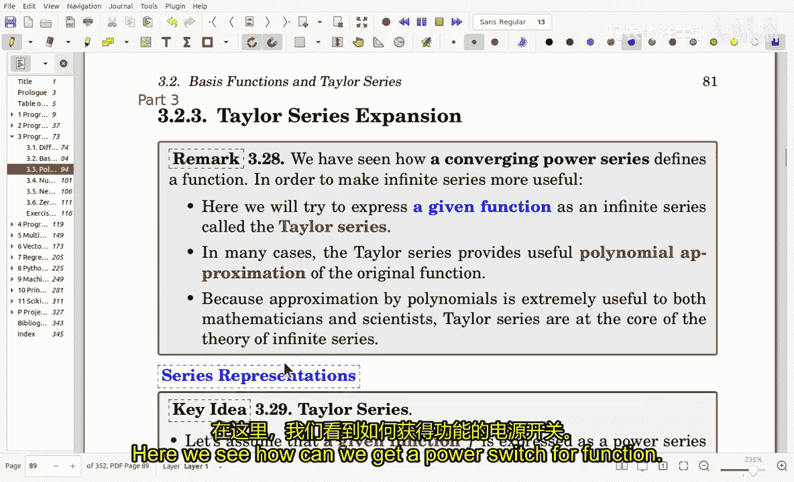

## 泰勒级数的定义与推导 🔍

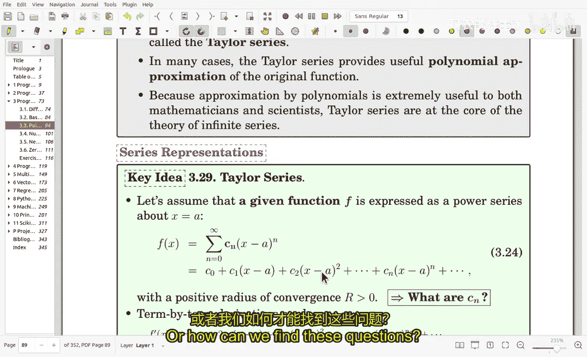

上一节我们介绍了收敛的幂级数可以定义一个函数。本节中，我们来看看如何将一个给定的函数表达为一个无穷级数，即泰勒级数。

如果一个幂级数被用来表示一个函数，那么这个幂级数就被称为该函数的泰勒级数。在许多情况下，泰勒级数为函数提供了有用的多项式近似。

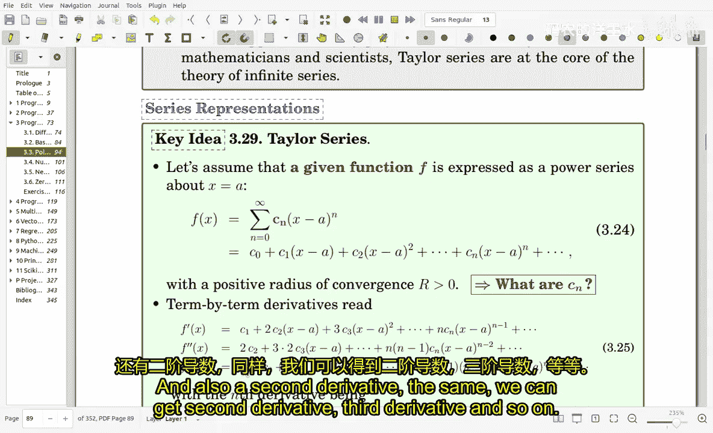

假设一个函数 **F(x)** 在 **x = a** 点附近可以表示为一个幂级数，且该级数的收敛半径大于零。那么我们可以将其写作：
```
F(x) = c₀ + c₁(x-a) + c₂(x-a)² + c₃(x-a)³ + ...
```
这里的问题是：系数 **cₙ** 是什么？我们如何找到它们？

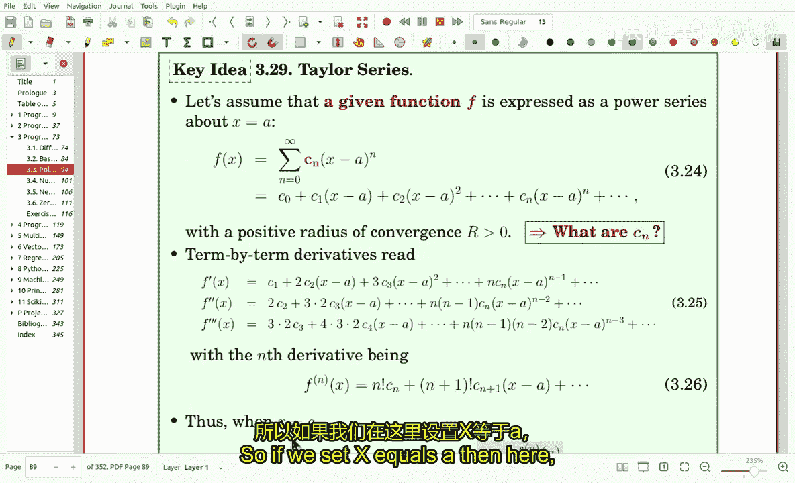

为了找到系数，我们对上述级数进行逐项求导。

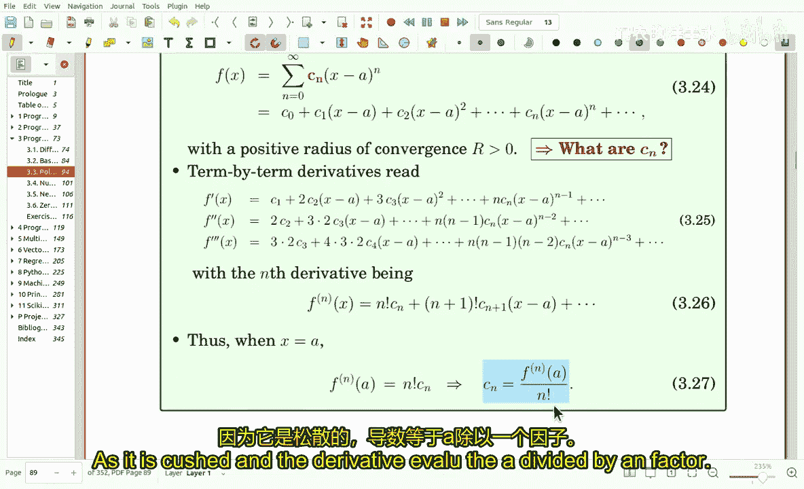

*   一阶导数：`F'(x) = c₁ + 2c₂(x-a) + 3c₃(x-a)² + ...`
*   二阶导数：`F''(x) = 2c₂ + 6c₃(x-a) + ...`
*   以此类推，第 **n** 阶导数为：`F⁽ⁿ⁾(x) = n! * cₙ + 包含 (x-a) 的项`

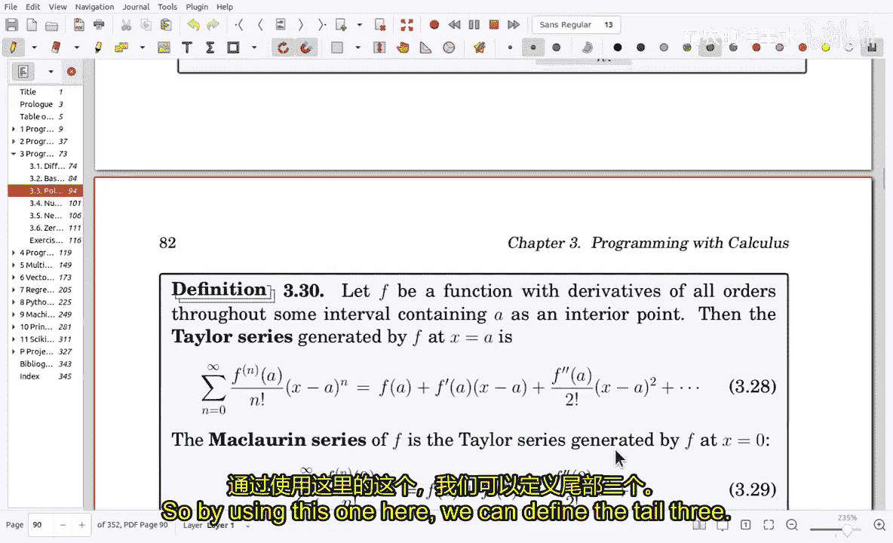

现在，我们令 **x = a**。此时，所有包含 **(x-a)** 的项都变为零。

于是我们得到：
*   `F(a) = c₀`
*   `F'(a) = 1! * c₁`
*   `F''(a) = 2! * c₂`
*   `F⁽ⁿ⁾(a) = n! * cₙ`

由此，我们可以解出系数 **cₙ**：
```
cₙ = F⁽ⁿ⁾(a) / n!
```

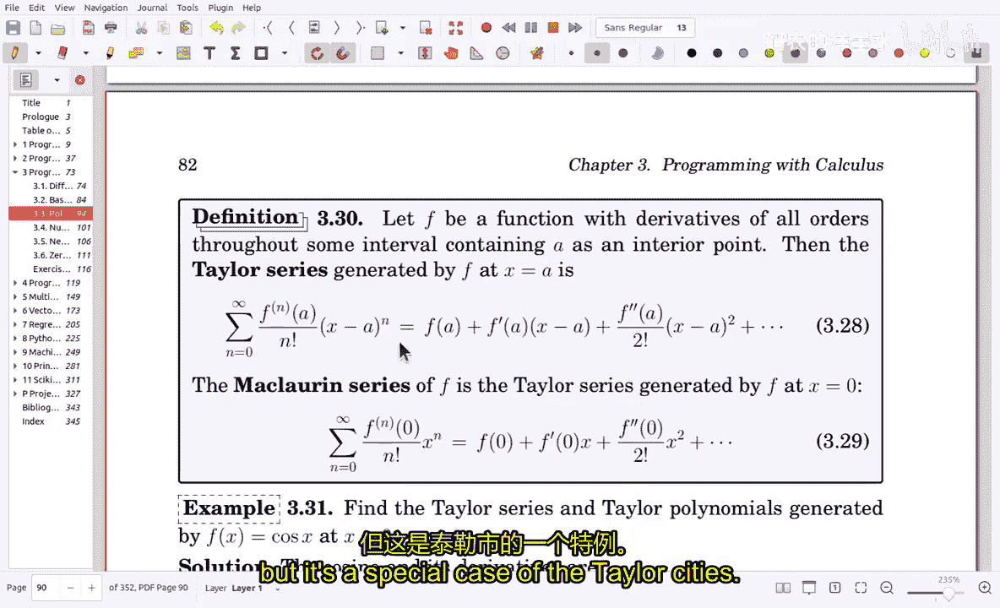

---

## 泰勒级数与麦克劳林级数 📐

基于上述推导，我们可以正式定义泰勒级数。

我们假设函数 **F** 在包含点 **a** 的某个区间内无限次可微。那么，**F** 在 **x = a** 处生成的泰勒级数由下式给出：
```
F(x) = Σ [n=0 to ∞] [ F⁽ⁿ⁾(a) / n! ] * (x - a)ⁿ
```
这是一个求和符号表示，实际上就是逐项写出：`F(a) + F'(a)(x-a) + [F''(a)/2!](x-a)² + ...`

当展开点 **a = 0** 时，这个特殊的泰勒级数被称为**麦克劳林级数**。它是泰勒级数的一个特例，在数学理论中非常常见。

---

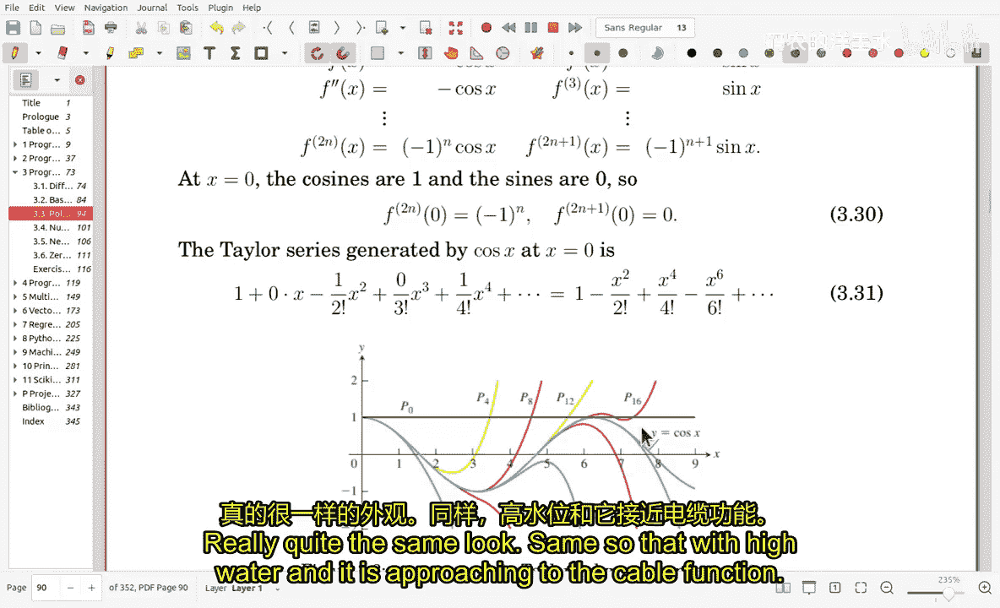

## 常见函数的泰勒级数示例 📚

以下是几个常见函数在 **x=0**（即麦克劳林级数）处的展开式：

*   **几何级数**：`1/(1-x) = 1 + x + x² + x³ + ...` （当 |x| < 1 时收敛）
*   **指数函数**：`eˣ = 1 + x + x²/2! + x³/3! + ...` （对所有 x 收敛）
*   **余弦函数**：`cos(x) = 1 - x²/2! + x⁴/4! - x⁶/6! + ...` （对所有 x 收敛）
*   **正弦函数**：`sin(x) = x - x³/3! + x⁵/5! - x⁷/7! + ...` （对所有 x 收敛）
*   **自然对数**：`ln(1+x) = x - x²/2 + x³/3 - x⁴/4 + ...` （当 -1 < x ≤ 1 时收敛）
*   **反正切函数**：`arctan(x) = x - x³/3 + x⁵/5 - x⁷/7 + ...` （当 |x| ≤ 1 时收敛）

上表中所示的收敛区间可以通过比值判别法等方法来验证。

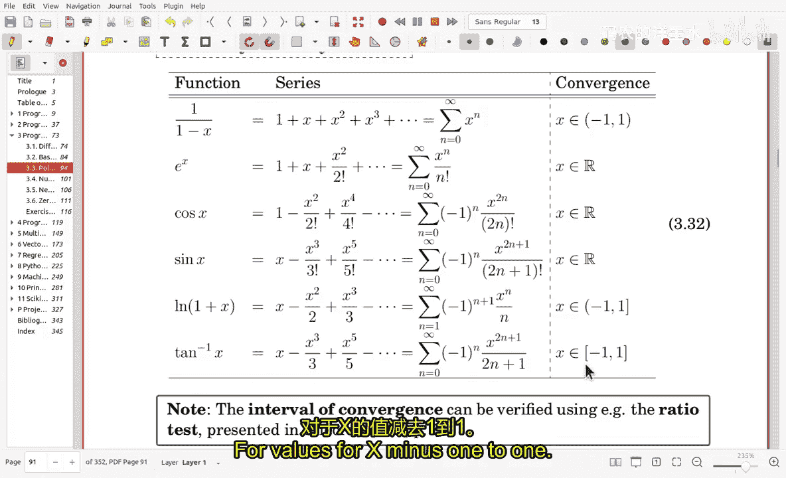

---

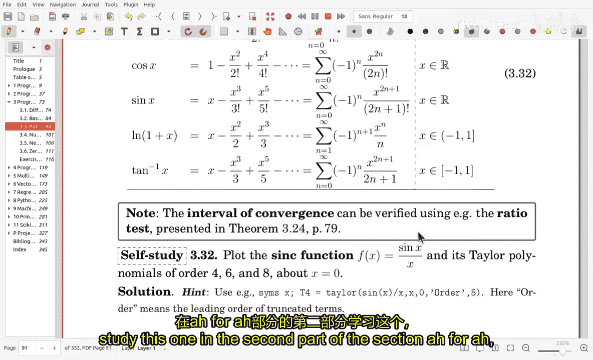

## 泰勒多项式与近似 💡

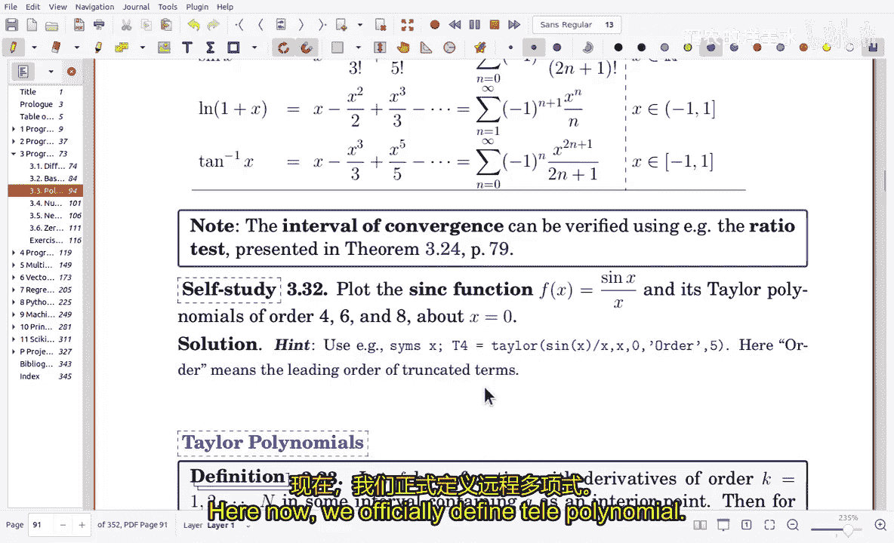

理解了无穷级数后，我们来看看如何用它进行实际计算。由于我们无法处理无穷项，因此需要截断级数，使用有限项的多项式来近似函数。

我们假设函数 **F** 在包含点 **a** 的区间内 **n** 次可微。那么，**F** 关于 **a** 的 **n** 阶泰勒多项式定义为泰勒级数的前 **n+1** 项（直到 **n** 次项）：
```
Pₙ(x) = F(a) + F'(a)(x-a) + [F''(a)/2!](x-a)² + ... + [F⁽ⁿ⁾(a)/n!](x-a)ⁿ
```
这个多项式必须是对原函数的一个良好近似。为了分析和验证近似的准确性，我们需要一个工具来估计截断后产生的误差。

---

## 误差分析：泰勒定理与拉格朗日余项 ⚖️

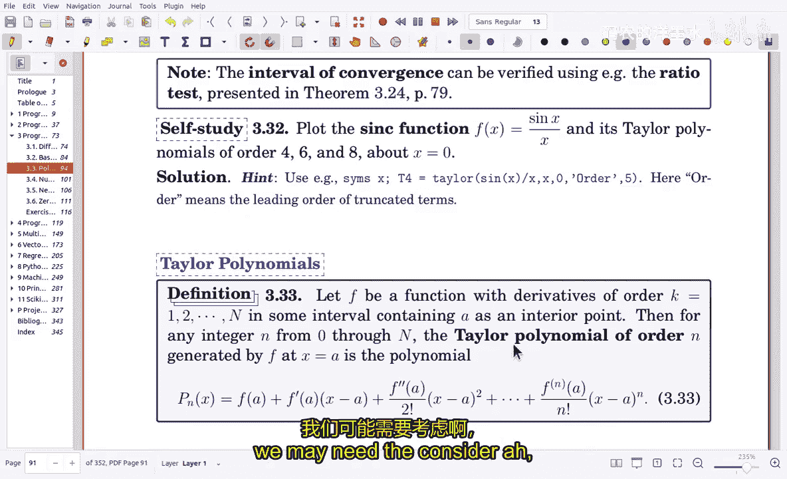

以下定理，即**带拉格朗日余项的泰勒定理**，是误差分析的核心。

假设函数 **F** 及其直到 **n+1** 阶的导数在区间内连续。那么，对于区间内的任意 **x**，有：
```
F(x) = Pₙ(x) + Rₙ(x)
```
其中，**Pₙ(x)** 是 **n** 阶泰勒多项式，而余项 **Rₙ(x)**（即误差）由拉格朗日形式给出：
```
Rₙ(x) = [ F⁽ⁿ⁺¹⁾(c) / (n+1)! ] * (x - a)ⁿ⁺¹
```
这里的 **c** 是介于 **a** 和 **x** 之间的某个数。

这个定理非常有用，因为它将无穷级数截断后的误差表达为一个单一的项。只要我们能够控制或估计这个余项的大小，就能确信泰勒多项式是原函数的一个良好近似。

---

## 应用实例：余弦函数的近似 📉

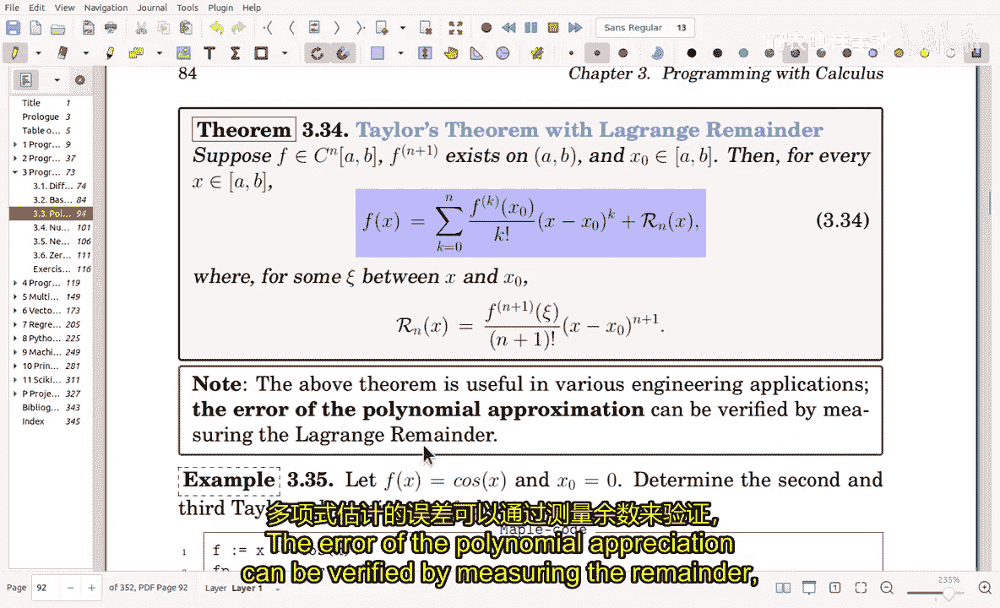

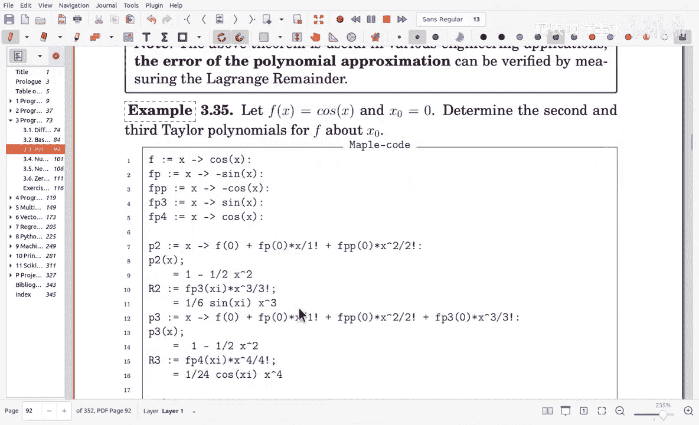

让我们以函数 **F(x) = cos(x)** 在 **x₀ = 0** 处为例，确定其二阶和三阶泰勒多项式。

首先计算各阶导数在0点的值：
*   `F(0) = cos(0) = 1`
*   `F'(0) = -sin(0) = 0`
*   `F''(0) = -cos(0) = -1`
*   `F'''(0) = sin(0) = 0`
*   `F⁽⁴⁾(0) = cos(0) = 1`

代入泰勒多项式公式：
*   **二阶泰勒多项式**：`P₂(x) = 1 + 0*x + (-1/2!)*x² = 1 - x²/2`
*   **三阶泰勒多项式**：由于余弦是偶函数，其三阶项系数为0，所以 `P₃(x) = 1 - x²/2`（与P₂相同）。

其误差（拉格朗日余项）可以表示为：
对于P₂，`R₂(x) = [ -sin(c) / 3! ] * x³` （实际上，由于余弦函数的对称性，更精确的余项应使用四阶导数）
更准确的余项（对于P₂，使用下一阶非零导数）为：`R₂(x) = [ cos(c) / 4! ] * x⁴`

当 **x** 很小时（即在零点附近），`cos(c)` 大约为1，误差项约为 `x⁴/24`。这是一个四阶小量，因此二阶多项式 `1 - x²/2` 在原点附近是对 `cos(x)` 的极好近似。从函数图像上也可以看到，在零点附近，这个二次多项式与余弦曲线贴合得非常紧密。

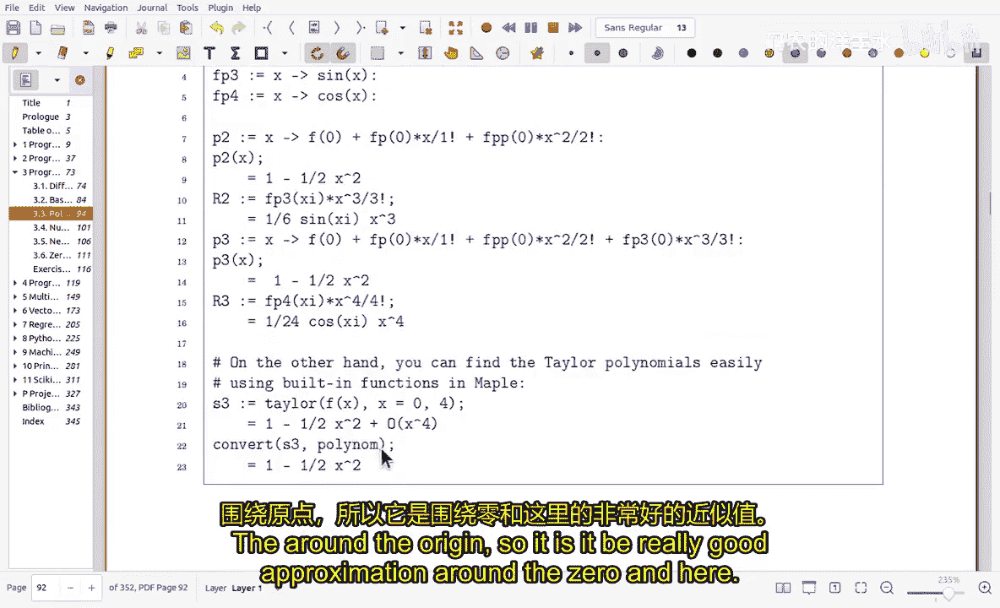

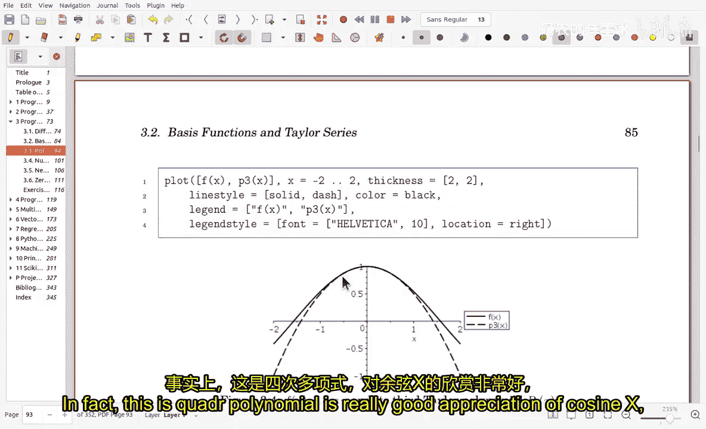

---

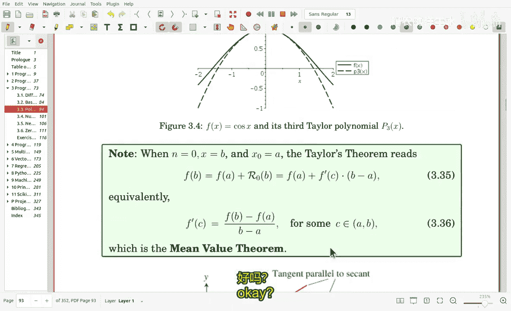

## 泰勒定理与中值定理的联系 🔗

最后，我们探讨泰勒定理的一个特例如何与微积分中的另一个重要定理相联系。

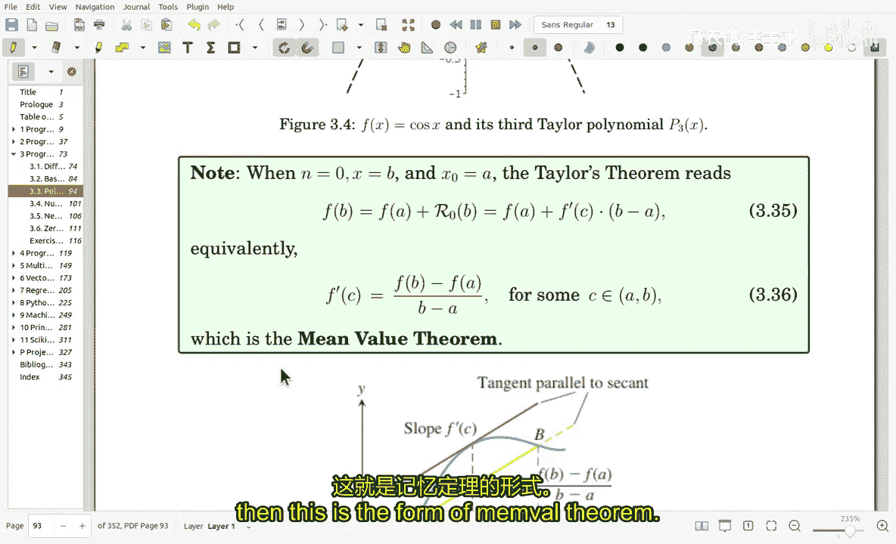

考虑泰勒定理中令 **n = 0** 的情况。此时，定理表述为：存在介于 **a** 和 **b** 之间的某个 **c**，使得
```
F(b) = F(a) + F'(c) * (b - a)
```
将这个等式重写一下：
```
F'(c) = [ F(b) - F(a) ] / (b - a)
```
仔细观察这个等式：右边是函数在区间 **[a, b]** 上的平均变化率（斜率），而左边是函数在某一点 **c** 的瞬时变化率（导数）。这正是**微分中值定理**的表述。

其几何意义是：对于可微函数，在区间内至少存在一点，使得该点的切线斜率等于区间两端点连线的斜率。这揭示了泰勒定理（即使是零阶情形）蕴含着深刻的几何直观。

---

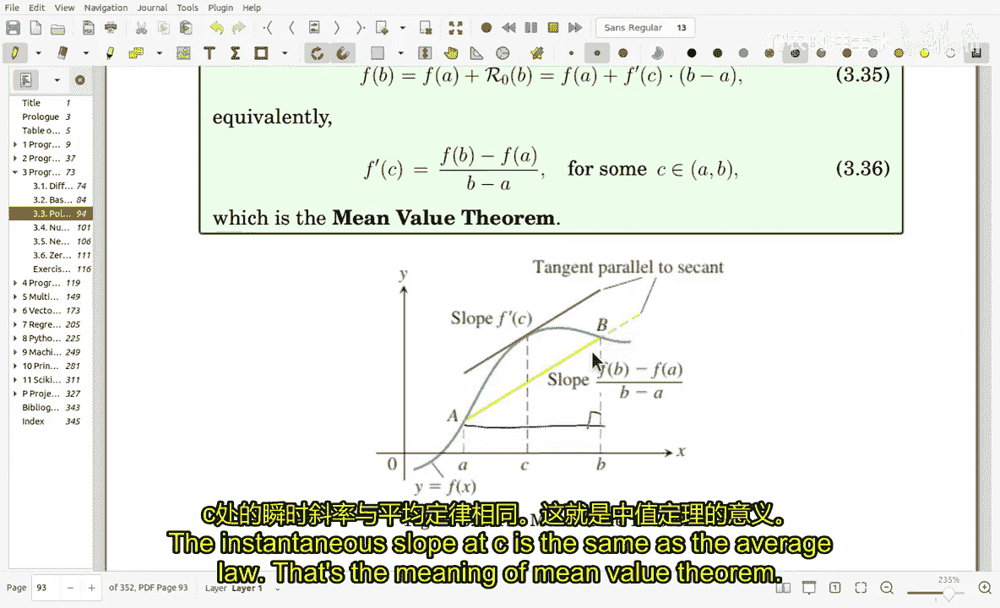

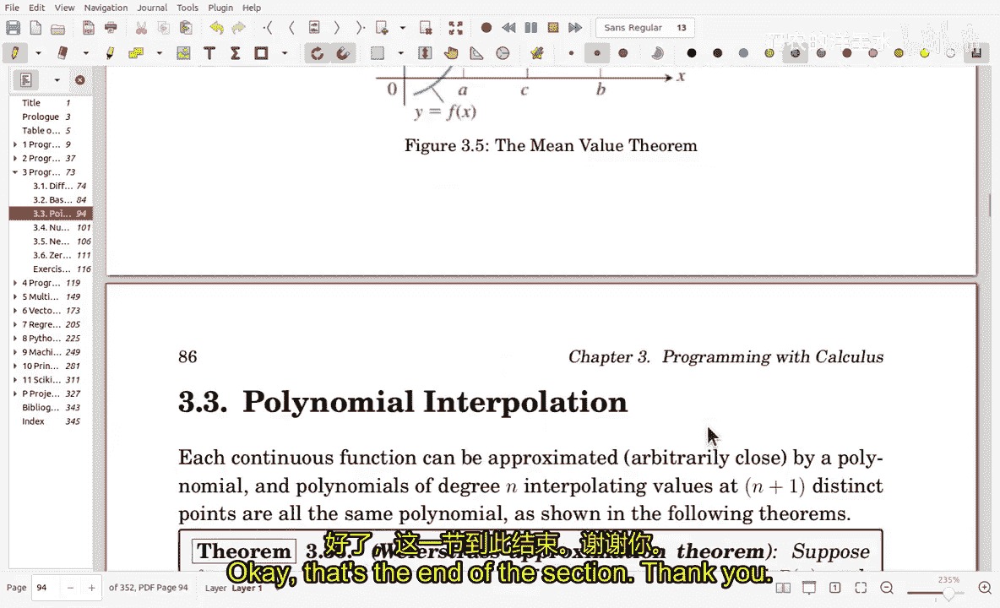

本节课中，我们一起学习了泰勒级数的核心思想：如何用无穷多项式级数精确表示一个函数，以及如何用有限项的泰勒多项式来近似函数。我们掌握了泰勒级数和麦克劳林级数的定义与推导方法，认识了几个常见函数的展开式，并学习了通过带拉格朗日余项的泰勒定理来分析近似误差。最后，我们还看到了泰勒定理与微分中值定理之间的深刻联系。泰勒级数是连接离散多项式与连续函数的有力桥梁，在数学、物理和工程领域有着广泛的应用。