# 023：Lecture 23 - 多项式插值拉格朗日形式

## 概述
在本节课中，我们将要学习多项式插值，特别是其拉格朗日形式。我们将了解如何通过一组给定的数据点构造一个多项式，并学习相关的核心定理和构造方法。

---

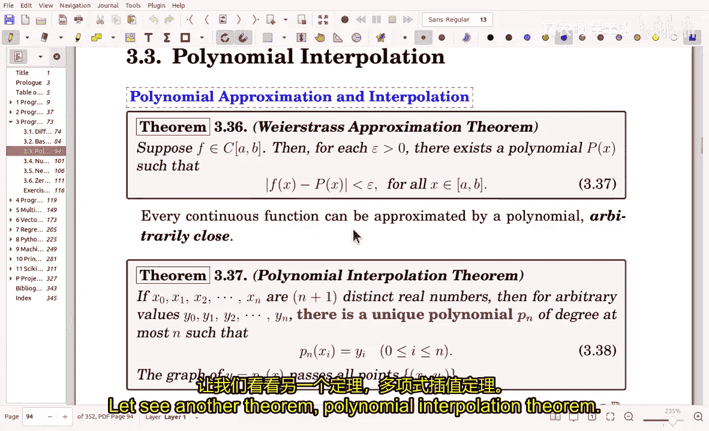

## 3.3 多项式插值

### 维尔斯特拉斯逼近定理
假设函数 **f** 在区间 **[a, b]** 上连续（记作 **f ∈ C[a, b]**）。那么，对于任意给定的正数 **ε**，都存在一个多项式 **P**，使得对于区间内所有的 **x**，函数 **f** 与多项式 **P** 的差值都小于 **ε**。

**公式表示：**
对于任意 **ε > 0**，存在多项式 **P**，使得：
**|f(x) - P(x)| < ε**， 对所有 **x ∈ [a, b]** 成立。

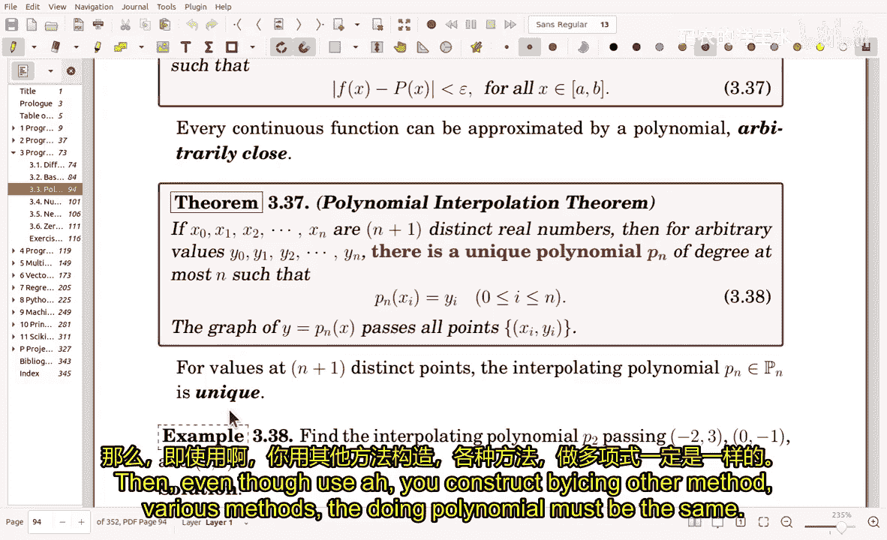

这个定理意味着，任何连续函数都可以用一个多项式来任意精确地逼近。

---

### 多项式插值定理
设 **x₀, x₁, ..., xₙ** 是 **n+1** 个互不相同的实数。那么，对于任意给定的一组值 **y₀, y₁, ..., yₙ**，都存在一个唯一的多项式 **Pₙ**，其次数最多为 **n**，并且满足 **Pₙ(xᵢ) = yᵢ** 对所有 **i** 成立。

**公式表示：**
给定 **n+1** 个点 **(xᵢ, yᵢ)**，存在唯一的次数 ≤ **n** 的多项式 **Pₙ(x)**，使得：
**Pₙ(xᵢ) = yᵢ**， **i = 0, 1, ..., n**。

该定理的核心思想是：对于给定的 **n+1** 个点，满足条件的插值多项式是唯一的。无论你用何种方法构造，最终得到的多项式都是同一个。

---

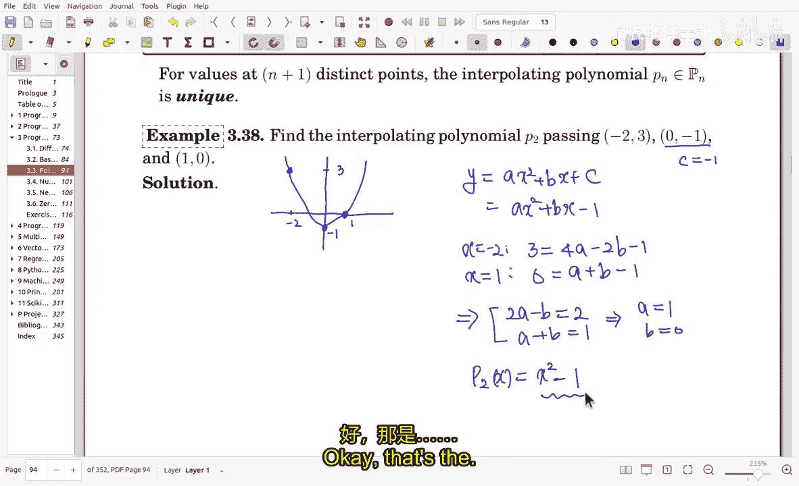

## 一个插值多项式的例子
上一节我们介绍了插值定理，本节中我们通过一个具体例子来看看如何构造插值多项式。

**问题：** 求一个通过以下三个点的二次插值多项式 **P₂(x)**：
点1: (-2, 3)
点2: (0, -1)
点3: (1, 0)

**解法：**
我们设二次多项式为一般形式：**P₂(x) = ax² + bx + c**。

1.  将点 (0, -1) 代入：
    **P₂(0) = a*0 + b*0 + c = -1** → **c = -1**。
2.  将点 (-2, 3) 和 (1, 0) 代入：
    *   **P₂(-2) = a*4 + b*(-2) - 1 = 3** → **4a - 2b = 4** → **2a - b = 2**。
    *   **P₂(1) = a*1 + b*1 - 1 = 0** → **a + b = 1**。
3.  解方程组：
    **2a - b = 2**
    **a + b = 1**
    两式相加得：**3a = 3** → **a = 1**。
    代入得：**1 + b = 1** → **b = 0**。

因此，所求的插值多项式为：
**P₂(x) = x² - 1**。

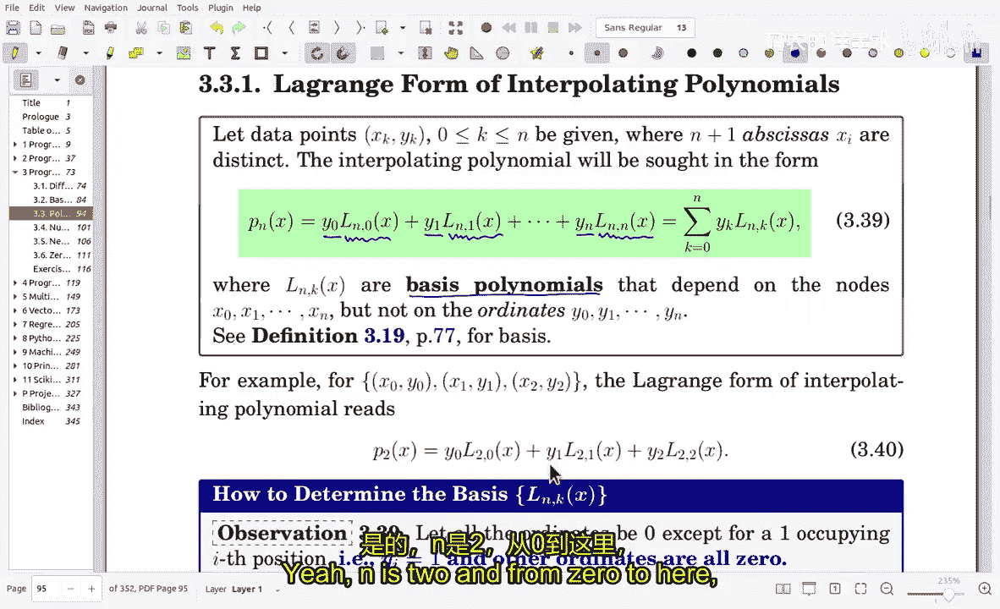

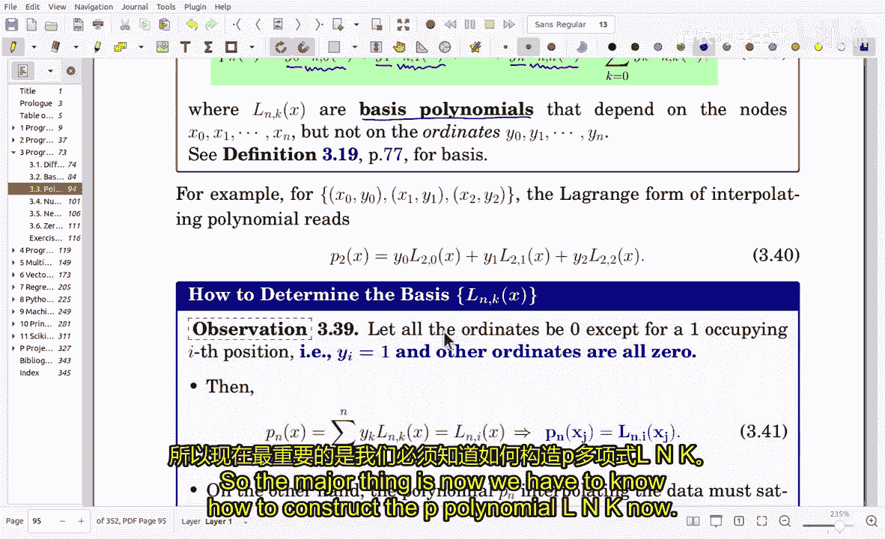

---

## 拉格朗日形式的插值多项式
在众多插值多项式的表达形式中，拉格朗日形式是最流行的一种。它提供了一种系统化的构造方法。

假设我们给定 **n+1** 个数据点 **(xₖ, yₖ)**，其中 **k = 0, 1, ..., n**，且所有的 **x** 值互不相同。

拉格朗日插值多项式寻求以下形式：
**Pₙ(x) = y₀ * Lₙ₀(x) + y₁ * Lₙ₁(x) + ... + yₙ * Lₙₙ(x) = Σ [yₖ * Lₙₖ(x)]**，求和从 **k=0** 到 **n**。

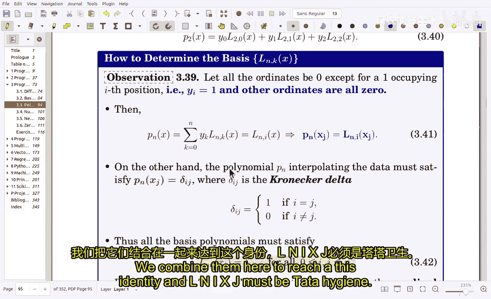

这里，**Lₙₖ(x)** 是一组依赖于节点 **x₀, x₁, ..., xₙ** 的多项式，称为**基函数**或**拉格朗日基多项式**。

例如，对于 **n=2**（三个点），拉格朗日形式为：
**P₂(x) = y₀ * L₂₀(x) + y₁ * L₂₁(x) + y₂ * L₂₂(x)**。

---

### 如何构造拉格朗日基多项式 **Lₙₖ(x)**
为了理解如何构造 **Lₙₖ(x)**，我们从一种特殊情况开始考虑。

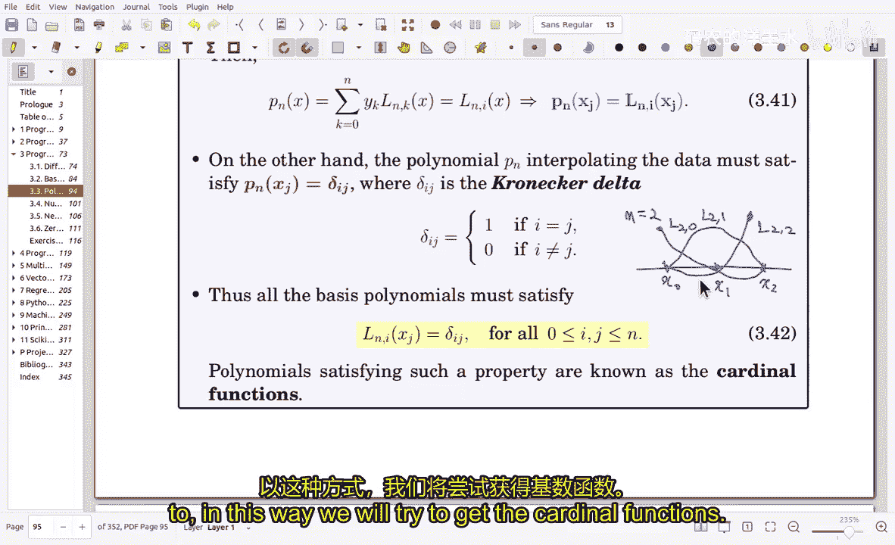

假设所有 **y** 值中，只有 **yᵢ = 1**，而其他所有的 **y** 值都为 **0**。那么，根据拉格朗日形式，多项式简化为：
**Pₙ(x) = Lₙᵢ(x)**。

另一方面，这个插值多项式必须满足数据点的条件：在 **xⱼ** 处，其值必须等于 **yⱼ**。这意味着：
*   当 **j = i** 时，**Pₙ(xᵢ) = Lₙᵢ(xᵢ) = 1**。
*   当 **j ≠ i** 时，**Pₙ(xⱼ) = Lₙᵢ(xⱼ) = 0**。

用克罗内克δ函数表示就是：**Lₙᵢ(xⱼ) = δᵢⱼ**。
满足这种性质的多项式 **Lₙᵢ(x)** 被称为**基数函数**。

**基数函数的图像特征：**
以 **n=2** 为例，有三个点 **x₀, x₁, x₂**。
*   **L₂₀(x)** 在 **x₀** 处值为1，在 **x₁** 和 **x₂** 处值为0。其图像是一个在 **x₁, x₂** 处与x轴相交的二次曲线，在 **x₀** 处达到峰值1。
*   **L₂₁(x)** 和 **L₂₂(x)** 具有类似的性质，分别在 **x₁** 和 **x₂** 处为1，在其他节点处为0。

---

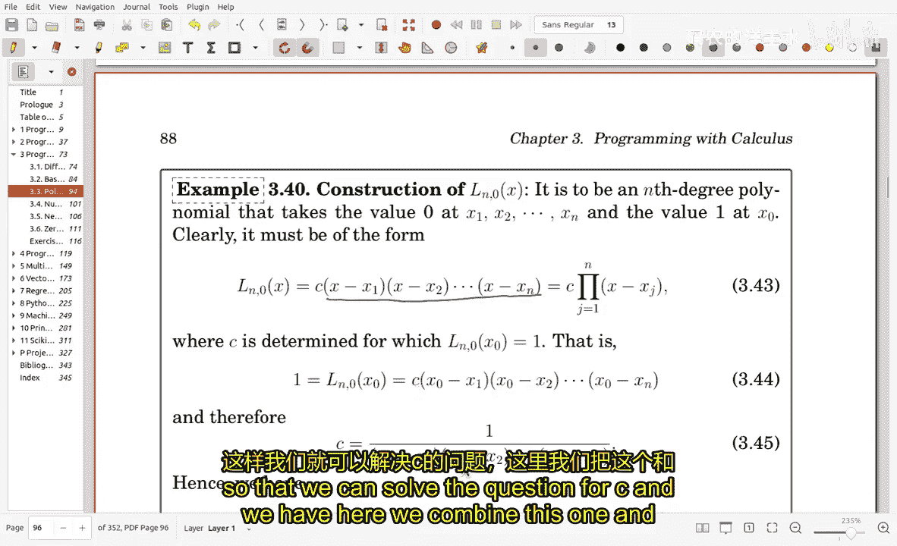

### 基数函数的构造公式
现在，我们来看如何用公式构造这些基数函数。我们以构造 **Lₙ₀(x)** 为例。

**目标：** **Lₙ₀(x₀) = 1**，且对于 **j = 1, 2, ..., n**，有 **Lₙ₀(xⱼ) = 0**。

1.  为了在 **x₁, x₂, ..., xₙ** 处函数值为0，**Lₙ₀(x)** 必须包含因子 **(x - x₁)(x - x₂)...(x - xₙ)**。
2.  因此，我们可以设 **Lₙ₀(x) = C * (x - x₁)(x - x₂)...(x - xₙ)**，其中 **C** 是待定常数。
3.  利用条件 **Lₙ₀(x₀) = 1** 来求解 **C**：
    **1 = C * (x₀ - x₁)(x₀ - x₂)...(x₀ - xₙ)**。
    由于所有 **x** 互异，分母不为零，解得：
    **C = 1 / [(x₀ - x₁)(x₀ - x₂)...(x₀ - xₙ)]**。
4.  因此，**Lₙ₀(x)** 的最终形式为：
    **Lₙ₀(x) = [(x - x₁)(x - x₂)...(x - xₙ)] / [(x₀ - x₁)(x₀ - x₂)...(x₀ - xₙ)]**。

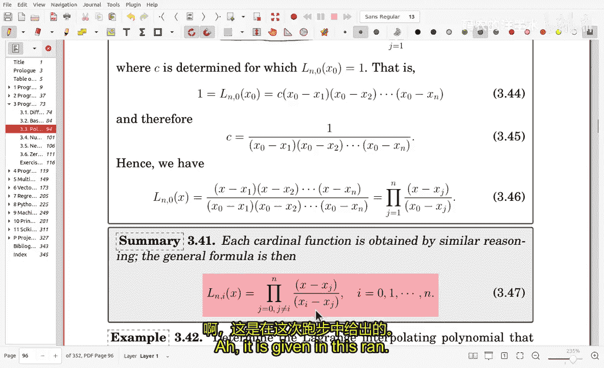

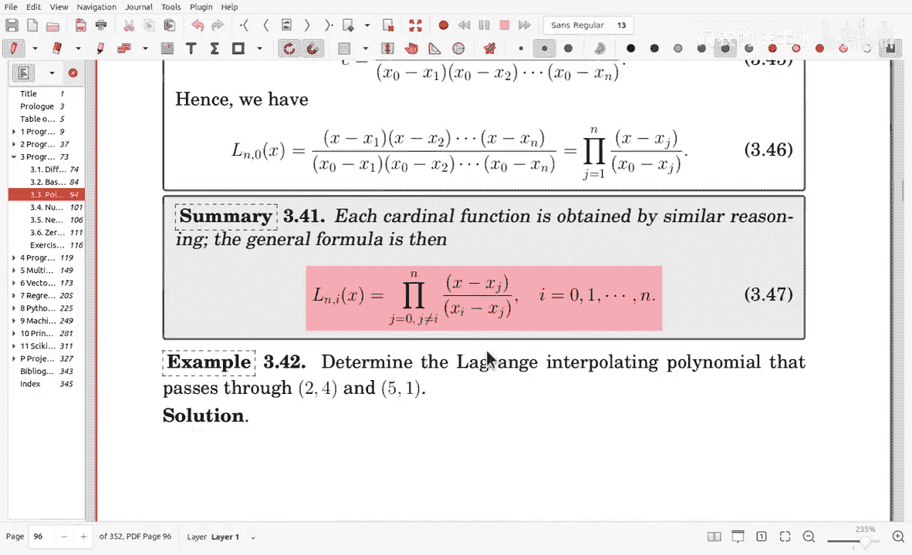

推广到一般的 **Lₙᵢ(x)**，其构造公式为：

**Lₙᵢ(x) = Π [(x - xⱼ) / (xᵢ - xⱼ)]**，连乘符号 **Π** 对 **j = 0 到 n** 进行，但 **j ≠ i**。

**公式解读：**
*   **分子：** 是 **(x - xⱼ)** 对所有 **j ≠ i** 的连乘。这确保了在除 **xᵢ** 外的所有节点处，函数值为0。
*   **分母：** 是 **(xᵢ - xⱼ)** 对所有 **j ≠ i** 的连乘。这是一个常数，用于确保在 **x = xᵢ** 时，函数值恰好为1。

---

## 应用示例
理解了构造原理后，我们通过两个例子来实践拉格朗日插值法的应用。

### 示例1：线性插值
**问题：** 确定通过点 **(2, 4)** 和 **(5, 1)** 的拉格朗日插值多项式。

**解答：**
这里 **n=1**，有两个点：**(x₀, y₀) = (2, 4)**， **(x₁, y₁) = (5, 1)**。

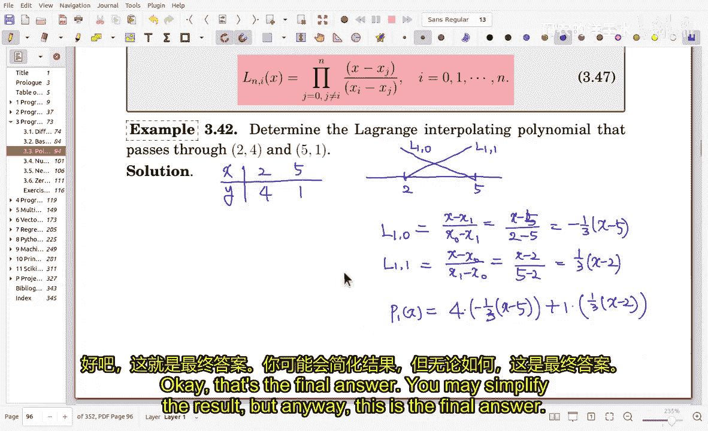

首先构造基数函数：
*   **L₁₀(x) = (x - x₁) / (x₀ - x₁) = (x - 5) / (2 - 5) = -(x - 5)/3**
*   **L₁₁(x) = (x - x₀) / (x₁ - x₀) = (x - 2) / (5 - 2) = (x - 2)/3**

然后，拉格朗日插值多项式为：
**P₁(x) = y₀ * L₁₀(x) + y₁ * L₁₁(x) = 4 * [-(x - 5)/3] + 1 * [(x - 2)/3]**
简化后可得最终表达式。

---

### 示例2：二次插值
**问题：** 对于函数 **f(x) = 1/x**，使用节点 **x₀=2, x₁=4, x₂=5** 构造二次拉格朗日插值多项式 **P₂(x)**。

**解答：**
首先根据 **f(x)** 计算对应的 **y** 值：
*   **y₀ = f(2) = 1/2**
*   **y₁ = f(4) = 1/4**
*   **y₂ = f(5) = 1/5**

接着，构造三个二次基数函数 **L₂₀(x), L₂₁(x), L₂₂(x)**。以 **L₂₀(x)** 为例：
**L₂₀(x) = [(x - x₁)(x - x₂)] / [(x₀ - x₁)(x₀ - x₂)] = [(x - 4)(x - 5)] / [(2 - 4)(2 - 5)] = [(x - 4)(x - 5)] / 6**

类似地，可以构造出 **L₂₁(x)** 和 **L₂₂(x)**。

最后，插值多项式为：
**P₂(x) = y₀ * L₂₀(x) + y₁ * L₂₁(x) + y₂ * L₂₂(x) = (1/2)*L₂₀(x) + (1/4)*L₂₁(x) + (1/5)*L₂₂(x)**

将各个基数函数的表达式代入并化简，即可得到 **P₂(x)** 的最终形式。

---

## 使用计算机程序实现
对于更复杂或更高阶的插值问题，我们可以借助计算机程序。虽然MATLAB可以处理，但Python因其灵活性（特别是使用`sympy`等符号计算库）而更受欢迎。

以下是一个用Python实现拉格朗日插值的示例代码框架：

```python
def lagrange_interpolation(x_values, y_values):
    """
    计算拉格朗日插值多项式。
    参数:
        x_values: 节点x的列表
        y_values: 对应节点y的列表
    返回:
        插值多项式（符号表达式）
    """
    n = len(x_values)
    polynomial = 0
    for i in range(n):
        # 构造基数函数 L_i(x)
        basis = 1
        for j in range(n):
            if j != i:
                basis *= (x - x_values[j]) / (x_values[i] - x_values[j])
        # 将该项加到多项式上
        polynomial += y_values[i] * basis
    return polynomial

# 示例：使用点 (2, 1/2), (4, 1/4), (5, 1/5)
x_vals = [2, 4, 5]
y_vals = [1/2, 1/4, 1/5]
P2 = lagrange_interpolation(x_vals, y_vals)
print("拉格朗日插值多项式 P2(x):")
print(P2)
print("简化后:")
print(simplify(P2))
```

这段代码的核心逻辑完全遵循拉格朗日公式：外层循环遍历每个数据点以构造对应的项 **yᵢ * Lₙᵢ(x)**，内层循环则用于计算每个基数函数 **Lₙᵢ(x)**。运行程序后，会输出原始表达式和简化后的结果。一旦实现，这个函数就可以方便地用于各种插值计算。

---

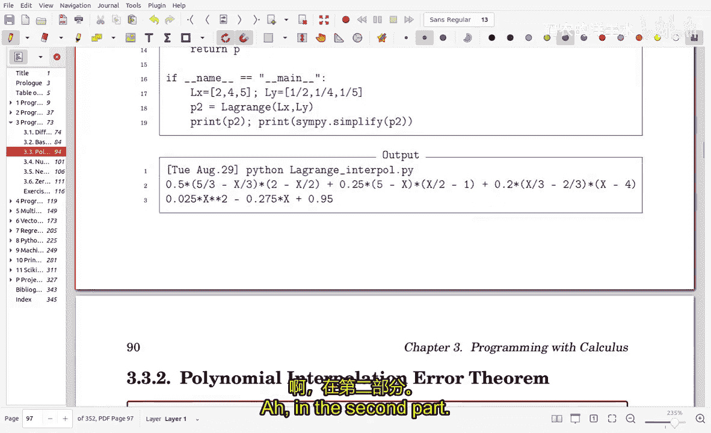

## 总结
本节课中我们一起学习了多项式插值的核心内容。我们首先了解了维尔斯特拉斯逼近定理和多项式插值唯一性定理。然后，重点学习了插值多项式的拉格朗日形式，包括其思想、基数函数的构造原理与公式。通过具体示例，我们实践了线性与二次拉格朗日插值多项式的求解过程。最后，我们还探讨了如何使用Python编程来实现这一算法，以处理更实际的问题。拉格朗日插值法提供了一种直观且系统的方法，通过一组基函数的线性组合来精确穿过所有给定数据点。