# 024：多项式插值误差定理（第二部分）📊

在本节课中，我们将要学习多项式插值误差定理。上一节我们介绍了多项式插值并构建了拉格朗日形式的插值多项式。本节中，我们来看看一个核心问题：插值多项式 `P_N` 在近似函数 `f` 时，其误差是多少？我们将通过误差定理来回答这个问题。

## 多项式插值误差定理

**定理**：设函数 `f` 在区间 `[a, b]` 上连续且 `M+1` 次可微。设 `P_N` 是函数 `f` 在 `[a, b]` 区间内 `N+1` 个互异点 `x_0, ..., x_N` 上的插值多项式。那么，对于区间内的每一个 `x`，都存在一个依赖于 `x` 的数 `ξ(x)`，使得插值误差由以下公式给出：

```
f(x) - P_N(x) = [f^{(N+1)}(ξ(x)) / (N+1)!] * Π_{i=0}^{N} (x - x_i)
```

这个定理可以与泰勒定理进行比较。在泰勒定理中，拉格朗日余项包含 `(x-a)^{N+1}` 项。而在插值误差公式中，我们看到的是一系列 `(x - x_i)` 的乘积。当这个乘积项的和很小时，多项式就能很好地近似原函数。

## 示例分析：近似 sin(x)

让我们通过一个具体例子来理解误差估计。考虑函数 `f(x) = sin(x)`，我们将在区间 `[-1, 1]` 上用5次多项式（即 `N=5`，需要6个插值点）来近似它。

我们选择等间距的6个点：`x_i = -1, -0.6, -0.2, 0.2, 0.6, 1`。每个子区间的长度 `h = 0.4`。

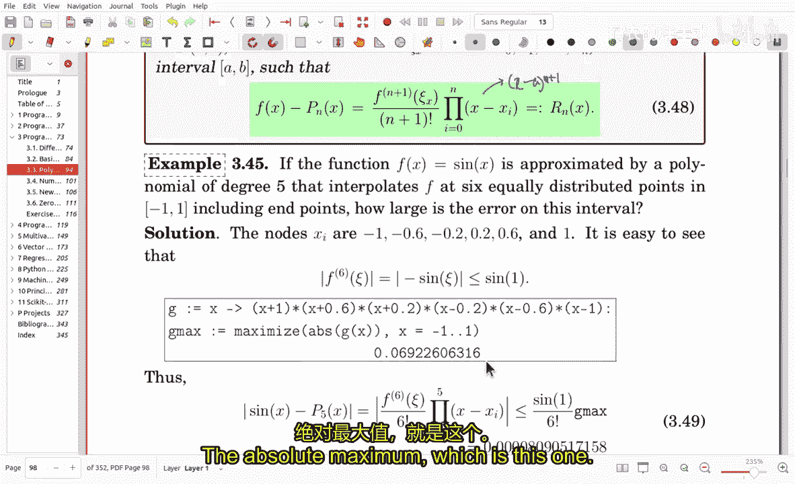

为了测量最大可能误差，我们应用误差定理。这里 `N=5`，所以我们需要 `sin(x)` 的6阶导数。由于 `sin(x)` 的任意阶导数的绝对值不超过1，我们可以设 `M = max|f^{(6)}(ξ)| = 1`。

接着，我们计算乘积项 `Π (x - x_i)` 在区间 `[-1, 1]` 上的绝对最大值。通过计算（例如使用MATLAB或Python），可以求得这个最大值为 `G_max ≈ 0.0170`。

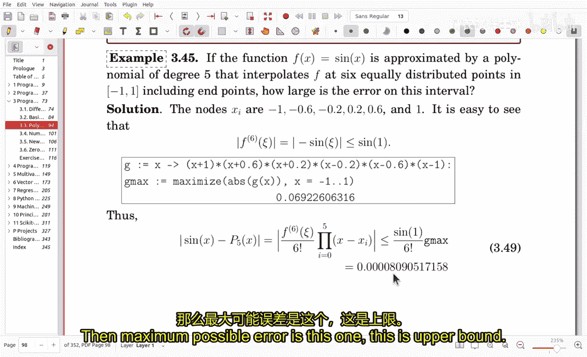

因此，误差的上界为：
```
|f(x) - P_5(x)| ≤ (1 / 6!) * G_max ≈ (1/720) * 0.0170 ≈ 2.36e-5
```
这表明，用5次插值多项式在给定点上近似 `sin(x)`，最大误差大约为 `2.36 × 10^{-5}`，近似效果相当好。

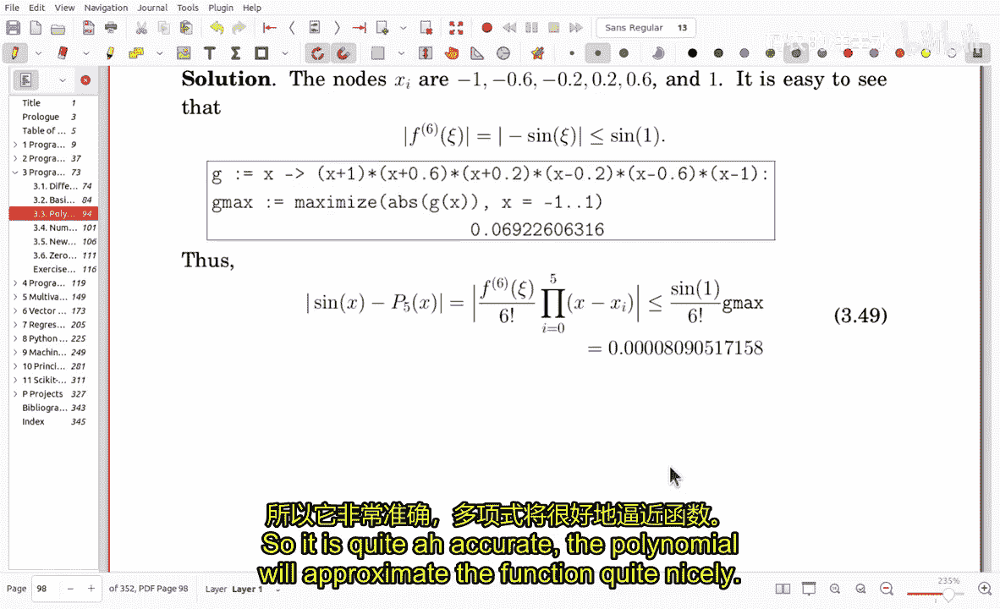

## 等距节点下的误差定理

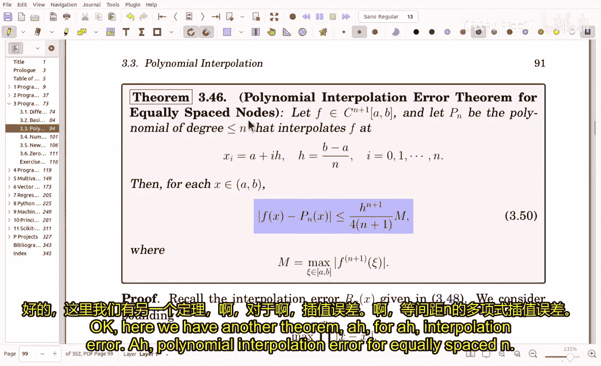

当插值节点在区间 `[a, b]` 上**等距分布**时，误差估计有一个更简便的形式。

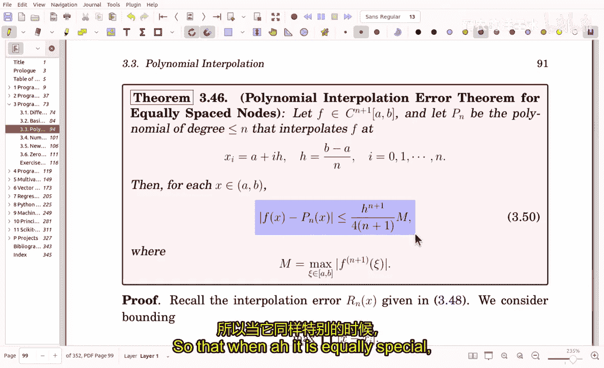

**定理（等距节点）**：设节点 `x_i = a + i*h`，其中 `i=0,...,N`，步长 `h = (b-a)/N`。那么插值误差满足以下上界：

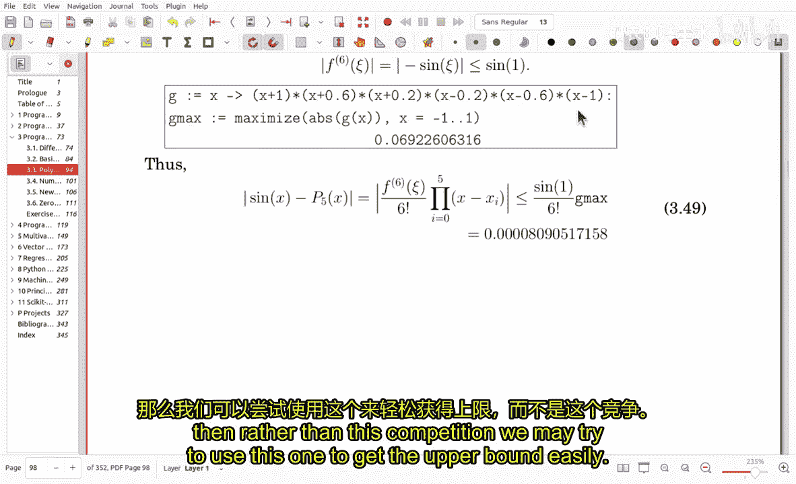

```
|f(x) - P_N(x)| ≤ (M / 4(N+1)) * (h^{N+1} / N^N)
```
其中，`M` 是函数 `f` 的 `N+1` 阶导数在区间 `[a, b]` 上的绝对值的最大值，即 `M = max_{ξ∈[a,b]} |f^{(N+1)}(ξ)|`。

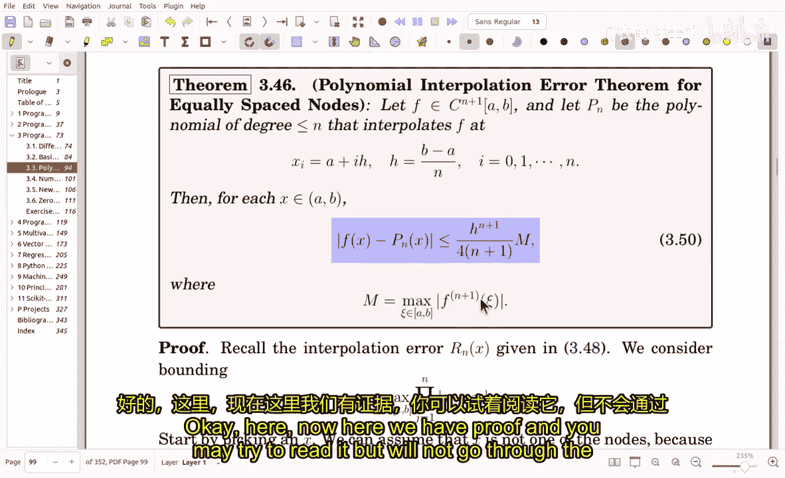

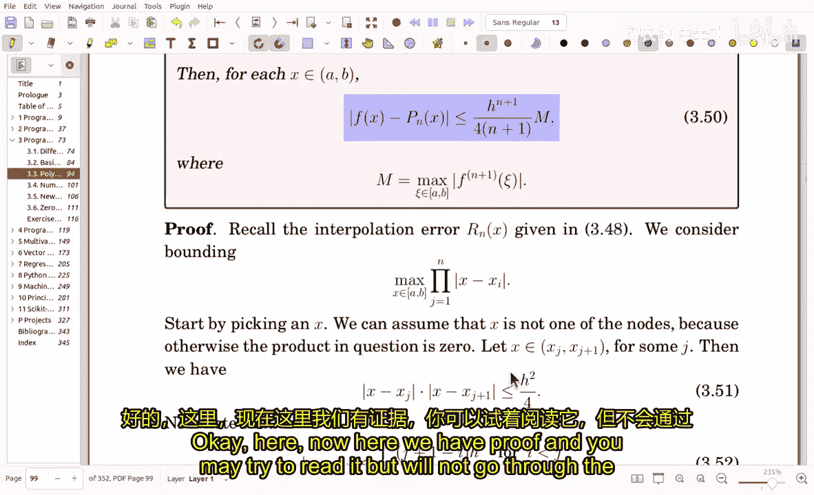

这个公式的证明过程较为复杂，此处不展开，但它的优点是在等距情况下能更方便地估算误差上界。

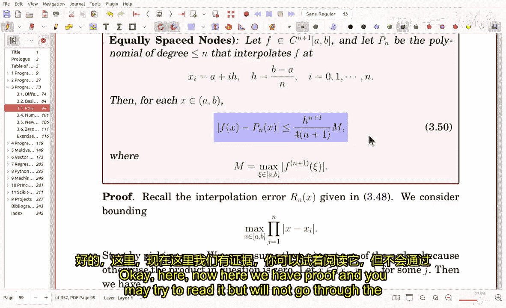

## 等距节点示例：再探 sin(x)

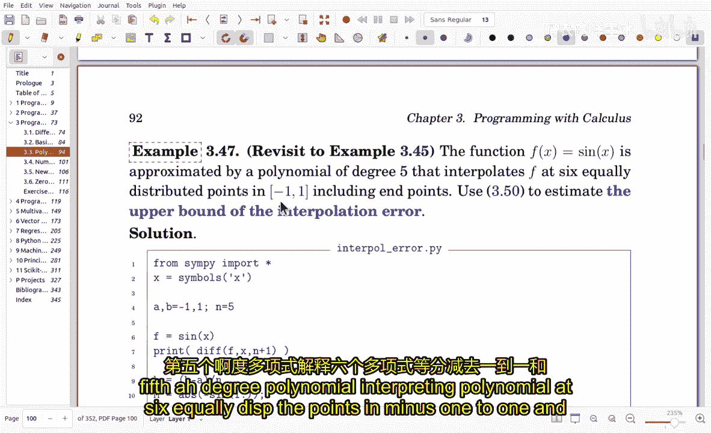

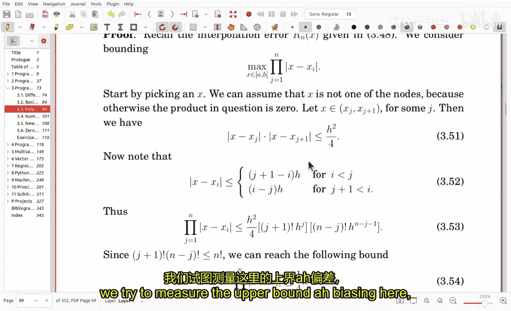

我们再次使用函数 `f(x) = sin(x)`，在区间 `[-1, 1]` 上用6个等距分布的点进行5次多项式插值。


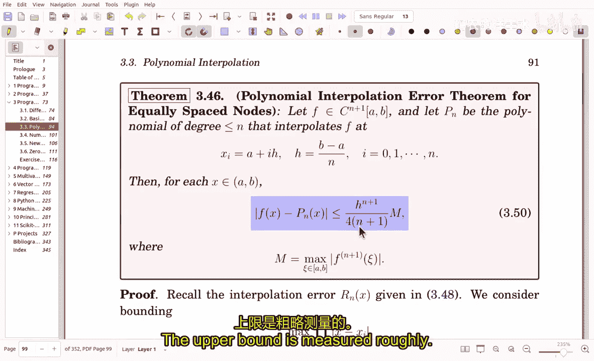

此时，步长 `h = (1 - (-1)) / 5 = 0.4`。`sin(x)` 的6阶导数的最大值 `M` 仍为1。将数值代入等距节点误差公式：

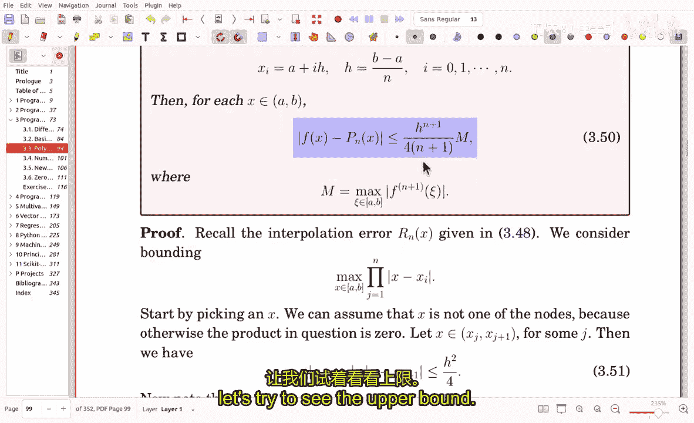

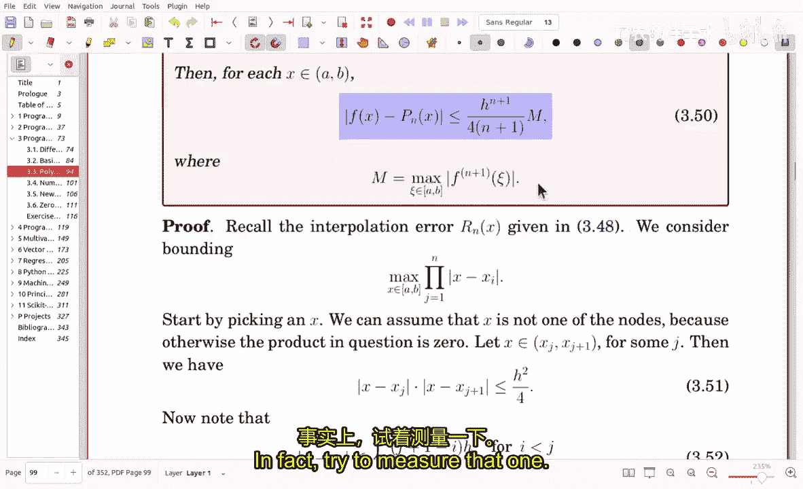

```
误差上界 ≤ (1 / 4*(5+1)) * (0.4^{6} / 5^{5})
```
通过Python计算可得：
```python
import math
h = 0.4
N = 5
M = 1
upper_bound = (M / (4*(N+1))) * (h**(N+1) / (N**N))
print(upper_bound) # 输出约为 1.4e-4
```
计算得到的误差上界约为 `1.4 × 10^{-4}`。

这个值比之前通过通用定理计算出的精确上界（`2.36e-5`）要大。这是因为等距节点公式给出的是一个更宽松但计算更方便的上界。它保证了实际误差绝不会超过这个值，虽然可能没有通用公式给出的界限那么紧。

## 总结

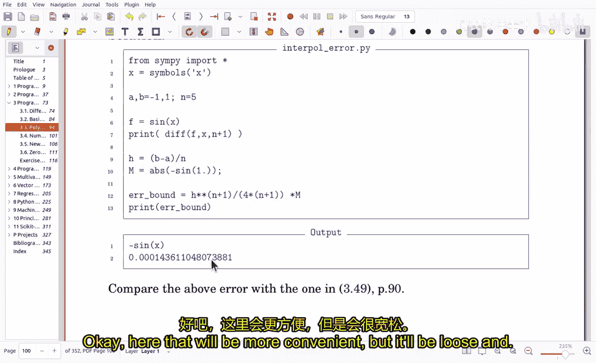

本节课中我们一起学习了多项式插值误差定理。
*   我们首先介绍了**通用的多项式插值误差公式**，它给出了插值多项式与原函数之间差异的精确表达式。
*   然后，我们通过近似 `sin(x)` 的例子演示了如何利用该定理计算误差的**理论上界**。
*   接着，我们介绍了在**节点等距分布**这一特殊情况下，一个更简便的误差上界公式。
*   最后，我们比较了两种方法在同一个例子中的应用，指出等距节点公式虽然方便，但给出的上界可能更宽松。

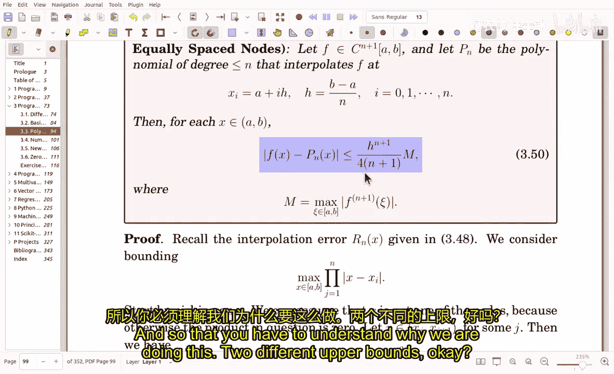


理解这些误差估计方法，有助于我们在使用多项式插值时，对近似的精度有一个量化的认识，并能在便利性与精确性之间做出权衡。