# 025：第25讲 - 数值微分与有限差分公式 🧮

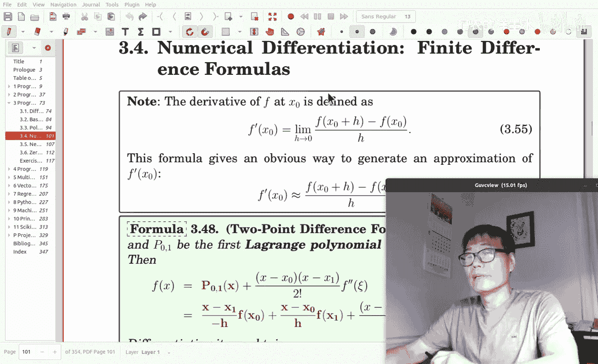

在本节课中，我们将学习数值微分的基本概念，特别是如何使用有限差分公式来近似计算函数的导数。我们将从最简单的两点公式开始，逐步扩展到更高阶的多点公式，并分析它们的精度。

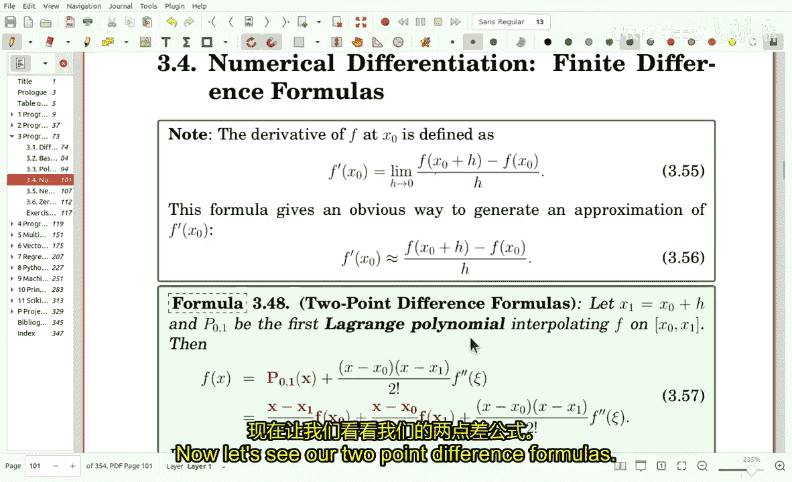

## 概述 📋

数值微分是计算函数导数近似值的一种方法，当无法或难以获得解析导数时非常有用。其核心思想是利用函数在一些离散点上的值来构造导数的近似。本节将介绍基于多项式插值的有限差分公式。

## 两点有限差分公式

上一节我们介绍了数值微分的基本定义。本节中我们来看看如何利用两个点来构造导数的近似公式。

函数 `F` 在点 `X0` 处的导数定义为以下极限公式：

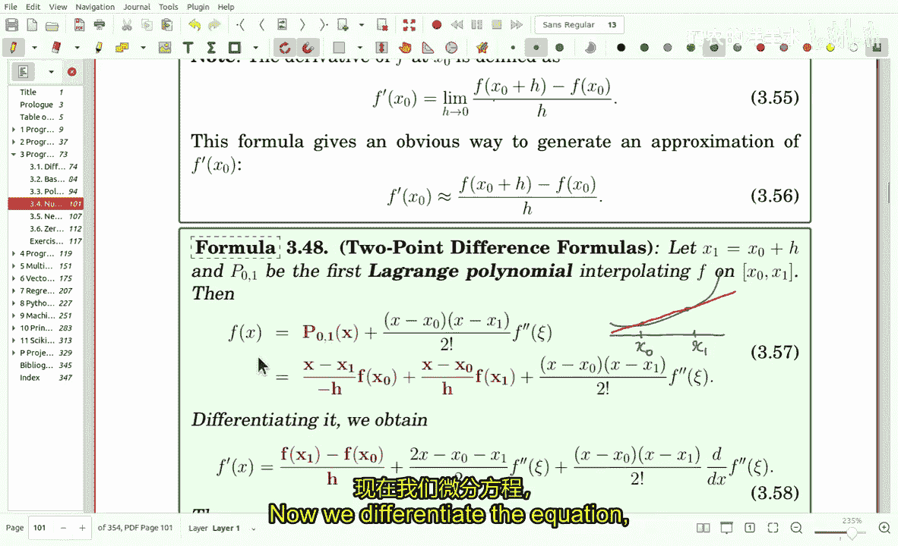

```
F'(X0) = lim (h->0) [F(X0 + h) - F(X0)] / h
```

当 `h` 很小时，这个差分商公式可以很好地近似导数值。

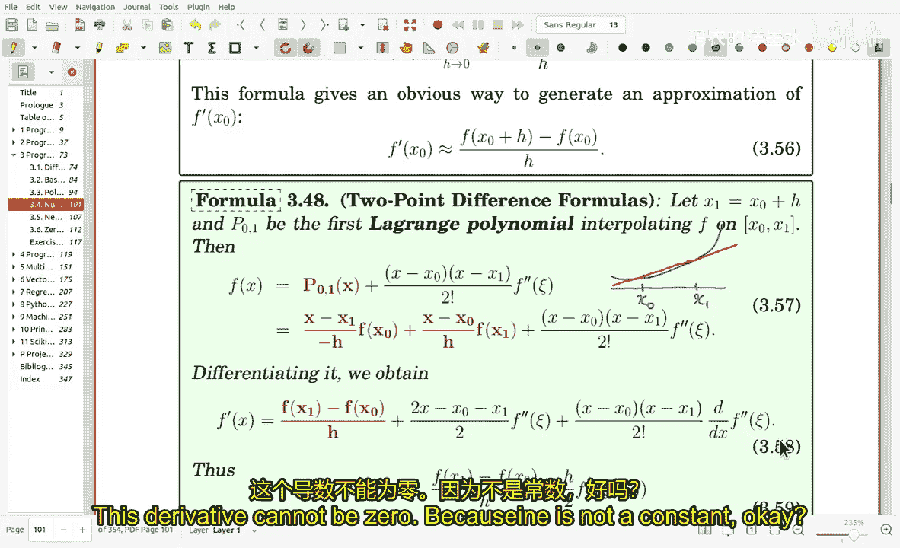

现在考虑两个点 `x0` 和 `x1`，其中 `x1 = x0 + h`。我们试图估计 `F` 在 `x0` 和 `x1` 处的导数。这涉及到通过这两个点的**一次拉格朗日插值多项式** `P_01(x)`。

根据多项式插值误差定理，我们有：

```
F(x) = P_01(x) + R_1(x)
```

其中 `P_01(x)` 可以显式地写为：

```
P_01(x) = L_{1,0}(x) * F(x0) + L_{1,1}(x) * F(x1)
```


这里 `L_{1,0}` 和 `L_{1,1}` 是拉格朗日基函数。

对上述方程求导，我们得到：

```
F'(x) = P'_01(x) + R'_1(x)
```

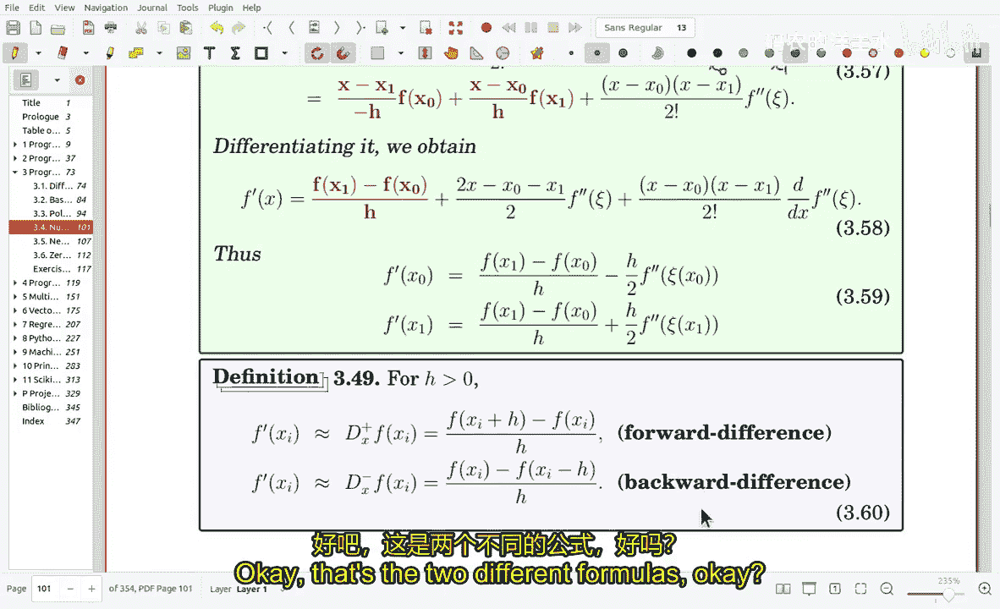

具体地，`P'_01(x)` 的表达式为：

```
P'_01(x) = (1 / -h) * F(x0) + (1 / h) * F(x1)
```

而误差项 `R'_1(x)` 的推导更为复杂，因为它依赖于 `x`。

如果我们评估 `F'` 在 `x0` 或 `x1` 处的值，误差项中的部分乘积会为零。具体来说：

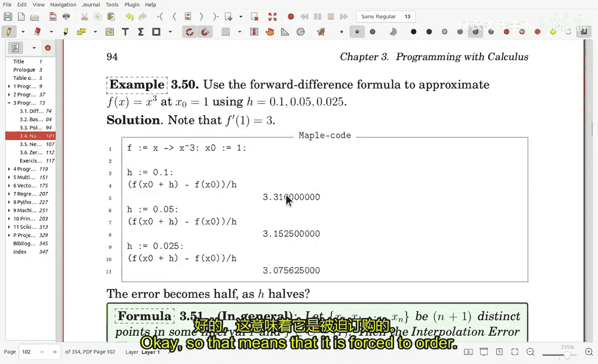

*   在 `x = x0` 处，我们得到**向前差分公式**：
    ```
    F'(x0) ≈ [F(x0 + h) - F(x0)] / h
    ```
    其误差项为 `O(h)`。

*   在 `x = x1` 处，我们得到**向后差分公式**：
    ```
    F'(x1) ≈ [F(x1) - F(x1 - h)] / h
    ```
    其误差项也为 `O(h)`。

当 `h > 0` 时，`x_i + h` 是向前的一个点。因此，在点 `x_i` 处，使用 `F(x_i)` 和 `F(x_i + h)` 的公式称为**向前差分公式**，记作 `D_+ F(x_i)`。

类似地，使用 `F(x_i)` 和 `F(x_i - h)` 的公式称为**向后差分公式**，记作 `D_- F(x_i)`。

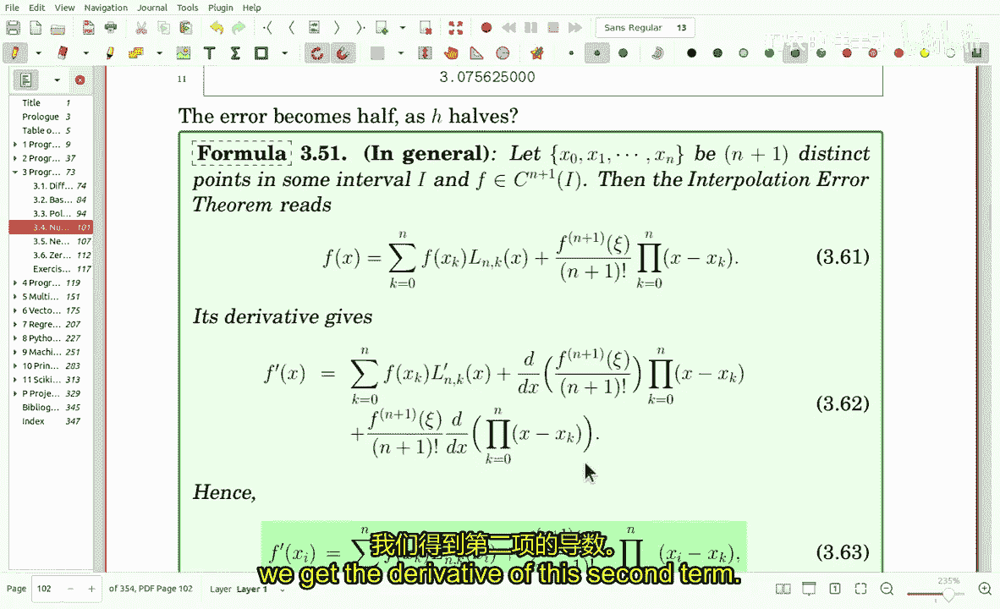

## 精度测试示例

以下是使用向前差分公式近似 `F(x) = x^3` 在 `x0 = 1` 处导数的精度测试。真实导数值 `F'(1) = 3`。

我们使用不同的步长 `h` 进行计算：

*   当 `h = 0.1` 时，近似值为 `3.31`，误差为 `0.31`。
*   当 `h = 0.05` 时，近似值为 `3.1525`，误差约为 `0.1525`。
*   当 `h = 0.025` 时，近似值为 `3.075625`，误差约为 `0.075625`。

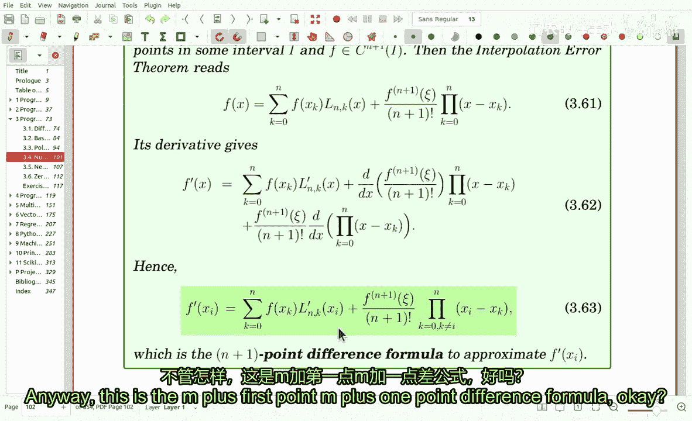

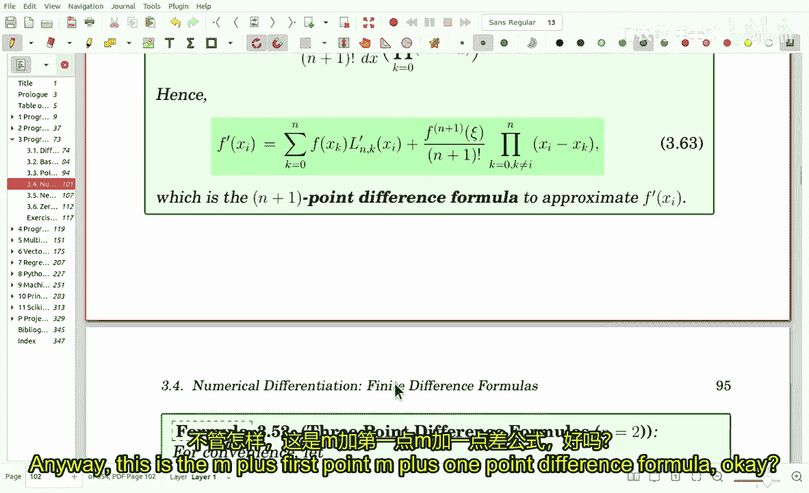

可以观察到，每次步长减半，误差也大致减半，这验证了向前差分公式具有**一阶精度** `O(h)`。

## 多点有限差分公式

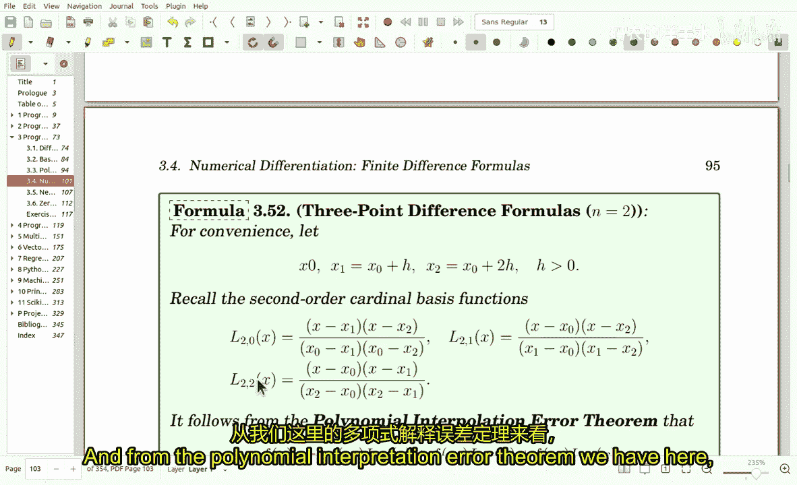

上一节我们基于两个点推导了公式。本节中我们来看看如何利用更多点来获得更高精度的近似。

一般来说，如果我们从 `m+1` 个不同的点开始构造插值多项式，根据插值误差定理有：

```
F(x) = P_m(x) + R_m(x)
```

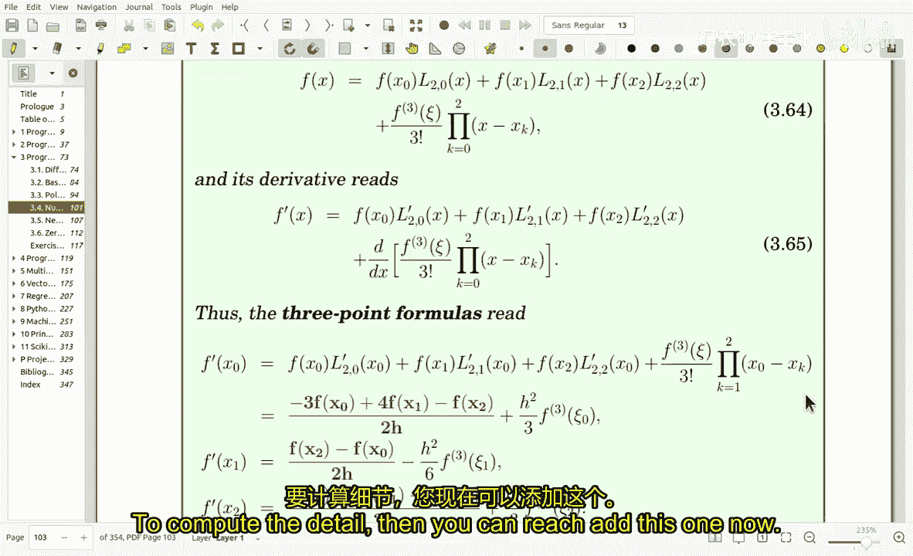

其中 `P_m(x)` 是 `m` 次拉格朗日插值多项式，误差项 `R_m(x)` 为 `O(h^{m+1})`。

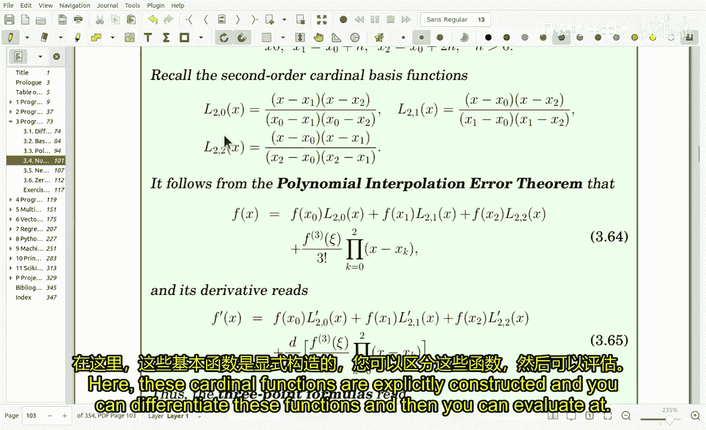

对上述方程求导：

```
F'(x) = P'_m(x) + R'_m(x)
```

如果我们希望在节点 `X_i` 处评估导数，公式可以简化为：

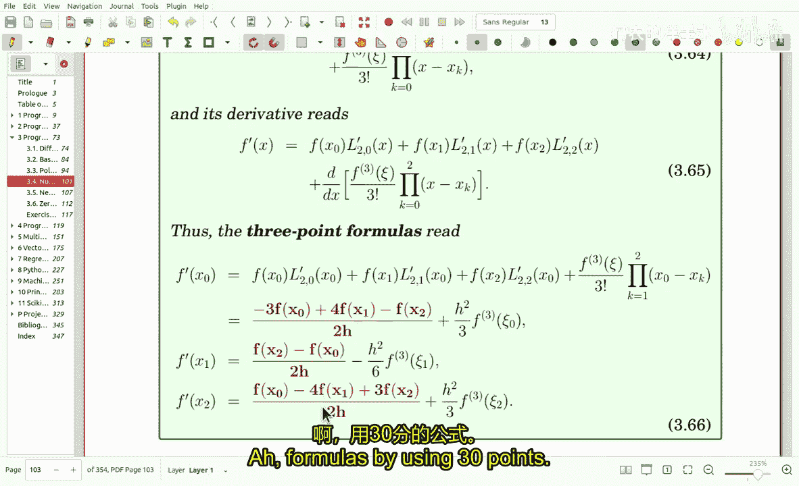

```
F'(X_i) ≈ Σ_{j=0}^{m} L'_{m,j}(X_i) * F(X_j)
```

而误差项 `R'_m(X_i)` 的阶数会降低一次，变为 `O(h^m)`。这就是 **`(m+1)` 点差分公式**。

## 三点差分公式示例

让我们看一个 `n=2`（即使用三个点）的例子。为方便起见，我们选择等距点：`x0`, `x1 = x0 + h`, `x2 = x0 + 2h`。

我们可以构造二次拉格朗日基函数 `L_{2,0}`, `L_{2,1}`, `L_{2,2}`。根据多项式插值误差定理：

```
F(x) = P_2(x) + R_2(x)
```

其中 `P_2(x)` 是二次拉格朗日多项式，`R_2(x)` 是误差项。

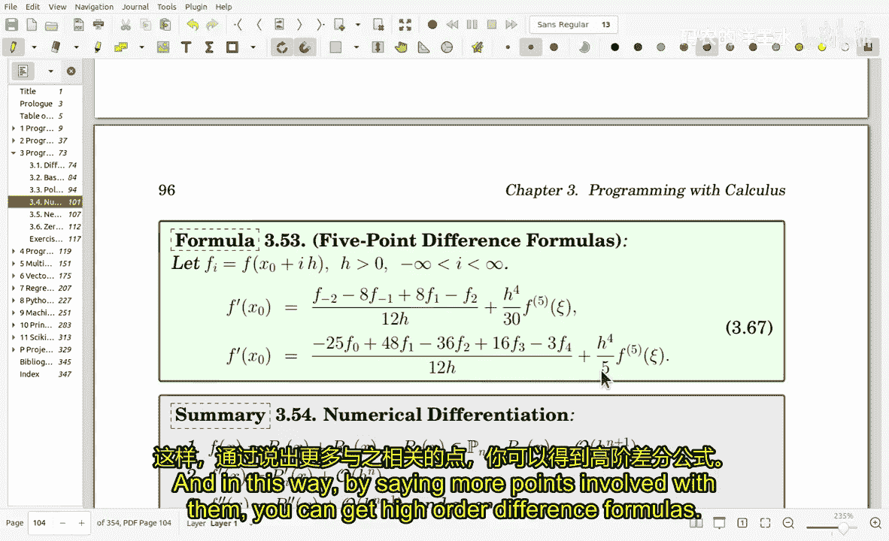

求导后，我们尝试在每个点 `x0`, `x1`, `x2` 处评估 `F'(x)`。经过详细的代数运算（对基函数求导并代入节点值），我们可以得到：

*   **左端点公式** (在 `x0` 处)：
    ```
    F'(x0) ≈ [-3F(x0) + 4F(x1) - F(x2)] / (2h)
    ```
    误差为 `O(h^2)`。

*   **中点公式** (在 `x1` 处)：
    ```
    F'(x1) ≈ [F(x2) - F(x0)] / (2h)
    ```
    误差为 `O(h^2)`。

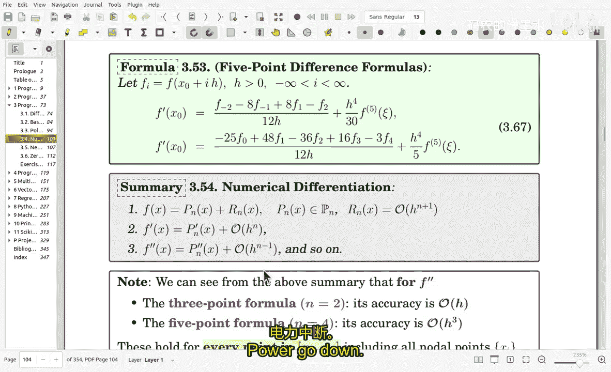

*   **右端点公式** (在 `x2` 处)：
    ```
    F'(x2) ≈ [F(x0) - 4F(x1) + 3F(x2)] / (2h)
    ```
    误差为 `O(h^2)`。

这样，我们通过使用三个点得到了具有二阶精度的差分公式。

## 五点差分公式与中点公式的优势

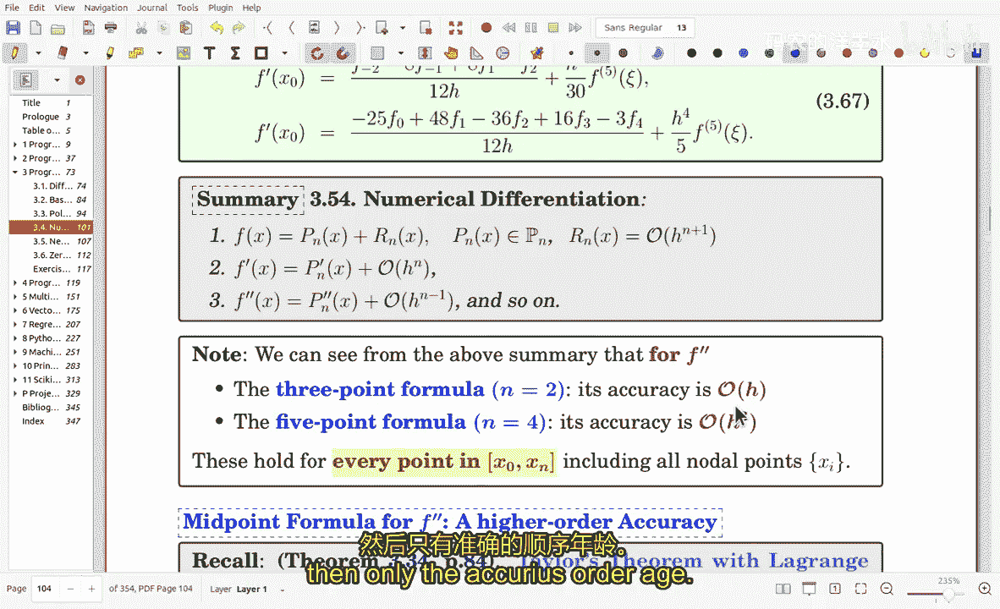

类似地，我们可以从五个点出发，构造四次拉格朗日多项式，从而推导出**五点差分公式**。例如，对于中点 `x0` 的公式如下：

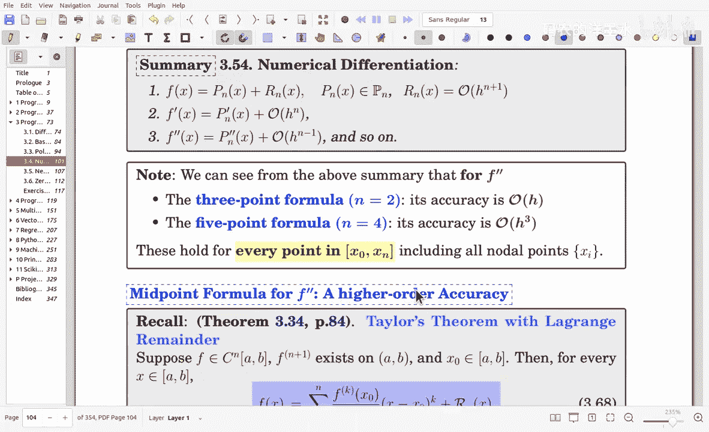

```
F'(x0) ≈ [F(x0-2h) - 8F(x0-h) + 8F(x0+h) - F(x0+2h)] / (12h)
```

其误差为 `O(h^4)`，精度更高。通过增加使用的点数，可以获得更高阶的差分公式。

在数值微分中有一个一般性结论：如果使用 `n+1` 个点进行 `n` 次多项式插值，那么：
*   函数近似本身具有 `O(h^{n+1})` 的精度。
*   一阶导数近似的精度会降低一阶，为 `O(h^n)`。
*   二阶导数近似的精度会再降低一阶，为 `O(h^{n-1})`。

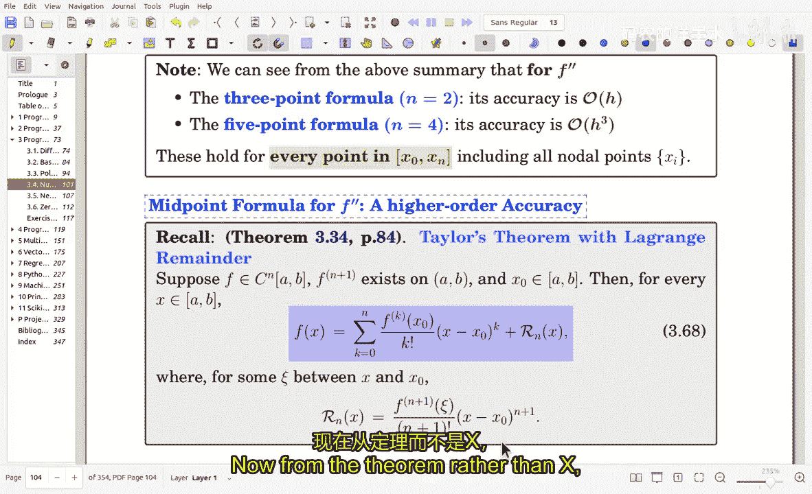

然而，如果我们**只关注中点**，并巧妙地利用泰勒展开式，有时可以获得比上述一般理论预测更高的精度。

## 利用泰勒展开推导高阶中点公式

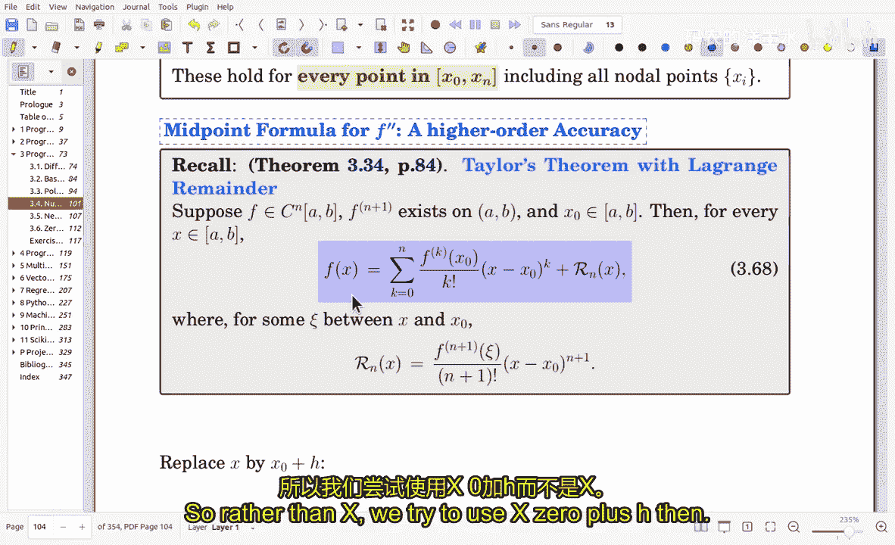

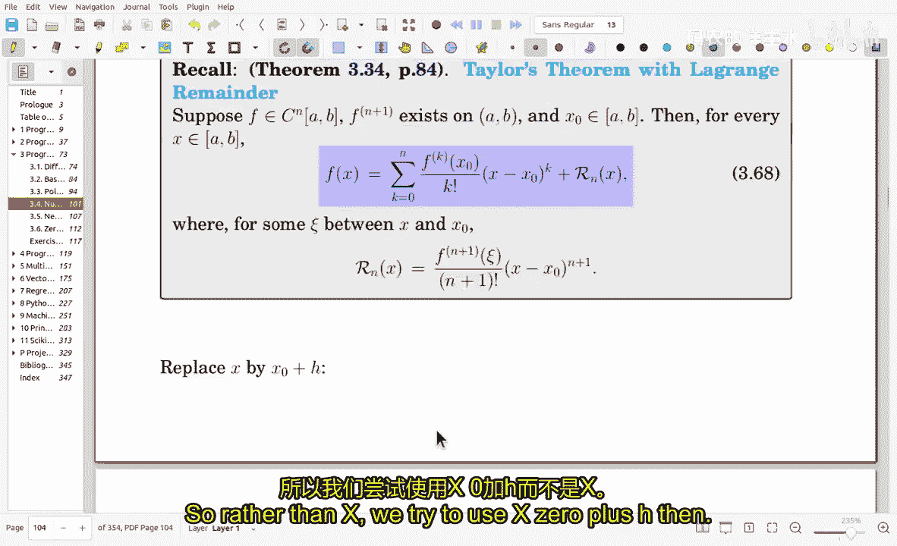

上一节提到了中点公式的潜在优势。本节中我们具体看看如何利用泰勒定理推导二阶导数的中点公式。

回顾带有拉格朗日余项的泰勒定理。对于充分可微的函数 `F`，在点 `x0` 附近有：

```
F(x0 + h) = F(x0) + hF'(x0) + (h^2/2!)F''(x0) + (h^3/3!)F'''(x0) + ... + R_n(h)
```

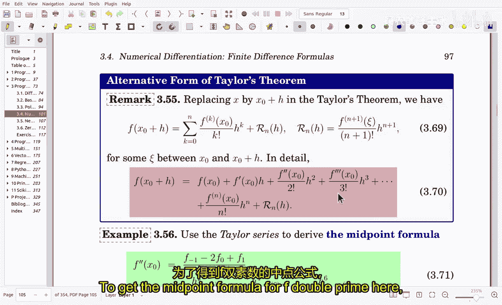

我们的目标是推导 `F''(x0)` 的公式。我们写出 `F(x0 + h)` 和 `F(x0 - h)` 的泰勒展开：

```
F(x0 + h) = F(x0) + hF'(x0) + (h^2/2)F''(x0) + (h^3/6)F'''(x0) + (h^4/24)F^{(4)}(x0) + ...
F(x0 - h) = F(x0) - hF'(x0) + (h^2/2)F''(x0) - (h^3/6)F'''(x0) + (h^4/24)F^{(4)}(x0) - ...
```

将这两个方程相加，奇数次项 `F'(x0)` 和 `F'''(x0)` 等会相互抵消，得到：

```
F(x0+h) + F(x0-h) = 2F(x0) + h^2 F''(x0) + (h^4/12) F^{(4)}(x0) + ...
```

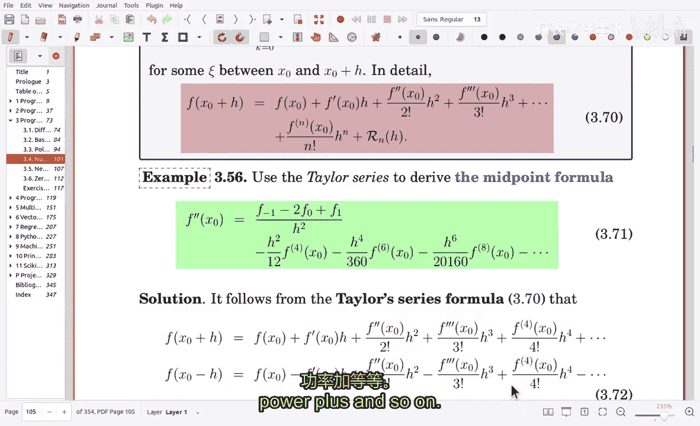

然后解出 `F''(x0)`：

```
F''(x0) = [F(x0+h) - 2F(x0) + F(x0-h)] / h^2 - (h^2/12) F^{(4)}(x0) + ...
```

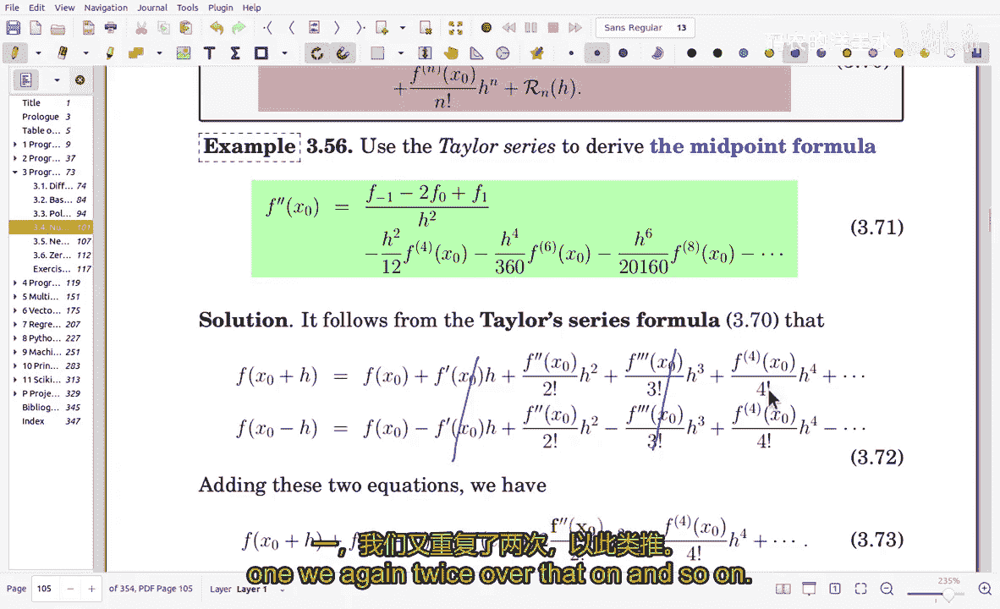

因此，我们得到了**二阶导数的中点差分公式**：

```
F''(x0) ≈ [F(x0+h) - 2F(x0) + F(x0-h)] / h^2
```

其误差项的主项是 `(h^2/12) F^{(4)}(ξ)`，这意味着该公式具有**二阶精度** `O(h^2)`。这比使用三点插值多项式直接求二阶导得到的一阶精度 `O(h)` 要高。这种高阶精度是**中点公式特有的优势**，对于端点的公式则无法达到。

## 中点公式精度测试示例

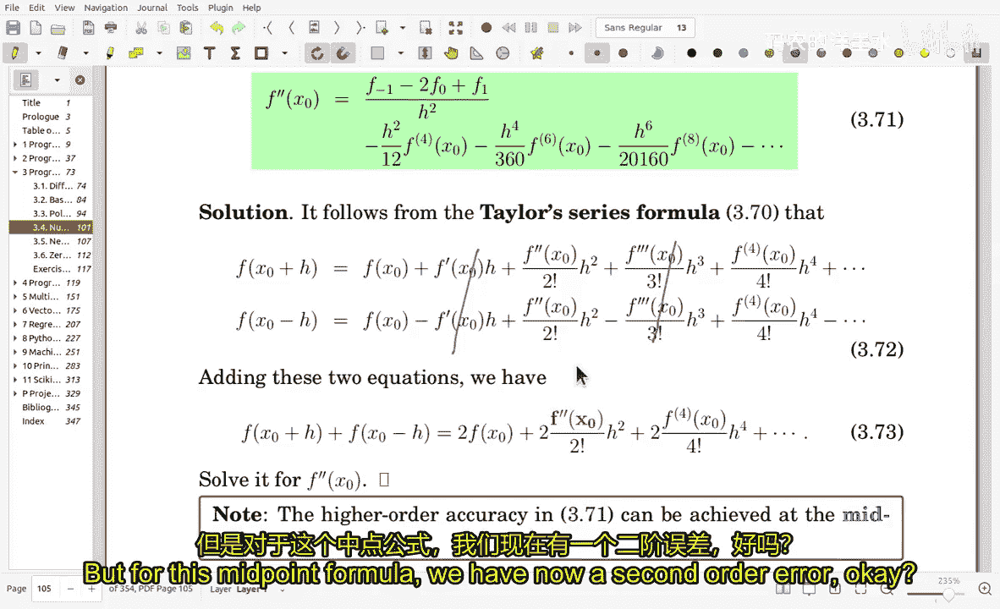

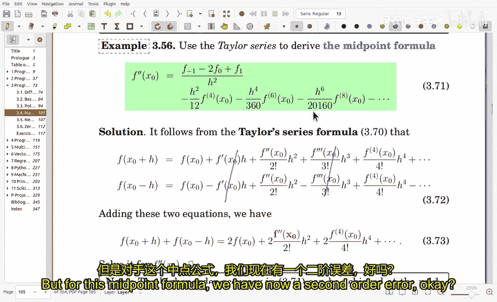

让我们测试上述二阶导数中点公式的精度。考虑函数 `F(x) = x^5 - 3x^2`，在 `x0=1` 处计算其二阶导数。真实值 `F''(1) = 14`。

我们使用不同的步长 `h`：

*   当 `h = 0.2` 时，近似值为 `14.4800`，误差为 `0.4800`。
*   当 `h = 0.1` 时，近似值为 `14.1200`，误差为 `0.1200`。
*   当 `h = 0.05` 时，近似值为 `14.0300`，误差为 `0.0300`。

可以观察到，当 `h` 减半时，误差大约变为原来的四分之一（例如从 `0.1200` 到 `0.0300`），这验证了该中点公式具有**二阶精度** `O(h^2)`。

## 总结 🎯

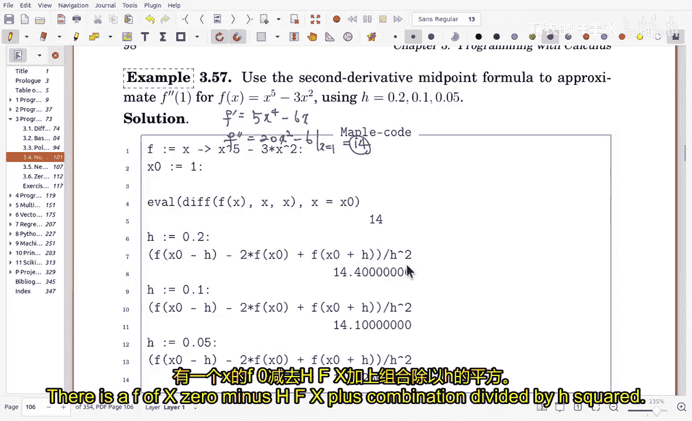

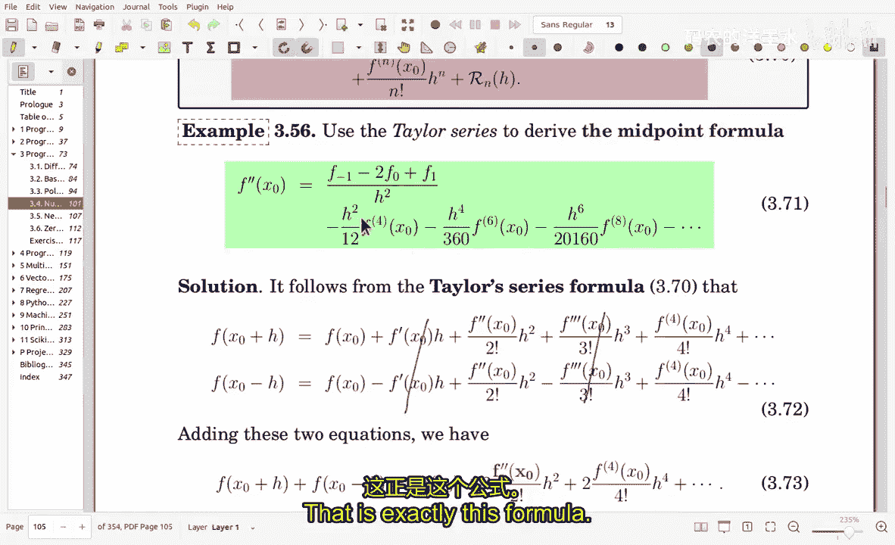

本节课中我们一起学习了数值微分的核心方法——有限差分公式。

*   我们从导数的定义出发，引出了最简单的向前和向后两点差分公式，它们具有一阶精度 `O(h)`。
*   通过引入多项式插值理论，我们推广到了使用 `m+1` 个点的通用差分公式，其精度为 `O(h^m)`，并具体推导了三点公式。
*   我们了解到，对于导数近似，精度会比函数插值本身的精度低一阶。
*   特别地，我们学习了如何利用泰勒展开推导特定（尤其是中点）的高阶精度公式。例如，二阶导数的中点公式 `[F(x+h)-2F(x)+F(x-h)]/h^2` 具有二阶精度 `O(h^2)`，这比从三点插值直接得到的一般结果更好。
*   数值实验验证了这些公式的精度阶数，帮助我们理解步长 `h` 的选择如何在计算效率与精度之间进行权衡。

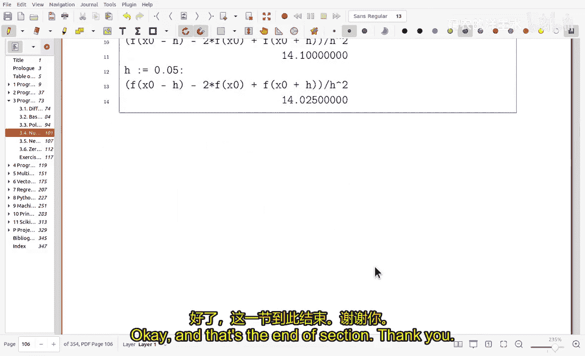

掌握这些有限差分公式是进行数值计算和科学仿真的重要基础。