# 027：牛顿法与霍纳法

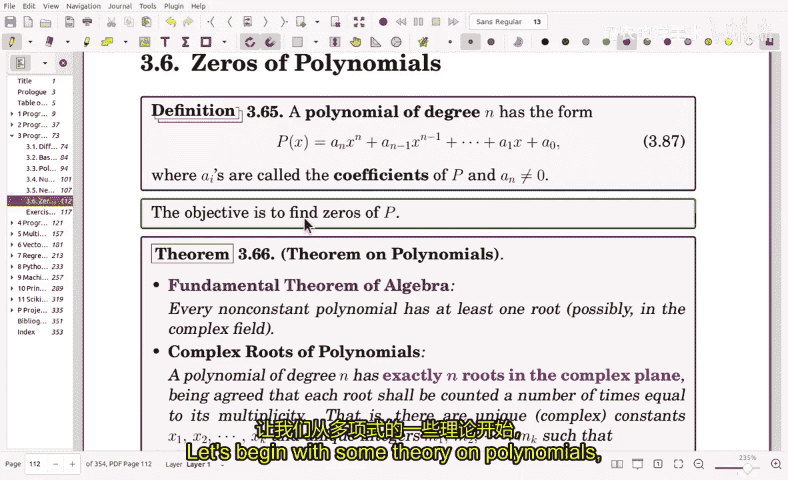

## 概述
在本节课中，我们将学习如何寻找多项式的零点。我们将从多项式的基本理论开始，然后介绍两种重要的算法：用于高效计算多项式及其导数值的霍纳法，以及用于迭代逼近零点的牛顿法。最后，我们将看到如何结合这两种方法，高效地求解多项式的根。

## 多项式基础理论

### 多项式的定义
一个 **N** 次多项式具有如下形式：
```
P(x) = a_N * x^N + a_{N-1} * x^{N-1} + ... + a_1 * x + a_0
```
其中，**a_i** 被称为多项式 **P** 的系数，且最高次项系数 **a_N** 不为零。

我们的目标是找到多项式 **P** 的零点，即满足 **P(x) = 0** 的 **x** 值。

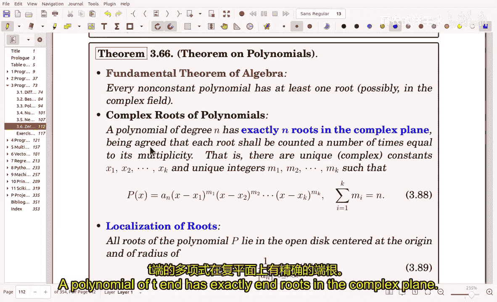

### 代数基本定理
代数基本定理指出：**每一个非常数多项式在复数域内至少有一个根**。

这意味着每个根都对应多项式的一个线性因子。因此，该定理可以重新表述为：每一个非常数多项式至少有一个线性因子。

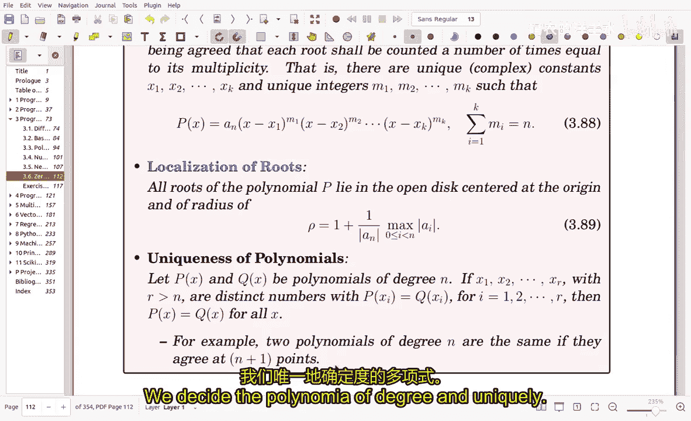

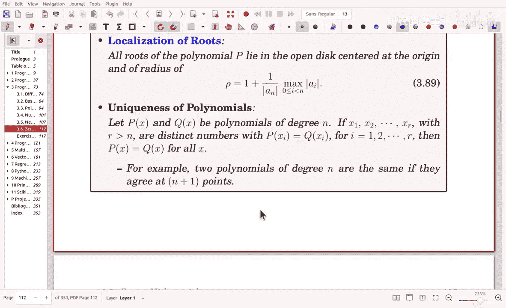

例如：
*   一个二次多项式至少有一个线性因子，而剩余部分也必须是线性因子，因此二次多项式总共有两个线性因子。
*   一个三次多项式至少有一个线性因子，剩余部分是一个二次多项式，而二次多项式又可以表示为两个线性因子的乘积。

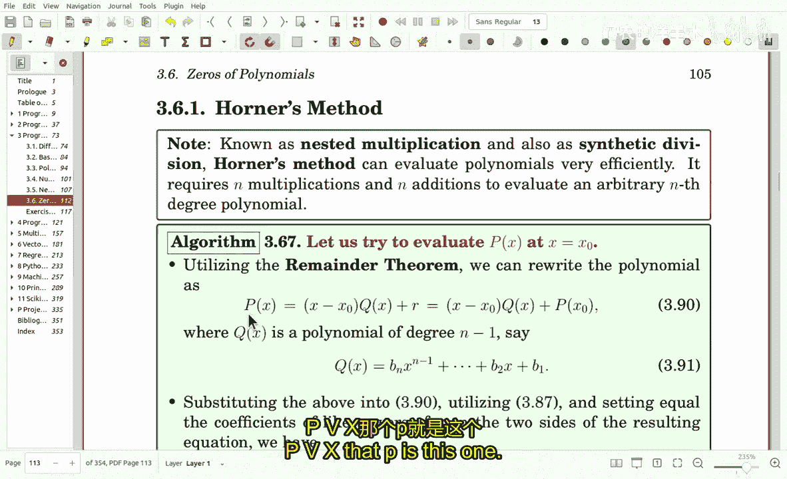

推广来说，一个 **N** 次多项式可以表示为 **N** 个线性因子的乘积。更精确地说，一个 **N** 次多项式在复数平面上恰好有 **N** 个根（计算重根），即存在唯一的复数 **x_1, x_2, ..., x_k** 和唯一的正整数 **m_1, m_2, ..., m_k**，使得：
```
P(x) = a_N * (x - x_1)^{m_1} * (x - x_2)^{m_2} * ... * (x - x_k)^{m_k}
```
其中 **m_1 + m_2 + ... + m_k = N**。

### 根的定位
多项式 **P** 的所有根都位于一个以原点为中心的开圆盘内，该圆盘的半径 **R** 为：
```
R = 1 + (|a_0| + |a_1| + ... + |a_{N-1}|) / |a_N|
```
当我们使用迭代算法求根时，可以将初始猜测值设置在这个圆盘内，以获得更好的收敛性。

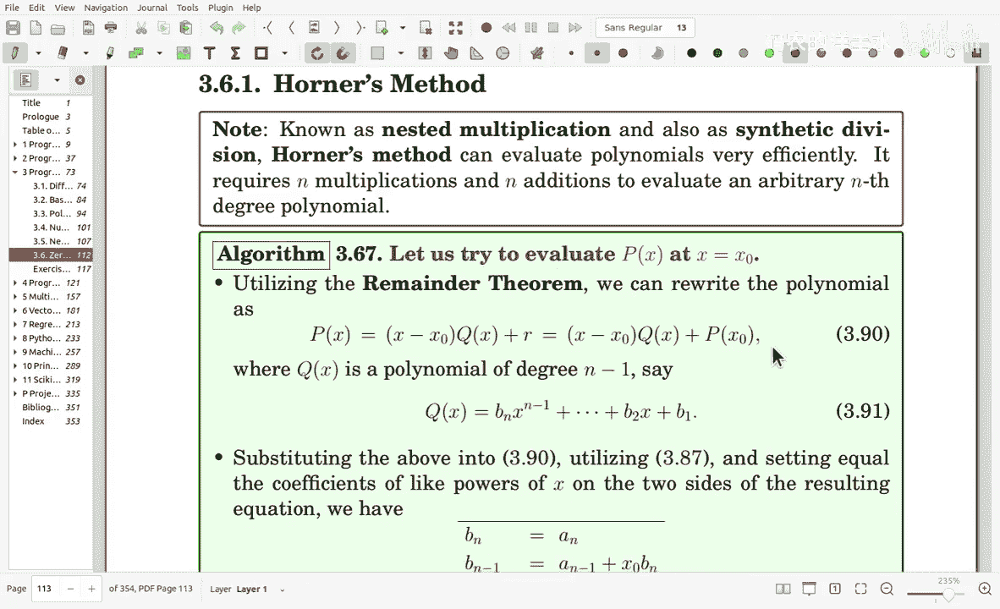

### 多项式的唯一性
设 **P** 和 **Q** 是两个 **N** 次多项式。如果它们在多于 **N** 个不同的点上的取值相同，那么这两个多项式必定完全相同。
特别地，如果两个 **N** 次多项式在 **N+1** 个不同点上的取值一致，则它们相同。这意味着 **N+1** 个不同点的函数值唯一地决定了一个 **N** 次多项式。

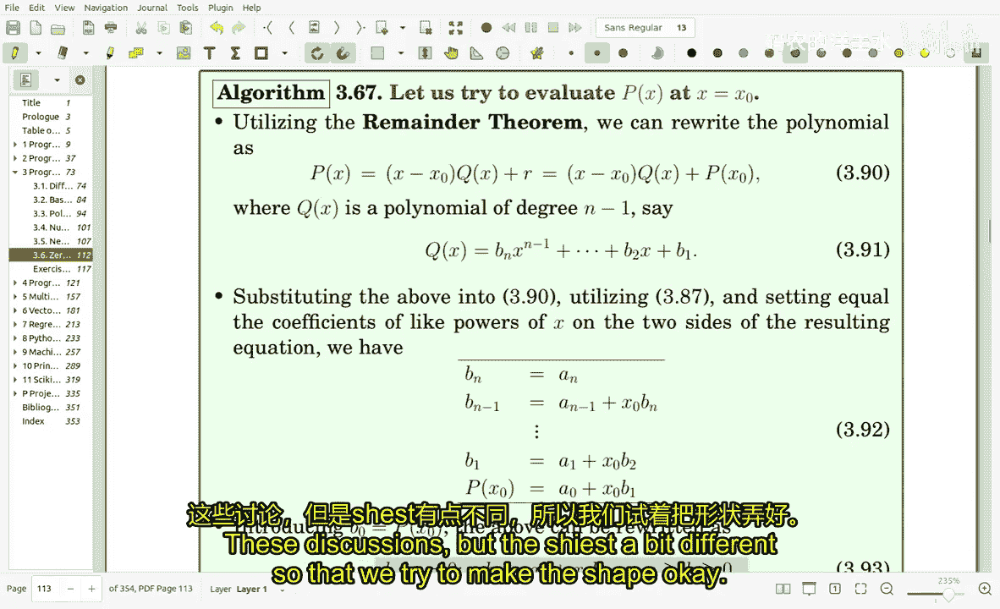

## 霍纳法（嵌套乘法）

上一节我们介绍了多项式的基本性质，本节中我们来看看如何高效地计算多项式在某一点的值。霍纳法（也称为嵌套乘法或综合除法）就是一种非常高效的多项式求值算法。

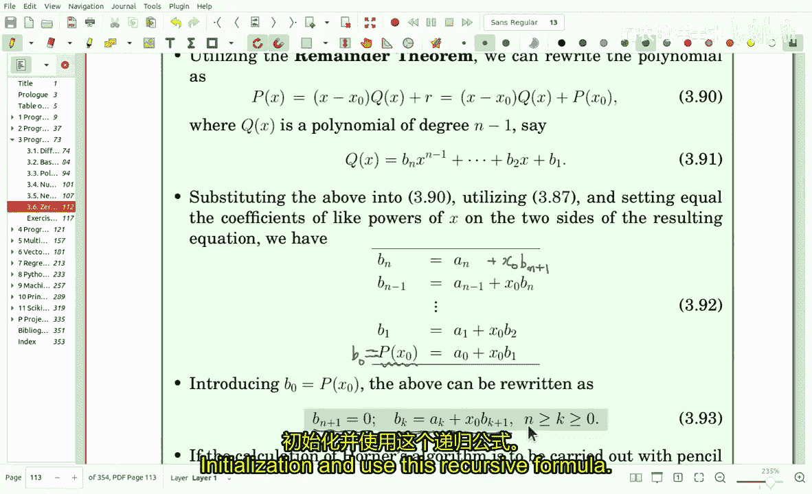

### 余数定理
霍纳法的理论基础是余数定理。该定理指出，多项式 **P(x)** 除以 **(x - x_0)**，可以得到商式 **Q(x)** 和余数 **R**（一个常数）：
```
P(x) = (x - x_0) * Q(x) + R
```
当 **x = x_0** 时，上式变为 **P(x_0) = R**。因此，求 **P(x_0)** 等价于求上述除法中的余数 **R**。

### 算法推导
设商式 **Q(x)** 为：
```
Q(x) = b_{N-1} * x^{N-1} + b_{N-2} * x^{N-2} + ... + b_1 * x + b_0
```
将 **P(x)** 和 **Q(x)** 的表达式代入 `P(x) = (x - x_0) * Q(x) + R` 并展开，通过比较等式两边 **x** 的同次幂系数，我们可以得到一组递推关系式。

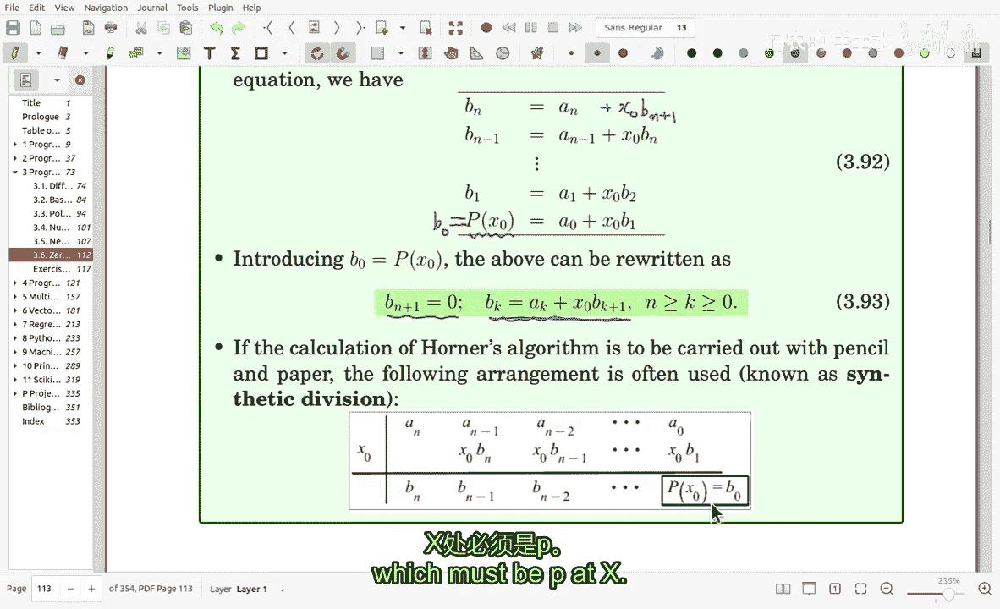

以下是计算系数 **b_k** 和余数 **R** 的递推公式：
```
b_{N-1} = a_N
b_{k-1} = a_k + x_0 * b_k, 对于 k = N-1, N-2, ..., 1
R = a_0 + x_0 * b_0
```
其中，**R** 就是我们所求的 **P(x_0)**。

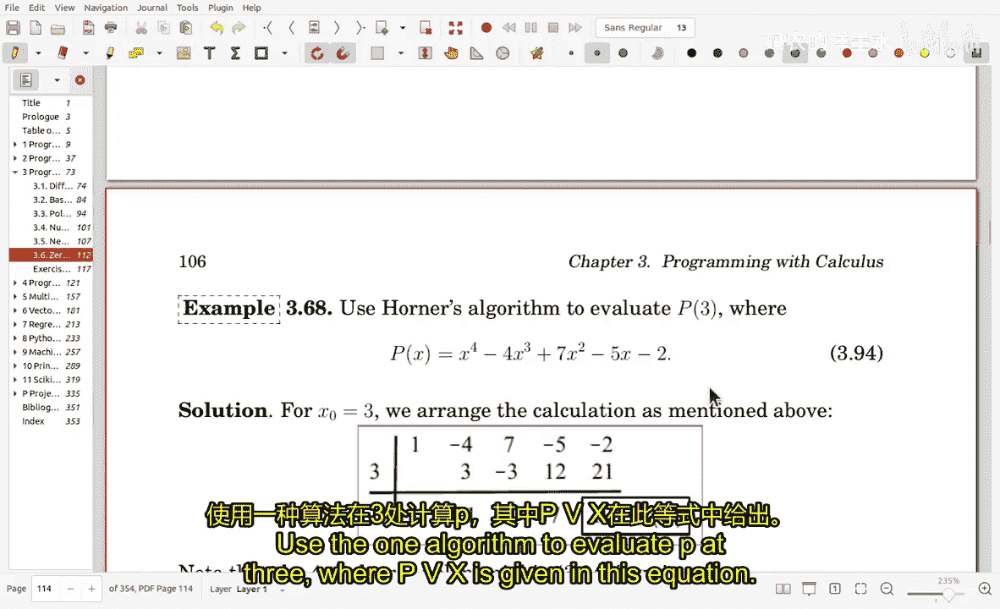

### 综合除法表格
上述递推过程可以用一个简洁的综合除法表格来实现，这通常在中学阶段学习过。

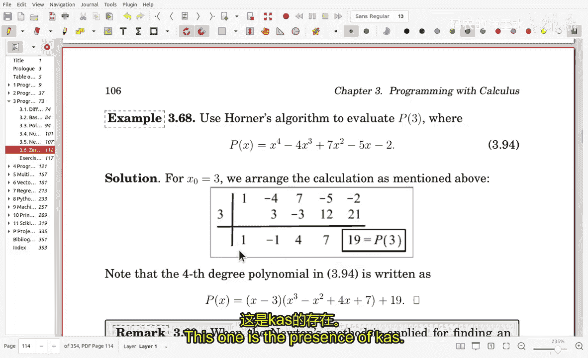

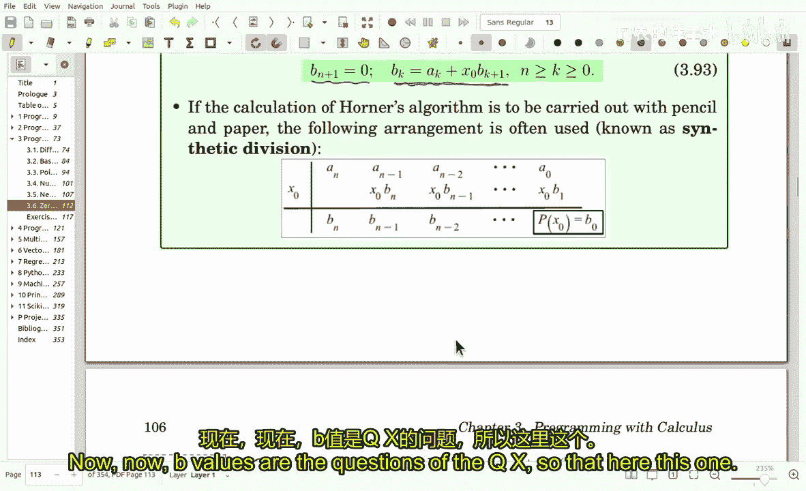

以下是构建表格的步骤：
1.  在第一行写下多项式系数 **a_N, a_{N-1}, ..., a_0**。
2.  在左侧写下求值点 **x_0**。
3.  将第一个系数 **a_N** 直接落到第三行，作为 **b_{N-1}**。
4.  将刚得到的数值乘以 **x_0**，结果写在第二行的下一个位置。
5.  将第二行的这个数与上方的系数相加，结果写在第三行。
6.  重复步骤4和5，直到处理完所有系数。
7.  第三行最后一个数就是余数 **R**，即 **P(x_0)**；第三行前面的数则是商式 **Q(x)** 的系数。

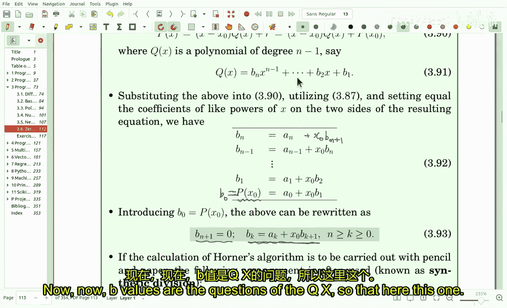

### 示例
使用霍纳法计算多项式 `P(x) = x^4 - 4x^3 + 7x^2 - 5x - 2` 在 `x=3` 处的值。

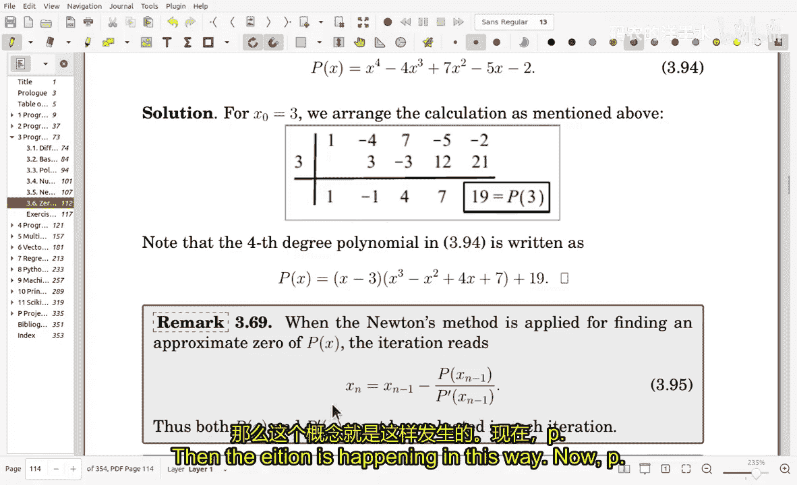

构建综合除法表格如下：
```
        1    -4     7    -5    -2
  3 |        3    -3    12    21
    ----------------------------
        1    -1     4     7    19
```
计算过程：
1.  落下系数 `1`。
2.  `1 * 3 = 3`，写在第二行。
3.  `-4 + 3 = -1`，写在第三行。
4.  `-1 * 3 = -3`，写在第二行。
5.  `7 + (-3) = 4`，写在第三行。
6.  `4 * 3 = 12`，写在第二行。
7.  `-5 + 12 = 7`，写在第三行。
8.  `7 * 3 = 21`，写在第二行。
9.  `-2 + 21 = 19`，写在第三行。

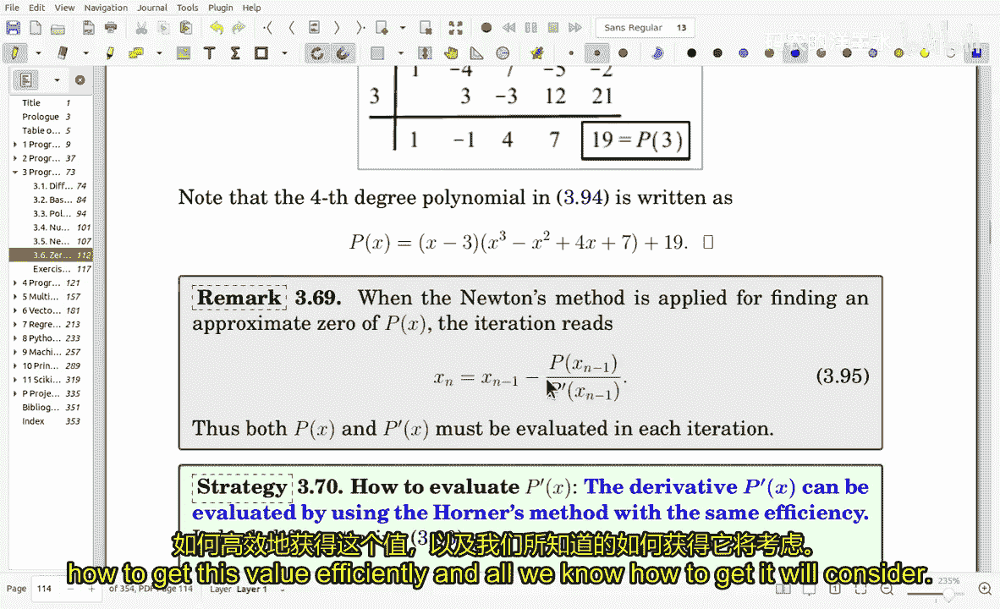

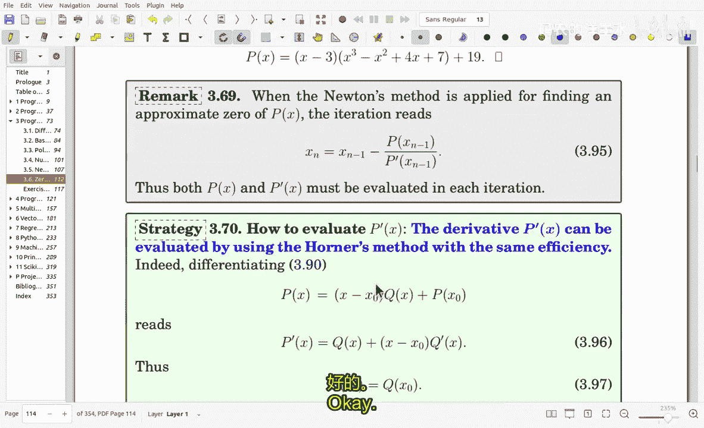

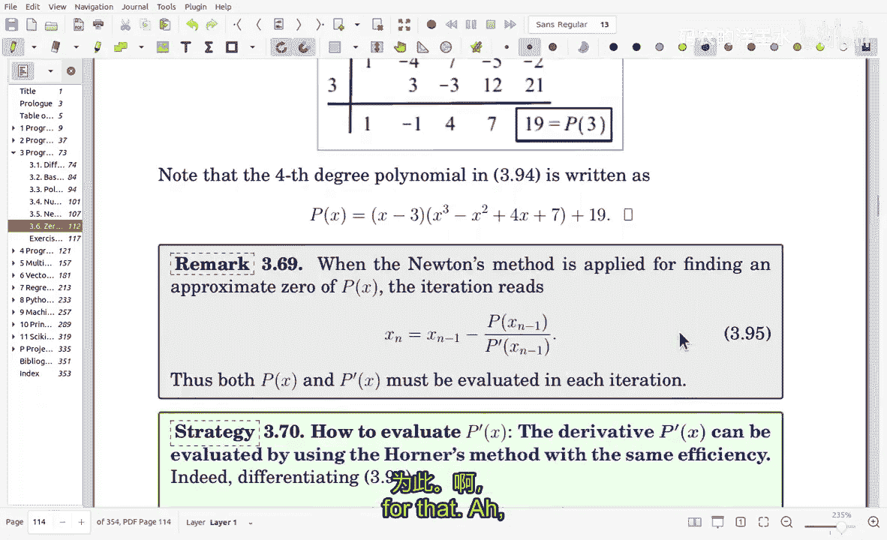

因此，`P(3) = 19`。同时，我们得到商式 `Q(x) = x^3 - x^2 + 4x + 7`，验证了 `P(x) = (x-3)*Q(x) + 19`。

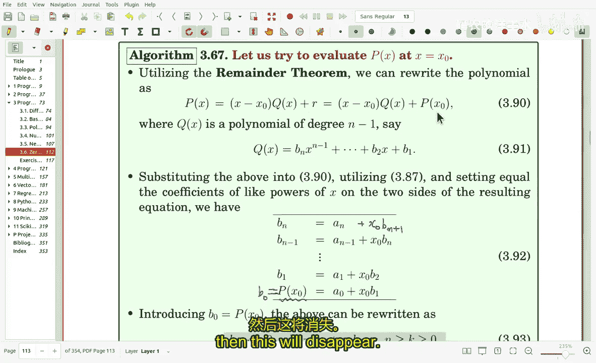

## 结合牛顿法求根

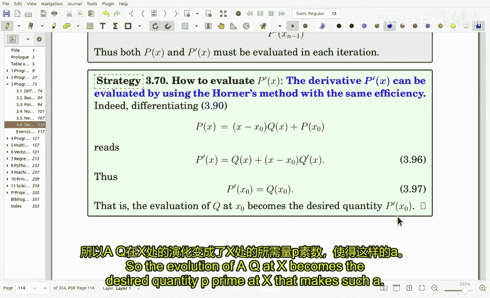

上一节我们学会了用霍纳法高效计算多项式值，本节我们来看看如何将其应用于牛顿法，以快速找到多项式的零点。

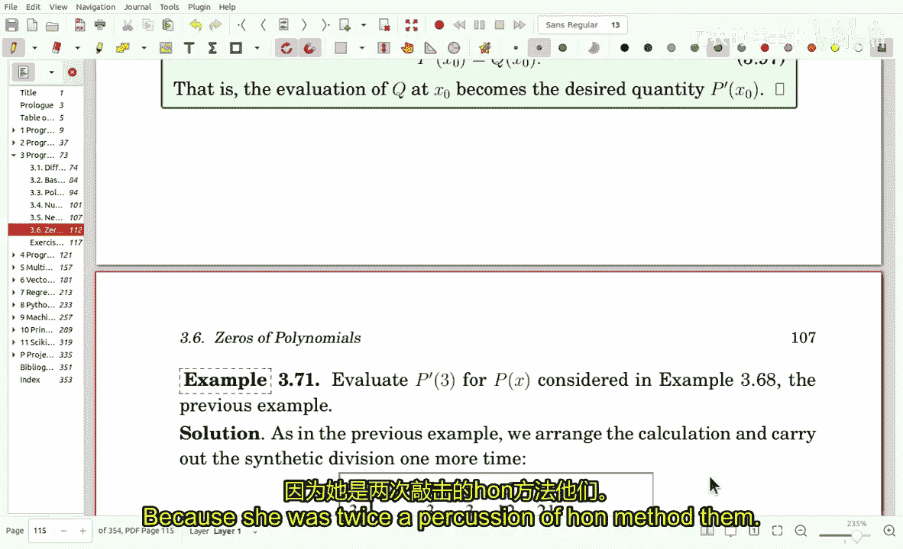

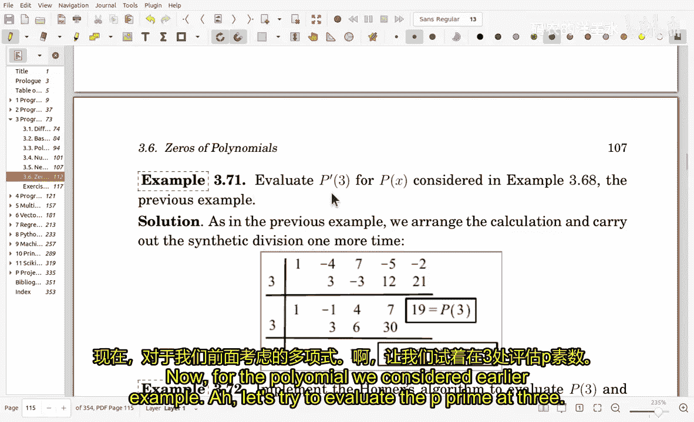

### 牛顿法回顾
牛顿法是一种迭代求根算法，其更新公式为：
```
x_{new} = x_{old} - P(x_{old}) / P'(x_{old})
```
其中，`P'(x)` 是多项式 `P(x)` 的导数。为了执行一次牛顿迭代，我们需要同时计算 `P(x)` 和 `P'(x)` 在 `x_{old}` 处的值。

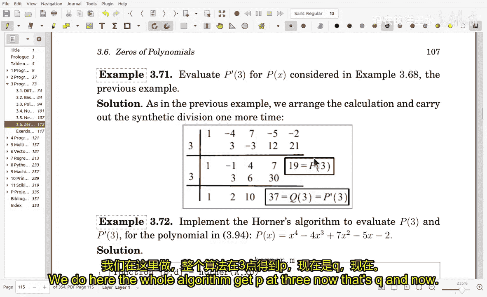

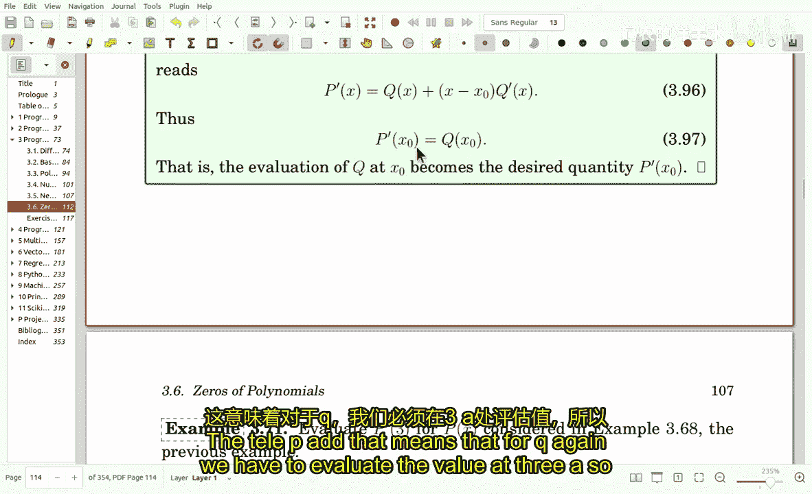

### 高效计算导数值
利用霍纳法和余数定理，我们可以高效地同时计算出 `P(x_0)` 和 `P'(x_0)`。

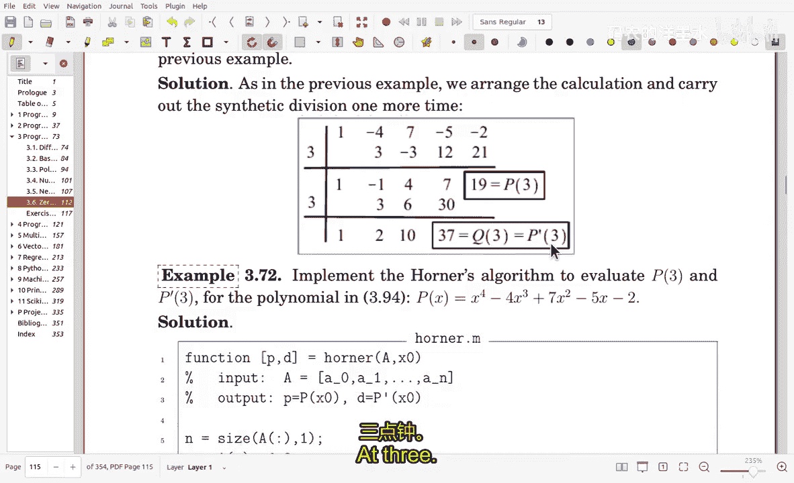

回顾 `P(x) = (x - x_0) * Q(x) + R`，其中 `R = P(x_0)`。
对这个等式两边关于 `x` 求导：
```
P'(x) = Q(x) + (x - x_0) * Q'(x)
```
当 `x = x_0` 时，第二项为零，因此：
```
P'(x_0) = Q(x_0)
```
这个结论非常有力：**多项式 `P` 在 `x_0` 处的导数值，恰好等于其除以 `(x - x_0)` 后得到的商式 `Q` 在 `x_0` 处的函数值**。

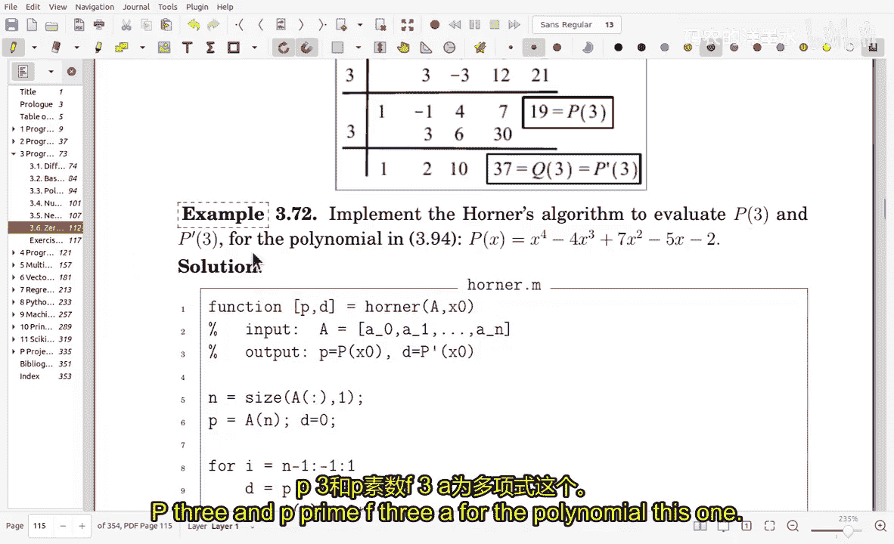

因此，计算 `P'(x_0)` 的步骤变为：
1.  使用霍纳法对 `P(x)` 在 `x_0` 处求值，得到 `P(x_0)` 和商式 `Q(x)` 的系数。
2.  再次使用霍纳法，对商式 `Q(x)` 在 `x_0` 处求值，得到的结果就是 `P'(x_0)`。

### 示例：计算函数值与导数值
继续使用多项式 `P(x) = x^4 - 4x^3 + 7x^2 - 5x - 2`，我们已经用一次霍纳法得到 `P(3)=19` 和 `Q(x)=x^3 - x^2 + 4x + 7`。

现在，对 `Q(x)` 在 `x=3` 处再次应用霍纳法：
```
        1    -1     4     7
  3 |        3     6    30
    ----------------------
        1     2    10    37
```
计算得 `Q(3) = 37`。因此，`P'(3) = Q(3) = 37`。

### 算法实现
我们可以编写一个霍纳法函数，使其同时返回 `P(x_0)` 和 `P'(x_0)`。以下是一个MATLAB风格的伪代码描述：
```matlab
function [P_val, P_prime_val] = Horner(coeffs, x0)
    % coeffs: 多项式系数向量，从高次到低次 [a_N, a_{N-1}, ..., a_0]
    % x0: 求值点
    % P_val: P(x0)
    % P_prime_val: P'(x0)

    n = length(coeffs) - 1; % 多项式次数
    b = coeffs(1); % 初始化 b_{N-1}
    d = 0;         % 用于计算导数的变量

    for i = 2:n+1
        d = b + x0 * d;       % 更新导数计算
        b = coeffs(i) + x0 * b; % 更新霍纳法主计算
    end

    P_val = b;
    P_prime_val = d;
end
```

### 牛顿-霍纳法求根
结合牛顿法和霍纳法，我们可以高效地寻找多项式零点。以下是算法步骤：
1.  给定多项式系数、初始猜测值 `x0`、容差 `tol` 和最大迭代次数 `max_iter`。
2.  进入循环，直到满足收敛条件或达到最大迭代次数：
    a. 调用 `Horner` 函数，计算当前点 `x` 处的 `P(x)` 和 `P'(x)`。
    b. 计算牛顿步长 `h = P(x) / P'(x)`。
    c. 更新点：`x = x - h`。
    d. 如果 `|h| < tol`，则跳出循环，`x` 即为近似根。
3.  返回最终的根 `x` 和迭代次数。

### 示例：求解多项式零点
使用牛顿-霍纳法寻找多项式 `P(x) = x^4 - 4x^3 + 7x^2 - 5x - 2` 的一个实根。
*   **初始猜测**：`x0 = 3`
*   **容差**：`1e-12`
*   **最大迭代**：1000

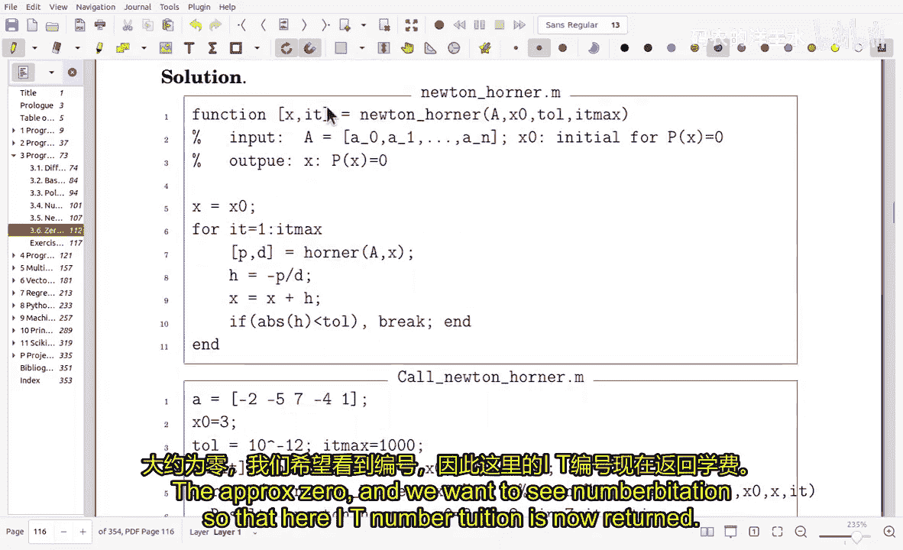

运行算法后，经过7次迭代，收敛到根 `x ≈ 2.0000`。该多项式共有两个实根（另一个约为 -0.236）和两个复根。

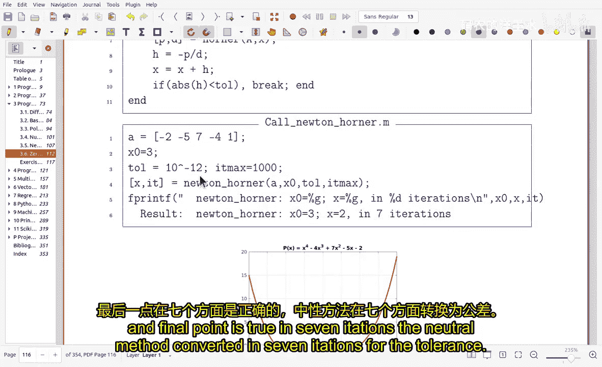

## 总结
本节课中我们一起学习了求解多项式零点的完整流程。
1.  我们首先回顾了多项式的基本理论，包括代数基本定理和根的定位。
2.  接着，我们深入学习了**霍纳法**，这是一种通过嵌套乘法和综合除法来高效计算多项式值的方法，其核心是余数定理。
3.  然后，我们发现霍纳法的一个巧妙应用：通过两次霍纳法求值，可以同时得到多项式在某点的函数值**P(x_0)**和导数值**P'(x_0)**，这基于公式 `P'(x_0) = Q(x_0)`。
4.  最后，我们将霍纳法与**牛顿法**相结合，形成了高效的“牛顿-霍纳法”，用于迭代求解多项式的实根。这种方法在每次迭代中都能以最小的计算代价获得所需的函数值和导数值，从而快速收敛到零点。

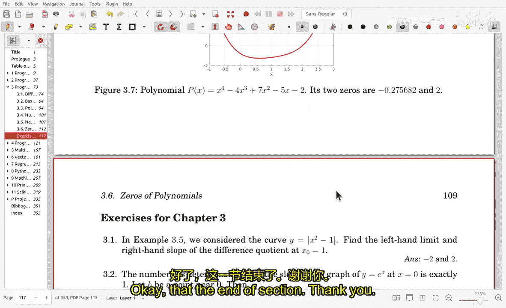

掌握这些方法，对于在科学计算和工程应用中处理多项式问题至关重要。