# 028：三种初等行变换（EROs）

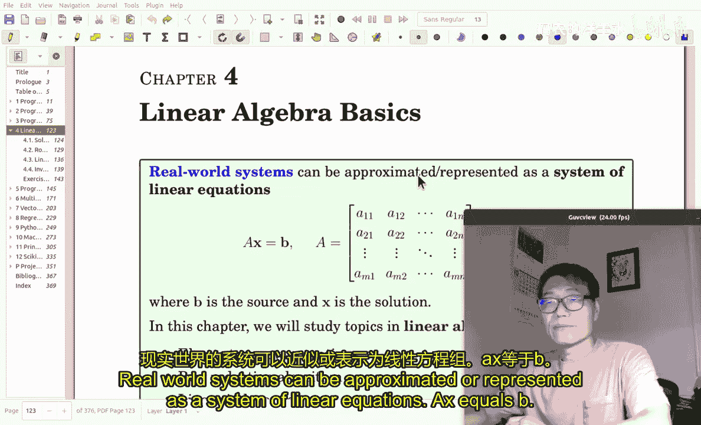

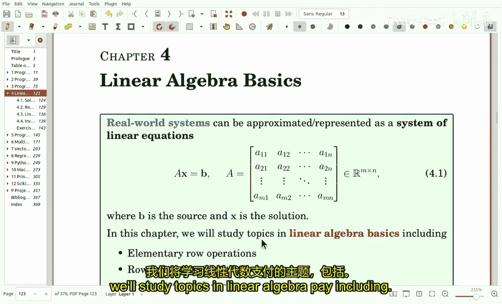

## 概述
在本节课中，我们将学习线性代数的基础知识。现实世界中的许多系统都可以近似或表示为线性方程组。我们将从线性方程组的基本概念开始，学习如何表示和求解它们，并介绍三种关键的初等行变换（EROs）。

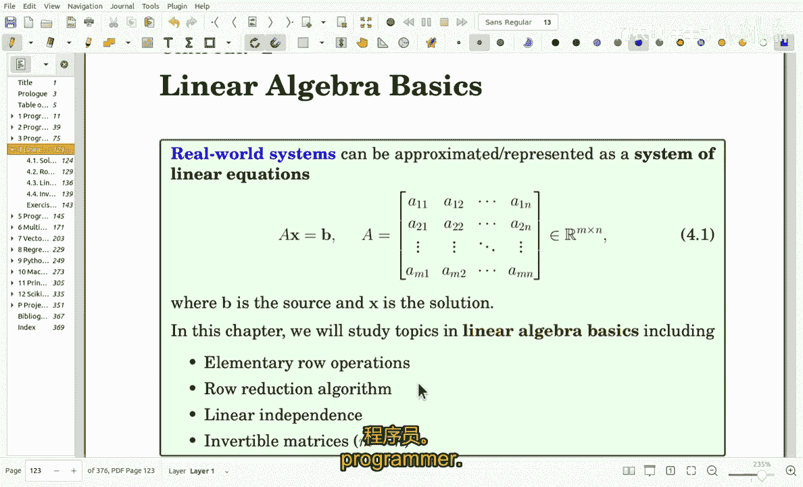

---

## 4.1 线性方程组的解

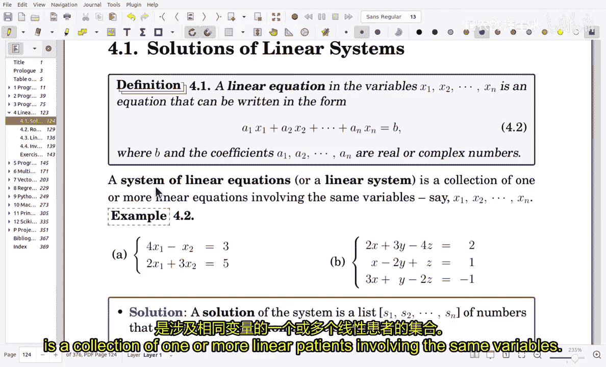

线性方程是变量 `x1, x2, ..., xn` 的方程，其形式为：
**a1x1 + a2x2 + ... + anxn = b**
其中系数 `a1` 到 `an` 以及常数 `b` 是实数或复数。

线性方程组（或简称线性系统）是一个或多个涉及相同变量的线性方程的集合。

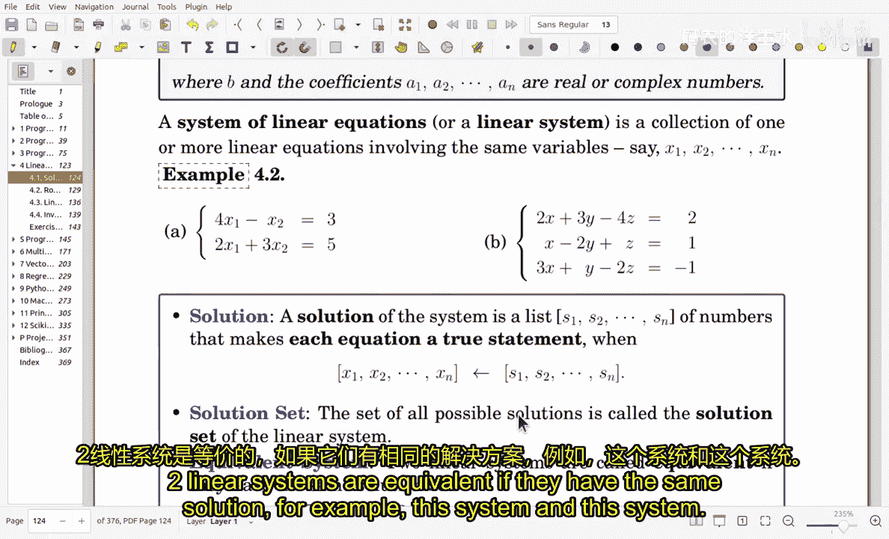

例如，左侧是一个包含两个变量 `x1` 和 `x2` 的二元线性方程组，右侧是一个包含三个变量 `x, y, z` 的三元线性方程组。

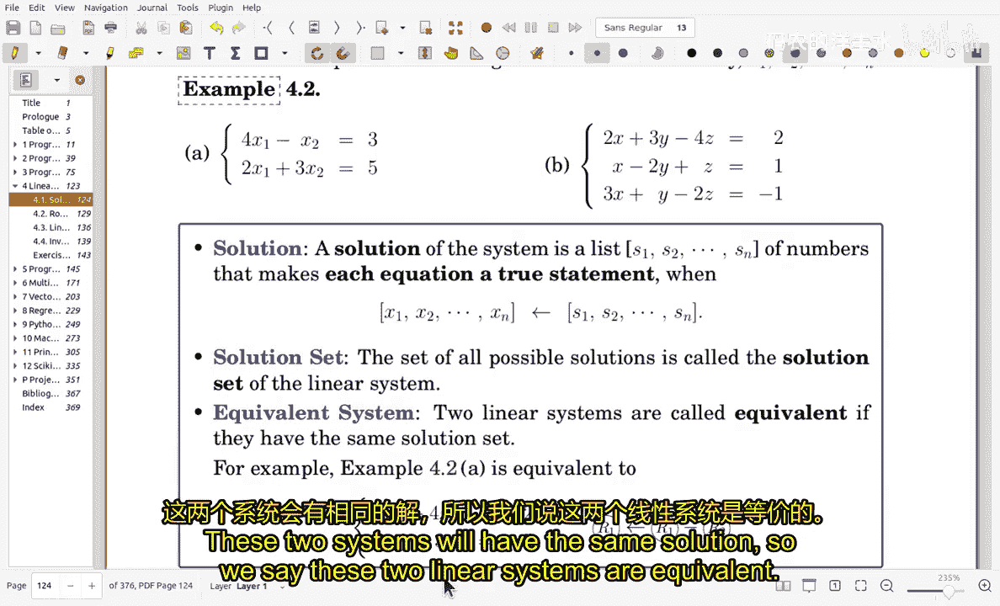

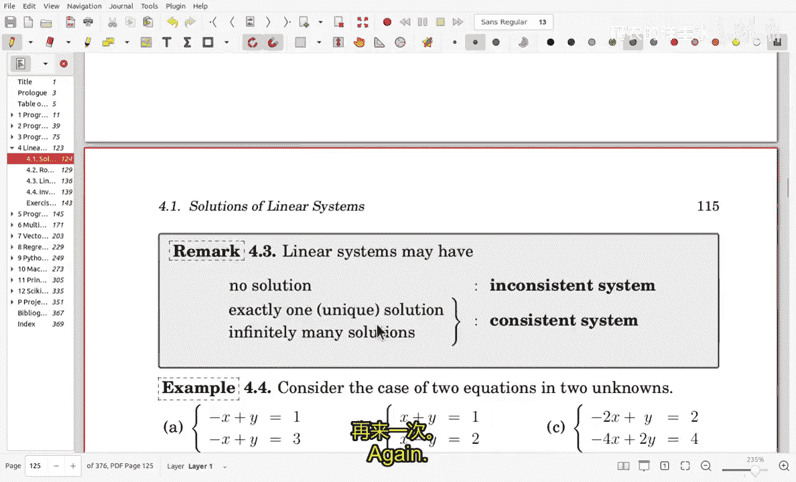

**解** 是指一组数字 `(s1, s2, ..., sn)`，当用这组数字分别替代变量 `x1, x2, ..., xn` 时，能使方程组中的每一个方程都成立。所有可能解的集合称为**解集**。如果两个线性系统具有相同的解集，则称它们是**等价**的。

例如，以下两个系统是等价的，因为第二个系统是通过将第一个方程乘以2再减去第二个方程得到的，它们共享相同的解集。

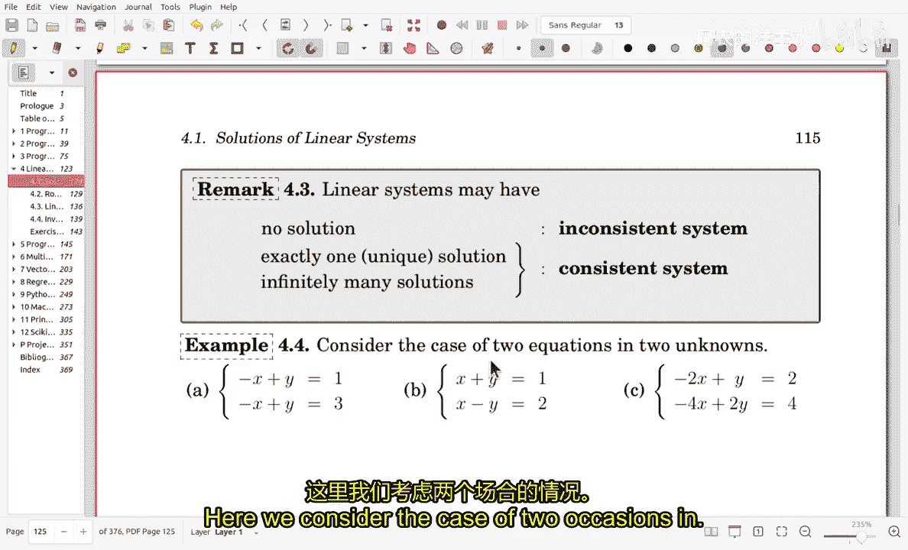

---

## 线性系统的解的情况

线性系统可能无解，可能有唯一解，也可能有无穷多解。
*   当系统无解时，我们称其为**不相容**的。
*   当系统至少有一个解（即唯一解或无穷多解）时，我们称其为**相容**的。

我们以两个方程两个未知数的系统为例来说明这三种情况。

1.  **无解**：例如，方程组 `y = x + 1` 和 `y = x + 3`。在坐标系中，这是两条斜率相同但截距不同的平行线，它们没有交点，因此系统无解。
2.  **唯一解**：例如，方程组 `y = -x + 1` 和 `y = x - 2`。在坐标系中，这是两条斜率不同的直线，它们相交于一点，该交点即为系统的唯一解。
3.  **无穷多解**：例如，将第一个方程 `x + y = 1` 乘以2得到 `2x + 2y = 2`，这与第二个方程完全相同。在坐标系中，两条直线重合，直线上每一个点都是解，因此系统有无穷多解。

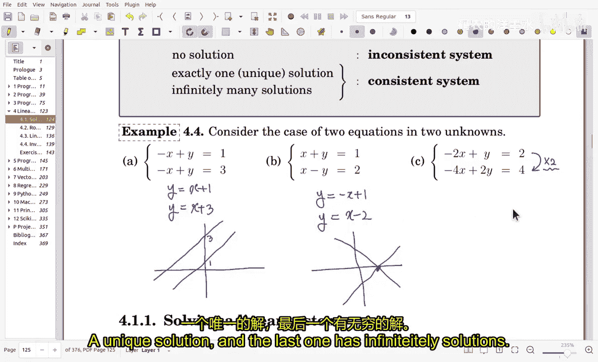

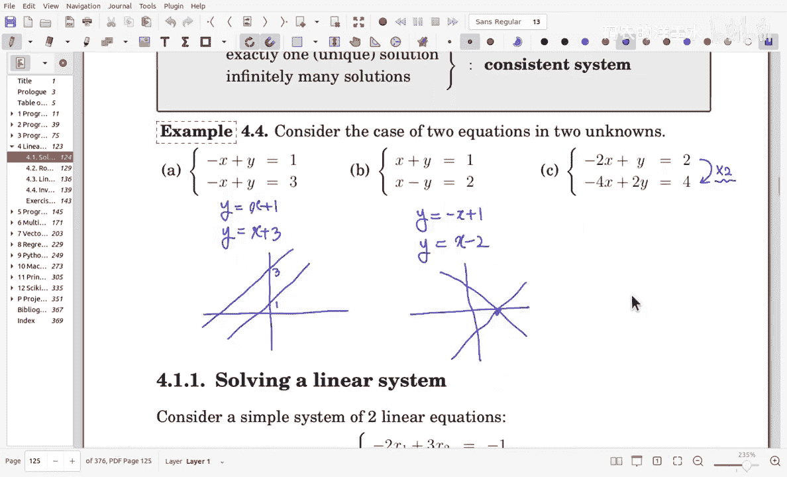

---

## 如何求解线性系统：矩阵表示法

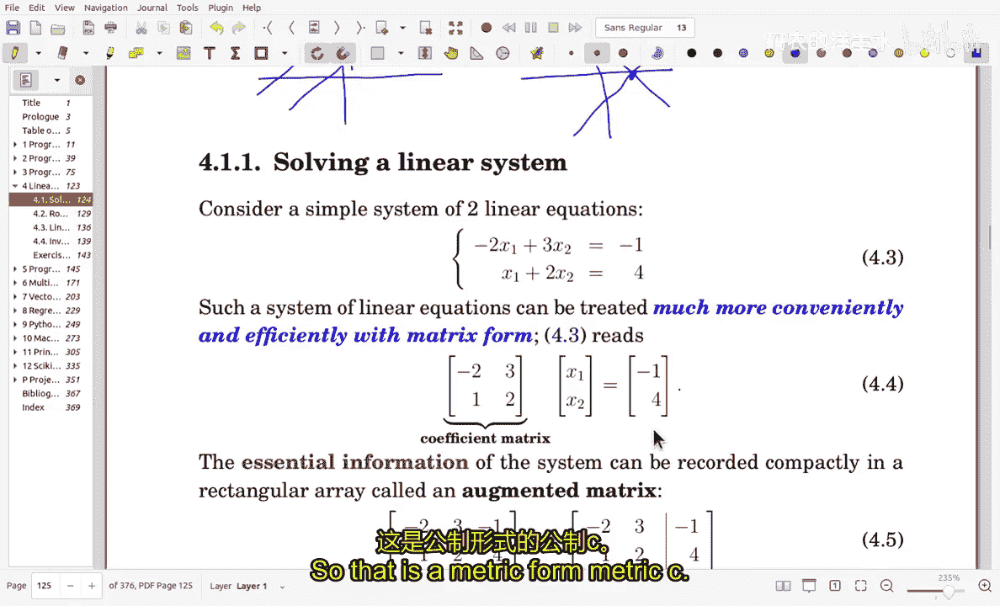

为了更便捷高效地求解线性系统，我们引入矩阵表示法。

考虑一个简单的二元线性方程组。我们可以将其系数和常数项组织成矩阵形式，即矩阵方程 **Ax = b**。

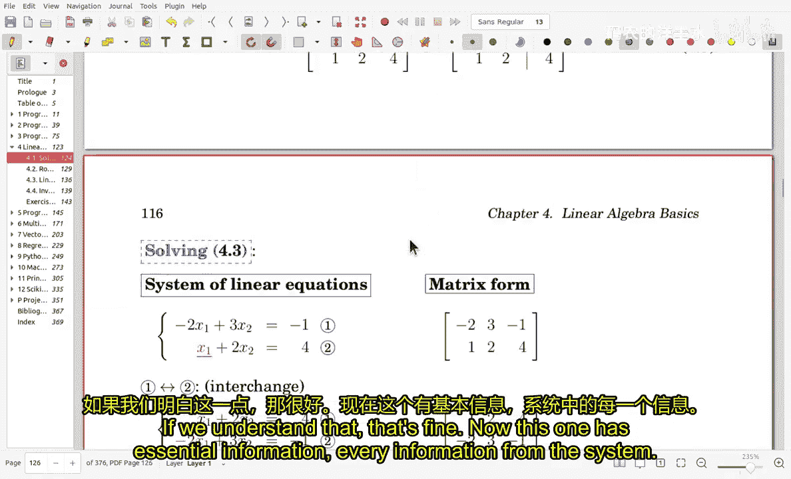

例如，方程组：
-2x1 + 3x2 = -1
x1 + 2x2 = 4

可以写成矩阵形式：
```
[-2  3] [x1]   = [-1]
[ 1  2] [x2]     [ 4]
```

为了包含所有求解信息，我们构造**增广矩阵**，它将系数矩阵和常数项向量合并：
```
[-2  3 | -1]
[ 1  2 |  4]
```

---

## 使用初等行变换（EROs）求解

上一节我们介绍了用增广矩阵表示线性系统。本节中，我们来看看如何通过一系列操作（即初等行变换）来求解它。

求解过程的目标是通过变换增广矩阵，将其左侧部分（系数矩阵）化为**行最简形**（最终目标是单位矩阵），此时右侧的列向量就是方程组的解。

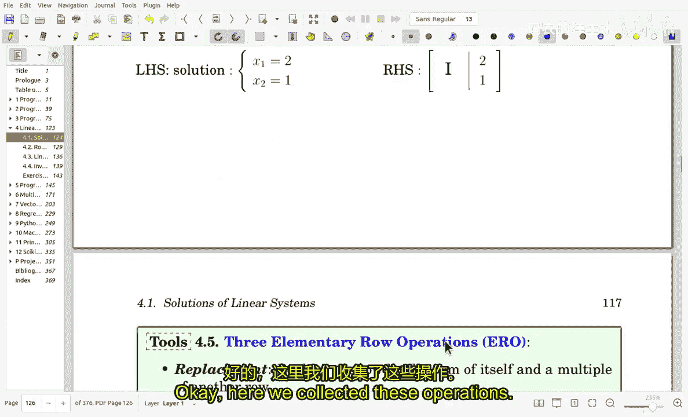

以下是求解前述方程组的步骤演示：

1.  **初始增广矩阵**：
    ```
    [-2  3 | -1]
    [ 1  2 |  4]
    ```
2.  **交换两行**（使左上角元素不为0）：
    ```
    [ 1  2 |  4]
    [-2  3 | -1]
    ```
3.  **行替换**：将第二行替换为“第二行 + 2 × 第一行”，以消去第一列下方的元素：
    ```
    [1  2 |  4]
    [0  7 |  7]
    ```
4.  **行缩放**：将第二行乘以 `1/7`：
    ```
    [1  2 |  4]
    [0  1 |  1]
    ```
5.  **行替换**：将第一行替换为“第一行 - 2 × 第二行”，以消去第一行第二列的元素：
    ```
    [1  0 |  2]
    [0  1 |  1]
    ```

最终矩阵对应方程组 `x1 = 2` 和 `x2 = 1`。因此，解为 `(2, 1)`。

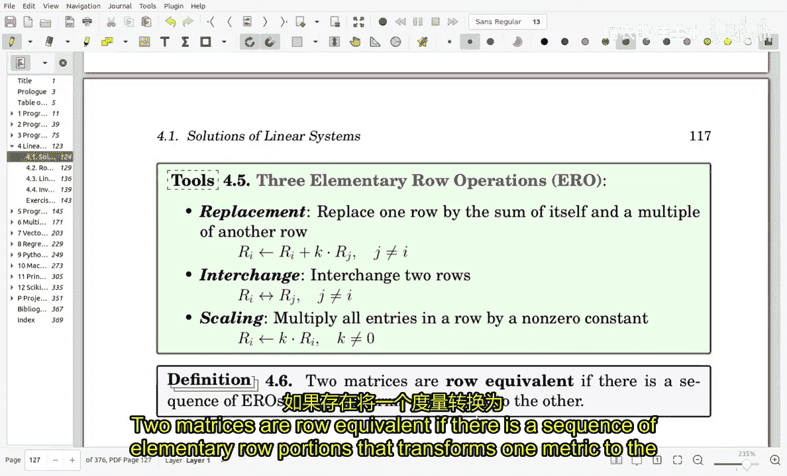

在上述过程中，我们使用了三种核心操作，即**初等行变换（EROs）**：

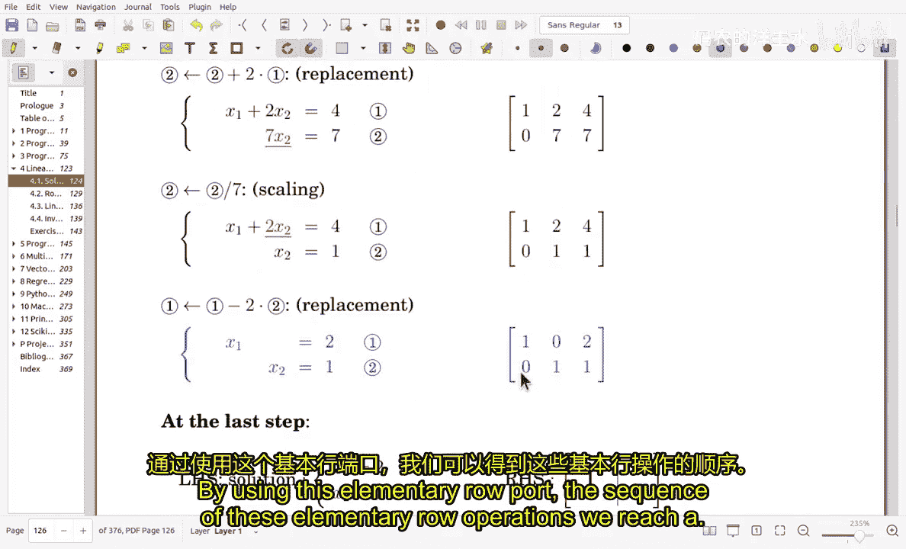

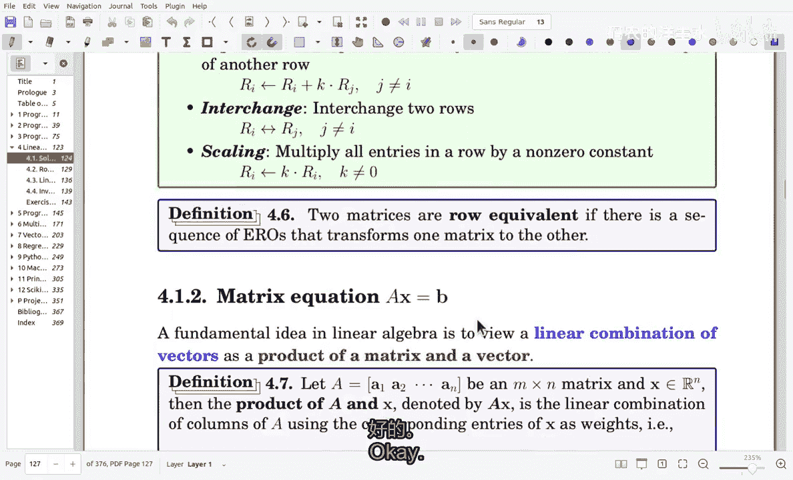

以下是三种初等行变换的定义：
1.  **行替换**：将某一行替换为它本身与另一行的倍数之和。
    *   **公式**：`Ri <- Ri + k * Rj`
2.  **行交换**：交换两行的位置。
    *   **公式**：`Ri <-> Rj`
3.  **行缩放**：将某一行的所有元素乘以一个非零常数。
    *   **公式**：`Ri <- k * Ri` (k ≠ 0)

如果存在一个初等行变换的序列能将矩阵A转化为矩阵B，则称矩阵A与B是**行等价**的。例如，通过一系列EROs，任何可逆矩阵都可以化为单位矩阵。

---

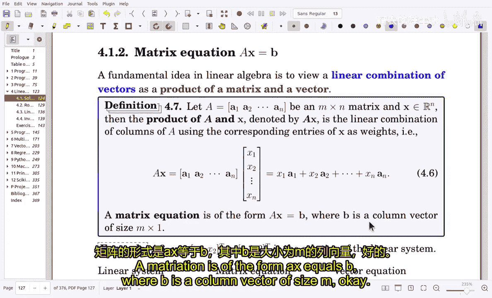

## 线性组合的矩阵视角

线性代数中的一个基本思想是将向量的线性组合视为矩阵与向量的乘积。

设 **A** 是一个 `m × n` 矩阵，其列向量为 **a1, a2, ..., an**。设 **x** 是一个 `n` 维向量。那么，乘积 **Ax** 被定义为列向量的线性组合：
**Ax = x1*a1 + x2*a2 + ... + xn*an**

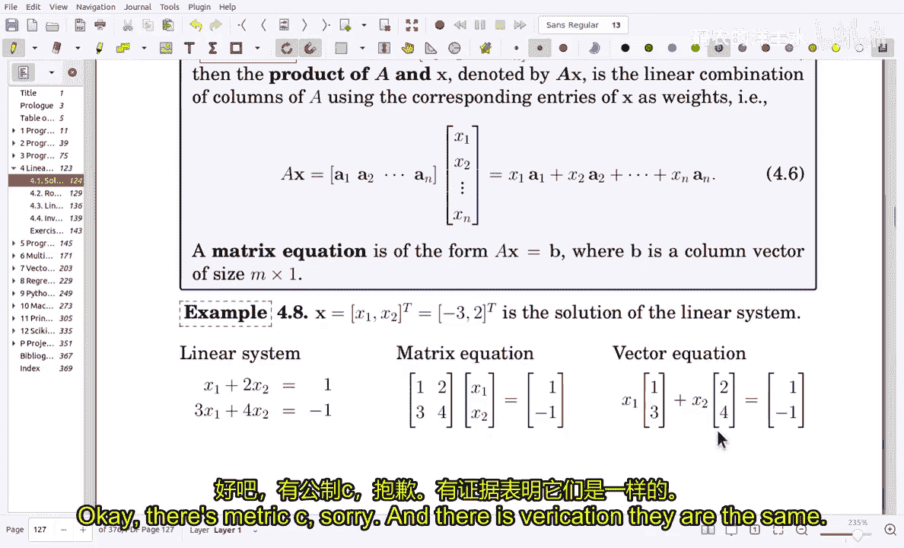

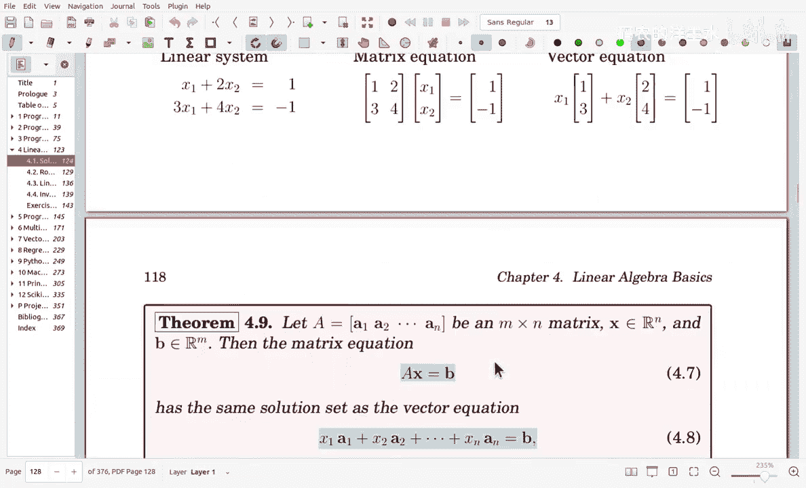

因此，矩阵方程 **Ax = b** 可以等价地视为向量方程：
**x1*a1 + x2*a2 + ... + xn*an = b**

这个向量方程与原始的线性方程组具有完全相同的解集。这为我们理解线性系统提供了另一种几何视角：求解 **Ax = b** 就是寻找一组系数 `x`，使得 **A** 的列向量能线性组合出目标向量 **b**。

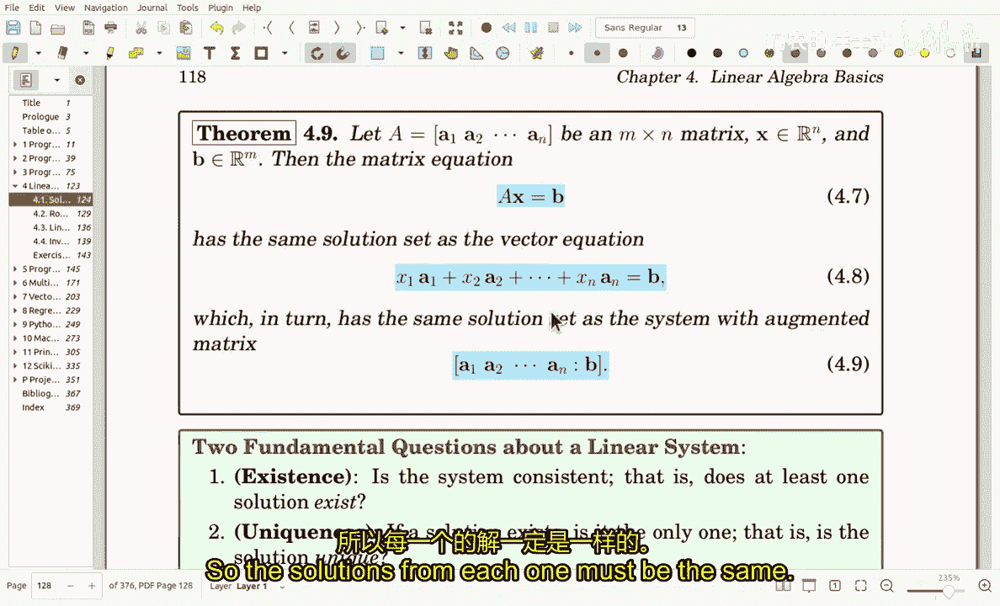

---

## 线性系统中的两个基本问题

在求解线性系统时，有两个根本性问题：
1.  **存在性**：系统是否相容？即，解是否存在？
2.  **唯一性**：如果解存在，它是否是唯一的？

在许多应用中，确保解存在且唯一至关重要。否则，我们可能面临无解或无穷多解的情况，处理起来会更加复杂。

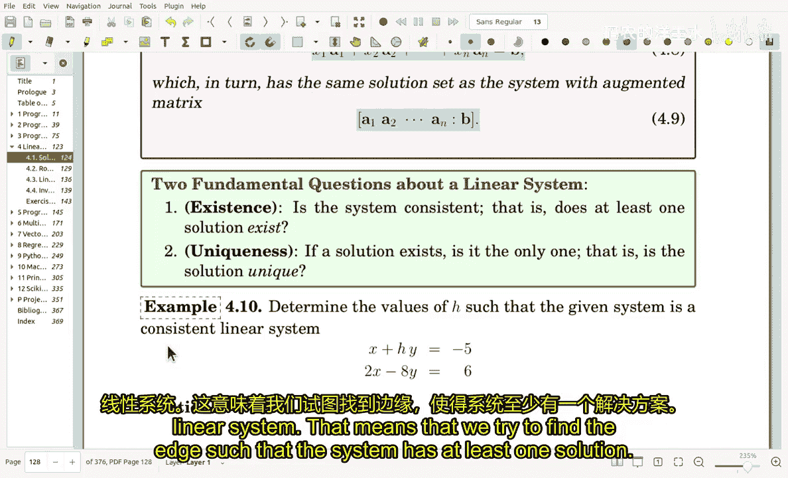

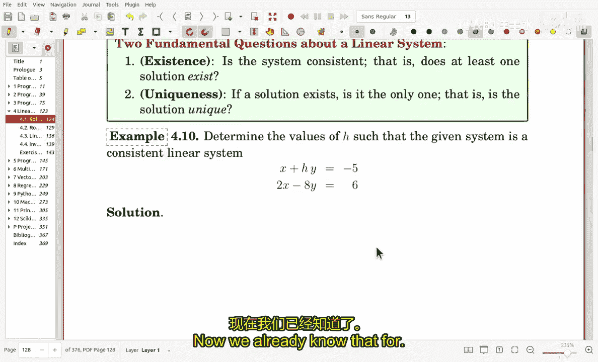

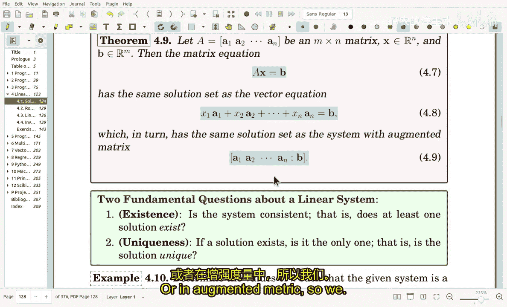

**示例**：确定参数 `h` 的值，使得以下系统相容（即至少有一个解）：
x1 + h*x2 = -5
2*x1 + 4*x2 = 6

我们构造增广矩阵并应用EROs：
```
[1  h | -5]
[2  4 |  6]
```
将第二行替换为“第二行 - 2 × 第一行”：
```
[1    h    | -5]
[0  4-2h  | 16]
```

系统相容的条件是，第二个方程不能导致 `0 = 非零常数` 的矛盾。这要求 `4 - 2h ≠ 0`，即 `h ≠ 2`。
*   当 `h ≠ 2` 时，我们可以继续求解得到唯一解。
*   当 `h = 2` 时，第二行变为 `[0 0 | 16]`，对应方程 `0 = 16`，系统不相容（无解）。

因此，当且仅当 `h ≠ 2` 时，该系统有（唯一）解。

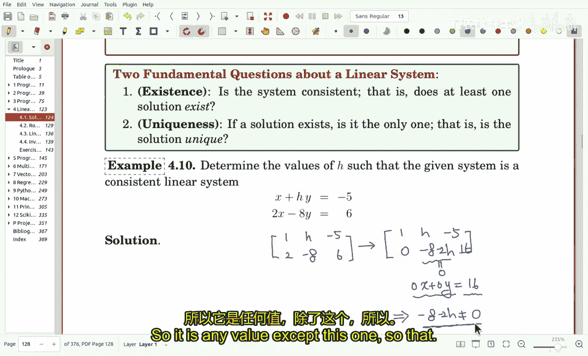

---

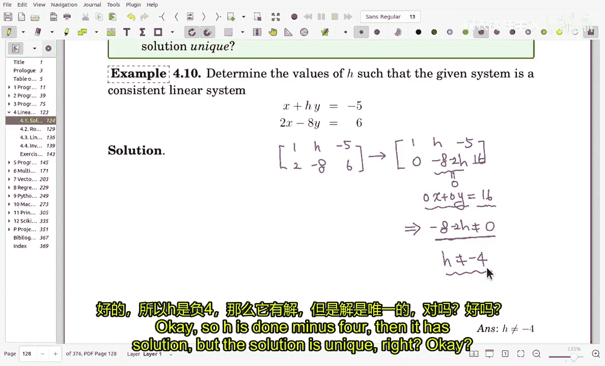

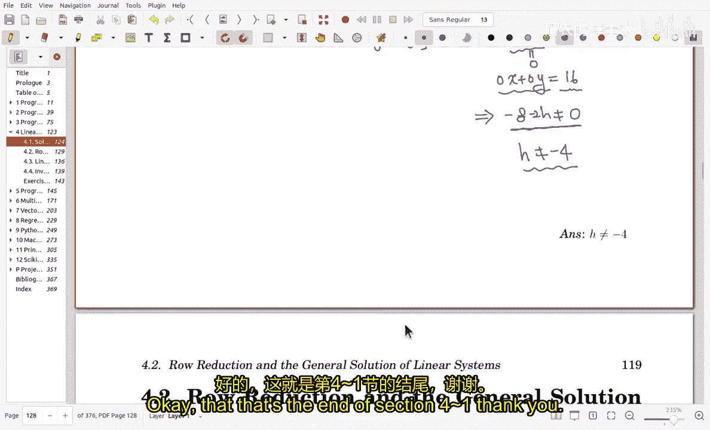

## 总结
本节课我们一起学习了线性代数的基础入门知识。我们首先了解了线性方程组的定义、解集以及等价系统的概念。接着，我们探讨了线性系统解的三种可能情况：无解、唯一解和无穷多解。为了有效求解，我们引入了矩阵表示法，特别是增广矩阵，并详细讲解了求解的核心工具——三种初等行变换（行替换、行交换、行缩放）。我们还从矩阵乘法的角度理解了线性组合，并指出了分析线性系统时需要考虑的两个基本问题：解的存在性与唯一性。这些概念是后续深入学习线性代数及其在人工智能中应用的重要基石。