# 029：行阶梯形与行化简算法

在本节课中，我们将学习线性系统的行化简算法，以及如何通过行化简得到行阶梯形和简化行阶梯形，从而求解线性方程组。我们将介绍核心概念，并通过具体示例演示算法步骤。

## 概述

在上一节（4.1节）中，我们学习了三种初等行变换。本节（4.2节）将探讨行化简以及线性方程组的通解。我们将通过一个具体例子，使用三种初等行变换来求解一个线性方程组。

## 示例：求解线性方程组

我们从该方程组的增广矩阵开始。

增广矩阵为：
```
[0, 1, -2, | 0]
[1, -2,  2, | 3]
[4, -8,  6, | 14]
```

由于第一行首元为0，我们交换第一行和第二行。
```
[1, -2,  2, | 3]
[0,  1, -2, | 0]
[4, -8,  6, | 14]
```

接下来，用第一行的-4倍加到第三行，以消去第三行第一列的元素。
```
[1, -2,  2, | 3]
[0,  1, -2, | 0]
[0,  0, -2, | 2]
```

然后，将第三行除以-2进行缩放。
```
[1, -2,  2, | 3]
[0,  1, -2, | 0]
[0,  0,  1, | -1]
```

现在，我们有了一个行阶梯形。接下来，通过行变换将主元列的其他元素化为0。首先，用第二行的2倍加到第一行，消去第一行第二列的元素。
```
[1, 0, -2, | 3]
[0, 1, -2, | 0]
[0, 0,  1, | -1]
```

然后，用第三行的2倍加到第一行，用第三行的2倍加到第二行，消去第一行和第二行第三列的元素。
```
[1, 0, 0, | 1]
[0, 1, 0, | -2]
[0, 0, 1, | -1]
```

矩阵被化简为单位矩阵，因此方程组的解为 `(1, -2, -1)`。这是一个唯一解，说明该方程组是相容的。

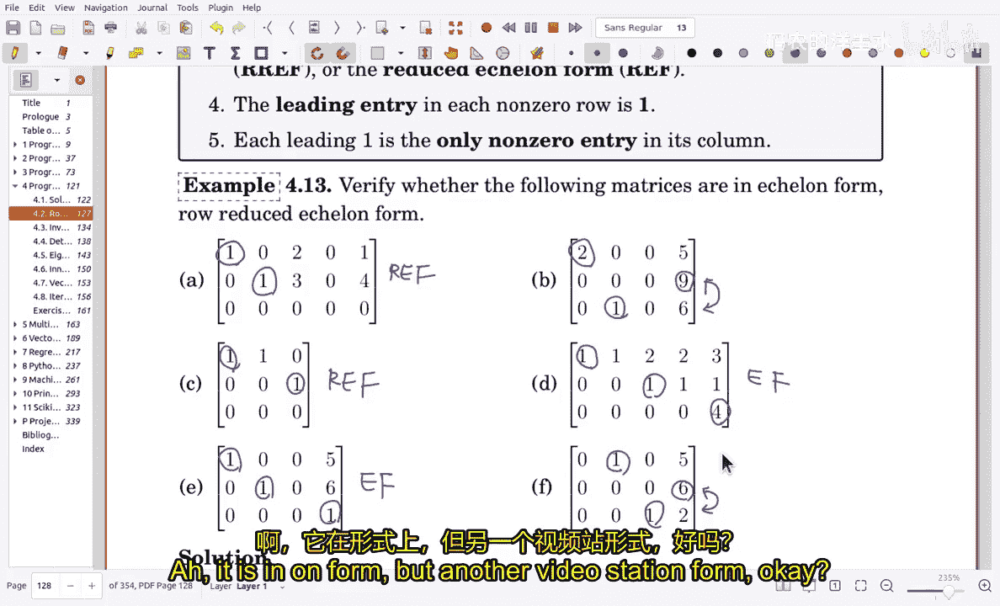

**核心方法**：线性方程组可以通过将其增广矩阵化为简化行阶梯形来求解。在MATLAB中，可以使用 `rref` 函数实现此过程。
```matlab
A = [0 1 -2; 1 -2 2; 4 -8 6];
B = [0; 3; 14];
rref([A B])
```

## 行阶梯形定义

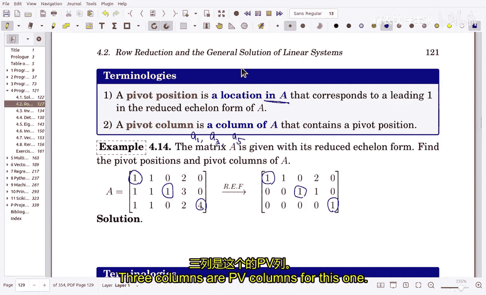

我们定义行阶梯形并考虑行化简算法。

一个矩阵是**行阶梯形**，如果它满足以下性质：
1.  所有非零行都在全零行之上。
2.  某一行的**主元**（即该行最左边的非零元素）总位于上一行主元的右侧。
3.  主元下方的所有元素均为零。

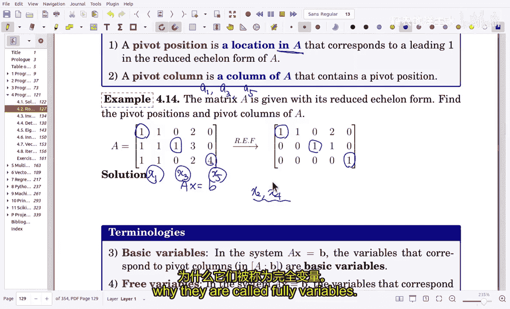

其形状类似于阶梯，因此得名。

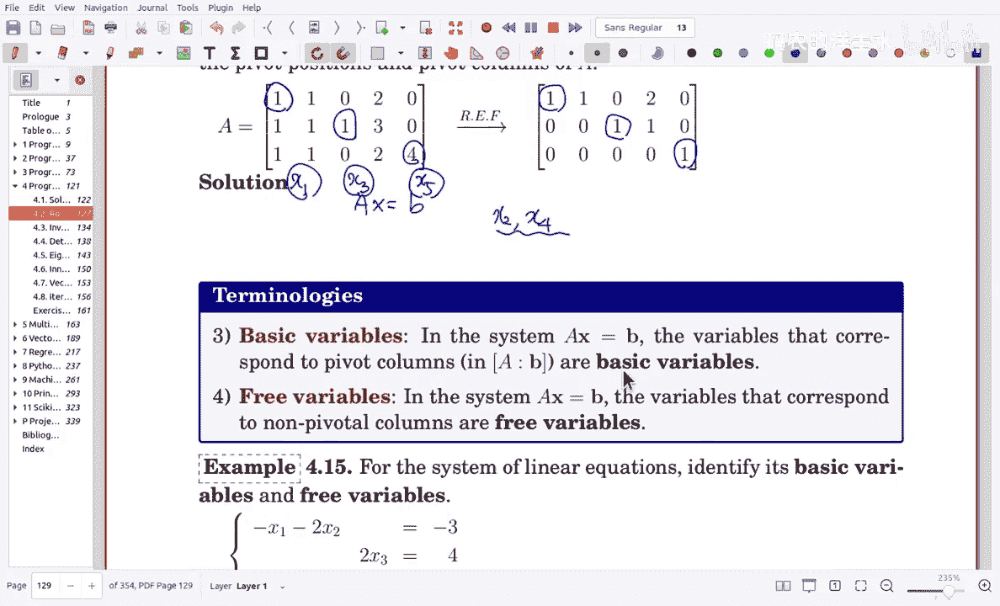

如果一个行阶梯形矩阵还满足以下两个额外条件，则称为**简化行阶梯形**：
4.  每个主元都为1。
5.  每个主元是其所在列中唯一的非零元素。

以下是判断矩阵形式的示例：
*   `[[1, *， *]; [0, 1, *]; [0, 0, 0]]` 是简化行阶梯形（满足所有条件）。
*   `[[1, *， *]; [0, 0, 1]; [0, 0, 0]]` 是行阶梯形（满足前3个条件）。
*   `[[0, 1]; [1, 0]]` 不是行阶梯形（交换两行后才是）。
*   `[[2, *]; [0, 1]]` 是行阶梯形，但不是简化行阶梯形（主元不是1，且其所在列有其他非零元素）。

## 主元位置与变量分类

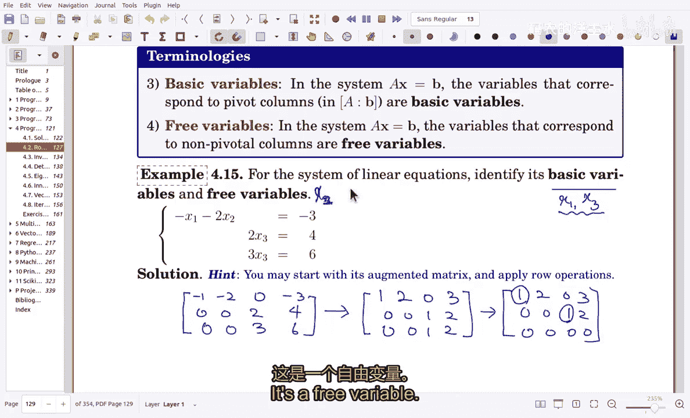

**主元位置**是矩阵A中对应于其简化行阶梯形中主元1的位置。
**主元列**是包含主元位置的列。

在方程组 `Ax = b` 中：
*   **基本变量**：对应于增广矩阵中主元列的变量。
*   **自由变量**：对应于非主元列的变量。

例如，对于一个化简后主元位于第1、3、5列的矩阵，`x1`， `x3`， `x5` 是基本变量，`x2` 和 `x4` 是自由变量。

## 示例：识别基本变量与自由变量

考虑以下线性方程组，我们需要识别其基本变量和自由变量。
```
-x1 - 2x2 = -3
 2x2 + 2x3 = 4
 3x2 + 3x3 = 6
```

首先，写出其增广矩阵并进行行化简。
```
[[-1, -2, 0, | -3],
 [ 0,  2, 2, |  4],
 [ 0,  3, 3, |  6]]
```
经过缩放和行变换，得到简化行阶梯形：
```
[[1, 2, 0, | 3],
 [0, 0, 1, | 2],
 [0, 0, 0, | 0]]
```
可以看到，主元位于第1列和第3列。因此，`x1` 和 `x3` 是基本变量，`x2` 是自由变量。

为什么称其为自由变量？将化简后的矩阵写回方程形式：
```
x1 + 2x2 = 3
x3 = 2
```
我们可以将基本变量 `x1` 和 `x3` 留在等式左边，其余移到右边：
```
x1 = 3 - 2x2
x3 = 2
```
对于 `x2`，没有方程约束它，因此它可以取任意值。解可以写为：
```
[x1]   [3]      [-2]
[x2] = [0] + x2*[ 1]
[x3]   [2]      [ 0]
```
其中 `x2` 是自由参数。正是由于 `x2` 可以自由选择，它被称为自由变量。

## 行化简算法详解

行化简算法通过一个例子来演示，目标是将给定矩阵 `A` 化为简化行阶梯形。

假设矩阵 `A` 为：
```
[[0, 3, -6, 6, 4, -5],
 [3, -7, 8, -5, 8, 9],
 [3, -9, 12, -9, 6, 15]]
```

**向前阶段（化为行阶梯形）**：
1.  **选择主元**：第一列第一行是0，与下方非零行交换，使左上角元素非零。
2.  **消元**：使用第一行主元，通过行倍加将下方行的第一列元素化为0。
3.  **缩放**：将第二行主元位置（第二行第二列）通过行缩放化为1。
4.  **继续消元**：使用新的主元，将其下方的元素化为0。
5.  重复此过程，向下向右移动，直到矩阵变为行阶梯形。

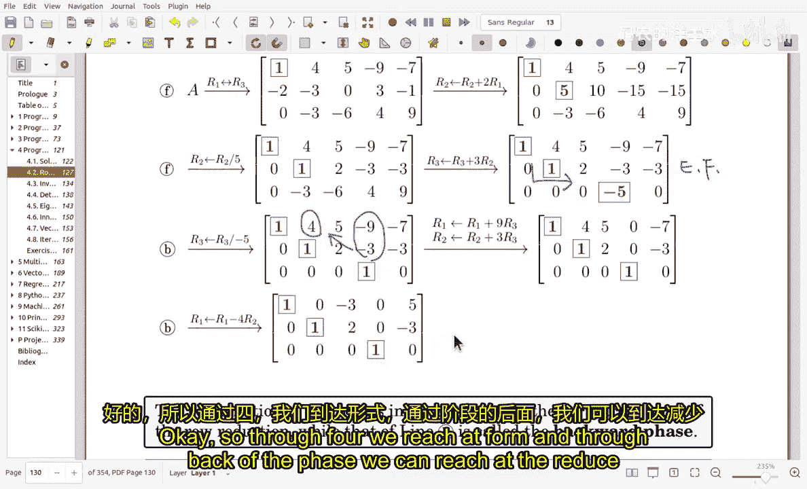

**向后阶段（化为简化行阶梯形）**：
1.  从最右边的非零行开始，将其主元上方的所有元素通过行倍加化为0。
2.  向左移动到上一个主元，重复步骤1，消去其上方所有元素。
3.  继续此过程，直到每个主元都是其所在列唯一的非零元素，且值为1。

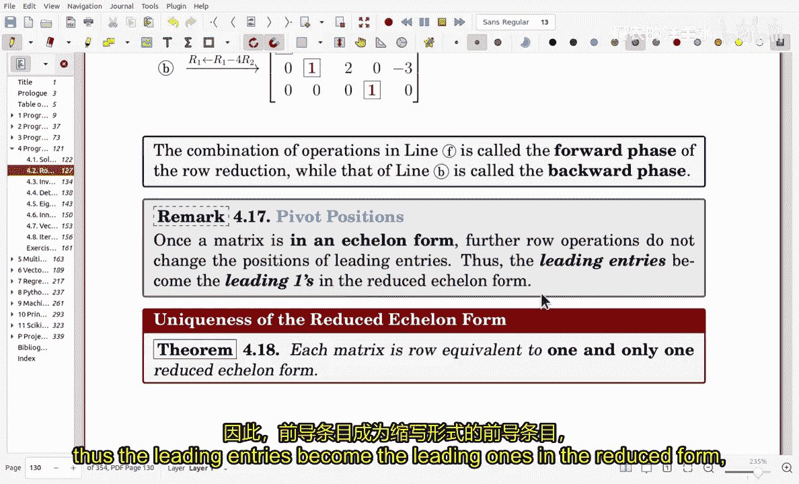

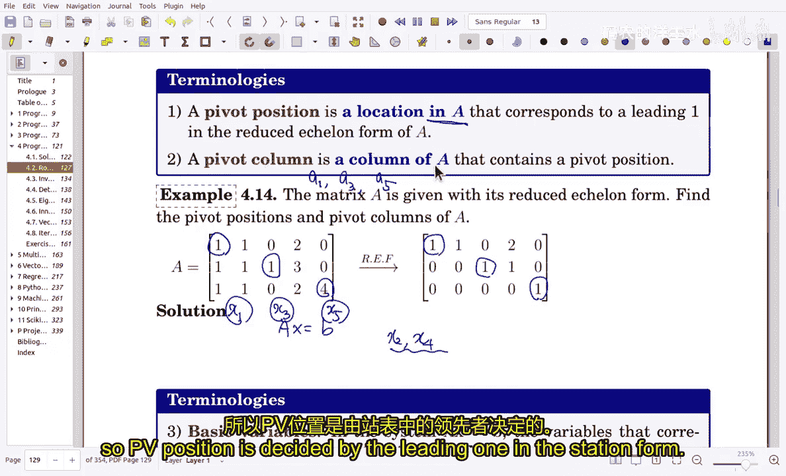

**算法要点**：
*   在向前阶段，我们从上到下、从左到右进行，得到行阶梯形。
*   在向后阶段，我们从下到上、从右到左进行，得到简化行阶梯形。
*   一旦矩阵化为行阶梯形，其主元位置就固定了，后续的初等行变换不会改变这些位置。

## 唯一性与总结

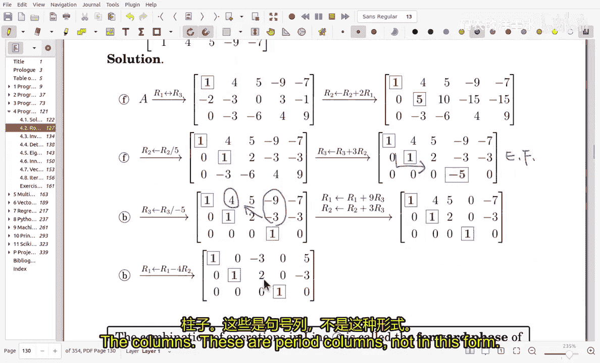

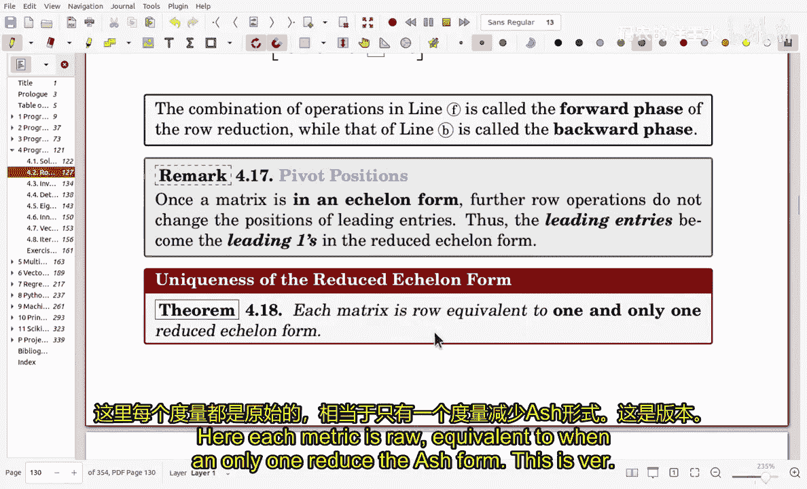

*   **行阶梯形不唯一**：一个矩阵可以通过不同的行变换序列得到不同的行阶梯形。
*   **简化行阶梯形唯一**：任意矩阵都行等价于**唯一一个**简化行阶梯形矩阵。

本节课中，我们一起学习了：
1.  **行阶梯形**和**简化行阶梯形**的定义与判断。
2.  **主元位置**、**主元列**、**基本变量**和**自由变量**的概念。
3.  使用**行化简算法**（分为向前和向后两个阶段）求解线性方程组。
4.  理解了自由变量在描述方程组**通解**中的作用。
5.  认识到简化行阶梯形的唯一性。

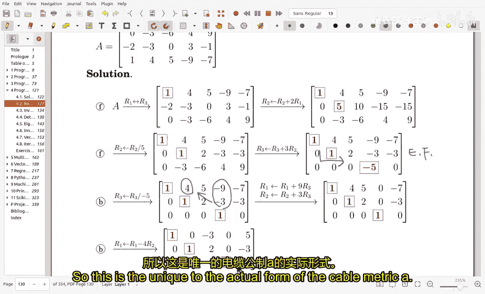

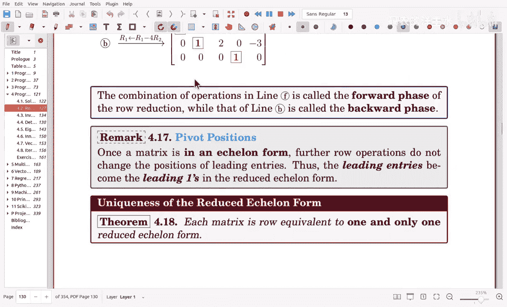

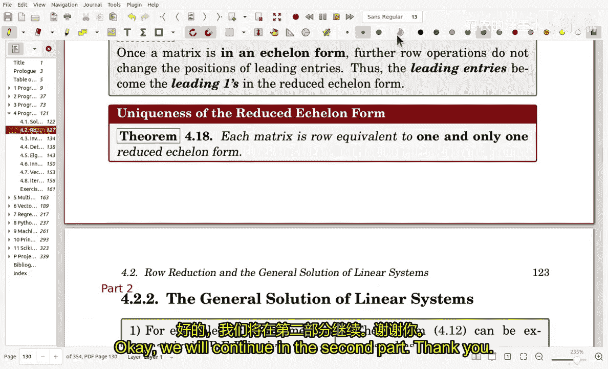

掌握行化简是理解线性方程组解的结构、矩阵的秩以及后续线性代数概念的基础。