# 030：基础变量与自由变量 🔢

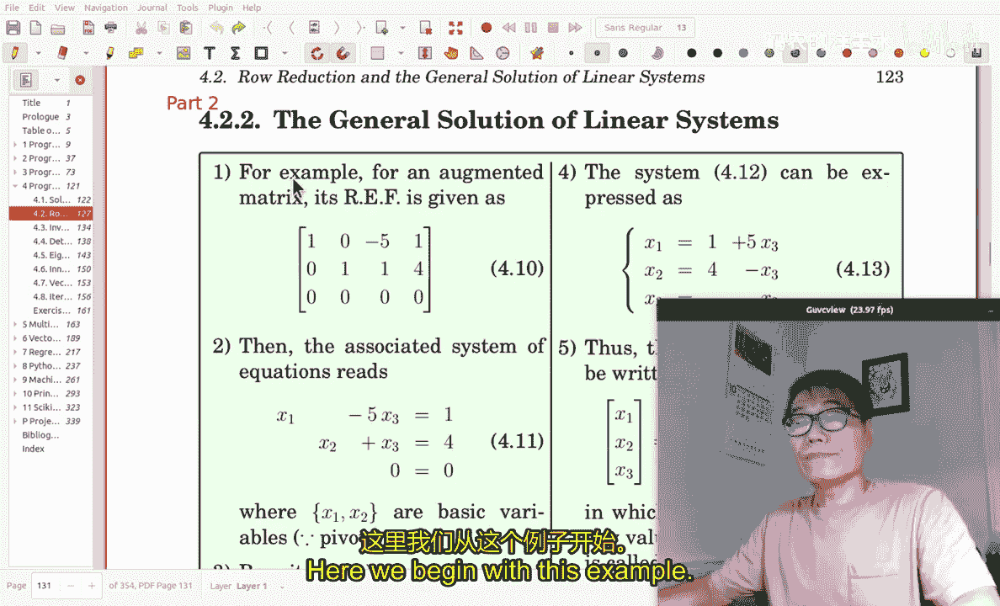

在本节课中，我们将学习线性方程组通解的第二部分。我们将重点介绍如何通过识别基础变量和自由变量，来系统地描述一个线性方程组的所有可能解。

上一节我们介绍了主元、主元位置和主元列的概念。本节中，我们将基于这些概念，学习如何找到并表达方程组的通解。

## 从例子开始

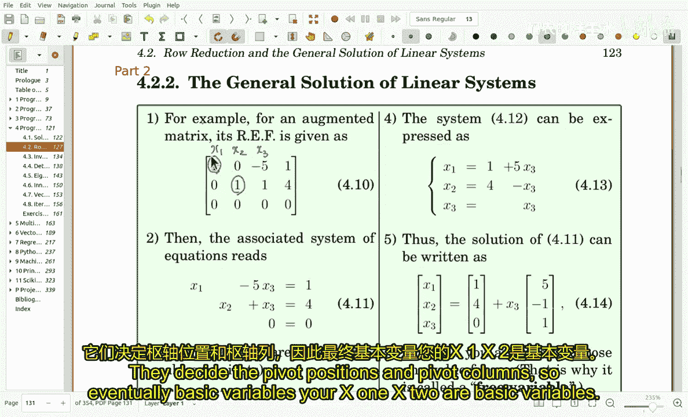

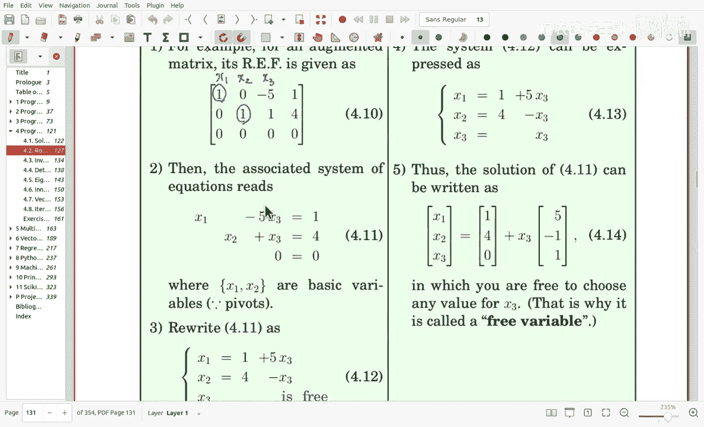

考虑以下增广矩阵，其行最简形式如下：

其对应的方程组可以写为：
*   x1 - 5x3 = 1
*   x2 + x3 = 4
*   0 = 0

其中，第一行和第二行的首项系数1决定了主元位置和主元列。因此，**基础变量**是 x1 和 x2。

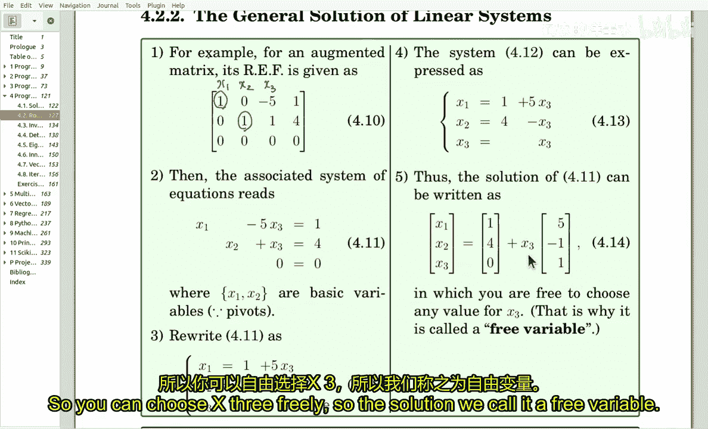

为了求解，我们将所有非基础变量移到等号右边，只保留基础变量在左边：
*   x1 = 1 + 5x3
*   x2 = 4 - x3

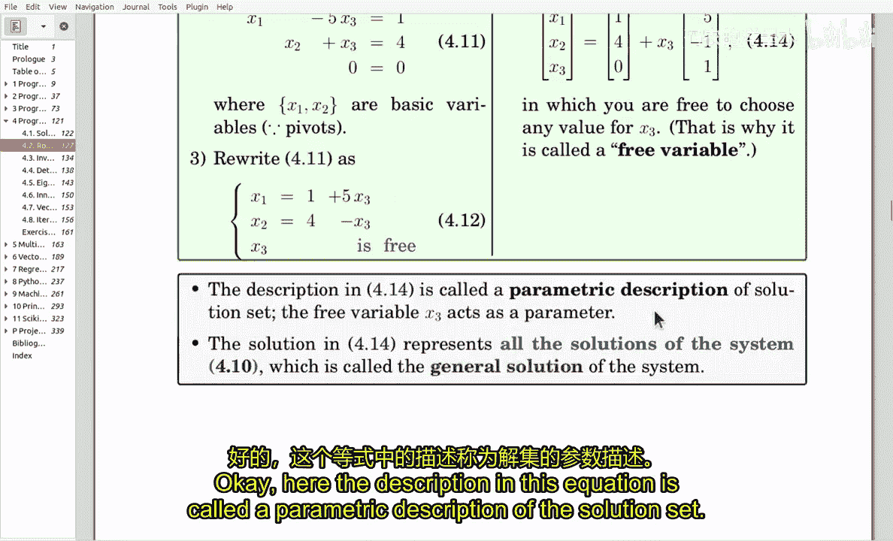

此时，x3 不受任何方程约束，可以自由取值，因此它是一个**自由变量**。为了完整地描述解向量 (x1, x2, x3)，我们显式地加上一行：x3 = x3。

于是，解可以写成向量形式：
`x = [1, 4, 0] + x3 * [5, -1, 1]`

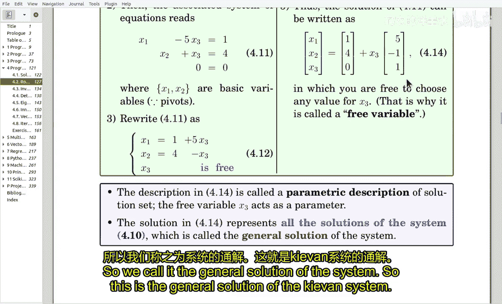

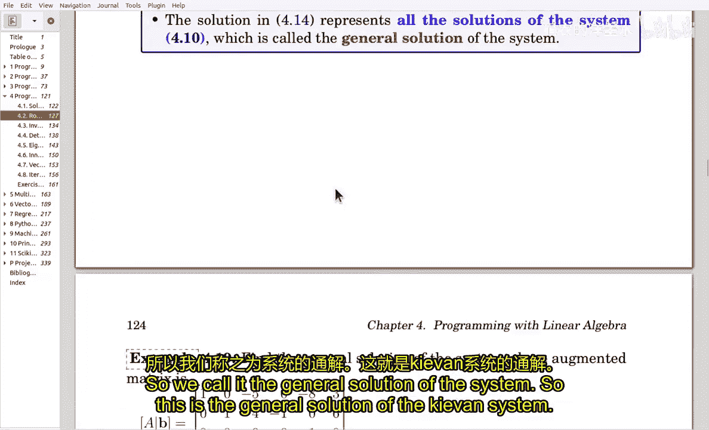

对于 x3 的任意选择，上述表达式都给出原方程组的一个解。因此，x3 作为参数，这个表达式描述了**所有解**的集合。

这种用自由变量作为参数的描述方式，称为解集的**参数化描述**。

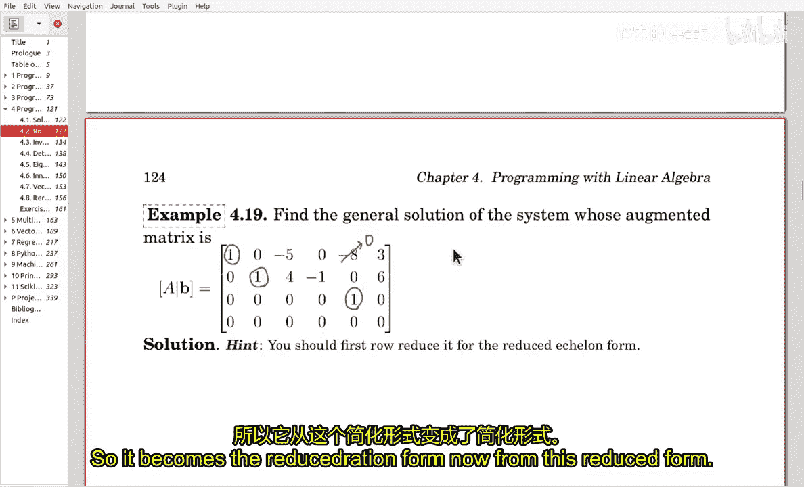

这个包含了所有解的表达式，就称为该方程组的**通解**。

## 求解通解的步骤

现在，我们通过一个具体例子来练习求解通解的完整过程。以下是需要求解的增广矩阵：

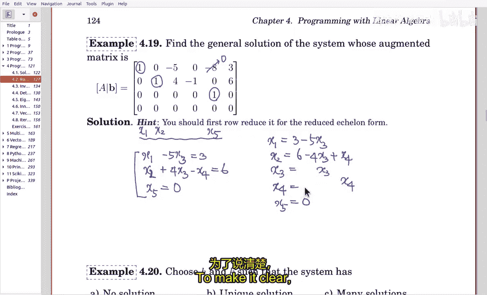

首先，我们将其化为行最简形式。通过行操作消除第二行第一列的元素后，得到：

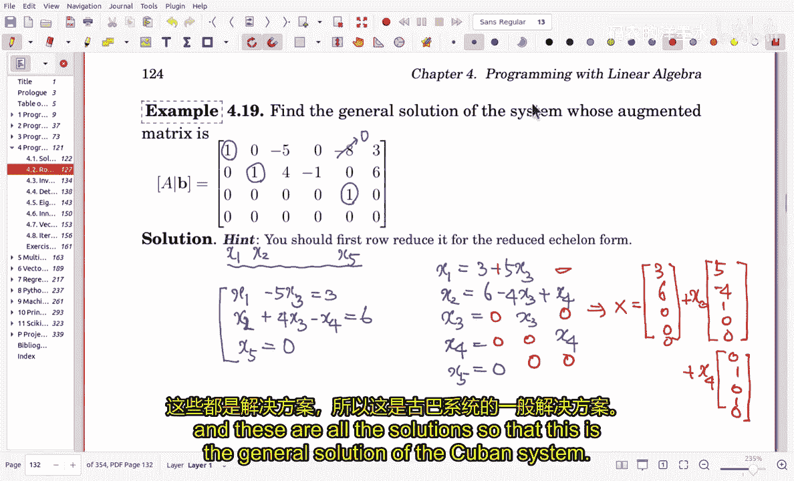

从行最简形式写出对应的方程组：
*   x1 - 5x4 = 3
*   x2 + 4x3 - x4 = 6
*   x5 = 0

这里，基础变量是 x1, x2, x5。自由变量是 x3 和 x4。

将基础变量留在左边，其他项移到右边：
*   x1 = 3 + 5x4
*   x2 = 6 - 4x3 + x4
*   x5 = 0
*   （自由变量）x3 = x3
*   （自由变量）x4 = x4

为了更清晰地写成向量形式，我们补上系数为0的项。解向量 `x = [x1, x2, x3, x4, x5]` 可以表示为：

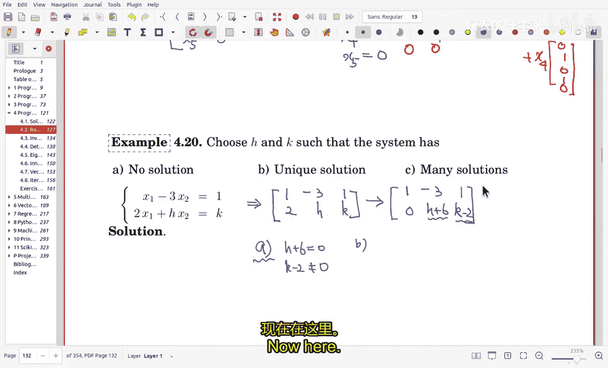

`x = [3, 6, 0, 0, 0] + x3 * [-4, 0, 1, 0, 0] + x4 * [5, 1, 0, 1, 0]`

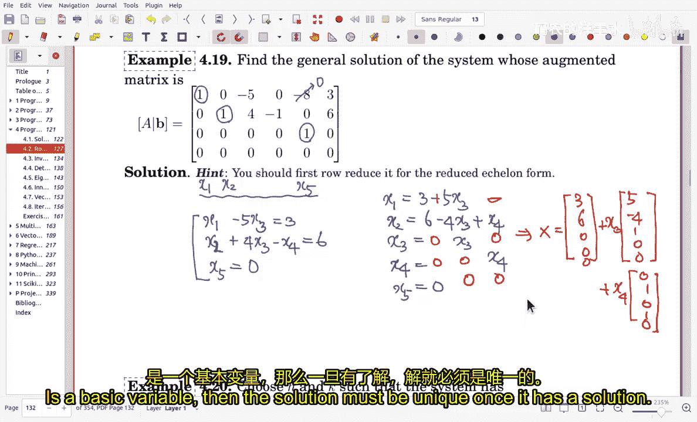

其中，x3 和 x4 可以任意取值。这个表达式就是该方程组的通解。

## 解的存在性与唯一性分析

接下来，我们探讨方程组解的不同情况。给定以下含参数 h 和 k 的方程组，我们需要确定参数取何值时，方程组无解、有唯一解或有无限多解。

其增广矩阵为：
`[1, -3, 1; 2, h, k]`

通过行化简（第二行减去2倍的第一行），得到：
`[1, -3, 1; 0, h+6, k-2]`

以下是不同情况的判断：
1.  **无解**：当 `h+6 = 0` 且 `k-2 ≠ 0` 时，第二行表示 `0 = 非零数`，矛盾，故无解。
2.  **唯一解**：当 `h+6 ≠ 0` 时，该位置成为主元，没有自由变量，因此有唯一解（假设方程组是相容的）。
3.  **无限多解**：当 `h+6 = 0` 且 `k-2 = 0` 时，第二行全为零，x2 成为自由变量，因此有无限多解。

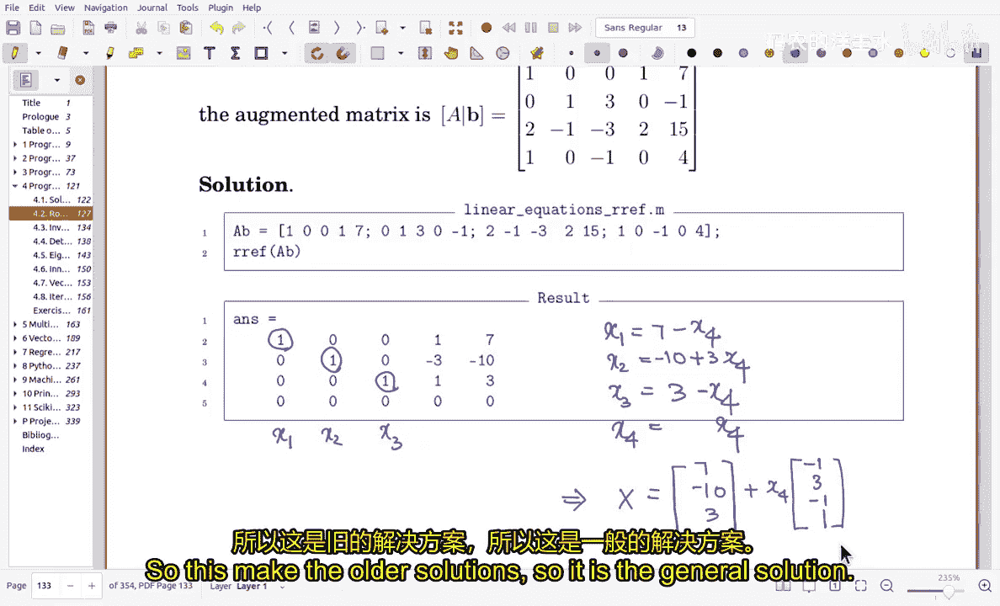

## 使用计算机求解

对于更复杂的系统，我们可以借助计算机。例如，对于给定的增广矩阵，使用 `rref`（行最简形式）函数，可以直接得到化简后的矩阵，从而快速识别基础变量和自由变量，并写出通解。

## 真/假判断题

最后，我们通过几个判断题来巩固概念。

1.  **行化简算法仅适用于线性方程组的增广矩阵。**  
    **答案：假**。行化简算法可以应用于任何矩阵，不一定是增广矩阵。

2.  **若增广矩阵的行最简形式中有一行为 `[0, 0, 0, 0, 0 | 0]`，则对应的线性方程组不相容（无解）。**  
    **答案：假**。这样的一行表示 `0=0`，是一个恒等式，本身不导致矛盾。不相容是由形如 `[0, 0, ..., 0 | b]`（其中 b ≠ 0）的行决定的。

3.  **矩阵中的主元位置取决于行化简过程中是否使用了行交换。**  
    **答案：假**。主元位置由矩阵本身决定，与化简过程中是否进行行交换无关。

4.  **将矩阵化为阶梯形的过程称为行化简算法的向前阶段。**  
    **答案：真**。行化简通常分为两个阶段：向前阶段（消元得到阶梯形）和向后阶段（进一步化简得到行最简形）。

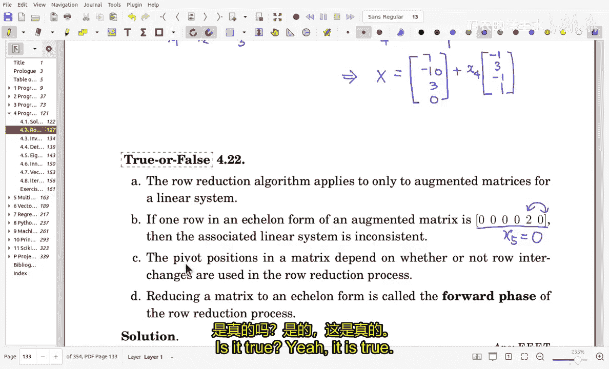

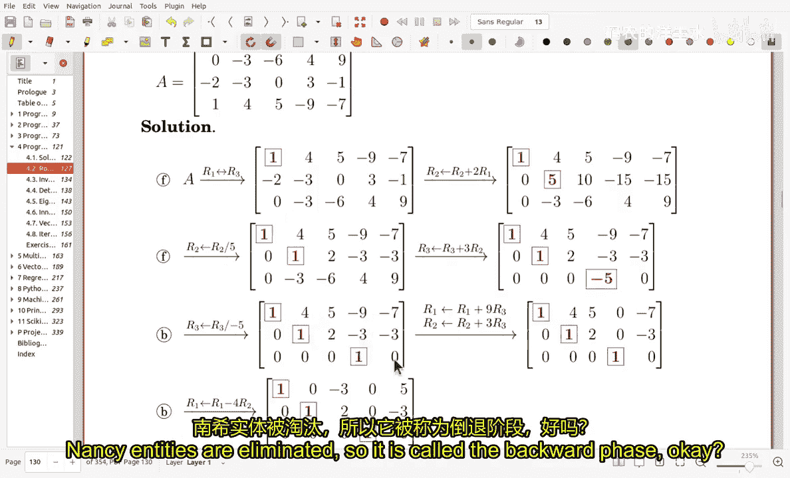
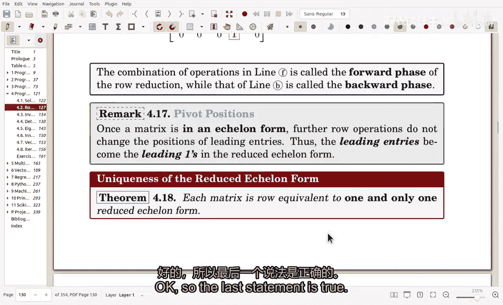
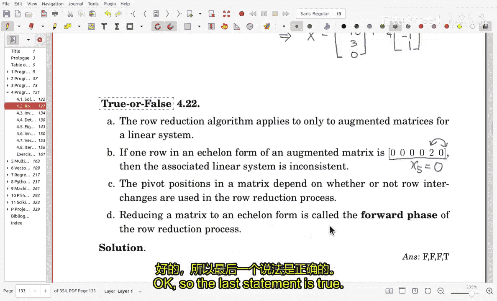

## 总结

本节课中，我们一起学习了线性方程组通解的求解方法。核心步骤是：将增广矩阵化为行最简形式，识别**基础变量**和**自由变量**，用自由变量作为参数表示基础变量，最后将所有解写成向量形式的**参数化描述**，即得到**通解**。我们还分析了方程组无解、有唯一解和有无穷多解的条件，并了解了如何使用计算工具辅助求解。

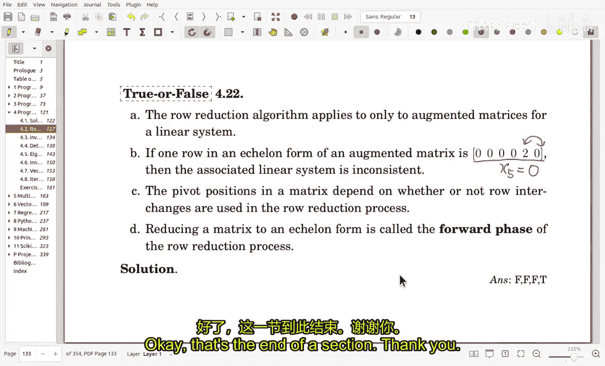

