# 031：线性独立性与向量张成

在本节课中，我们将学习线性代数中的两个核心概念：**线性独立性**与**向量张成**。我们将通过定义、示例和矩阵方法来理解这些概念，并学习如何判断一组向量是否线性独立，以及如何确定一个向量是否属于某个向量集的张成空间。

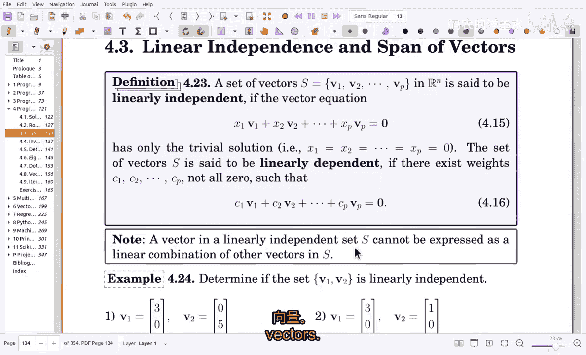

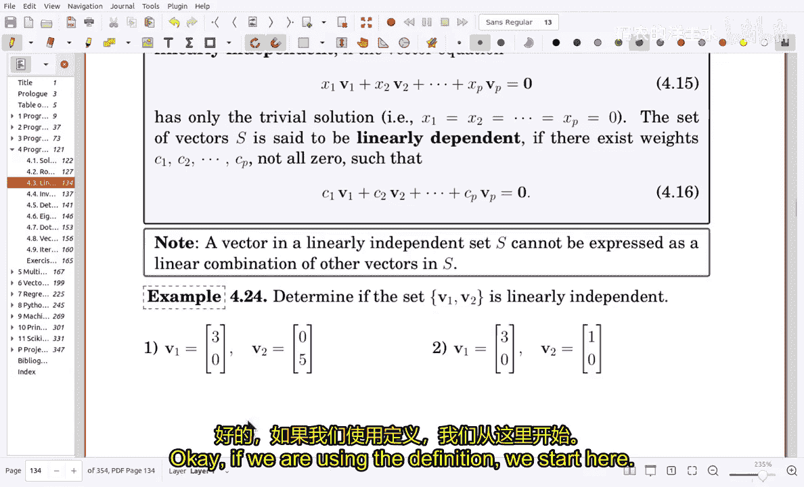

## 4.3：线性独立性与向量张成

一个包含 **p** 个向量的集合，其中每个向量都属于 **Rⁿ** 空间，如果满足以下条件，则称该集合是**线性独立的**：方程 **c₁v₁ + c₂v₂ + ... + cₚvₚ = 0** 只有**平凡解**（即所有系数 **cᵢ = 0**）。否则，该向量集合被称为**线性相关的**。

线性相关意味着存在一组不全为零的权重 **c₁, c₂, ..., cₚ**，使得这些向量的线性组合等于零向量。

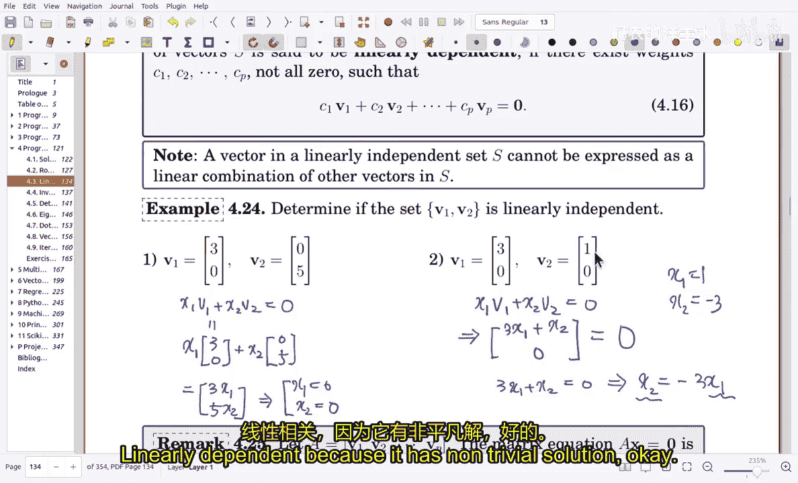

线性独立性意味着集合中的每个向量都独立于其他向量。具体来说，在一个线性独立的集合中，任何一个向量都不能表示为集合中其他向量的线性组合。

---

### 通过定义判断线性独立性

上一节我们介绍了线性独立性的定义，本节中我们来看看如何应用这个定义。

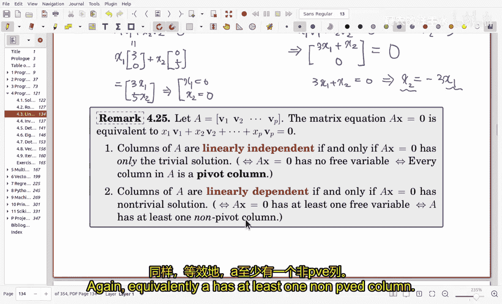

以下是判断两个向量是否线性独立的步骤：
1.  设定线性组合方程：**x₁v₁ + x₂v₂ = 0**。
2.  将向量代入方程。
3.  解出系数 **x₁** 和 **x₂**。
4.  如果只有 **x₁ = 0** 且 **x₂ = 0** 这一组解，则向量线性独立。如果存在非零解，则向量线性相关。

**示例 1**：判断向量 **v₁ = [3, 0]ᵀ** 和 **v₂ = [0, 5]ᵀ** 是否线性独立。
*   建立方程：**x₁[3, 0]ᵀ + x₂[0, 5]ᵀ = [0, 0]ᵀ**。
*   得到方程组：**3x₁ = 0** 和 **5x₂ = 0**。
*   解得：**x₁ = 0**, **x₂ = 0**。
*   只有平凡解，因此向量**线性独立**。

**示例 2**：判断向量 **v₁ = [3, 0]ᵀ** 和 **v₂ = [1, 0]ᵀ** 是否线性独立。
*   建立方程：**x₁[3, 0]ᵀ + x₂[1, 0]ᵀ = [0, 0]ᵀ**。
*   得到方程组：**3x₁ + x₂ = 0** 和 **0 = 0**。
*   从第一个方程可得 **x₂ = -3x₁**。只要 **x₁** 不为零，**x₂** 就不为零。
*   例如，**x₁ = 1**, **x₂ = -3** 就是一组非零解。
*   存在非平凡解，因此向量**线性相关**。

---

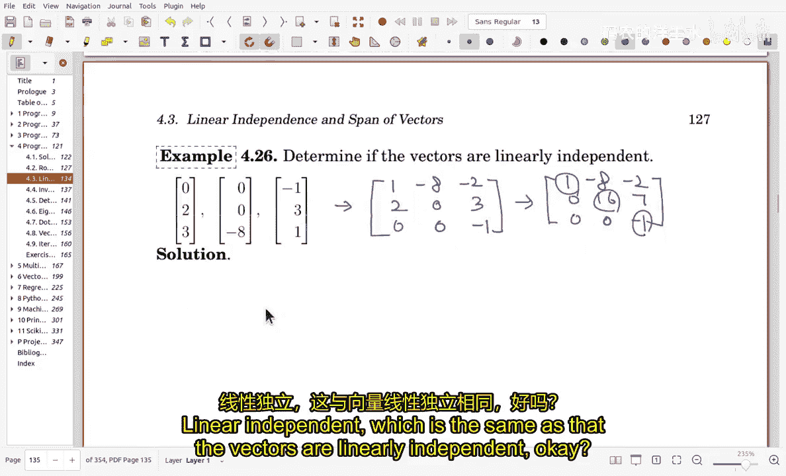

### 通过矩阵方法判断线性独立性

对于包含多个向量的集合，使用矩阵方法更为高效。我们将向量作为列向量组合成一个矩阵 **A**。

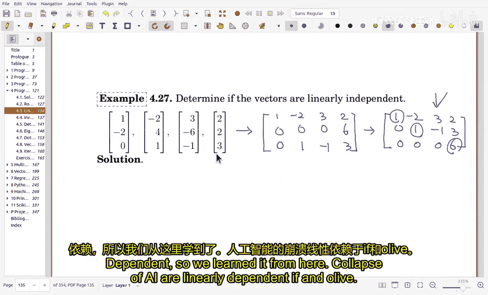

以下是利用矩阵判断线性独立性的关键等价关系：
*   向量 **v₁, v₂, ..., vₚ** 线性独立 **⇔** 齐次方程 **Ax = 0** 只有平凡解。
*   向量 **v₁, v₂, ..., vₚ** 线性独立 **⇔** 矩阵 **A** 的每一列都是**主元列**（即没有自由变量）。

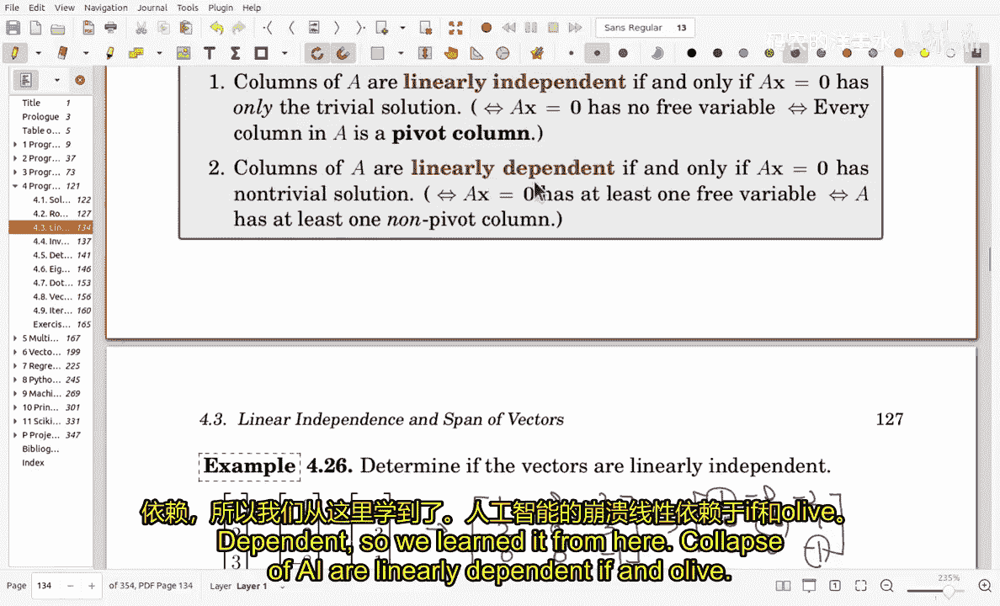

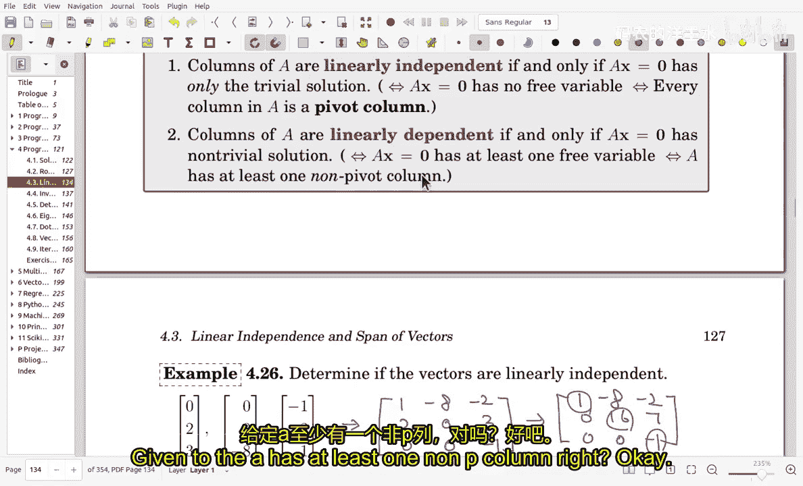

反之：
*   向量线性相关 **⇔** 齐次方程 **Ax = 0** 存在非平凡解。
*   向量线性相关 **⇔** 矩阵 **A** 至少有一列是**非主元列**（即存在自由变量）。

**示例 3**：判断向量 **v₁ = [1, 2, -1]ᵀ**, **v₂ = [-2, 0, 3]ᵀ**, **v₃ = [3, 6, -3]ᵀ** 是否线性独立。
1.  构造矩阵 **A**，其列向量为 **v₁, v₂, v₃**：
    ```
    A = [ 1  -2   3 ]
        [ 2   0   6 ]
        [ -1  3  -3 ]
    ```
2.  对 **A** 进行行化简，得到行阶梯形：
    ```
    [ 1  -2   3 ]
    [ 0   4   0 ]
    [ 0   0  -1 ]
    ```
3.  观察发现，每一列都有一个主元（第一行的1，第二行的4，第三行的-1）。
4.  所有列都是主元列，因此这组向量**线性独立**。

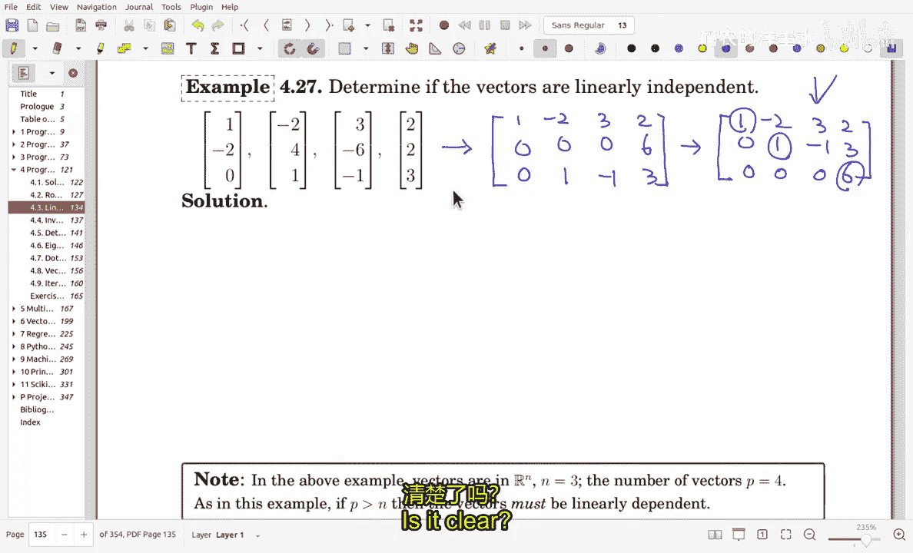

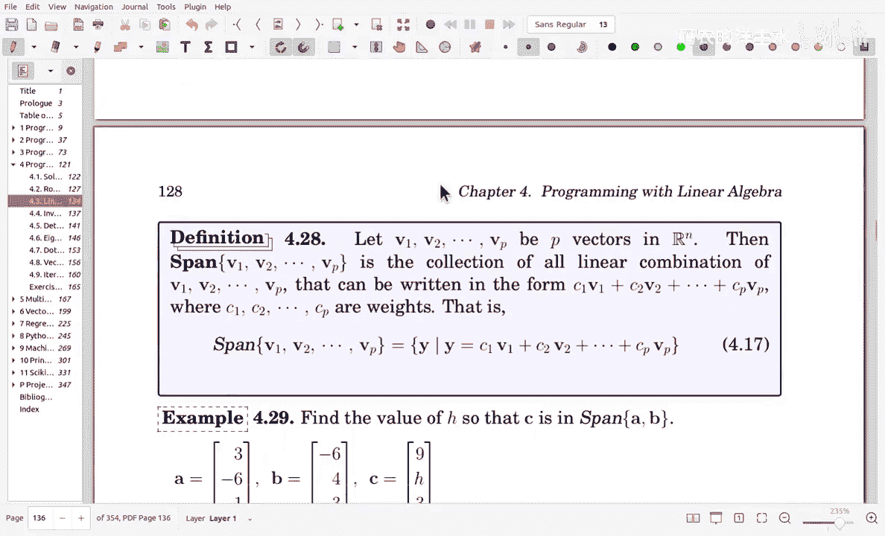

**示例 4**：判断向量 **v₁ = [1, -2, 3]ᵀ**, **v₂ = [-2, 4, -6]ᵀ**, **v₃ = [2, 1, 3]ᵀ**, **v₄ = [0, 3, 9]ᵀ** 是否线性独立。
1.  构造矩阵 **A**：
    ```
    A = [ 1  -2   2   0 ]
        [ -2  4   1   3 ]
        [ 3  -6   3   9 ]
    ```
2.  对 **A** 进行行化简：
    ```
    [ 1  -2   2   0 ]
    [ 0   0   5   3 ]
    [ 0   0  -3   9 ]
    ```
    继续化简可得：
    ```
    [ 1  -2   0   ? ] (具体数值不影响判断)
    [ 0   0   1   ? ]
    [ 0   0   0   1 ]
    ```
3.  观察主元位置。第二列没有主元，它是一个非主元列。
4.  存在非主元列，因此这组向量**线性相关**。

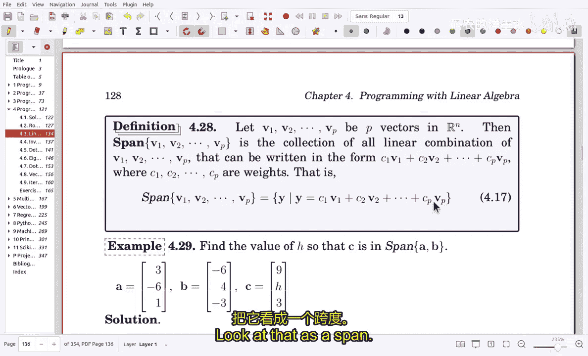

**一个重要结论**：在 **Rⁿ** 空间中，如果向量的数量 **p** 大于空间的维数 **n**，那么这组向量**必定是线性相关的**。因为矩阵 **A** 最多只有 **n** 个主元（行数），但列数 **p > n**，所以至少有一列是非主元列。

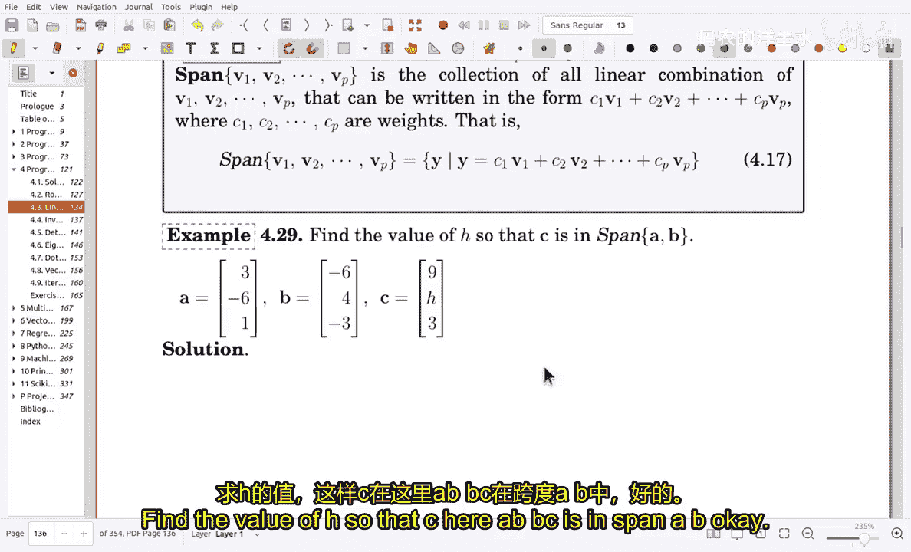

---

### 向量的张成

接下来，我们学习另一个核心概念：**张成**。

向量 **v₁, v₂, ..., vₚ** 的**张成**，记作 **Span{v₁, v₂, ..., vₚ}**，是指所有可能的线性组合 **c₁v₁ + c₂v₂ + ... + cₚvₚ**（其中 **cᵢ** 为任意标量）所构成的集合。

简单来说，一个向量集的张成空间，就是你能用这些向量“构造”出的所有向量的集合。

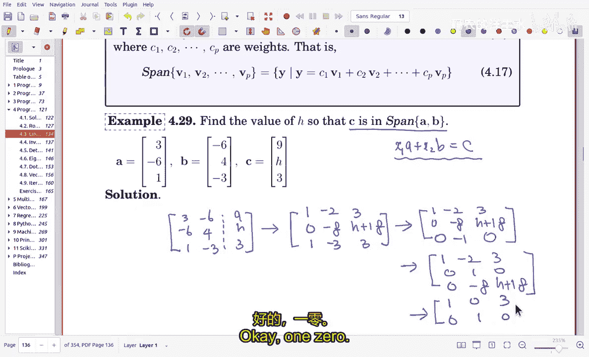

**示例 5**：求 **h** 的值，使得向量 **c = [9, h, 3]ᵀ** 在 **a = [3, -1, 1]ᵀ** 和 **b = [-2, 4, 3]ᵀ** 的张成空间中。
*   **c ∈ Span{a, b}** 意味着存在标量 **x₁** 和 **x₂**，使得 **x₁a + x₂b = c**。
*   这等价于求解线性方程组 **Ax = c**，其中 **A** 的列是 **a** 和 **b**。
*   构造增广矩阵并化简：
    ```
    [ 3  -2 |  9 ]
    [ -1  4 |  h ]
    [ 1   3 |  3 ]
    ```
    经过行化简，最终可以得到形如：
    ```
    [ 1  0 |  3  ]
    [ 0  1 |  0  ]
    [ 0  0 | h+18]
    ```
*   要使方程组有解，增广矩阵的最后一行的常数项必须为零，即 **h + 18 = 0**。
*   因此，**h = -18**。此时解为 **x₁ = 3**, **x₂ = 0**，即 **c = 3a + 0b**。

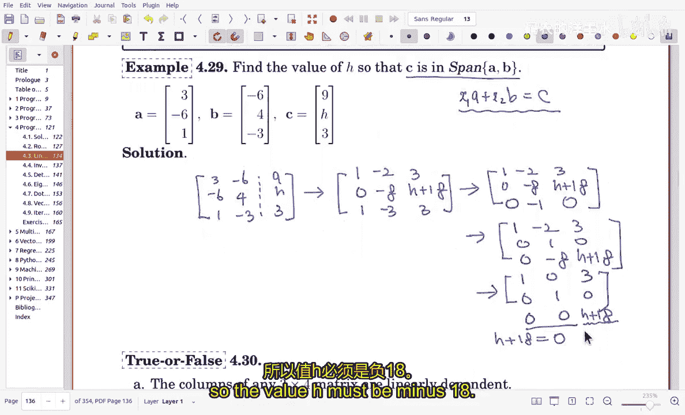

---

### 真/假判断题

最后，我们通过几个判断题来巩固所学概念。

以下是关于线性独立与张成的几个陈述，请判断真假：
1.  **任何 3×4 矩阵的列向量都是线性相关的。**
    *   **真**。因为矩阵有3行（n=3）和4列（p=4），p > n。根据结论，它必定线性相关。
2.  **如果 u 和 v 线性独立，且集合 {u, v, w} 线性相关，那么 w 一定在 Span{u, v} 中。**
    *   **真**。{u, v} 线性独立意味着矩阵 [u v] 有两个主元。加入 w 后变得相关，说明矩阵 [u v w] 仍然只有两个主元，即 w 列不是主元列，因此 w 可以表示为 u 和 v 的线性组合，故 w ∈ Span{u, v}。
3.  **两个向量线性相关，当且仅当它们位于一条通过原点的直线上。**
    *   **真**。两个向量相关意味着其中一个向量是另一个的标量倍数。所有这种倍数向量的集合，正好形成一条通过原点的直线。如果包含零向量，也满足此条件。
4.  **矩阵 A 的列向量线性独立，如果方程 Ax = 0 有平凡解。**
    *   **假**。Ax = 0 **总是有平凡解**（x=0）。线性独立的**关键**在于它**只有**平凡解。如果它还有非平凡解，那么列向量就是相关的。因此，这个陈述的表述不准确。

---

### 总结

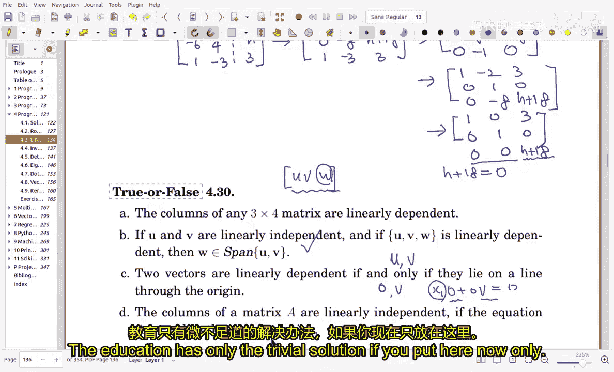

本节课中我们一起学习了线性代数中两个基础而重要的概念：
1.  **线性独立性**：一组向量中，任一向量都不能由其余向量线性表示。我们学习了通过解定义方程和利用矩阵（判断主元列）两种方法来判定。
2.  **向量张成**：一组向量所有可能的线性组合构成的集合。我们学习了如何通过求解线性方程组来判断一个向量是否属于某个张成空间。

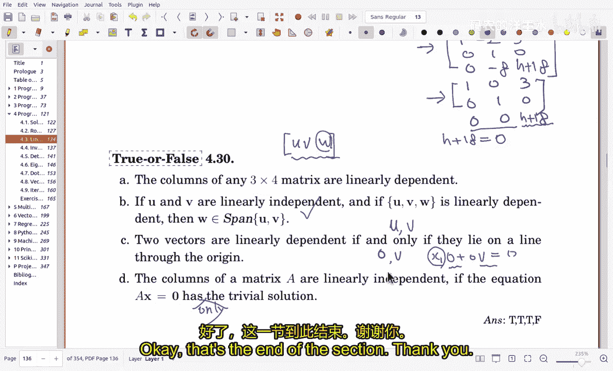

理解这些概念是学习向量空间、基、维数以及后续更复杂人工智能算法（如主成分分析、线性回归）的基石。