# 032：可逆矩阵与可逆矩阵定理 🔄

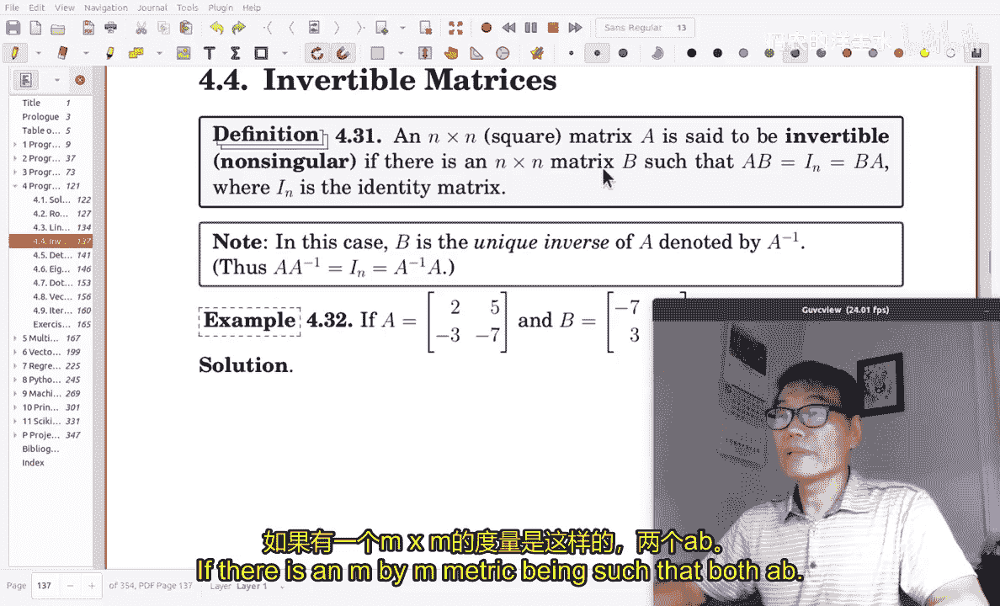

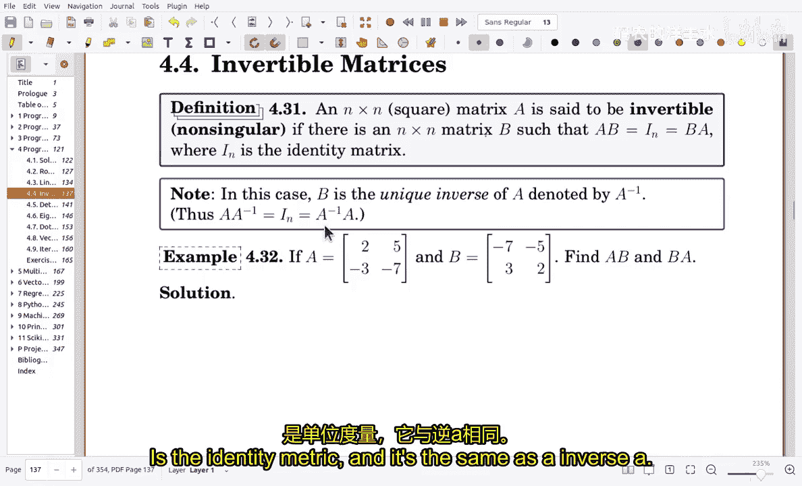

在本节课中，我们将学习可逆矩阵的定义、性质以及一个非常重要的定理——可逆矩阵定理。这个定理提供了多种判断矩阵是否可逆的等价条件，是线性代数中的核心内容。

## 可逆矩阵的定义

一个 **n x n** 的方阵 **A** 被称为**可逆的**或**非奇异的**，如果存在另一个 **n x n** 的矩阵 **B**，使得以下两个等式同时成立：

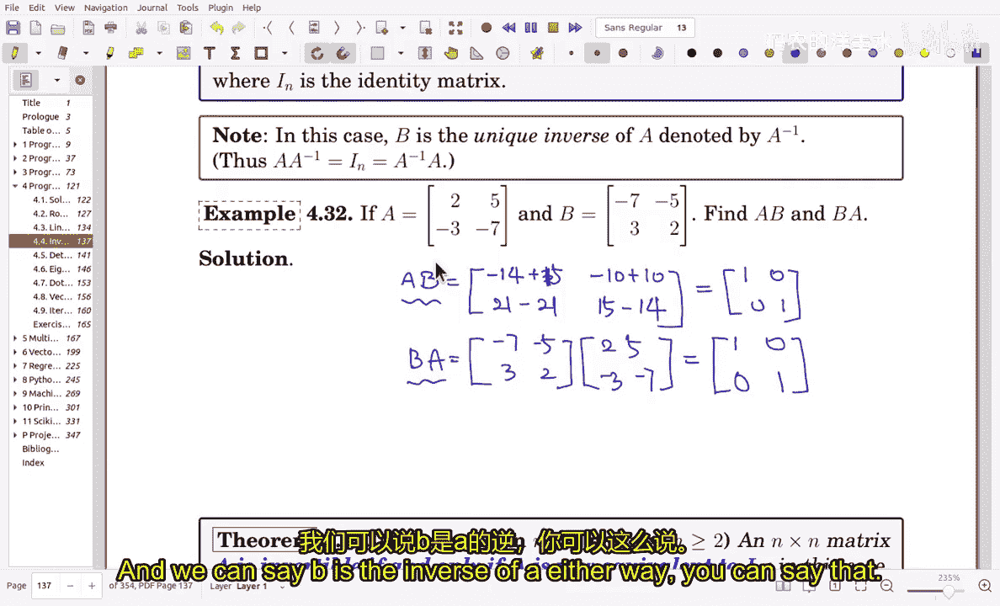

**AB = I** 且 **BA = I**

其中 **I** 是 **n x n** 的单位矩阵。在这种情况下，矩阵 **B** 是唯一的，我们称 **B** 为 **A** 的**逆矩阵**，记作 **A⁻¹**。因此，上述关系可以写作：

**A A⁻¹ = I** 且 **A⁻¹ A = I**

## 逆矩阵的示例

让我们通过一个例子来理解。假设有两个矩阵：

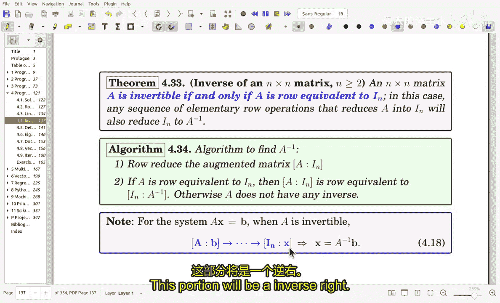

**A = [[-4, 5], [6, -9]]**
**B = [[9/2, 5/2], [3, 2]]**

我们可以计算 **AB** 和 **BA**，结果会发现两者都等于 **2x2** 的单位矩阵 **I**。因此，**B** 是 **A** 的逆矩阵，反之亦然。

## 如何求逆矩阵：算法

上一节我们介绍了逆矩阵的定义，本节中我们来看看如何实际计算一个矩阵的逆。一个关键的观察是：一个 **n x n** 矩阵 **A** 可逆，当且仅当它**行等价**于 **n x n** 的单位矩阵 **I**。这意味着通过一系列初等行变换，可以将 **A** 化为 **I**。

这个观察引出了求逆的算法：
1.  构造一个增广矩阵 **[A | I]**，即把原矩阵 **A** 和同阶的单位矩阵 **I** 并排放在一起。
2.  对增广矩阵进行初等行变换，目标是将其左半部分（即 **A** 的部分）化为单位矩阵 **I**。
3.  如果能够成功做到这一点，那么此时增广矩阵的右半部分就会变成 **A** 的逆矩阵 **A⁻¹**，即最终形式为 **[I | A⁻¹]**。
4.  如果在化简过程中，**A** 的部分无法化为单位矩阵（例如出现全零行），则说明 **A** 不可逆。

这个过程与用高斯消元法解线性方程组 **Ax = b** 非常相似。在那里，我们构造增广矩阵 **[A | b]**，通过行变换得到 **[I | x]**，其中 **x** 就是解。在这里，我们把 **b** 换成了单位矩阵 **I**，解出的就是逆矩阵 **A⁻¹**。

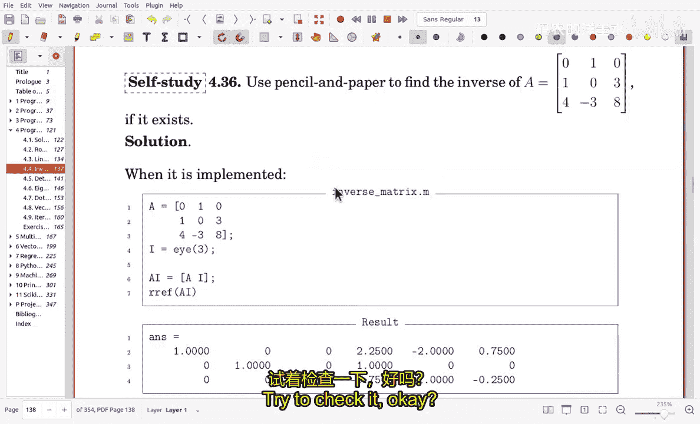

## 矩阵的转置

在深入更多性质之前，我们先简要回顾一个相关概念：矩阵的转置。对于一个 **m x n** 的矩阵 **A**，其**转置矩阵**记作 **Aᵀ**，是一个 **n x m** 的矩阵。**Aᵀ** 的第 i 行、第 j 列元素等于原矩阵 **A** 的第 j 行、第 i 列元素。

用公式表示，如果 **A = [aᵢⱼ]**，那么 **Aᵀ = [aⱼᵢ]**。

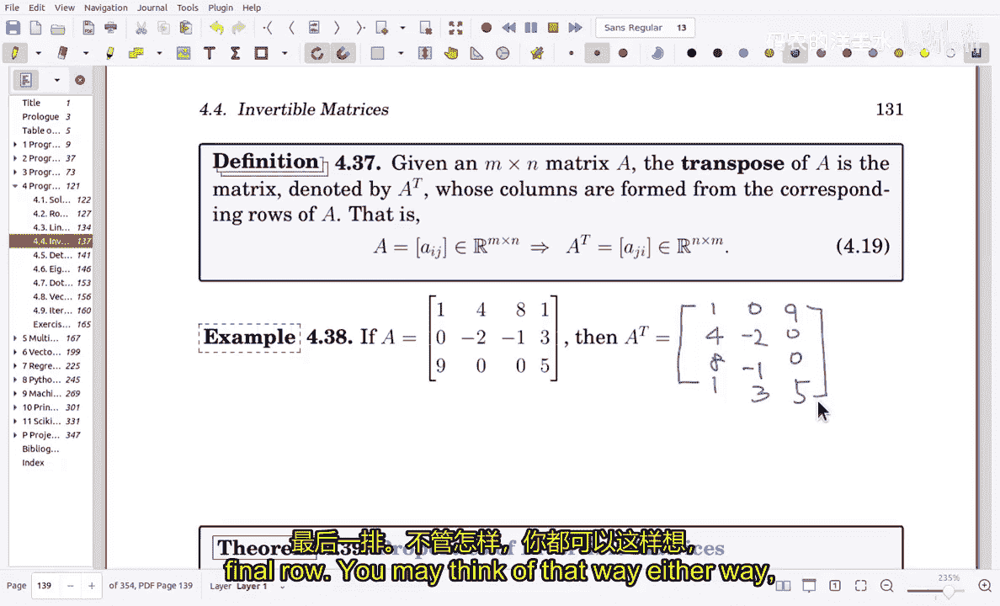

例如，若 **A = [[1, 0, 5], [4, -2, 9]]**，则其转置为 **Aᵀ = [[1, 4], [0, -2], [5, 9]]**。

## 可逆矩阵的性质

了解了定义和算法后，我们来看看可逆矩阵的一些重要性质。以下是关于可逆矩阵 **A** 和 **B** 的一些基本事实：

*   **2x2 矩阵的逆公式**：对于一个 2x2 矩阵 **A = [[a, b], [c, d]]**，如果 **ad - bc ≠ 0**，那么它是可逆的，其逆矩阵为：
    **A⁻¹ = (1/(ad-bc)) * [[d, -b], [-c, a]]**
    这里的 **ad - bc** 称为矩阵的行列式，我们将在后续章节学习。

*   **逆的逆**：如果 **A** 可逆，那么它的逆 **A⁻¹** 也可逆，并且 **(A⁻¹)⁻¹ = A**。

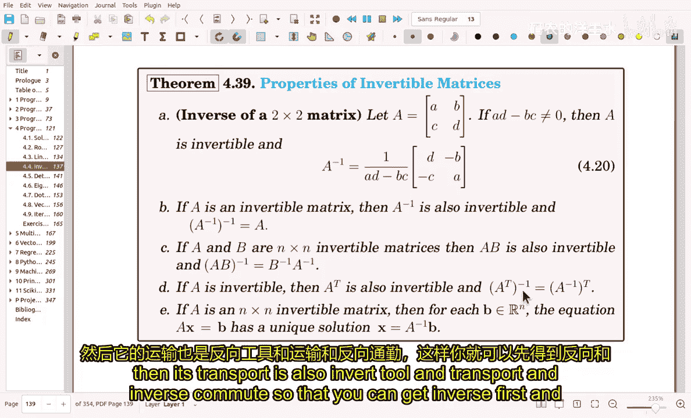

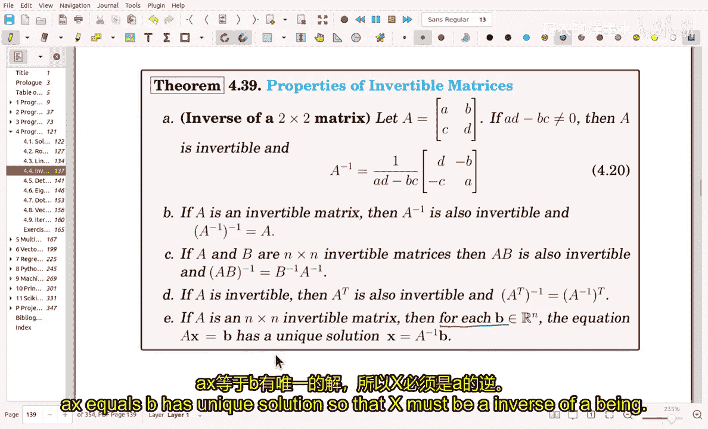

*   **乘积的逆**：如果 **A** 和 **B** 都是 **n x n** 可逆矩阵，那么它们的乘积 **AB** 也可逆，并且 **(AB)⁻¹ = B⁻¹ A⁻¹**。**注意顺序要颠倒**。

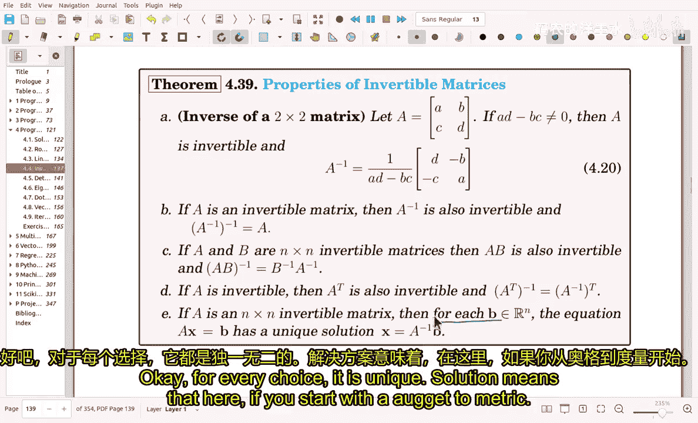

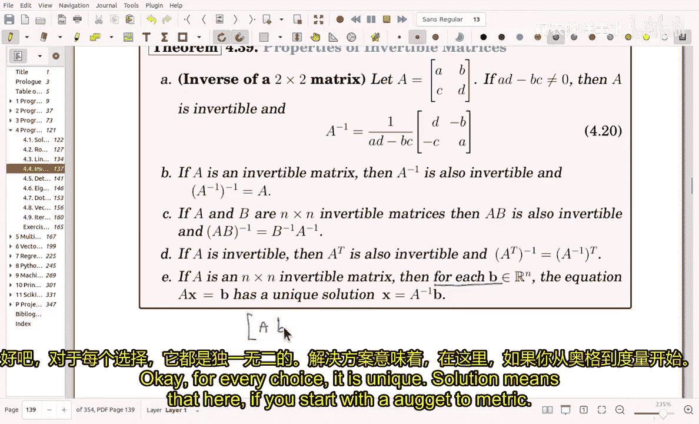

*   **转置的逆**：如果 **A** 可逆，那么它的转置 **Aᵀ** 也可逆，并且 **(Aᵀ)⁻¹ = (A⁻¹)ᵀ**。即求逆和转置操作可以交换顺序。

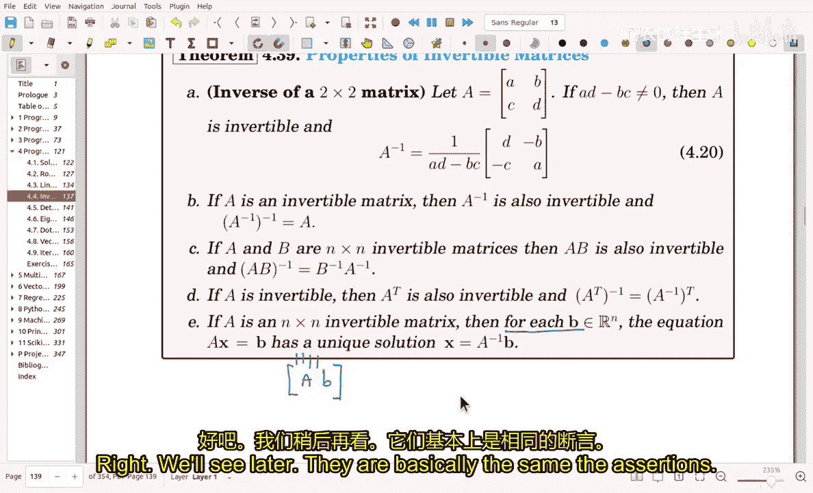

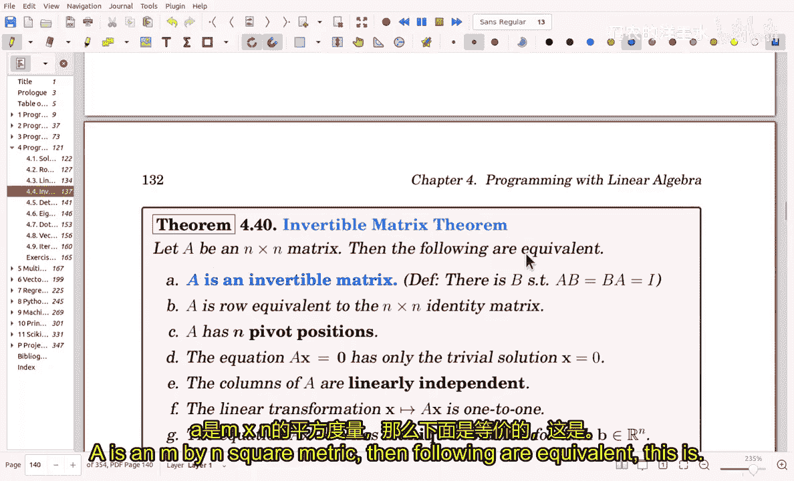

## 可逆矩阵定理 🧮

这是本节课的核心定理。它列出了关于一个 **n x n** 矩阵 **A** 的多个陈述，这些陈述在 **A** 可逆时是**彼此等价**的。这意味着，只要其中任何一个陈述成立，其他所有陈述也必然成立，从而可以判定 **A** 是可逆的。这大大扩展了可逆性的定义，提供了多种验证方法。

以下是该定理的部分等价陈述（随着课程深入，列表还会扩充）：

设 **A** 是一个 **n x n** 矩阵，则下列陈述等价（即要么全真，要么全假）：
1.  **A** 是可逆矩阵。
2.  **A** 行等价于 **n x n** 单位矩阵 **I**。
3.  **A** 有 **n** 个主元位置（即每一行每一列都有主元）。
4.  齐次方程 **Ax = 0** 仅有平凡解 **x = 0**。
5.  **A** 的列向量是线性无关的。
6.  线性变换 **x → Ax** 是一对一的（单射）。
7.  对于 **Rⁿ** 中的任意向量 **b**，方程 **Ax = b** 都有解（且是唯一解）。
8.  **A** 的列向量张成整个 **Rⁿ** 空间。
9.  线性变换 **x → Ax** 将 **Rⁿ** 映射到整个 **Rⁿ**（满射）。
10. 存在一个 **n x n** 矩阵 **C**，使得 **CA = I**。（仅左逆存在即可）
11. 存在一个 **n x n** 矩阵 **D**，使得 **AD = I**。（仅右逆存在即可）
12. **Aᵀ** 是可逆矩阵。

**这个定理的威力在于**：我们不再需要直接寻找一个矩阵 **B** 来验证 **AB = I** 和 **BA = I**（这通常很困难）。相反，我们可以检查更容易验证的条件，例如：
*   将 **A** 化为行最简形，看它是不是单位矩阵。
*   解方程 **Ax = 0**，看是否只有零解。
*   判断 **A** 的列是否线性无关。

## 定理应用示例

让我们使用可逆矩阵定理来判断一个矩阵是否可逆。

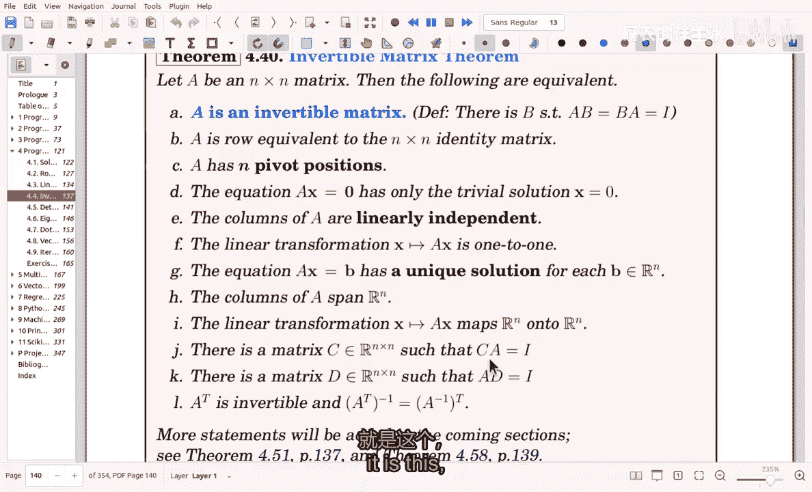

**问题**：判断矩阵 **A = [[1, 0, 2], [-3, 1, 4], [-5, -1, 0]]** 是否可逆。

**解法**：我们可以使用定理中的陈述(2)或(3)。最常用的方法是进行行化简，检查主元数量。

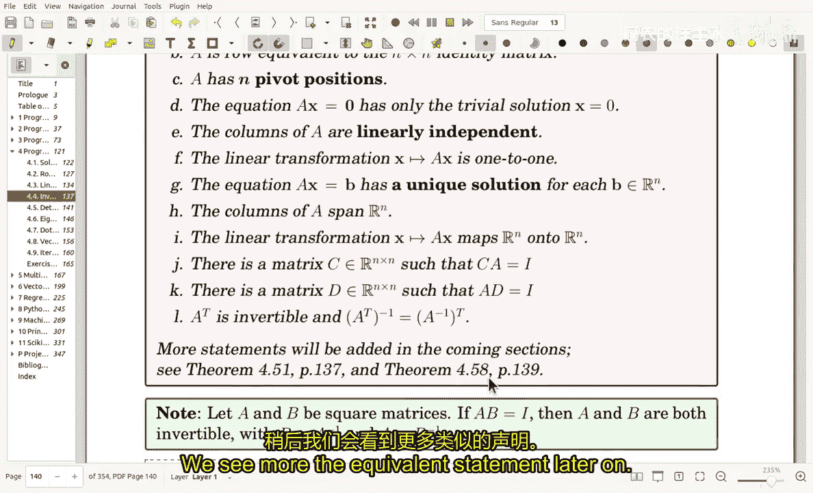

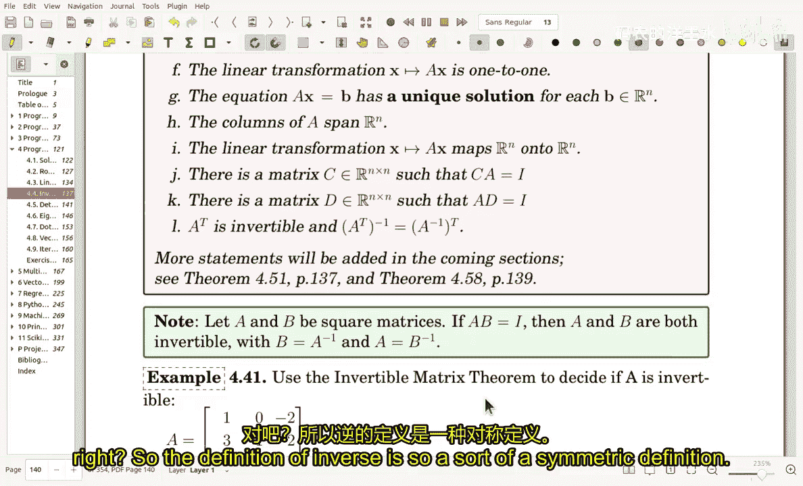

对 **A** 进行初等行变换，最终可以将其化为行最简形。化简过程会显示该矩阵有三个主元位置，与它的阶数 **n=3** 相等。

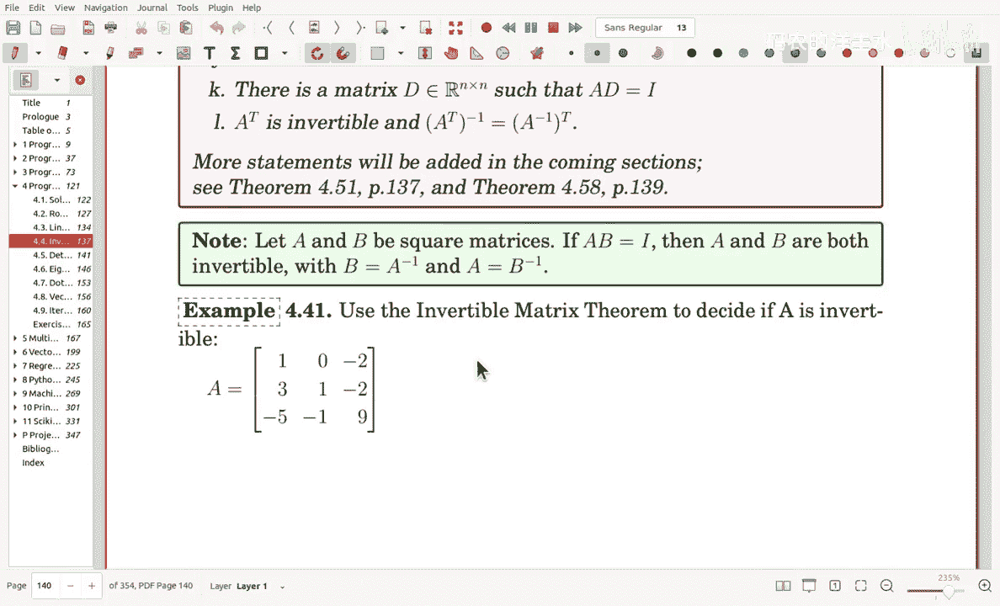

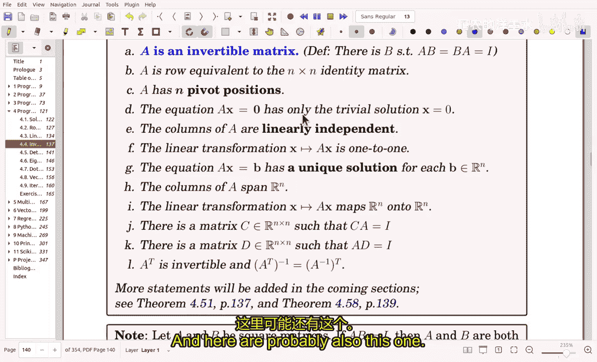

根据可逆矩阵定理，这意味着 **A** 的列是线性无关的，从而 **A** 是可逆矩阵。我们无需实际求出 **A⁻¹** 即可做出判断。

---

本节课中我们一起学习了：
1.  **可逆矩阵**的正式定义：存在逆矩阵 **A⁻¹** 使得 **AA⁻¹ = A⁻¹A = I**。
2.  通过构造增广矩阵 **[A | I]** 并施行行变换来**求解逆矩阵**的实用算法。
3.  可逆矩阵的一系列重要**性质**，如逆的逆、乘积的逆、转置的逆等。
4.  线性代数中至关重要的**可逆矩阵定理**，它提供了多个判断矩阵可逆性的等价条件，极大地简化了分析和计算。

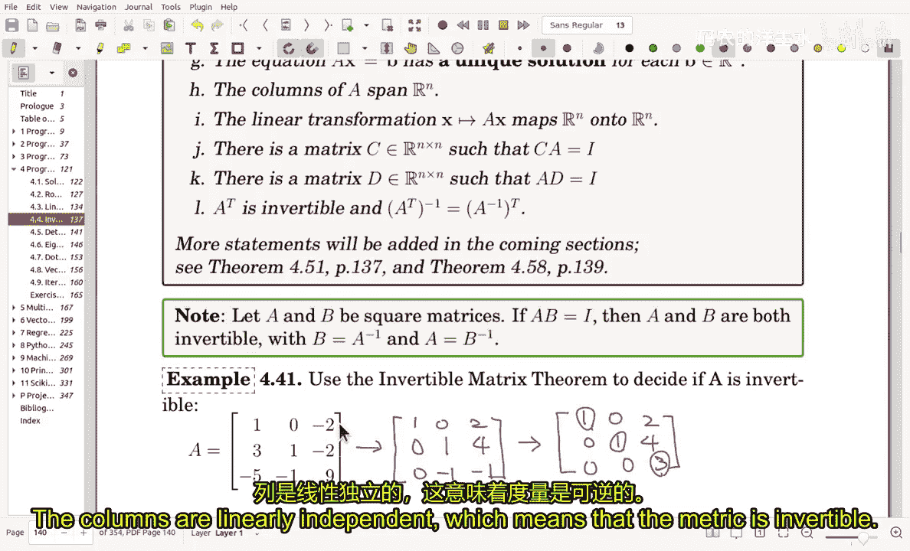

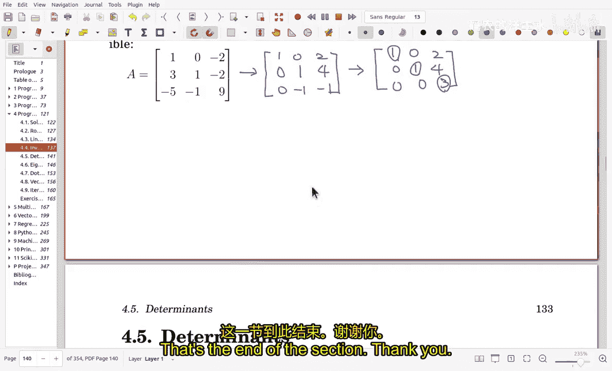

掌握这些概念和定理，是理解更高级线性代数主题和人工智能算法中矩阵运算的基础。