# 033：行列式 📐

在本节中，我们将学习行列式。行列式是一个与方阵相关的标量值，它具有重要的几何意义，可以理解为线性变换对体积（或面积）的缩放因子。

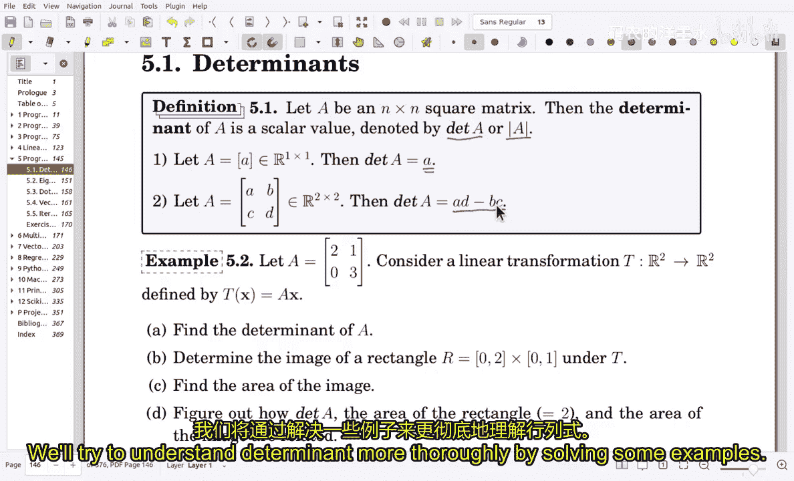

上一章我们学习了线性代数的基础知识。在本章中，我们将通过编程来探讨线性代数中适用于现实世界问题的热门主题。让我们进入第5.1节：行列式。

---

## 行列式的定义

对于一个 **n x n** 的方阵 **A**，其行列式是一个标量值，记作 **det(A)** 或 **|A|**。

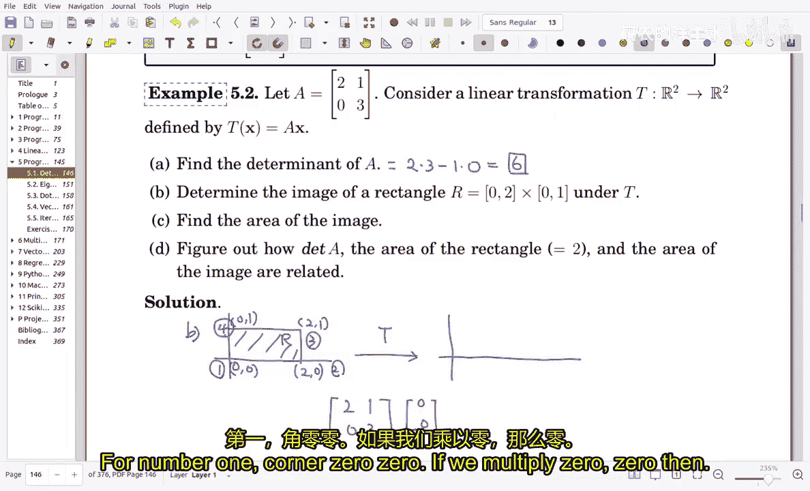

*   如果 **A** 是一个 **1 x 1** 矩阵，其唯一元素为 **a**，则其行列式就是该元素本身：**det(A) = a**。
*   如果 **A** 是一个 **2 x 2** 矩阵，其元素为 **a, b, c, d**，则其行列式为：**det(A) = ad - bc**。

我们将通过一些例子来更深入地理解行列式。

---

## 行列式的几何意义：缩放因子

为了更好地理解行列式，我们来看一个具体的例子。

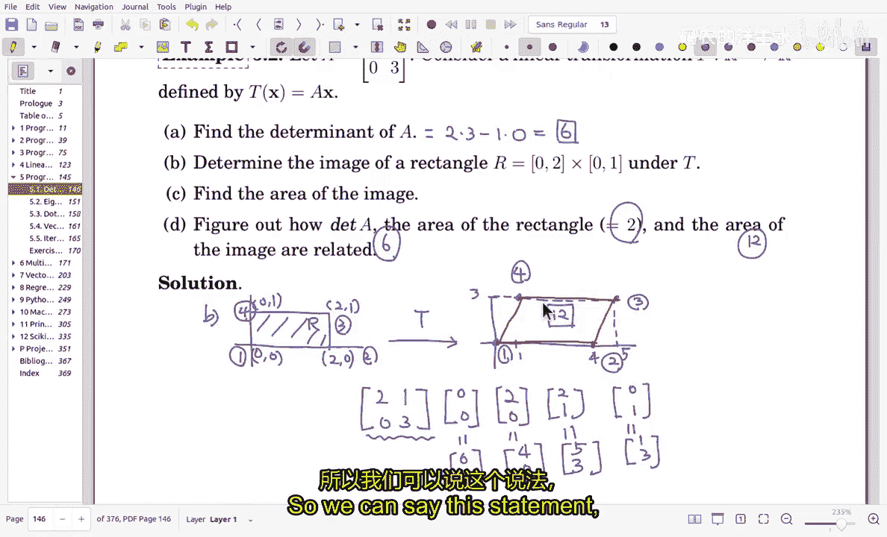

**给定矩阵 A：**
```
A = [[2, 1],
     [0, 3]]
```
考虑由矩阵乘法定义的线性变换 **T: R² → R²**。

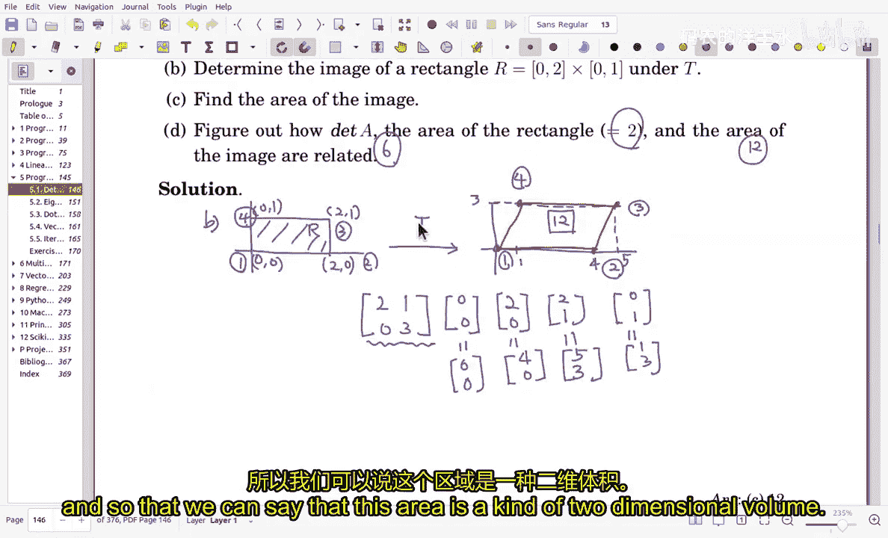

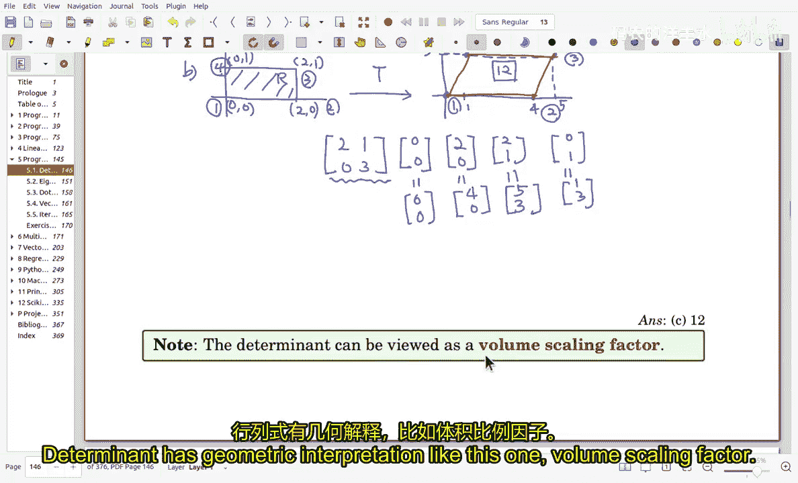

**A. 计算 det(A)。**
根据公式，**det(A) = (2 * 3) - (1 * 0) = 6**。

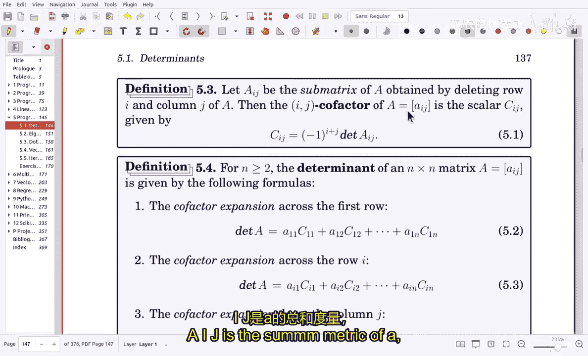

**B. 找出矩形 R 在变换 T 下的像。**
矩形 R 的顶点坐标为 (0,0), (2,0), (2,1), (0,1)。通过矩阵乘法计算每个顶点变换后的坐标：
*   T(0,0) = (0,0)
*   T(2,0) = (4,0)
*   T(2,1) = (5,3)
*   T(0,1) = (1,3)

连接这些点，得到变换后的图像是一个平行四边形。

**C. 计算像的面积。**
该平行四边形的底为4，高为3，因此面积为 **12**。

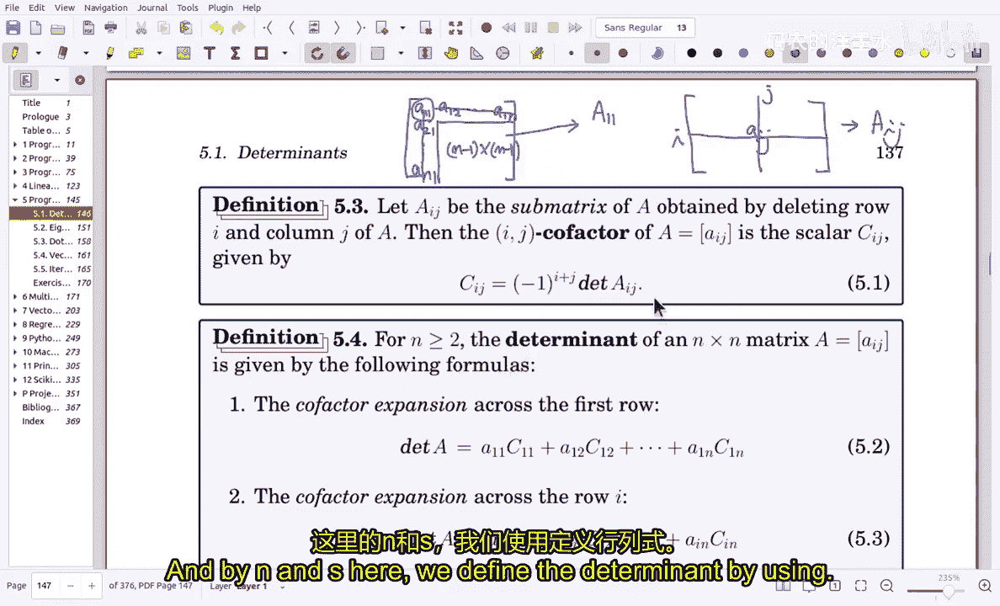

**D. 观察 det(A) 与面积变化的关系。**
原矩形 R 的面积为 **2**。变换后像的面积为 **12**。面积放大了 **6** 倍，恰好等于行列式 **det(A) = 6** 的值。

这个例子并非特例，它揭示了一个普遍规律：**行列式可以看作是线性变换导致的体积（在二维中是面积）缩放因子**。在高维空间中，行列式同样表示体积的缩放比例。

---

## 高阶行列式的计算：余子式展开

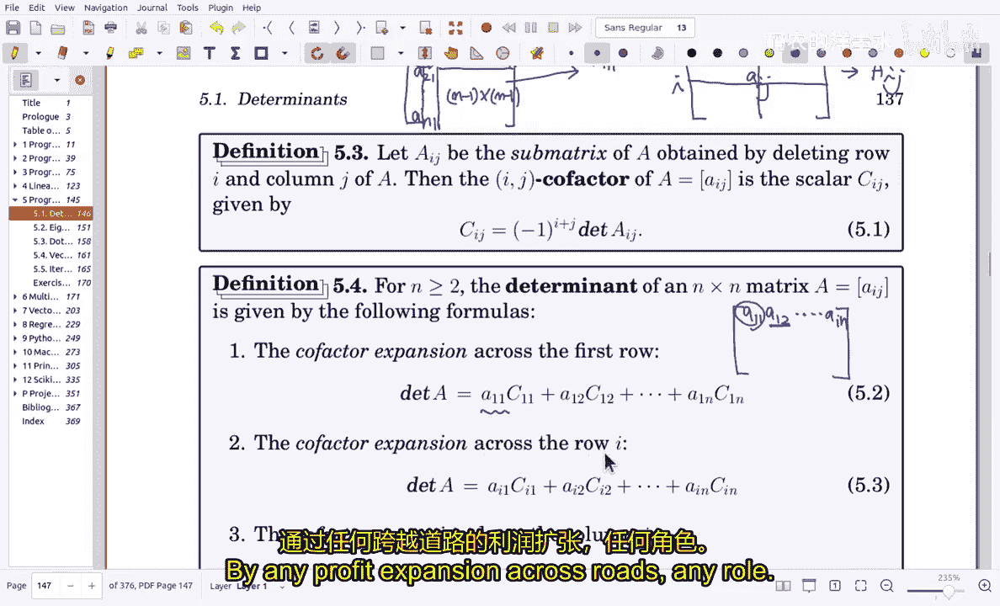

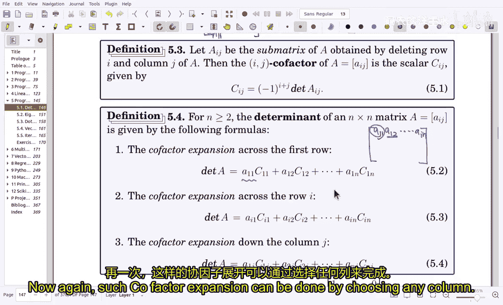

对于 **n ≥ 2** 的 **n x n** 矩阵，我们通过余子式展开来定义其行列式。

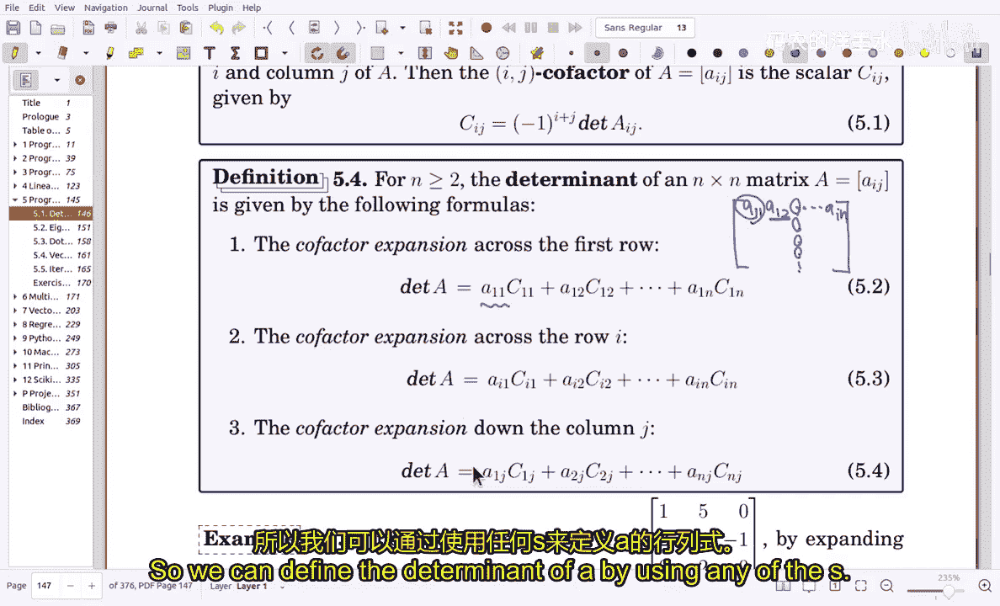

首先，定义 **子矩阵 A_ij**：它是从原矩阵 **A** 中删除第 **i** 行和第 **j** 列后得到的 **(n-1) x (n-1)** 矩阵。

接着，定义 **余子式 C_ij**：**C_ij = (-1)^(i+j) * det(A_ij)**。

利用余子式，我们可以按行或按列展开来计算行列式。

**按第 i 行展开：**
**det(A) = a_i1 * C_i1 + a_i2 * C_i2 + ... + a_in * C_in**

**按第 j 列展开：**
**det(A) = a_1j * C_1j + a_2j * C_2j + ... + a_nj * C_nj**

幸运的是，无论选择哪一行或哪一列进行展开，得到的结果都是相同的。

---

### 计算示例

**给定矩阵 A：**
```
A = [[1,  5, 0],
     [2,  4, -1],
     [0, -2, 0]]
```

**任务1：按第一行展开计算 det(A)。**
det(A) = 1 * C11 + 5 * C12 + 0 * C13
*   C11 = (-1)^(1+1) * det([[4, -1], [-2, 0]]) = 1 * (4*0 - (-1)*(-2)) = -2
*   C12 = (-1)^(1+2) * det([[2, -1], [0, 0]]) = (-1) * (2*0 - (-1)*0) = 0
*   C13 因乘以0，无需计算。
因此，**det(A) = 1*(-2) + 5*0 + 0 = -2**。

**任务2：按第三列展开计算 det(A)。**
det(A) = 0 * C13 + (-1) * C23 + 0 * C33
*   C23 = (-1)^(2+3) * det([[1, 5], [0, -2]]) = (-1) * (1*(-2) - 5*0) = 2
因此，**det(A) = 0 + (-1)*2 + 0 = -2**。

从本例中我们可以得到两个重要观察：
1.  计算 **3x3** 矩阵的行列式，最终会归结为计算几个 **2x2** 矩阵的行列式。
2.  为了简化计算，**应选择包含零元素最多的行或列进行展开**，这样可以减少需要计算的余子式数量。

---

## 特殊矩阵的行列式

如果矩阵 **A** 是三角矩阵（上三角或下三角），那么其行列式等于主对角线上所有元素的乘积。

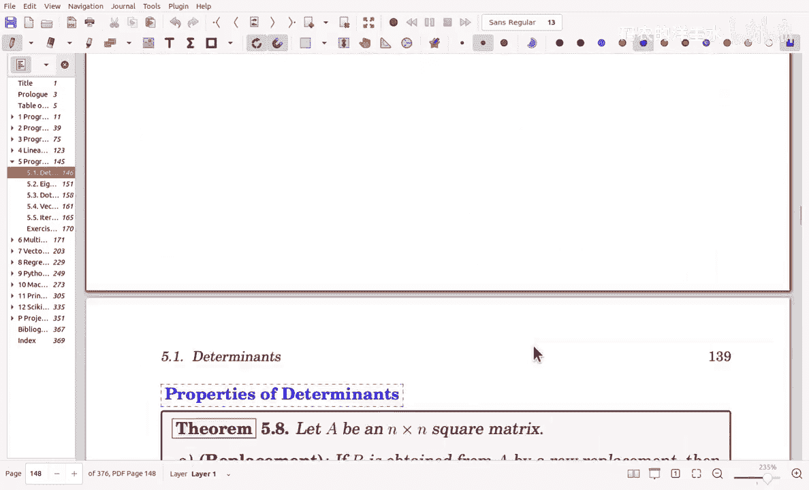

**例如，对于上三角矩阵：**
```
A = [[1, -4, 2],
     [0, -6, -7],
     [0,  0,  4]]
```
**det(A) = 1 * (-6) * 4 = -24**。

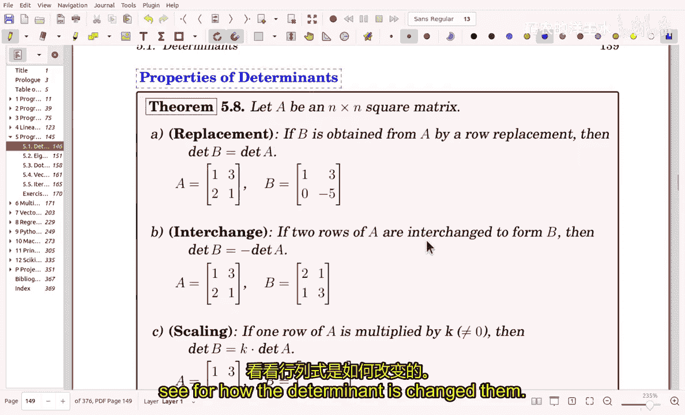

这个性质可以通过对第一列反复进行余子式展开来证明。在 MATLAB 或类似工具中，可以使用 `det(A)` 命令轻松验证。

---

## 行列式与矩阵可逆性

观察上一个例子中的矩阵 **A**，它在每一列都有主元位置，因此它是可逆的。同时，它的行列式 **det(A) = -24 ≠ 0**。

如果我们将主对角线上的某个元素改为0，例如将4改为0，那么行列式就会变成0。此时，矩阵将缺少一个主元，变得不可逆。

事实上，这是一个普遍定理：**方阵 A 可逆的充分必要条件是 det(A) ≠ 0**。行列式为0意味着线性变换将空间压缩到了更低的维度，因此不存在逆变换。

---

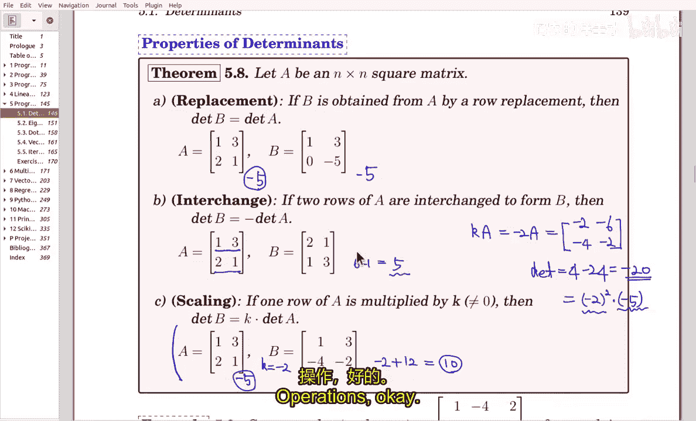

## 行变换对行列式的影响

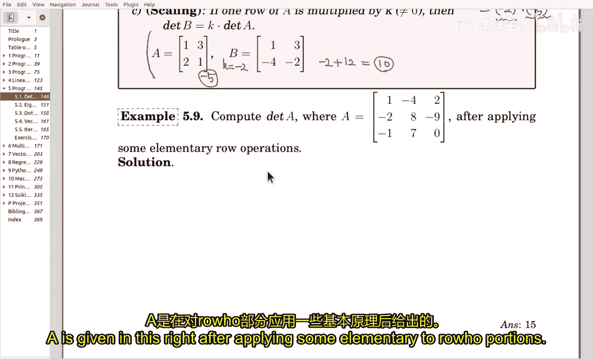

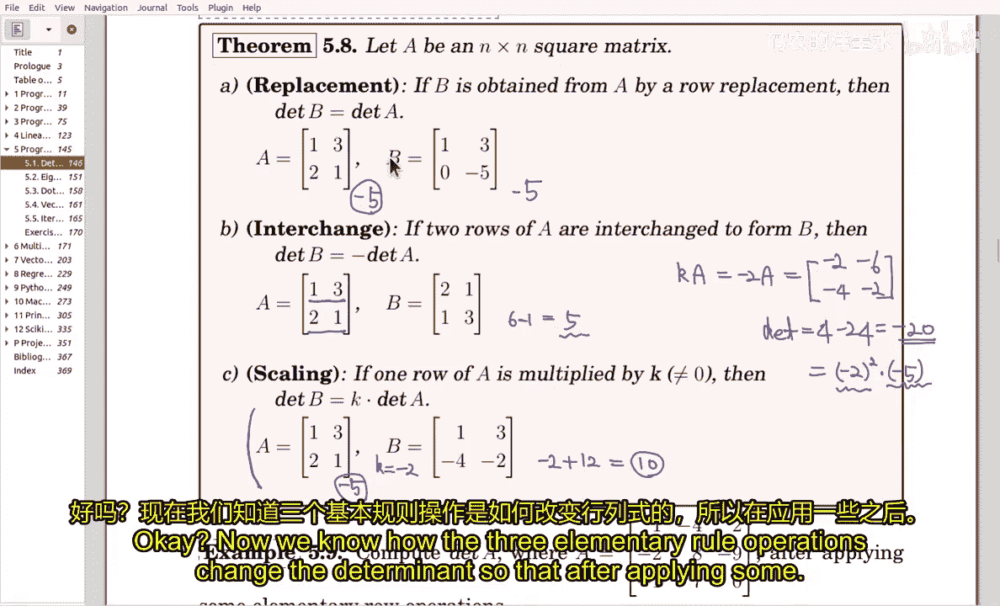

了解初等行变换如何改变行列式，可以帮助我们更有效地计算行列式。

设 **A** 为 **n x n** 矩阵，**B** 是由 **A** 经过行变换得到的矩阵。
1.  **行替换**：将一行加上另一行的倍数。**det(B) = det(A)**。（行列式不变）
2.  **行交换**：交换两行的位置。**det(B) = -det(A)**。（行列式变号）
3.  **行缩放**：将某一行乘以标量 **k**。**det(B) = k * det(A)**。（行列式缩放 k 倍）

**重要提示**：若将整个矩阵 **A** 乘以标量 **k**，得到 **kA**，这相当于对每一行都进行了缩放。因此，**det(kA) = k^n * det(A)**，其中 **n** 是矩阵的阶数。

---

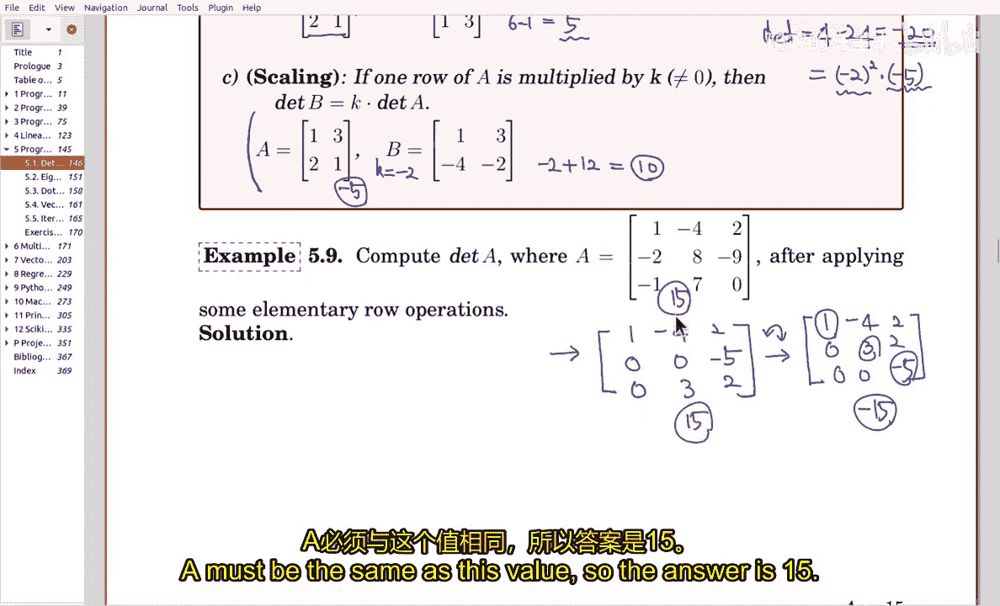

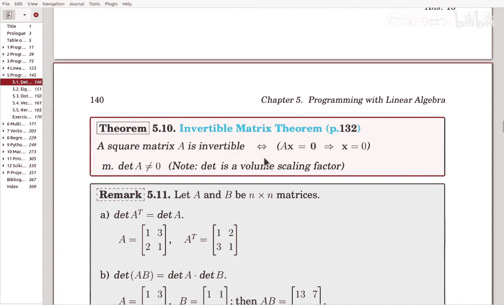

### 利用行变换计算行列式

**给定矩阵 A：**
```
A = [[1, -4, 2],
     [2, -8, 9],
     [0,  3, 0]]
```
我们可以通过行变换将其化为上三角矩阵，并跟踪行列式的变化。
1.  对 A 进行行替换：R2 ← R2 - 2*R1。得到矩阵 B，**det(B) = det(A)**。
    ```
    B = [[1, -4,  2],
         [0,  0,  5],
         [0,  3,  0]]
    ```
2.  交换 B 的第2行和第3行，得到矩阵 C。**det(C) = -det(B) = -det(A)**。
    ```
    C = [[1, -4,  2],
         [0,  3,  0],
         [0,  0,  5]]
    ```
3.  矩阵 C 是上三角矩阵，其行列式为对角线元素乘积：**det(C) = 1 * 3 * 5 = 15**。
因此，**-det(A) = 15**，解得 **det(A) = -15**。

---

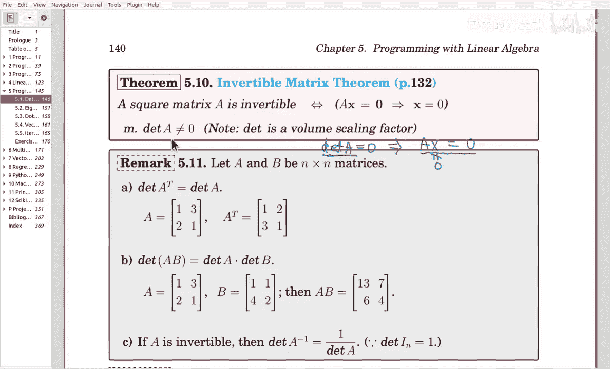

## 行列式的其他性质

以下是行列式的一些有用性质：
*   **转置不变性**：**det(Aᵀ) = det(A)**。
*   **乘积的行列式**：**det(AB) = det(A) * det(B)**。
*   **逆矩阵的行列式**：若 A 可逆，则 **det(A⁻¹) = 1 / det(A)**。这可以从 **det(A⁻¹) * det(A) = det(I) = 1** 推导出来。

---

### 综合例题

假设 **A** 是一个 5x5 矩阵，经过一系列初等行变换得到 A1, A2, A3。已知：
*   A → (行替换) → A1
*   A1 → (第3行缩放5倍) → A2
*   A2 → (交换第1行和第2行) → A3
且已知 **A3** 是对角矩阵 diag(1, -2, 3, -1, 1)。

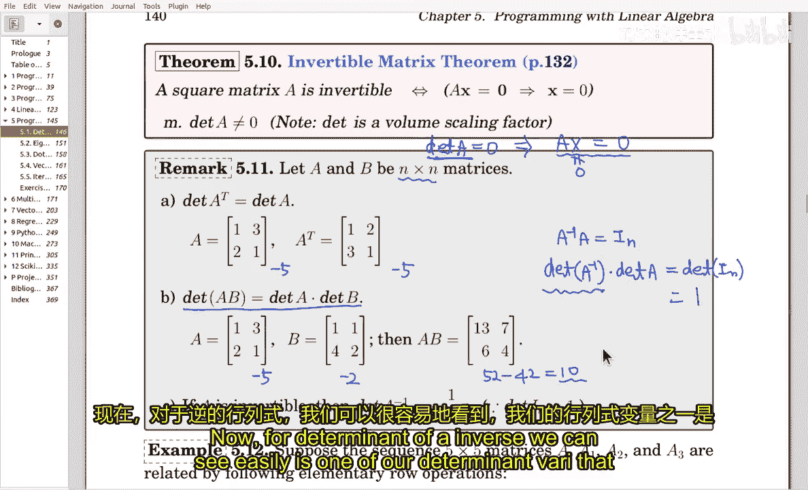

求 **det(A)**。
1.  A3 是上三角矩阵，**det(A3) = 1 * (-2) * 3 * (-1) * 1 = 6**。
2.  A3 由 A2 经行交换得到，故 **det(A2) = -det(A3) = -6**。
3.  A2 由 A1 经行缩放（k=5）得到，故 **det(A1) = det(A2) / 5 = -6/5**。
4.  A1 由 A 经行替换得到，行列式不变，故 **det(A) = det(A1) = -6/5**。

---

## 总结

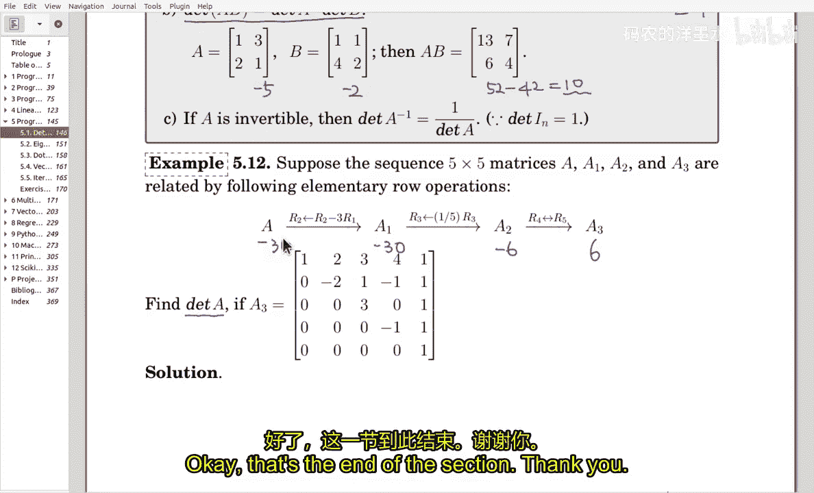

本节课我们一起学习了行列式的核心概念。我们首先定义了2x2矩阵的行列式，并揭示了其**作为线性变换体积缩放因子**的几何意义。接着，我们学习了通过**余子式展开**计算高阶行列式的方法，并掌握了**三角矩阵行列式**的简便算法。我们探讨了**行列式与矩阵可逆性**的深刻联系：矩阵可逆当且仅当其行列式非零。然后，我们分析了**初等行变换对行列式的影响**，这为我们提供了计算行列式的强大工具。最后，我们介绍了行列式的其他重要性质，如转置不变性、乘积法则和逆矩阵的行列式。理解这些内容是应用行列式解决实际编程问题的基础。