# 034：特征方程 📐

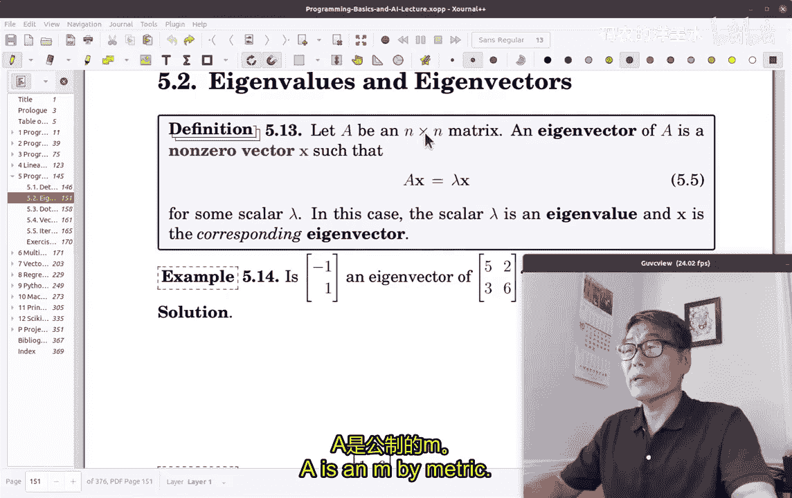

在本节课中，我们将学习线性代数中两个核心概念：**特征值**和**特征向量**。它们是定义在方阵上的重要工具，与行列式密切相关。我们将通过定义、示例和计算方法，帮助你理解这些概念。

## 定义与基本概念

特征值和特征向量是针对方阵定义的。设 **A** 是一个 **M x M** 的矩阵。


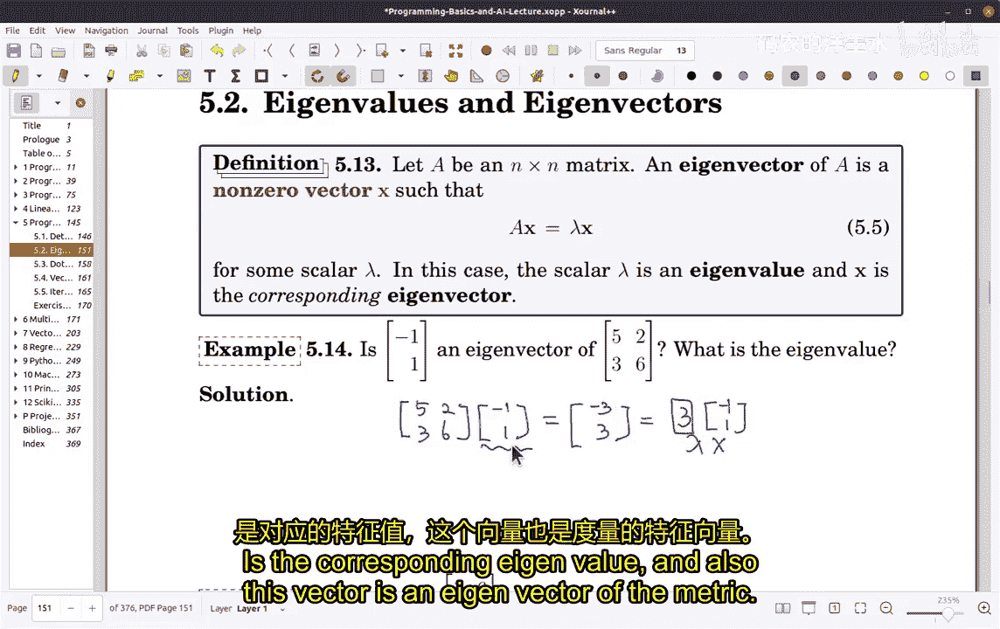

如果存在一个**非零向量 x** 和一个**标量 λ**，使得等式 **A x = λ x** 成立，那么：
*   标量 **λ** 被称为矩阵 **A** 的一个**特征值**。
*   向量 **x** 被称为对应于特征值 **λ** 的**特征向量**。

为了更好地理解这些新术语，我们将通过解决一些示例来加深认识。

## 示例：验证特征向量

上一节我们介绍了定义，本节中我们来看看如何验证一个向量是否是特征向量。

**问题**：向量 `[-1, 1]` 是矩阵 `[[5, 2], [3, 6]]` 的特征向量吗？如果是，对应的特征值是什么？

**解答**：
根据定义，如果它是特征向量，则必须满足方程 **A x = λ x**。
1.  计算矩阵与向量的乘积 **A x**：
    `[[5, 2], [3, 6]] * [-1, 1] = [(-5+2), (-3+6)] = [-3, 3]`
2.  观察结果：`[-3, 3]` 恰好等于 `3 * [-1, 1]`。
3.  因此，存在标量 **λ = 3**，使得 **A x = 3 x** 成立。

**结论**：向量 `[-1, 1]` 是矩阵的一个特征向量，其对应的特征值为 **3**。


## 示例：寻找特征向量

现在，我们来看一个已知特征值，求解对应特征向量的例子。

**问题**：已知矩阵 **A = [[1, 6], [5, 2]]**，证明 **7** 是它的一个特征值，并找出所有对应的特征向量。

**解答**：
如果 **7** 是特征值，则存在非零向量 **x**，使得 **A x = 7 x**。
1.  将方程重写为：**A x - 7 x = 0**。
2.  提取公因子 **x**：**(A - 7I) x = 0**，其中 **I** 是单位矩阵。
3.  计算矩阵 **A - 7I**：
    `[[1, 6], [5, 2]] - 7*[[1, 0], [0, 1]] = [[-6, 6], [5, -5]]`
4.  现在需要求解齐次线性方程组 **[[-6, 6], [5, -5]] * [x1, x2] = [0, 0]** 的非零解。
5.  将其增广矩阵进行行化简：
    `[[-6, 6, 0], [5, -5, 0]]` → 化简后得到 `[[1, -1, 0], [0, 0, 0]]`。
6.  解为：`x1 - x2 = 0`，即 `x1 = x2`。`x2` 是自由变量。
7.  因此，所有解（即特征向量）具有形式：`x = x2 * [1, 1]`，其中 `x2` 为任意非零标量。

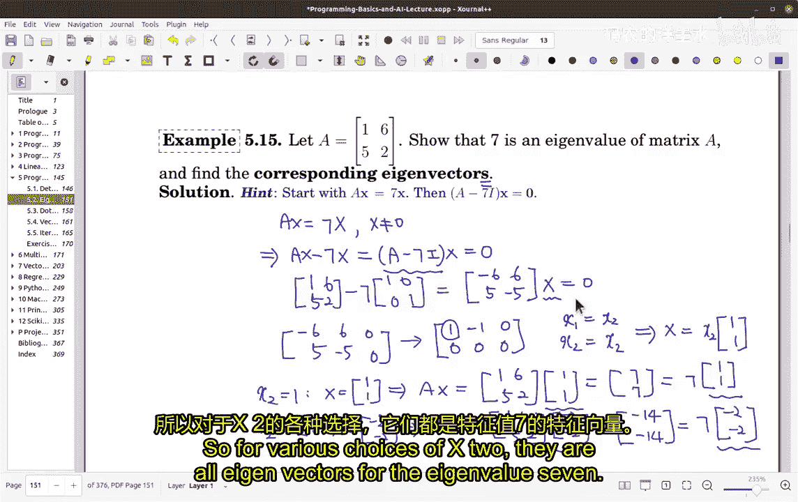

**结论**：**7** 确实是矩阵 **A** 的特征值。所有形如 `k*[1, 1]`（k ≠ 0）的向量都是对应于特征值 **7** 的特征向量。例如，`[1, 1]` 和 `[-2, -2]` 都是。

## 特征值与可逆性

一个重要的结论将特征值与矩阵的可逆性联系起来。

**定理**：数 **0** 是矩阵 **A** 的特征值，当且仅当 **A** 是**不可逆**的（奇异的）。

**解释**：
*   如果 **0** 是特征值，则存在非零向量 **x** 使得 **A x = 0 * x = 0**。这意味着齐次方程组有非零解，因此 **A** 不可逆。
*   反之，如果 **A** 不可逆，则齐次方程组 **A x = 0** 有非零解，这个解向量 **x** 就满足 **A x = 0 * x**，因此 **0** 是特征值。

这补充了可逆矩阵定理：矩阵 **A** 可逆，等价于 **0** 不是 **A** 的特征值。

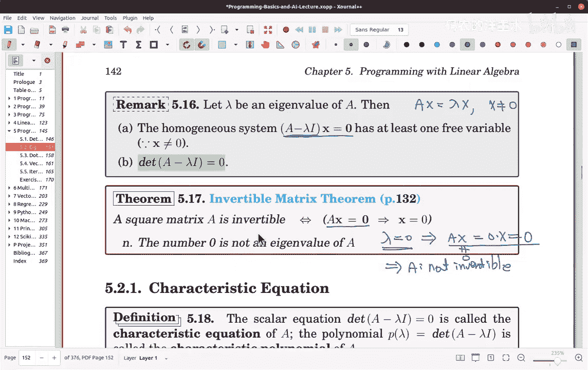


## 特征方程

上一节我们通过解方程寻找特征向量，本节我们来看看如何系统地寻找特征值。

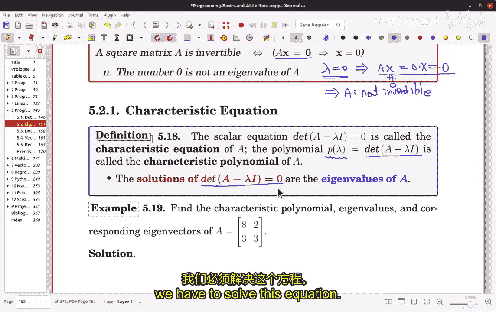

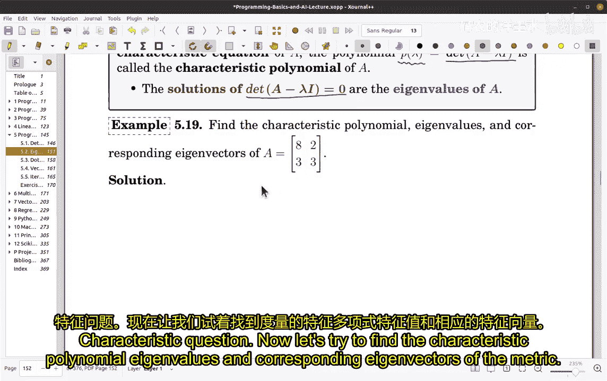

从定义 **A x = λ x** 出发，可推导出 **(A - λI) x = 0**。为了存在非零解 **x**，矩阵 **(A - λI)** 必须是奇异的，即其行列式必须为零。

**定义**：
*   方程 **det(A - λI) = 0** 称为矩阵 **A** 的**特征方程**。
*   多项式 **p(λ) = det(A - λI)** 称为矩阵 **A** 的**特征多项式**。

**核心方法**：矩阵 **A** 的特征值，就是其特征方程 **det(A - λI) = 0** 的根（解）。


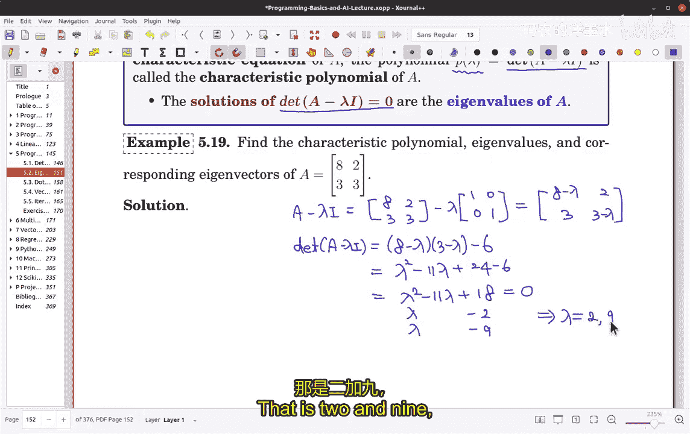

## 完整示例：计算特征值与特征向量

现在，让我们应用特征方程来完整求解一个矩阵的特征值和特征向量。

**问题**：求矩阵 **A = [[8, 3], [2, 3]]** 的特征多项式、特征值及对应的特征向量。


**解答**：
1.  **构造 A - λI**：
    `A - λI = [[8-λ, 3], [2, 3-λ]]`
2.  **计算特征多项式**：
    `det(A - λI) = (8-λ)(3-λ) - (3*2) = λ^2 - 11λ + 24 - 6 = λ^2 - 11λ + 18`
3.  **解特征方程**：
    `λ^2 - 11λ + 18 = 0` → 因式分解为 `(λ - 2)(λ - 9) = 0`。
    解得特征值：**λ1 = 2**，**λ2 = 9**。
4.  **对每个特征值求特征向量**：
    *   **对于 λ1 = 2**：
        解方程组 **(A - 2I)x = 0**。
        `A - 2I = [[6, 3], [2, 1]]`，行化简后得 `[[1, 1/2, 0], [0, 0, 0]]`。
        解为 `x1 = -1/2 * x2`。取 `x2 = 2`（为消除分数），得到一个基础特征向量：`[-1, 2]`。所有形如 `k*[-1, 2]`（k ≠ 0）的向量都是对应 λ=2 的特征向量。
    *   **对于 λ2 = 9**：
        解方程组 **(A - 9I)x = 0**。
        `A - 9I = [[-1, 3], [2, -6]]`，行化简后得 `[[1, -3, 0], [0, 0, 0]]`。
        解为 `x1 = 3 * x2`。取 `x2 = 1`，得到一个基础特征向量：`[3, 1]`。所有形如 `k*[3, 1]`（k ≠ 0）的向量都是对应 λ=9 的特征向量。


## 使用MATLAB进行计算

对于更复杂的矩阵，我们可以借助计算工具。以下是使用MATLAB求解的示例。

**问题**：求矩阵 `[[0, 1, 1], [1, 0, 1], [1, 1, 0]]` 的特征多项式和所有特征值。

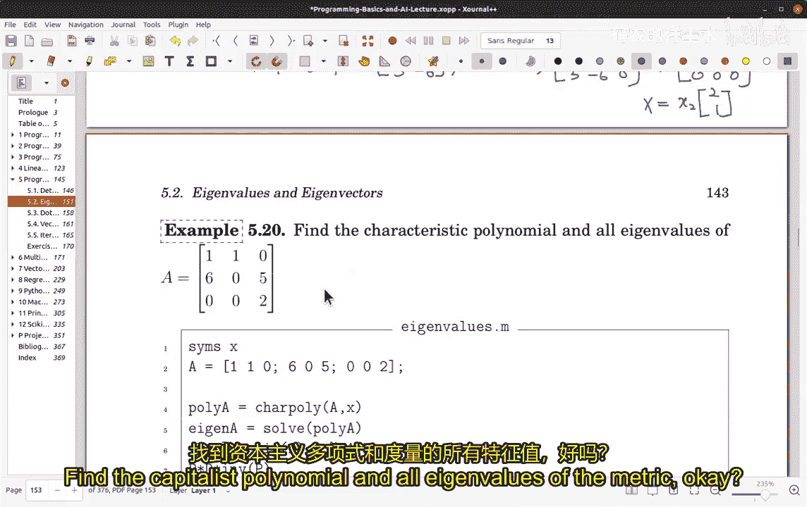

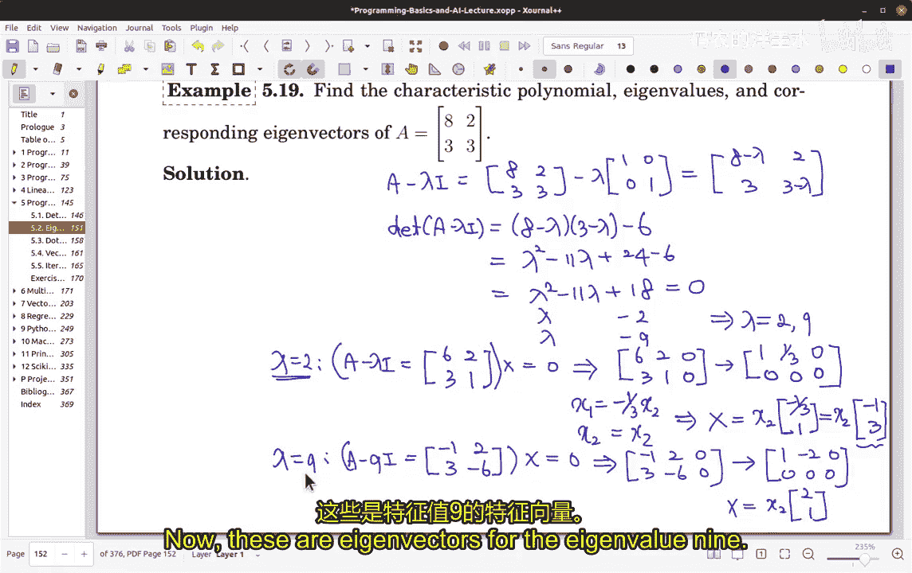

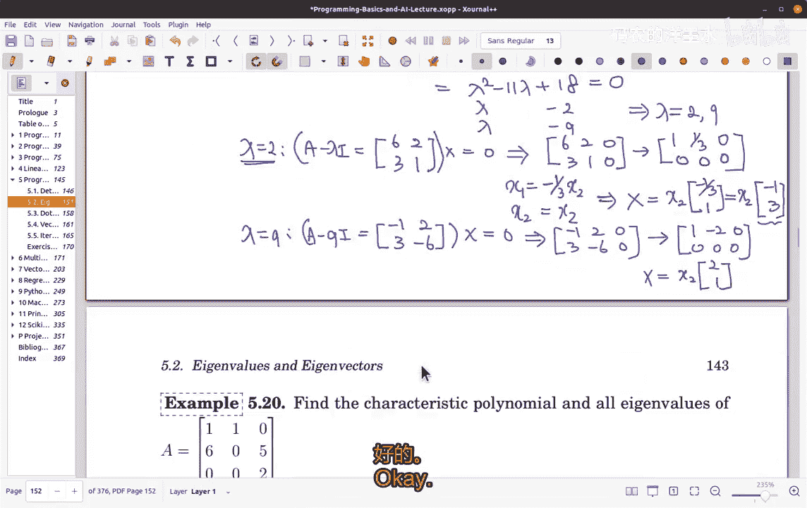


**MATLAB代码与结果**：
```matlab
A = [0 1 1; 1 0 1; 1 1 0]; % 定义矩阵
p = charpoly(A); % 计算特征多项式
% p 的结果对应多项式：λ^3 - 3λ - 2
roots(p) % 求解特征方程的根
% 得到特征值：-2, -2, 3 (此处-2是重根)

[V, D] = eig(A); % 直接计算特征向量(V)和特征值对角矩阵(D)
% V 的列是特征向量
% D 的对角线元素是特征值
% 可以验证 A * V ≈ V * D
```
通过 `eig` 命令，我们可以直接得到特征向量矩阵 **P** 和对角特征值矩阵 **D**，并且满足关系 **A = P D P^(-1)**，这引向了下一部分的重要主题：矩阵的相似对角化。

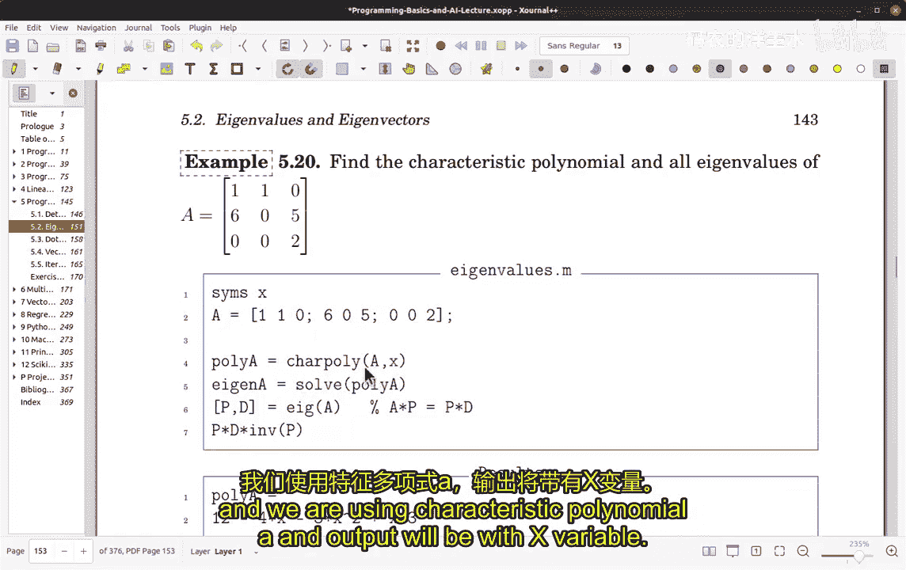

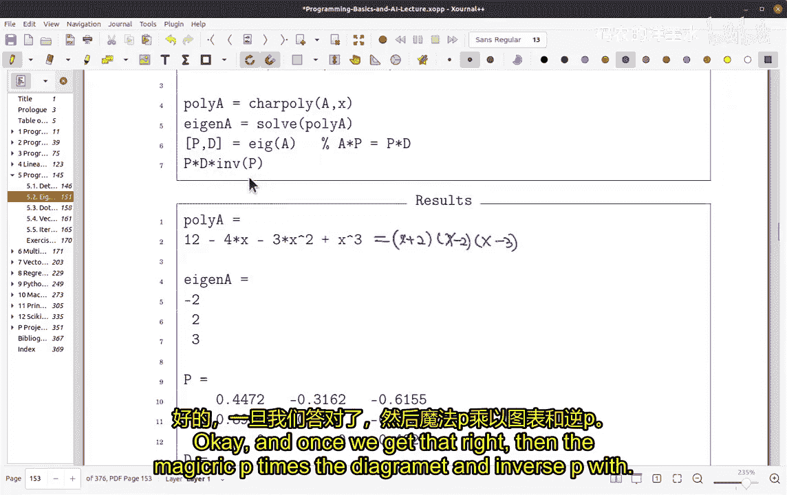

## 总结

本节课中我们一起学习了线性代数的核心概念——特征值与特征向量。
1.  我们首先了解了它们的定义：满足 **A x = λ x** 的标量 **λ** 和向量 **x**。
2.  我们通过具体例子学习了如何验证特征向量，以及如何根据已知特征值求解特征向量。
3.  我们探讨了特征值 **0** 与矩阵可逆性之间的重要关系。
4.  我们引入了系统求解特征值的关键工具——**特征方程 det(A - λI) = 0** 和**特征多项式**。
5.  我们完成了一个从计算特征多项式、解特征值到求对应特征向量的完整示例。
6.  最后，我们了解了如何使用MATLAB等计算工具来辅助求解。


这些概念是理解矩阵深层结构、进行矩阵对角化以及后续许多高级应用（如主成分分析PCA）的基础。在接下来的课程中，我们将继续学习矩阵的相似性与对角化定理。

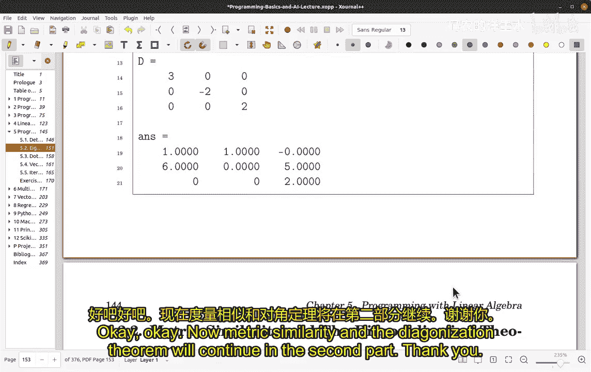

