# 035：第35讲 - 矩阵相似性与对角化定理（第二部分）🔢

在本节课中，我们将继续学习矩阵相似性的概念，并深入探讨矩阵对角化的核心定理。我们将了解如何判断一个矩阵是否可对角化，以及如何通过特征值和特征向量来实现对角化。

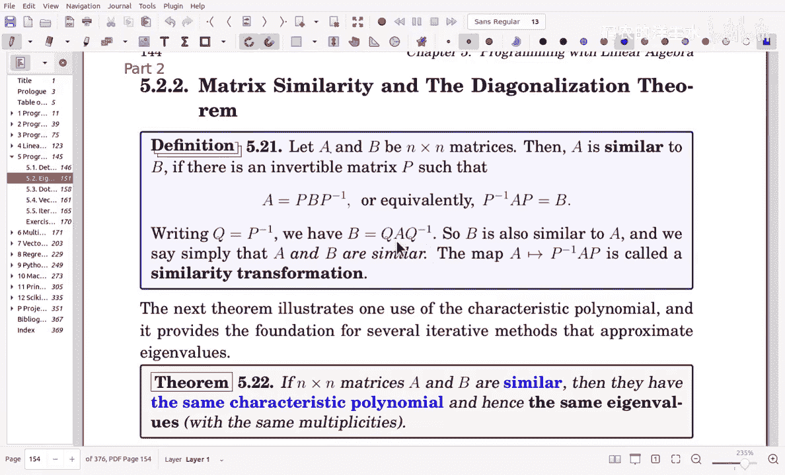

---

## 矩阵相似性回顾

上一节我们介绍了矩阵相似性的基本定义。本节中，我们来看看相似矩阵的一些重要性质。

两个 n×n 矩阵 **A** 和 **B** 是相似的，如果存在一个可逆矩阵 **P**，使得：

**A = P B P⁻¹**

或者等价地：

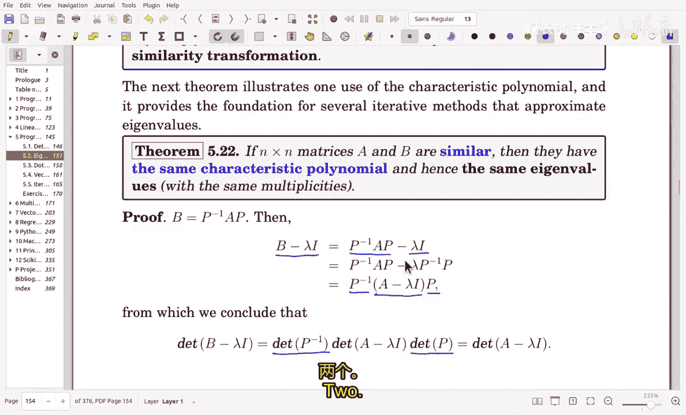

**P⁻¹ A P = B**

如果我们定义 **Q = P⁻¹**，那么方程也可以写成 **B = Q A Q⁻¹**。因此，相似关系是对称的：如果 **A** 相似于 **B**，那么 **B** 也相似于 **A**。映射 **A → P⁻¹ A P** 被称为相似变换。

---

## 相似矩阵的性质

以下是相似矩阵的一个关键性质。

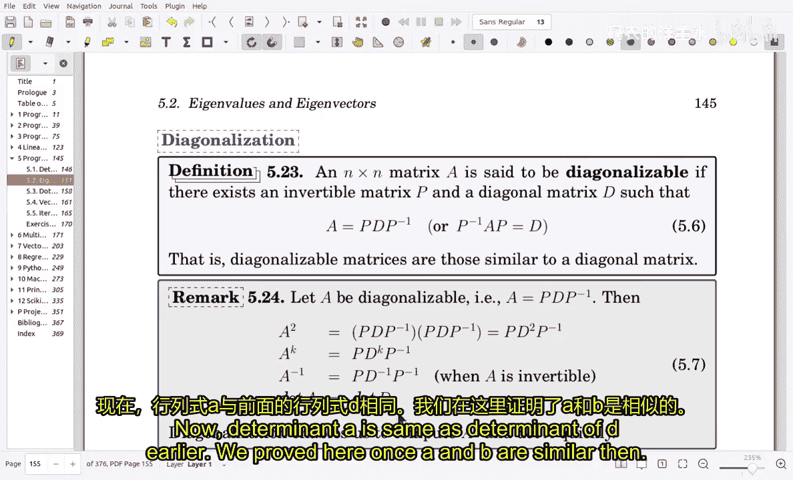

**定理**：如果 n×n 矩阵 **A** 和 **B** 相似，那么它们具有相同的特征多项式，因此也具有相同的特征值。

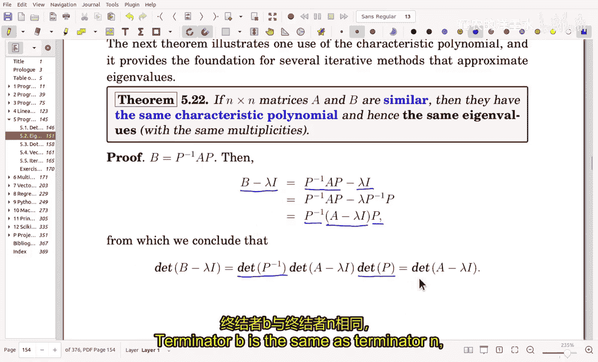

**证明**：
假设 **B** 相似于 **A**，即 **B = P⁻¹ A P**。
考虑 **B** 的特征多项式：
**det(B - λI) = det(P⁻¹ A P - λI)**
将单位矩阵 **I** 写作 **P⁻¹ P**，得到：
**det(P⁻¹ A P - λ P⁻¹ P) = det(P⁻¹ (A - λI) P)**
根据行列式的性质，**det(XY) = det(X) det(Y)**，因此：
**det(P⁻¹ (A - λI) P) = det(P⁻¹) det(A - λI) det(P)**
由于 **det(P⁻¹) det(P) = 1**，所以：
**det(B - λI) = det(A - λI)**
这表明 **A** 和 **B** 的特征多项式相同，因此它们的特征值也完全相同。

---

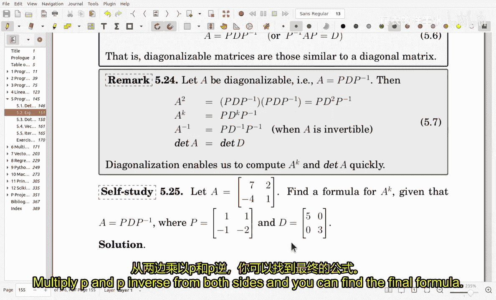

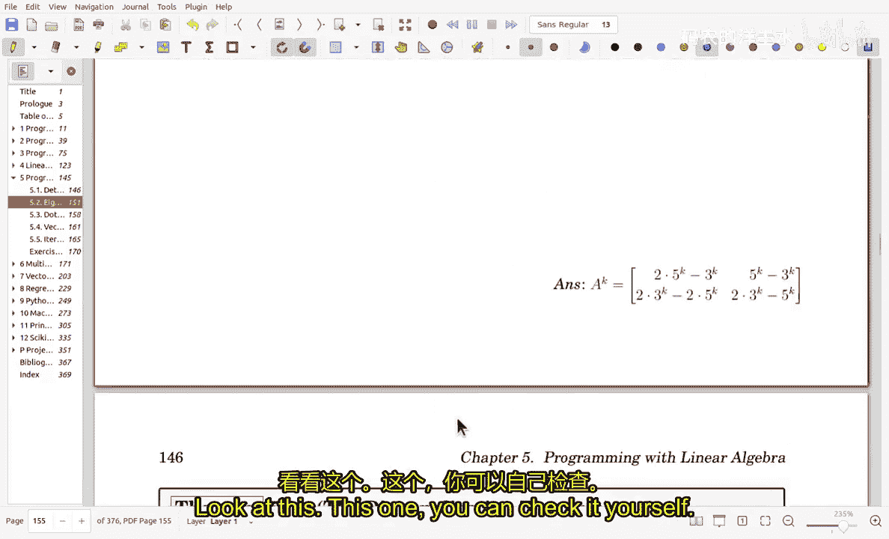

## 矩阵的对角化

现在，我们进入本节课的核心：矩阵的对角化。

**定义**：一个 n×n 矩阵 **A** 是可对角化的，如果存在一个可逆矩阵 **P** 和一个对角矩阵 **D**，使得：
**A = P D P⁻¹**
这意味着 **A** 相似于一个对角矩阵。

对角化在计算矩阵的幂和行列式时非常高效。例如：
*   **A² = (P D P⁻¹)(P D P⁻¹) = P D² P⁻¹**
*   推广到 **k** 次幂：**Aᵏ = P Dᵏ P⁻¹**
*   如果 **A** 可逆，则 **A⁻¹ = P D⁻¹ P⁻¹**
*   **det(A) = det(D)**，即所有特征值的乘积。

**自学习问题示例**：
给定 **A = P D P⁻¹**，其中：
```
P = [[1, 3], [2, 5]], D = [[5, 0], [0, 3]]
```
求 **Aᵏ** 的公式。
**解**：**Aᵏ = P Dᵏ P⁻¹ = P [[5ᵏ, 0], [0, 3ᵏ]] P⁻¹**。通过矩阵乘法即可得到最终表达式。

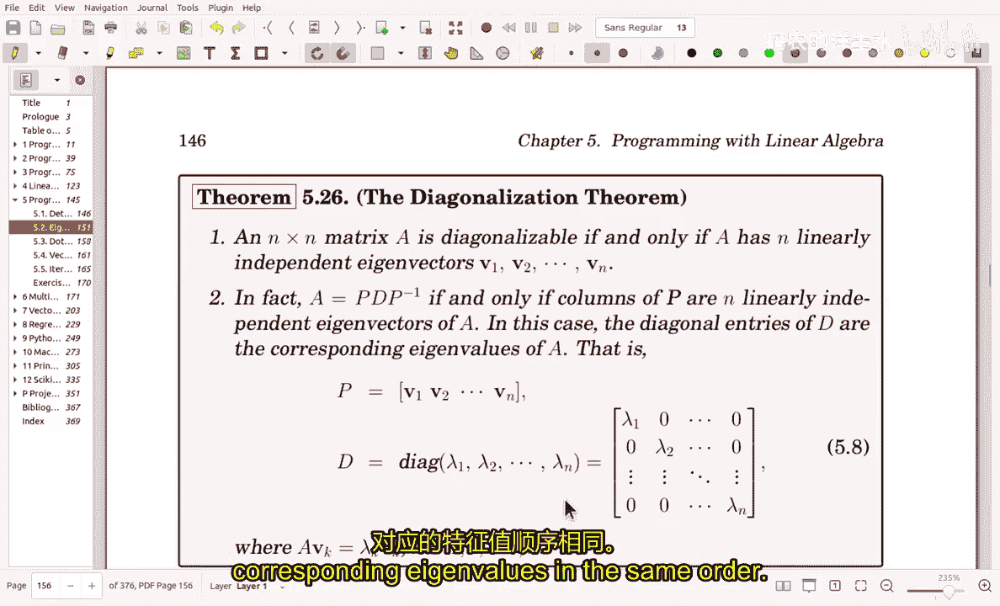

---

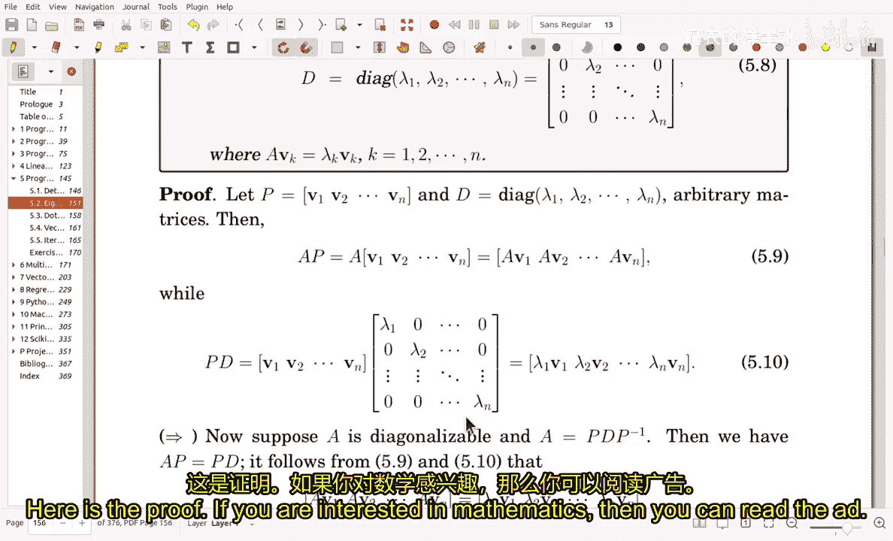

## 对角化定理

判断一个矩阵是否可对角化，关键在于其特征向量。

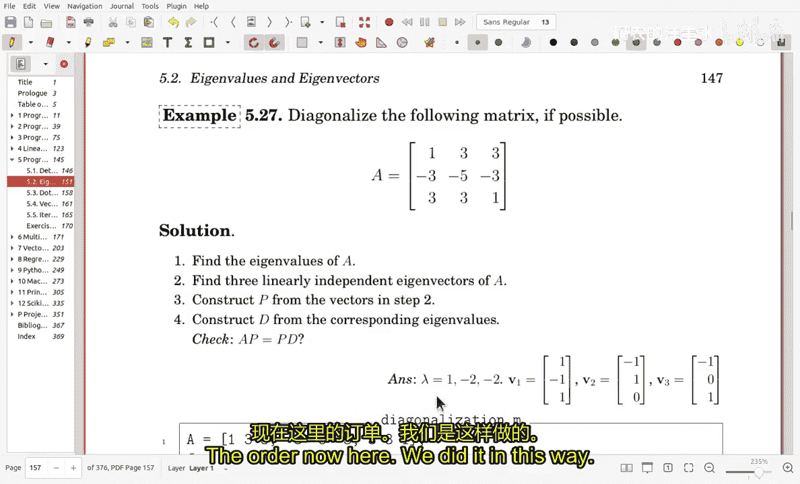

**对角化定理**：一个 n×n 矩阵 **A** 是可对角化的（即相似于一个对角矩阵），当且仅当 **A** 有 **n** 个线性无关的特征向量。

在这种情况下，**A** 可以分解为 **A = P D P⁻¹**，其中：
*   矩阵 **P** 的列由 **A** 的 **n** 个线性无关的特征向量组成。
*   对角矩阵 **D** 的对角线元素是与 **P** 中特征向量顺序对应的特征值。

**证明思路**：
假设 **A** 有 **n** 个线性无关的特征向量 **v₁, v₂, ..., vₙ**，对应的特征值为 **λ₁, λ₂, ..., λₙ**。
令 **P = [v₁ v₂ ... vₙ]**，**D = diag(λ₁, λ₂, ..., λₙ)**。
根据特征值定义 **A vₖ = λₖ vₖ**，可以推导出 **A P = P D**。由于 **P** 的列线性无关，**P** 可逆，因此两边同时左乘 **P⁻¹** 即得 **A = P D P⁻¹**。

---

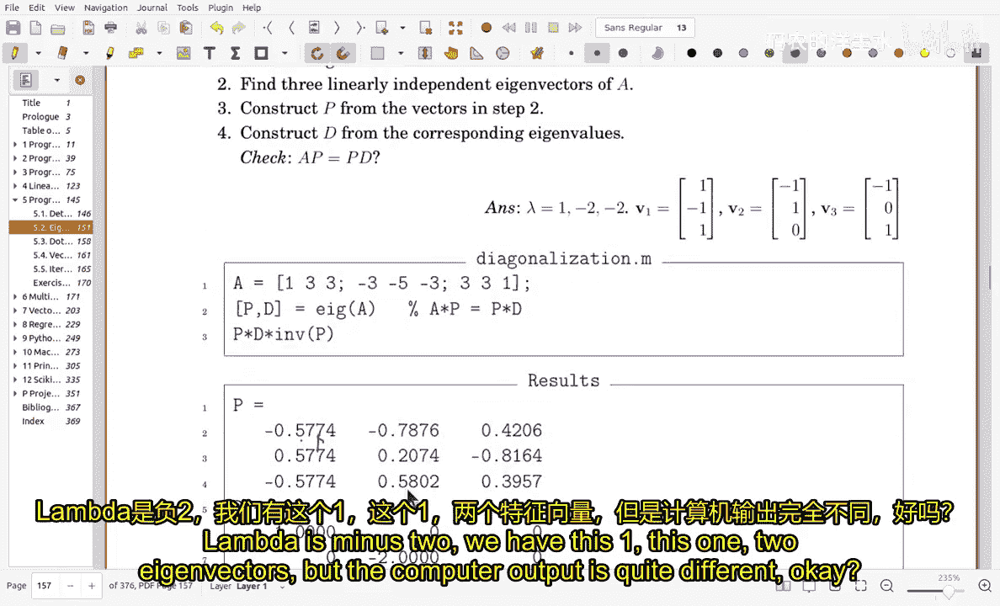

## 对角化实例

让我们通过一个例子来实践对角化过程。

**问题**：如果可能，对角化以下矩阵 **A**：
```
A = [[-5,  9,  0],
     [-6, 10,  0],
     [-3,  6,  1]]
```

**解**：
对角化的步骤是：
1.  求特征值。
2.  对每个特征值，求线性无关的特征向量。
3.  检查是否找到 **3** 个线性无关的特征向量（因为 **A** 是 3×3 矩阵）。
4.  如果能找到，用它们构造 **P**，并用对应的特征值构造 **D**。

**手动计算**：
*   特征值为 **λ₁ = 1** 和 **λ₂ = -2**（二重根）。
*   对于 **λ₁ = 1**，找到一个特征向量，例如 **v₁ = [0, 0, 1]ᵀ**（经过缩放后可能是 **[1, -1, 1]ᵀ**）。
*   对于 **λ₂ = -2**，求解 **(A + 2I)x = 0**。通过行化简，发现有两个自由变量，可以得到两个线性无关的特征向量，例如 **v₂ = [-1, 1, 0]ᵀ** 和 **v₃ = [-1, 0, 1]ᵀ**。
*   因此，我们找到了三个线性无关的特征向量，**A** 可对角化。
*   构造：
    ```
    P = [v₁, v₂, v₃] (按对应顺序排列)
    D = diag(1, -2, -2) (特征值顺序与P中特征向量顺序一致)
    ```
    则有 **A = P D P⁻¹**。

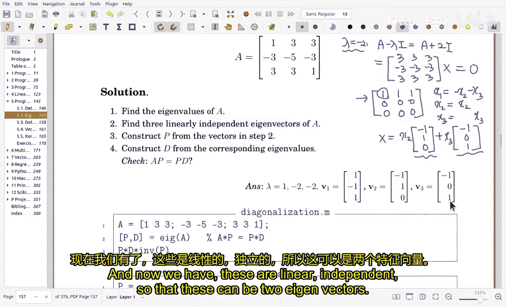

**计算机辅助（如MATLAB）**：
使用 `[P, D] = eig(A)` 函数可以直接得到特征向量矩阵 **P** 和对角特征值矩阵 **D**。计算机输出的特征向量形式可能不同（例如，是手动计算得到的特征向量的线性组合），但只要它们线性无关，并且与特征值正确对应，结果就是有效的。

---

## 总结

本节课中我们一起学习了：
1.  **矩阵相似性**的定义和关键性质：相似矩阵具有相同的特征多项式和特征值。
2.  **矩阵对角化**：一个矩阵 **A** 可对角化意味着它可以表示为 **A = P D P⁻¹**，这能极大简化矩阵幂等运算。
3.  **对角化定理**：矩阵可对角化的充要条件是它拥有 **n** 个线性无关的特征向量。此时，**P** 由这些特征向量构成，**D** 由对应的特征值构成。
4.  通过实例练习了对角化的具体步骤：求特征值、求特征向量、构造 **P** 和 **D**。

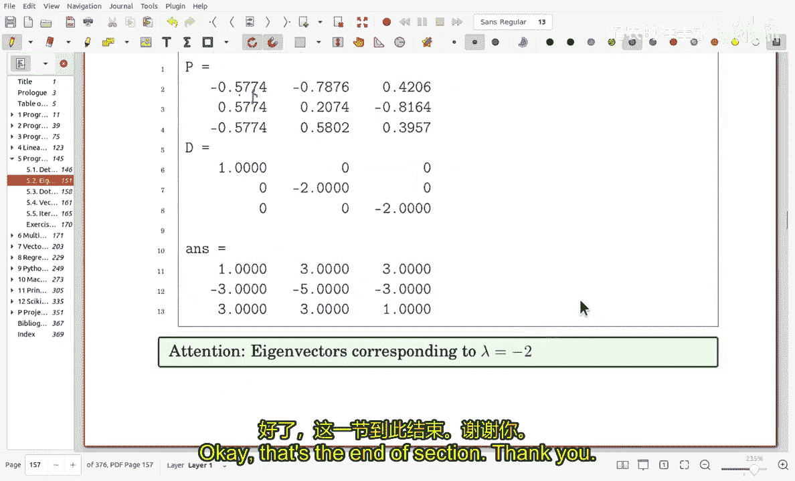

理解矩阵的对角化是线性代数在人工智能和许多科学计算领域应用的基础，它帮助我们洞察矩阵的结构并简化复杂计算。