# 036：点积、长度与正交性 📐

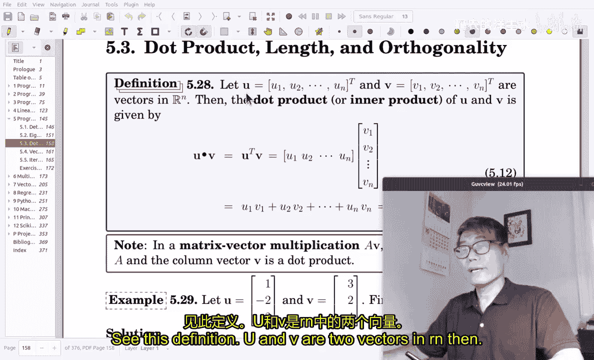

在本节中，我们将学习向量运算中的三个核心概念：点积、向量的长度（或范数）以及正交性。这些概念是理解向量空间几何和后续机器学习算法的基础。

## 点积的定义与计算

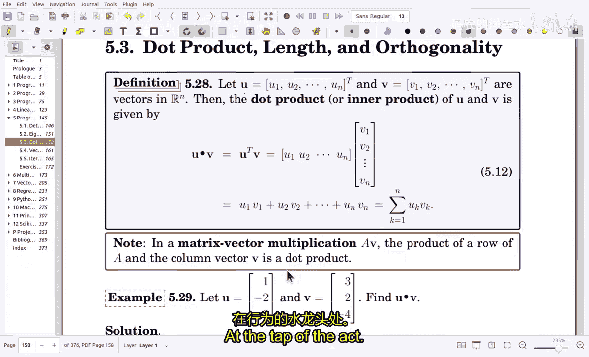

点积，也称为内积，是两个向量之间的一种运算。设 **u** 和 **v** 是 Rⁿ 空间中的两个向量，它们的点积定义为：

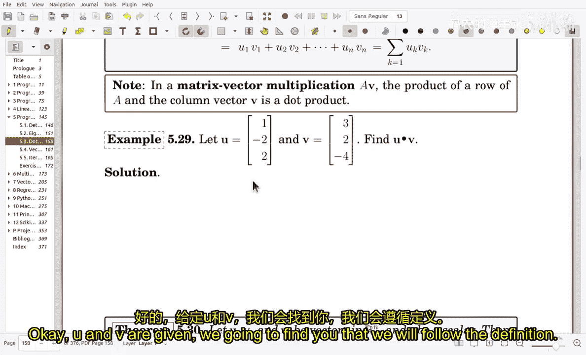

**u · v = u₁v₁ + u₂v₂ + ... + uₙvₙ**

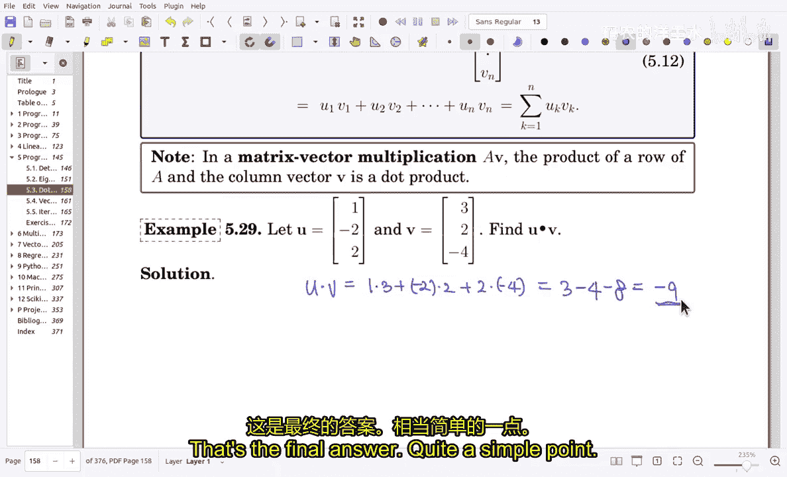

这等价于将向量 **u** 转置后与向量 **v** 进行矩阵乘法：**uᵀv**。在矩阵乘法 **AB** 中，矩阵 **A** 的行向量与矩阵 **B** 的列向量的点积，就是乘积矩阵中的一个元素。

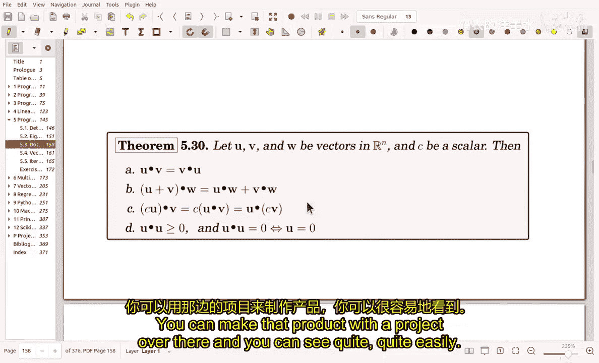

现在，我们通过一个例子来具体计算点积。

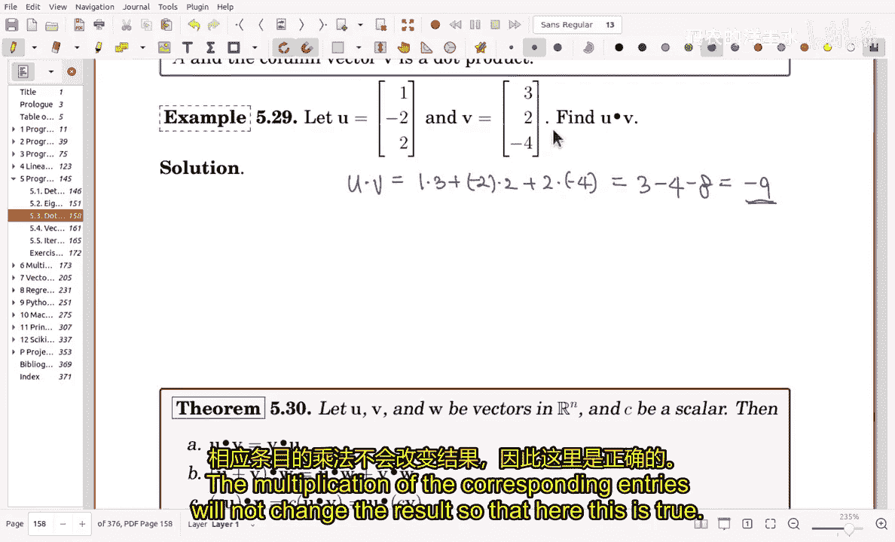

**示例：** 给定向量 **u** = [1, -2, 2] 和 **v** = [3, 2, -4]，计算 **u · v**。

根据定义，我们将对应分量相乘后求和：
1 × 3 = 3
(-2) × 2 = -4
2 × (-4) = -8
总和为：3 + (-4) + (-8) = -9

因此，**u · v = -9**。

## 点积的运算性质

了解点积的运算规则有助于简化计算。设 **u**, **v**, **w** 是 Rⁿ 中的向量，c 是一个标量，则点积满足以下性质：

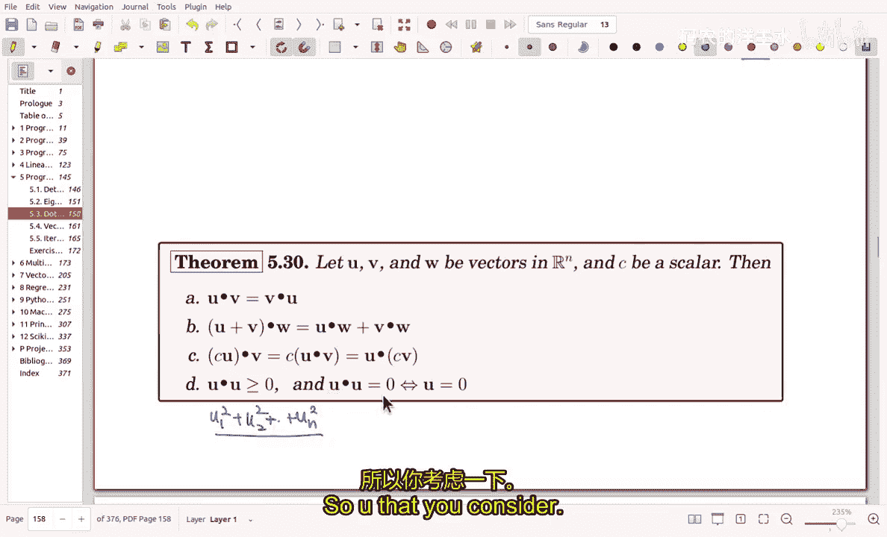

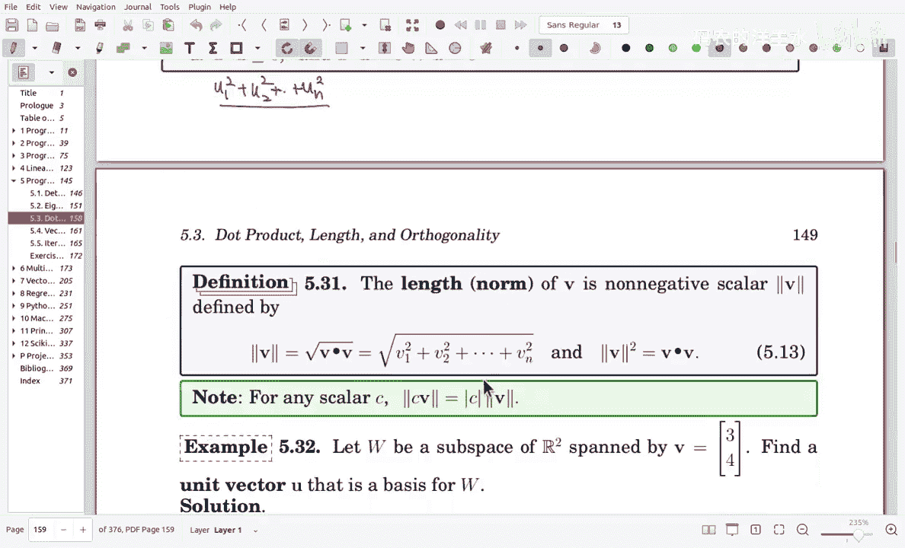

以下是点积的主要运算性质：
1.  **交换律**：**u · v = v · u**
2.  **分配律**：**u · (v + w) = u · v + u · w**
3.  **标量乘法结合律**：**(c u) · v = c (u · v) = u · (c v)**
4.  **自点积的非负性**：**u · u ≥ 0**，且 **u · u = 0** 当且仅当 **u = 0**（零向量）。

这些性质在证明定理和优化计算时非常有用。例如，利用分配律可以将两次点积运算合并为一次。

## 向量的长度与距离

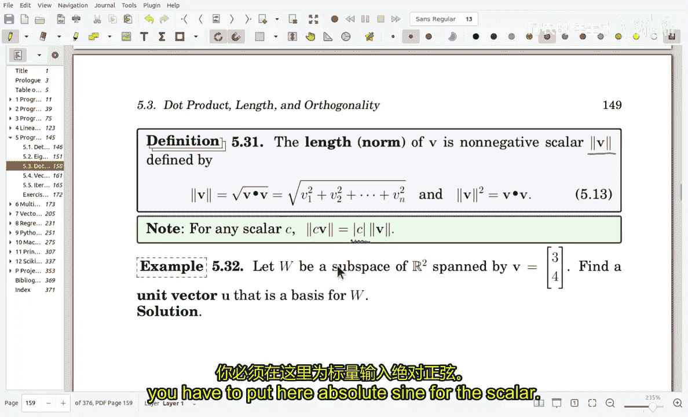

上一节我们介绍了点积，本节中我们来看看如何利用点积定义向量的长度。向量 **v** 的长度（或欧几里得范数）记作 **||v||**，定义为：

**||v|| = √(v · v) = √(v₁² + v₂² + ... + vₙ²)**

显然，**||v||² = v · v**。对于任意标量 c，有 **||c v|| = |c| * ||v||**，这里需要注意标量要取绝对值。

**示例：单位向量**
设 W 是 R² 中由向量 **v** = [3, 4] 张成的子空间。我们希望找到 W 的一个单位正交基 **u**。
首先计算 **v** 的长度：**||v|| = √(3² + 4²) = √25 = 5**。
则单位向量 **u = v / ||v|| = [3/5, 4/5]**。所有 **u** 的标量倍数构成了子空间 W，因此 **u** 是 W 的一个基。

基于长度，我们可以定义两个向量之间的距离。向量 **u** 和 **v** 之间的距离 **dist(u, v)** 定义为：

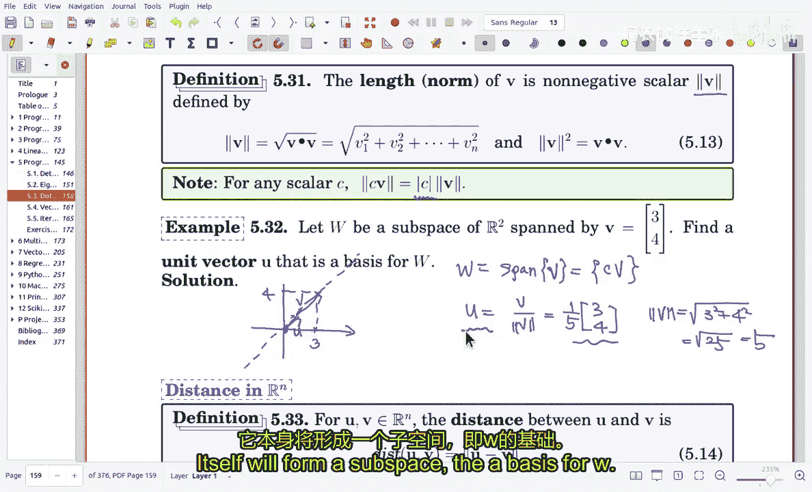

**dist(u, v) = ||u - v||**

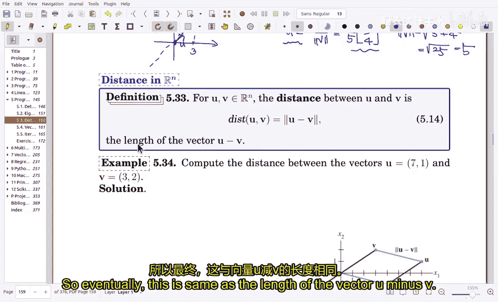

**示例：** 计算 **u** = [7, 1] 和 **v** = [3, 2] 之间的距离。
首先，**u - v = [4, -1]**。
然后，**dist(u, v) = ||u - v|| = √(4² + (-1)²) = √17**。

几何上，这个距离就是连接向量 **u** 和 **v** 终点的那条线段的长度。

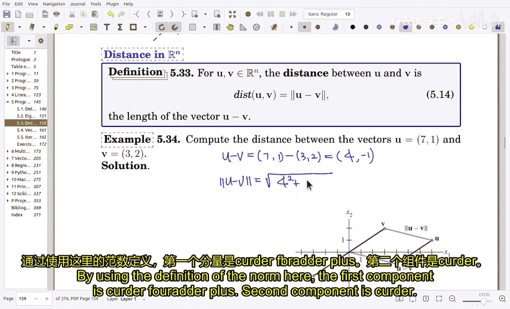

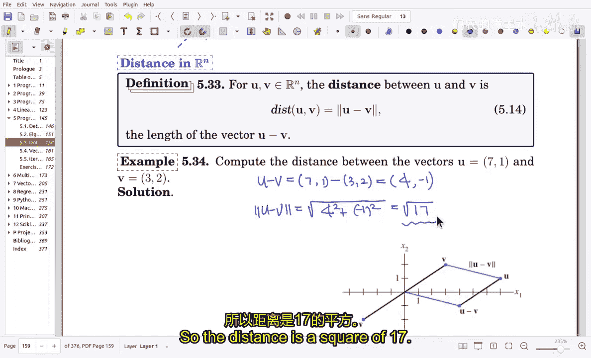

## 正交性与勾股定理

现在，我们进入核心概念：正交性。如果两个向量的点积为零，则称它们正交：

**u · v = 0 ⇔ u 与 v 正交**

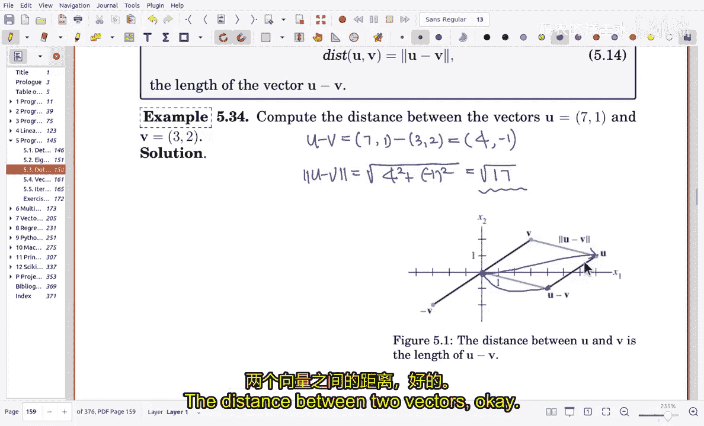

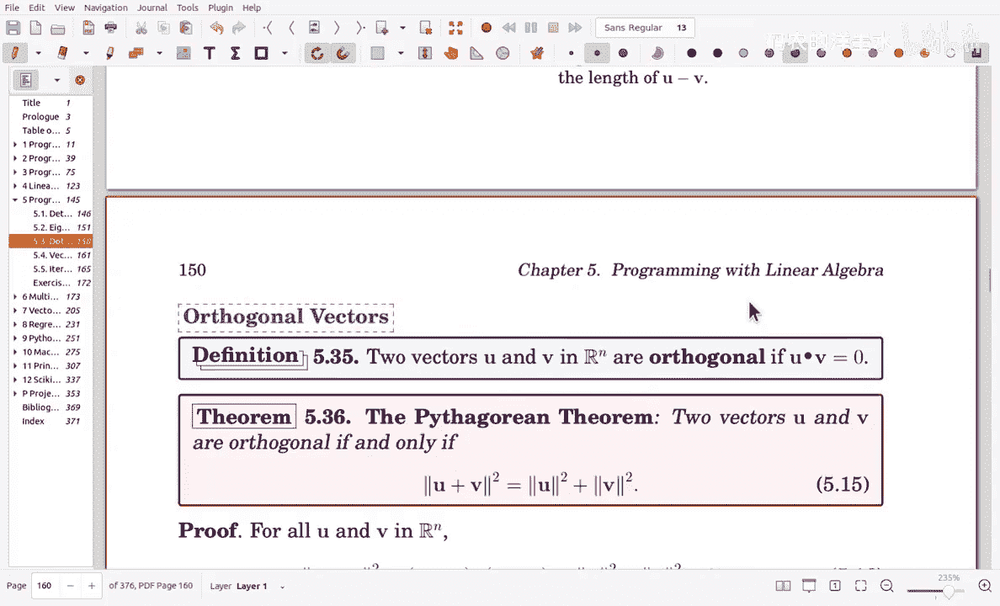

正交性在几何上对应着两个向量垂直（夹角为90度）。与此紧密相关的是**勾股定理**在向量空间中的形式：

两个向量 **u** 和 **v** 正交，当且仅当 **||u + v||² = ||u||² + ||v||²**。

这可以直观理解：以 **u** 和 **v** 为边构成一个直角三角形，那么 **u + v** 就是斜边。斜边长度的平方等于两直角边长度的平方和。

## 向量夹角公式

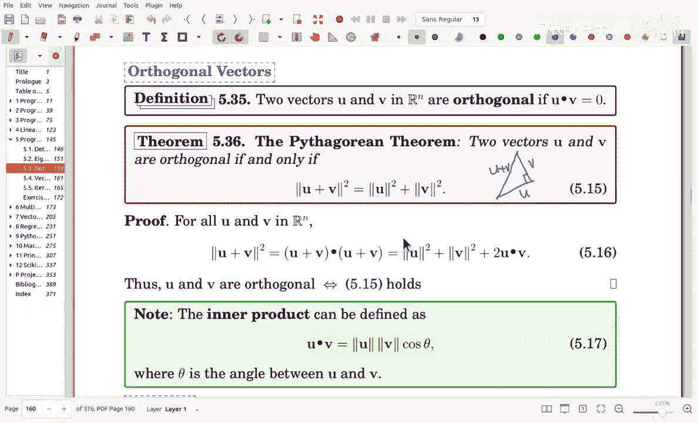

点积还有一个重要的几何解释，它关联了向量的长度和它们之间的夹角 θ：

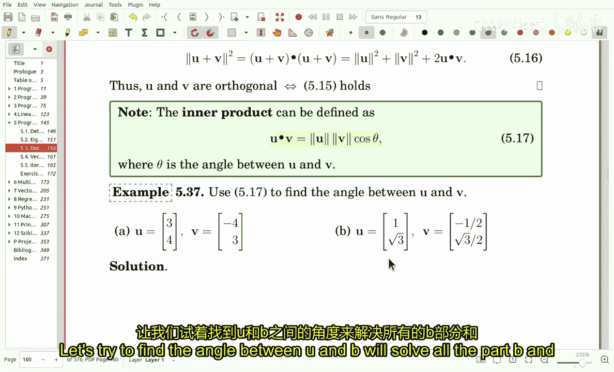

**u · v = ||u|| ||v|| cos θ**

我们可以利用这个公式来求解两个向量之间的夹角。

**示例：** 求 **u** = [1, √3] 和 **v** = [1, 0] 之间的夹角。
1.  计算点积：**u · v** = 1×1 + √3×0 = 1。
2.  计算长度：**||u|| = √(1² + (√3)²) = √4 = 2**；**||v|| = √(1² + 0²) = 1**。
3.  代入公式：cos θ = (u · v) / (||u|| ||v||) = 1 / (2 × 1) = 1/2。
4.  因此，夹角 θ = π/3 (60度)。

---

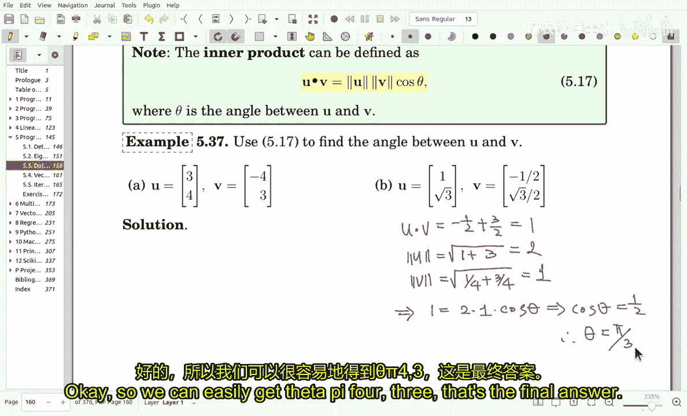

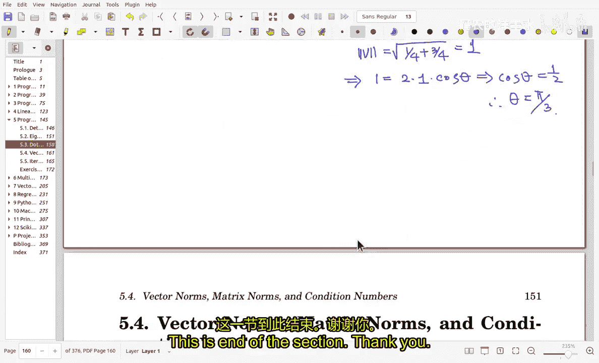

本节课中我们一起学习了向量的点积、长度（范数）、距离以及正交性。我们看到了点积如何同时具备代数定义和几何意义，并且通过勾股定理和夹角公式将长度与角度联系起来。理解这些概念是掌握向量空间几何和许多人工智能算法（如支持向量机、主成分分析等）的关键第一步。