# 037：向量范数、矩阵范数与条件数

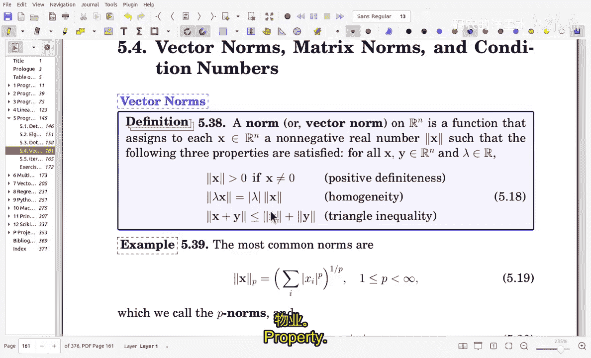

## 概述
在本节课中，我们将学习线性代数中几个核心概念：**向量范数**、**矩阵范数**以及**条件数**。这些概念是理解数值计算稳定性、误差分析以及许多机器学习算法的基础。我们将从定义开始，逐步介绍常见的范数类型及其计算方法，并探讨它们之间的关系。

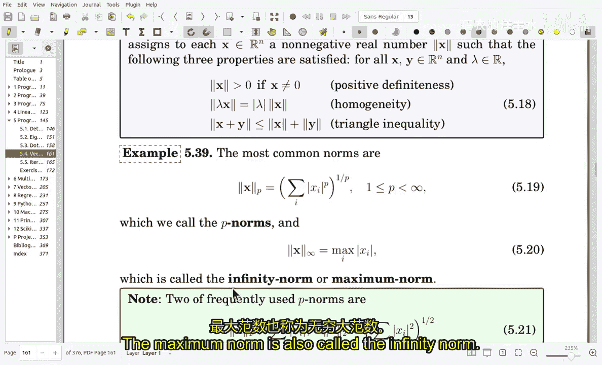

---

## 5.4：向量范数

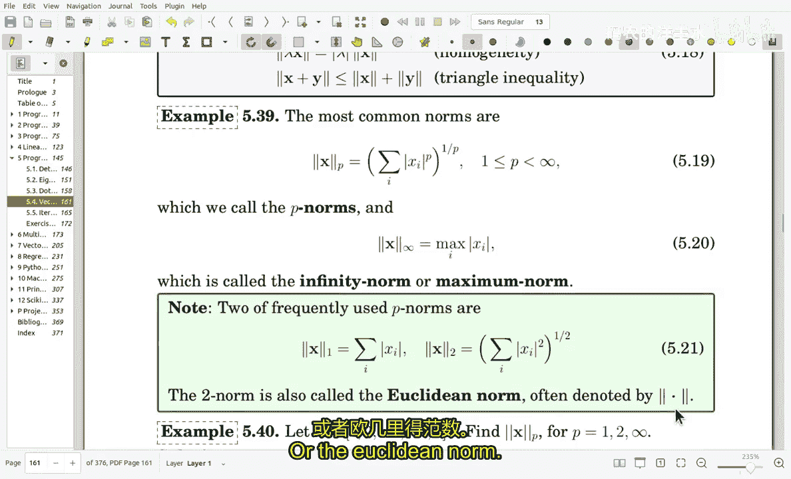

上一节我们回顾了线性代数的基础知识，本节中我们来看看如何度量向量的大小，即向量范数。

定义在 **Rⁿ** 上的向量范数是一个函数，它为每个向量 **x** ∈ **Rⁿ** 分配一个非负数，并满足以下三个性质：
1.  **正定性**：对于所有 **x** ∈ **Rⁿ**，有 **\|x\| ≥ 0**，且 **\|x\| = 0** 当且仅当 **x = 0**。
2.  **齐次性**：对于所有 **x** ∈ **Rⁿ** 和标量 λ，有 **\|λx\| = |λ| \|x\|**。
3.  **三角不等式**：对于所有 **x, y** ∈ **Rⁿ**，有 **\|x + y\| ≤ \|x\| + \|y\|**。

满足这些性质的函数可以定义出多种范数。

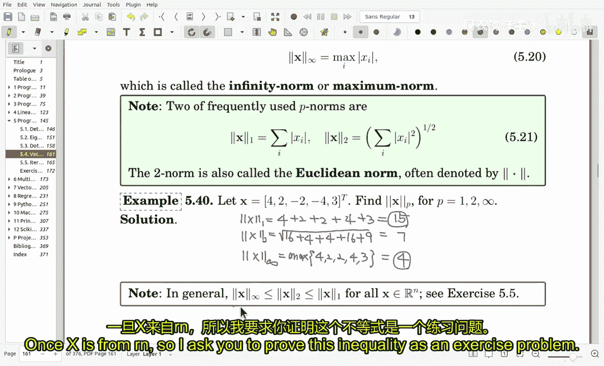

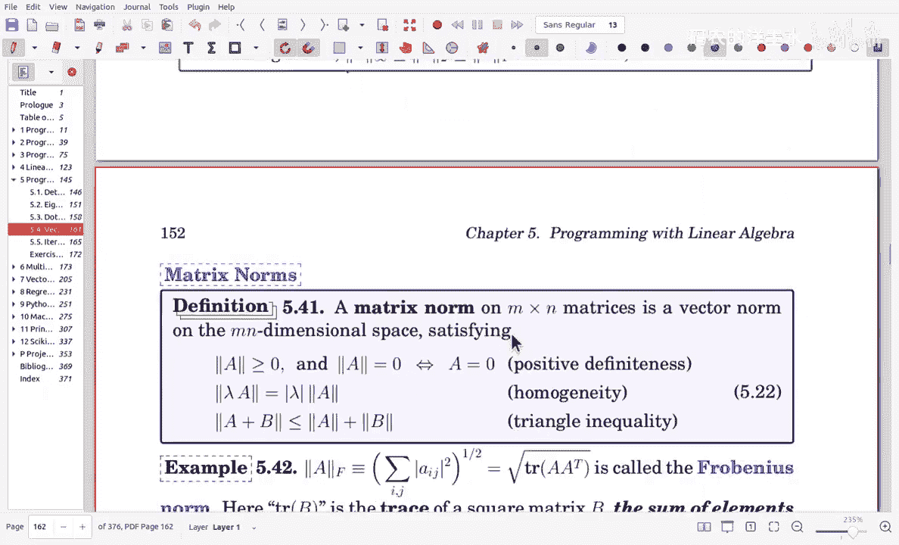

以下是两种最常见的范数族：

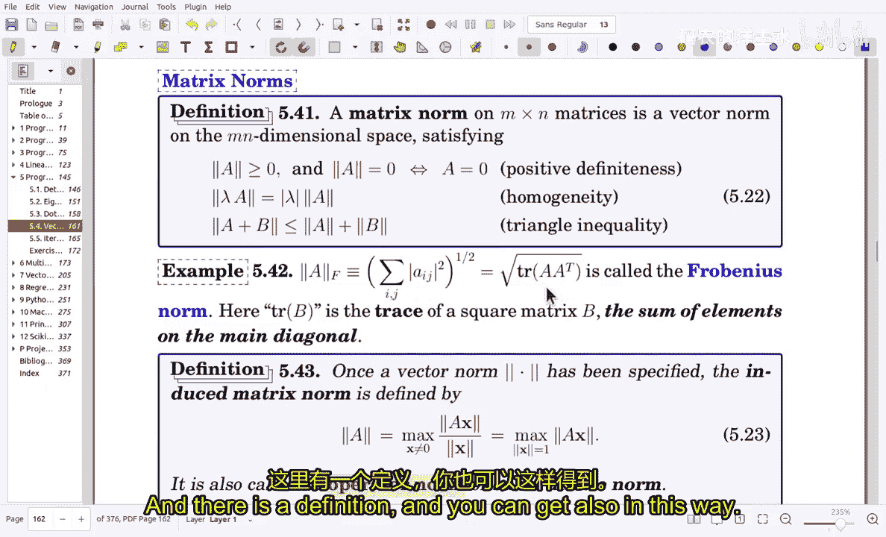

*   **p-范数**：对于 p ≥ 1，p-范数定义为：
    `\|x\|_p = (|x₁|^p + |x₂|^p + ... + |x_n|^p)^(1/p)`
*   **最大范数（无穷范数）**：定义为向量中绝对值最大的分量：
    `\|x\|_∞ = max(|x₁|, |x₂|, ..., |x_n|)`

在p-范数中，最常用的是1-范数和2-范数。
*   **1-范数**：`\|x\|_1 = |x₁| + |x₂| + ... + |x_n|`
*   **2-范数**：`\|x\|_2 = sqrt(|x₁|² + |x₂|² + ... + |x_n|²)`

2-范数也称为**欧几里得范数**。通常，当范数符号没有下标时，默认指的就是2-范数。

### 示例
让我们通过一个例子来计算不同范数。设向量 **x** = [4, -2, 2, -4, 3]ᵀ。

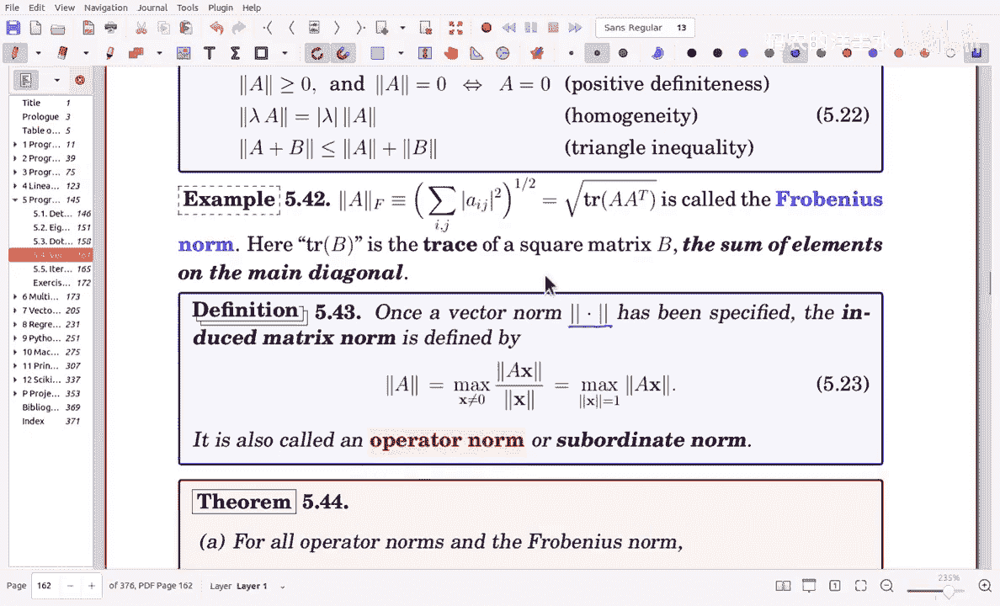

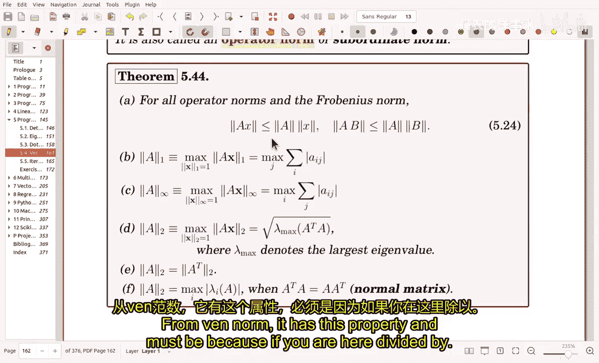

*   **1-范数**：`\|x\|_1 = |4| + |-2| + |2| + |-4| + |3| = 4 + 2 + 2 + 4 + 3 = 15`
*   **2-范数**：`\|x\|_2 = sqrt(4² + (-2)² + 2² + (-4)² + 3²) = sqrt(16 + 4 + 4 + 16 + 9) = sqrt(49) = 7`
*   **无穷范数**：`\|x\|_∞ = max(|4|, |-2|, |2|, |-4|, |3|) = max(4, 2, 2, 4, 3) = 4`

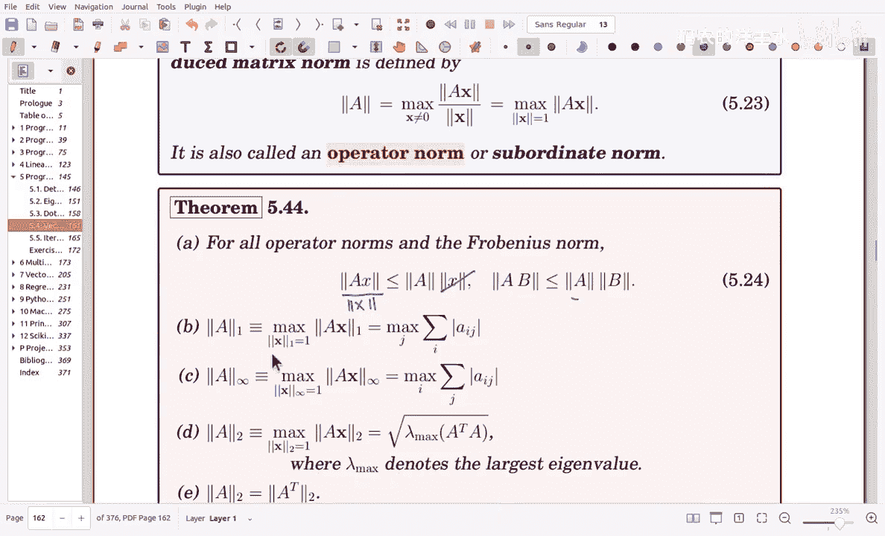

在这个例子中，1-范数值最大，无穷范数值最小，2-范数居中。一般来说，对于任意 **x** ∈ **Rⁿ**，有以下不等式关系：
`\|x\|_∞ ≤ \|x\|_2 ≤ \|x\|_1`
你可以尝试证明这个不等式。

---

## 矩阵范数

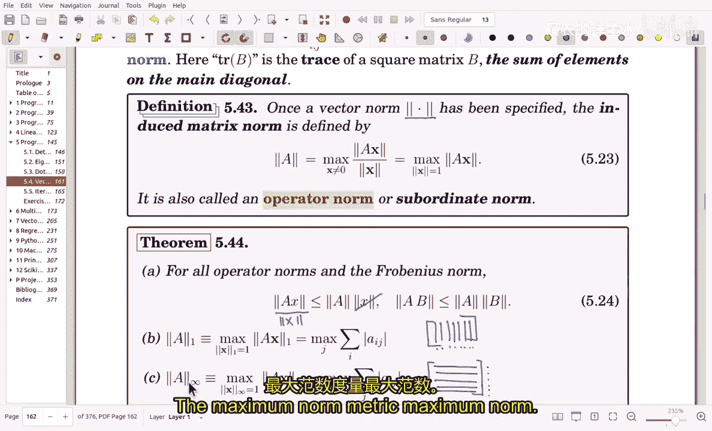

理解了向量范数后，我们可以将其推广到矩阵上，定义矩阵范数。

定义在 **m × n** 矩阵空间上的矩阵范数，本质上是一个定义在 **m×n** 维空间（将矩阵视为长向量）上的向量范数，同样需要满足正定性、齐次性和三角不等式。

我们可以定义多种矩阵范数。一个例子是**弗罗贝尼乌斯范数**：
`\|A\|_F = sqrt(Σ_i Σ_j |a_ij|²)`
这个值可以通过公式 `\|A\|_F = sqrt(trace(AᵀA))` 计算，其中 `trace` 是矩阵的迹（主对角线元素之和）。

另一种非常重要的矩阵范数是由向量范数**诱导**出的算子范数（或从属范数）。给定一个向量范数 `\|·\|`，其诱导的矩阵范数定义为：
`\|A\| = max_{x ≠ 0} ( \|Ax\| / \|x\| )`
这个定义可以等价地理解为：`\|A\| = max_{\|x\|=1} \|Ax\|`。它衡量了矩阵 **A** 对向量 **x** 的最大“拉伸”倍数。

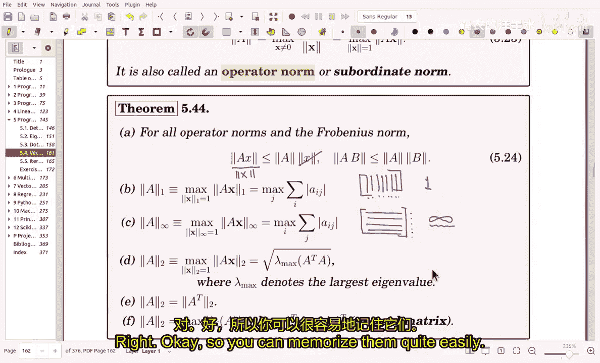

### 常见诱导范数的计算
对于由特定向量p-范数诱导出的矩阵范数，有直接的计算公式：

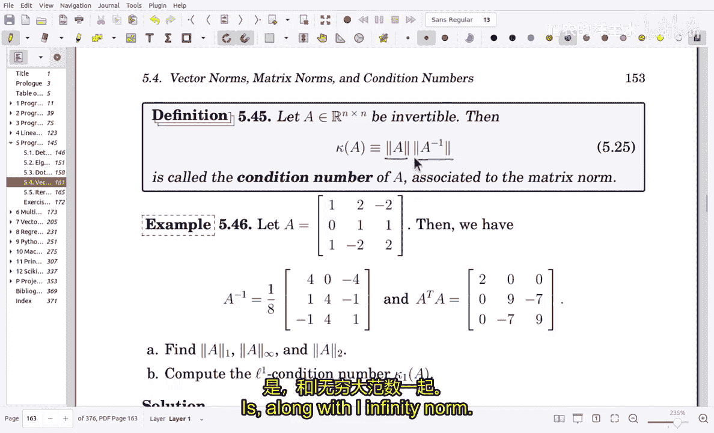

*   **矩阵1-范数（列和范数）**：由向量1-范数诱导。计算方法是求矩阵各列元素绝对值之和的最大值。
    `\|A\|_1 = max_j ( Σ_i |a_ij| )`
*   **矩阵无穷范数（行和范数）**：由向量无穷范数诱导。计算方法是求矩阵各行元素绝对值之和的最大值。
    `\|A\|_∞ = max_i ( Σ_j |a_ij| )`
*   **矩阵2-范数（谱范数）**：由向量2-范数诱导。计算方法是求矩阵 **AᵀA** 的最大特征值的平方根。
    `\|A\|_2 = sqrt( λ_max(AᵀA) )`
    如果矩阵 **A** 是正规矩阵（例如对称矩阵），那么 `\|A\|_2` 等于 **A** 的绝对值最大的特征值。

记忆技巧：计算1-范数时按列求和（1像一根竖线），计算无穷范数时按行求和（无穷符号像横躺的8，代表行）。

---

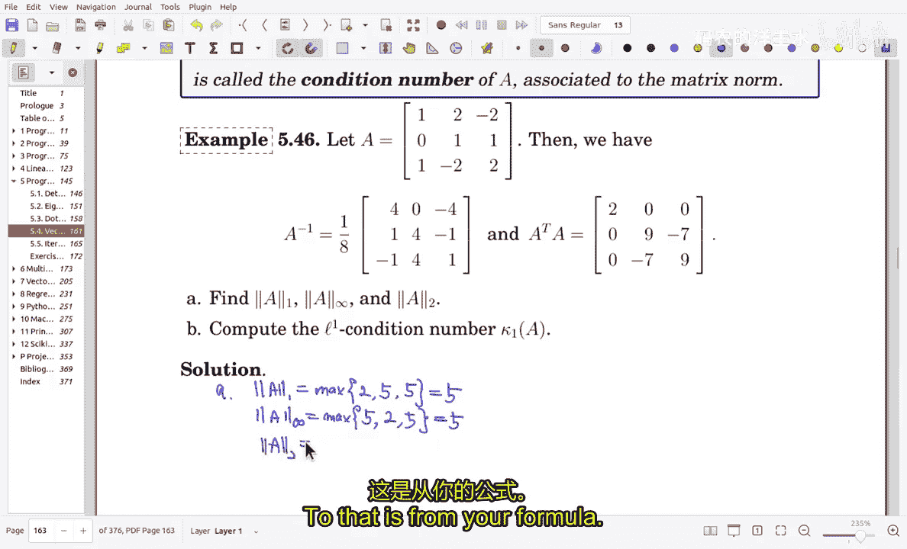

## 条件数

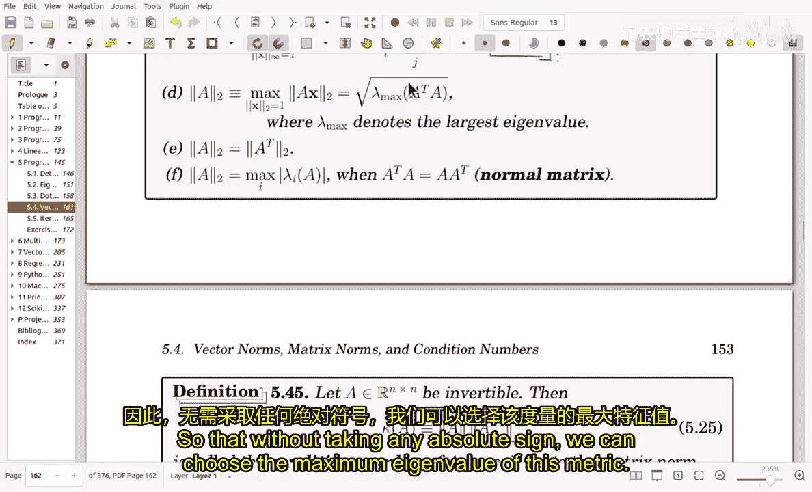

在学习了矩阵范数之后，我们可以用它来定义一个衡量矩阵“病态”程度的重要指标——条件数。

对于一个可逆矩阵 **A**，其条件数定义为：
`cond(A) = \|A\| \|A⁻¹\|`
其中，`\|·\|` 是某种矩阵范数。条件数与所选的矩阵范数相关，因此我们常称之为 **L1条件数**、**L2条件数** 或 **L∞条件数**。

条件数反映了线性方程组 **Ax = b** 的解 **x** 对于输入数据 **b** 或 **A** 中微小扰动的敏感程度。条件数越大，矩阵越“病态”，求解时对误差越敏感。

### 示例
设矩阵 **A** = [[2, 0, 0], [0, 3, -7], [0, -7, 3]]，其逆矩阵 **A⁻¹** = [[1/2, 0, 0], [0, 3/40, 7/40], [0, 7/40, 3/40]]。

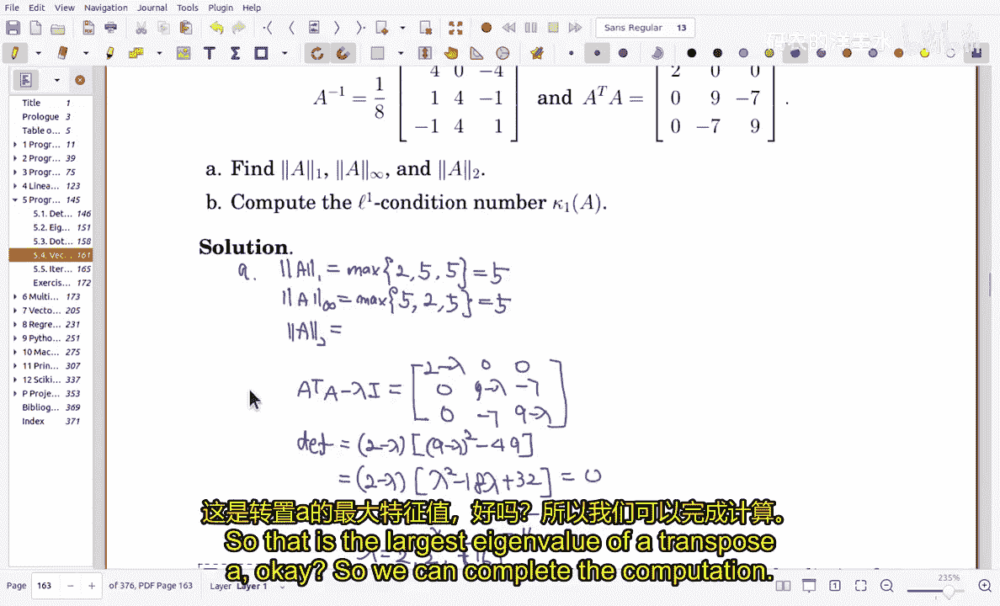

1.  **计算 \|A\|₁**：求各列绝对值之和的最大值。
    第一列：|2|+|0|+|0|=2；第二列：|0|+|3|+|-7|=10；第三列：|0|+|-7|+|3|=10。
    因此，`\|A\|₁ = max(2, 10, 10) = 10`。

2.  **计算 \|A\|_∞**：求各行绝对值之和的最大值。
    第一行：|2|+|0|+|0|=2；第二行：|0|+|3|+|-7|=10；第三行：|0|+|-7|+|3|=10。
    因此，`\|A\|_∞ = max(2, 10, 10) = 10`。

3.  **计算 \|A\|₂**：需要求 **AᵀA** 的最大特征值。经计算，**AᵀA** 的特征值为 2, 2, 16。最大特征值为 16。
    因此，`\|A\|₂ = sqrt(16) = 4`。

4.  **计算 L1 条件数**：`cond₁(A) = \|A\|₁ \|A⁻¹\|₁`。
    已知 `\|A\|₁ = 10`。计算 `\|A⁻¹\|₁`：求 **A⁻¹** 各列绝对值之和的最大值。
    第一列：|1/2|+0+0=0.5；第二列：0+|3/40|+|7/40|=0.25；第三列：0+|7/40|+|3/40|=0.25。
    因此，`\|A⁻¹\|₁ = max(0.5, 0.25, 0.25) = 0.5`。
    最终，`cond₁(A) = 10 * 0.5 = 5`。

---

## 补充说明

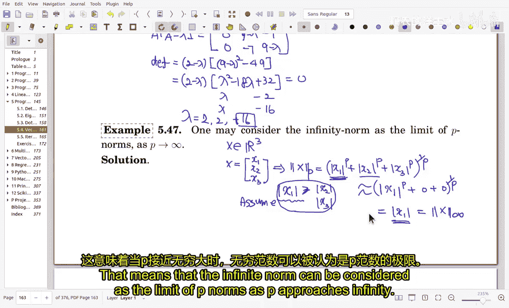

1.  **无穷范数与p-范数的关系**：向量无穷范数可以看作是p-范数当 p 趋于无穷大时的极限，即 `\|x\|_∞ = lim_{p→∞} \|x\|_p`。直观上，当p非常大时，绝对值最大的分量在求和式中占主导地位，其p次方根就趋近于该最大值。

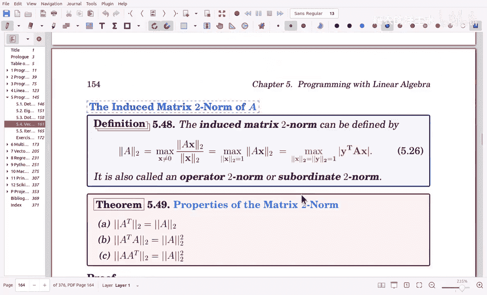

2.  **矩阵2-范数的等价定义**：矩阵2-范数还有另一个有用的等价定义：
    `\|A\|_2 = max_{\|x\|_2=\|y\|_2=1} |yᵀAx|`
    基于此，可以证明一些性质，例如 `\|Aᵀ\|_2 = \|A\|_2`，以及 `\|AᵀA\|_2 = \|A\|_2²`。

---

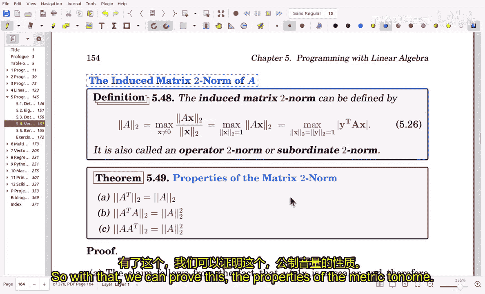

## 总结
本节课我们一起学习了线性代数中的核心度量工具。
*   我们首先定义了**向量范数**，并介绍了常见的1-范数、2-范数和无穷范数及其计算方法。
*   接着，我们将概念推广到**矩阵范数**，重点讲解了由向量范数诱导出的算子范数，并给出了1-范数、2-范数和无穷范数对应的矩阵范数计算公式。
*   最后，我们利用矩阵范数定义了**条件数**，它用于评估矩阵求逆和线性方程组求解的数值稳定性，并通过一个例子演示了如何计算。

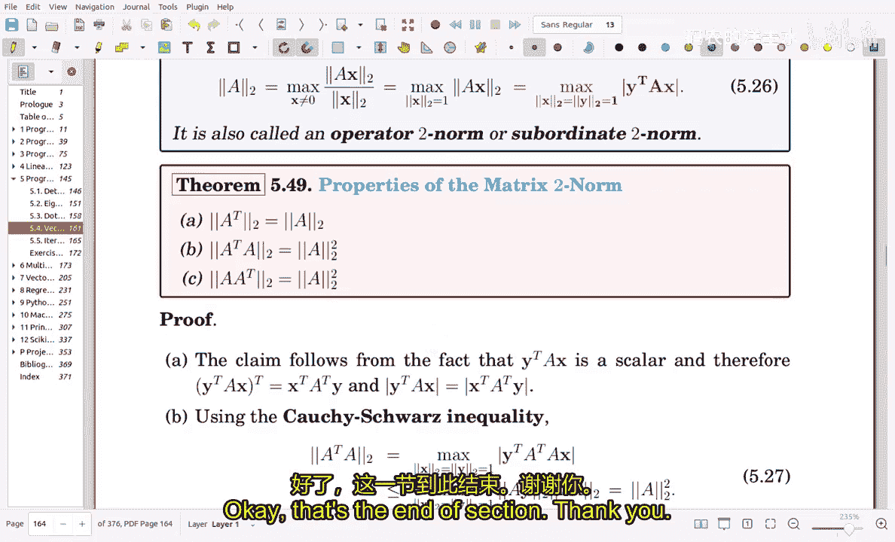

理解这些概念对于后续学习数值算法、优化理论以及机器学习模型中的正则化等都至关重要。