# 038：第38讲 - 特征值幂法与逆幂法 🧮

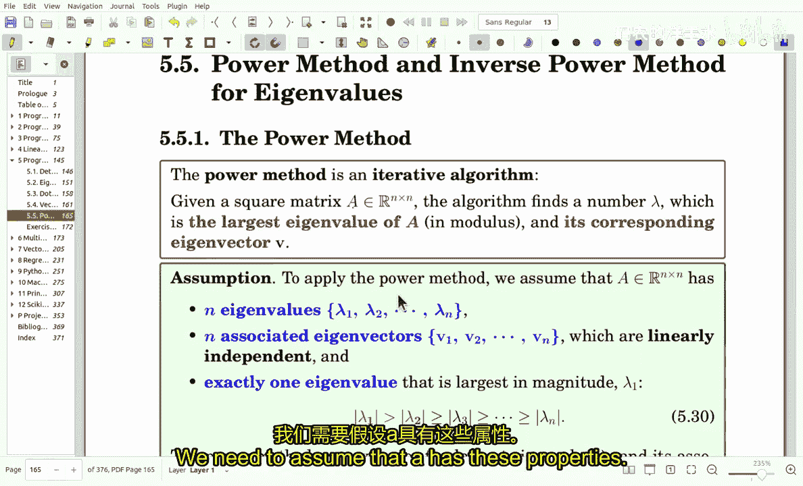

## 概述
在本节课中，我们将学习两种用于计算矩阵特征值和特征向量的数值方法：幂法和逆幂法。这两种方法都是迭代算法，能够分别找到矩阵模最大的特征值（及其特征向量）和最接近某个给定值的特征值。

## 幂法

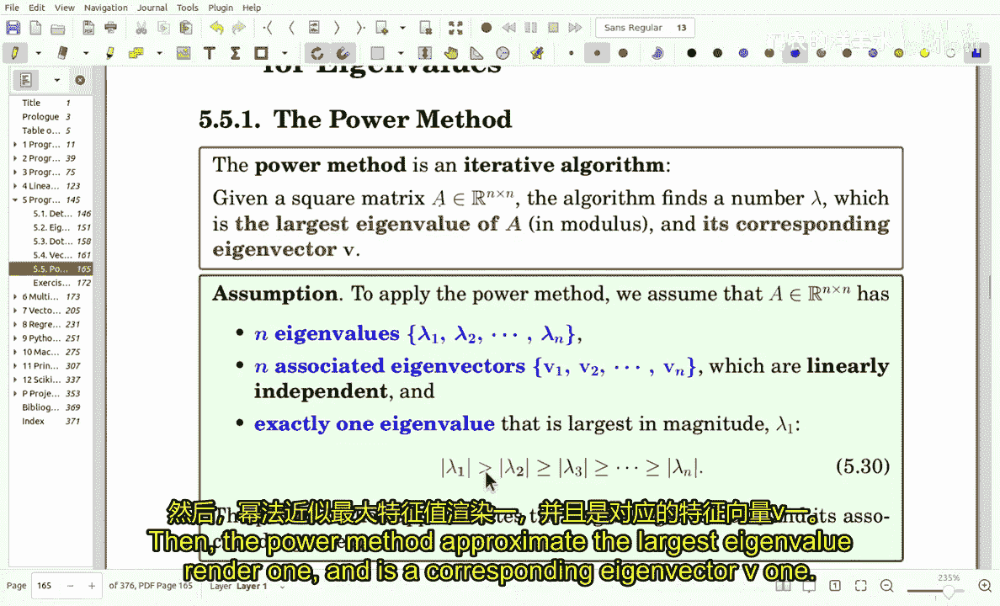

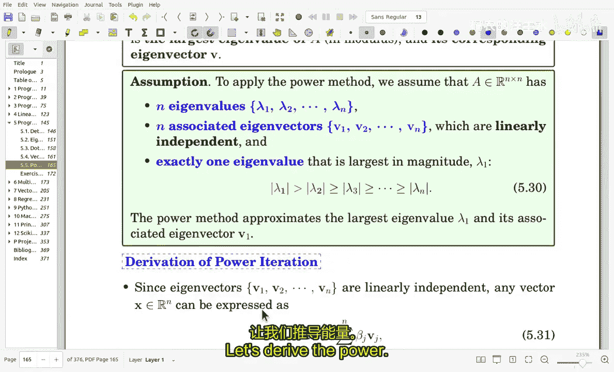

上一节我们介绍了特征值问题的背景，本节中我们来看看如何通过幂法找到矩阵模最大的特征值。

幂法是一种迭代算法，适用于**方阵**。该算法旨在找到一个数 `μ`，它是矩阵 `A` 的**模最大的特征值**，以及其对应的特征向量 `v`。

要应用幂法，我们需要假设矩阵 `A` 满足以下性质：
1.  `A` 有 `n` 个特征值 `λ₁, λ₂, ..., λₙ`。
2.  `A` 有 `n` 个对应的线性无关的特征向量 `v₁, v₂, ..., vₙ`。
3.  存在一个模最大的特征值 `λ₁`，且其模严格大于其他所有特征值的模，即 `|λ₁| > |λ₂| ≥ |λ₃| ≥ ... ≥ |λₙ|`。

### 算法推导

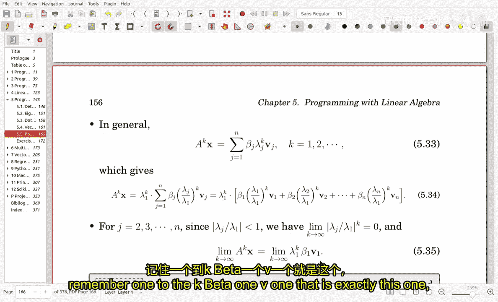

我们假设 `A` 有 `n` 个线性无关的特征向量，因此它们构成一组基。对于任意向量 `x₀`，它可以表示为这些特征向量的线性组合：

`x₀ = β₁v₁ + β₂v₂ + ... + βₙvₙ`

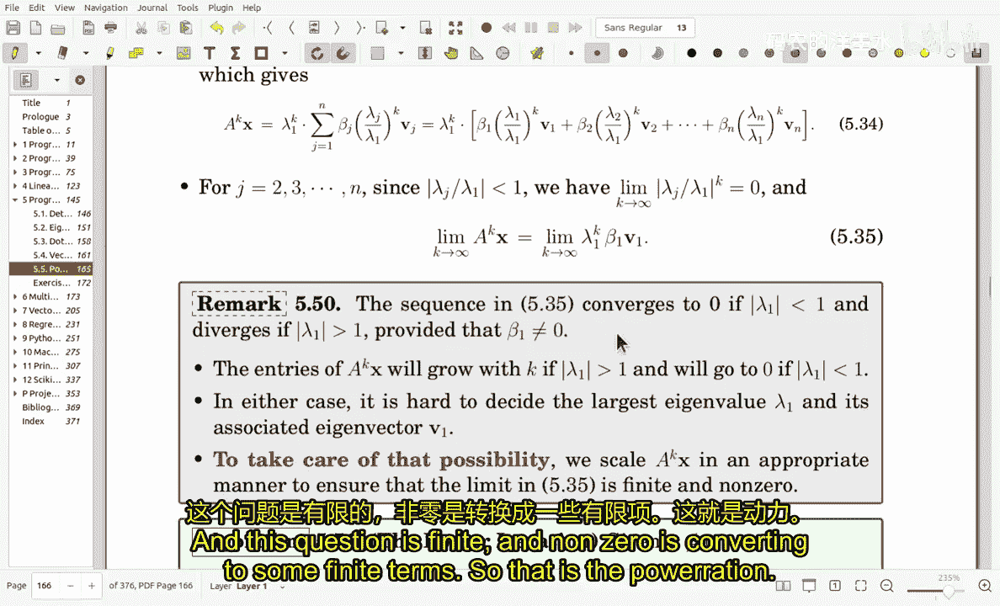

现在，我们连续用矩阵 `A` 乘以 `x₀`：
*   `x₁ = A x₀ = β₁λ₁v₁ + β₂λ₂v₂ + ... + βₙλₙvₙ`
*   `x₂ = A x₁ = A² x₀ = β₁λ₁²v₁ + β₂λ₂²v₂ + ... + βₙλₙ²vₙ`
*   ...
*   经过 `k` 次迭代后：`xₖ = Aᵏ x₀ = β₁λ₁ᵏv₁ + β₂λ₂ᵏv₂ + ... + βₙλₙᵏvₙ`

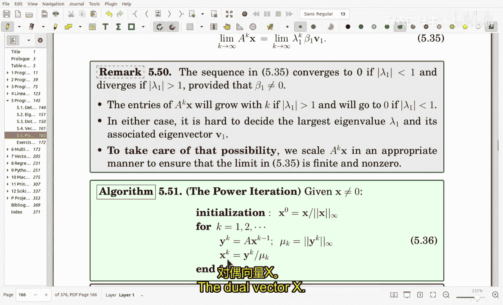

提取公因子 `λ₁ᵏ`，我们得到：

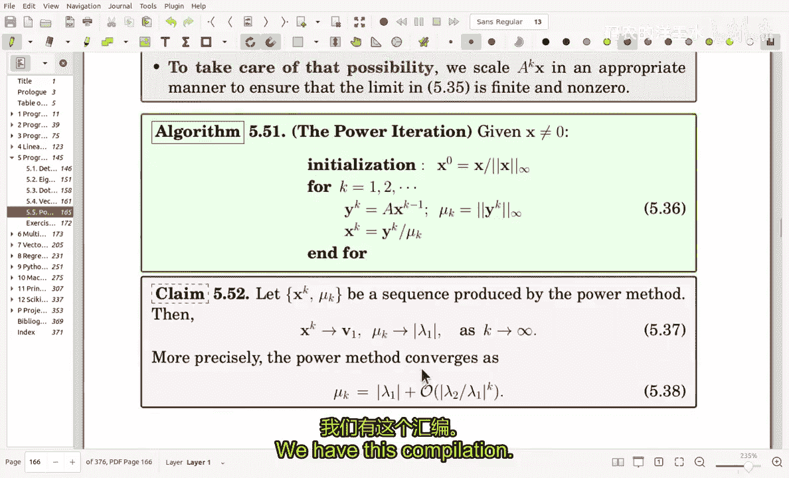

`xₖ = λ₁ᵏ [ β₁v₁ + β₂(λ₂/λ₁)ᵏ v₂ + ... + βₙ(λₙ/λ₁)ᵏ vₙ ]`

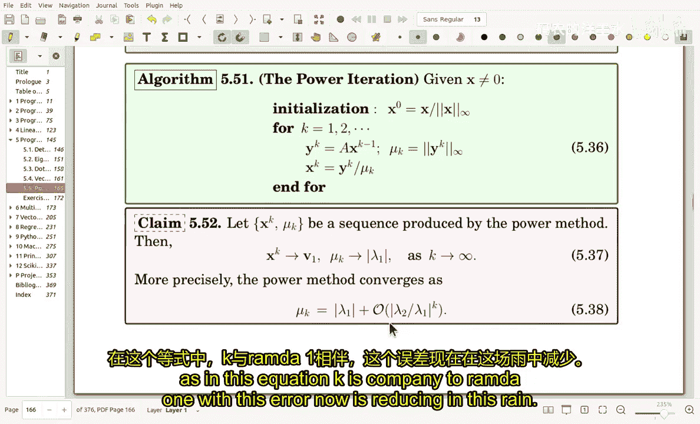

由于 `|λ₁| > |λ₂| ≥ ... ≥ |λₙ|`，比值 `|λᵢ/λ₁| < 1`（对于 `i ≥ 2`）。因此，当 `k` 增大时，`(λᵢ/λ₁)ᵏ` 项会趋近于零。最终，`xₖ` 的方向将趋近于特征向量 `v₁` 的方向。

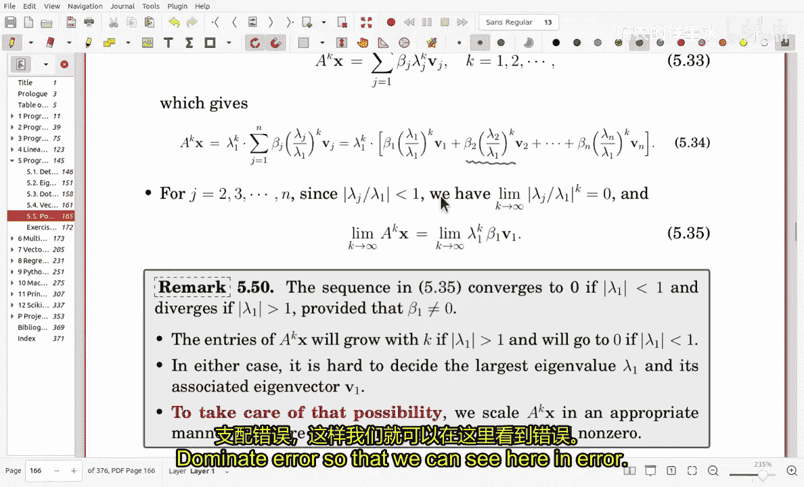

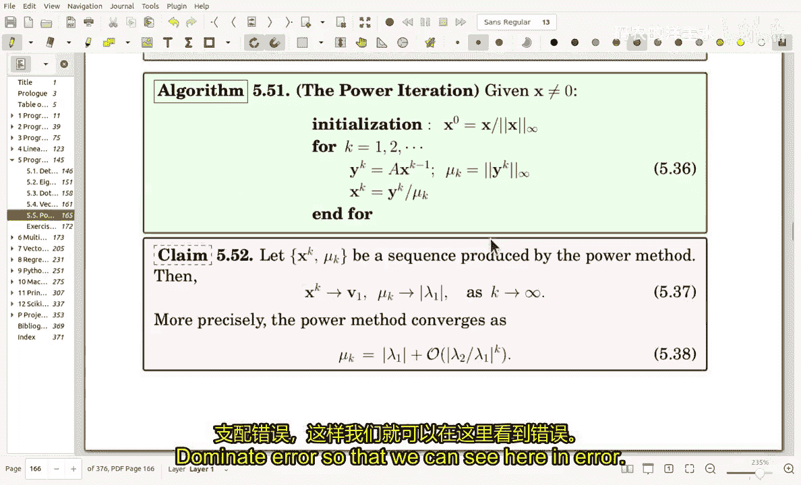

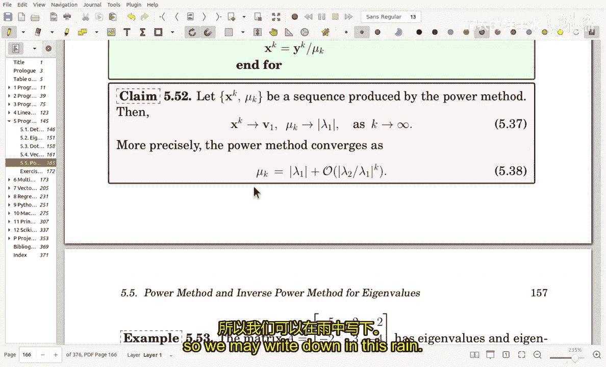

为了避免 `xₖ` 的模无限增大或减小到零，我们在每一步迭代后进行缩放，通常使其无穷范数（即绝对值最大的分量）为 1。

### 算法步骤

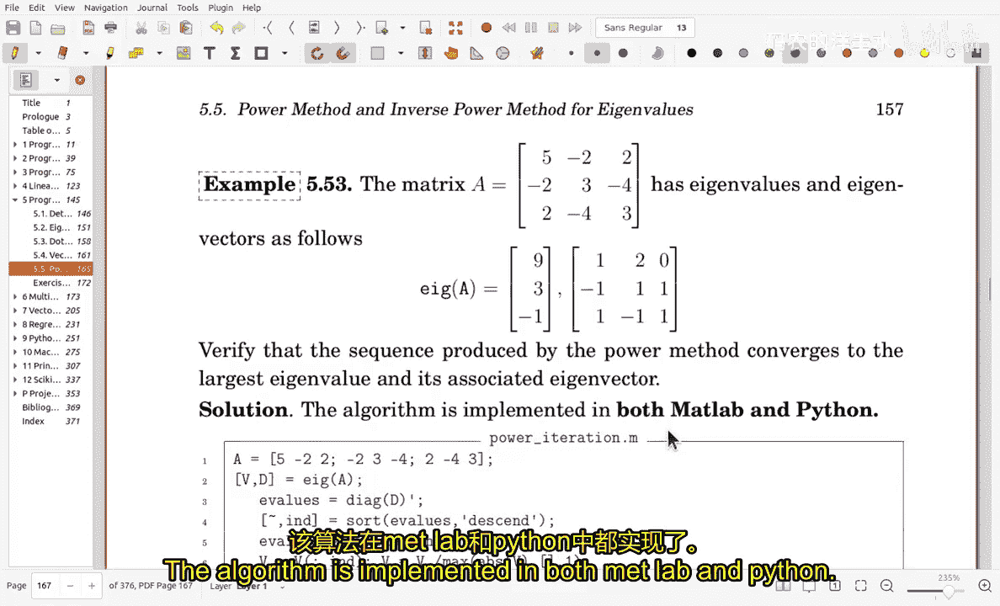

以下是幂法的具体迭代步骤：

1.  选择初始向量 `x₀`，并缩放使其满足 `||x₀||∞ = 1`。
2.  对于 `k = 0, 1, 2, ...`，重复以下步骤：
    a.  计算 `y = A xₖ`。
    b.  估计特征值：`μₖ = (y)ᵢ`，其中 `i` 是 `y` 中绝对值最大分量的索引。
    c.  缩放得到新向量：`xₖ₊₁ = y / μₖ`。

随着迭代进行，`μₖ` 收敛到 `|λ₁|`，`xₖ` 收敛到对应的特征向量 `v₁`（可能需要根据 `μₖ` 的符号调整 `λ₁` 的符号）。收敛速度由比值 `|λ₂/λ₁|` 决定，该比值越小，收敛越快。

### 代码示例

以下是在 MATLAB 和 Python 中实现幂法的核心代码逻辑。

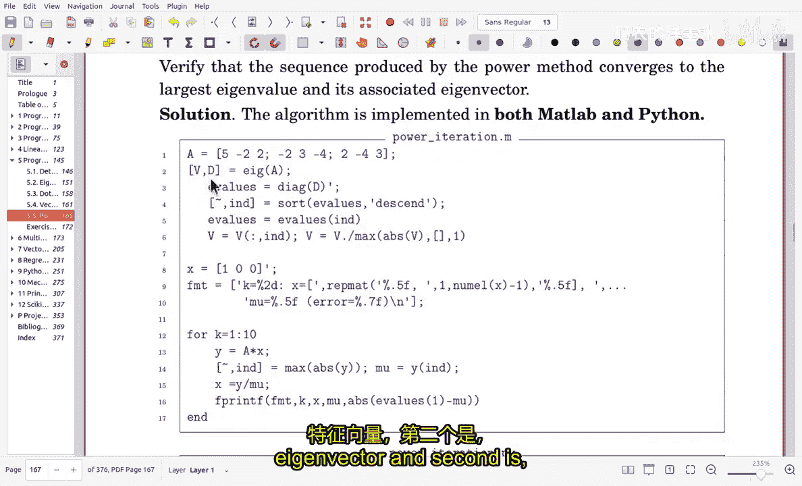

**MATLAB 实现核心部分：**
```matlab
x = [1; 0; 0]; % 初始向量
for k = 1:max_iter
    y = A * x;
    [mu, idx] = max(abs(y));
    mu = y(idx);
    x = y / mu;
    % 记录 mu 和 x 以观察收敛
end
```

**Python 实现核心部分 (使用 NumPy)：**
```python
import numpy as np
x = np.array([1., 0., 0.]) # 初始向量
for k in range(max_iter):
    y = A @ x
    idx = np.argmax(np.abs(y))
    mu = y[idx]
    x = y / mu
    # 记录 mu 和 x 以观察收敛
```

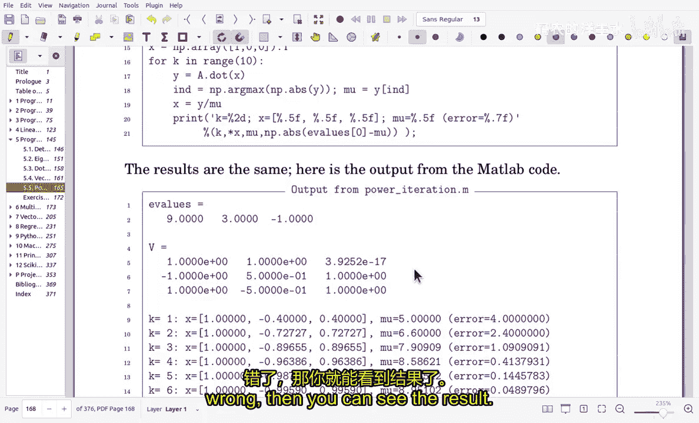

## 逆幂法

上一节我们学习了如何寻找模最大的特征值，本节中我们来看看逆幂法，它用于寻找最接近某个给定值 `q` 的特征值。

逆幂法是幂法的一个变体，用于解决以下问题：给定一个标量 `q`，找到矩阵 `A` 的特征值中**最接近 `q`** 的那个特征值及其特征向量。

### 算法原理

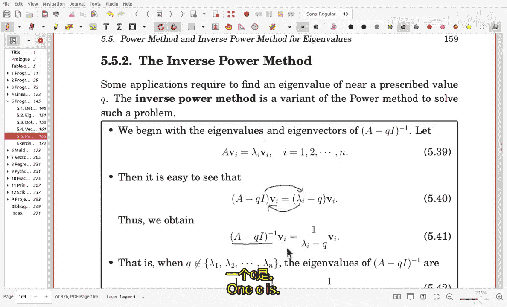

逆幂法的核心思想基于以下事实：
如果 `(λ, v)` 是 `A` 的一个特征对，即 `A v = λ v`，那么对于矩阵 `(A - qI)⁻¹`，有：
`(A - qI)⁻¹ v = (1/(λ - q)) v`

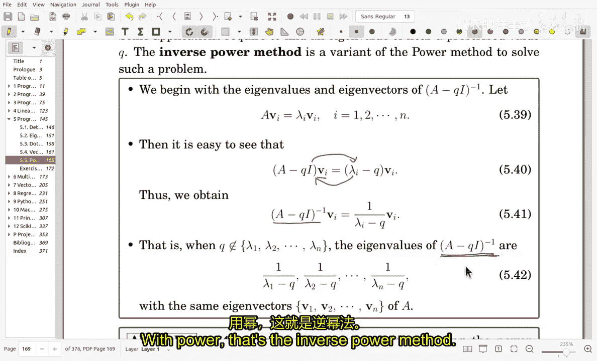

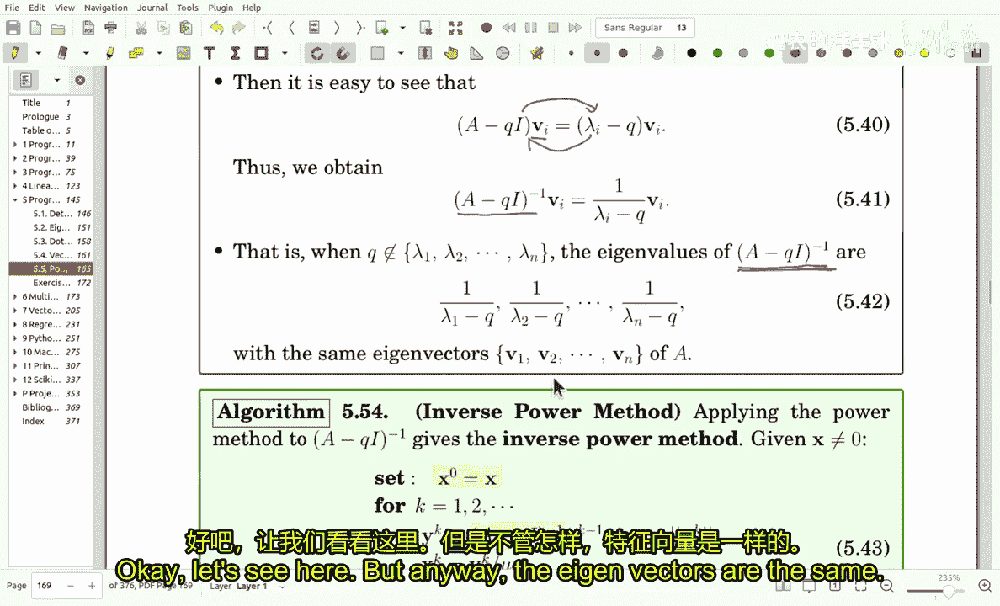

这意味着 `v` 也是 `(A - qI)⁻¹` 的特征向量，其对应的特征值为 `1/(λ - q)`。

现在，对矩阵 `(A - qI)⁻¹` 应用幂法。幂法会找到该矩阵模最大的特征值。哪个 `1/(λᵢ - q)` 的模最大呢？那就是分母 `|λᵢ - q|` 最小的那个，即 `λᵢ` 最接近 `q` 的那个特征值。

因此，对 `(A - qI)⁻¹` 应用幂法，迭代向量将收敛到最接近 `q` 的特征值 `λᵢ` 所对应的特征向量 `vᵢ`，而估计的特征值 `μₖ` 将收敛到 `1/(λᵢ - q)`。由此我们可以恢复出 `λᵢ`：
`λᵢ ≈ q + 1/μₖ`

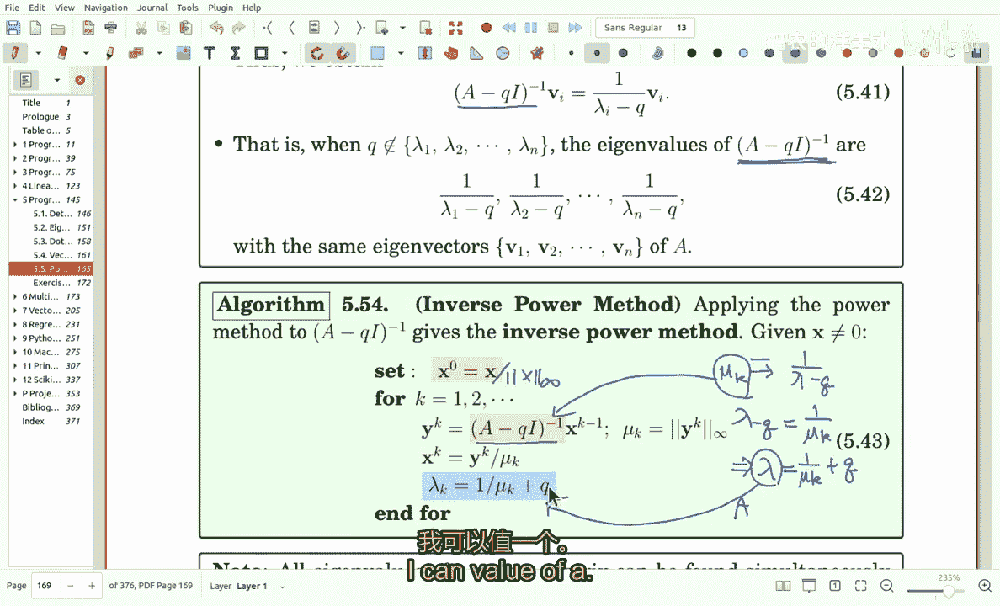

### 算法步骤

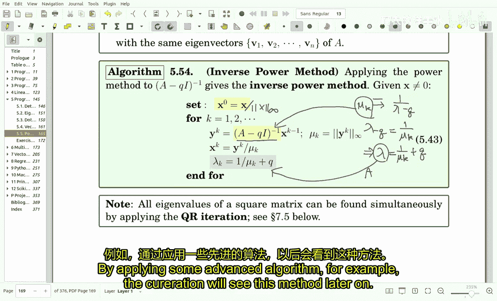

逆幂法的迭代步骤与幂法类似，但作用在 `(A - qI)⁻¹` 上：

1.  选择初始向量 `x₀`，并缩放使其满足 `||x₀||∞ = 1`。给定目标值 `q`。
2.  对于 `k = 0, 1, 2, ...`，重复以下步骤：
    a.  解线性方程组：`(A - qI) y = xₖ` 得到 `y`。这等价于计算 `y = (A - qI)⁻¹ xₖ`，但通常通过求解方程组来实现以避免显式求逆。
    b.  估计中间量：`μₖ = (y)ᵢ`，其中 `i` 是 `y` 中绝对值最大分量的索引。
    c.  缩放得到新向量：`xₖ₊₁ = y / μₖ`。
3.  近似特征值：`λ ≈ q + 1/μₖ`。

逆幂法的收敛速度由 `|(λᵢ - q) / (λⱼ - q)|` 决定，其中 `λⱼ` 是第二接近 `q` 的特征值。当 `q` 非常接近某个特征值时，收敛会非常快。

### 代码示例

以下是在 MATLAB 和 Python 中实现逆幂法的核心代码逻辑。

**MATLAB 实现核心部分：**
```matlab
q = 4; % 给定的目标值
x = [1; 0; 0]; % 初始向量
for k = 1:max_iter
    % 解方程组 (A - qI) * y = x，而不是直接求逆
    y = (A - q*eye(size(A))) \ x;
    [mu, idx] = max(abs(y));
    mu = y(idx);
    x = y / mu;
    lambda_approx = q + 1/mu; % 恢复原矩阵的特征值近似值
    % 记录 lambda_approx 和 x 以观察收敛
end
```

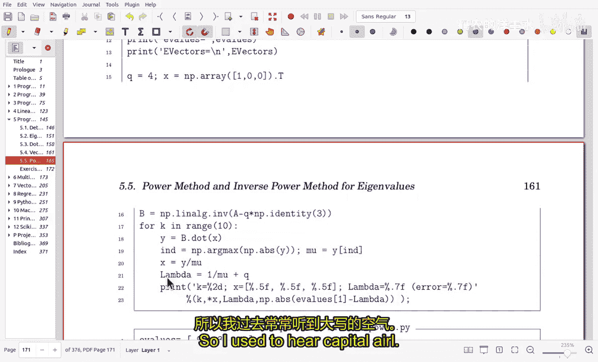

**Python 实现核心部分 (使用 NumPy 和 SciPy)：**
```python
import numpy as np
from scipy import linalg
q = 4.0
x = np.array([1., 0., 0.])
for k in range(max_iter):
    # 解方程组 (A - qI) * y = x
    y = linalg.solve(A - q * np.eye(A.shape[0]), x)
    idx = np.argmax(np.abs(y))
    mu = y[idx]
    x = y / mu
    lambda_approx = q + 1.0 / mu # 恢复原矩阵的特征值近似值
    # 记录 lambda_approx 和 x 以观察收敛
```

## 总结

本节课中我们一起学习了两种重要的特征值迭代算法：
1.  **幂法**：用于求解矩阵**模最大的特征值**及其对应的特征向量。其收敛速度取决于最大与次大特征值模的比值 `|λ₂/λ₁|`。
2.  **逆幂法**：是幂法的推广，用于求解**最接近给定数值 `q` 的特征值**及其特征向量。通过对方阵 `(A - qI)⁻¹` 应用幂法实现。当 `q` 接近某个特征值时，收敛速度极快。

这两种方法都是求单个特征对的有效工具。要同时计算所有特征值，需要使用更高级的算法，例如我们将在后续课程中介绍的 QR 算法。