# 039：第39讲 - 多变量函数及其偏导数 📚

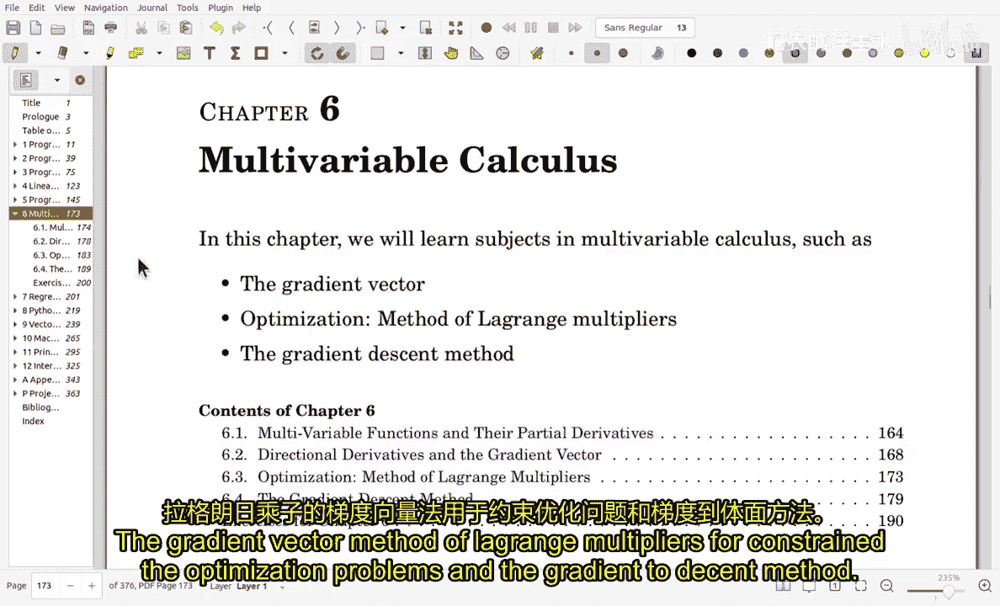

在本节课中，我们将学习多变量微积分的基础知识，包括多变量函数的定义、其图像表示，以及如何计算偏导数。这些概念是理解后续梯度、拉格朗日乘数法和梯度下降法等高级主题的基石。

## 6.1 多变量函数及其偏导数 🔍

在之前的课程中，我们学习了单变量函数。它有一个自变量 `x` 和一个因变量 `y`，可以写作 `y = f(x)`。本节中，我们将这个概念扩展到两个自变量的情况。

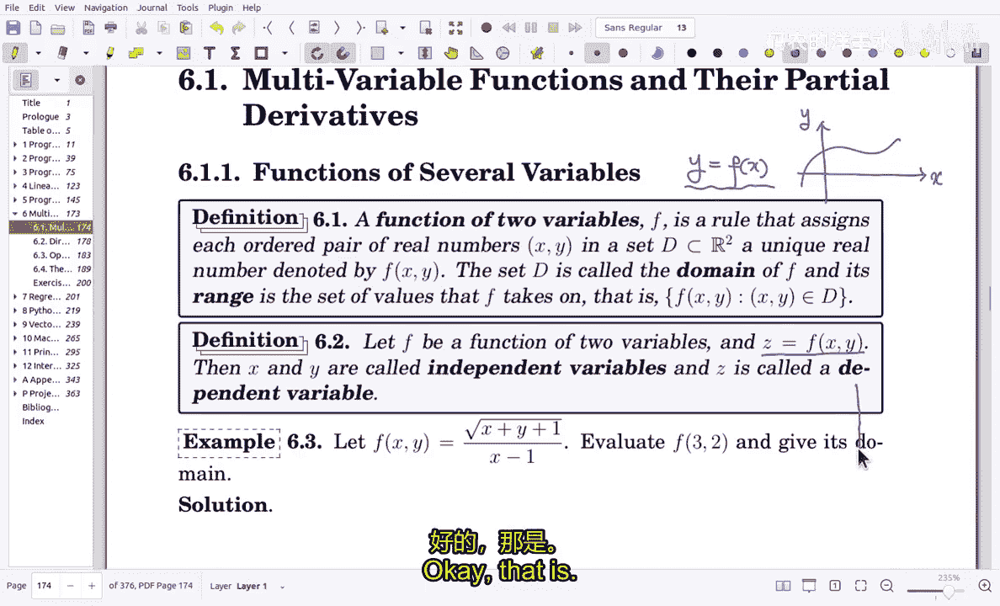

### 双变量函数的定义

一个双变量函数 `f` 是一个规则，它为每一个有序实数对 `(x, y)` 分配一个唯一的实数 `z`。记作 `z = f(x, y)`。其中，`x` 和 `y` 是自变量，`z` 是因变量。所有可能的输入 `(x, y)` 的集合称为函数 `f` 的定义域 `D`，所有输出 `z` 的集合称为值域。

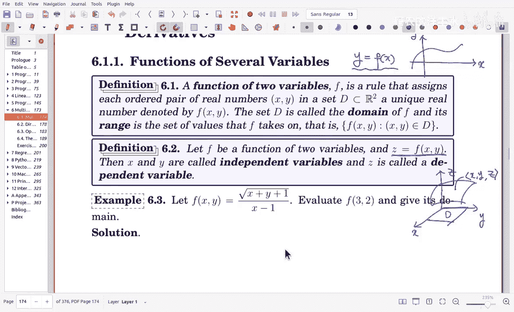

与单变量函数图像为曲线不同，双变量函数的图像是一个曲面。我们可以建立一个三维坐标系：`x` 轴和 `y` 轴构成水平面，`z` 轴垂直向上。定义域 `D` 是 `xy` 平面上的一个区域，而函数的图像则是这个区域上方的曲面，曲面上每一点的坐标是 `(x, y, z)`，其中 `z = f(x, y)`。

### 示例：函数求值与定义域

考虑函数 `f(x, y) = sqrt(x + y + 1) / (x - 1)`。

**1. 求 `f(3, 2)` 的值：**
将 `x=3`, `y=2` 代入公式：
分子：`sqrt(3 + 2 + 1) = sqrt(6)`
分母：`3 - 1 = 2`
因此，`f(3, 2) = sqrt(6) / 2`。

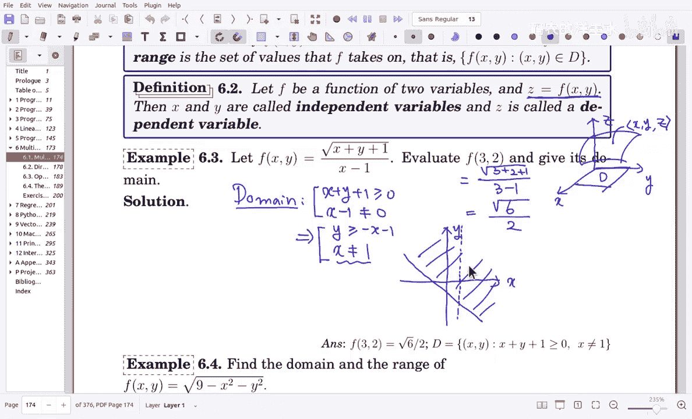

**2. 求其自然定义域：**
自然定义域是使函数有意义的 `(x, y)` 点的集合。需要满足两个条件：
*   根号内非负：`x + y + 1 >= 0`
*   分母不为零：`x - 1 != 0`，即 `x != 1`

因此，定义域 `D` 是所有满足 `y >= -x - 1` 且 `x != 1` 的点 `(x, y)`。在 `xy` 平面上，这是直线 `y = -x - 1` 上方（包含该直线）的区域，但需去掉垂直于 `x=1` 的整条直线。

### 示例：定义域与值域

求函数 `f(x, y) = sqrt(9 - x^2 - y^2)` 的定义域和值域。

**定义域：**
为使根号内非负，需满足 `9 - x^2 - y^2 >= 0`，即 `x^2 + y^2 <= 9`。
这表示定义域是以原点为中心、半径为3的圆盘（包含边界）。

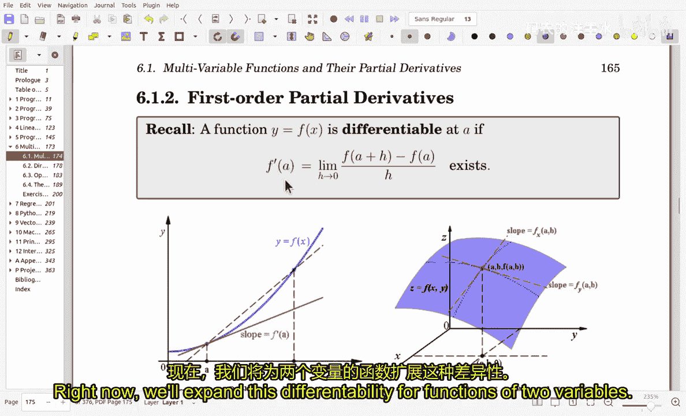

**值域：**
根号值始终非负。当 `x=0, y=0`（圆心）时，函数取得最大值 `f(0,0) = sqrt(9) = 3`。
当点 `(x, y)` 位于边界 `x^2 + y^2 = 9` 上时，函数取得最小值 `0`。
因此，函数的值域是 `[0, 3]`。

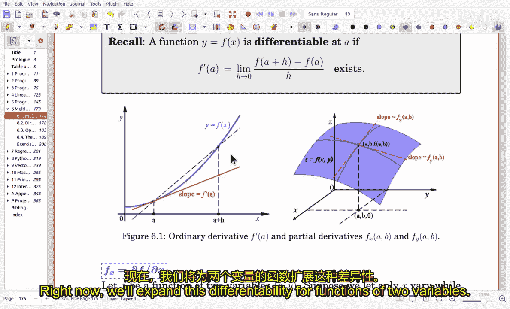

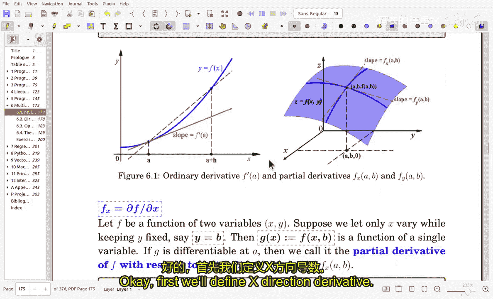

## 偏导数的引入 📈

在单变量微积分中，函数 `y = f(x)` 在点 `a` 的导数定义为：
`f'(a) = lim (h -> 0) [f(a+h) - f(a)] / h`
它表示函数图像在点 `(a, f(a))` 处切线的斜率。

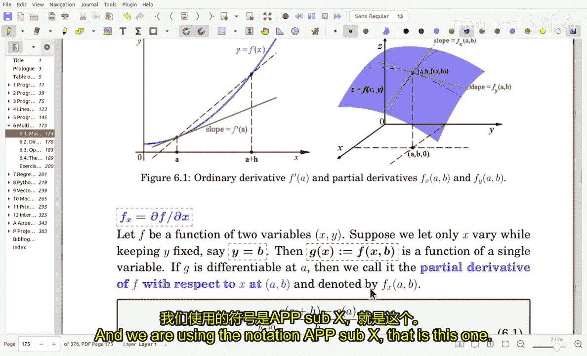

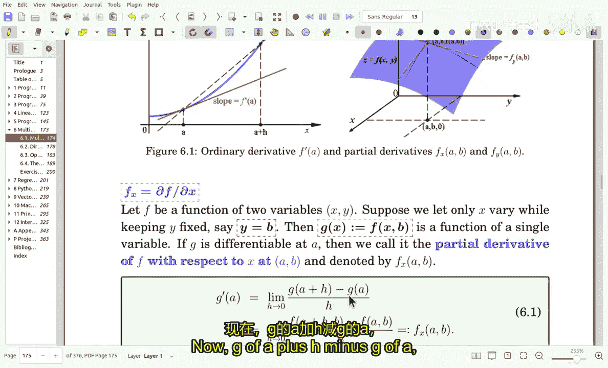

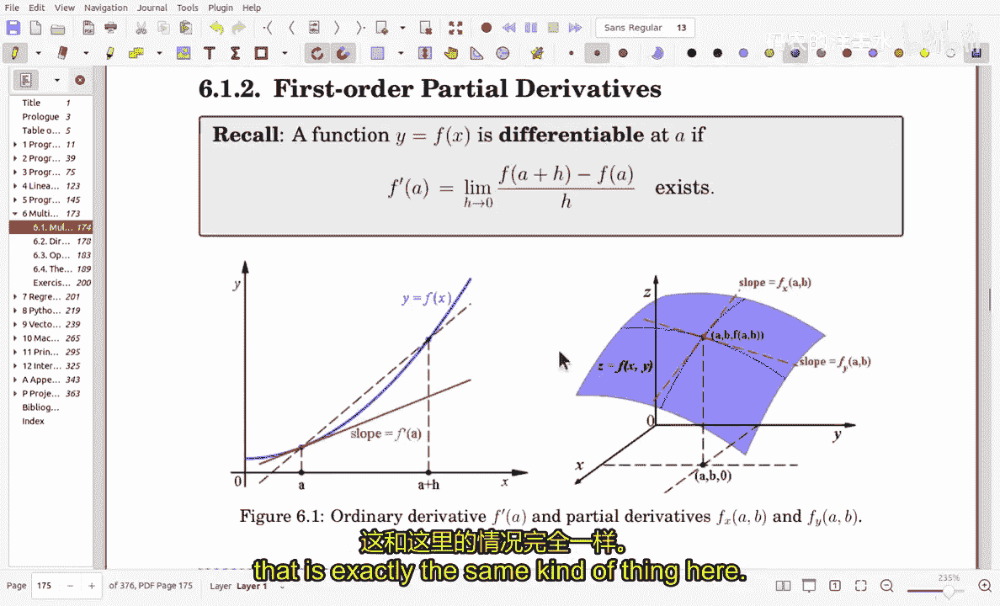

对于双变量函数 `z = f(x, y)`，我们如何定义“变化率”呢？由于有两个自变量，我们需要分别考虑每个方向上的变化率，这就是偏导数。

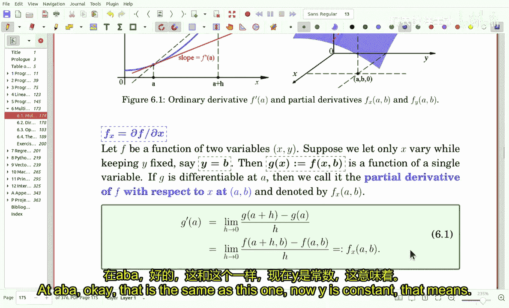

### 偏导数的定义

**关于 x 的偏导数：**
假设我们将 `y` 固定为一个常数 `b`，即只让 `x` 变化。这定义了一个单变量函数 `g(x) = f(x, b)`。函数 `f` 在点 `(a, b)` 处关于 `x` 的偏导数，就是 `g(x)` 在 `x=a` 处的普通导数。记作 `f_x(a, b)` 或 `∂f/∂x |_(a,b)`。

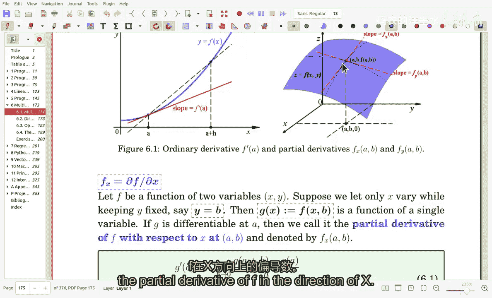

其极限定义为：
`f_x(a, b) = lim (h -> 0) [f(a+h, b) - f(a, b)] / h`

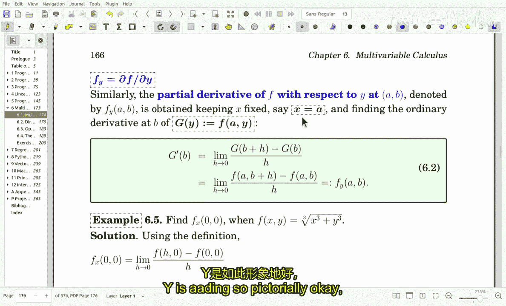

几何上，它表示曲面 `z = f(x, y)` 与平面 `y = b` 相交所得的曲线，在点 `(a, b, f(a,b))` 处切线的斜率。这条切线平行于 `xz` 平面。

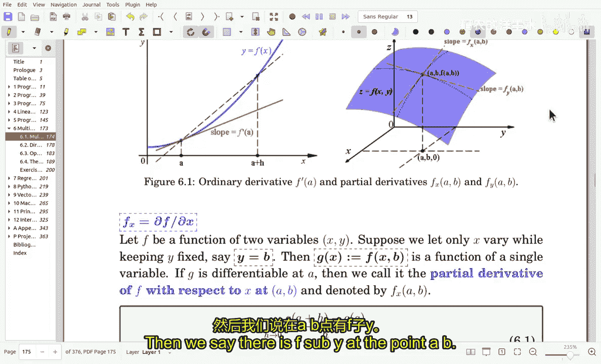

**关于 y 的偏导数：**
类似地，固定 `x = a`，定义函数 `h(y) = f(a, y)`。函数 `f` 在点 `(a, b)` 处关于 `y` 的偏导数，就是 `h(y)` 在 `y=b` 处的普通导数。记作 `f_y(a, b)` 或 `∂f/∂y |_(a,b)`。

其极限定义为：
`f_y(a, b) = lim (h -> 0) [f(a, b+h) - f(a, b)] / h`

几何上，它表示曲面 `z = f(x, y)` 与平面 `x = a` 相交所得的曲线，在点 `(a, b, f(a,b))` 处切线的斜率。这条切线平行于 `yz` 平面。

### 计算示例

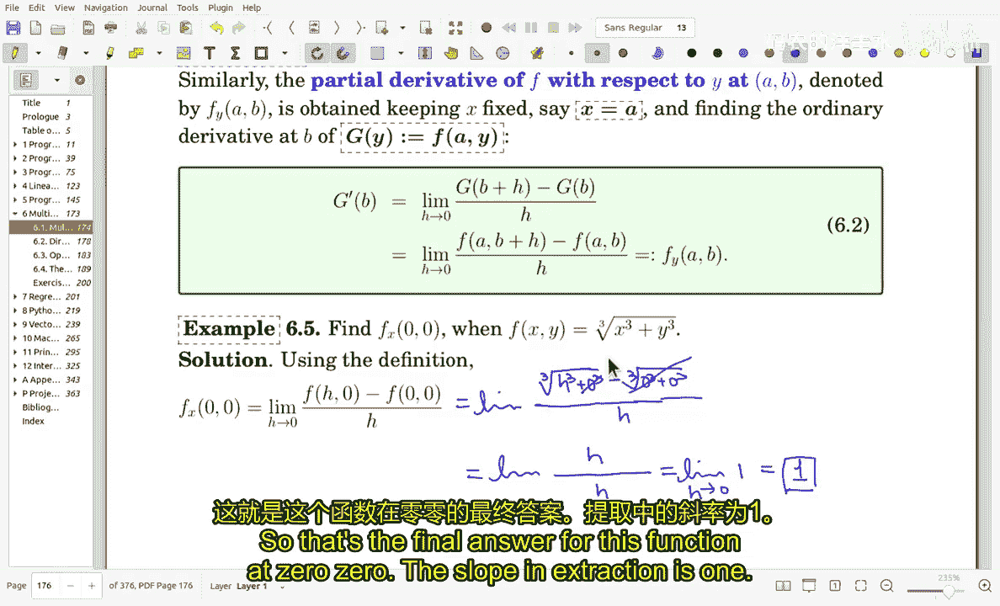

根据定义，求函数 `f(x, y) = (x^3 + y^3)^(1/3)` 在点 `(0,0)` 处关于 `x` 的偏导数 `f_x(0,0)`。

根据定义：
`f_x(0,0) = lim (h -> 0) [f(h, 0) - f(0, 0)] / h`
`= lim (h -> 0) [(h^3 + 0^3)^(1/3) - (0^3 + 0^3)^(1/3)] / h`
`= lim (h -> 0) [h - 0] / h`
`= lim (h -> 0) 1`
`= 1`

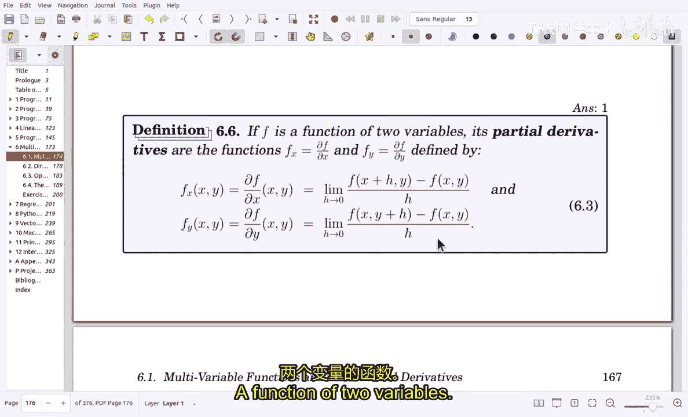

因此，该函数在原点处沿 `x` 方向的斜率为1。

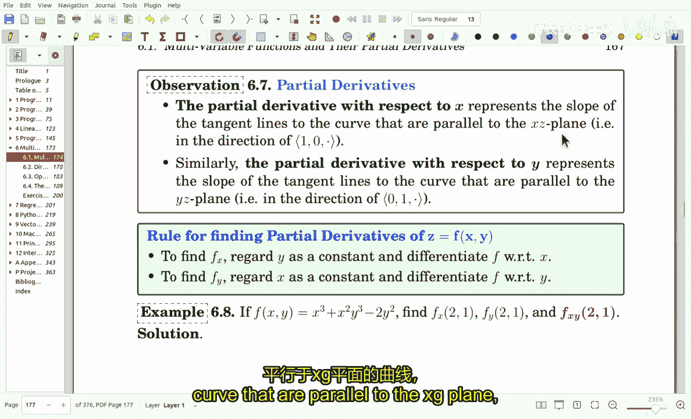

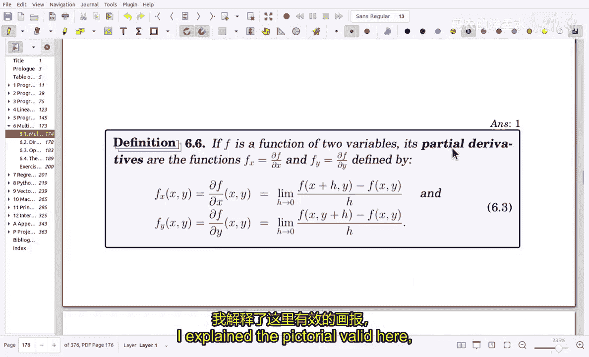

### 偏导函数

通常，我们不只计算在某一点的偏导数，而是计算作为 `(x, y)` 函数的偏导函数。
*   关于 `x` 的偏导函数：`f_x(x, y) = lim (h -> 0) [f(x+h, y) - f(x, y)] / h`
*   关于 `y` 的偏导函数：`f_y(x, y) = lim (h -> 0) [f(x, y+h) - f(x, y)] / h`

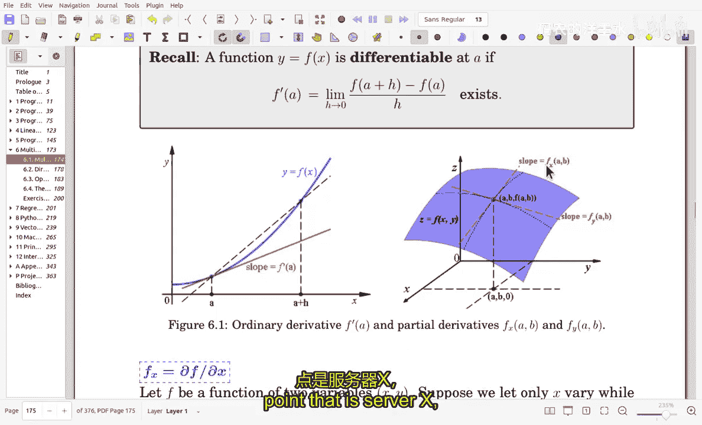

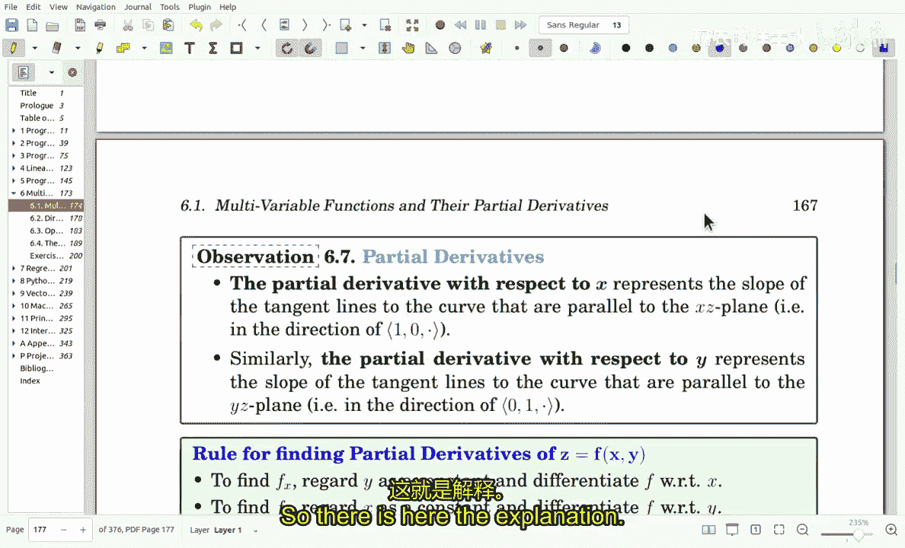

**计算规则：**
求 `f_x` 时，将 `y` 视为常数，对 `x` 求导。
求 `f_y` 时，将 `x` 视为常数，对 `y` 求导。

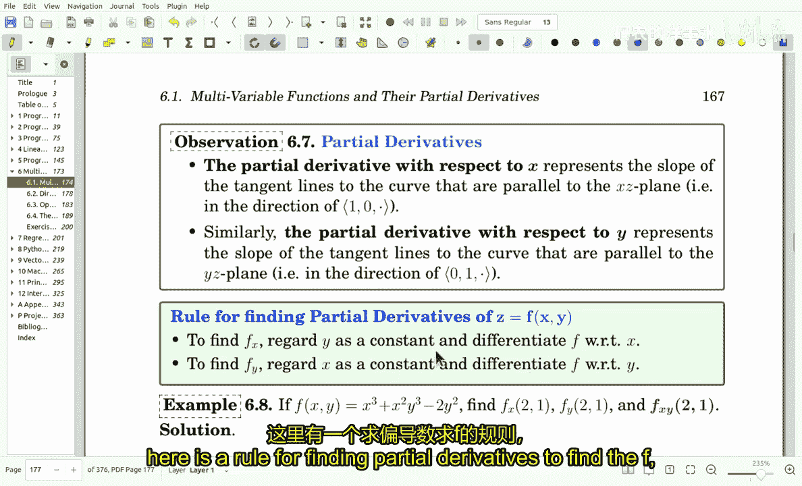

### 综合计算示例

对于函数 `f(x, y) = x^3 + x^2 y^3 - 2y^2`：
1.  求一阶偏导函数 `f_x` 和 `f_y`。
    *   `f_x`: 将 `y` 视作常数。`∂/∂x (x^3) = 3x^2`；`∂/∂x (x^2 y^3) = 2x y^3`；`∂/∂x (-2y^2) = 0`。所以 `f_x = 3x^2 + 2x y^3`。
    *   `f_y`: 将 `x` 视作常数。`∂/∂y (x^3) = 0`；`∂/∂y (x^2 y^3) = 3x^2 y^2`；`∂/∂y (-2y^2) = -4y`。所以 `f_y = 3x^2 y^2 - 4y`。

2.  求二阶混合偏导 `f_{xy}`（即先对 `x` 求偏导，再对 `y` 求偏导）。
    *   对上面求得的 `f_x = 3x^2 + 2x y^3` 再关于 `y` 求偏导（视 `x` 为常数）。
    *   `∂/∂y (3x^2) = 0`；`∂/∂y (2x y^3) = 2x * 3y^2 = 6x y^2`。
    *   所以 `f_{xy} = 6x y^2`。

3.  在点 `(2, 1)` 处计算这些偏导的值。
    *   `f_x(2, 1) = 3*(2)^2 + 2*(2)*(1)^3 = 12 + 4 = 16`
    *   `f_y(2, 1) = 3*(2)^2*(1)^2 - 4*(1) = 12 - 4 = 8`
    *   `f_{xy}(2, 1) = 6*(2)*(1)^2 = 12`

## 扩展到三变量函数 🔄

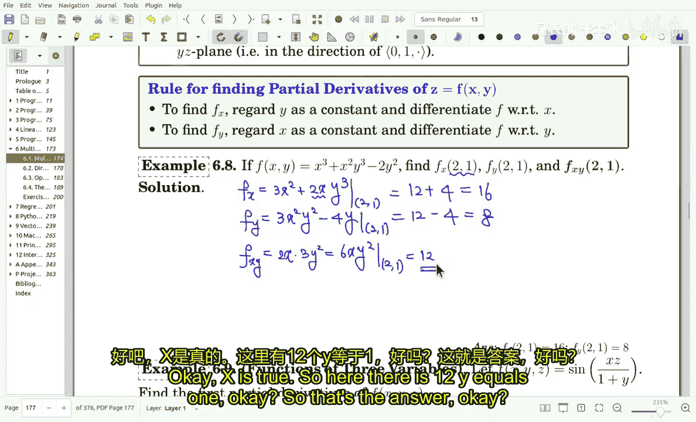

上述概念可以自然地推广到三个或更多变量的函数。对于一个三变量函数 `w = f(x, y, z)`：
*   求 `f_x` 时，将 `y` 和 `z` 视为常数，对 `x` 求导。
*   求 `f_y` 时，将 `x` 和 `z` 视为常数，对 `y` 求导。
*   求 `f_z` 时，将 `x` 和 `y` 视为常数，对 `z` 求导。

### 三变量函数示例

对于函数 `f(x, y, z) = sin( (x z) / (1 + y) )`，求其三个一阶偏导数。
*   `f_x`: 将 `y, z` 视为常数。使用链式法则，外函数 `sin(u)` 的导数是 `cos(u)`，内函数 `u = (x z)/(1+y)` 对 `x` 的导数是 `z/(1+y)`。所以 `f_x = cos( (x z)/(1+y) ) * [z/(1+y)]`。
*   `f_y`: 将 `x, z` 视为常数。外函数导数仍为 `cos(u)`，内函数 `u = (x z)/(1+y)` 对 `y` 的导数是 `(x z) * (-1)/(1+y)^2 = - (x z)/(1+y)^2`。所以 `f_y = cos( (x z)/(1+y) ) * [ - (x z)/(1+y)^2 ]`。
*   `f_z`: 将 `x, y` 视为常数。外函数导数为 `cos(u)`，内函数 `u = (x z)/(1+y)` 对 `z` 的导数是 `x/(1+y)`。所以 `f_z = cos( (x z)/(1+y) ) * [x/(1+y)]`。

## 总结 📝

本节课我们一起学习了多变量微积分的入门知识：
1.  **多变量函数**：我们定义了双变量函数 `z = f(x, y)`，其图像是三维空间中的曲面，并学习了如何确定其定义域和值域。
2.  **偏导数**：我们引入了偏导数的概念，它描述了多变量函数在某一坐标轴方向上的变化率。`f_x` 表示固定 `y` 时函数沿 `x` 方向的变化率，`f_y` 表示固定 `x` 时函数沿 `y` 方向的变化率。我们学习了通过将其他变量视为常数来求偏导数的计算规则。
3.  **几何意义**：偏导数 `f_x(a, b)` 和 `f_y(a, b)` 分别代表了曲面在点 `(a, b)` 处，平行于 `xz` 平面和 `yz` 平面的切线斜率。
4.  **推广**：我们将偏导数的概念简单推广到了三个自变量的函数。

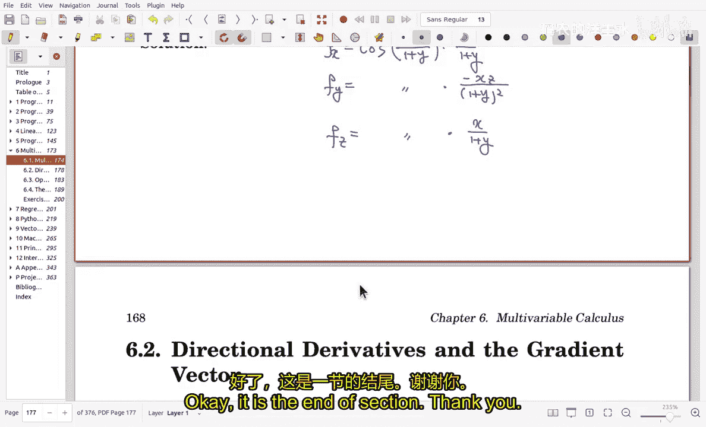

理解多变量函数和偏导数是学习后续梯度向量、方向导数以及优化算法（如梯度下降法）的重要基础。