# 040：方向导数与梯度矢量 📈

在本节课中，我们将学习多元函数中两个核心概念：方向导数和梯度矢量。我们将了解如何计算函数在任意方向上的变化率，并探索梯度矢量如何指示函数增长最快的方向。

## 6.2 方向导数与梯度矢量

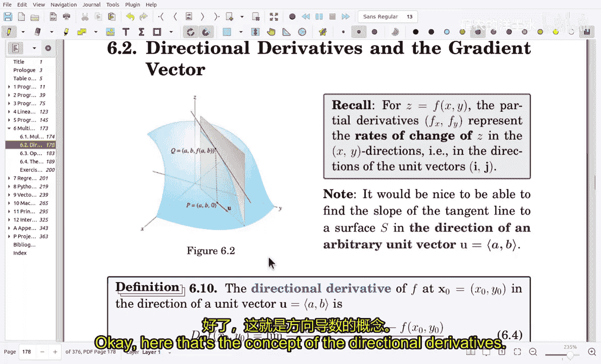

对于二元函数 **Z = f(x, y)**，其偏导数 **∂f/∂x** 和 **∂f/∂y** 分别表示函数在 **x** 轴和 **y** 轴方向上的变化率。换句话说，它们分别对应单位向量 **i** 和 **j** 方向上的导数。

然而，我们常常需要知道函数在任意方向上的变化率。考虑一个任意的单位向量 **u = (a, b)**，我们想要找到曲面在该方向上的切线斜率。

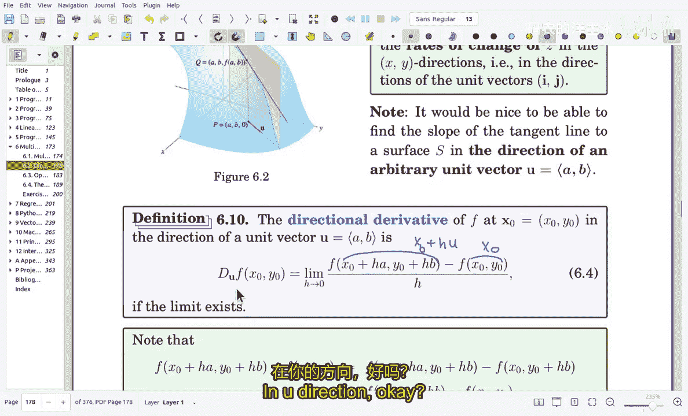

### 方向导数的定义

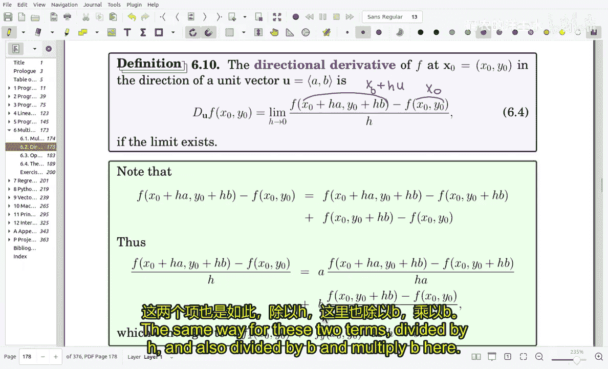

函数 **f** 在点 **(x₀, y₀)** 处沿单位向量 **u = (a, b)** 的方向导数定义为：

这个定义测量了当点 **(x₀, y₀)** 沿 **u** 方向移动一个微小距离 **h** 时，函数值 **f** 的平均变化率在 **h** 趋近于 0 时的极限。

### 方向导数的计算公式

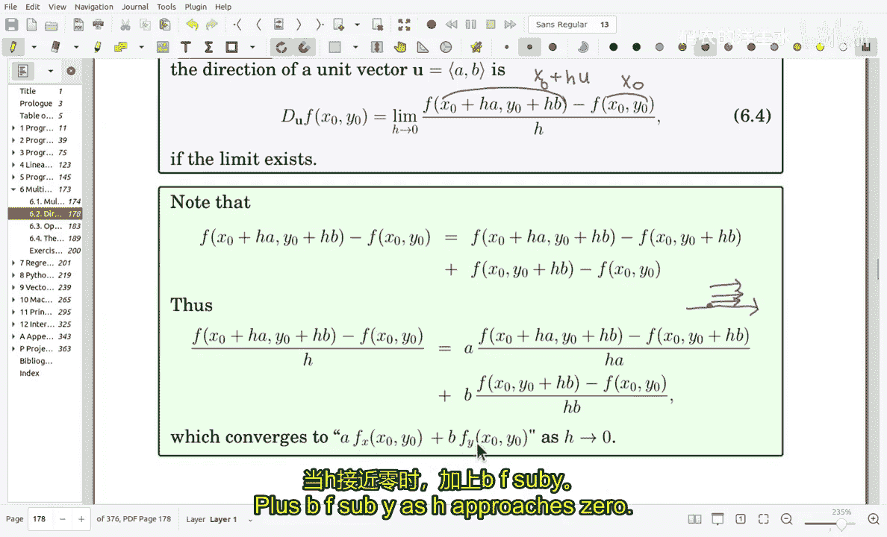

如果函数 **f** 是可微的，那么我们可以推导出方向导数的计算公式。通过对定义式进行代数变换，我们可以将其分解为与 **x** 和 **y** 偏导数相关的部分。

当 **h** 趋近于 0 时，上述表达式中的两个部分分别收敛于 **f** 在 **x** 和 **y** 方向上的偏导数。因此，我们得到以下定理：

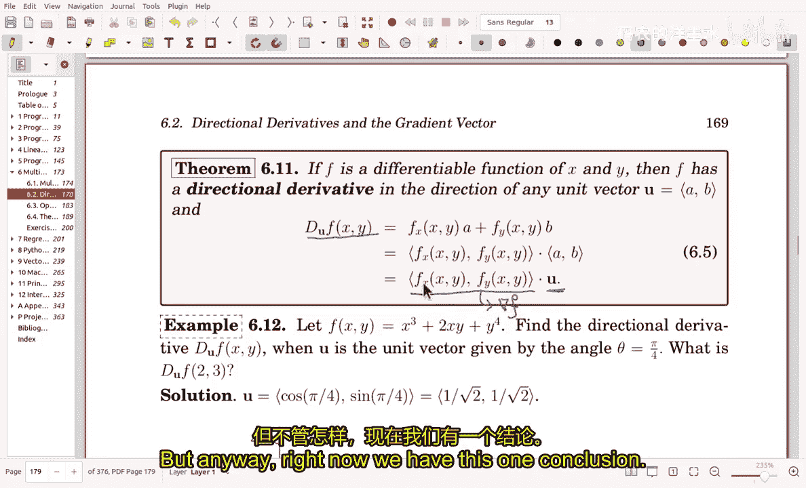

**定理**：如果 **f** 是关于 **x** 和 **y** 的可微函数，那么 **f** 在任意单位向量 **u = (a, b)** 方向上都有方向导数，并且其计算公式为：

这个结果可以简洁地写成两个向量的点积形式。我们稍后会定义其中一个向量为梯度矢量。

### 示例计算

让我们通过一个例子来应用这个公式。

**示例 1**：设 **f(x, y) = x³ + 2xy + 3y²**。求在点 **(2, 3)** 处，沿角度 **θ = π/4**（45度）方向的单位向量 **u** 的方向导数 **D_u f**。

首先，确定方向向量 **u**。对于角度 **π/4**，单位向量为：
**u = (cos(π/4), sin(π/4)) = (1/√2, 1/√2)**

接着，计算函数在点 **(2, 3)** 处的偏导数：
*   **∂f/∂x = 3x² + 2y**。在 **(2, 3)** 处，值为 **3*(2)² + 2*3 = 12 + 6 = 18**。
*   **∂f/∂y = 2x + 6y**。在 **(2, 3)** 处，值为 **2*2 + 6*3 = 4 + 18 = 22**。

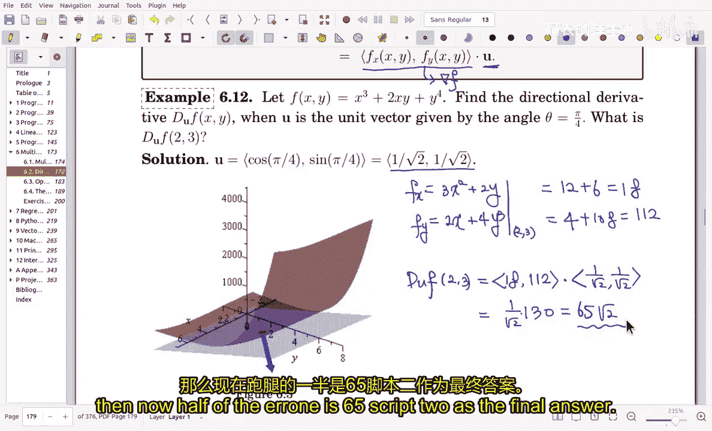

最后，应用公式计算方向导数：
**D_u f(2,3) = (∂f/∂x)*a + (∂f/∂y)*b = 18*(1/√2) + 22*(1/√2) = 40/√2 = 20√2**

你可以尝试用类似方法计算沿 **θ = π/3**（60度）方向的方向导数。

### 扩展到三元函数

方向导数的概念可以自然地扩展到三元甚至更多元的函数。

**示例 2**：设 **f(x, y, z) = x² - 2y² + z⁴**。求在点 **(1, 3, 1)** 处，沿向量 **v = (2, -2, -1)** 方向的方向导数。

首先，将方向向量 **v** 单位化得到 **u**：
**|v| = √(2² + (-2)² + (-1)²) = √(4+4+1) = √9 = 3**
**u = v / |v| = (2/3, -2/3, -1/3)**

接着，计算函数在点 **(1, 3, 1)** 处的偏导数：
*   **∂f/∂x = 2x**， 在 **(1,3,1)** 处值为 **2**。
*   **∂f/∂y = -4y**， 在 **(1,3,1)** 处值为 **-12**。
*   **∂f/∂z = 4z³**， 在 **(1,3,1)** 处值为 **4**。

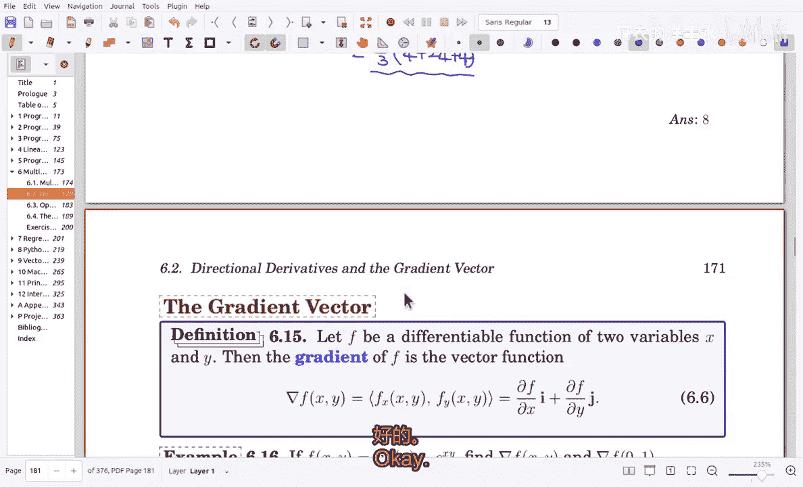

最后，计算方向导数：
**D_u f(1,3,1) = (2, -12, 4) · (2/3, -2/3, -1/3) = (4/3) + (24/3) + (-4/3) = 24/3 = 8**

## 梯度矢量 🧭

上一节我们介绍了方向导数的计算，其中涉及一个由偏导数组成的向量。这个向量极其重要，我们将其定义为梯度矢量。

### 定义与表示

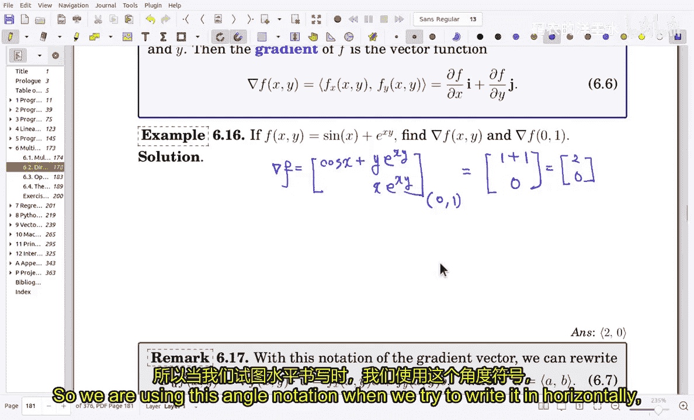

对于一个可微的二元函数 **f(x, y)**，其在点 **(x, y)** 处的梯度矢量（记作 **∇f** 或 **grad f**）定义为：

**∇f(x, y) = (∂f/∂x, ∂f/∂y)**

我们也可以用单位向量 **i** 和 **j** 来表示：**∇f = (∂f/∂x) i + (∂f/∂y) j**

**示例 3**：求函数 **f(x, y) = sin x + e^(xy)** 在点 **(0, 1)** 处的梯度。
*   **∂f/∂x = cos x + y e^(xy)**。在 **(0,1)** 处，**cos0=1**，**y e^(0)=1*1=1**，所以值为 **2**。
*   **∂f/∂y = 0 + x e^(xy)**。在 **(0,1)** 处，值为 **0 * e^0 = 0**。
因此，**∇f(0,1) = (2, 0)**。

### 梯度与方向导数的关系

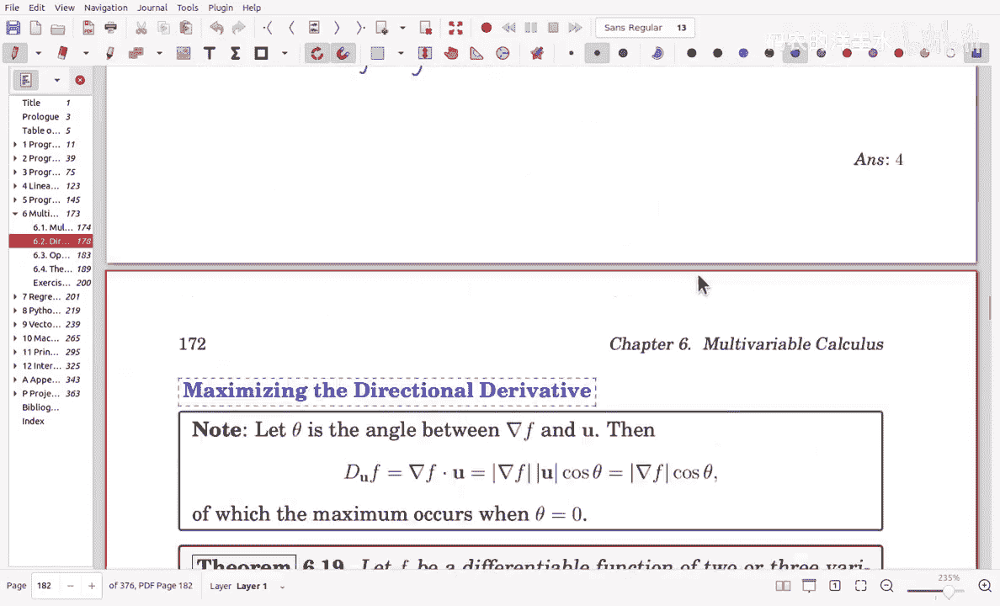

利用梯度矢量，方向导数的公式可以写得非常简洁：

**D_u f(x, y) = ∇f(x, y) · u**

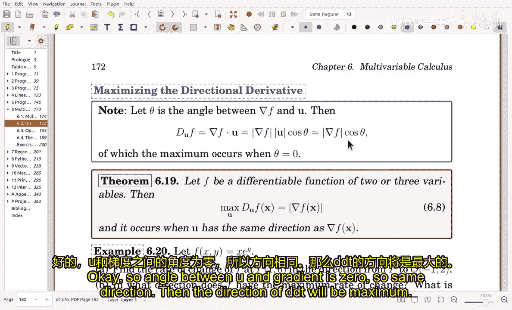

其中 **·** 表示点积。这个公式是计算方向导数最常用的方式。

**示例 4**：设 **f(x, y) = x²y³ - 4y**。求在点 **(2, -1)** 处，沿向量 **v = (3, 4)** 方向的方向导数。

首先，将 **v** 单位化：**|v| = 5**，所以 **u = (3/5, 4/5)**。
接着，计算梯度：
*   **∂f/∂x = 2xy³**。在 **(2, -1)** 处，值为 **2*2*(-1)³ = -4**。
*   **∂f/∂y = 3x²y² - 4**。在 **(2, -1)** 处，值为 **3*4*1 - 4 = 12 - 4 = 8**。
所以，**∇f(2, -1) = (-4, 8)**。
最后，计算点积：**D_u f = (-4, 8) · (3/5, 4/5) = (-12/5) + (32/5) = 20/5 = 4**。

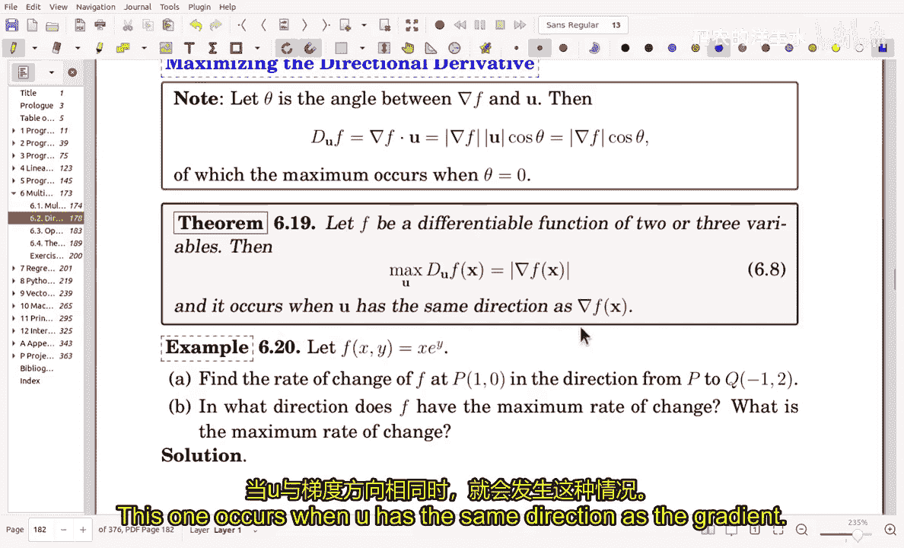

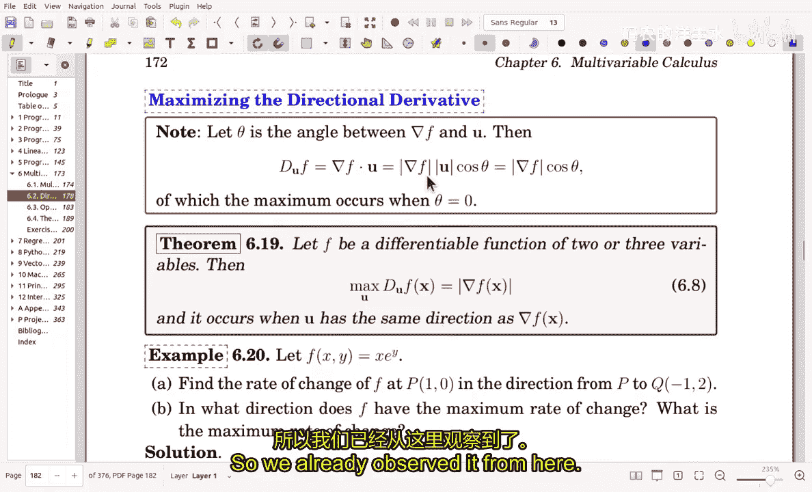

## 最大化方向导数 ⬆️

理解了方向导数与梯度的关系后，我们来看一个关键应用：如何找到函数增长最快的方向。

### 理论推导

根据公式 **D_u f = ∇f · u = |∇f| |u| cosθ**，其中 **θ** 是梯度矢量 **∇f** 与方向向量 **u** 之间的夹角。
由于 **u** 是单位向量（**|u|=1**），上式简化为 **D_u f = |∇f| cosθ**。

余弦函数 **cosθ** 的最大值为 **1**，当且仅当 **θ = 0** 时取得。这意味着 **u** 的方向与梯度 **∇f** 的方向完全一致。

**定理**：可微函数 **f** 在给定点处，方向导数的最大值等于该点梯度矢量的模（长度）**|∇f|**，并且这个最大值发生在梯度矢量所指的方向上。

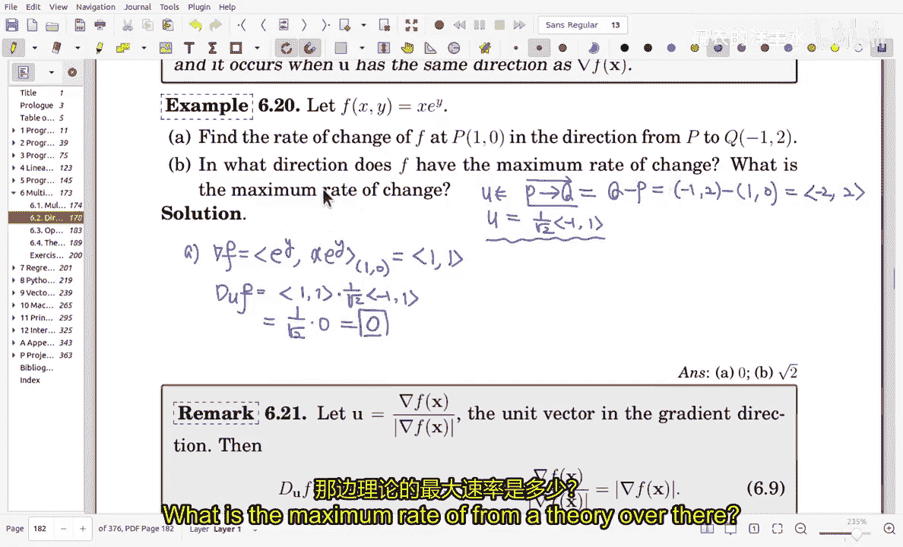

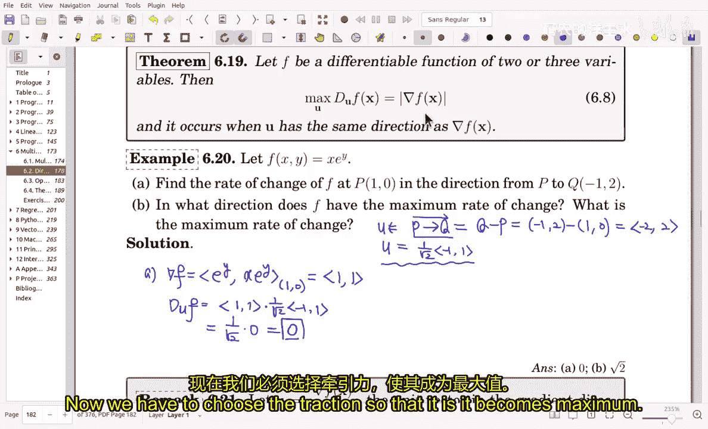

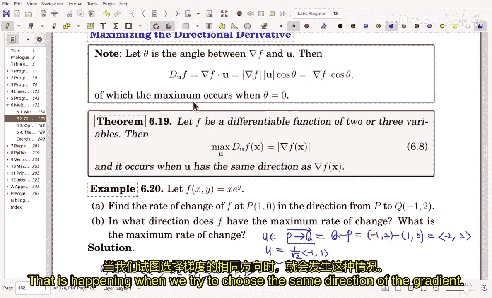

换句话说，**梯度方向是函数值增加最快的方向**。

### 示例与应用

**示例 5**：设 **f(x, y) = x e^y**。
1.  求在点 **P(1, 0)** 处，沿 **P** 到 **Q(0, 2)** 方向的方向导数。
    *   方向向量 **v = Q - P = (-1, 2)**。单位化：**|v| = √5**，**u = (-1/√5, 2/√5)**。
    *   梯度 **∇f = (e^y, x e^y)**。在 **(1,0)** 处，**∇f(1,0) = (1, 1)**。
    *   **D_u f = (1, 1) · (-1/√5, 2/√5) = (-1+2)/√5 = 1/√5**。
2.  函数在 **P** 点沿哪个方向增加最快？最大增加速率是多少？
    *   根据定理，增加最快的方向就是梯度方向，即 **∇f(1,0) = (1, 1)** 的方向。将其单位化：**u_max = (1/√2, 1/√2)**。
    *   最大增加速率等于梯度的模：**|∇f(1,0)| = |(1,1)| = √2**。

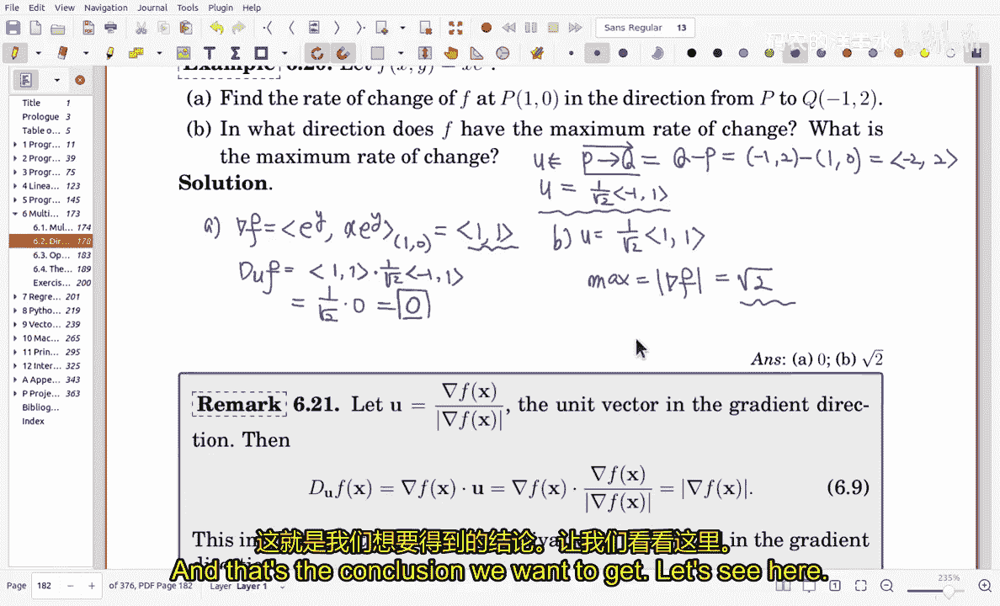

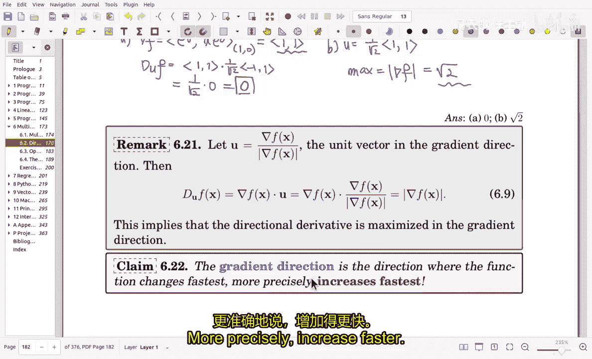

我们可以这样直观理解：对于一元函数 **y = f(x)**，其导数 **f'(x)** 的正负指示了增加或减少的方向，其绝对值大小指示了变化的快慢。梯度将这个概念推广到了多元函数，它指向了“最陡峭的上山”方向。

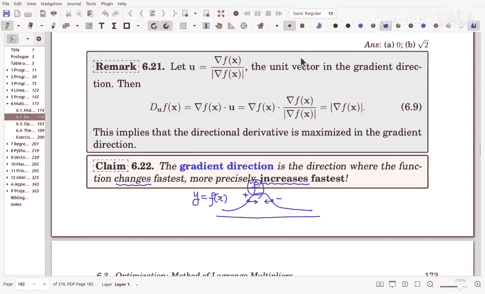

## 总结

本节课我们一起学习了多元微积分中的两个核心工具：
1.  **方向导数**：它度量了函数在任意指定方向上的瞬时变化率。计算公式为 **D_u f = ∇f · u**。
2.  **梯度矢量**：它是一个由函数所有一阶偏导数组成的向量，**∇f = (∂f/∂x, ∂f/∂y)**。梯度具有极其重要的几何意义：
    *   梯度的方向是函数在该点处**增加最快**的方向。
    *   梯度的模（长度）等于该方向上的**最大增加速率**。

理解梯度的这一性质，对于后续学习优化算法（如梯度下降法）至关重要。