# 041：等式约束优化 🧮

在本节课中，我们将学习带有等式约束的优化问题，并掌握一种强大的求解工具——拉格朗日乘数法。我们将从几何直观入手，理解其原理，并通过具体例子学习如何应用它来求解最大值和最小值问题。

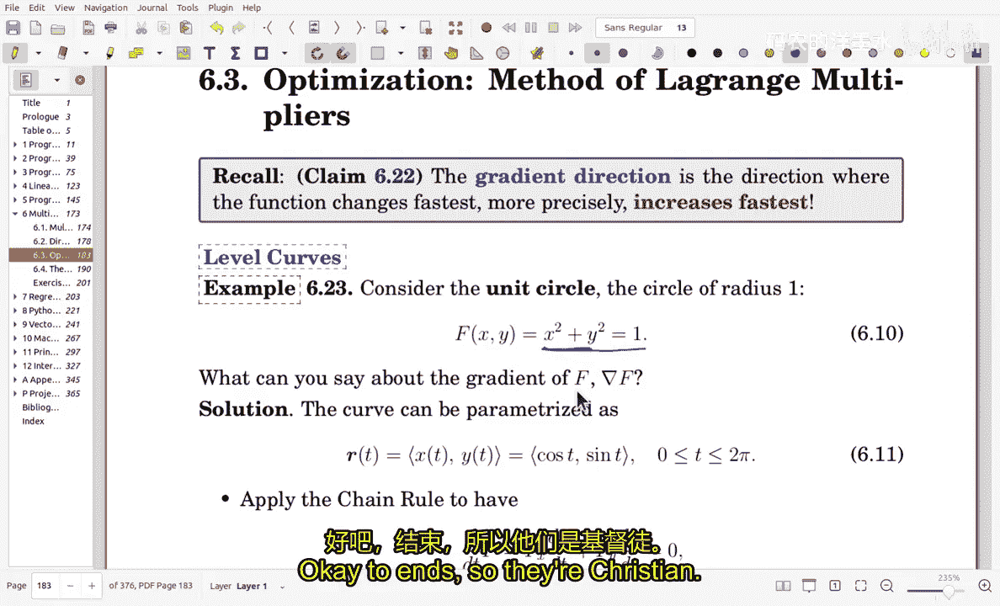

## 梯度与等高线 📈

上一节我们提到，梯度方向是函数值增长最快的方向。本节我们将从等高线开始，深入理解这一概念。

考虑一个简单的例子：单位圆。其方程由 `x² + y² = 1` 给出。我们可以将方程左边定义为一个函数 `F(x, y) = x² + y²`。

那么，关于函数 `F` 的梯度，我们能得出什么结论呢？

为了回答这个问题，我们引入参数化。曲线可以用以下方程参数化表示：
`r(t) = [x(t), y(t)] = [cos(t), sin(t)]`，其中 `t` 从 `0` 变化到 `2π`。

现在，`F` 可以看作是 `t` 的函数。我们使用链式法则求 `F` 对 `t` 的导数：
`dF/dt = (∂F/∂x)(dx/dt) + (∂F/∂y)(dy/dt) = (2x)(-sin t) + (2y)(cos t)`。

在圆上的任意点 `(x, y)`，这个导数向量 `[-2x sin t + 2y cos t]` 实际上与向量 `[-sin t, cos t]` 方向一致，后者正是圆的切向量。同时，`F` 的梯度 `∇F = [2x, 2y]`。

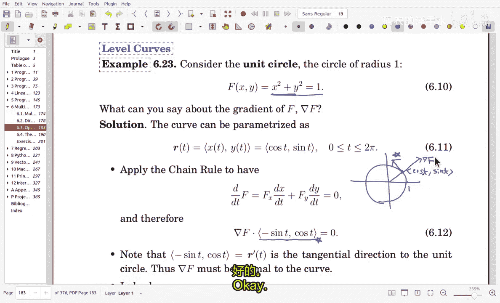

计算 `∇F` 与切向量的点积：`[2x, 2y] · [-sin t, cos t] = -2x sin t + 2y cos t = 0`。这表明梯度 `∇F` 与曲线的切向量正交。

从几何上看，梯度是曲线的法向量，指向函数值增长最快的方向。在单位圆内部，`F(x, y) < 1`；在圆上，`F(x, y) = 1`；在圆外部，`F(x, y) > 1`。梯度方向正是从圆内指向圆外的方向。

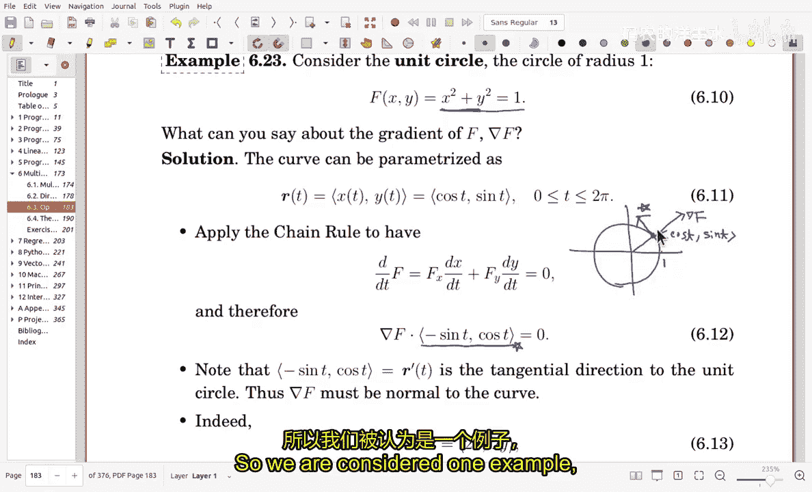

我们可以将这一观察推广为一般结论：

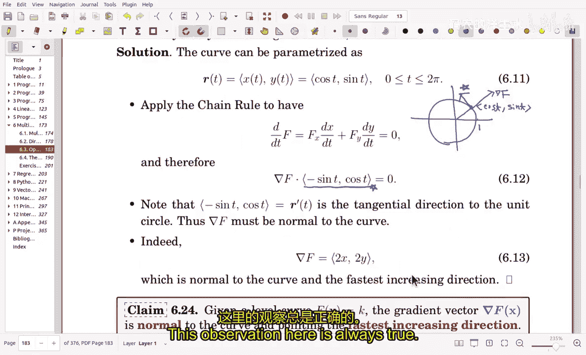

> 给定一条等高线 `F(x, y) = K`，其梯度向量 `∇F` 垂直于该曲线，并指向函数值增长最快的方向。

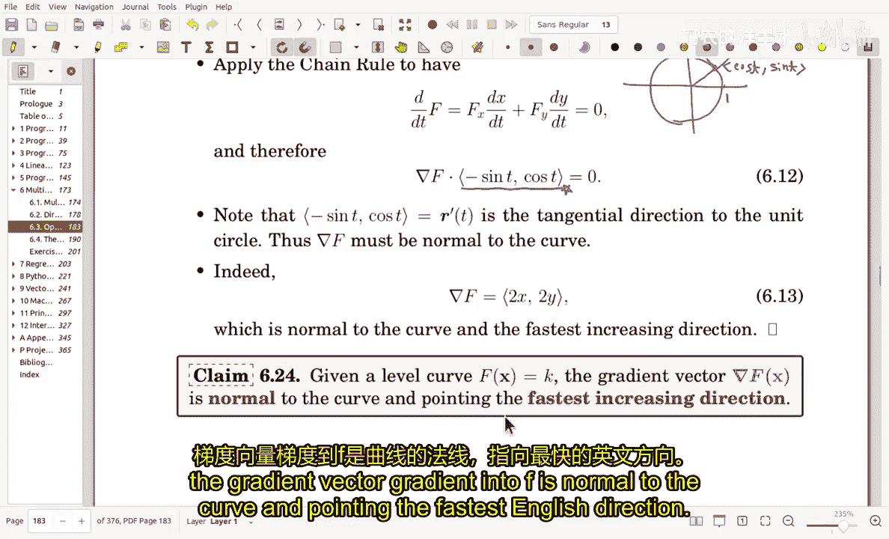

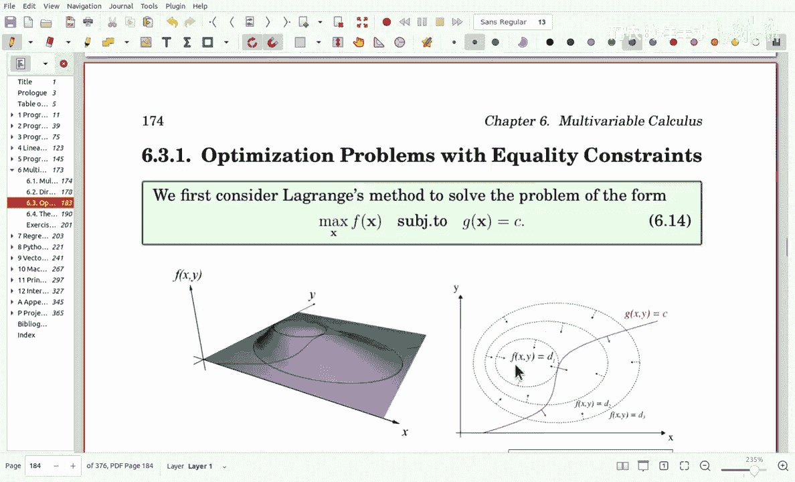

## 等式约束优化问题与拉格朗日乘数法 🎯

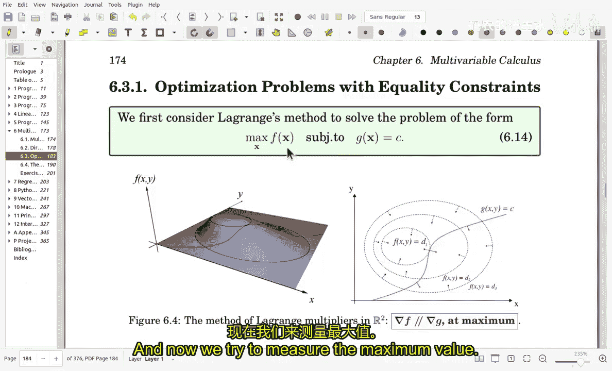

现在，我们准备考虑带有等式约束的优化问题，并介绍一种有效的求解技术。

我们的目标是：在满足约束条件 `G(x) = c` 的前提下，最大化函数 `F(x)`。这意味着我们必须从所有满足该等式的点 `x` 中，找出使 `F(x)` 取得最大值的点。

让我们通过一个几何图像来理解。假设我们想最大化函数 `z = F(x, y)`，但点 `(x, y)` 必须位于曲线 `G(x, y) = c` 上。我们画出 `F` 的若干条等高线（`F = T1, T2, T3...`，其中 `T1 > T2 > T3`）。

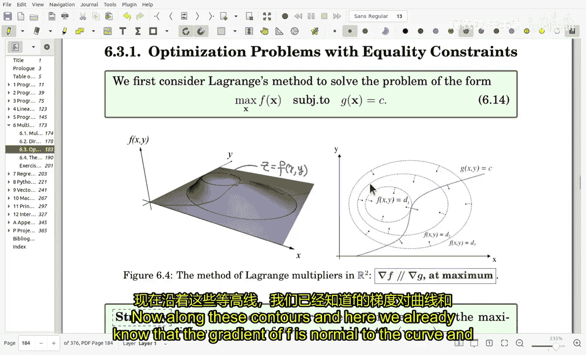

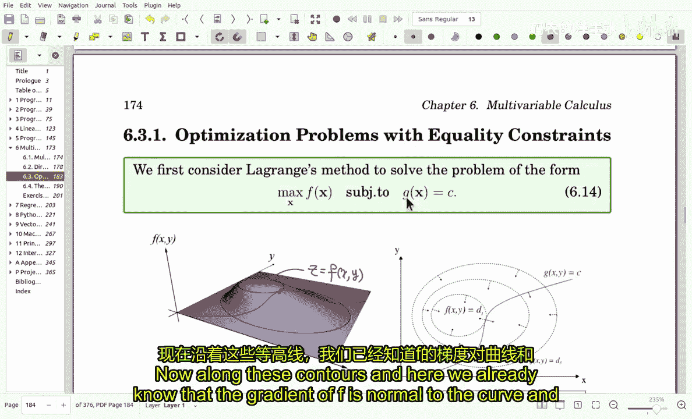

我们知道，`F` 的梯度 `∇F` 垂直于其等高线，并指向 `F` 增长最快的方向。同时，约束曲线 `G(x, y) = c` 本身也是一条等高线，其梯度 `∇G` 垂直于该约束曲线。

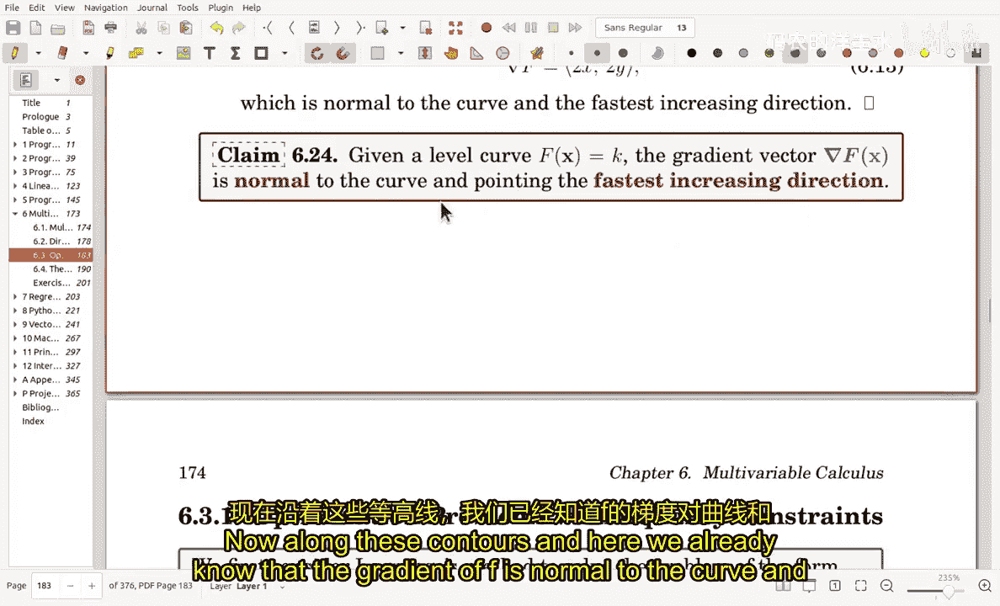

在最大值点处，`F` 的某条等高线（例如 `F = T_max`）必然与约束曲线 `G = c` 相切。因为如果它们相交，我们就可以沿着约束曲线移动到 `F` 值更大或更小的点，该点就不是极值点。

在切点处，两条曲线拥有共同的切线。因此，它们的法向量，即梯度 `∇F` 和 `∇G`，必须彼此平行。于是我们得到关键结论：

> 在约束优化问题的极值点（最大值或最小值）处，目标函数的梯度 `∇F` 与约束函数的梯度 `∇G` 平行。

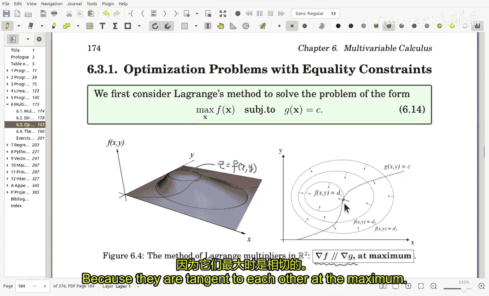

由此，我们推导出**拉格朗日乘数法**。

对于寻找函数 `F(x, y, z)` 在约束 `G(x, y, z) = c` 下的极值问题，该方法步骤如下：

1.  引入一个辅助变量 `λ`（称为拉格朗日乘子）。
2.  构造拉格朗日函数：`L(x, y, z, λ) = F(x, y, z) - λ (G(x, y, z) - c)`。
3.  求 `L` 对所有变量（包括 `λ`）的偏导数，并令其为零：
    *   `∂L/∂x = 0` -> `∂F/∂x - λ ∂G/∂x = 0`
    *   `∂L/∂y = 0` -> `∂F/∂y - λ ∂G/∂y = 0`
    *   `∂L/∂z = 0` -> `∂F/∂z - λ ∂G/∂z = 0`
    *   `∂L/∂λ = 0` -> `G(x, y, z) - c = 0`
    这等价于求解方程组：`∇F = λ ∇G` 和 `G(x, y, z) = c`。
4.  解这个方程组，得到所有可能的候选点 `(x, y, z)` 及对应的 `λ`。
5.  计算所有候选点处的函数值 `F(x, y, z)`。其中最大的即为约束下的最大值，最小的即为约束下的最小值。

## 应用示例：最大体积的纸盒 📦

让我们通过一个具体问题来实践拉格朗日乘数法。

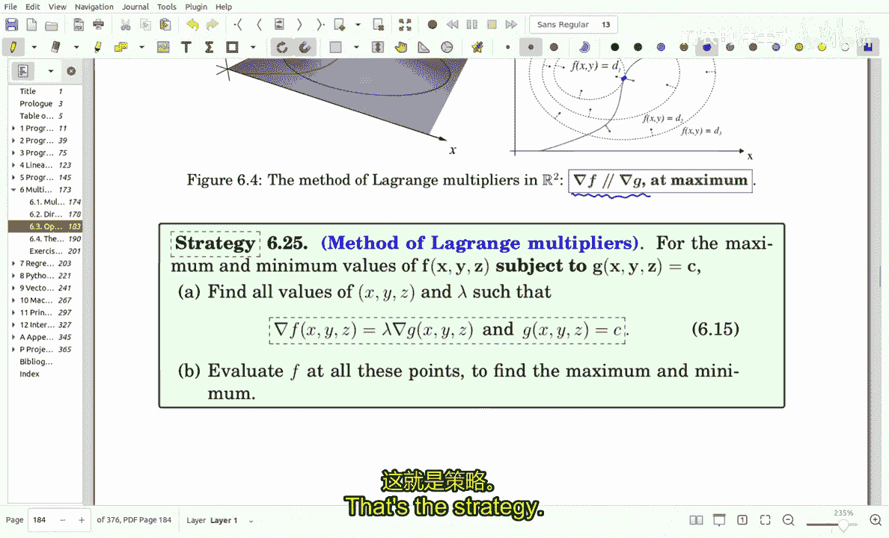

**问题**：用 `12` 平方米的纸板制作一个无盖长方体纸盒。求使纸盒体积最大的尺寸。

**解答**：
设长方体的长、宽、高分别为 `x`, `y`, `z`。
*   目标函数（体积）：`F(x, y, z) = x y z`（需要最大化）。
*   约束条件（纸板总面积）：底面 `xy` + 前后面 `2xz` + 左右面 `2yz` = `12`。
    即约束函数：`G(x, y, z) = xy + 2xz + 2yz = 12`。

现在应用拉格朗日乘数法。我们需要解方程组 `∇F = λ ∇G` 和 `G = 12`。

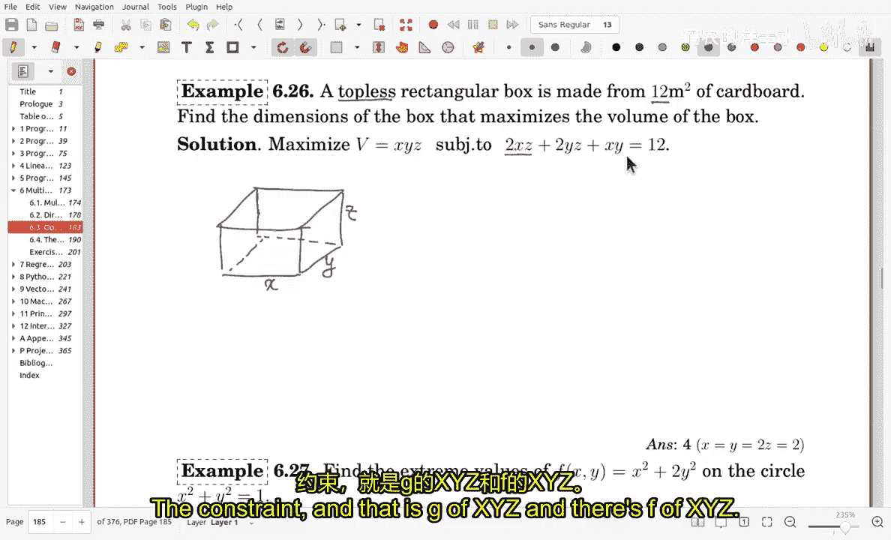

计算梯度：
`∇F = (yz, xz, xy)`
`∇G = (y+2z, x+2z, 2x+2y)`

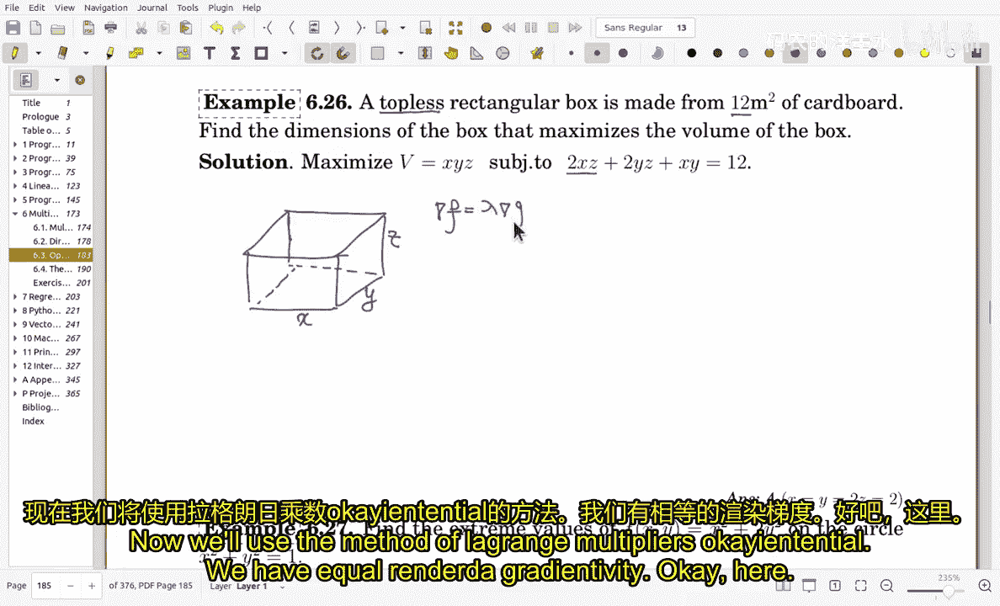

得到方程组：
1.  `yz = λ (y + 2z)`
2.  `xz = λ (x + 2z)`
3.  `xy = λ (2x + 2y)`
4.  `xy + 2xz + 2yz = 12`

这个方程组看起来复杂，但可以利用对称性简化。分别用 `x`, `y`, `z` 乘方程 `(1)`, `(2)`, `(3)`：
1‘. `x y z = λ (xy + 2xz)`
2‘. `x y z = λ (xy + 2yz)`
3‘. `x y z = λ (2xz + 2yz)`

由于体积 `xyz > 0`，且 `λ` 不可能为零（否则梯度为零，与物理意义不符），因此方程 `1‘`, `2‘`, `3‘` 的右边必须相等。
由 `1‘` 和 `2‘` 右边相等可得：`xy + 2xz = xy + 2yz` -> `2xz = 2yz` -> `x = y` (假设 `z ≠ 0`)。
由 `2‘` 和 `3‘` 右边相等可得：`xy + 2yz = 2xz + 2yz` -> `xy = 2xz` -> `y = 2z` (假设 `x ≠ 0`)。

因此我们得到关系：`x = y` 且 `y = 2z`，即 `x = 2z`, `y = 2z`。

代入约束方程 `(4)`：
`(2z)(2z) + 2(2z)z + 2(2z)z = 12`
`4z² + 4z² + 4z² = 12`
`12z² = 12`
`z² = 1` -> `z = 1` (取正值)。

于是，`x = 2`, `y = 2`, `z = 1`。

最大体积为 `V = x y z = 2 * 2 * 1 = 4` 立方米。

## 应用示例：圆上的极值 🔵

**问题**：求函数 `F(x, y) = x² + 2y²` 在单位圆 `x² + y² = 1` 上的极值。

**解答**：
目标函数：`F(x, y) = x² + 2y²`。
约束函数：`G(x, y) = x² + y² = 1`。

建立拉格朗日方程组 `∇F = λ ∇G`：
`∇F = (2x, 4y)`
`∇G = (2x, 2y)`

方程组为：
1.  `2x = λ (2x)`
2.  `4y = λ (2y)`
3.  `x² + y² = 1`

由方程 `(1)`：`2x(1 - λ) = 0`，推出 `x = 0` 或 `λ = 1`。

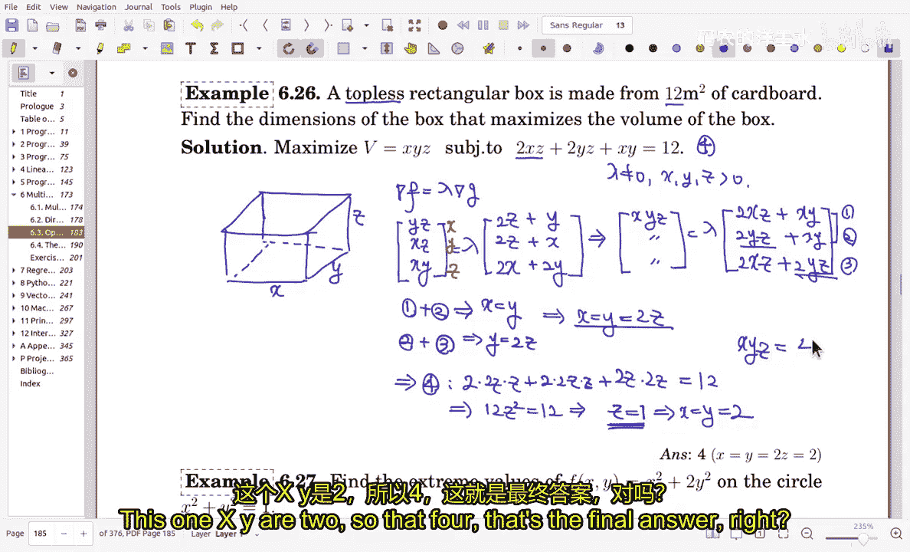

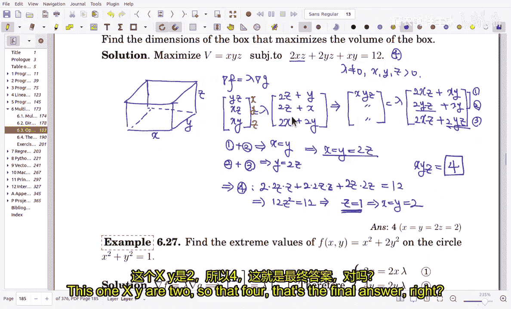

**情况一**：`x = 0`。
代入方程 `(3)`：`0 + y² = 1` -> `y = ±1`。
得到两个候选点：`(0, 1)` 和 `(0, -1)`。

**情况二**：`λ = 1`。
代入方程 `(2)`：`4y = 1 * (2y)` -> `4y = 2y` -> `2y = 0` -> `y = 0`。
代入方程 `(3)`：`x² + 0 = 1` -> `x = ±1`。
得到另外两个候选点：`(1, 0)` 和 `(-1, 0)`。

现在我们评估所有候选点的函数值：
*   `F(0, 1) = 0² + 2*(1)² = 2`
*   `F(0, -1) = 0² + 2*(-1)² = 2`
*   `F(1, 0) = 1² + 2*(0)² = 1`
*   `F(-1, 0) = (-1)² + 2*(0)² = 1`

因此，在单位圆约束下，函数 `F(x, y)` 的**最大值为 `2`**，**最小值为 `1`**。

## 内部极值与边界极值 🔍

现在考虑一个相关但不同的问题：求函数 `F(x, y) = x² + 2y²` 在**单位圆盘内**（包括边界 `x² + y² ≤ 1`）的极值。

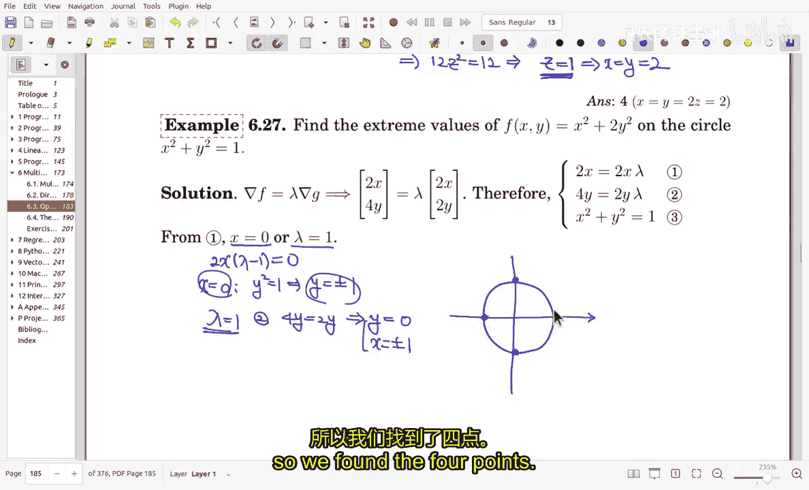

对于区域内部的极值，我们寻找无约束的临界点，即令梯度 `∇F = (2x, 4y) = (0, 0)`。解得 `x=0`, `y=0`，即原点 `(0, 0)`。在该点，`F(0, 0) = 0`。

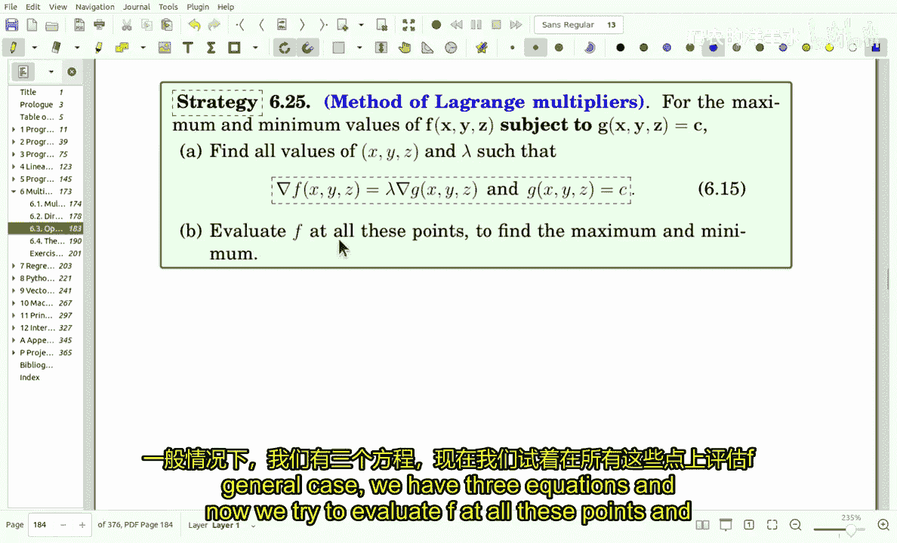

对于边界上的极值，我们已经用拉格朗日乘数法求过了，结果是最大值 `2`，最小值 `1`。

比较内部临界点和边界极值：
*   最小值：内部点 `(0,0)` 的函数值 `0` 小于边界最小值 `1`。因此全局最小值为 `0`。
*   最大值：边界最大值 `2` 大于内部任何点的值（因为函数在内部是连续的，且原点值最小）。因此全局最大值为 `2`。

所以，在闭单位圆盘上，函数的最小值为 `0`（在原点取得），最大值为 `2`（在点 `(0, ±1)` 取得）。

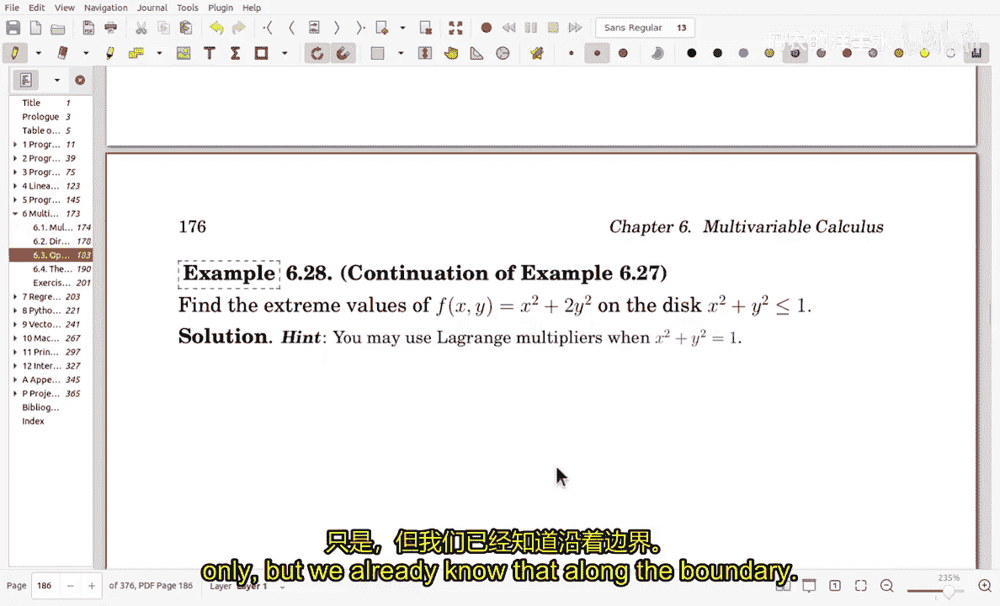

## 拉格朗日乘数法的另一种视角：拉格朗日函数 ⚙️

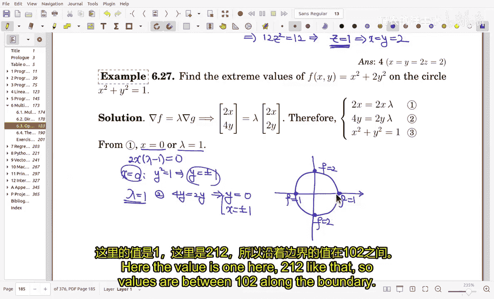

最后，我们从另一个角度审视拉格朗日乘数法。

对于优化问题：最大化 `F(x)`，满足 `G(x) = c`。拉格朗日乘数法要求解 `∇F = λ ∇G` 和 `G(x) = c`。

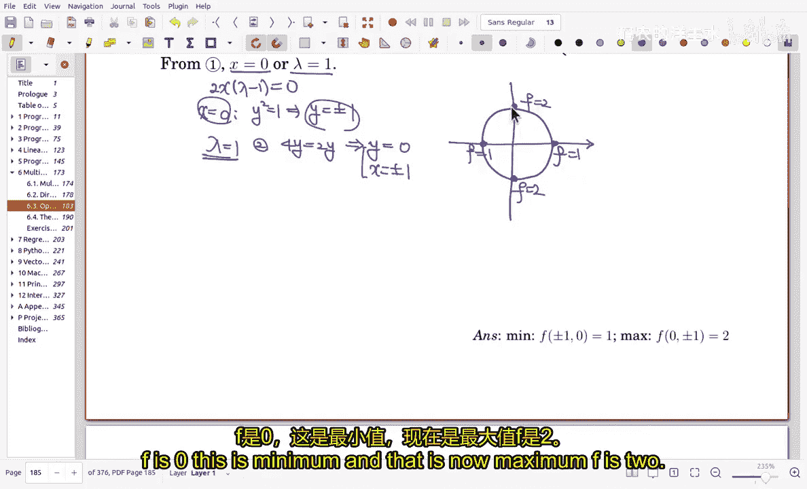

这可以解释为：寻找以下**拉格朗日函数**的临界点：
`L(x, λ) = F(x) - λ (G(x) - c)`

如果我们对 `L` 求所有变量的偏导数并令其为零：
*   `∂L/∂x = 0` -> `∇F - λ ∇G = 0`，即 `∇F = λ ∇G`。
*   `∂L/∂λ = 0` -> `-(G(x) - c) = 0`，即 `G(x) = c`。

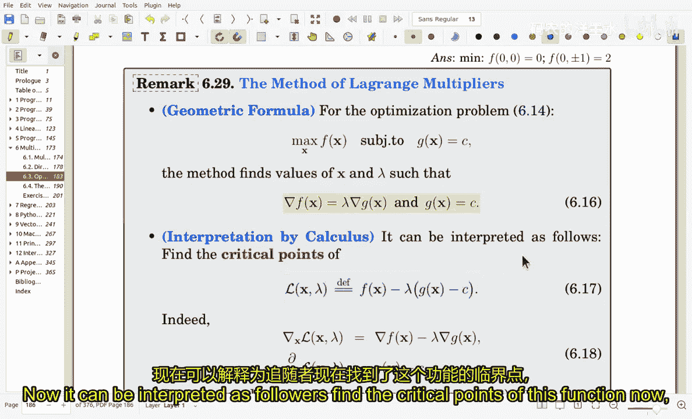

这正是我们之前推导出的方程组。因此，在优化理论中，我们通常直接构造并处理这个拉格朗日函数 `L`。

## 总结 📝

本节课我们一起学习了如何使用拉格朗日乘数法解决等式约束优化问题。我们首先从等高线和梯度的几何关系出发，理解了在极值点处目标函数与约束函数的梯度必须平行的原理。然后，我们学习了该方法的具体步骤：
1.  构造拉格朗日函数 `L = F - λ(G - c)`。
2.  求 `L` 对所有变量（包括 `λ`）的偏导并令其为零。
3.  解方程组得到候选点。
4.  比较候选点的函数值确定极值。

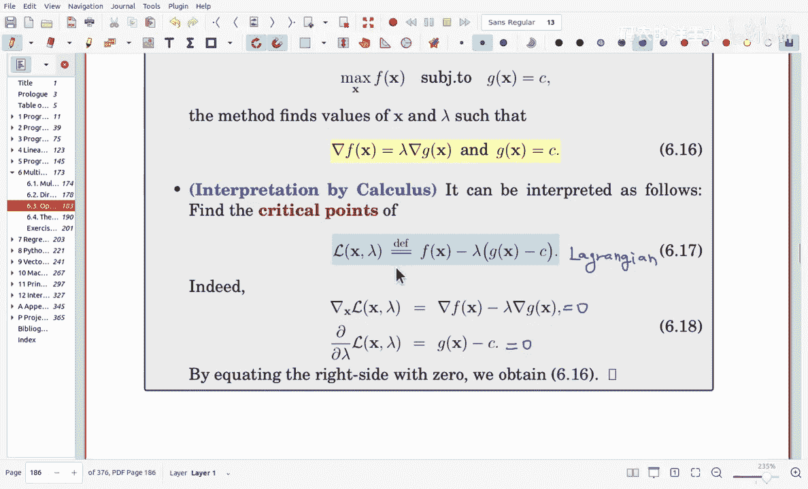

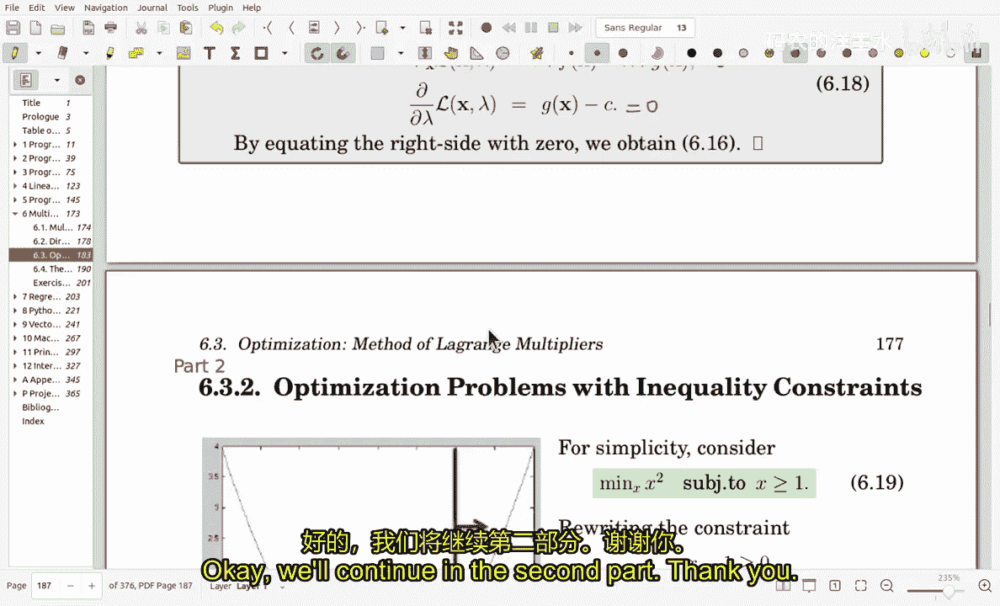

我们通过“最大体积纸盒”和“圆上函数极值”两个例子实践了这一方法，并讨论了在闭区域上需要同时考虑内部临界点和边界极值的问题。最后，我们了解到拉格朗日乘数法等价于求解一个扩展的拉格朗日函数的临界点。掌握这一工具，对于解决人工智能、经济学、工程学等领域的许多优化问题至关重要。