# 042：不等式约束

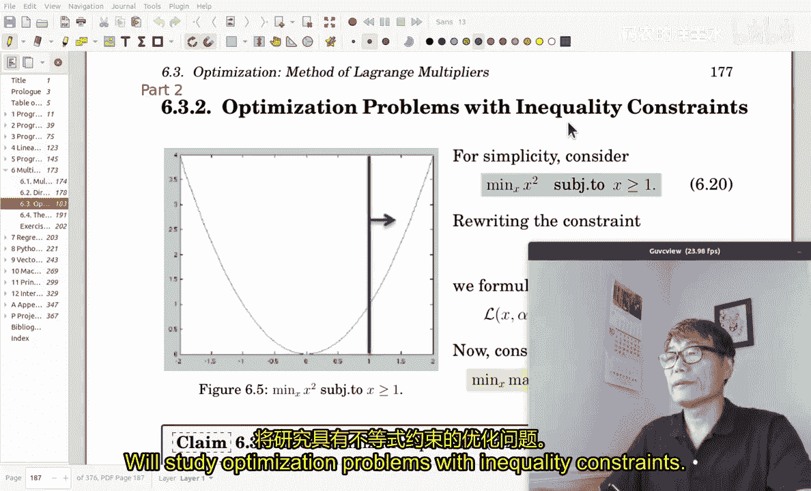

在本节课中，我们将学习如何处理带有不等式约束的优化问题。我们将从一个简单的例子开始，逐步理解拉格朗日乘数法在不等式约束下的应用，并引入对偶问题的概念。

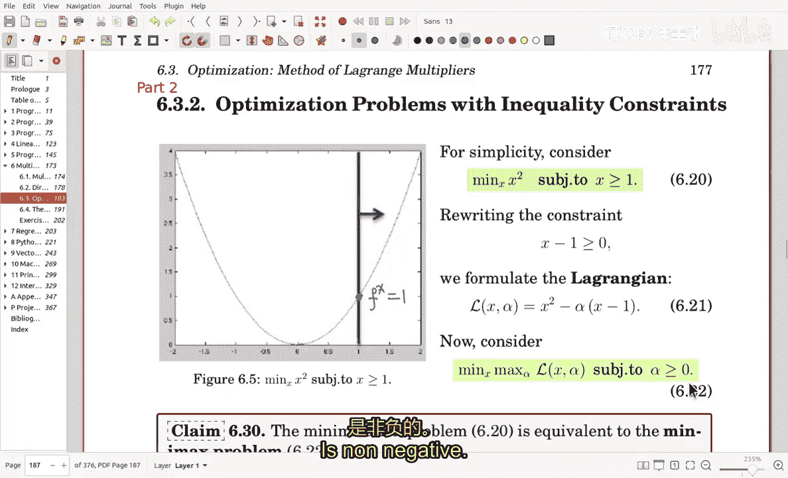

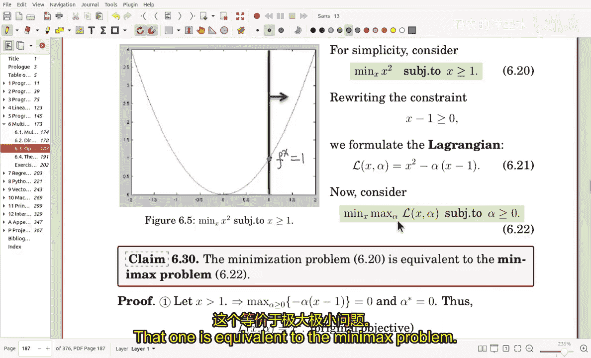

## 问题引入与拉格朗日函数

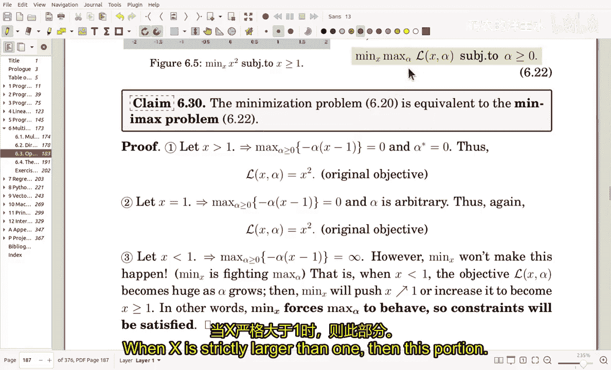

上一节我们介绍了等式约束下的优化。本节中，我们来看看当约束条件是不等式时，问题该如何处理。

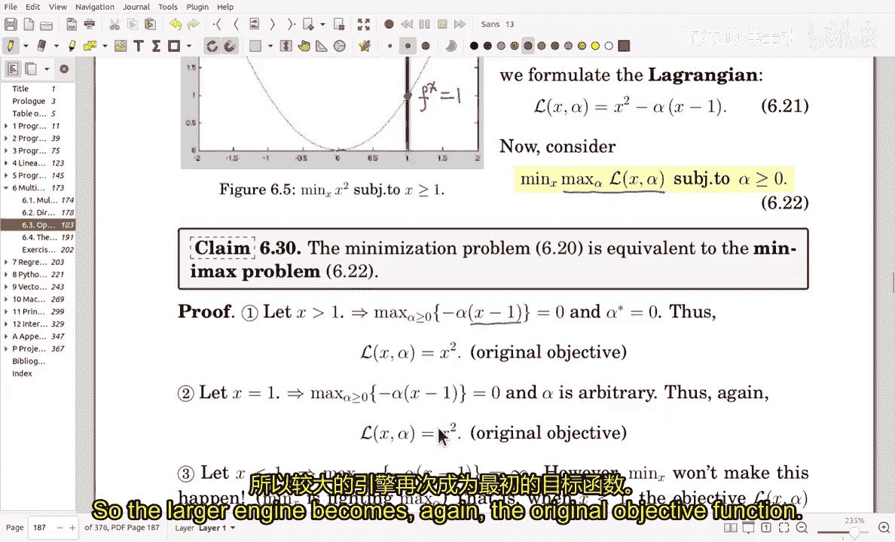

考虑一个简单的极小化问题：最小化函数 **f(x) = x²**，约束条件为 **x ≥ 1**。

从图像上看，曲线是 **y = x²**。我们试图在 **x ≥ 1** 的范围内找到最小值。显然，最小值出现在 **x = 1** 处，最优值为 **1**。虽然我们已经知道答案，但我们将尝试使用优化理论来求解。

首先，我们将约束条件重写为 **g(x) = x - 1 ≥ 0** 的形式，并构造拉格朗日函数：
**L(x, α) = f(x) - α * g(x) = x² - α(x - 1)**
其中，拉格朗日乘子 **α** 必须满足 **α ≥ 0**。

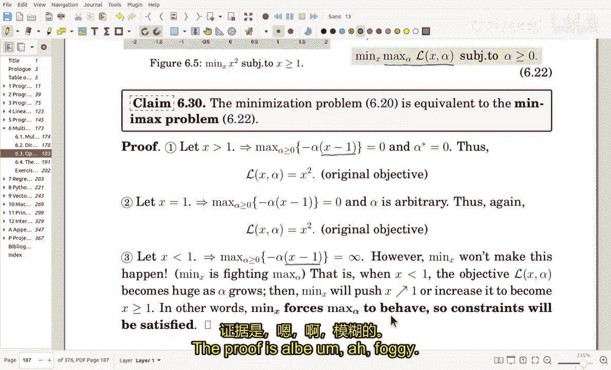

## 极小极大问题的等价性

接下来，我们考虑一个极小极大问题：**min_x max_{α≥0} L(x, α)**。

我们有一个重要的结论：原始的最小化问题与这个极小极大问题是等价的。以下是详细的论证：

*   当 **x > 1** 时，约束条件 **g(x) > 0**。对于非负的 **α**，项 **-αg(x)** 总是非正的。因此，**L(x, α)** 的最大值出现在 **α = 0** 时，此时拉格朗日函数退化为原始目标函数 **f(x)**。
*   当 **x = 1** 时，约束条件 **g(x) = 0**。无论 **α** 取何值，**-αg(x)** 项始终为0。因此，**L(x, α) = f(x)**。
*   当 **x < 1** 时，约束条件被违反，**g(x) < 0**。由于 **α ≥ 0**，项 **-αg(x)** 为正。通过选择非常大的 **α**，可以使 **L(x, α)** 趋于正无穷。

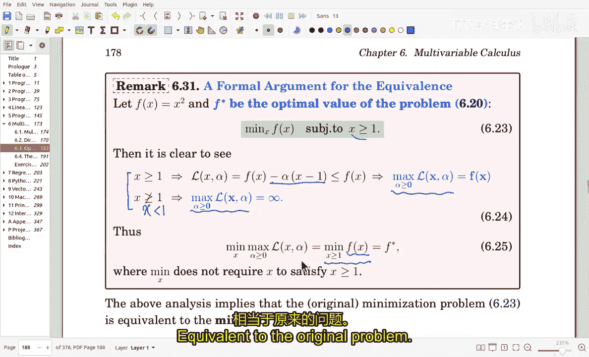

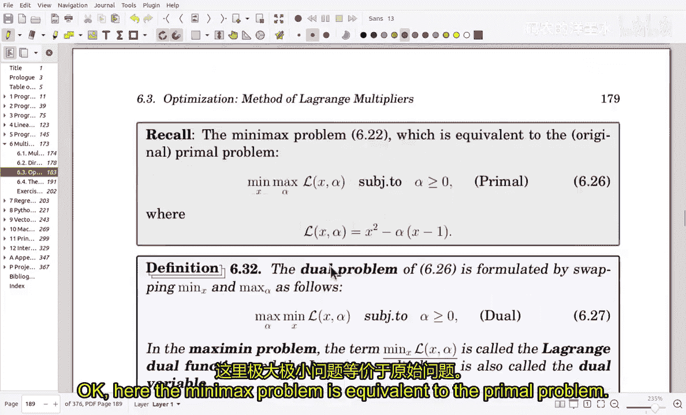

在极小极大问题中，外层是对 **x** 求极小。为了最小化这个极大值，优化过程会迫使 **x** 满足约束条件（即 **x ≥ 1**），以避免目标函数值变为无穷大。因此，这个极小极大问题最终等价于原始的约束优化问题。

## 原始问题与对偶问题

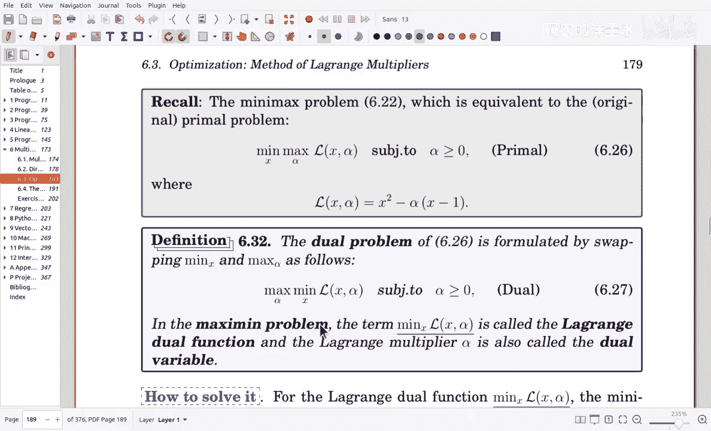

基于上述等价性，我们可以定义原始问题（Primal Problem）为：
**p* = min_x max_{α≥0} L(x, α)**

通过交换极小和极大的顺序，我们得到对偶问题（Dual Problem）：
**d* = max_{α≥0} min_x L(x, α)**

其中，内层 **g(α) = min_x L(x, α)** 被称为拉格朗日对偶函数，**α** 被称为对偶变量。

根据对偶理论，原始问题的最优值 **p*** 总是大于等于对偶问题的最优值 **d***，即 **p* ≥ d***。这被称为弱对偶性。如果两者相等，即 **p* = d***，则称为强对偶性。对于凸优化问题，通常满足强对偶性。

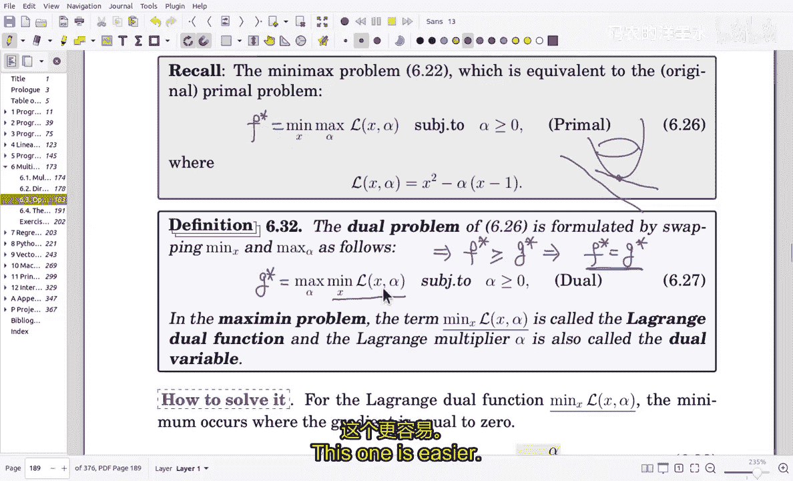

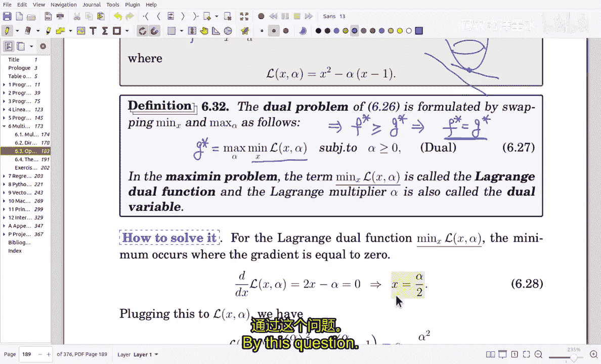

## 求解对偶问题

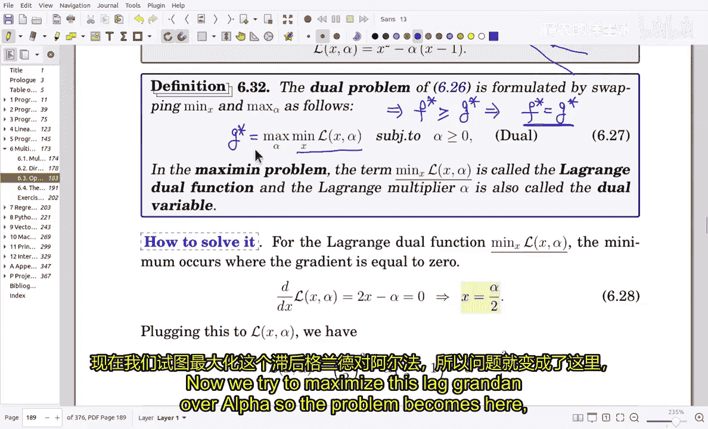

在许多情况下，求解对偶问题比直接求解原始问题更容易。因此，我们通常的策略是先求解对偶问题。

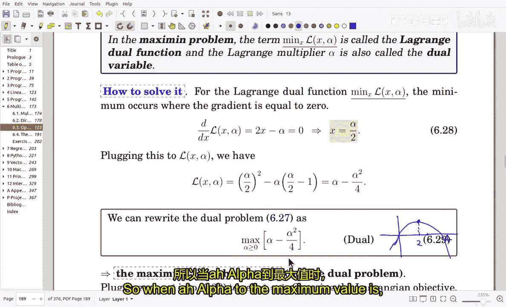

对于我们的例子 **L(x, α) = x² - α(x - 1)**，我们首先对内层的 **x** 求极小。

以下是求解步骤：
1.  对 **L** 关于 **x** 求导并令其为零：**∂L/∂x = 2x - α = 0**，解得 **x = α/2**。
2.  将 **x = α/2** 代回拉格朗日函数，得到仅关于 **α** 的对偶函数：
    **g(α) = (α/2)² - α(α/2 - 1) = -α²/4 + α**
3.  接下来，在外层对 **α ≥ 0** 最大化 **g(α)**。对 **g(α)** 求导：**dg/dα = -α/2 + 1 = 0**，解得 **α* = 2**。
4.  此时对偶函数的最大值为 **g(α*) = -(2)²/4 + 2 = 1**。
5.  根据强对偶性，原始问题的最优值 **p* = 1**。将最优乘子 **α* = 2** 代回 **x = α/2**，得到原始最优解 **x* = 1**。

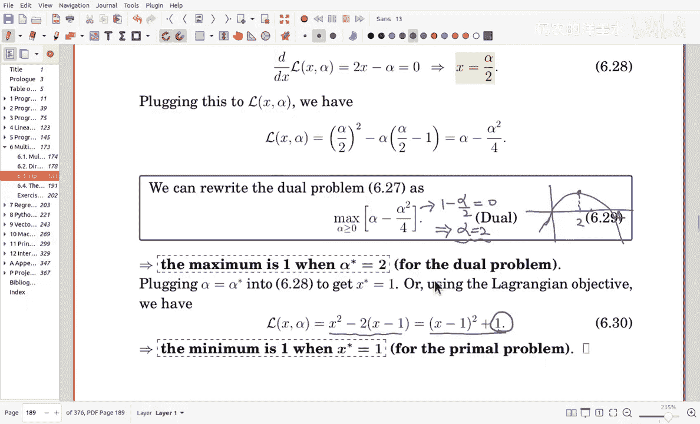

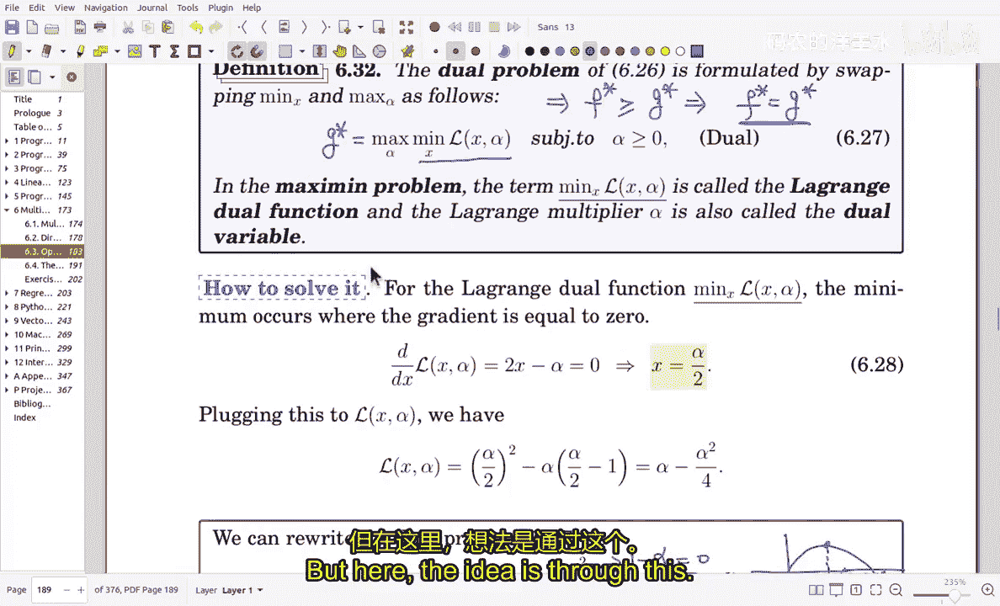

通过求解对偶问题，我们得到了与直接观察相同的结果：在 **x ≥ 1** 的约束下，**f(x) = x²** 的最小值为 **1**，在 **x = 1** 处取得。

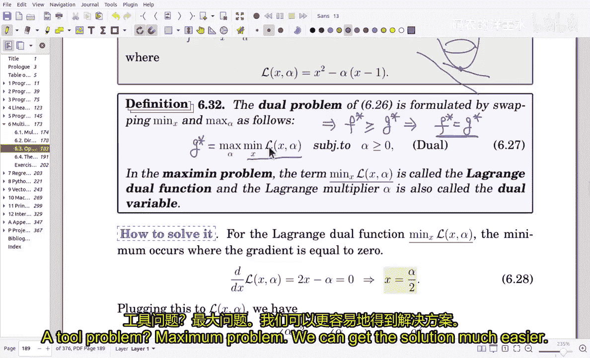

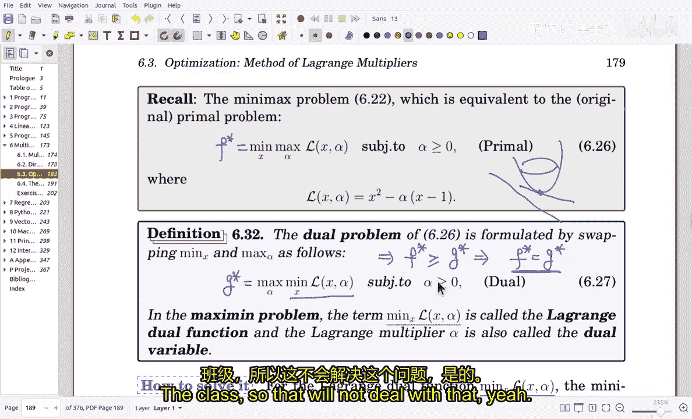

## 扩展到多个约束

最后，我们简要地将方法扩展到多个约束条件。考虑一个最大化问题：最大化 **f(x, y, z)**，同时满足两个等式约束 **g(x, y, z) = 0** 和 **h(x, y, z) = 0**。

从几何角度解释，在极值点处，目标函数的梯度 **∇f** 必须位于两个约束函数梯度 **∇g** 和 **∇h** 张成的平面内。这意味着 **∇f** 可以表示为 **∇g** 和 **∇h** 的线性组合：
**∇f = λ∇g + μ∇h**
其中 **λ** 和 **μ** 是拉格朗日乘子。

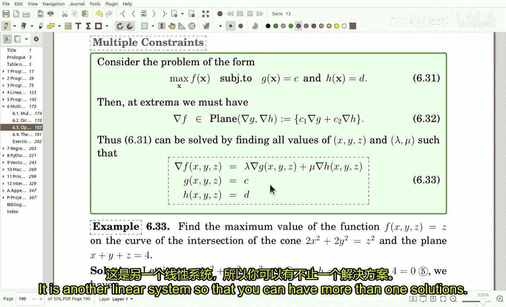

结合两个约束方程，我们得到一个包含5个方程（3个来自梯度关系，2个来自约束）和5个未知数（**x, y, z, λ, μ**）的方程组，可以联立求解。

## 总结

本节课中我们一起学习了拉格朗日乘数法在不等式约束优化问题中的应用。核心要点包括：
1.  通过引入非负的拉格朗日乘子，将不等式约束问题转化为一个极小极大问题。
2.  原始问题与对偶问题的定义及其关系（弱对偶性与强对偶性）。
3.  利用对偶性，通过求解相对简单的对偶问题来获得原始问题的解。
4.  该方法可以自然地扩展到多个等式或不等式约束的情形。

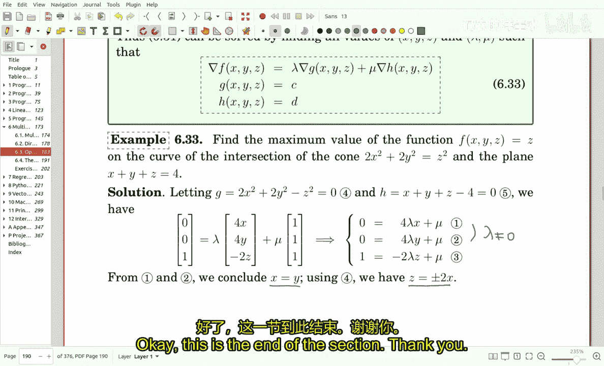

这种方法为处理复杂的约束优化问题提供了一个强大而系统的框架。