# 043：梯度下降法的推导与分析 📉

在本节课中，我们将学习梯度下降法的核心原理与推导过程。梯度下降法是一种用于寻找函数最小值的迭代优化算法，广泛应用于机器学习和人工智能领域。

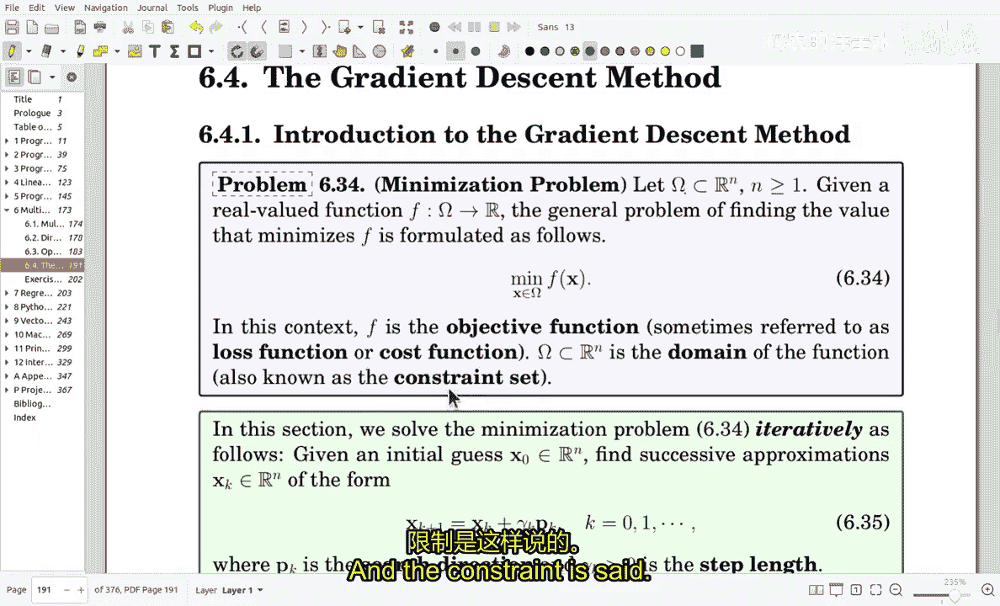

## 6.4：梯度下降法

上一节我们介绍了优化问题的基本形式，本节中我们来看看梯度下降法如何解决这类问题。

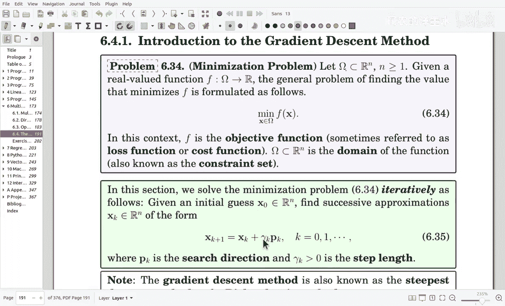

我们想要解决的问题定义如下：
*   **Ω** 是 **Rⁿ** 的一个子集。
*   给定一个实值函数 **F**。
*   一般的最小化问题可以表述为：尝试找到 **F** 在 **x ∈ Ω** 上的最小值。

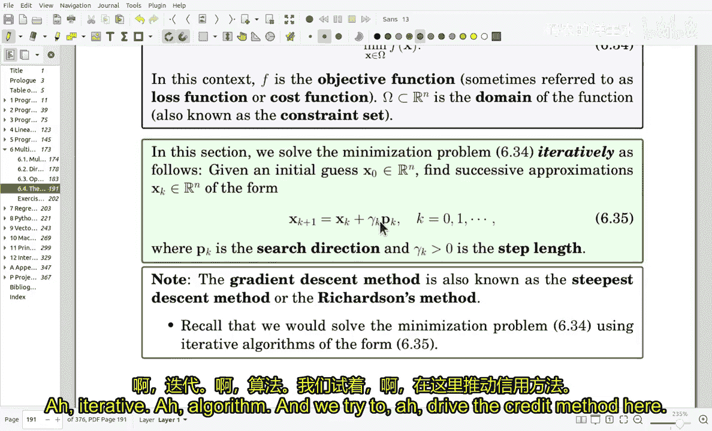

在这个上下文中：
*   **F** 被称为**目标函数**，有时也称为损失函数或成本函数。
*   **Ω** 是函数的定义域。
*   约束条件是 **x ∈ Ω**。

我们将尝试以迭代方式解决这个最小化问题。从一个初始猜测 **x₀** 开始，我们将尝试找到一系列近似解 **xₖ**，其形式如下：

**xₖ₊₁ = xₖ + αₖ pₖ**

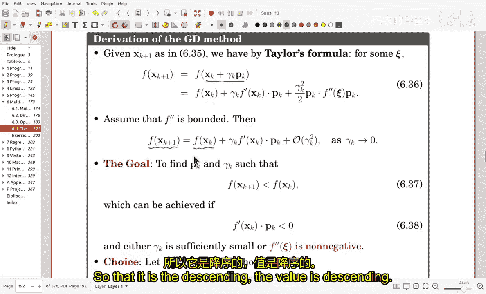

其中：
*   **pₖ** 是**搜索方向**。
*   **αₖ** 是**步长**。在找到方向后，我们需要决定步长。

梯度下降法，也称为最速下降法，是这类迭代算法的一种。在这里，我们尝试推导梯度下降法。当 **xₖ₊₁** 由上述公式决定时，问题在于如何选择 **pₖ** 和 **αₖ**。

我们可能会尝试使用泰勒展开来分析这个扰动。所以，**f(xₖ + αₖ pₖ)** 可以展开为 **f(xₖ)** 加上其梯度与搜索方向的点积（乘以步长），再加上二阶项。

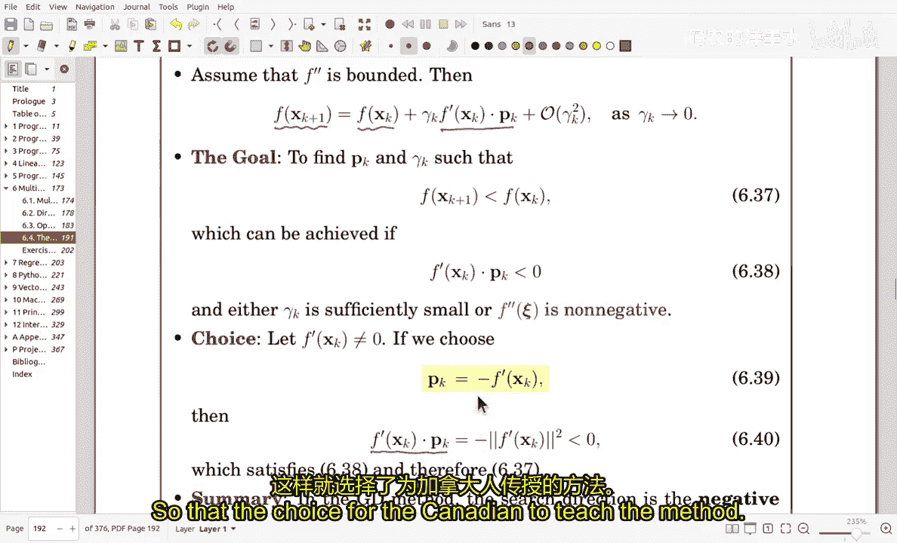

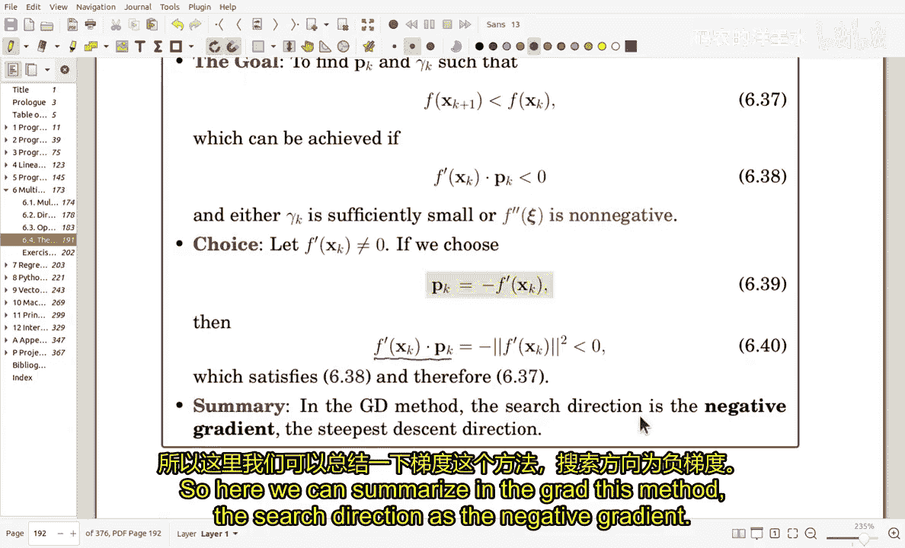

一旦我们假设二阶导数（海森矩阵）有界，我们就可以在这个范围内进行推导。我们的目标是使新点的函数值小于当前点的函数值，即函数值下降。

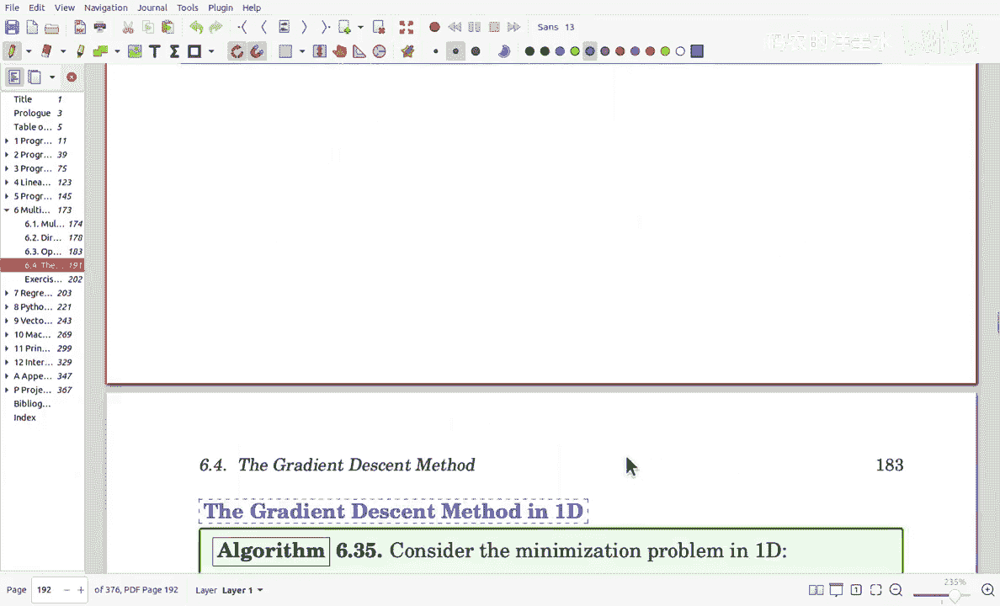

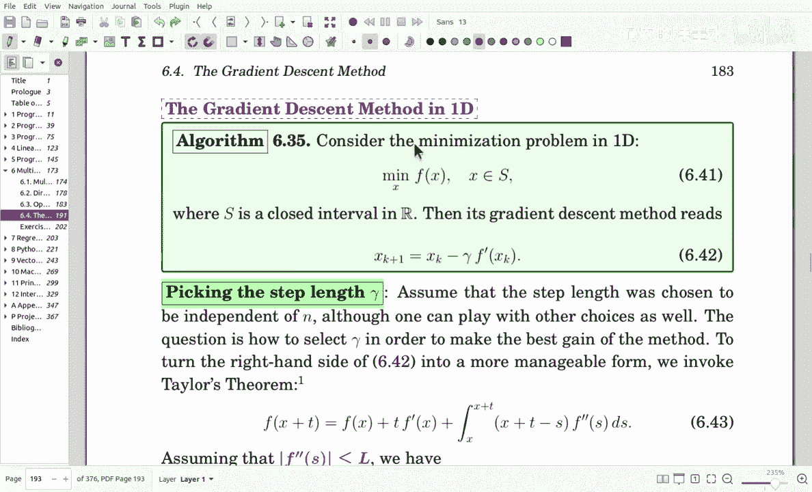

当点积为负时，因为步长是正数，我们就能得到更小的函数值。这要求步长足够小，并且海森矩阵非负。

我们的选择是：对于搜索方向 **pₖ**，我们尝试使用梯度的负方向。这样，点积就等于负的梯度范数的平方。当梯度非零时，它就是负的。这就是梯度下降法的选择。

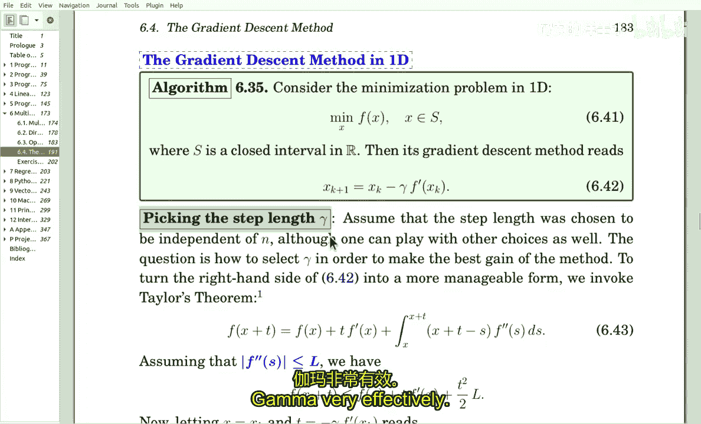

以下是梯度下降法的核心公式总结：

*   **搜索方向**：**pₖ = -∇f(xₖ)**
*   **迭代更新**：**xₖ₊₁ = xₖ - αₖ ∇f(xₖ)**

现在，我们尝试在一维情况下分析这个方法。

## 一维情况下的分析

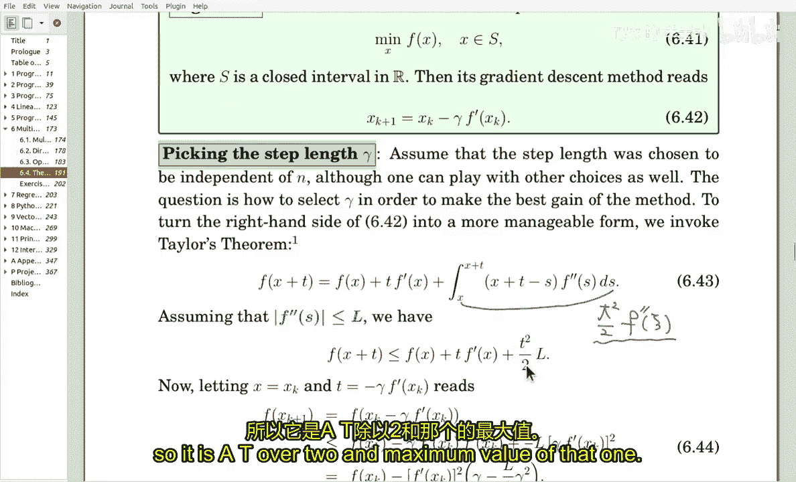

考虑一维最小化问题：最小化定义在实数集闭区间 **S** 上的函数 **F(x)**。那么梯度下降法可以表述为：

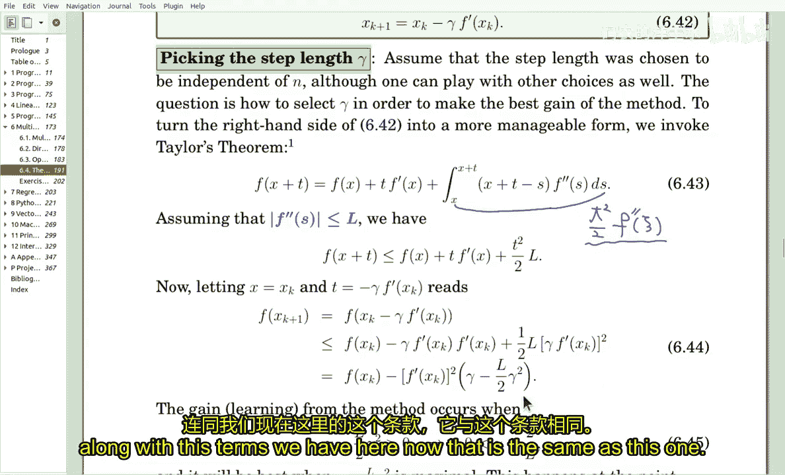

**xₖ₊₁ = xₖ - γ f'(xₖ)**

我们将尝试有效地设置步长 **γ**。

我们从泰勒定理开始。对于一般的 **x** 和 **t**，**f(x + t)** 等于 **f(x)** 加上 **t f'(x)**，再加上一个积分形式的余项。你也可以使用拉格朗日余项，即 **t²/2 f''(ξ)**。

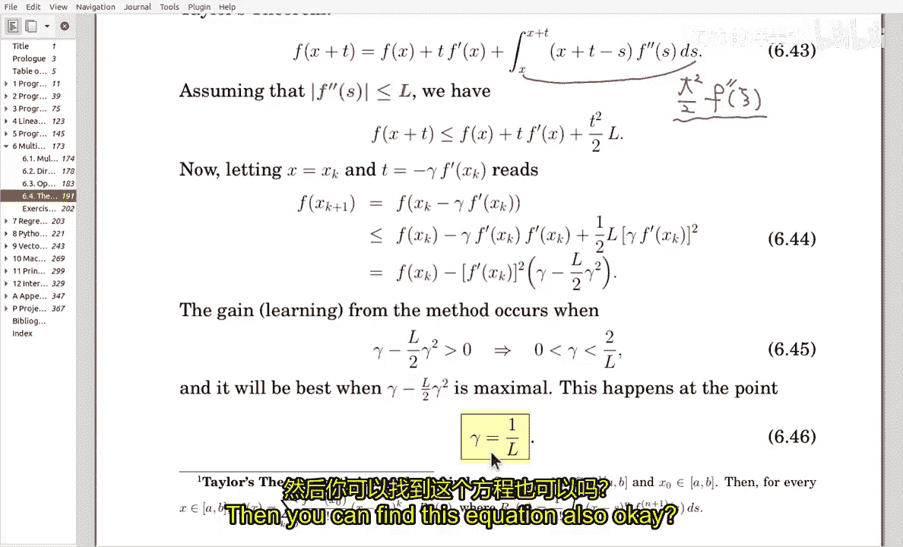

假设二阶导数有界，且上界为 **L**。那么我们可以得到 **f(x + t)** 的一个上界。

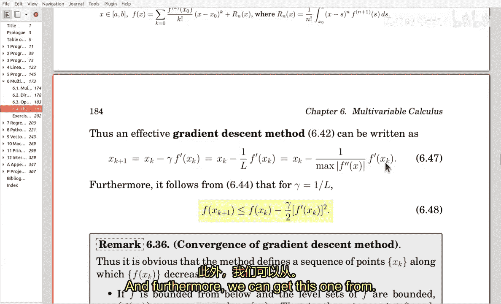

现在，在这个公式中，我们令 **x = xₖ**，**t = -γ f'(xₖ)**。那么我们可以得到 **f(xₖ₊₁)** 的一个上界。

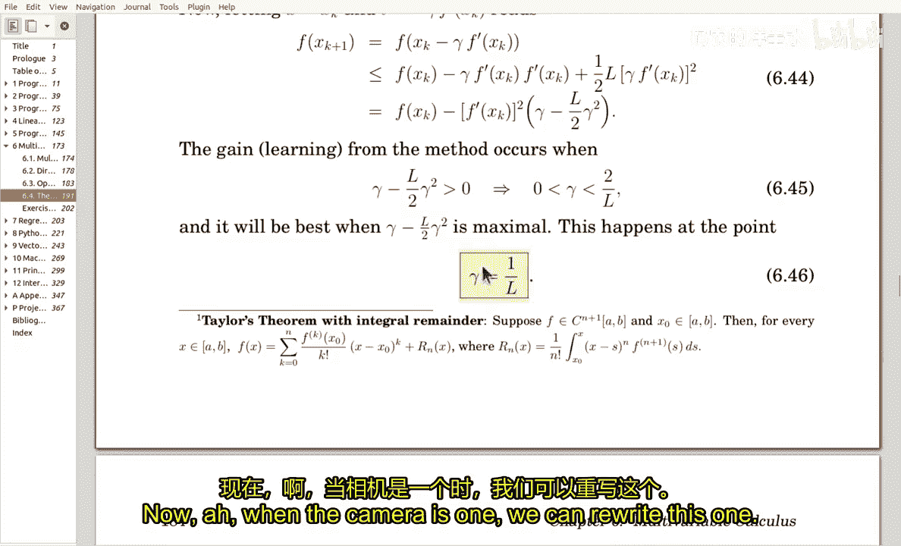

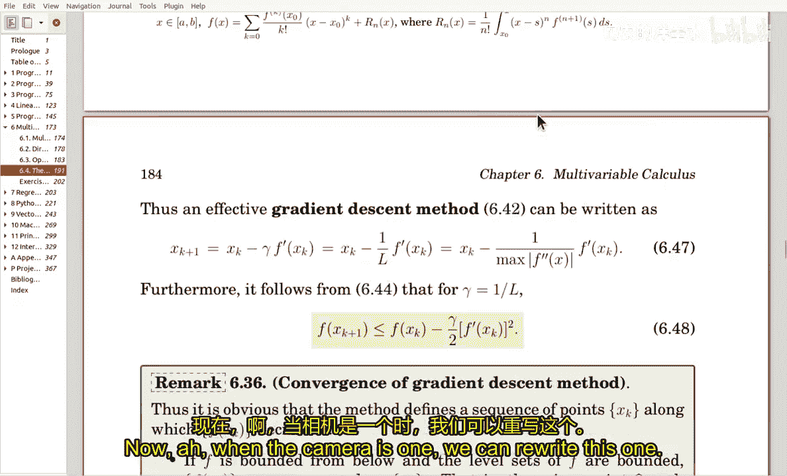

目标是使这个上界严格小于 **f(xₖ)**，从而实现下降。这要求某个项为正。这个要求等价于 **γ** 在 **0** 和 **2/L** 之间。

这个二次项在 **γ** 取中点时达到最大值。当 **γ = 1/L** 时，我们可以得到最优的界。

通过对这个二次项求导并设为零，也可以找到这个方程。

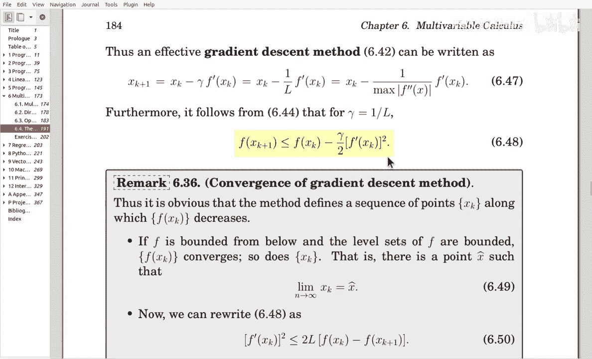

当 **γ = 1/L** 时，我们可以重写这个不等式，得到新函数值的上界。这个不等式将在后面用于决定 **γ**。

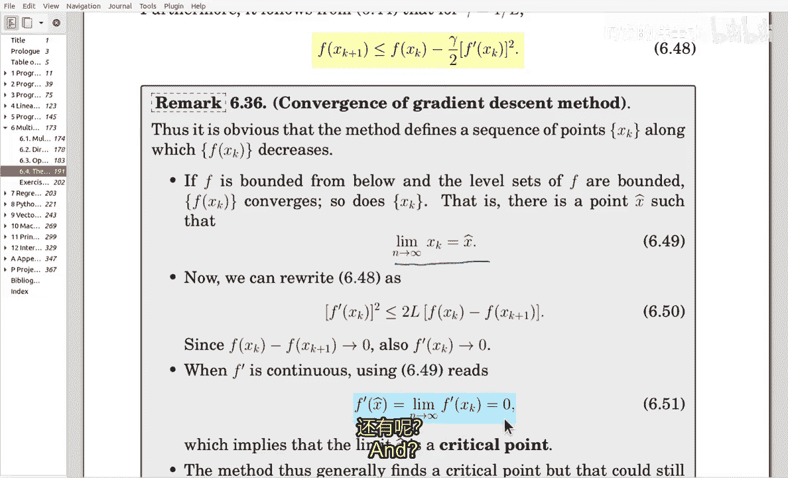

但在一般情况下，虽然理论上可以选择这个值，但实际上不容易设置。当我们尝试找到一个好的、合理的步长参数时，必须找到满足这个不等式的值。这将在后面用到。

这里有一个重要的结论：一旦序列 **{xₖ}** 收敛到 **x̂**，那么在 **x̂** 处，极限 **f'(x̂) = 0**。这意味着 **x̂** 是一个临界点。

这表示梯度下降法试图找到一个临界点，可能是局部极小值或鞍点。找到全局最小值在这里并不保证。无论如何，该算法试图找到局部最小值。它可能是全局最小值，但主要是在初始值附近寻找局部最小值。

例如，目标函数的图像可能如图所示。如果你从这里开始，它会下降并停在那里。如果你从那里开始，它会下降并停在那里。无论如何，该算法都试图降低函数值并达到一个局部最小值。

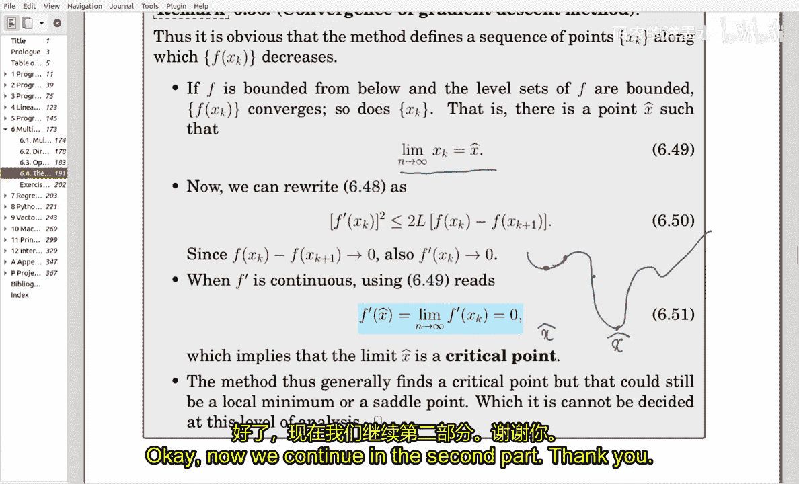

本节课中我们一起学习了梯度下降法的基本形式、在一维情况下的推导，以及其收敛到临界点的性质。理解这些原理是应用该算法解决实际优化问题的基础。