# 044：梯度下降法回溯线搜索

在本节课中，我们将学习梯度下降法在多维空间中的实际应用，并重点介绍一种改进步长选择的技术——回溯线搜索。我们将从一个经典优化函数开始，探讨固定步长带来的问题，然后学习如何通过回溯线搜索自适应地选择步长，以加速收敛。

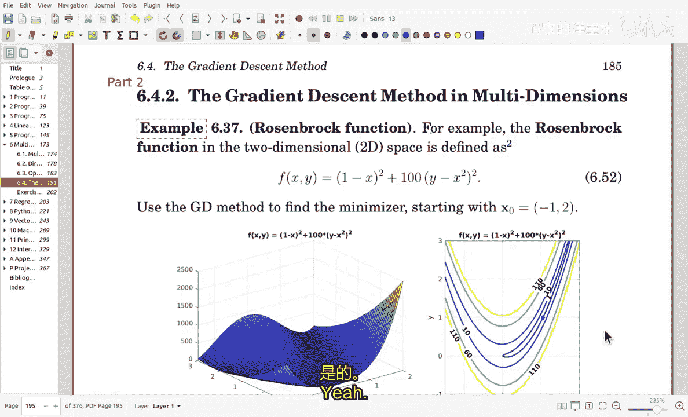

## 多维空间中的梯度下降法

上一节我们推导了一维空间中的梯度下降法。本节中，我们来看看该方法在多维空间中的一些实际问题。

我们将从一个例子开始。例如，二维空间中的罗森布罗克函数定义如下：

`f(x, y) = (1 - x)^2 + 100 * (y - x^2)^2`

这是该函数的图像。其最小值点在 (1, 1)。当 x=1 且 y=1 时，函数值为 0，因此最小值为 0。

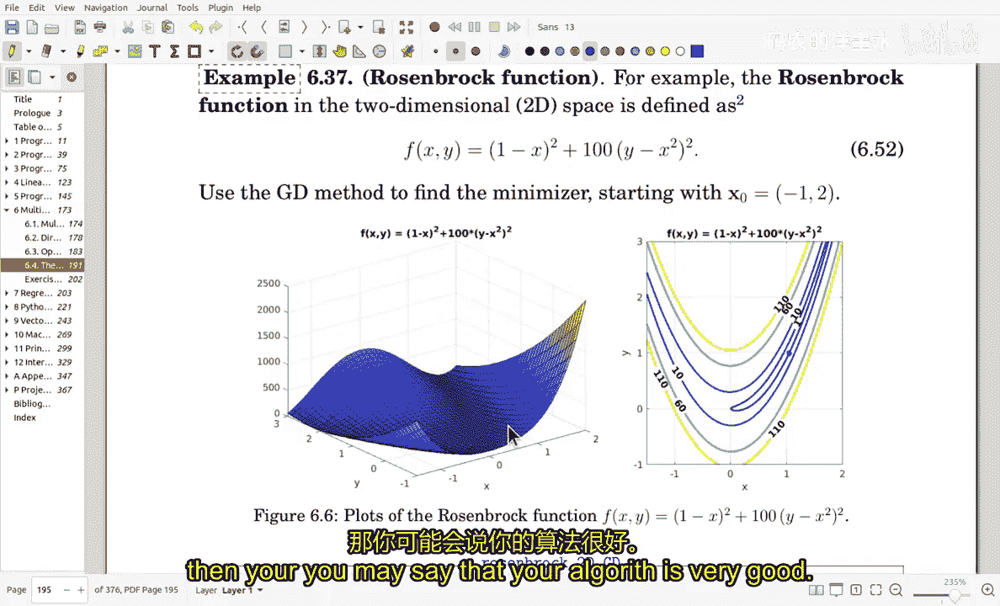

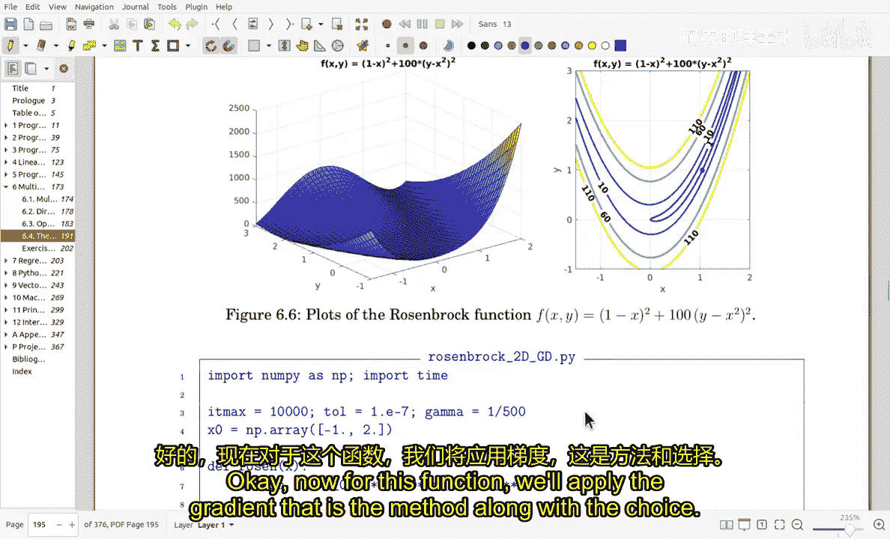

这个函数在优化领域被广泛使用。主要原因是，它的函数值变化非常平滑，但迭代过程中，一旦迭代点位于这个“山谷”区域附近，移动速度会变得非常缓慢。因此，你需要一些特殊的方案来加速收敛。但如果你尝试选择较大的参数，又可能导致算法发散，所以必须非常小心。总之，这个函数在优化中常用于检验算法的收敛性。如果你的算法运行良好且优于其他算法，那么可以说你的算法非常好。

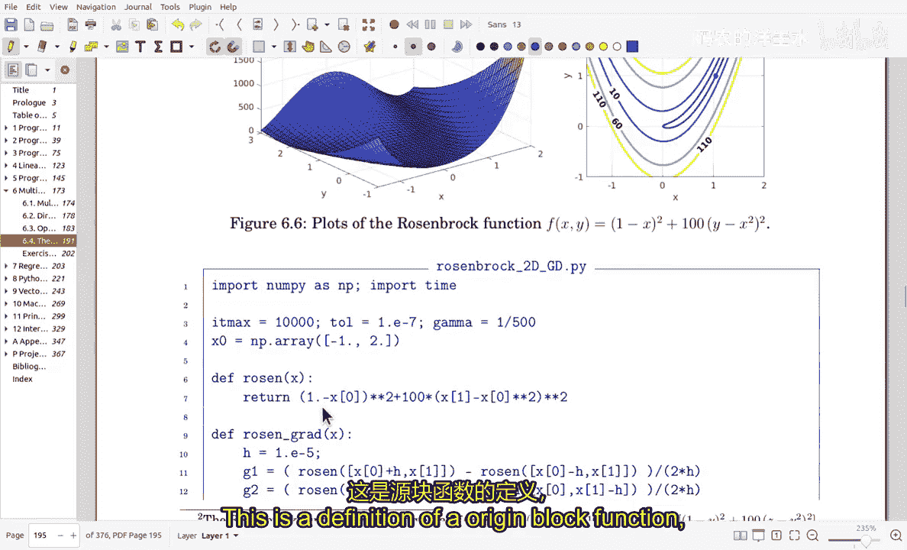

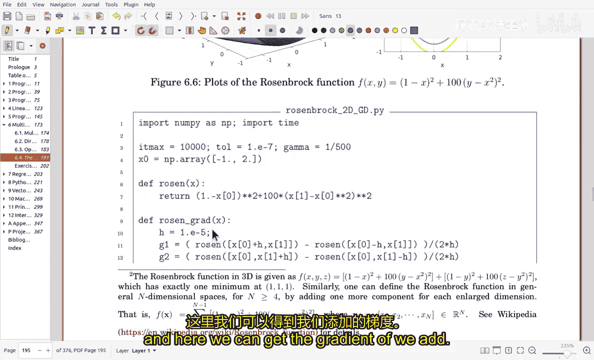

现在，我们将对这个函数应用梯度下降法，并选择一个步长参数 `gamma = 1/500`，起始点为 (-1, 2)。罗森布罗克函数的定义和梯度计算如下：

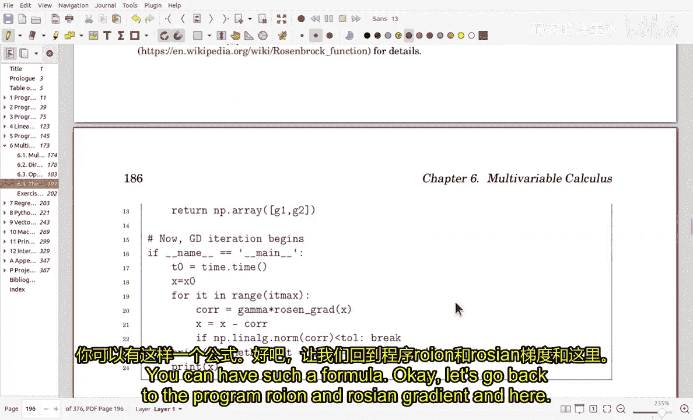

梯度计算公式为：
`grad_f = [ -2*(1-x) - 400*x*(y - x^2), 200*(y - x^2) ]`

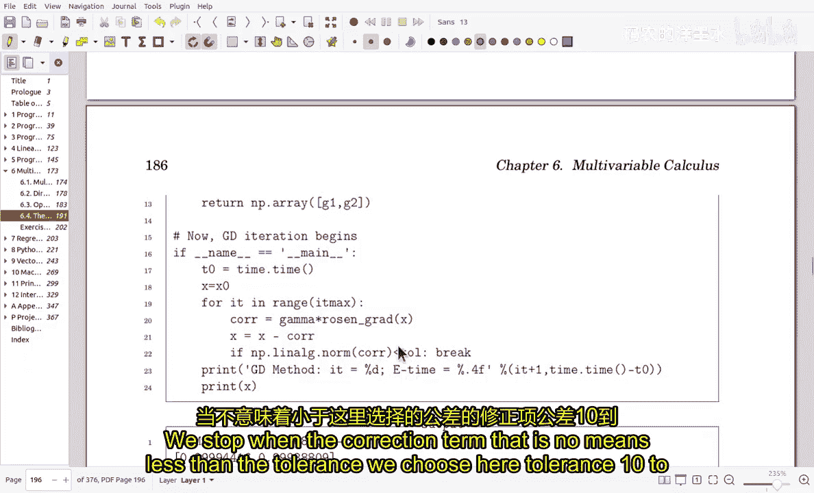

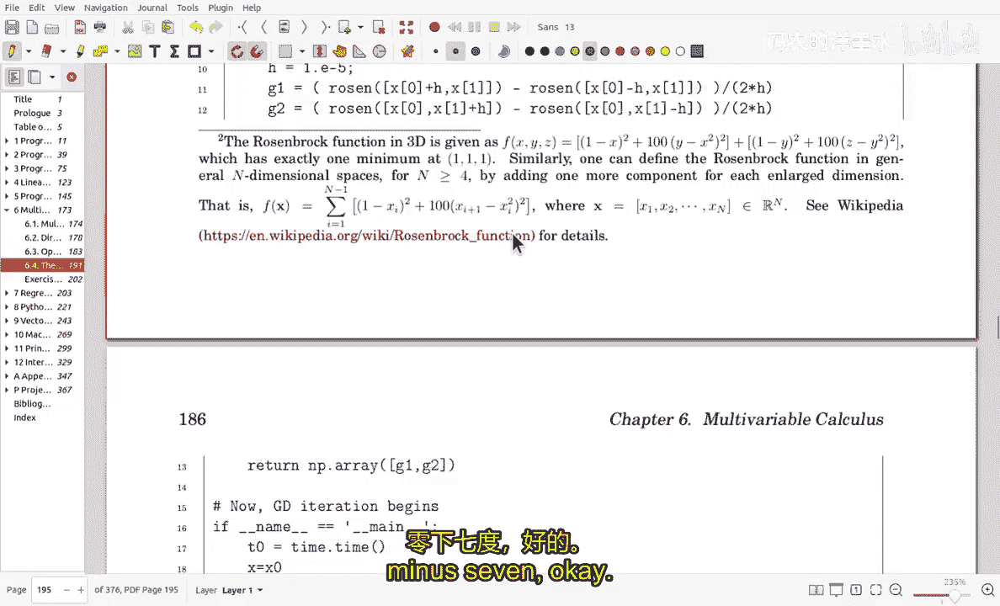

需要注意的是，罗森布罗克函数可以定义在任意维度。例如，在三维或n维空间中，有相应的公式。让我们回到程序。

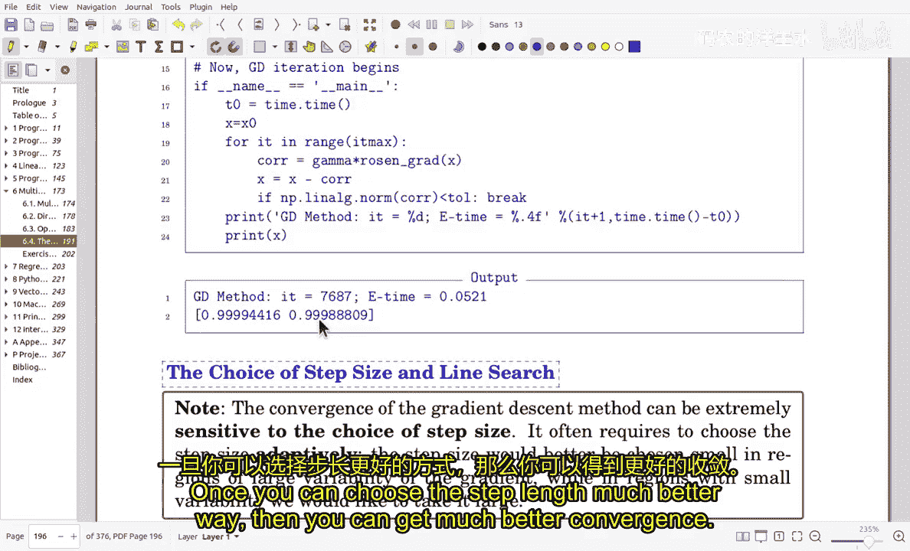

当我们运行程序时，会进行迭代，同时计算修正项并更新位置。当修正项的范数小于我们设定的容差 `10^-7` 时，迭代停止。

结果显示，使用固定步长的方法需要超过7000次迭代才能收敛。虽然时间不长，但速度较慢。如果你能选择更好的步长，就可以获得更好的收敛效果。

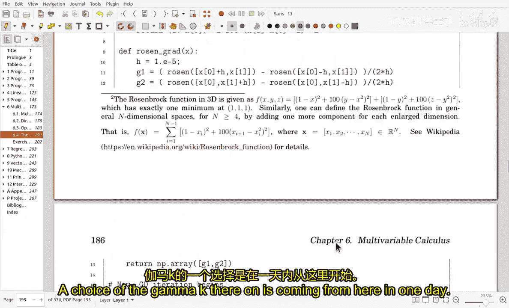

## 回溯线搜索

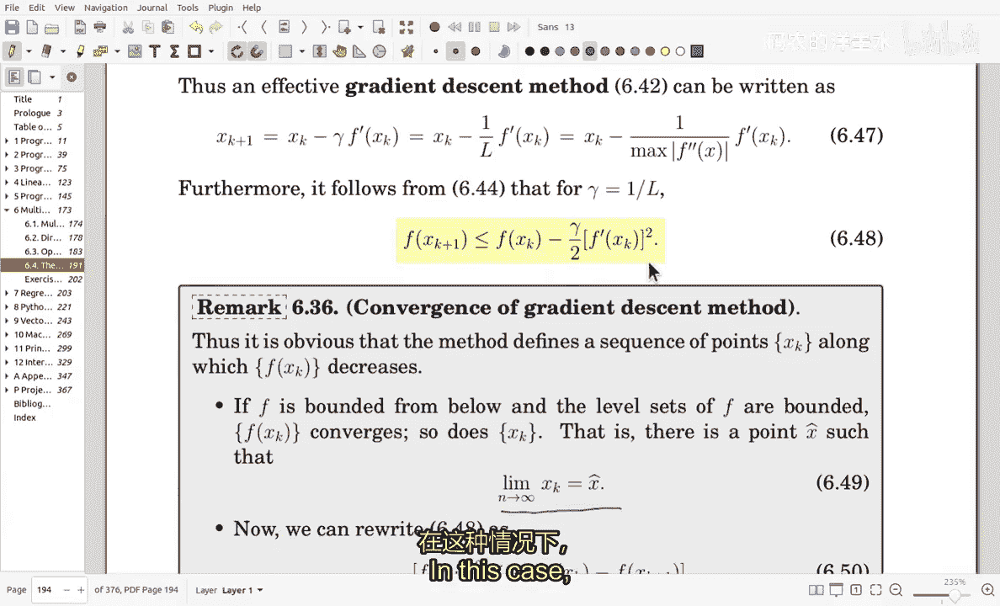

这里的主要问题在于步长的选择。梯度下降法对步长的选择可能极其敏感。我们可以尝试自适应地选择步长，即在每次迭代中尝试选择不同的步长 `gamma_k`，并尽可能保证收敛性。

获得这种步长的一种方法称为回溯线搜索。在这种搜索中，我们将尝试找到一个满足“充分下降条件”的步长 `gamma_k`。

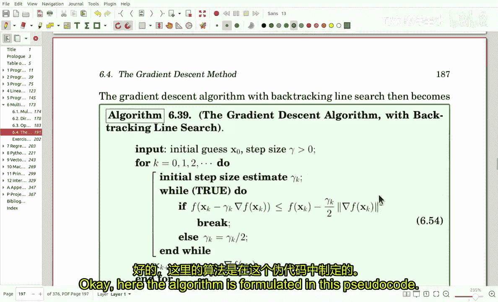

在新位置，函数值必须小于或等于这个不等式的右边。步长 `gamma_k` 的选择基于以下分析：在一维情况下，我们有 `f(x_{k+1}) <= f(x_k) - c * gamma_k * ||grad_f(x_k)||^2` 这样的分析。因此，我们需要选择满足这个不等式的参数。在这种情况下，它被称为充分下降。

这被称为充分下降条件，我们将尝试找到满足这个不等式的步长。这是合理的，我们在一维中分析过它，但在多维中也应满足。

以下是该算法的伪代码描述：

我们从初始猜测 `x_0` 和初始步长 `gamma` 开始。回溯线搜索部分是额外的。在每次迭代 `k` 中，我们从某个较大的初始步长 `gamma_k` 开始。然后检查不等式是否满足。我们可以计算 `f(x_k - gamma_k * grad_f(x_k))`，因为 `x_k` 点的梯度已知。每次我们计算这个向量并评估函数值。如果满足不等式右边，我们就停止这次线搜索迭代。如果不满足，我们就尝试缩减参数，例如使用 `gamma_k = beta * gamma_k`（`0 < beta < 1`）这个方程，使得在每次搜索参数时步长减小。我们重复这个过程，直到决定步长，然后进行更新。

当我们评估这个值时，我们已经有了 `x_{k+1}`。一旦线搜索迭代结束，`x_{k+1}` 就确定了。通过这种方式，我们可以使用线搜索技术。对于每次迭代 `k`，我们尝试从一个较大的值开始迭代地决定步长，每次缩减一半，直到决定。因此它被称为回溯线搜索。

决定步长后，我们可以更新并进入下一次迭代。

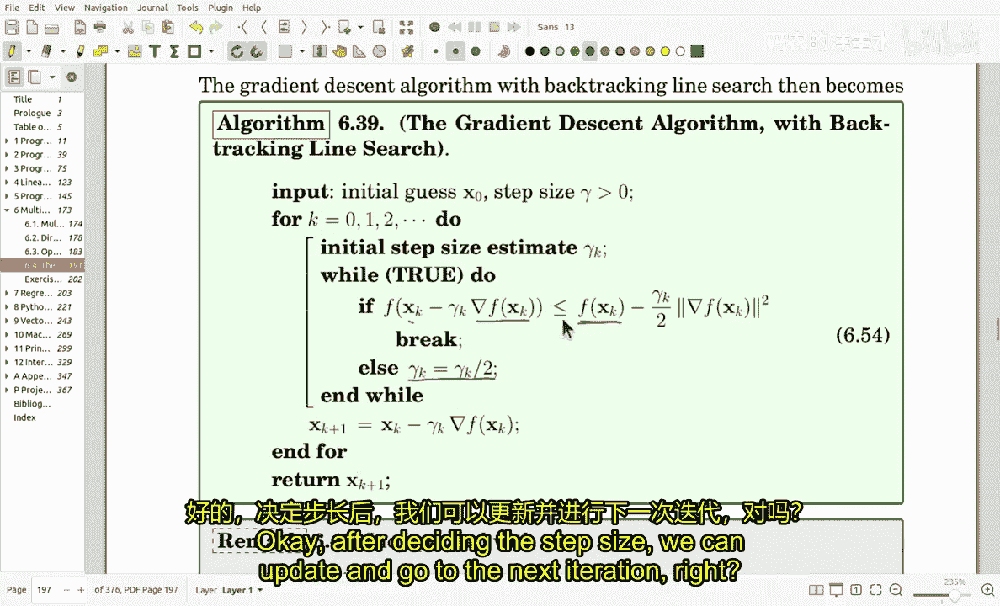

## 部分更新与随机梯度下降

结合线搜索或部分更新，梯度下降法是各种机器学习的主要计算算法。

部分更新的思路是：与其使用完整的梯度更新，我们可能选择梯度的一部分。在多维情况下，你可以尝试选择一个方向导数。例如，梯度向量的第一个分量可以在那里使用，或者其中几个分量可以使用。或者，如果目标函数是一个求和形式，例如目标函数 `F` 是根据数据点 `theta_i` 制定的，那么你可以尝试只使用部分数据点的梯度，而不是整个梯度。无论哪种方式，你都可以得到部分更新。

结合这种线搜索和部分更新，梯度下降法是机器学习优化中的主要工具。带有部分更新的梯度下降法被称为随机梯度下降法。

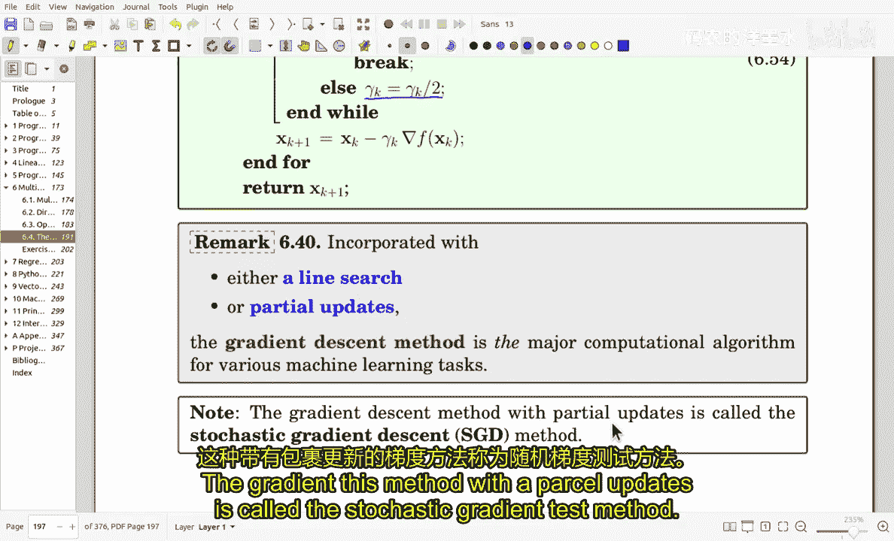

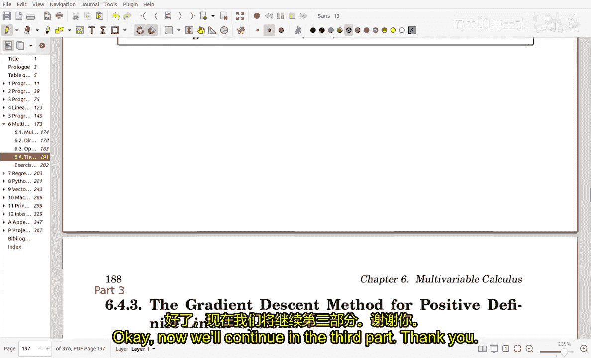

本节课中，我们一起学习了梯度下降法在多维空间的应用，重点探讨了固定步长收敛慢的问题及其解决方案——回溯线搜索。回溯线搜索通过自适应地选择满足充分下降条件的步长，有效加速了收敛。此外，我们还简要了解了部分更新和随机梯度下降的概念，它们是机器学习优化中的核心工具。在第三部分我们将继续深入。