# 046：最小二乘问题与正规方程方法 🧮

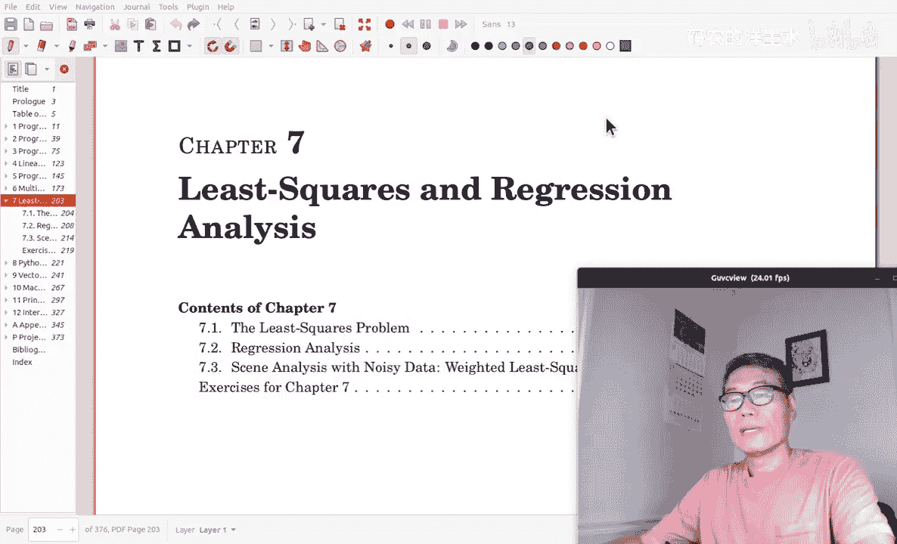

在本节课中，我们将学习最小二乘问题及其在回归分析中的应用。我们将重点介绍一种处理含噪声数据的著名算法，并详细讲解如何使用正规方程方法来求解最小二乘问题。

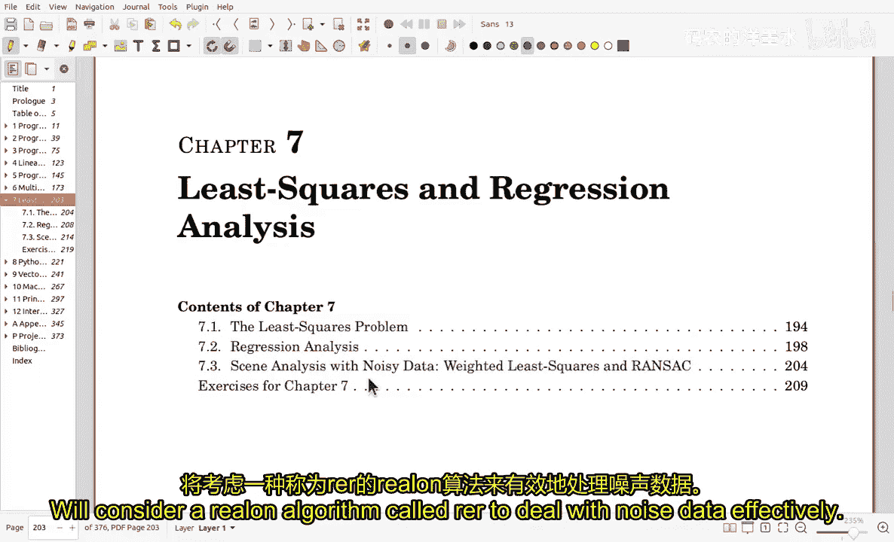

---

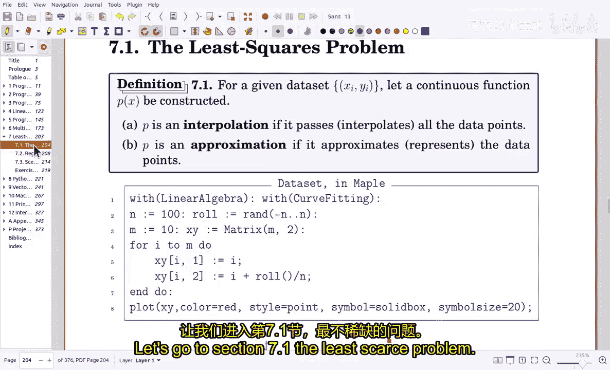

## 最小二乘问题 📈

对于给定的数据集 `(x_i, y_i)`，我们构造一个连续函数 `P(x)`。根据定义，如果 `P(x)` 经过所有数据点，则它是一个插值函数；否则，它是一个近似函数。

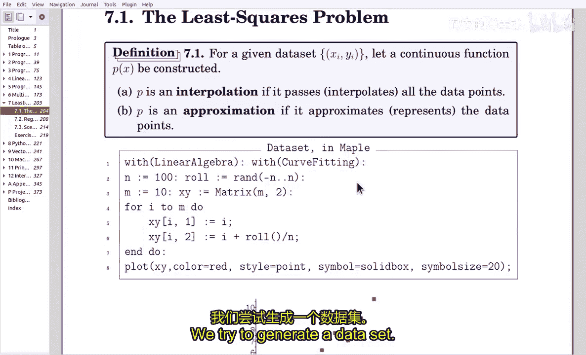

让我们看一个小程序。使用 Maple，我们尝试生成一个数据集。

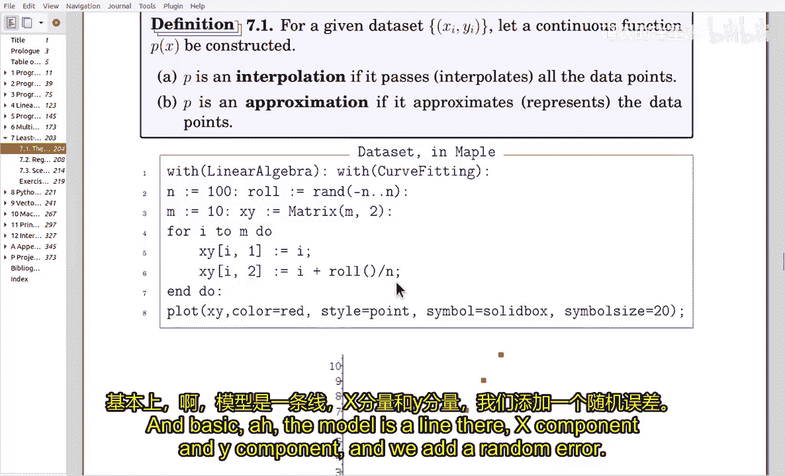


基础模型是一条直线。它有 x 分量和 y 分量，并且我们添加了一个随机误差。


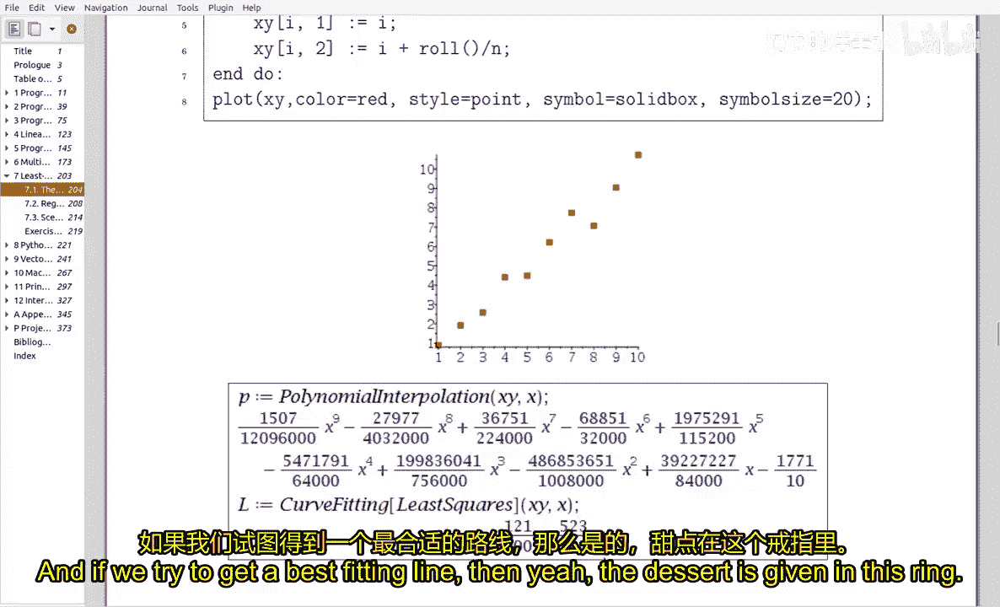

生成的数据是一个散点图。如果我们尝试构造一个插值多项式，由于有10个点，我们可以得到一个9次多项式。如果我们尝试得到一条最佳拟合线，那么结果由这条直线给出。

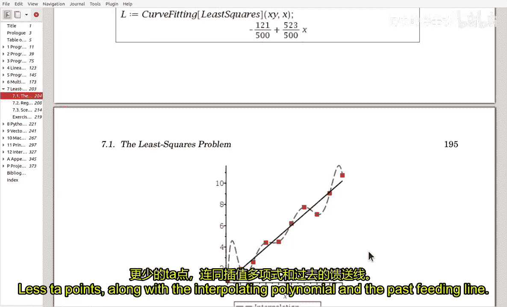


让我们看看数据点，以及插值多项式和最佳拟合线。


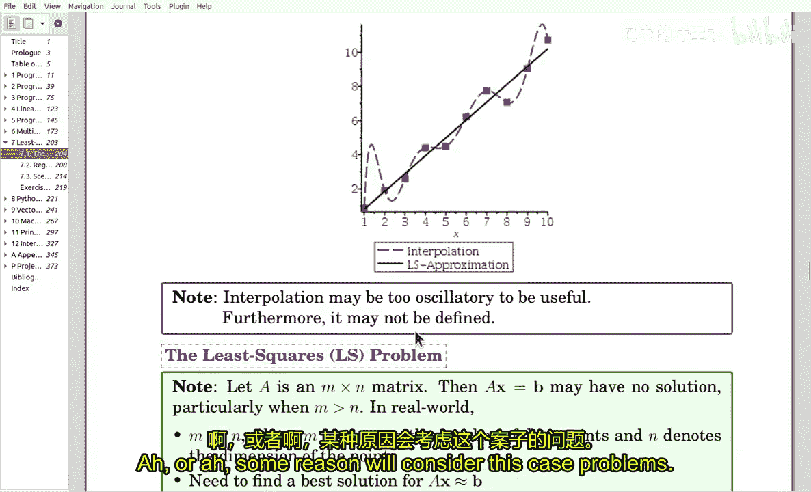

这里的插值多项式振荡很大，因此在现实中可能并不实用。此外，一旦数据点在一个点上有多个值，我们就无法得到这样的插值。而直线是代表数据集的最佳拟合线。在许多情况下，这条最佳拟合线更有用。这就是背景。出于某些原因，我们将考虑最小二乘问题。


---

## 定义最小二乘问题 🎯

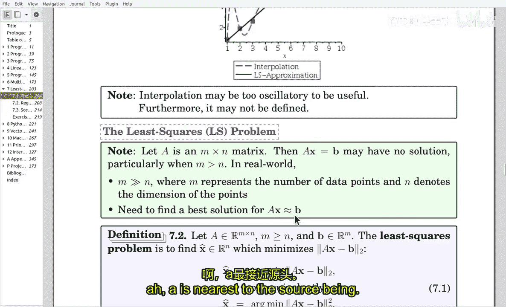

设 `A` 是一个 `m × n` 矩阵，那么方程 `Ax = b` 可能无解，特别是当 `m > n` 时。在现实世界中，`m` 通常远大于 `n`。这里，`m` 通常代表数据点的数量，`n` 代表点的维度，通常是特征分量的维度。因此，数据点的数量远大于维度。

为了解决这个问题，我们需要找到最佳近似解。寻找最佳解的目标是使 `Ax` 最接近向量 `b`。


现在，我们定义最小二乘问题如下：设 `A` 是一个 `m × n` 矩阵，且 `m ≥ n`，`b` 属于 `R^m`。那么最小二乘问题就是寻找 `x_hat` 属于 `R^n`，使得以下差值（用范数衡量）最小化：

**目标函数：** `min ||Ax - b||^2`

`x_hat` 是这个最小化问题的解。最小化这个范数平方等价于最小化其平方根，因此这两个问题是相同的。`x` 被称为 `Ax = b` 的最小二乘解。

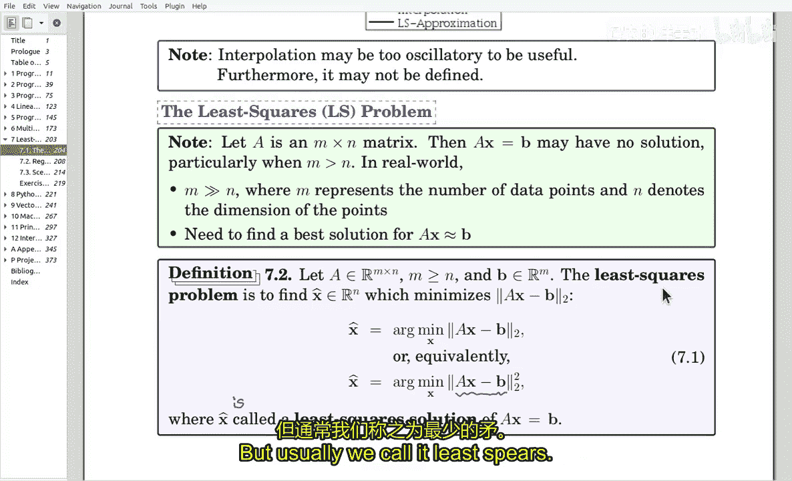

我们称之为“最小二乘”的原因是：对于误差向量 `Ax - b`，当我们衡量其范数时，每个分量被平方后求和。因此，这是误差平方和最小化的缩写，但通常我们称之为最小二乘。


---

## 正规方程方法 ⚙️

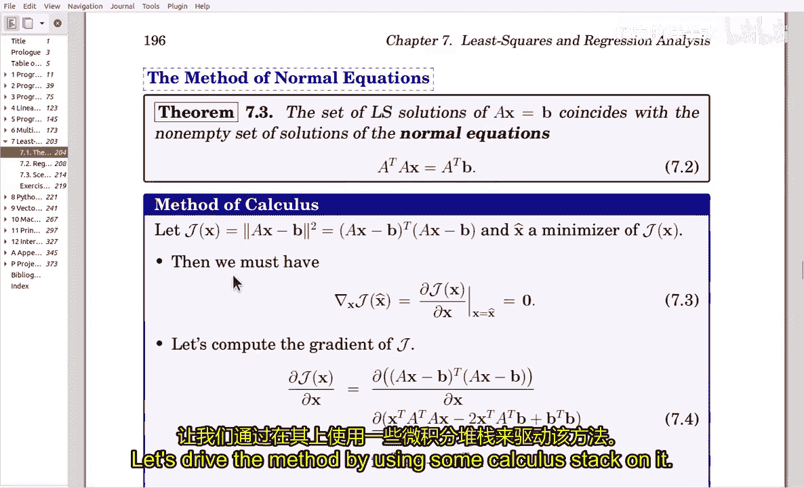

最小二乘问题可以通过使用正规方程的方法来解决。

`Ax = b` 的最小二乘解集与以下正规方程的解集完全一致：

**正规方程：** `A^T A x_hat = A^T b`

这个正规方程是通过将 `A^T` 从左乘到 `Ax = b` 两边得到的。让我们通过一些微积分技巧来推导这个方法。


定义目标函数 `f(x)` 为：

**`f(x) = ||Ax - b||^2 = (Ax - b)^T (Ax - b)`**

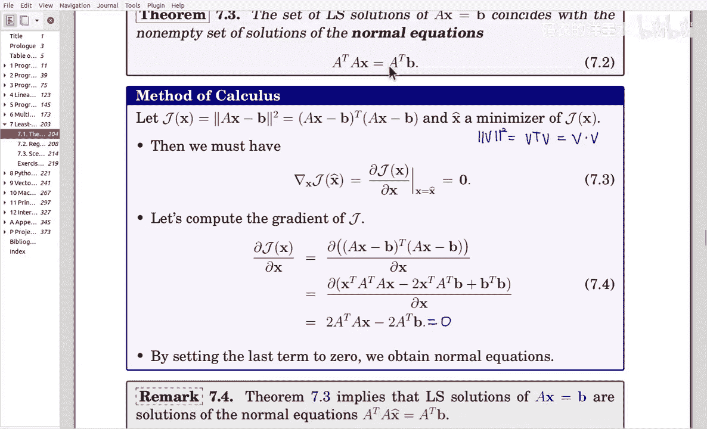

在向量范数中，向量 `v` 的范数平方等于 `v^T v`（即点积 `v·v`）。`x_hat` 是 `f(x)` 的最小值点。如果我们对其应用导数（即梯度），并在 `x = x_hat` 处设为零，则可以得到解。

梯度可以如下求得：将 `f(x)` 展开后对 `x` 求导。从第一项我们得到 `2 A^T A x`，从第二项得到 `-2 A^T b`，常数项消失。因此，我们得到：

**梯度：** `∇f(x) = 2 A^T A x - 2 A^T b`

令梯度为零：

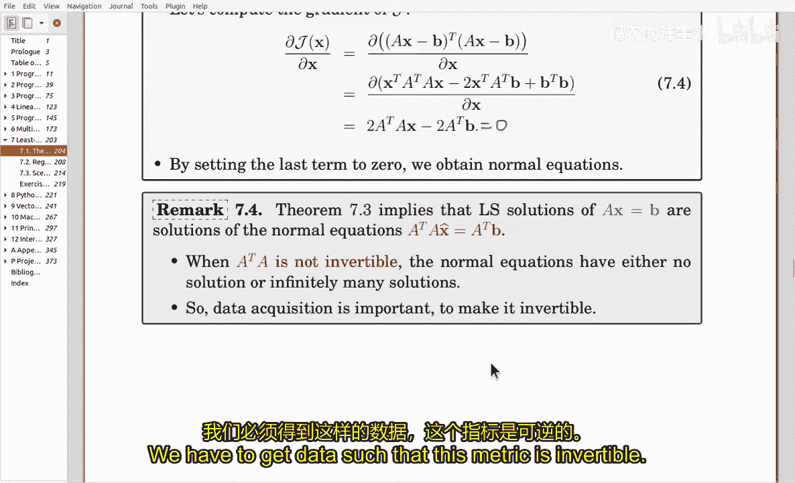

**`2 A^T A x - 2 A^T b = 0`**

简化后得到正规方程：

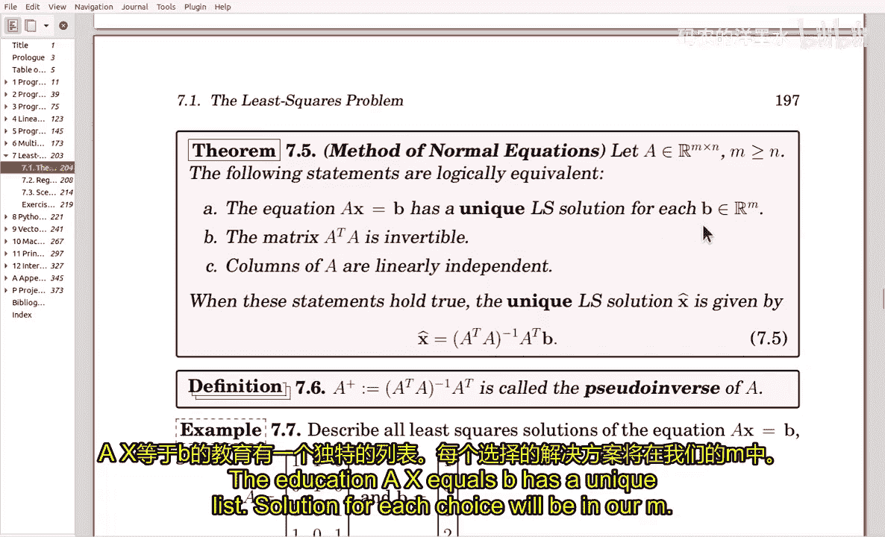

**`A^T A x_hat = A^T b`**

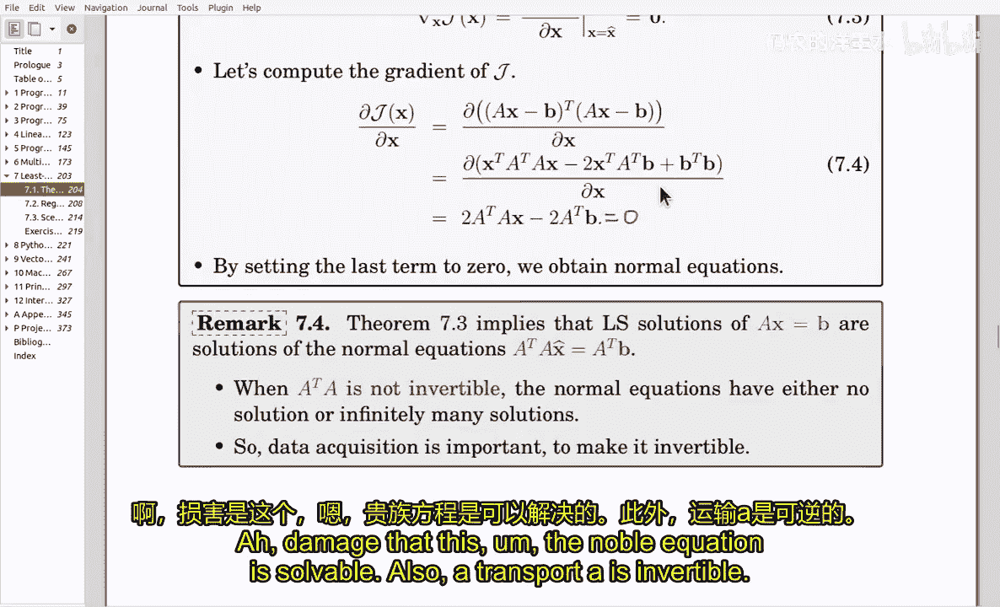


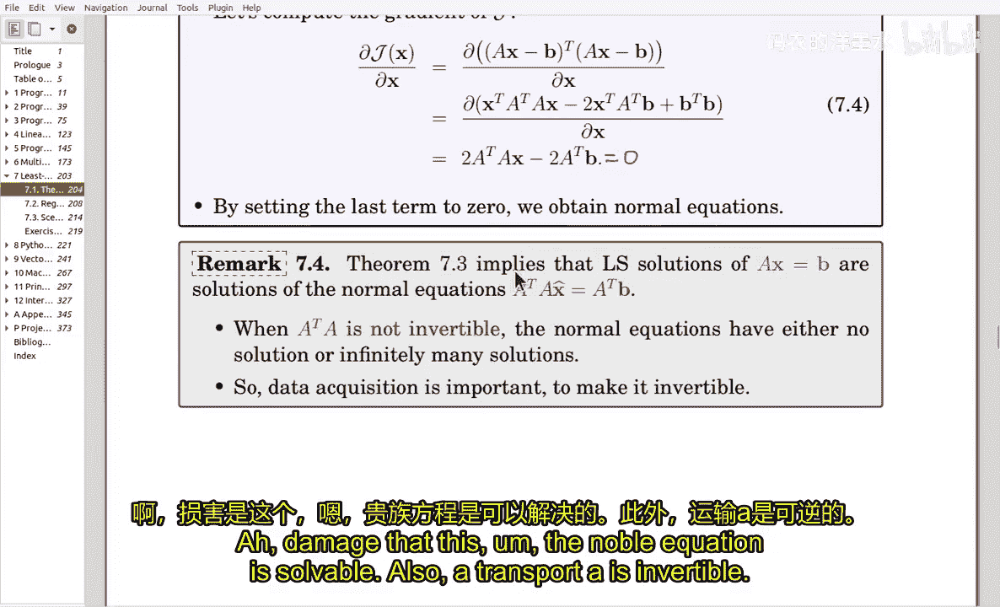

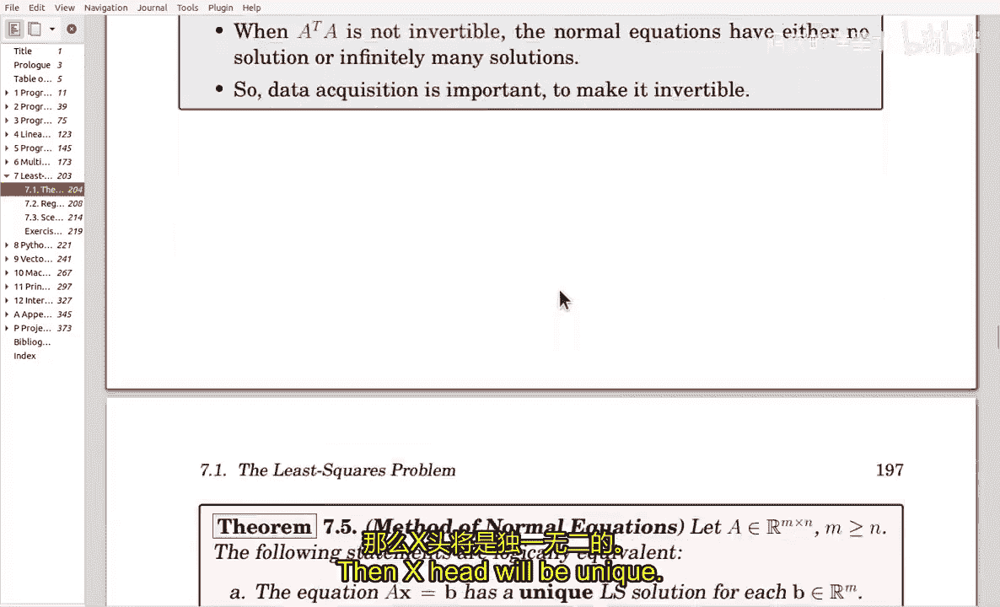

---

## 解的存在性与唯一性 🔍

上述定理意味着 `Ax = b` 的最小二乘解是正规方程的解。当 `A^T A` 不可逆时，正规方程可能无解或有无穷多解。

为了得到合理的唯一解，数据非常重要，必须确保矩阵 `A^T A` 是可逆的。我们需要获取数据使得这个矩阵可逆。


以下是关于正规方程方法的逻辑等价陈述：
1.  对于 `R^m` 中的每个 `b`，方程 `Ax = b` 有唯一的最小二乘解。
2.  正规方程 `A^T A x_hat = A^T b` 是可解的。
3.  矩阵 `A^T A` 是可逆的。
4.  `A` 的列是线性独立的（即 `A` 是列满秩的）。

当这些陈述成立时，我们说 `A` 具有满秩。实际上，一旦 `A` 的列线性独立，`A^T A` 就是可逆的，因为它是对称的，并且其特征值均为正。

在这些条件成立的情况下，唯一的最小二乘解 `x_hat` 由下式给出：

**唯一解公式：** `x_hat = (A^T A)^{-1} A^T b`


---

## 伪逆矩阵 🧩

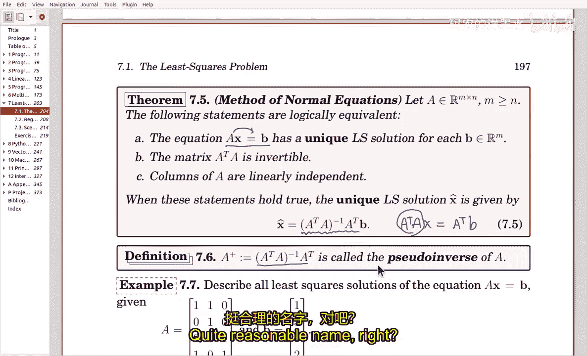

为了方便使用，我们引入一个记号。使用 `A⁺` 符号，我们定义伪逆矩阵：

**伪逆定义：** `A⁺ = (A^T A)^{-1} A^T`

这看起来像是从正规方程中推导出来的。如果 `A` 是方阵且可逆，我们可以直接应用逆矩阵来求解。但在这里，我们使用这样的矩阵。它扮演着逆矩阵的角色，但并非真正的逆矩阵，因此我们称之为 `A` 的伪逆。这是一个相当合理的名称。


---

## 实例演算 📝

让我们用纸笔来求解一个具体的最小二乘问题。给定 `A` 和 `b`：

```
A = [1 1 0]
    [0 0 1]
    [0 1 1]
    [1 0 1]

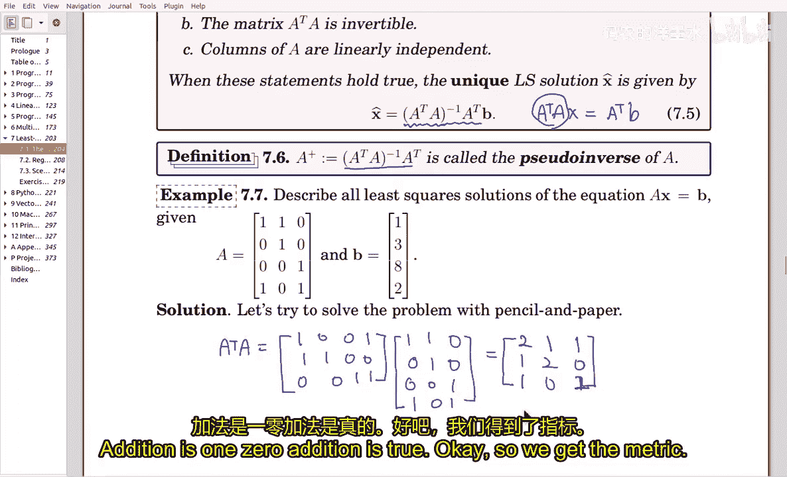

b = [1]
    [3]
    [8]
    [2]
```

首先，我们需要计算 `A^T A` 和 `A^T b`。

**计算 `A^T A`：**
根据矩阵乘法规则（行点乘列）：
- 第一行第一列：`(1,0,0,1)` 点乘 `(1,0,0,1)` = 1 + 0 + 0 + 1 = 2
- 第一行第二列：`(1,0,0,1)` 点乘 `(1,0,1,0)` = 1 + 0 + 0 + 0 = 1
- 第一行第三列：`(1,0,0,1)` 点乘 `(0,1,1,1)` = 0 + 0 + 0 + 1 = 1
- 第二行第一列：`(1,0,1,0)` 点乘 `(1,0,0,1)` = 1 + 0 + 0 + 0 = 1
- 第二行第二列：`(1,0,1,0)` 点乘 `(1,0,1,0)` = 1 + 0 + 1 + 0 = 2
- 第二行第三列：`(1,0,1,0)` 点乘 `(0,1,1,1)` = 0 + 0 + 1 + 0 = 1
- 第三行第一列：`(0,1,1,1)` 点乘 `(1,0,0,1)` = 0 + 0 + 0 + 1 = 1
- 第三行第二列：`(0,1,1,1)` 点乘 `(1,0,1,0)` = 0 + 0 + 1 + 0 = 1
- 第三行第三列：`(0,1,1,1)` 点乘 `(0,1,1,1)` = 0 + 1 + 1 + 1 = 3

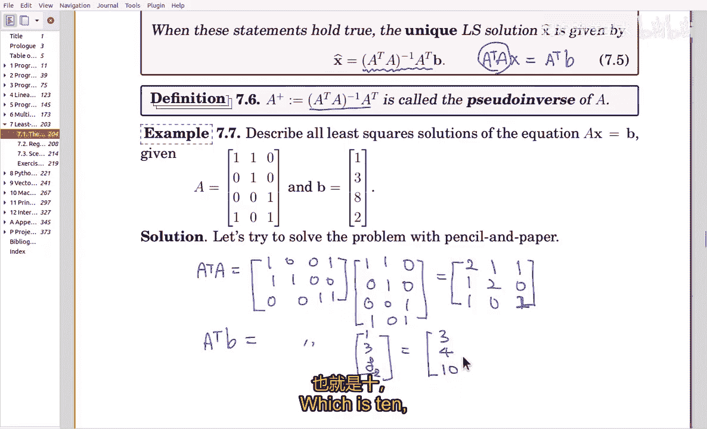

因此：
```
A^T A = [2 1 1]
        [1 2 1]
        [1 1 3]
```

**计算 `A^T b`：**
- 第一行：`(1,0,0,1)` 点乘 `(1,3,8,2)` = 1*1 + 0*3 + 0*8 + 1*2 = 3
- 第二行：`(1,0,1,0)` 点乘 `(1,3,8,2)` = 1*1 + 0*3 + 1*8 + 0*2 = 9
- 第三行：`(0,1,1,1)` 点乘 `(1,3,8,2)` = 0*1 + 1*3 + 1*8 + 1*2 = 13

因此：
```
A^T b = [3]
        [9]
        [13]
```

现在我们需要解正规方程：`[2 1 1; 1 2 1; 1 1 3] * x = [3; 9; 13]`。

我们可以使用初等行变换（高斯消元法）来求解。通过一系列行变换（交换、倍加、倍乘），最终将增广矩阵化为行最简形式，得到解：

```
x1 = -4
x2 =  4
x3 =  7
```

因此，最小二乘解为 `x_hat = [-4, 4, 7]^T`。使用矩阵程序计算 `(A^T A)^{-1} A^T b` 也会得到完全相同的结果。

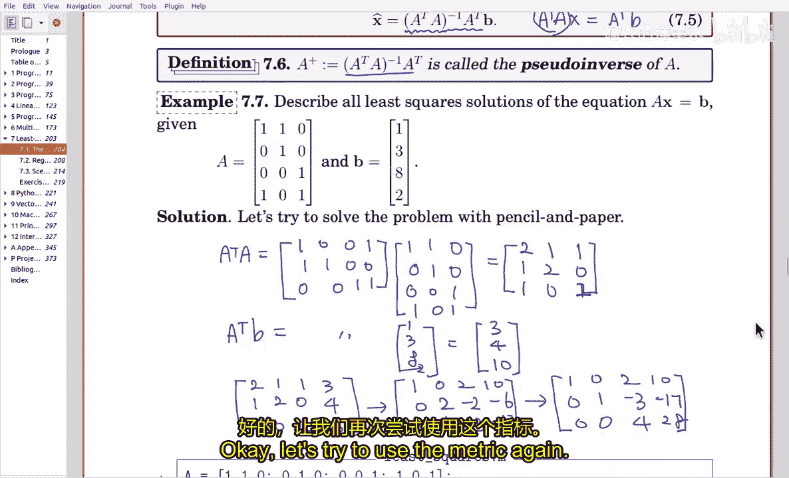


---

## 总结 📚

本节课中，我们一起学习了：
1.  **最小二乘问题的定义**：寻找使 `||Ax - b||^2` 最小的 `x`，用于处理无解或过定方程组。
2.  **正规方程方法**：通过求解 `A^T A x_hat = A^T b` 来得到最小二乘解。
3.  **解的唯一性条件**：当矩阵 `A` 的列线性独立（满秩）时，`A^T A` 可逆，存在唯一最小二乘解。
4.  **伪逆矩阵**：引入了 `A⁺ = (A^T A)^{-1} A^T` 作为计算工具。
5.  **实例计算**：通过一个具体例子，演示了如何从构建正规方程到求解出最小二乘解的全过程。

正规方程是解决线性回归和许多其他优化问题的基础工具。理解其原理和计算步骤对于深入学习机器学习至关重要。

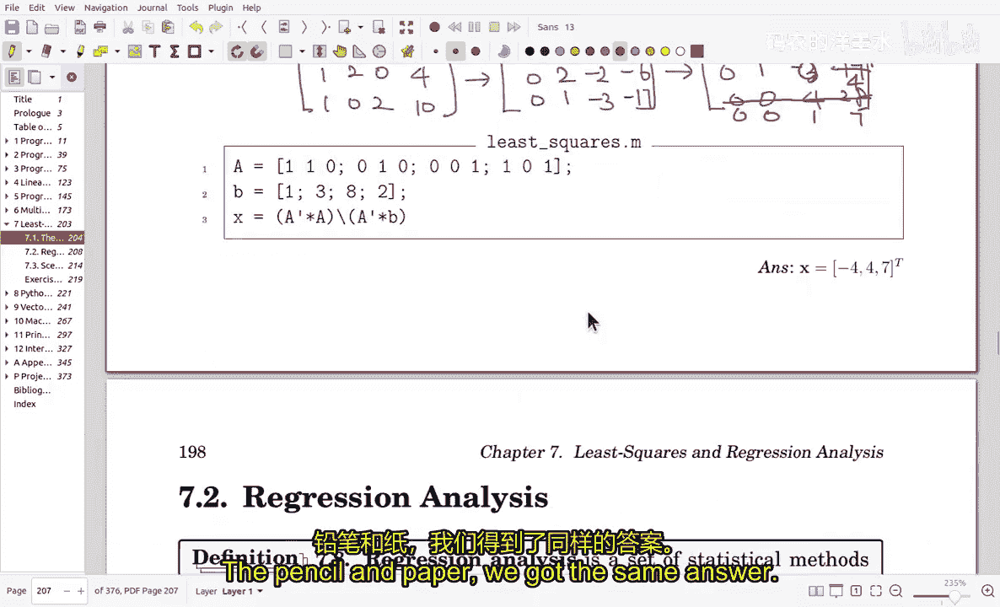

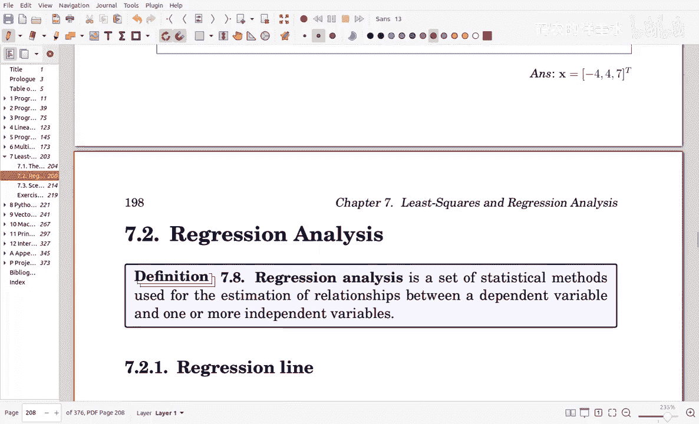

