# 047：线性与非线性回归

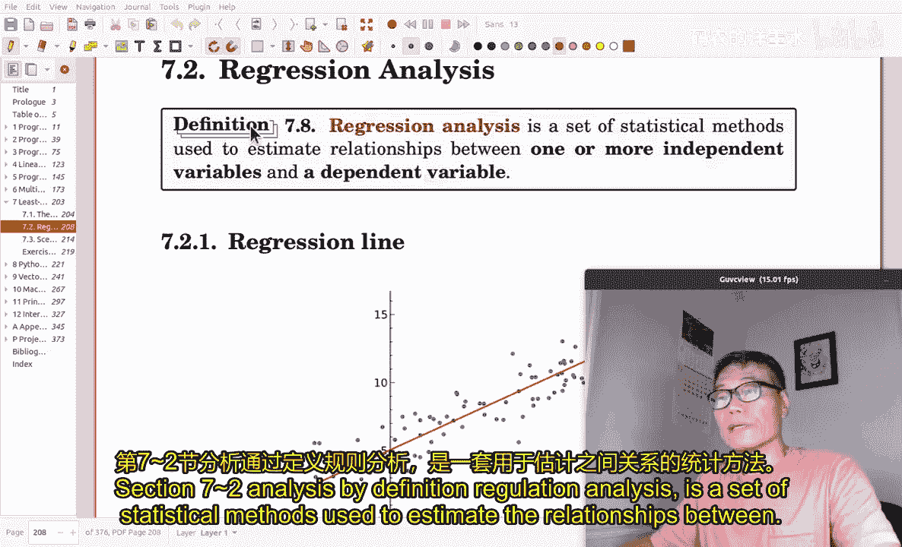

在本节课中，我们将要学习回归分析，这是一种用于估计自变量与因变量之间关系的统计方法。我们将从线性回归的基本概念开始，逐步深入到非线性模型的线性化处理技巧。

## 7.2：回归分析

根据定义，回归分析是一组用于估计自变量与因变量之间关系的统计方法。


观察上图，蓝色点代表数据点。通过最小二乘法技术，我们找到一条最能代表这些数据点的线，这条线被称为回归线。

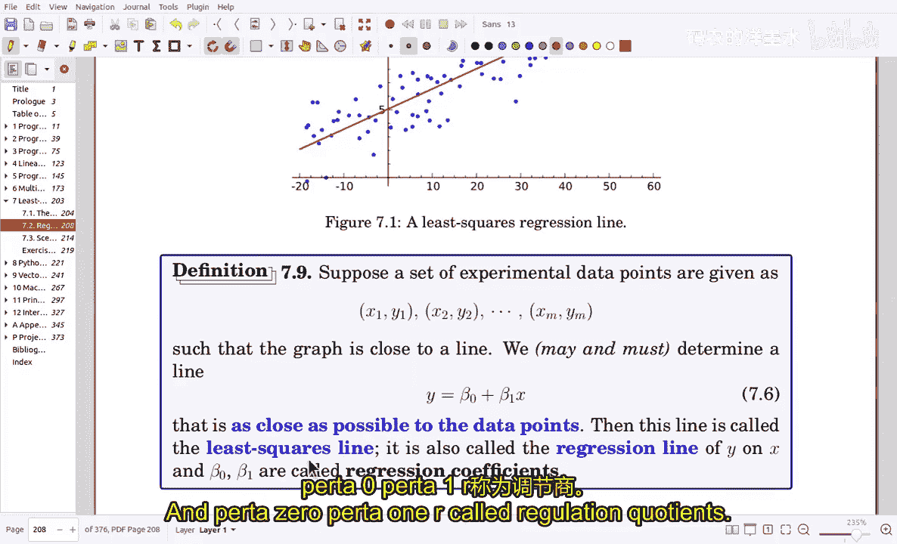

以下是正式定义。假设给出一组实验数据点，形式为 `(x1, y1), (x2, y2), ..., (xM, yM)`，共有 M 个点。例如，在 `x1` 处，观测到的 y 值是 `y1`。

如果将这些数据点绘制出来，并且图形接近一条直线，如上图所示，那么我们可以确定一条形式为 `y = β0 + β1x` 的直线，使得该直线在平均意义上或最小二乘误差的意义上尽可能接近所有数据点。

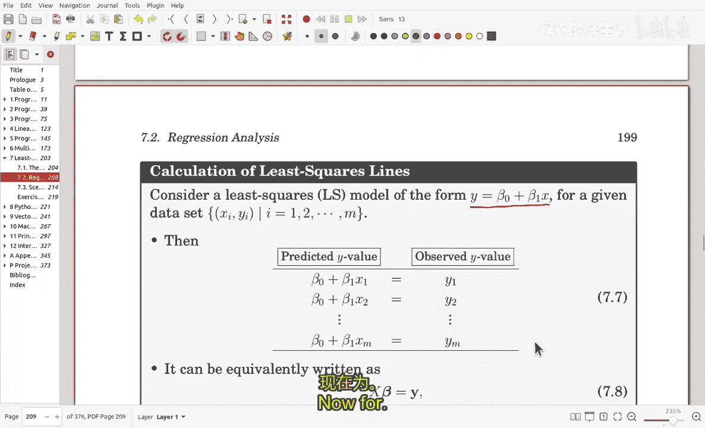

因为直线不可能穿过所有数据点，所以我们需要确定这种形式的直线。在这种情况下，这条线被称为最小二乘线或回归线。`β0` 和 `β1` 被称为回归系数。


### 如何计算最小二乘线

现在，我们考虑形式为 `y = β0 + β1x` 的最小二乘模型。对于给定的数据集，对于每个点 `xi`，我们观测到的 y 值是 `yi`。

因此，对于模型，我们有以下方程：对于点 `(x1, y1)`，有 `y1 = β0 + β1*x1`；对于点 `(x2, y2)`，有 `y2 = β0 + β1*x2`。依此类推，每个点对应一个方程。


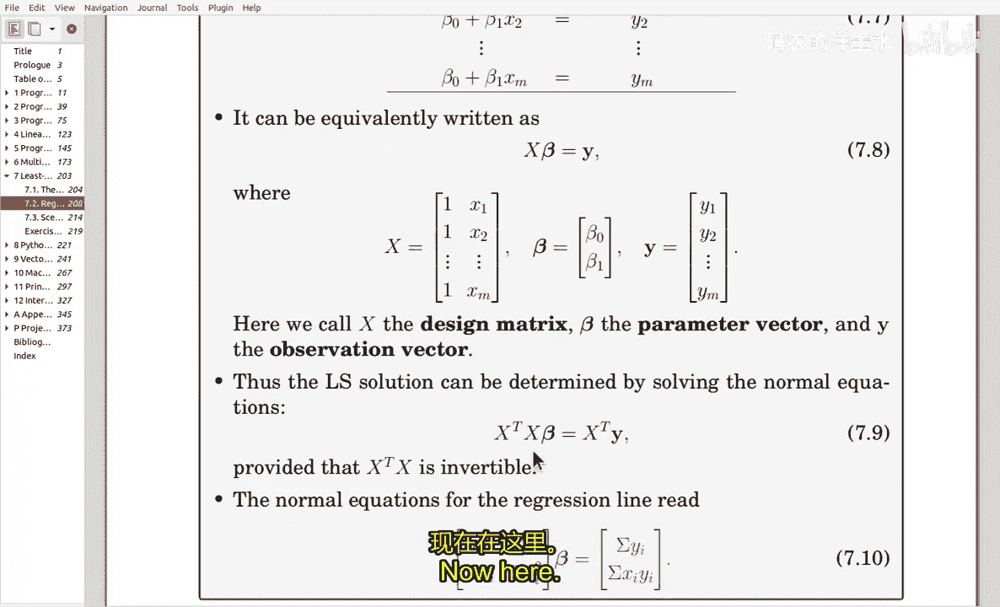

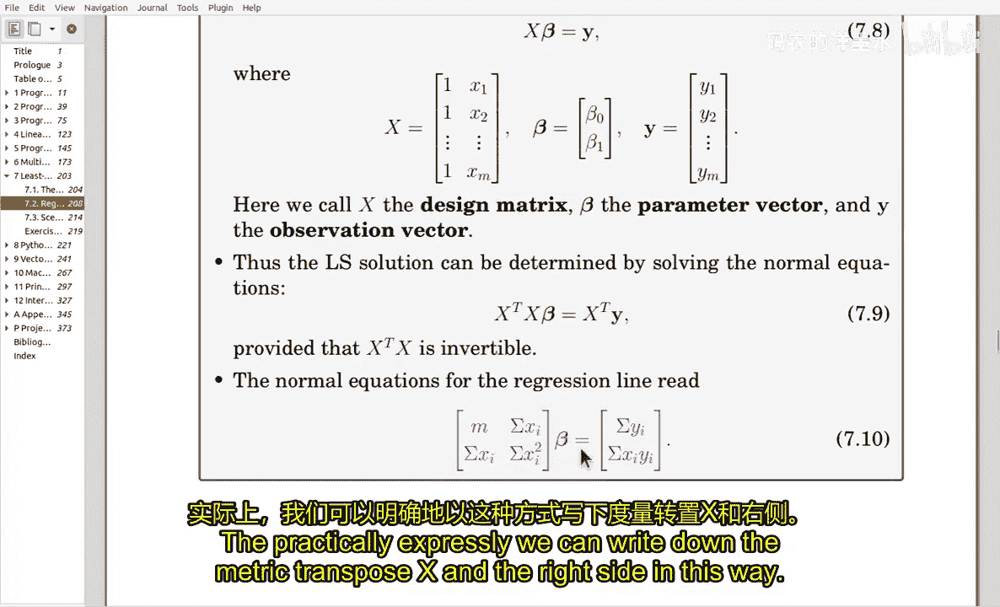

我们可以将这些方程写成矩阵形式 `Xβ = y`。其中，矩阵 `X` 是系数集合，第一列全为1（对应 `β0`），第二列为 `x` 值（对应 `β1`）。`β` 是未知向量 `[β0, β1]^T`，`y` 是观测值向量 `[y1, y2, ..., yM]^T`。

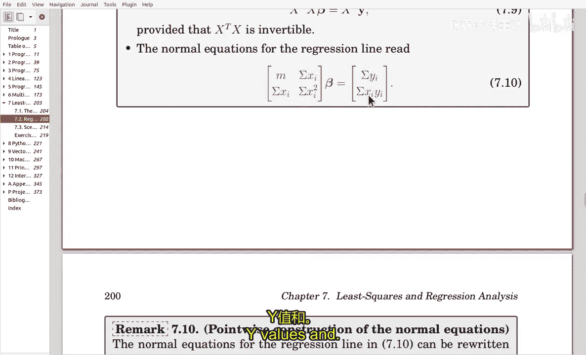

如果使用最小二乘法，我们可以采用正规方程法。我们计算 `X^T X`，如果它是可逆的，那么我们可以找到唯一解。实际上，只要数据点中至少有两个点的 `x` 值不同，矩阵 `X` 的列就是线性独立的，这意味着 `X^T X` 是可逆的。


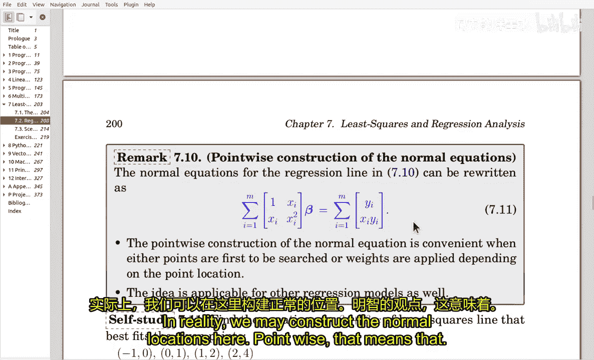


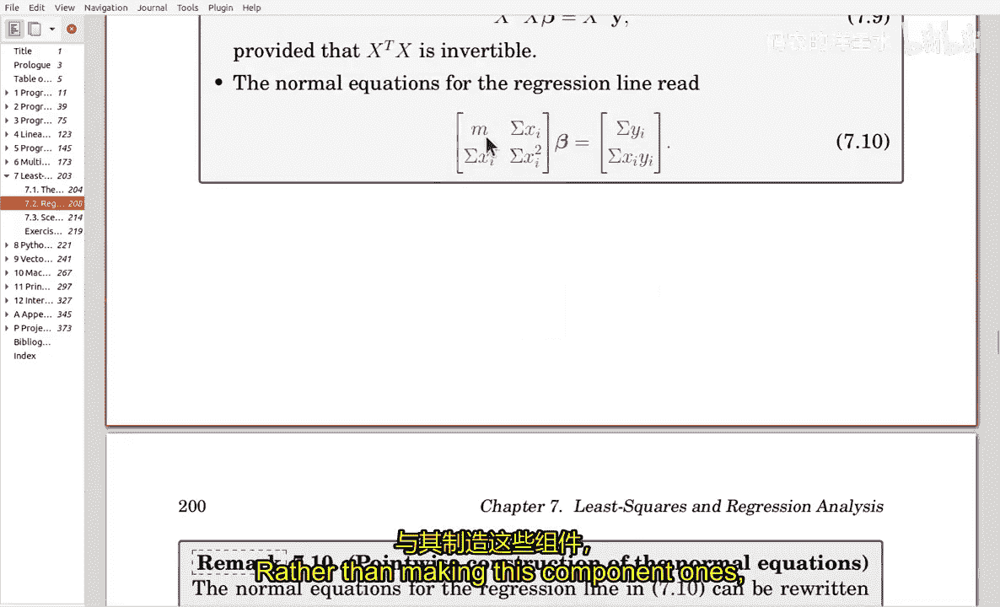

具体计算时，我们可以明确写出 `X^T X` 矩阵和右侧向量。


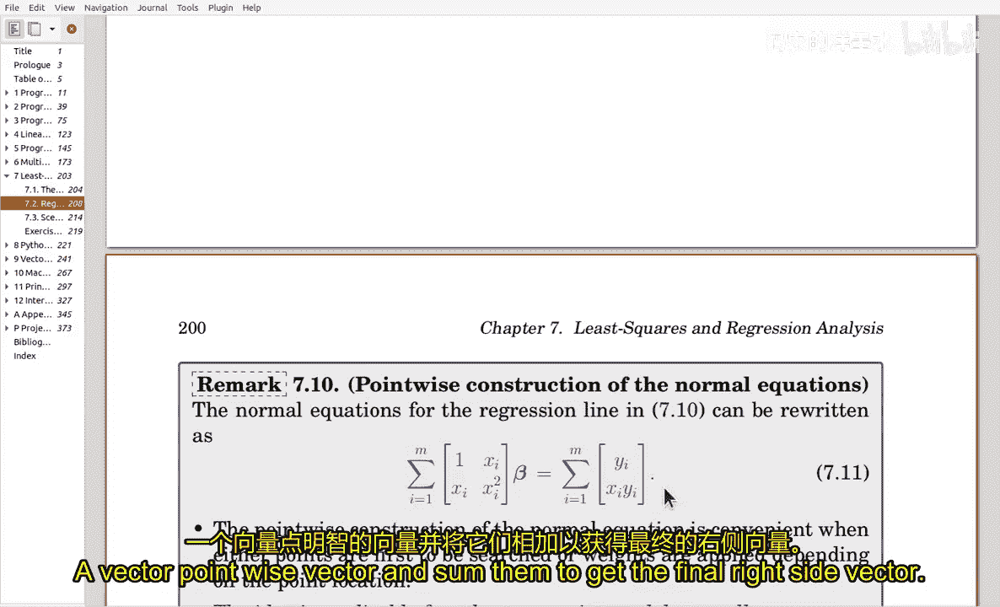


`X^T X` 是一个 2x2 矩阵：
- 左上角元素是数据点数量 `M`。
- 右上角和左下角元素是所有 `x` 值的和 `Σxi`。
- 右下角元素是所有 `x` 值平方的和 `Σxi^2`。

右侧向量 `X^T y` 为：
- 第一个元素是所有 `y` 值的和 `Σyi`。
- 第二个元素是所有 `xi*yi` 的和 `Σxi*yi`。

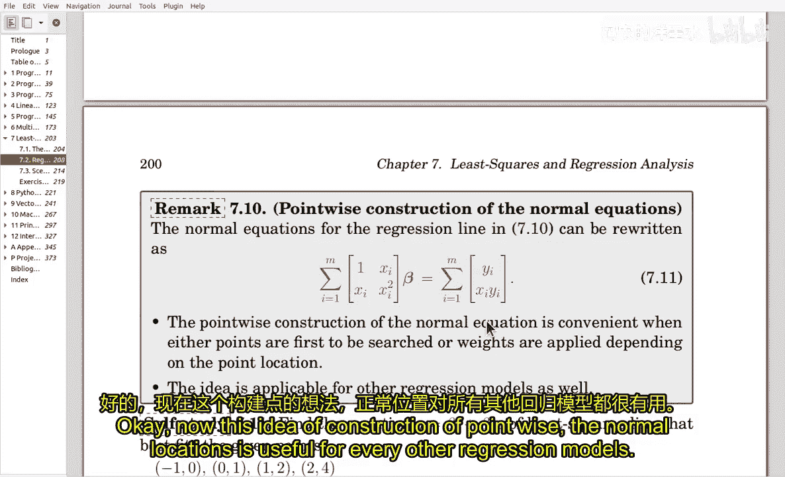

在实际操作中，我们可以采用逐点构建的方式。这意味着我们不是一次性构建整个矩阵，而是为每个数据点计算其贡献（一个小的矩阵和向量），然后将所有点的贡献相加，得到最终的 `X^T X` 矩阵和 `X^T y` 向量。


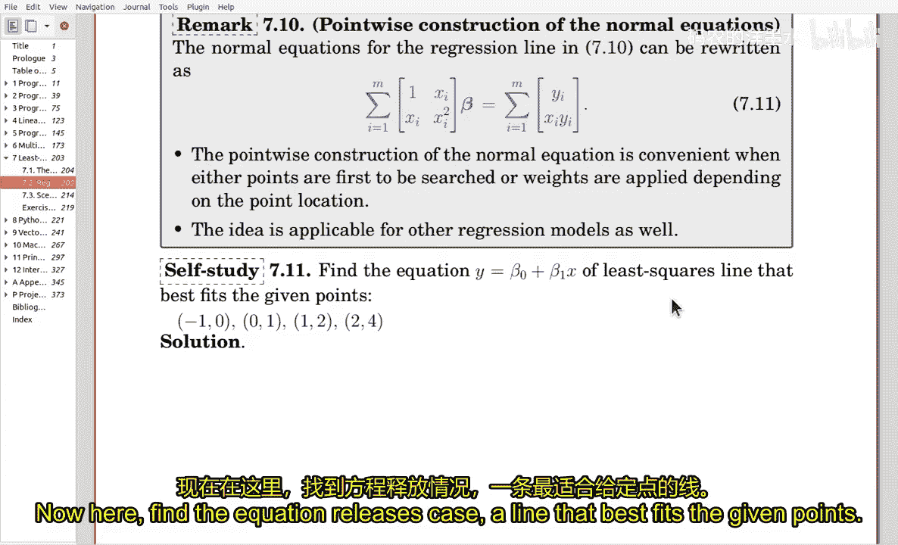


采用这种逐点构建方式的原因是，当我们已经有一条回归线，后来又增加了新的数据点时，我们可以轻松地添加新点的贡献。此外，如果我们想给某些点赋予更高的权重（例如，认为某些数据更可靠），我们可以在每个点的贡献中加入权重因子，从而得到更符合需求的回归线。

这种逐点构建正规方程的思想，对于其他回归模型也同样有用。


### 计算示例

现在，让我们尝试进行部分计算。假设我们有以下数据点：`(-1, 0), (0, 1), (1, 2), (2, 4)`。

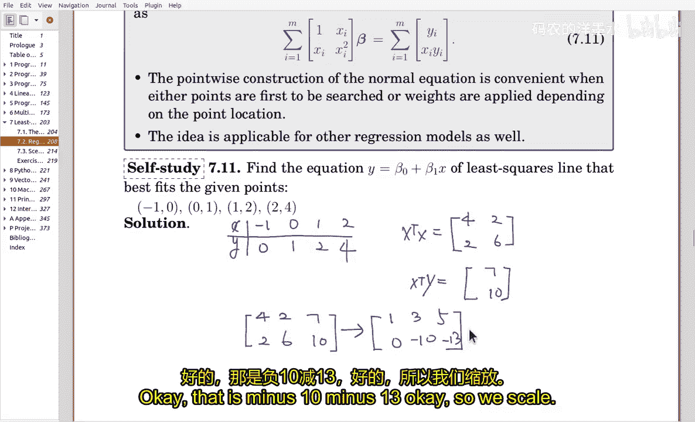

我们可以制作一个表格：

| x   | y   |
|-----|-----|
| -1  | 0   |
| 0   | 1   |
| 1   | 2   |
| 2   | 4   |

计算所需的和：
- `M = 4`
- `Σx = (-1) + 0 + 1 + 2 = 2`
- `Σx^2 = (-1)^2 + 0^2 + 1^2 + 2^2 = 1 + 0 + 1 + 4 = 6`
- `Σy = 0 + 1 + 2 + 4 = 7`
- `Σxy = (-1)*0 + 0*1 + 1*2 + 2*4 = 0 + 0 + 2 + 8 = 10`

因此，正规方程为：
```
[ 4   2 ] [β0] = [7]
[ 2   6 ] [β1]   [10]
```

解这个方程组。将第一个方程乘以3，第二个方程乘以1，然后相减，可以求得 `β1 = 1.3`。代入任一方程，求得 `β0 = 1.1`。

所以，我们寻求的回归线模型是：`y = 1.1 + 1.3x`。


### 扩展到非线性回归：多项式拟合

对于其他曲线，我们可以使用相同的最小二乘拟合技术。例如，考虑二次多项式回归模型：`y = β0 + β1*x + β2*x^2`。

对于给定的数据集，我们可以为每个数据点建立方程。在点 `(x1, y1)` 处，模型给出 `y1 = β0 + β1*x1 + β2*x1^2`。这些方程组可以写成矩阵形式 `Xβ = y`。

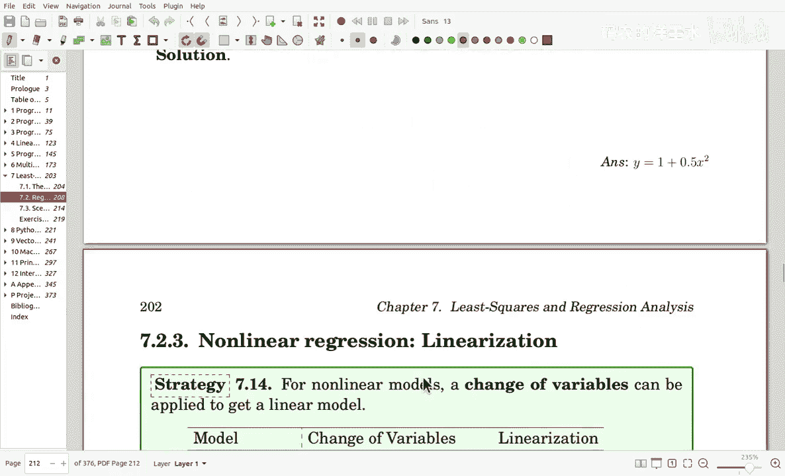

此时，矩阵 `X` 的列是 `[1, xi, xi^2]`，未知向量 `β` 是 `[β0, β1, β2]^T`。使用最小二乘法和正规方程 `(X^T X) β = X^T y`，我们可以求解 `β`。

计算 `X^T X` 会得到一个具有特定模式的矩阵，其元素涉及 `xi` 的各次幂的和（如 `Σ1`, `Σxi`, `Σxi^2`, `Σxi^3`, `Σxi^4`）。右侧向量 `X^T y` 的模式是 `Σyi`, `Σxi*yi`, `Σxi^2*yi`。


### 线性化技巧

回归技术或最小二乘技术对于非线性模型也非常有用。通过线性化，我们可以有效地进行处理。这通常从变量替换开始。

观察以下模型示例：

1.  **模型：`y = a + b/x`**
    *   这不是线性的，因为 `x` 在分母中。
    *   **线性化方法**：引入新变量 `x_tilde = 1/x`，`y_tilde = y`。则模型变为 `y_tilde = a + b * x_tilde`，这是一个线性模型。

2.  **模型：`y = a + b * ln(x)`**
    *   **线性化方法**：引入新变量 `x_tilde = ln(x)`，`y_tilde = y`。则模型变为 `y_tilde = a + b * x_tilde`。

3.  **模型：`y = c * e^(d*x)` （指数模型）**
    *   **线性化方法**：对等式两边取自然对数：`ln(y) = ln(c) + d*x`。
    *   引入新变量 `y_tilde = ln(y)`，则模型变为 `y_tilde = ln(c) + d*x`。这是一个关于 `x` 和 `y_tilde` 的线性模型。求出 `ln(c)` 和 `d` 后，再通过 `c = e^(ln(c))` 得到 `c`。

4.  **模型：`y = c * x^d` （幂律模型）**
    *   **线性化方法**：对等式两边取自然对数：`ln(y) = ln(c) + d * ln(x)`。
    *   引入新变量 `x_tilde = ln(x)`，`y_tilde = ln(y)`。则模型变为 `y_tilde = ln(c) + d * x_tilde`。

下表总结了一些线性化的例子：

| 原模型          | 变量替换                     | 线性化后的模型          |
|------------------|------------------------------|-------------------------|
| `y = a + b/x`    | `x_tilde = 1/x`, `y_tilde = y` | `y_tilde = a + b*x_tilde` |
| `y = a + b*ln(x)`| `x_tilde = ln(x)`, `y_tilde = y` | `y_tilde = a + b*x_tilde` |
| `y = c*e^(d*x)`  | `y_tilde = ln(y)`            | `y_tilde = ln(c) + d*x` |
| `y = c*x^d`      | `x_tilde = ln(x)`, `y_tilde = ln(y)` | `y_tilde = ln(c) + d*x_tilde` |

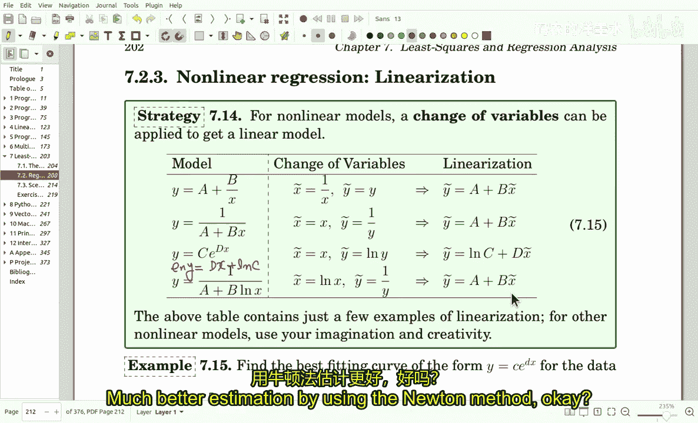

我们需要线性化的原因是，有时我们必须求解真正的非线性回归模型（例如使用牛顿法）。在这种情况下，我们需要为参数提供良好的初始值。通过线性化或近似模型，我们可以获得良好的近似参数，然后从那个起点出发，使用牛顿法等迭代方法得到更精确的估计。


### 线性化实例：指数拟合

假设我们有一些数据点，希望找到形式为 `y = c * e^(d*x)` 的最佳拟合曲线。散点图看起来像一条指数曲线。

我们采用线性化方法。对模型两边取自然对数：`ln(y) = ln(c) + d*x`。
令 `Y = ln(y)`，`A0 = ln(c)`，`A1 = d`。则方程变为 `Y = A0 + A1*x`，这是一个线性模型。

接下来，我们对原始数据中的每个 `y` 值计算其自然对数，得到新的 `Y` 值数据集 `(x, Y)`。然后，对这个新数据集 `(x, Y)` 应用标准的线性最小二乘法，求解 `A0` 和 `A1`。

得到 `A0` 和 `A1` 后，我们可以恢复原始参数：
*   `d = A1`
*   `c = e^(A0)`

在编程实现时，需要注意：由于要对 `y` 取对数，所以原始数据中所有的 `y` 值必须是正数。如果存在零或负值，可能需要剔除这些数据点或选择其他模型，否则算法会出错。


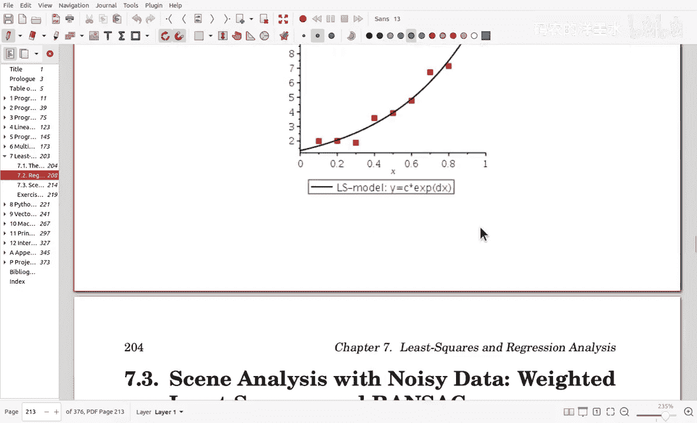

## 总结

本节课中，我们一起学习了回归分析的核心内容。

1.  **线性回归**：我们学习了如何通过最小二乘法，找到一条直线 `y = β0 + β1x` 来最佳拟合一组数据点。关键在于构建并求解正规方程 `(X^T X) β = X^T y`。
2.  **多项式回归**：我们将线性回归的思想扩展到多项式模型（如二次函数 `y = β0 + β1x + β2x^2`），方法类似，只是设计矩阵 `X` 的构造不同。
3.  **非线性回归的线性化**：这是处理复杂模型的有力工具。我们学习了通过对数变换、倒数变换等变量替换技巧，将诸如指数模型 `y = c*e^(d*x)`、幂律模型 `y = c*x^d` 等非线性模型转化为线性模型，从而可以利用成熟的线性最小二乘法进行求解。这种方法不仅能直接得到近似解，还能为更精确的非线性优化方法提供良好的初始参数估计。


通过掌握这些从线性到非线性的回归技术，你便具备了分析各种变量间关系的基础能力。