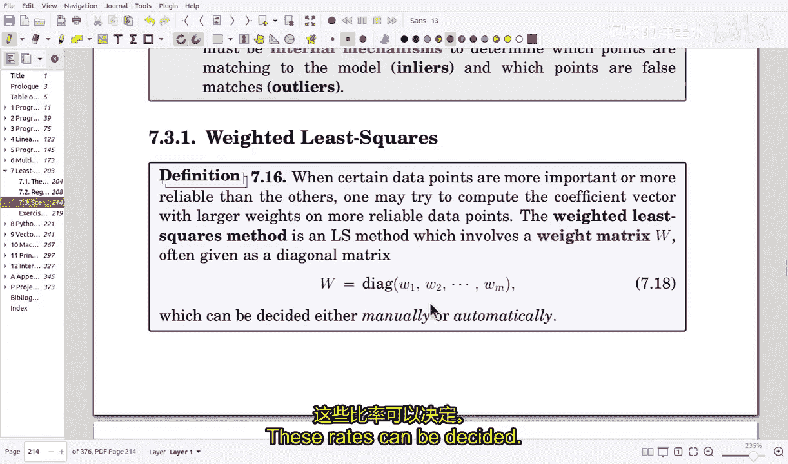
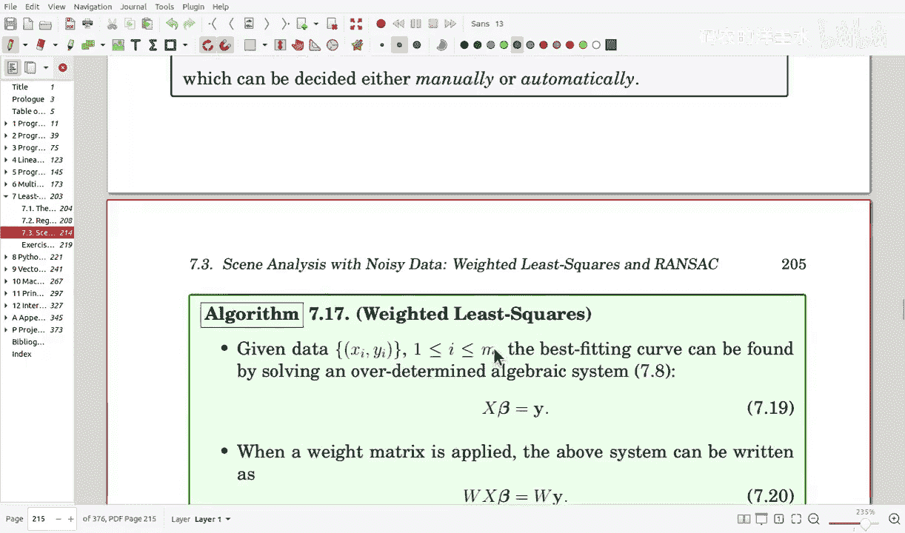
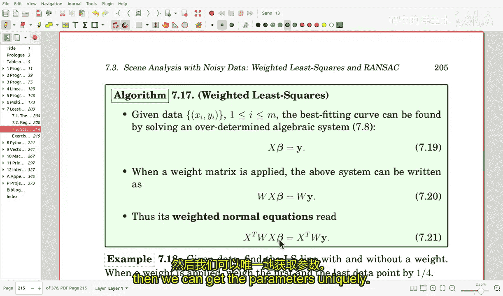
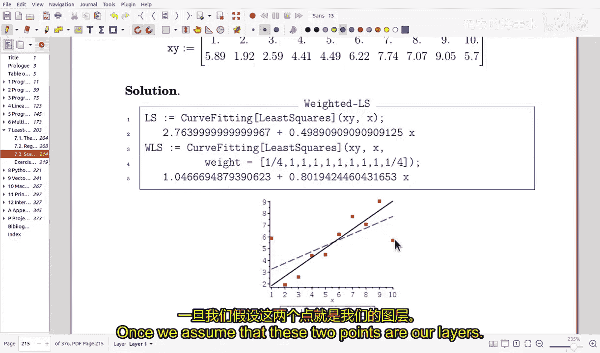
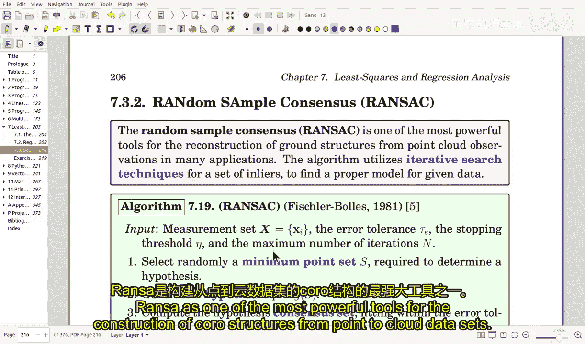
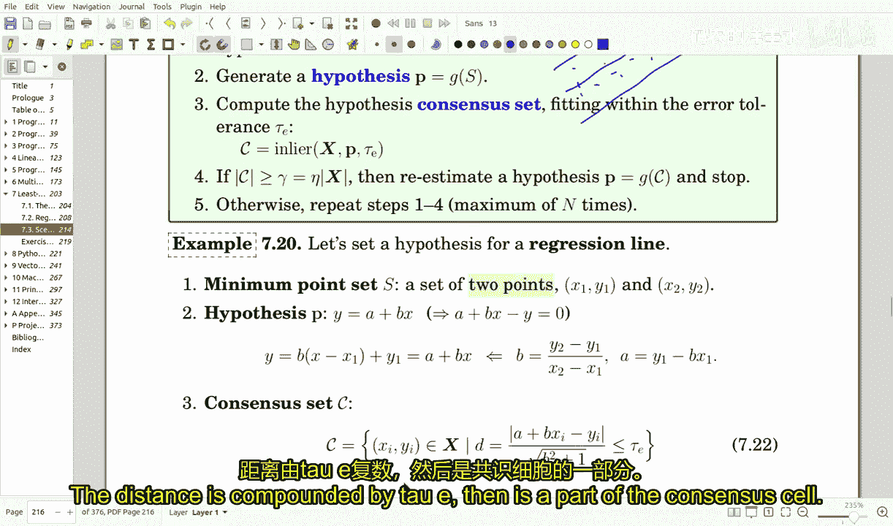
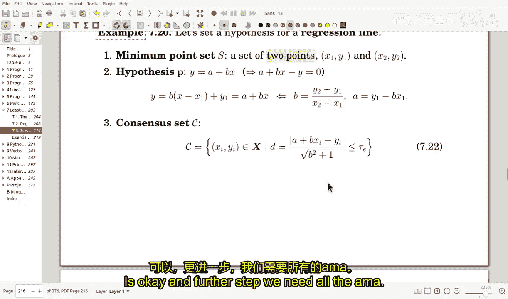
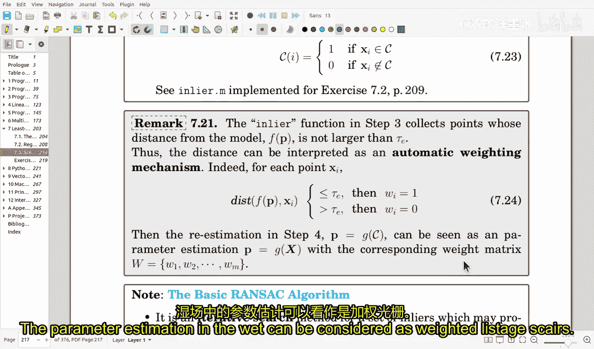
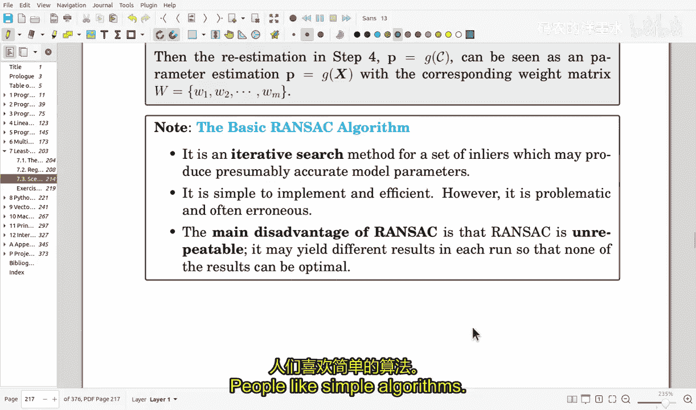

# 048：噪声数据加权最小二乘法和RANSAC 🧠

在本节课中，我们将学习处理噪声数据的两种关键技术：加权最小二乘法和随机抽样一致性算法。场景分析的核心任务是从获取的数据中解读出预定义的模型，这涉及到模型选择和参数估计。传统方法在处理包含大量噪声或异常值的数据时可能失效，因此我们需要更鲁棒的算法。

## 场景分析概述

场景分析关注于根据预定义模型来解释获取的数据。它包含两个子问题：第一个是找到最佳模型，这是一个分类问题；第二个是计算最佳参数值，这是一个参数估计问题。

传统的参数估计技术（如最小二乘法）会优化模型以拟合所有数据点。这些方法是基于平滑假设的简单平均方法。该假设认为，总是有足够多的“好”数据点来平滑掉异常偏差。

然而，现实中，这种平滑假设在许多应用中并不成立。这意味着数据集可能包含严重的误差，例如噪声。因此，为了获得更可靠的模型参数，必须有内部机制来确定哪些点与模型匹配（内点），哪些点产生错误匹配（外点）。

## 加权最小二乘法

上一节我们介绍了传统最小二乘法的局限性。本节中，我们来看看加权最小二乘法如何通过赋予不同数据点不同的重要性来改进参数估计。

当你获得数据点时，可能会发现某些点比其他点更重要、更可靠。在这种情况下，你可以尝试给这些重要的点赋予更大的权重。这就是加权最小二乘法的思想。它是一种按比例缩放的方法，涉及一个权重矩阵 **W**。

权重矩阵通常被给定为一个对角矩阵，如下所示：

$$
W = \begin{bmatrix}
w_1 & 0 & \cdots & 0 \\
0 & w_2 & \cdots & 0 \\
\vdots & \vdots & \ddots & \vdots \\
0 & 0 & \cdots & w_n
\end{bmatrix}
$$

这些权重可以手动或自动决定。

以下是加权最小二乘法的算法。对于基本数据集 `(x_i, y_i)`，最佳拟合曲线可以通过求解以下代数系统找到：

$$
(X^T W X) \beta = X^T W y
$$

我们之前已经用这种形式表述过这个系统。当应用权重矩阵时，系统可以这样重写。我们只需乘以权重矩阵 **W**，然后相应的法方程可以通过乘以 `X^T` 来表述。一旦这个矩阵可逆，我们就可以唯一地得到参数 `β`。

$$
\beta = (X^T W X)^{-1} X^T W y
$$

请看这个例子。给定数据，我们需要在有权重和无权重的情况下找到最小二乘线。当应用权重时，我们将第一个和最后一个数据点的权重设为四分之一。

现在，如果你观察数据，实际上我们可以在这里绘制。中间的点大致在一条线上，但边界点扰动很大。因此，我们可以认为这两个边界点不可靠。在现实中，当你尝试获取数据时，每个点都花费了成本，因此丢弃这些点并不明智。所以，你可以尝试以较小的权重使用它们。这就是这里的核心思想。

标准最小二乘法的输出曲线拟合结果，所有点权重相同。加权最小二乘法使用这个权重矩阵，对于第一个和最后一个点，权重是四分之一，内部点的权重相同，都是1。让我们看看结果，它们显然有很大不同。当我们使用权重时，我们得到实线；不使用权重时，我们得到虚线。因此，这里的加权最小二乘法更可靠，前提是我们假设这两个点是外点。

## 随机抽样一致性算法

上一节我们探讨了通过加权来处理噪声的方法。本节中，我们将介绍一种更强大的、专门用于从点云数据中构建正确结构的算法：随机抽样一致性算法。

RANSAC 是从点云数据中构建正确结构最强大的工具之一。该算法利用迭代搜索技术来寻找给定数据集的“内点”集合，从而提出模型。

以下是 RANSAC 算法，由 Fischler 和 Bolles 于 1981 年发明。

*   **输入**：
    *   `X`：数据点集合。
    *   `τ`：用作模型与点之间距离容差的半径。
    *   `η`：停止阈值。
    *   `N`：最大迭代次数。

*   **算法步骤**：
    1.  随机选择最小点集（足以确定一个假设模型）。
    2.  根据最小点集生成假设模型 `H`。
    3.  通过与假设模型 `H` 的距离在容差 `τ` 内的点形成共识集 `C`。
    4.  如果共识集 `C` 的大小超过阈值 `η`，则使用 `C` 中的所有点重新估计模型 `H`，并停止。
    5.  否则，重复步骤 1-4，最多 `N` 次迭代。
    6.  在 `N` 次迭代后，返回具有最大共识集的模型。

让我们为回归线设置一个假设。当我们选择一条线时，我们需要两个点。从两个点，我们可以轻松确定模型。例如，斜率可以通过 `Δy / Δx` 计算，这是你在高中就学过的技术，可以确定模型。

对于共识集 `C`，它是满足以下条件的点的集合：点 `(x_i, y_i)` 到直线的距离公式（同样来自高中知识）小于等于 `τ`，则该点属于共识集。

$$
\text{distance} = \frac{|Ax_i + By_i + C|}{\sqrt{A^2 + B^2}} \leq \tau
$$

关于 RANSAC 的实现有几点说明：
*   在步骤 2 中，假设 `H` 是模型参数的集合（例如，对于直线 `y = a + bx`，保存 `a` 和 `b`），而不是模型本身。
*   在步骤 3 中，共识集可以更方便地表示为一个索引数组 `C`。如果点 `x_i` 在共识集中（即满足上述不等式），则在索引 `i` 处赋值为 1，否则为 0。这样，索引值为 1 的点就是内点。

关于 RANSAC 的一个关键点是：步骤 3 中的内点函数收集那些到模型距离不大于 `τ` 的点。这个距离可以解释为一种自动加权机制。事实上，对于每个点 `x_i`，如果到模型的距离在 `τ` 内，我们尝试将其权重设为 1，否则为 0。那么，在最后一步重新估计假设时，可以看作是使用相应权重矩阵进行的加权最小二乘估计。因此，RANSAC 中的参数估计可以被视为加权最小二乘法。

## RANSAC 的特性与变体

基本的 RANSAC 算法是一种迭代搜索方法，用于寻找可能产生准确模型参数的内点集。然而，它存在问题且常常误差很大。RANSAC 的主要缺点是**不可重复**。它可能在每次运行时产生不同的结果，因此没有一个结果能保证是最优的。尽管如此，它实现简单且高效，因此广受欢迎。

请看这个示例。我们有两个不同的数据集：蓝点是内点，红点是外点。如果我们使用所有点，会得到红线；如果只使用内点，会得到蓝线。现在，我们使用 RANSAC。如图所示，生成的线（来自 RANSAC 输出）每次可能不同。有时很好，但有时差异很大，可能会产生扰动很大的线。我尝试测量变化，运行 1000 次后，收集输出并尝试测量截距和斜率的标准差。对于左侧数据集，截距和斜率的标准差都很大，误差明显。对于右侧数据集，截距的标准差是 0.1，虽然不完美但误差可观察，斜率也有类似误差，并给出了计算时间。

RANSAC 既不可重复也不最优。为了克服这个缺点，文献中研究了各种变体。例如：
*   最大似然估计样本一致性。
*   渐进样本一致性。

因为 RANSAC 是随机算法，人们不完全知道如何克服其缺点。事实上，今年我发表了一篇论文，提出了一个称为“迭代更新一致性”的变体，它是**最优**的。我们使用迭代更新而不是迭代搜索，可以在计算时间和准确性上获得很大改进。然而，尽管人们创造了这些变体，RANSAC 由于其简单性和高效性，仍然是寻找内点的主流算法。

## 总结

本节课中，我们一起学习了处理噪声场景分析数据的两种核心方法。我们首先介绍了**加权最小二乘法**，它通过为不同可靠度的数据点分配权重来改进传统最小二乘估计。接着，我们深入探讨了**随机抽样一致性算法**，这是一种强大的迭代方法，通过随机采样和共识集验证来从包含大量外点的数据中鲁棒地估计模型参数。我们了解了 RANSAC 的基本步骤、实现细节，以及它虽然简单高效但不可重复的特点，最后简要提及了其一些改进变体。掌握这些方法对于在现实世界的不完美数据中进行可靠的模型拟合至关重要。