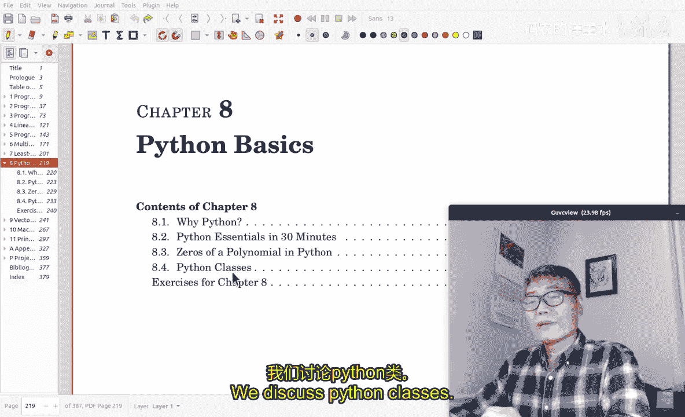
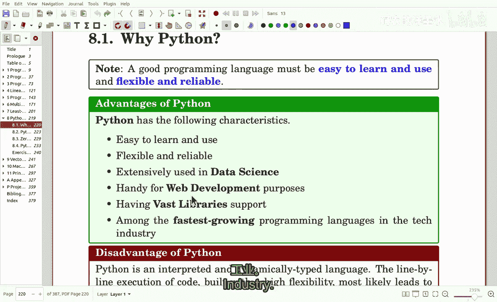
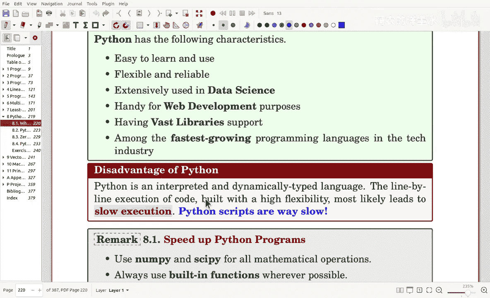
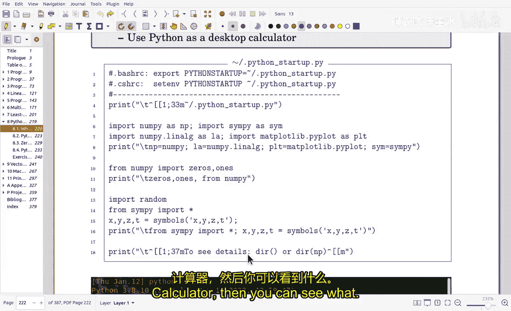

# 049：学习Python与库

在本章中，我们将学习Python编程语言及其核心库。我们将从Python的基础知识开始，然后实现一个求解多项式零点的代码，并将其与Matlab代码进行比较。最后，我们将讨论Python的类。

## 8.1 为何选择Python 🐍

上一节我们介绍了本章的学习目标，本节中我们来看看为什么Python是一个值得学习的编程语言。

一个好的编程语言必须易于学习和使用，同时具备灵活性和可靠性。这些正是Python的优势。此外，Python在数据科学领域被广泛使用，拥有丰富的开发工具和庞大的库支持。最后，Python是科技行业、人工智能和机器学习领域中增长最快的编程语言。

然而，Python也存在一个问题。因为它是一种解释型、动态类型的语言，所以运行速度相对较慢。与Matlab相比，Python脚本的运行速度也较慢。

## 8.2 加速Python程序 ⚡

既然我们了解了Python速度较慢的缺点，本节将探讨几种加速Python程序的方法。

以下是加速Python程序的策略：
*   在数学运算中使用NumPy和SciPy库。
*   尽可能使用内置函数。
*   使用Cython。Cython是Python的C语言扩展，它结合了C和Python。你可以像写C语言或Python一样实现函数。如果更多地使用C语言的特性，程序会运行得更快。
*   将自定义的C、C++或Fortran模块导入到Python中。使用编译模块比Python脚本快得多，有时甚至能快100倍。如果你正在开发新项目并需要编写长脚本，尝试使用编译语言会得到性能更好的代码。

接下来，我们考虑如何从Python调用C、C++或Fortran代码。这个脚本将编译所有用C、C++和Fortran编写的函数。

首先，我们为Fortran、C和C++定义库名称。然后，使用`f2py3`编译Fortran 90文件。你可以包含Fortran 90的编译选项，例如选择优化级别3，这是可用的最高优化级别。如果不选择优化，默认级别通常为1，速度会慢大约两倍。

对于C语言，你需要生成位置无关代码，因此需要添加相应的编译标志，并使用所有C文件生成共享对象。对于C++，过程类似，只是需要使用C++文件。

一旦生成了共享对象，就可以在Python中包装和使用它们。对于Fortran，你可以直接导入所有函数，使用方式类似。然而，对于C和C++，你需要使用`ctypes`库来加载动态链接库。

例如，对于一个C函数，你需要使用`ctypes`定义其参数类型和返回类型。参数类型是输入类型，返回类型是输出类型。定义好类型后，就可以调用C函数了。Python中的变量会被转换为C函数可用的格式，执行操作后，结果再从C类型转换回Python类型。通过这种方式，可以调用C函数。而对于Fortran，则可以直接使用，无需处理这些复杂步骤。

## 8.3 使用Python作为计算器 🧮

在学会了如何提升Python性能后，本节我们来看看如何将Python设置为一个方便的计算器。

NumPy库的设计旨在实现类似Matlab的功能，Python可以作为一个便捷的桌面计算器使用。首先，你需要设置启动环境。

例如，如果你使用Linux，可以在`.bashrc`文件中添加一行配置。如果你使用csh，则在`.cshrc`文件中添加。在home目录的这个文件中，你可以写入导入语句，例如导入NumPy、SciPy、线性代数包、绘图包以及一些常用函数。你还可以声明`x, y, z, t`等符号变量，并添加一些说明行。这样，当你打开桌面计算器时，就能看到已导入的内容。

打开Python后，这些信息会被打印出来，你可以看到导入了哪些库和变量。你还可以添加注释来查看详细信息。Python是一种非常方便的工具，具有高度的灵活性和易用性。

---

本节课中，我们一起学习了Python编程语言的核心优势与速度瓶颈，探讨了使用NumPy、Cython及编译语言模块来加速程序的方法，并了解了如何将Python配置为强大的桌面计算器。掌握这些知识，将帮助你在人工智能编程中更高效地使用Python。