# 050：Python 核心概念、循环与函数 🐍

在本节课中，我们将学习 Python 编程语言的核心概念，包括其基本特性、数据结构（如列表、元组、字符串、字典和集合）、变量赋值、输入输出以及如何编写函数和循环。这些是构建更复杂程序的基础。

## Python 核心特性 ✨

Python 是一种简单、易读、开源的编程语言，易于学习。
它是一种解释型语言，而非编译型语言，这意味着它是脚本语言。
变量无需声明类型。
Python 支持面向对象的编程范式。
它是跨平台的，可以在 Linux、Windows 和 macOS 系统上使用。
它拥有庞大的标准库。
Python 是一种高级语言，这意味着它易于使用。高级语言不一定比低级语言更好，但它更易于使用且简单，同时也非常强大。
Python 不支持指针。
Python 代码文件必须以 `.py` 扩展名存储。
一个关键特性是使用缩进。Python 使用缩进来定义代码块。这非常有用，因为如果没有正确的缩进，代码将无法运行，这有助于避免错误。
代码块以缩进开始，以第一个非缩进行结束。
缩进量由用户决定，但在整个代码块中必须保持一致。
注释可以通过使用 `#` 符号来添加。
多行注释可以通过使用三引号（单引号或双引号）来添加。

## 序列数据类型 📊

Python 中有几种重要的序列数据类型：列表、元组和字符串。

列表使用方括号 `[]` 定义，可以包含字符串、整数或浮点数等多种类型的元素。

```python
L = [‘a’, 20, 5.5]
```

元组使用圆括号 `()` 定义，元素之间用逗号分隔。

```python
T = (1, 2, 3)
```

一个元素的元组可以这样定义。

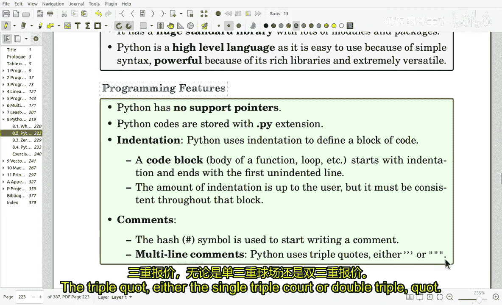

```python
single_element_tuple = (1,)
```

字符串可以使用单引号、双引号或三引号定义。

```python
s1 = ‘hello’
s2 = “world”
s3 = “””multi-line
string”””
```

### 访问序列元素

索引从 0 开始。你可以通过索引访问单个元素，也可以使用切片同时访问多个元素。
`-1` 表示最后一个元素，`-2` 表示倒数第二个元素，依此类推。

对于字符串，在声明之后，可以通过索引访问字符。例如，从位置 2 到 5（不包括 5）的切片可以获取子字符串。
换行符 `\n` 在字符串中不可见，但确实存在。

切片有一些规则。对于一个列表或数组，索引从 0 开始。
切片操作 `[start:end]` 会返回从索引 `start` 到 `end-1` 的元素。
例如，`L[1:4]` 会返回列表中索引为 1、2、3 的元素。

对于元组，切片操作方式相同。`T[1:4]` 会返回元组中从第二个到第四个（不包括第四个）的元素。

### 序列的加法与乘法

列表、元组和字符串的加法和乘法操作与常规的数学运算不同。
加法 `+` 用于连接两个序列。
乘法 `*` 用于重复序列多次。

```python
list1 = [1, 2]
list2 = [3, 4]
result_list = list1 + list2  # 结果为 [1, 2, 3, 4]

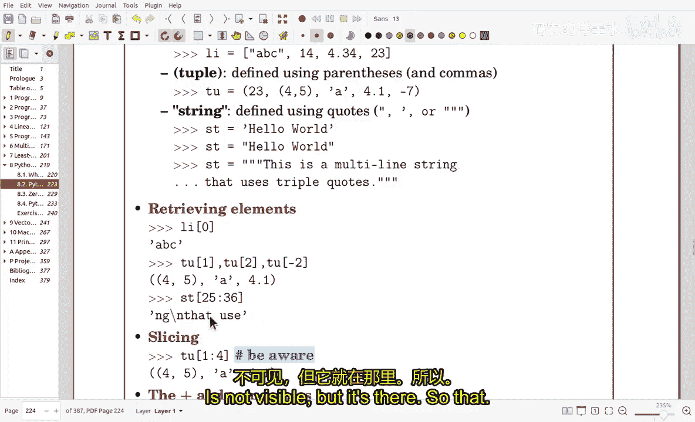

tuple1 = (‘a’, ‘b’)
result_tuple = tuple1 * 3  # 结果为 (‘a’, ‘b’, ‘a’, ‘b’, ‘a’, ‘b’)

str1 = ‘hello ‘
str2 = ‘world’
result_str = str1 + str2  # 结果为 ‘hello world’
```

### 引用与复制

在 Python 中，简单的赋值 `B = A` 并不会创建一个新的列表，而是创建了一个对原列表 `A` 的新引用 `B`。因此，修改 `A` 也会影响到 `B`。

```python
A = [1, 2, 3]
B = A
A.append(4)
print(B)  # 输出 [1, 2, 3, 4]，B 也随之改变
```

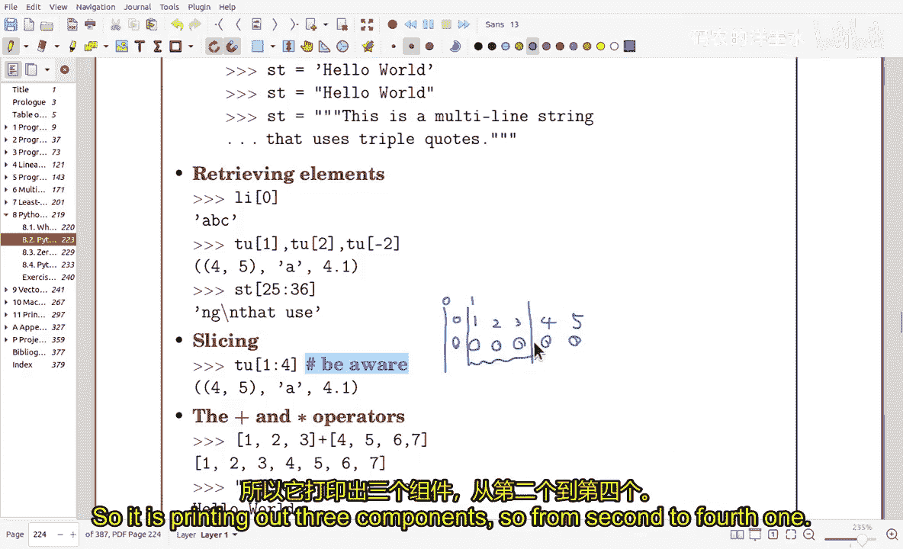

要创建真正的独立副本，需要进行深拷贝。

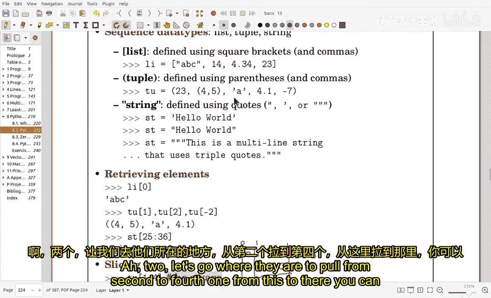

## 循环与迭代 🔄

`range()` 函数用于生成一个数字序列，常用于循环。
`range(8)` 生成从 0 到 7 的整数序列。

```python
for i in range(8):
    print(i)  # 输出 0, 1, 2, 3, 4, 5, 6, 7
```

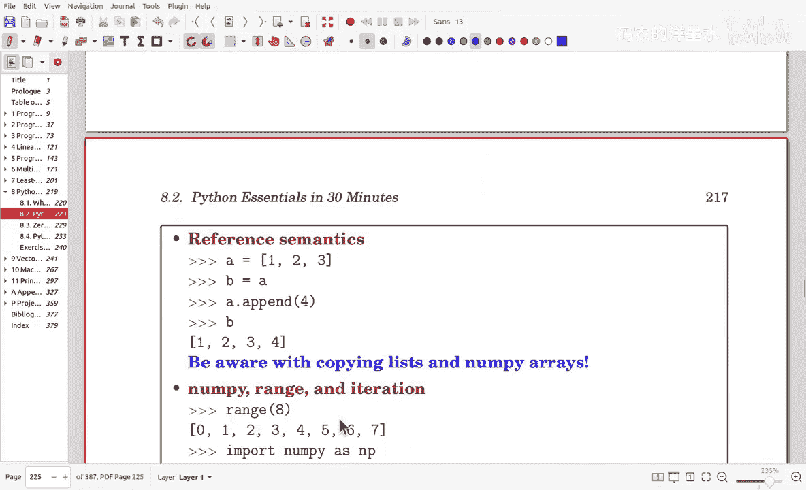

使用 `len()` 函数可以获取列表的长度。

```python
my_list = [1, 2, 3, 4]
length = len(my_list)  # length 的值为 4
```

在迭代中，可以这样使用：

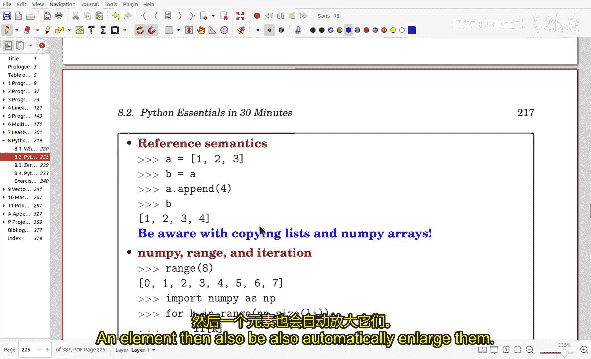

```python
for i in range(len(my_list)):
    print(my_list[i])
```

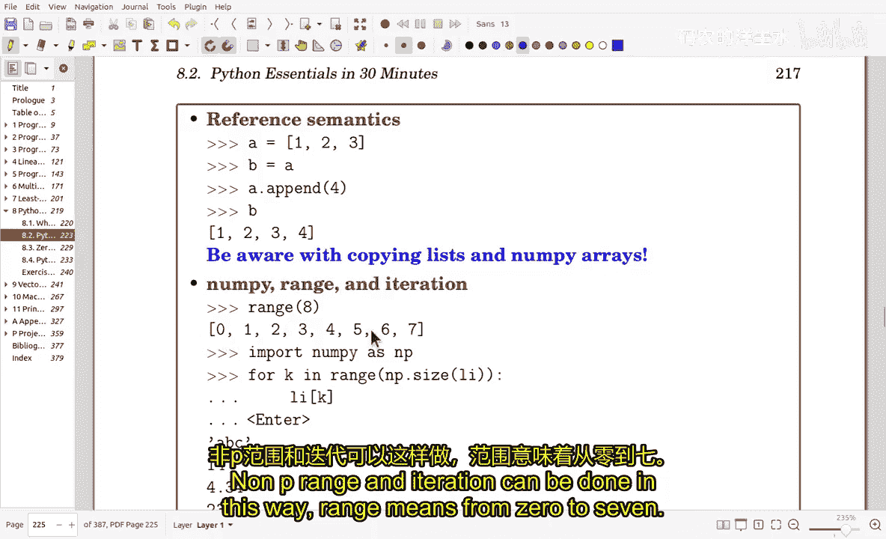

### 深拷贝与浅拷贝

之前提到，简单的赋值是引用。要创建完全独立的新对象，需要使用深拷贝。

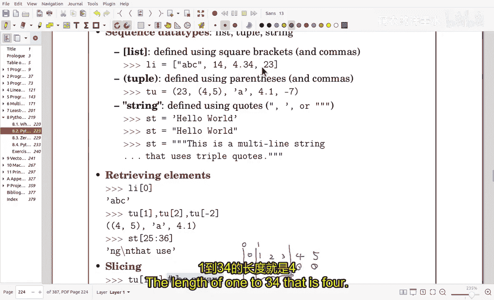

```python
from copy import deepcopy

A = [1, 2, 3]
B = A          # 浅拷贝，B 是 A 的引用
C = deepcopy(A) # 深拷贝，C 是 A 的完全独立副本

A[0] = 99
print(B)  # 输出 [99, 2, 3]，B 随 A 改变
print(C)  # 输出 [1, 2, 3]，C 保持不变
```

简单的赋值（`=`）在某种意义上只是重命名，`A` 有了另一个名字 `B`。所以当 `A` 的值改变时，`B` 的值也会改变。

## Python 常用规则与技巧 🛠️

有时一行代码需要做很多事情，可能会超过一行的长度。这时可以使用反斜杠 `\` 进行续行，或者使用圆括号、方括号或花括号将内容括起来，这样换行符会被忽略，被视为同一行。

```python
# 使用反斜杠续行
long_string = “This is a very long string that “ \
              “spans multiple lines.”

# 使用括号自动续行
my_list = [
    1, 2, 3,
    4, 5, 6
]
```

使用分号 `;` 可以在同一行中放置多个语句。

```python
a = 1; b = 2; c = 3
```

可以在一行中为多个变量赋值。

```python
a, b, c = 1, 2, “hello”
```

也可以这样赋值。

```python
[a, b, c] = [1, 2, “hello”]
```

### 函数文档字符串

在定义函数时，可以编写文档字符串。使用三引号（单引号或双引号）将其括起来，它会被视为函数的帮助文档。类似于 MATLAB 中的 `help` 命令，输入函数名可以查看其开头的文档字符串部分。

```python
def my_function():
    “””
    这是一个示例函数。
    它目前什么都不做。
    “””
    pass

help(my_function)  # 会显示上面的文档字符串
```

这种方法会捕获文档字符串部分并打印出来。

### 变量交换与类型

在一行中交换两个变量的值在 Python 中非常方便。

```python
b, c = c, b  # 交换 b 和 c 的值
```

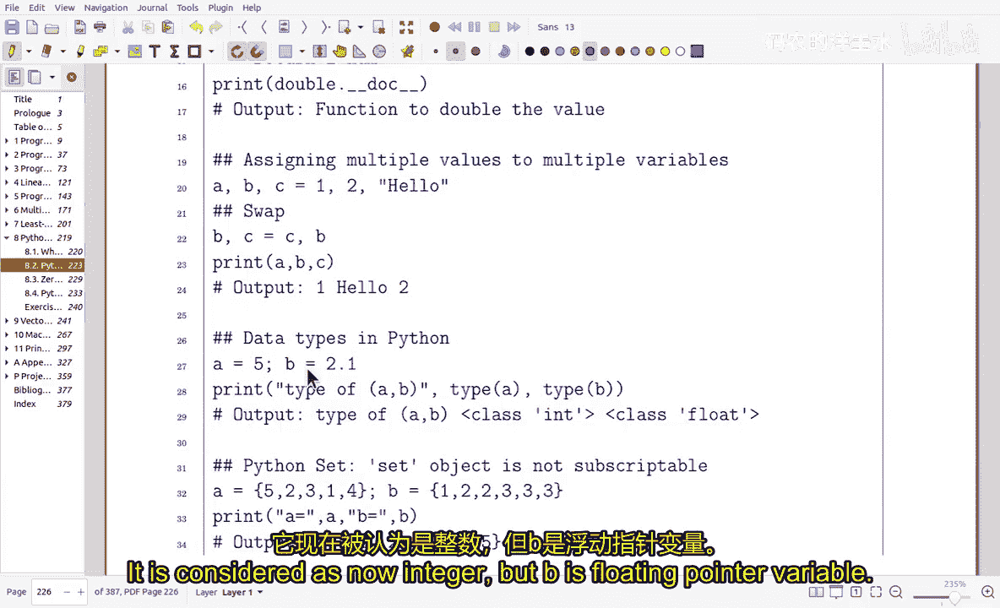

在其他语言中，这通常不允许，需要借助一个临时变量。

在 Python 中，一旦为变量赋值，其类型会自动确定。但是，如果你在不同上下文中使用它，类型可以很容易地转换。

```python
a = 4      # a 是整数 (int)
b = 2.0    # b 是浮点数 (float)
c = a + b  # c 是浮点数 6.0，整数 a 被转换为浮点数进行运算
```

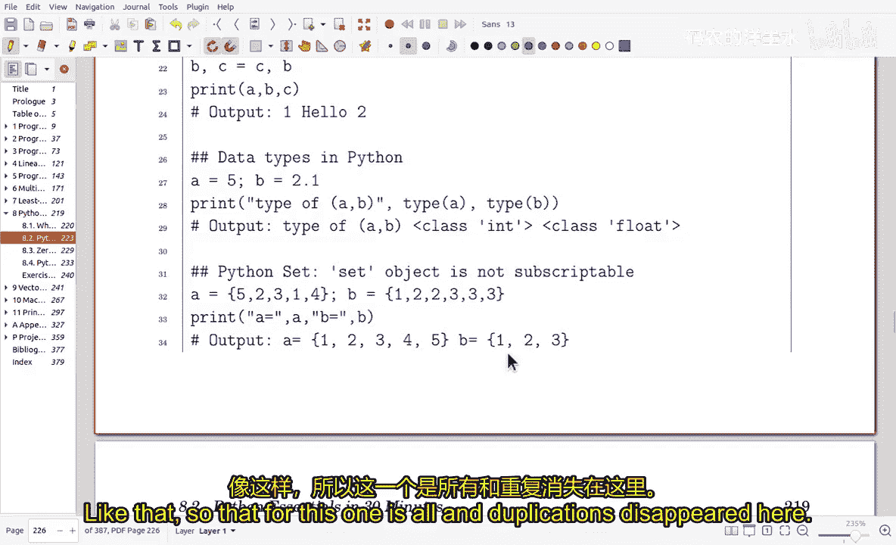

可以使用 `type()` 函数检查变量的类型。

```python
print(type(a))  # 输出 <class ‘int’>
print(type(b))  # 输出 <class ‘float’>
```

## 集合与字典 🗂️

Python 集合 (`set`) 是一个无序且不包含重复元素的集合。

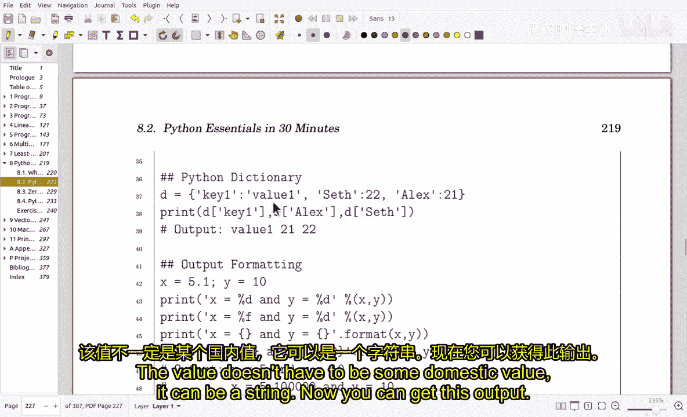

```python
A = {1, 2, 2, 3, 4}
B = {3, 4, 5, 6}
print(A)  # 输出 {1, 2, 3, 4}，重复项被移除
```

集合支持交集、并集等操作。

```python
print(A & B)  # 交集，输出 {3, 4}
print(A | B)  # 并集，输出 {1, 2, 3, 4, 5, 6}
```

Python 字典 (`dict`) 对于数据处理非常有用。它由键-值对组成。

```python
D = {‘Seth’: 22, ‘Alex’: 21}
```

你可以通过键来访问字典中的值。

```python
print(D[‘Seth’])  # 输出 22
```

值可以是任何类型，比如字符串。

```python
D[‘City’] = ‘Stackville’
print(D)  # 输出 {‘Seth’: 22, ‘Alex’: 21, ‘City’: ‘Stackville’}
```

## 输入与输出 📥📤

Python 的 `print` 函数输出格式非常灵活。

```python
x = 5.0
y = 3
print(“x is”, x, “and y is”, y)  # 输出: x is 5.0 and y is 3
```

你可以使用格式化字符串来精确控制输出。

```python
print(“x is %.1f and y is %d” % (x, y))  # 输出: x is 5.0 and y is 3
print(“y is {1} and x is {0}”.format(x, y))  # 输出: y is 3 and x is 5.0
```

你可以指定分隔符 `sep` 和结束符 `end`。

```python
print(“x =“, x, “; y =“, y, sep=‘|’, end=‘!\n’)  # 输出: x =|5.0|; y =|3!
```

使用 `input()` 函数可以获取用户输入。

```python
city = input(“Enter your city: “)
print(“You entered:”, city)
```

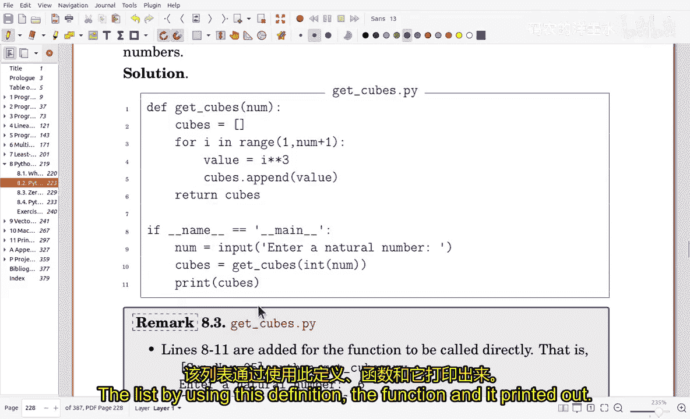

## 函数与循环实战 🚀

现在，我们将综合运用循环和函数来编写一个程序，该程序返回自然数的立方。

我们定义一个函数 `get_cubes`，它接受一个数字 `n` 作为输入。

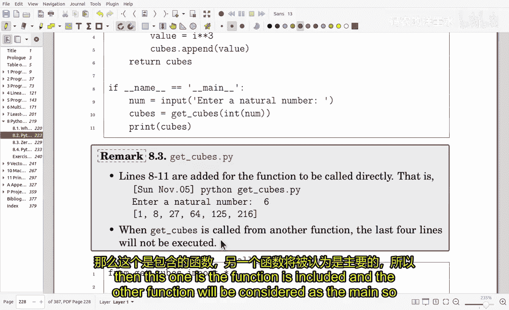

```python
def get_cubes(n):
    cubes = []  # 创建一个空列表
    for i in range(1, n+1):  # 从 1 循环到 n
        cubes.append(i**3)   # 计算立方并添加到列表
    return cubes
```

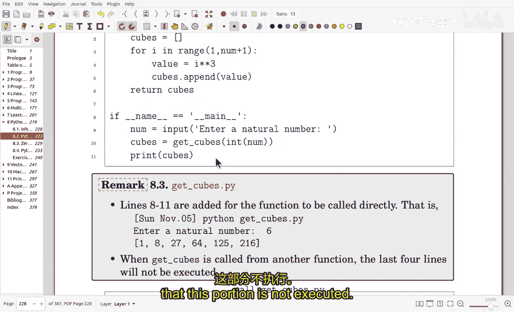

为了让这个函数可以独立运行，我们通常使用 `if __name__ == ‘__main__’:` 这个条件。当这个 `.py` 文件被直接运行时，`__name__` 的值是 `’__main__’`，下面的代码块会被执行。如果它被作为模块导入到其他文件，则不会执行。

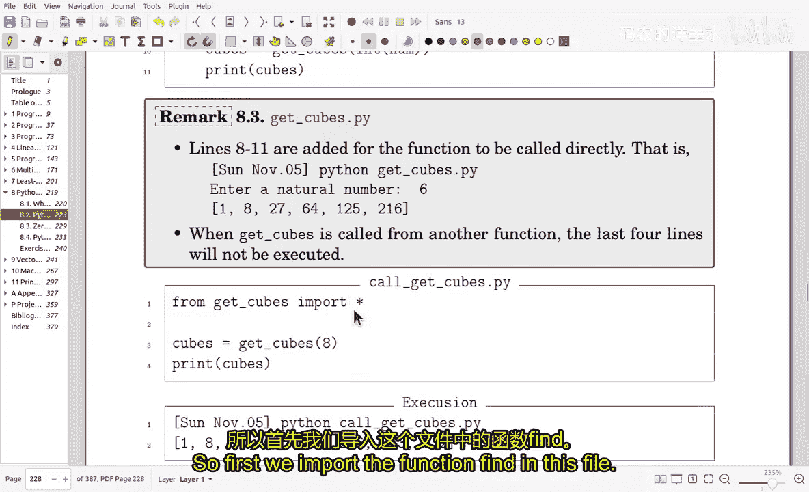

```python
if __name__ == ‘__main__’:
    num = int(input(“Enter a number: “))
    result = get_cubes(num)
    print(“The cubes are:”, result)
```

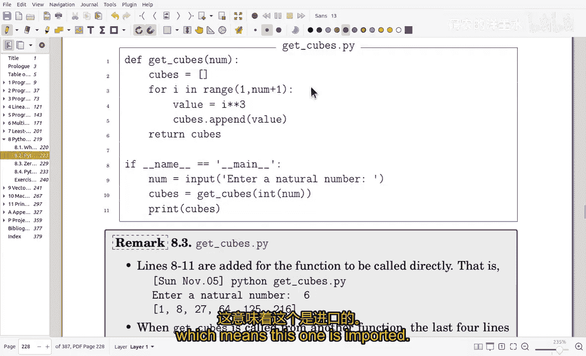

### 从其他文件调用函数

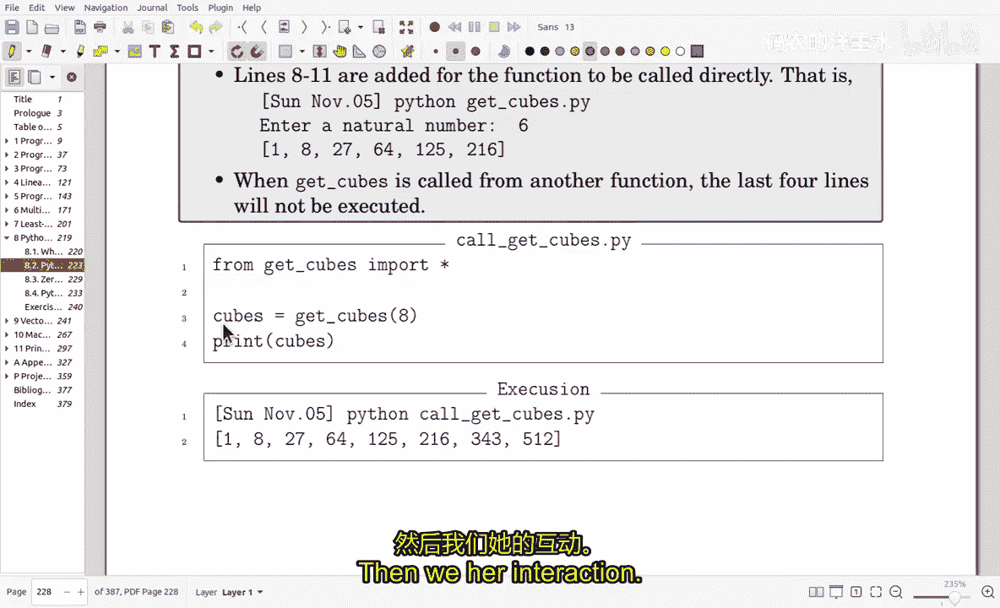

我们可以在另一个 Python 文件中导入并使用 `get_cubes` 函数。

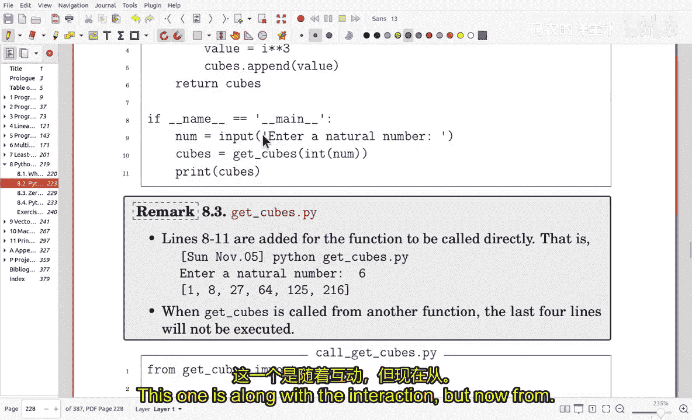

创建一个新文件，例如 `caller.py`：

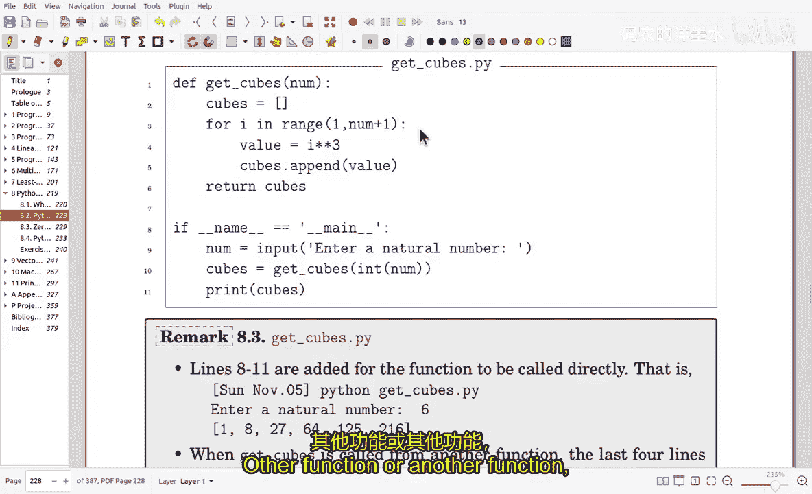

```python
# 从 get_cubes.py 文件中导入所有内容（包括 get_cubes 函数）
from get_cubes import *

# 现在可以直接调用函数，无需交互式输入
my_cubes = get_cubes(5)
print(“Cubes from 1 to 5 are:”, my_cubes)
```

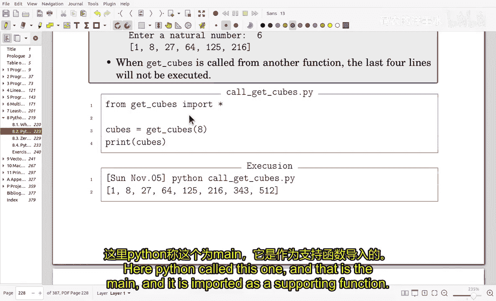

当运行 `caller.py` 时，`get_cubes.py` 中的 `if __name__ == ‘__main__’:` 代码块不会被执行，只有 `get_cubes` 函数被导入和使用。

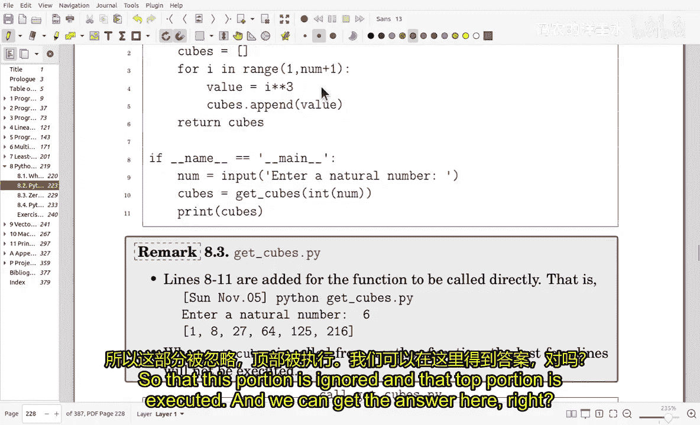

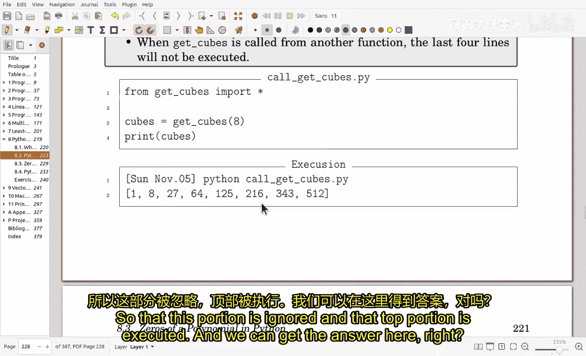

---

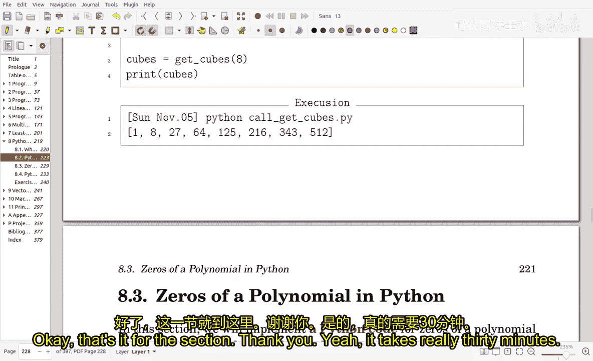

本节课中我们一起学习了 Python 的核心特性、多种数据结构（列表、元组、字符串、字典、集合）的操作、变量的赋值与引用机制、灵活的输入输出方法，以及如何编写函数和循环来构建实用的程序。理解这些基础概念是迈向更高级 Python 编程的关键步骤。