# 051：Lecture 51 - 在Python中实现牛顿-霍纳法求多项式零点 🧮

在本节课中，我们将学习如何在Python中实现牛顿-霍纳法来寻找多项式的零点，并将其与之前学习的MATLAB实现进行比较。

## 概述

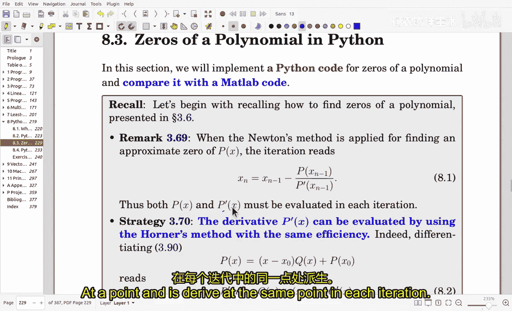

上一节我们介绍了牛顿迭代法的基本思想。本节中，我们来看看如何结合霍纳法，在Python中高效地实现求解多项式零点的算法。我们将从回顾牛顿-霍纳法的原理开始，然后逐步编写Python代码，并与MATLAB版本进行对比。

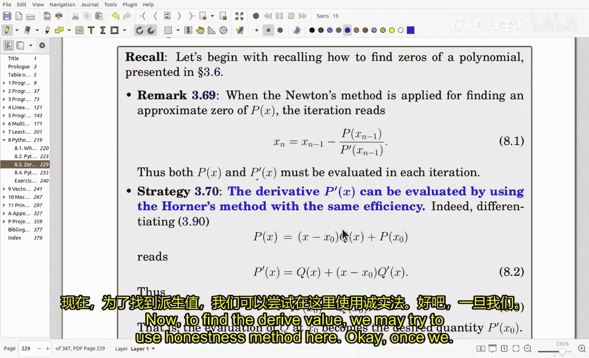

## 牛顿-霍纳法原理回顾

牛顿法用于寻找函数 $f(x)=0$ 的近似解。其迭代公式可以表述为：

$$
x_{n+1} = x_n - \frac{f(x_n)}{f'(x_n)}
$$

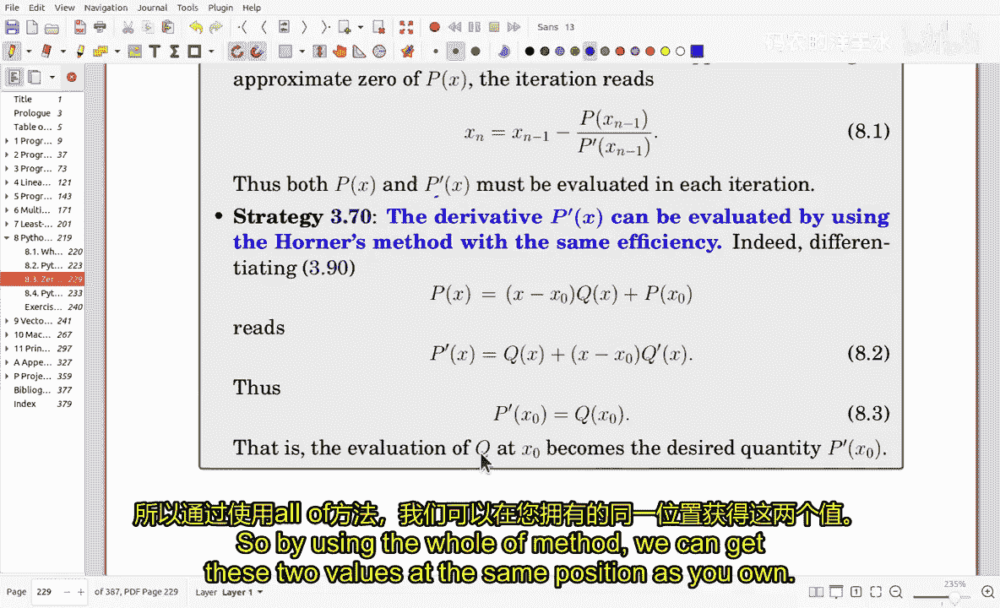

在每次迭代中，我们需要计算多项式 $P(x)$ 在点 $x_n$ 处的值及其导数值 $P'(x_n)$。

为了高效地同时计算这两个值，我们可以使用霍纳法。假设多项式 $P(x)$ 可以表示为：

$$
P(x) = (x - x_0)Q(x) + R
$$

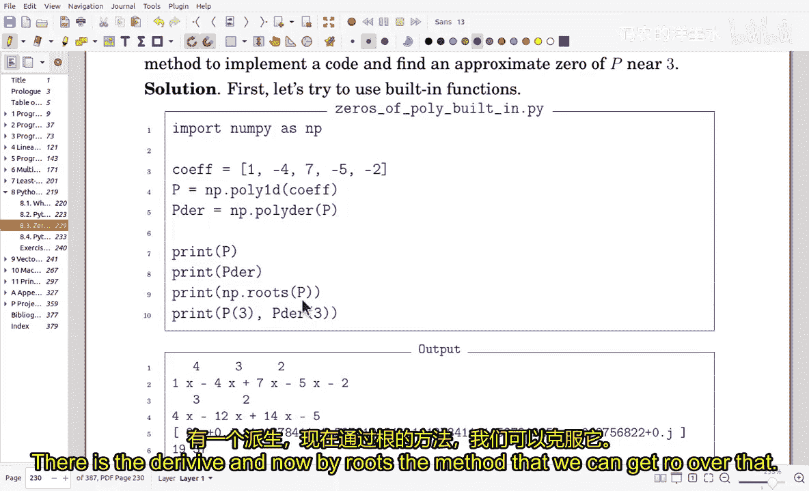

根据多项式余数定理，当我们在 $x_0$ 处求值时，$R = P(x_0)$。同时，$P(x)$ 在 $x_0$ 处的导数 $P'(x_0)$ 等于商式 $Q(x)$ 在 $x_0$ 处的值 $Q(x_0)$。

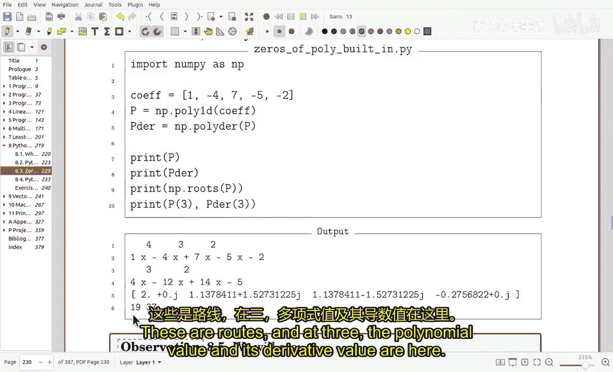

因此，通过一次霍纳法计算，我们可以在同一点 $x_0$ 同时得到 $P(x_0)$ 和 $P'(x_0)$ 的值，这正是牛顿迭代所需的。

## 在Python中实现算法

现在，我们将使用牛顿法和霍纳法在Python中实现代码，以寻找多项式 $P(x) = x^4 - 3x^3 - 15x^2 + 19x + 30$ 的一个零点近似解。

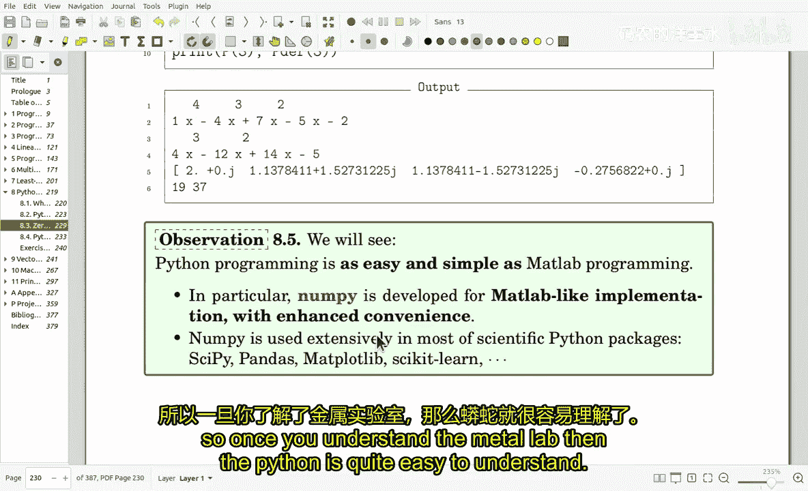

首先，我们可以利用Python的`numpy`库来方便地处理多项式。`numpy`的设计借鉴了MATLAB，旨在提供类似的便捷性，并被大多数科学计算Python包（如SciPy、Pandas、Matplotlib）所使用。因此，如果你理解MATLAB，Python会很容易上手。

以下是实现牛顿-霍纳法的Python函数：

```python
def newton_horner(quot, x0, tol=1e-12, max_iter=1000):
    """
    使用牛顿-霍纳法寻找多项式零点。
    参数:
        quot: 多项式系数列表（按升序排列）。
        x0: 初始猜测值。
        tol: 容差。
        max_iter: 最大迭代次数。
    返回:
        x: 找到的零点近似值。
        n_iter: 执行的迭代次数。
    """
    n_iter = 0
    x = x0
    for n_iter in range(max_iter):
        # 使用霍纳法计算 P(x) 和 P'(x)
        p = quot[-1]
        d = 0
        for coef in quot[-2::-1]:
            d = p + x * d
            p = coef + x * p
        # 计算修正项并更新x
        h = p / d
        x = x - h
        # 检查收敛条件
        if abs(h) <= tol:
            break
    return x, n_iter + 1
```

代码解释如下：
*   函数`newton_horner`接收多项式系数`quot`、初始值`x0`等参数。
*   我们初始化迭代计数`n_iter`和当前点`x`。
*   在循环中，我们使用霍纳法同时计算多项式值`p`和导数值`d`。
*   计算牛顿修正项 `h = p / d`，并更新 `x = x - h`。
*   如果修正项的绝对值小于容差`tol`，则停止迭代。
*   函数返回最终的`x`值和迭代次数。

接下来，我们定义多项式系数并调用该函数：

```python
# 多项式 P(x) = x^4 - 3x^3 - 15x^2 + 19x + 30 的系数（升序）
quot = [30, 19, -15, -3, 1]
x0 = 3.0
tolerance = 1e-12
max_iterations = 1000

x_final, num_iters = newton_horner(quot, x0, tolerance, max_iterations)
print(f"牛顿-霍纳法从 x0={x0} 开始")
print(f"最终解: {x_final}")
print(f"迭代次数: {num_iters}")
```

运行此代码，输出结果将显示算法从`x0=3`开始，经过7次迭代后收敛到解`x≈2`。

## 与MATLAB代码对比

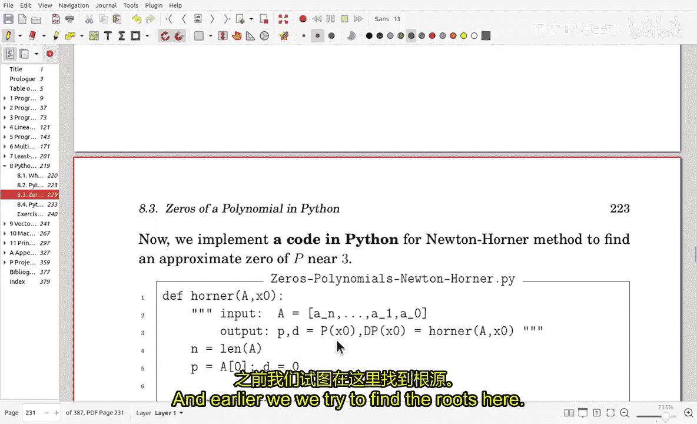

为了加深理解，我们将Python实现与之前章节中的MATLAB代码进行对比。

以下是MATLAB中的`newton_horner`函数核心部分：

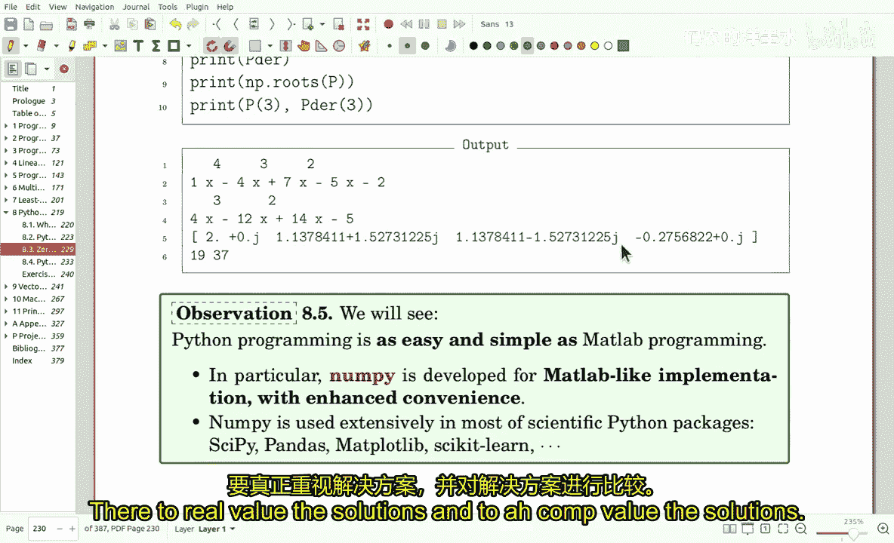

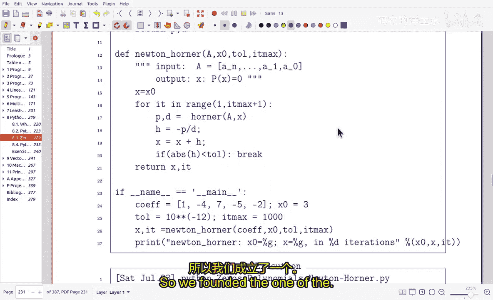

```matlab
function [x, n_iter] = newton_horner(quot, x0, tol, max_iter)
    n_iter = 0;
    x = x0;
    for n_iter = 1:max_iter
        % 霍纳法计算 P(x) 和 P'(x)
        [p, d] = horner(quot, x);
        % 牛顿更新
        h = p / d;
        x = x - h;
        % 检查收敛
        if abs(h) <= tol
            break;
        end
    end
end
```

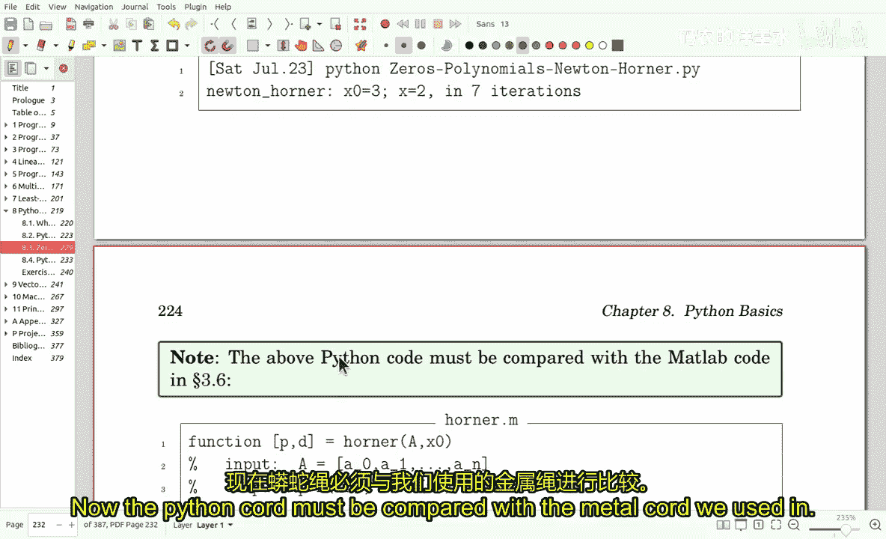

以及调用方式：

```matlab
quot = [30, 19, -15, -3, 1];
x0 = 3;
tol = 1e-12;
max_iter = 1000;
[x_final, n] = newton_horner(quot, x0, tol, max_iter);
fprintf('牛顿-霍纳法从 x0=%d 开始\n', x0);
fprintf('最终解: %f\n', x_final);
fprintf('迭代次数: %d\n', n);
```

通过对比可以发现，Python代码和MATLAB代码在算法逻辑和结构上具有高度的相似性。主要的区别在于语法细节（如循环语法、打印输出）。这种相似性使得熟悉MATLAB的用户能够相对轻松地过渡到Python进行科学计算。

## 结果验证

我们找到的解 `x≈2` 确实是给定多项式的一个实根。该多项式共有四个根，包括两个实根和两个复根。我们的算法成功地找到了其中一个实根。

## 总结

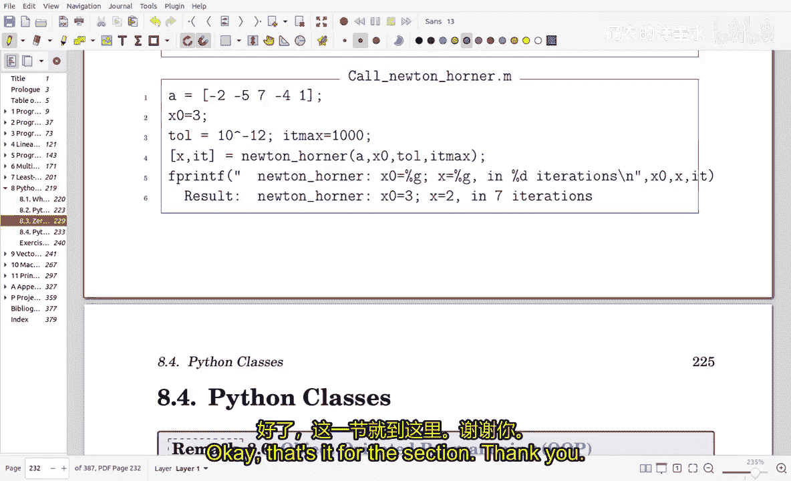

本节课中我们一起学习了如何在Python中实现牛顿-霍纳法来求解多项式的零点。我们首先回顾了算法的数学原理，然后逐步编写了Python代码，并通过与MATLAB版本的详细对比，展示了两种语言在实现科学计算算法时的相似性。关键点在于利用霍纳法高效计算多项式值及其导数值，从而驱动牛顿迭代。掌握这一方法后，你就能在Python环境中解决类似的数值计算问题。