# 052：类与继承 🐍

在本节课中，我们将要学习 Python 中一个核心概念：**类**。类是面向对象编程的基石，它允许我们将数据和功能捆绑在一起。我们将从定义一个简单的类开始，逐步学习如何创建对象、定义方法，并最终探索如何通过继承来复用和扩展已有的类。

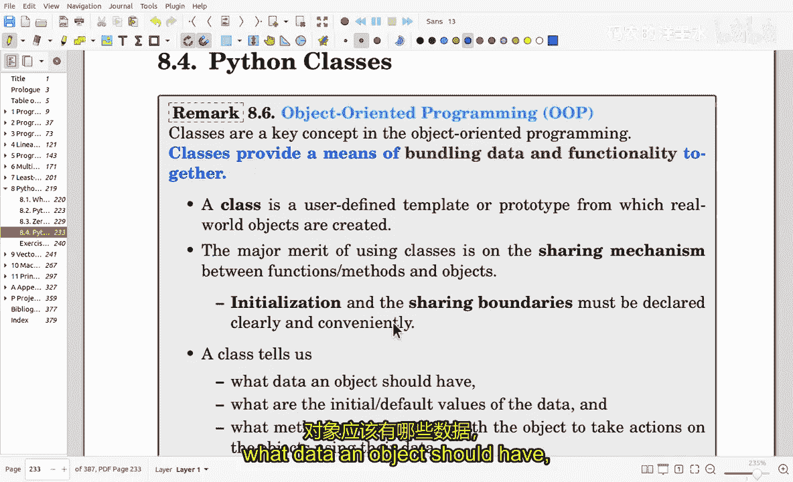

---

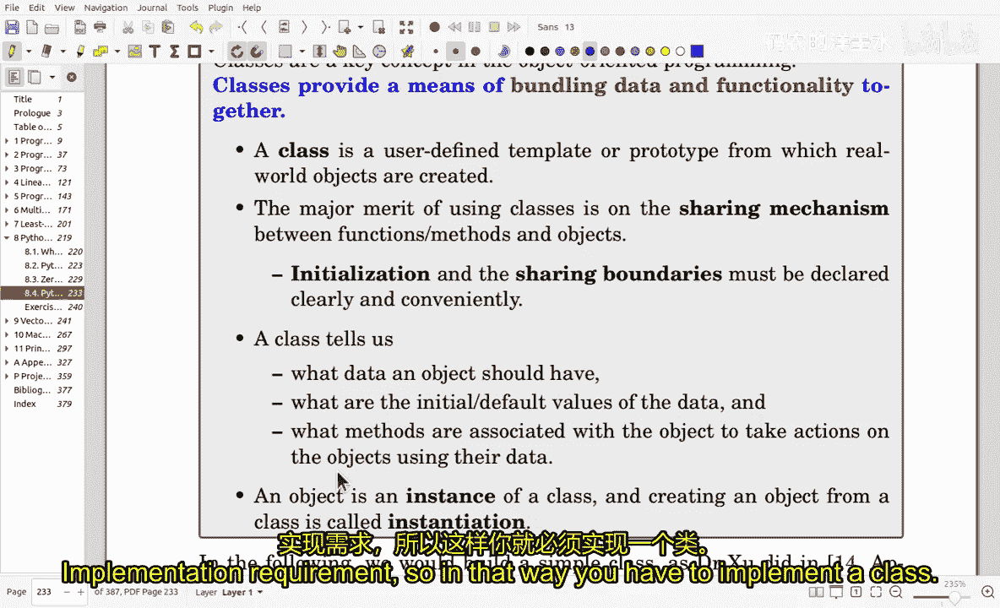

## 1. 什么是类？🧱

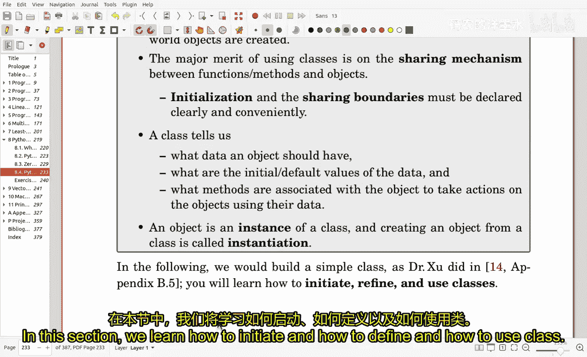

上一节我们介绍了编程的基本概念，本节中我们来看看 Python 中的类。

类是一种将数据和功能捆绑在一起的手段。它通常被定义为一个模板或原型，现实世界中的对象可以基于这个模板被创建出来。

使用类的主要机制在于函数和对象之间的共享。类中的函数被称为**方法**。初始化过程和数据共享的边界必须被清晰、方便地声明。

一个类会告诉我们：
*   对象应该包含哪些数据。
*   这些数据的初始默认值是什么。
*   有哪些方法与对象关联以执行操作。

这实际上是一种实现要求，因此你必须按照这种方式来实现类。

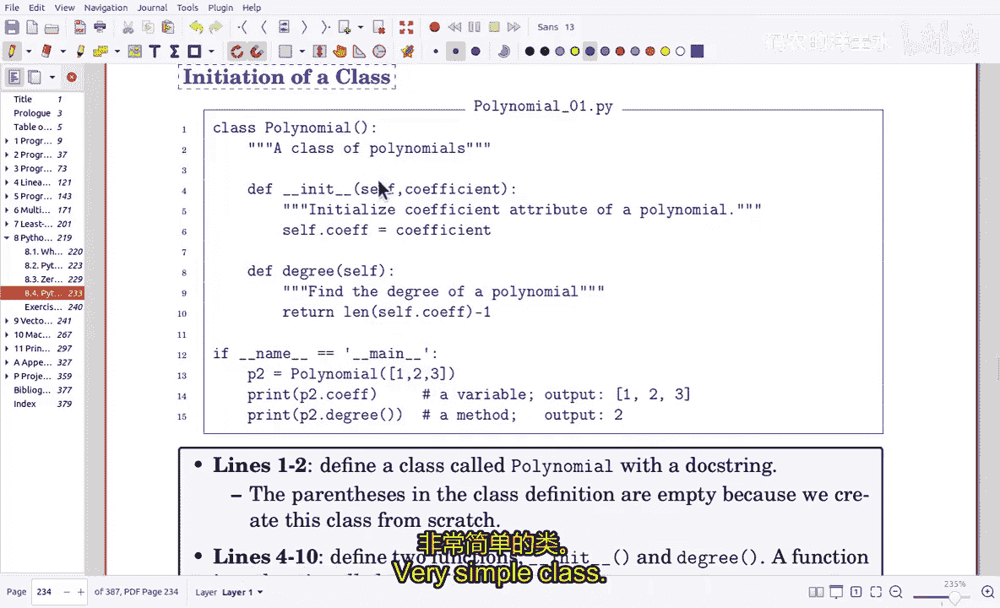

---

## 2. 创建对象与实例化 🏗️

一个对象是类的一个**实例**。从一个类创建对象的过程称为**实例化**。

在本节中，我们将构建一个简单的类，就像南卫理公会大学的数学教授 T. Su 在其书中所做的那样。我们将学习如何初始化、定义和使用类。

以下是一个简单的多项式类定义：

```python
class Polynomial:
    """这是一个表示多项式的类。"""

    def __init__(self, coeff):
        self.coeff = coeff

    def degree(self):
        return len(self.coeff) - 1
```

我们来解释一下这段代码：
*   `class Polynomial:` 定义了一个名为 `Polynomial` 的类。
*   `def __init__(self, coeff):` 这是一个特殊的**初始化方法**。当像 `p2 = Polynomial([1, 2, 3])` 这样创建对象时，它会自动被调用。
*   `self` 参数代表对象实例本身。通过 `self.coeff = coeff`，我们将传入的系数列表 `coeff` 存储为对象的一个属性。
*   一旦通过 `self.coeff` 存储，这个属性就可以被类中的其他所有方法共享和访问，也可以通过对象名（如 `p2.coeff`）从外部访问。
*   `degree` 方法计算并返回多项式的次数。它不需要额外输入，因为可以通过 `self.coeff` 访问到系数。

例如，对于多项式 `x^2 + 2x + 3`，系数列表是 `[1, 2, 3]`，次数为 2。

---

## 3. 类属性与更多方法 ⚙️

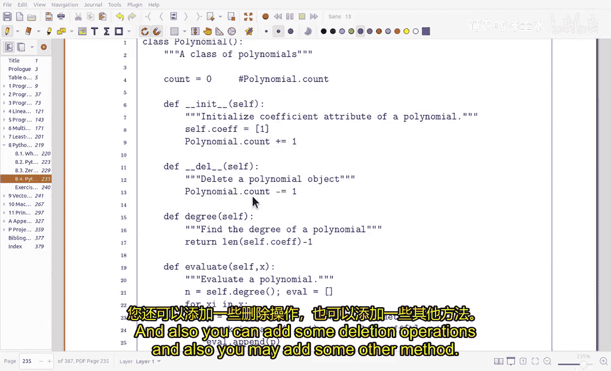

现在，我们尝试定义一个功能更丰富的多项式类。

```python
class Polynomial:
    """这是一个更高级的多项式类。"""
    count = 0  # 这是一个类属性

    def __init__(self, coeff=None):
        if coeff is None:
            coeff = [0]
        self.coeff = coeff
        Polynomial.count += 1  # 每创建一个对象，计数加1

    def __del__(self):
        Polynomial.count -= 1  # 对象被删除时，计数减1

    def degree(self):
        return len(self.coeff) - 1

    def evaluate(self, x):
        import numpy as np
        x = np.array(x)
        result = 0
        for i, c in enumerate(self.coeff):
            result += c * (x ** i)
        return result
```

以下是这个类的关键点：

*   **类属性**：`count = 0` 是在类内部但在所有方法之外定义的变量。它属于类本身，通过 `Polynomial.count` 访问，被所有对象共享，就像一个全局参数。
*   **`__init__` 方法**：现在它有一个默认参数 `coeff=None`。如果不提供系数，则默认创建一个 `[0]` 列表。每次初始化时，类属性 `count` 会增加 1，用于统计创建的对象数量。
*   **`__del__` 方法**：这是一个析构器。当对象被删除（例如使用 `del` 语句）时，它会自动调用，并将 `count` 减 1。
*   **`evaluate` 方法**：这个方法接收一组 x 值，计算多项式在这些点上的函数值并返回。

通过这种方式，你可以在类中定义全局变量、执行不同的初始化、添加删除操作以及其他自定义方法。

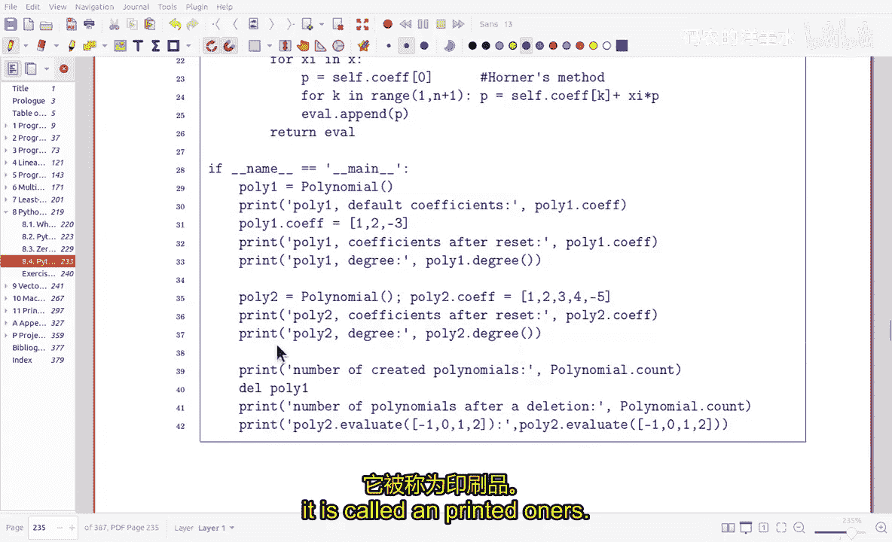

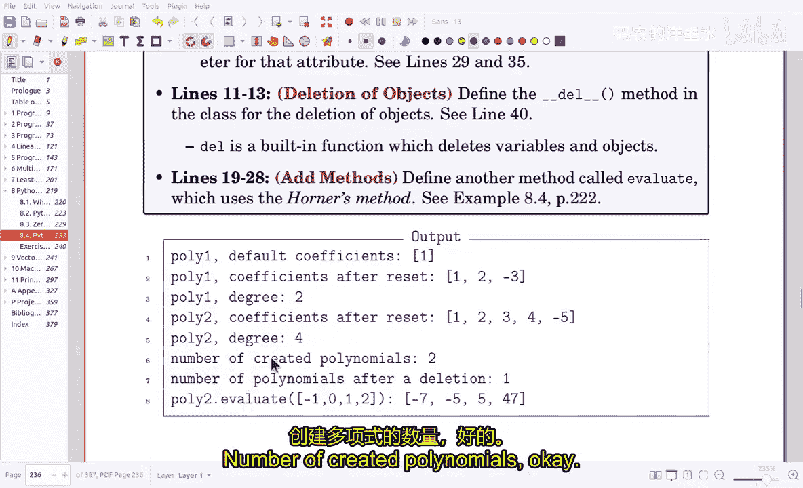

---

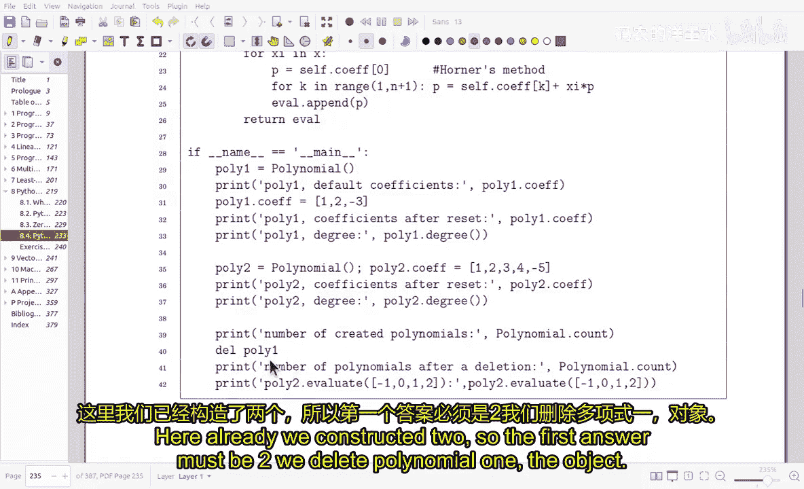

## 4. 使用类：示例演示 💻

让我们看看如何使用上面定义的类。

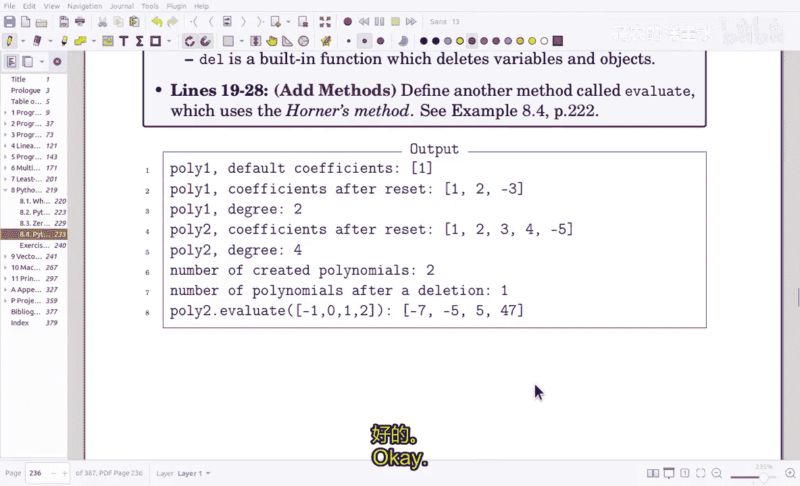

```python
# 创建第一个对象，使用默认系数
poly1 = Polynomial()
print(“poly1.coeff:”, poly1.coeff)  # 输出: [0]
print(“poly1.degree():”, poly1.degree())  # 输出: 0

# 手动赋值并检查
poly1.coeff = [1, 0, -3, 0, 5]
print(“After assignment - coeff:”, poly1.coeff)  # 输出: [1, 0, -3, 0, 5]
print(“After assignment - degree:”, poly1.degree())  # 输出: 4

# 创建第二个对象，传入系数
poly2 = Polynomial([2, -3, 0, 1])
print(“\npoly2.coeff:”, poly2.coeff)  # 输出: [2, -3, 0, 1]
print(“poly2.degree():”, poly2.degree())  # 输出: 3

# 检查创建的多项式数量
print(“\nNumber of polynomials created:”, Polynomial.count)  # 输出: 2

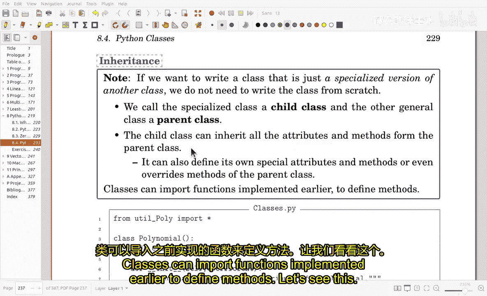

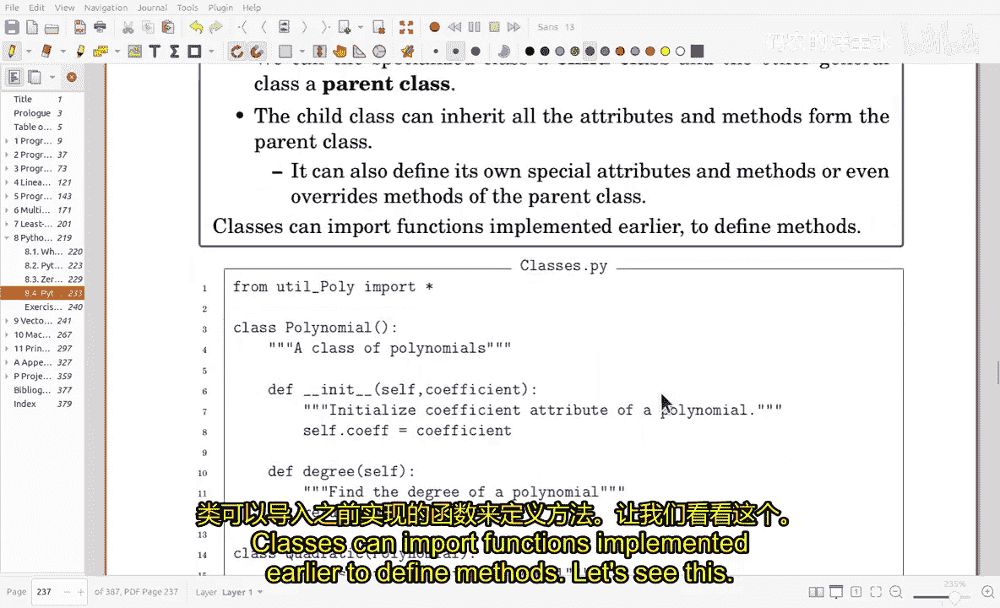

# 删除一个对象
del poly1
print(“After deletion, count:”, Polynomial.count)  # 输出: 1

# 评估多项式
x_vals = [0, 1, 2, 3]
values = poly2.evaluate(x_vals)
print(“\nEvaluation of poly2 at”, x_vals, “:”, values)
```

输出结果将展示对象的创建、属性访问、方法调用、类属性统计以及对象删除的整个过程。

---

## 5. 类的继承 👨‍👦

如果我们想编写一个类，它只是另一个已有类的特殊版本，我们不需要从头开始重写。我们可以使用**继承**。

被继承的类称为**父类**（或基类），新创建的类称为**子类**。子类可以继承父类的所有属性和方法，同时也可以定义自己特有的属性和方法，甚至可以**重写**父类的方法。

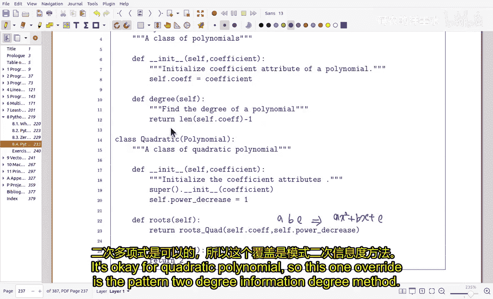

类可以导入外部已实现的函数来定义自己的方法。

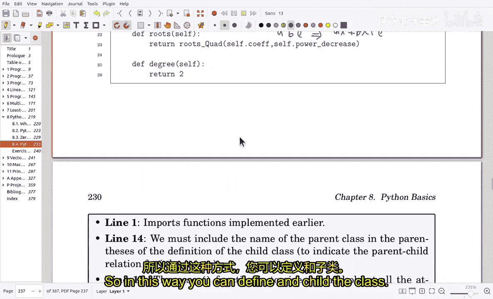

让我们看一个例子，创建一个 `Quadratic`（二次多项式）子类，它继承自 `Polynomial` 父类。

```python
from utility_poly import *  # 导入一个包含独立`roots`函数的工具模块

class Polynomial:
    # ... (父类定义与之前相同，略) ...

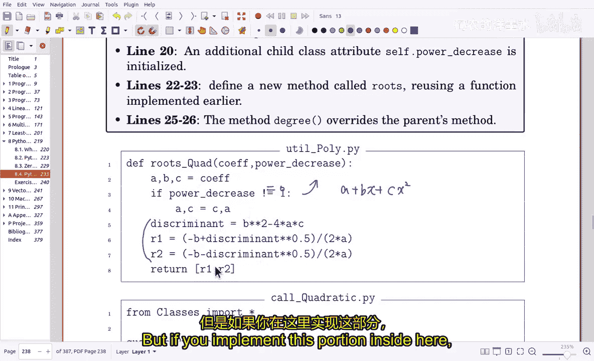

class Quadratic(Polynomial):  # Quadratic 继承自 Polynomial
    def __init__(self, coeff, power_decrease=1):
        super().__init__(coeff)  # 调用父类的初始化方法
        self.power_decrease = power_decrease  # 新增子类特有属性

    def roots(self):
        # 使用外部工具函数计算根，该函数不依赖于类变量
        return roots(self.coeff, self.power_decrease)

    def degree(self):  # 重写父类的方法
        return 2  # 对于二次多项式，次数总是2
```

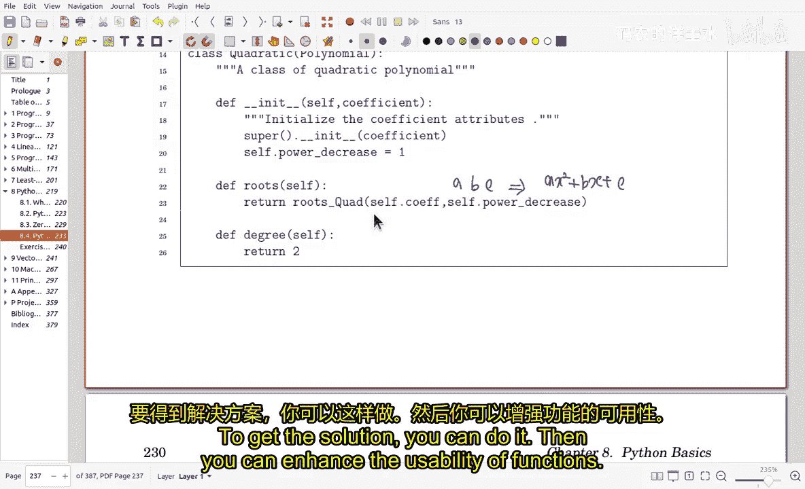

代码解析：
*   `class Quadratic(Polynomial):` 表示 `Quadratic` 是 `Polynomial` 的子类。
*   `super().__init__(coeff)` 调用父类的 `__init__` 方法来完成基础初始化。
*   `self.power_decrease = power_decrease` 添加了一个子类特有的属性，用于指示系数排列顺序（幂次递减或递增）。
*   `roots` 方法使用了从外部模块导入的独立函数 `roots()`。这样做的好处是 `roots()` 函数可以在其他项目中复用，而不依赖于这个类。
*   `degree` 方法被重写，对于二次多项式直接返回 2，而不是通过计算系数长度得到。

使用子类：
```python
# 创建一个二次多项式对象，系数按幂次递减排列 (2x^2 -3x + 1)
quad1 = Quadratic([2, -3, 1], power_decrease=1)
print(“Roots (power_decrease=1):”, quad1.roots())

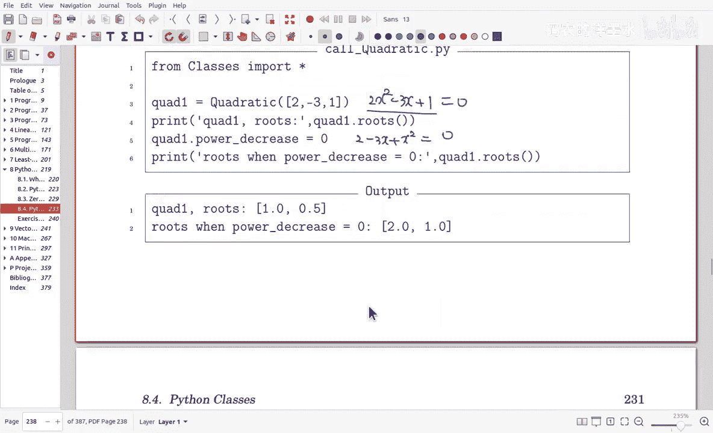

# 创建另一个对象，系数按幂次递增排列 (1 -3x + 2x^2)
quad2 = Quadratic([1, -3, 2], power_decrease=0)
print(“Roots (power_decrease=0):”, quad2.roots())
```

---

## 6. 总结与最佳实践 📝

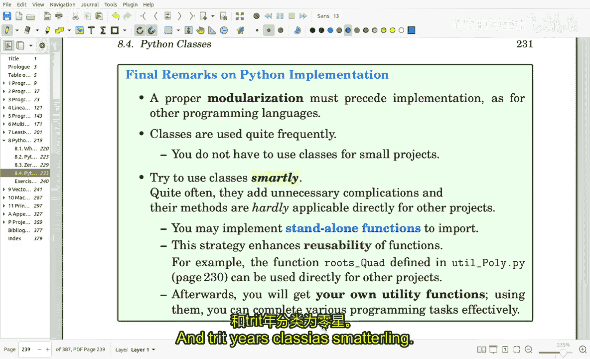

本节课中我们一起学习了 Python 类的核心概念和使用方法。

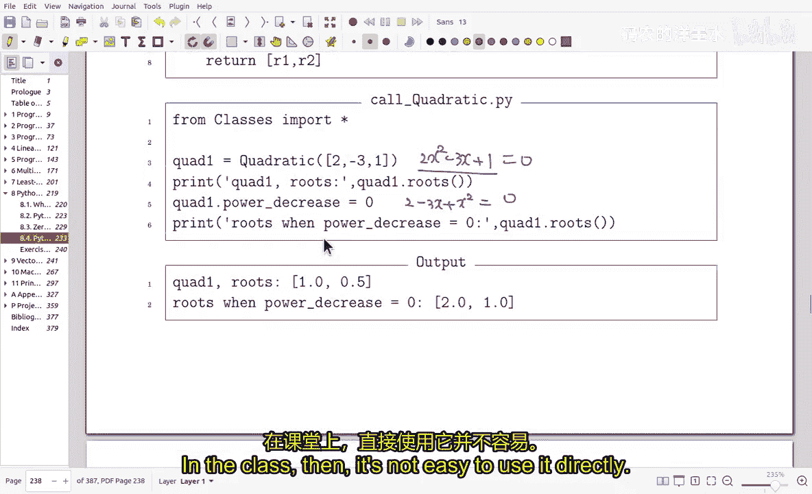

关于 Python 类的实现，有以下几点最终建议：
1.  **模块化设计优先**：与其它编程语言一样，在实现之前应进行良好的模块化设计。将整体操作分解为多个函数，每个函数负责一部分操作。
2.  **明智地使用类**：对于小型项目，不一定非要使用类。有时，类会增加不必要的复杂性，并且其方法很难直接应用于其他对象。
3.  **增强可复用性**：考虑实现独立的、不依赖于类内部状态的函数（就像我们例子中的 `roots()` 函数）。这些函数可以被轻松导入到其他项目中，从而增强代码的可复用性。
4.  **有效利用继承**：通过继承复用已有类的功能，并通过重写和添加方法来创建更特殊的子类。

尝试聪明地使用类，你就能成为一名优秀的程序员。

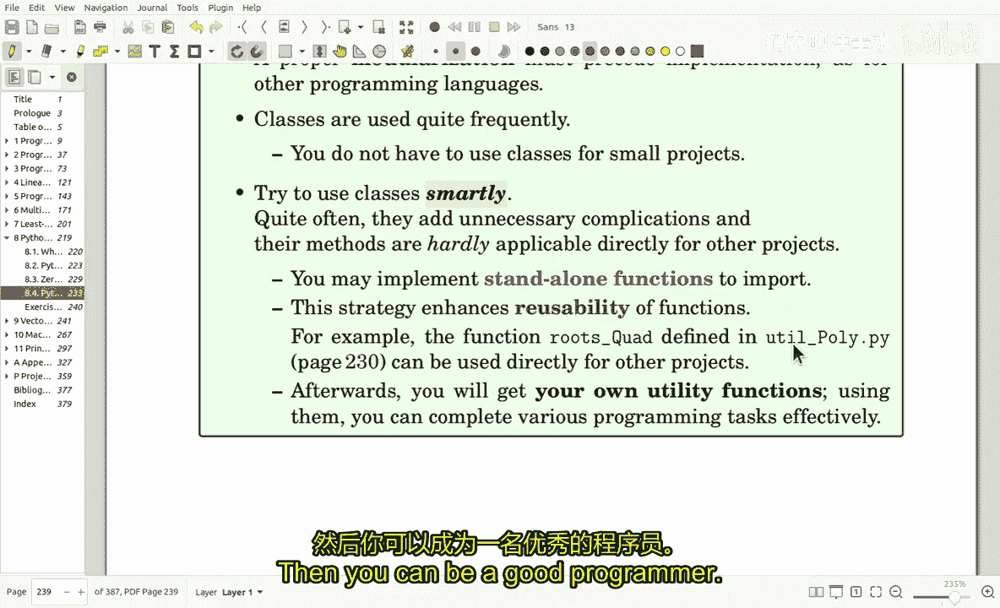

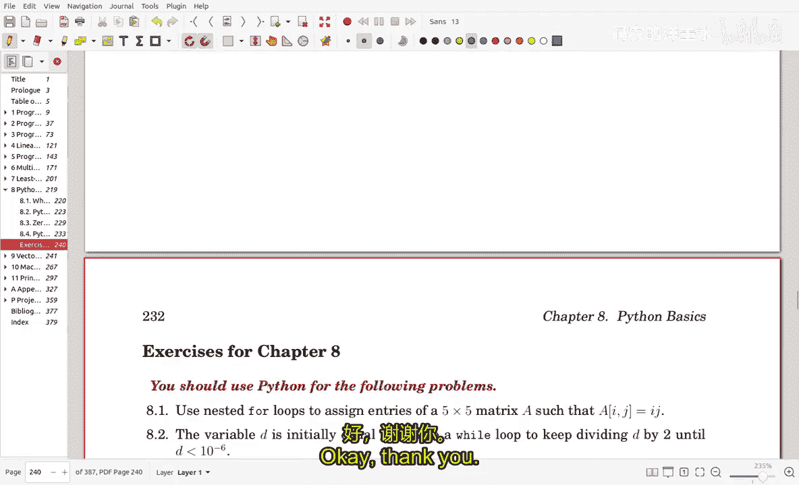

---
**本节课中我们一起学习了：**
*   类的定义、属性和方法。
*   如何实例化对象并使用它们。
*   类属性与实例属性的区别。
*   如何通过继承创建子类，并重写父类方法。
*   编写可复用代码的最佳实践，例如使用独立函数和明智地应用类。