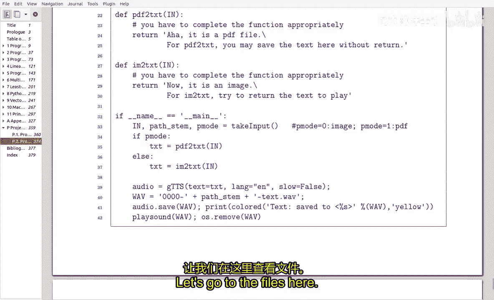
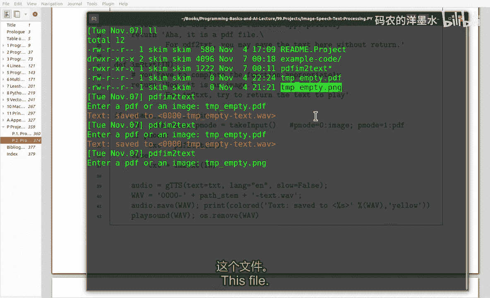
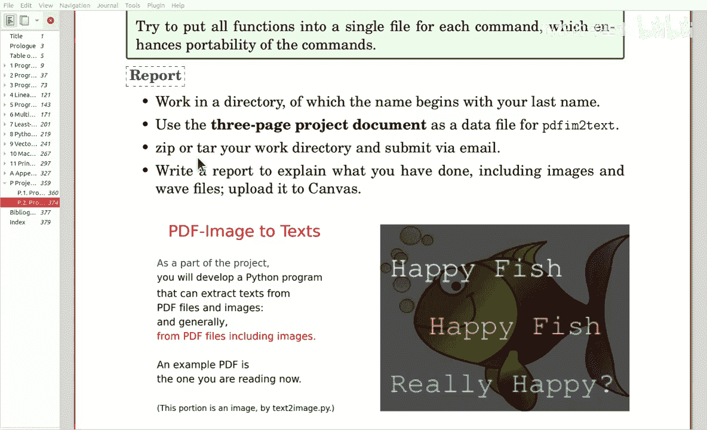

# 053：从图片、PDF文件和语音数据中提取文本

## 概述

在本节课中，我们将学习如何构建一个文本提取项目。该项目包含两个核心部分：一是从图像和PDF文件中提取文本，二是从语音数据中提取文本。我们将介绍所需的核心技术、库以及实现步骤，目标是让初学者能够理解并动手实践。

---

## 核心技术：OCR与语音识别

文本提取应用的核心技术是**OCR**和**语音识别**。

**OCR** 是光学字符识别技术，其主要功能是从图像中提取文本。在现代应用中，结合机器学习算法，OCR不仅能提取文本，还能将图像文本转换为音频文件以便收听。目前存在一些强大的文本提取工具，准确率可达98%以上，但大多数并非完全开源可用。

我们将开发两个文本提取算法：一个用于处理图像数据，另一个用于处理语音数据。

---

## 项目目标

我们将开发两个独立的Python程序：
1.  **PDF/图像转文本**
2.  **语音转文本**

### PDF/图像转文本
*   **输入**：可以是图像文件或PDF文件。你的代码需要能同时接受这两种形式。
*   **处理PDF**：PDF文件可能包含图像，尤其是在由扫描件生成的情况下。在这种情况下，每一页都应被视为一张图像。
*   **核心任务**：提取所有文本内容，并将其转换为音频数据。

### 语音转文本
*   **输入**：语音数据，可以来自麦克风或音频文件。
*   **核心任务**：从语音中提取文本内容，并可以播放出来。

---

## 示例：PDF/图像转文本程序

以下是实现PDF/图像转文本功能所需的主要库：

*   `pytesseract`：这是核心库，基于机器学习，用于从图像中提取文本。
*   `pdf2image`：此包用于将PDF文件转换为图像。
*   `PIL` / `Pillow`：用于图像处理。
*   `gTTS`：Google文本转语音库，质量很好。
*   `pygame`：用于播放生成的音频数据。
*   `os`：用于系统操作。
*   `colorama`：用于在控制台中彩色打印输出。

通过这些库，你可以了解程序的运行状态，并获取可能的警告或错误信息。

现在，让我们看看程序的主要流程。首先，`main`函数会执行。执行后，程序会提示你输入一个PDF文件或图像文件。

一旦你输入了文件路径，程序会尝试从文件名中获取主干名和扩展名。如果输入是PDF文件，则`pdf_mode`标志设为1，否则初始为0，表示是图像文件。然后，函数会返回输入的文件路径、主干名和`pdf_mode`标志。

根据`pdf_mode`的值，程序会调用不同的函数：如果为1，则调用`pdf_to_text`；否则，调用`image_to_text`。目前，这两个函数只是返回临时文本。

对于`pdf_to_text`函数，由于PDF提取的文本可能很大，你可以在此处将文本保存到文件中，而无需通过`return`返回。

对于`image_to_text`函数，你可以尝试返回文本以便播放。获取文本后，使用`gTTS`库将其转换为音频数据，并保存为文件。同时，程序会用黄色在控制台打印相关信息。你可以选择播放音频，也可以通过注释掉相关代码来仅保存文件。

---

## 项目文件与测试

项目目录中包含多个文件。例如，有两个空文件用于测试。通过执行程序并输入不同的文件（如PDF或图像），可以测试功能是否正常工作。

目录中还包含其他Python脚本，例如：
*   `add_text_to_image.py`：测试Google文本转语音。
*   `channel_rating_audio_data_and_image_to_text.py`：另一个图片处理示例。
*   `pdf_to_text.py`：PDF转文本。
*   `speech_microphone_to_wave.py`：处理麦克风音频。

这些文件提供了如何处理麦克风音频、如何保存和回放的示例代码，你可以从中获得实现提示。

---

## 作业任务与要求

以下是需要完成的任务：

1.  **下载资源**：下载提供的压缩文件并解压。查看`pdf_image_to_text.py`文件。
2.  **完成代码**：示例代码位于`example_code`子目录中。你需要首先完成`pdf_image_to_text.py`的功能。
    *   你可以从`pdf_to_text.py`文件中寻找线索。该文件是从网络下载的，由他人编写，但对于你完成此函数将非常有用。
3.  **独立完成第二部分**：对于第二个程序（语音转文本），你需要从零开始编写。本项目的目的是让你有机会从头开始构建一个程序。你可以从提供的两个示例文件中获得提示。
4.  **代码组织**：尝试将所有功能整合到单个文件中（每个命令对应一个文件）。这能增强命令的可移植性。如果将命令分散在多个文件中，则不易移动和复制。
5.  **工作目录**：你的工作目录名应以你的姓氏开头。
6.  **测试数据**：使用课程提供的30页项目文档作为PDF/图像转文本的测试数据文件。原因是该文档部分页面包含图像，并且有些文本是横向排列、分两行的，或者字体大小不同，这可以测试你的程序是否能正确识别和合并这些文本。
7.  **提交**：将你的工作目录压缩为ZIP文件，通过电子邮件提交。报告需解释你所完成的工作，包括测试图像和输出文件。同时，将文件上传到课程指定的系统。

---

## 总结

本节课我们一起学习了如何构建一个综合的文本提取项目。我们介绍了从图像和PDF中提取文本的OCR技术，以及从语音中提取文本的基本概念。通过分析示例代码和项目要求，我们明确了实现两个独立程序（PDF/图像转文本、语音转文本）的步骤、所需库以及代码组织方式。最后，我们了解了具体的作业任务、测试方法和提交要求。希望你能通过动手实践，掌握这些人工智能编程的基础应用。