# 054：向量空间与正交性

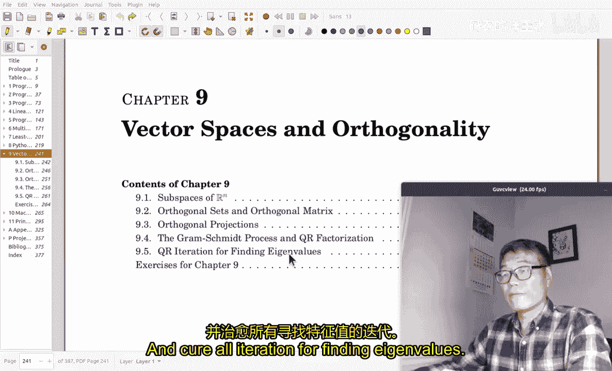

在本章中，我们将学习一些线性代数的核心概念。主要主题包括格拉姆-施密特正交化过程、QR分解，以及用于寻找特征值的QR迭代算法。

## 9.1：Rn的子空间

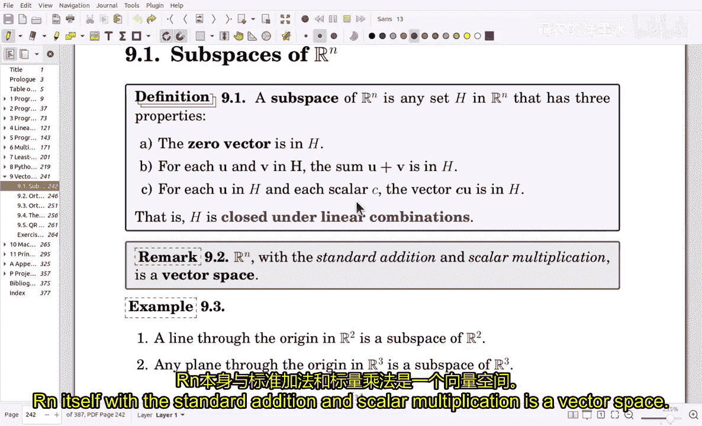

本节我们将介绍Rn中子空间的定义和基本性质。

一个集合H要成为Rn的子空间，必须满足以下三个性质：
1.  零向量在集合中。
2.  对于H中的任意向量u和v，它们的和u+v也在集合中。
3.  对于H中的任意向量u和任意标量c，标量乘法c·u的结果也在集合中。

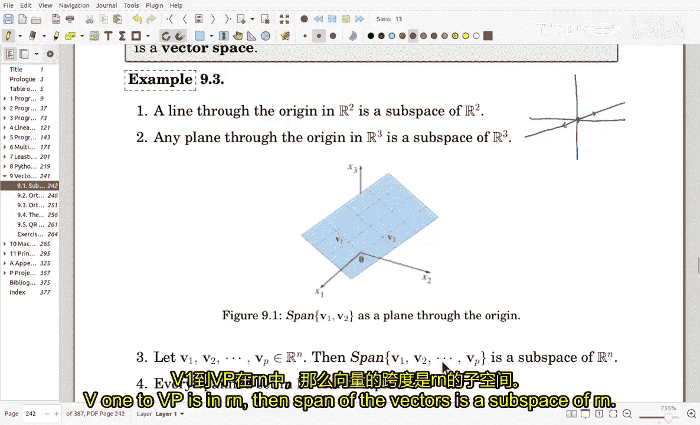

如果这三个条件都满足，那么该集合就是Rn的一个子空间。这三个条件可以简洁地表达为：**H对线性组合封闭**。这意味着它必须包含零向量，并且对向量加法和标量乘法封闭。

Rn本身，连同标准的向量加法和标量乘法，构成一个向量空间。

以下是子空间的例子：
*   **R2中通过原点的直线**是R2的一个子空间。在二维坐标系中，选择一条通过原点的直线。零向量（原点）在直线上。如果选择直线上的任意两个向量，它们的和仍在直线上。同样，直线上任意向量的标量倍数也仍在直线上。
*   **R3中通过原点的平面**是R3的一个子空间。可以验证，该平面上向量的任意线性组合仍在该平面上。这个平面可以表示为两个向量v1和v2的张成空间。

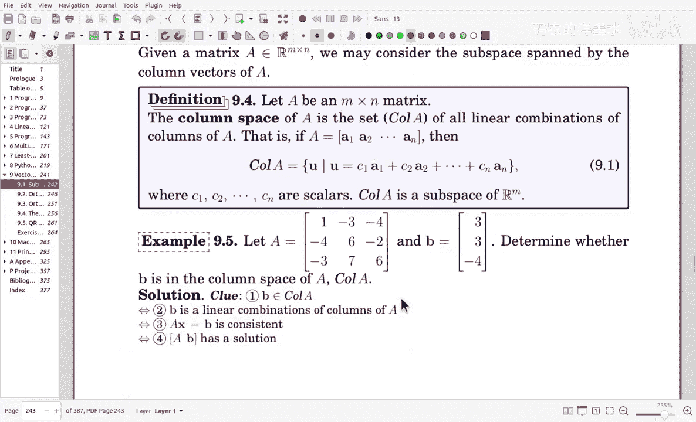

### 列空间

给定一组向量v1, ..., vp，它们的**张成空间**（span）是所有这些向量所有可能线性组合的集合。根据定义，张成空间对线性组合封闭，因此它是Rn的一个子空间。

现在，考虑一个m×n的矩阵A。由A的列向量张成的子空间称为A的**列空间**，记作Col A。

**列空间的定义**：
`Col A = { 所有形如 c1*a1 + c2*a2 + ... + cn*an 的向量 }`
其中，c1到cn是任意标量，a1到an是矩阵A的列向量。

由于每个列向量都属于Rm，它们的线性组合也属于Rm，因此Col A是Rm的一个子空间。

**示例：判断向量是否在列空间中**

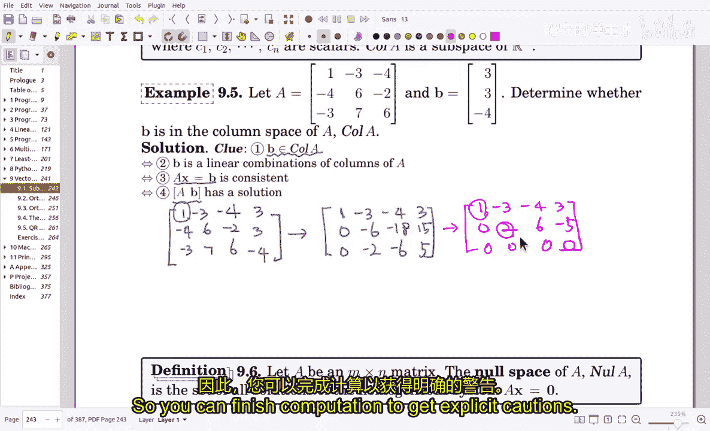

给定矩阵A和向量b，判断b是否在Col A中。

如果b在Col A中，则意味着b是A的列向量的一个线性组合。这个条件等价于线性方程组 `A x = b` 有解（即系统是相容的）。因此，我们可以通过求解增广矩阵 `[A b]` 来判断。

例如，给定矩阵A和向量b：
```
A = [1  -3   0  -4;
    -4   6  -2   3;
     7  -6   7   6]
b = [30; 30; -4]
```
我们构建增广矩阵并进行行化简。经过一系列初等行变换后，我们得到一个行阶梯形矩阵，其中存在主元列和自由变量。这表明方程组 `A x = b` 有无穷多解。因此，**b在矩阵A的列空间中**。

### 零空间

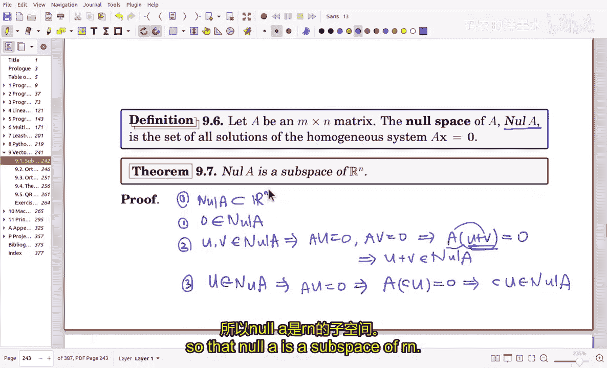

对于一个m×n矩阵A，其**零空间**（记作Nul A）是齐次线性方程组 `A x = 0` 的所有解向量的集合。

**零空间的定义**：
`Nul A = { x ∈ Rn : A x = 0 }`

零空间是Rn的一个子空间。我们可以验证其满足子空间的三个条件：
1.  **零向量**：显然，`A * 0 = 0`，所以零向量在Nul A中。
2.  **对加法封闭**：如果u和v都在Nul A中（即 `A u = 0` 且 `A v = 0`），那么 `A(u+v) = A u + A v = 0 + 0 = 0`，所以 `u+v` 也在Nul A中。
3.  **对标量乘法封闭**：如果u在Nul A中（即 `A u = 0`），那么对于任意标量c，有 `A(c u) = c (A u) = c * 0 = 0`，所以 `c u` 也在Nul A中。

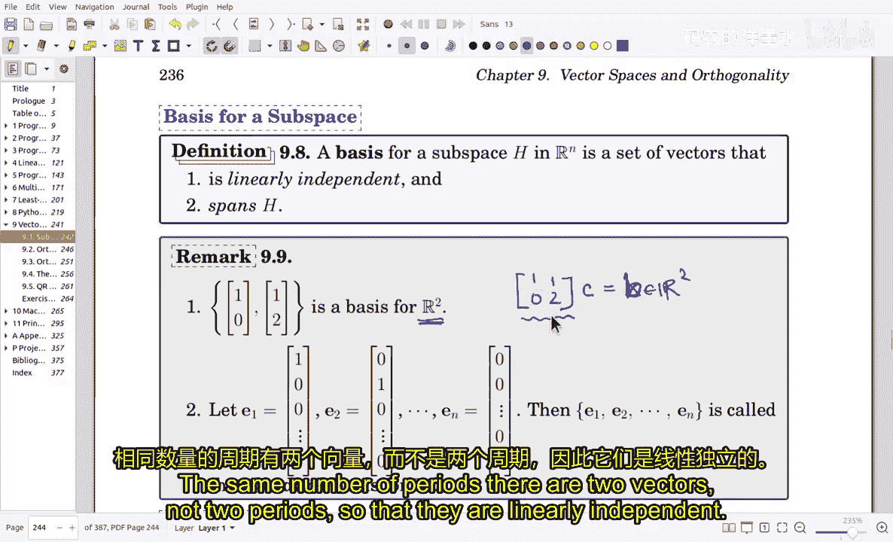

因此，Nul A是Rn的一个子空间。

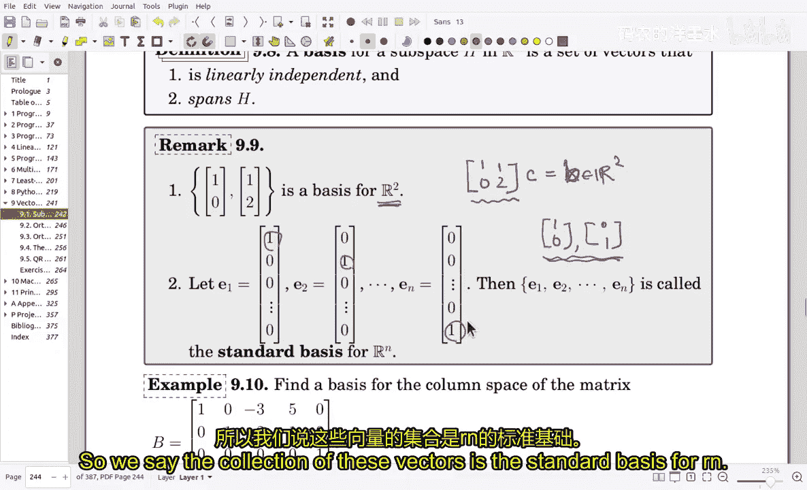

### 子空间的基

子空间H的一个**基**是一组满足以下两个条件的向量集合：
1.  它们是**线性无关**的。
2.  它们**张成**整个子空间H。

例如，在R2中，向量 `[1; 0]` 和 `[1; 2]` 构成R2的一个基。由它们构成的矩阵 `[1 1; 0 2]` 是可逆的，这意味着对于R2中的任意向量v，方程组 `[1 1; 0 2] * x = v` 都有唯一解x。因此，这两个向量张成整个R2，并且它们是线性无关的。

**标准基**：向量 `e1 = [1; 0; ...; 0]`, `e2 = [0; 1; ...; 0]`, ..., `en = [0; 0; ...; 1]` 称为Rn的**标准基**。这组向量线性无关，并且能张成整个Rn。

### 寻找列空间和零空间的基

**寻找列空间的基**：
矩阵A的**主元列**（在行阶梯形中具有主元的列）构成Col A的一个基。非主元列可以表示为前面主元列的线性组合，因此主元列本身就已经是线性无关的，并且能张成整个列空间。

**示例**：
给定矩阵B，其行阶梯形如下：
```
[1  0  -3   5  0;
 0  1   2  -1  0;
 0  0   0   0  1]
```
主元列是第1、2、5列。因此，**原矩阵B的第1、2、5列**构成Col B的一个基。

**寻找零空间的基**：
通过求解齐次方程组 `A x = 0`，并将解表示为参数向量形式，其中自由变量对应的系数向量就构成了Nul A的一个基。

**示例**：
给定矩阵A，经过行化简得到：
```
[1  0  2  0;
 0  1 -1  0;
 0  0  0  1]
```
对应的齐次方程组为：
`x1 + 2*x3 = 0`
`x2 - x3 = 0`
`x4 = 0`
这里，`x3` 是自由变量。令 `x3 = t`，则解为 `x = t * [-2; 1; 1; 0]`。因此，向量 `[-2; 1; 1; 0]` 构成了Nul A的一个基。

更一般地，如果方程组 `A x = 0` 的解有k个自由变量 `x_{i1}, ..., x_{ik}`，其通解可以写成：
`x = x_{i1} * u1 + ... + x_{ik} * uk`
那么向量 `u1, ..., uk` 就构成了Nul A的一个基。

### 秩定理

秩定理揭示了矩阵的列空间和零空间维度之间的重要关系。

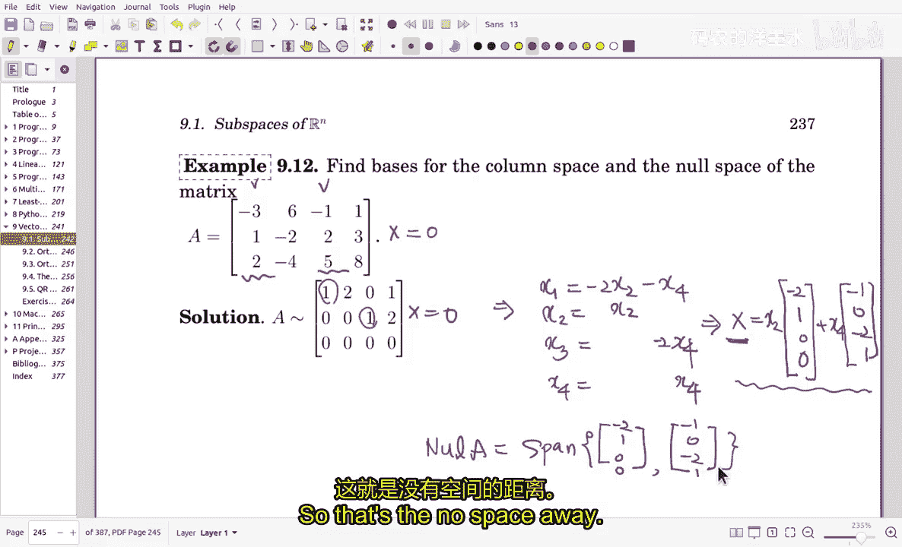

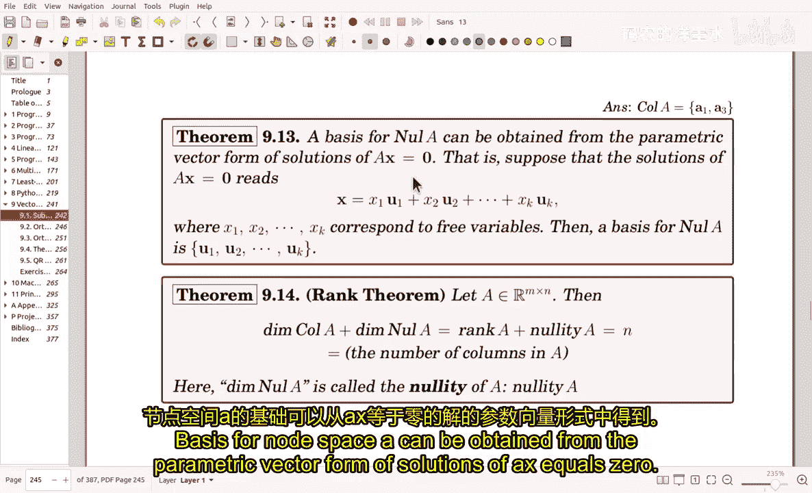

设A是一个m×n矩阵。
*   **秩**（Rank）：矩阵A的秩，记作rank A，是其**列空间的维度**，也等于其行阶梯形中**主元列的个数**。
*   **零度**（Nullity）：矩阵A的零度，记作nullity A，是其**零空间的维度**，也等于齐次方程组 `A x = 0` 中**自由变量的个数**。

**秩定理**：
`rank A + nullity A = n`
其中n是矩阵A的列数。

这个定理是直观的：主元列的个数（秩）加上自由变量的个数（零度），正好等于总的列数。

---

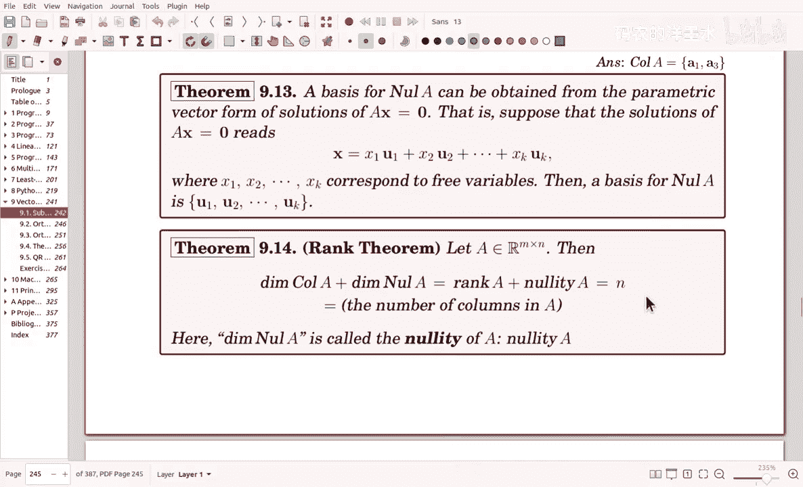

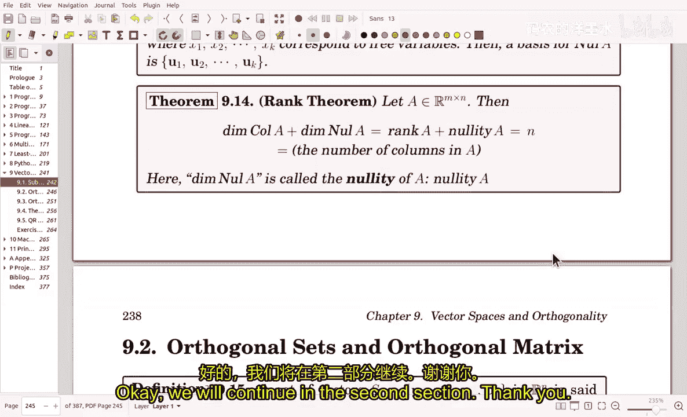

**本章总结**：
在本节中，我们一起学习了Rn中子空间的核心概念。我们定义了子空间，并介绍了两个重要的子空间：由矩阵列向量张成的**列空间**（Col A）和齐次方程组解集构成的**零空间**（Nul A）。我们学习了如何为子空间寻找一组**基**，并理解了**秩定理**如何将列空间的维度（秩）与零空间的维度（零度）联系起来。这些概念是理解矩阵结构和线性方程组解集的基础。在下一节中，我们将继续探讨向量空间的正交性。