# 055：第55讲 - 正交集与正交矩阵 📐

在本节课中，我们将学习线性代数中两个核心概念：**正交集**与**正交矩阵**。我们将了解它们的定义、性质以及如何应用它们来简化向量投影和线性组合的计算。这些概念是理解许多高级算法（如QR分解）的基础。

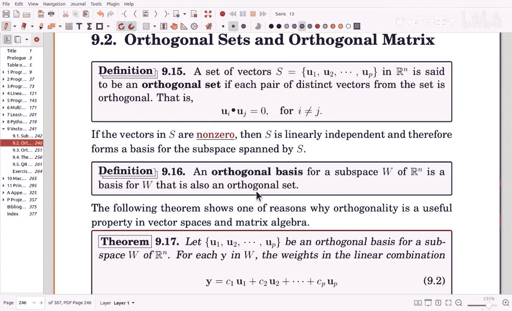

## 正交基与正交投影

上一节我们介绍了向量空间的基本概念。本节中，我们来看看一种特殊的向量集——正交集。

### 正交集与正交基

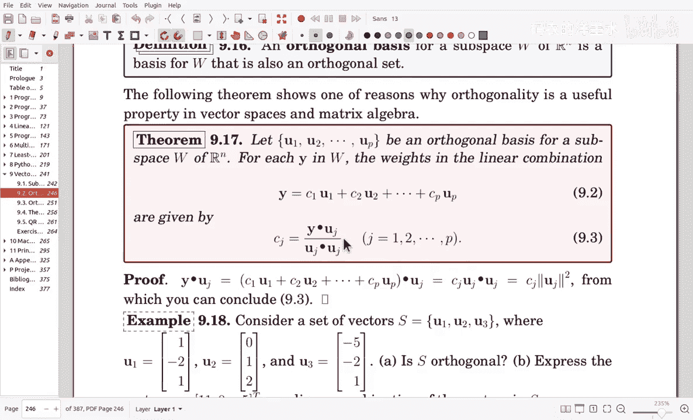

一个向量集合 {**u**₁, **u**₂, ..., **u**_p} 在 ℝⁿ 中被称为**正交集**，如果集合中任意两个不同的向量都是正交的。这意味着对于所有 i ≠ j，都有 **u**_i · **u**_j = 0。

如果正交集内的所有向量都是非零向量，那么该集合必然是线性无关的。因此，由该集合张成的子空间 W 中，这个正交集就构成了 W 的一个**正交基**。

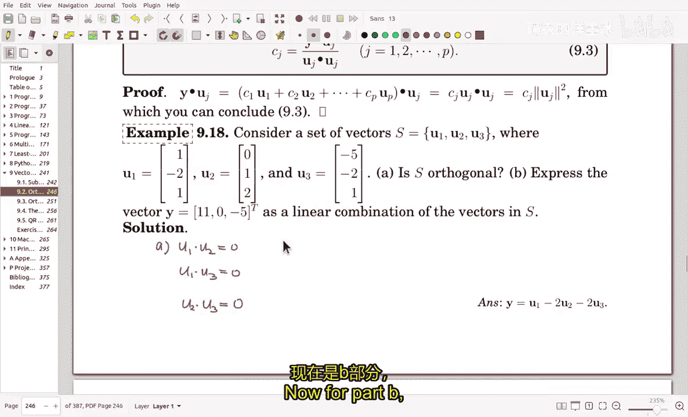

**公式**：对于正交集中的任意两个不同向量，有 **u**_i · **u**_j = 0 (i ≠ j)。

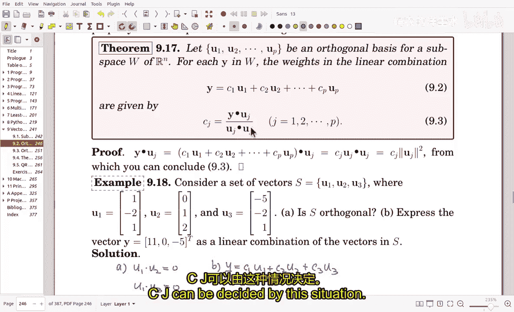

正交性之所以有用，一个重要原因是它能极大简化向量在子空间中的坐标计算。

### 正交基下的坐标计算

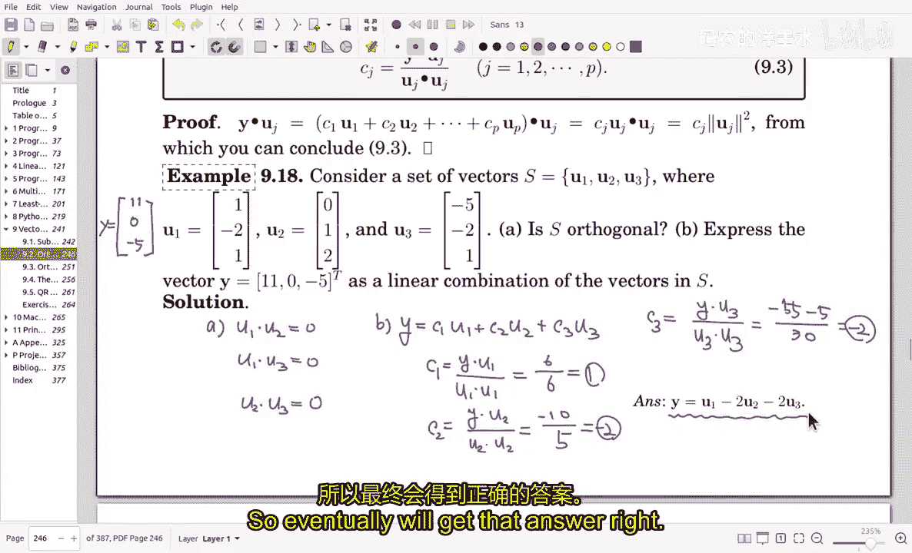

假设 {**u**₁, **u**₂, ..., **u**_p} 是子空间 W 的一个正交基。那么，对于 W 中的任意向量 **y**，我们可以将其表示为基向量的线性组合：**y** = c₁**u**₁ + c₂**u**₂ + ... + c_p**u**_p。

以下是计算每个系数 c_j 的简单方法：

1.  对等式两边同时与基向量 **u**_j 做点积。
2.  由于正交性，所有 i ≠ j 的项 **u**_i · **u**_j 都为零。
3.  我们得到：**y** · **u**_j = c_j (**u**_j · **u**_j)。
4.  因此，系数 c_j 可以轻松解出：c_j = (**y** · **u**_j) / (**u**_j · **u**_j)。

**公式**：c_j = (**y** · **u**_j) / (**u**_j · **u**_j)

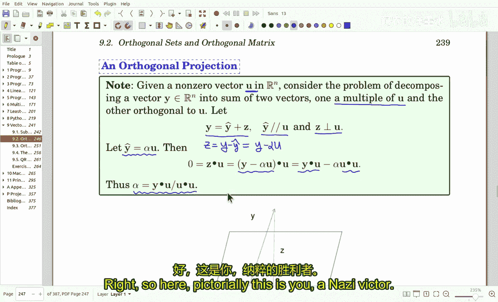

### 示例：利用正交性分解向量

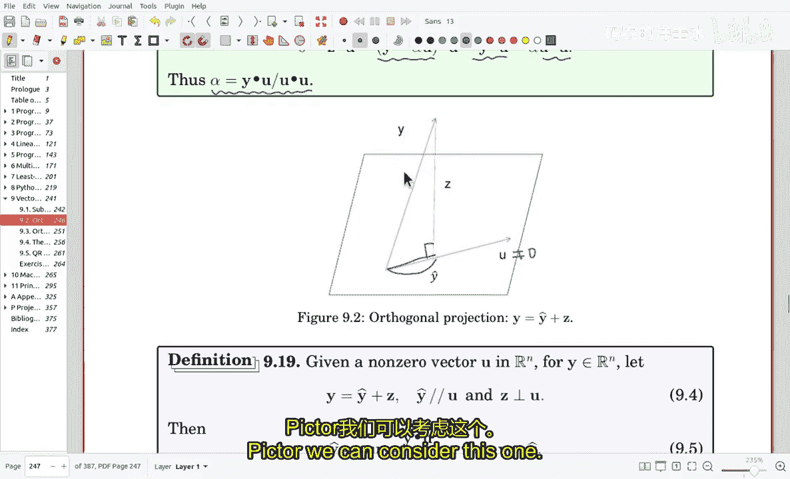

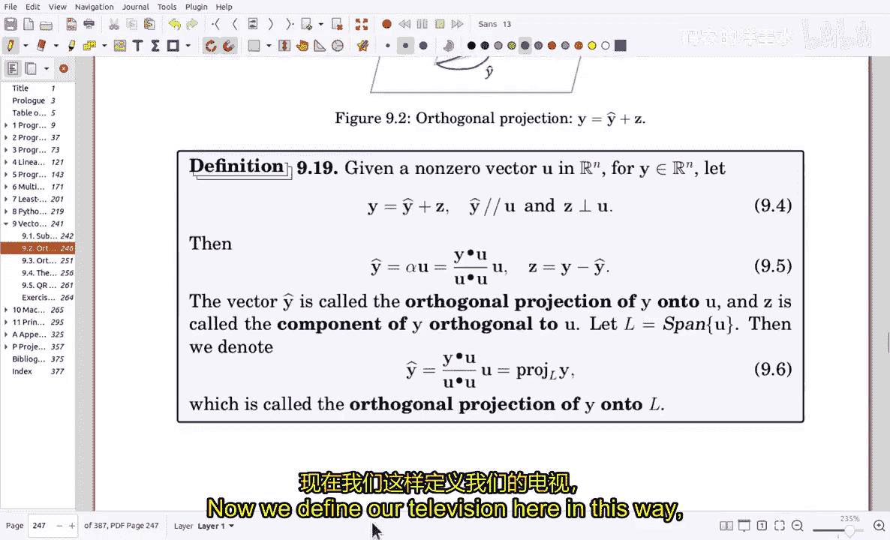

考虑一个正交向量集 S = {**u**₁, **u**₂, **u**₃}，其中：
**u**₁ = [1, -2, 1], **u**₂ = [0, 1, 2], **u**₃ = [-5, -2, 1]。
向量 **y** = [11, 0, -5]。

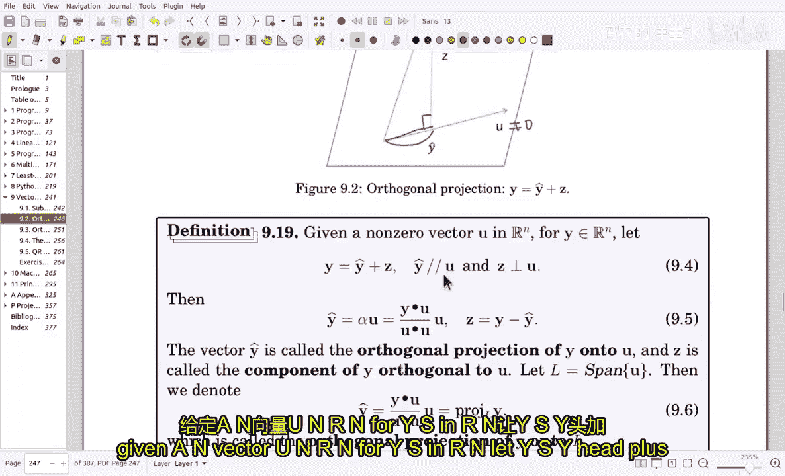

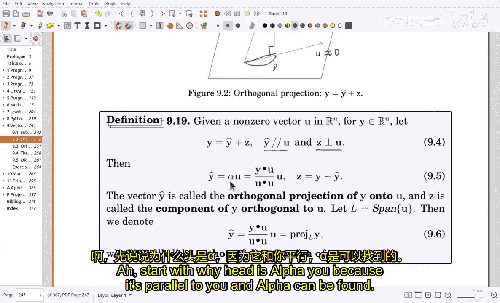

我们的目标是将 **y** 表示为 S 中向量的线性组合：**y** = c₁**u**₁ + c₂**u**₂ + c₃**u**₃。

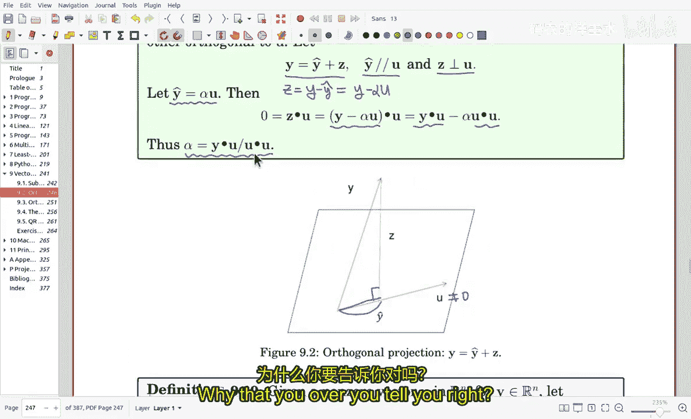

首先验证 S 是正交集（点积均为0），然后应用上述公式：
c₁ = (**y**·**u**₁)/(**u**₁·**u**₁) = 6/6 = 1
c₂ = (**y**·**u**₂)/(**u**₂·**u**₂) = (-10)/5 = -2
c₃ = (**y**·**u**₃)/(**u**₃·**u**₃) = (-60)/30 = -2

因此，**y** = 1***u**₁ - 2***u**₂ - 2***u**₃。

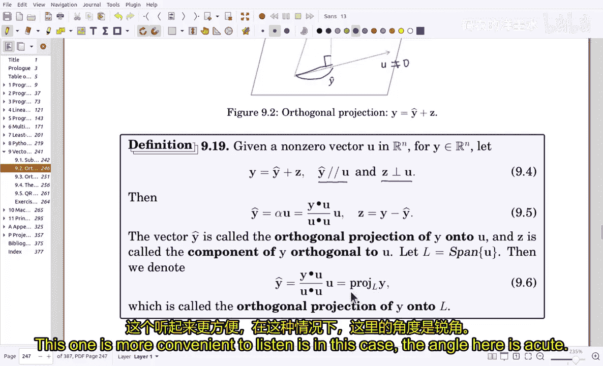

---

## 向量的正交投影

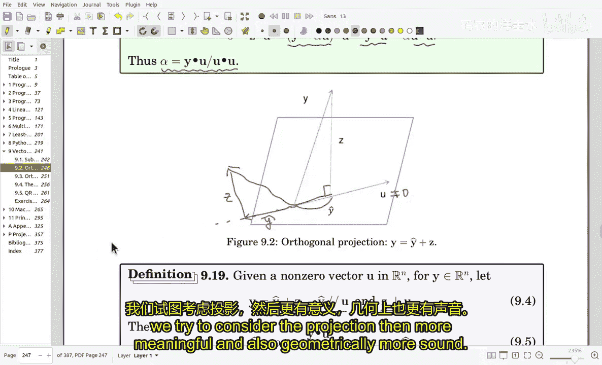

理解了正交基后，我们来看一个更具体的应用：将一个向量分解为平行于和垂直于另一个向量的两部分。

### 投影的定义与计算

给定一个非零向量 **u** ∈ ℝⁿ，我们希望将向量 **y** 分解为：
**y** = **ŷ** + **z**
其中，**ŷ** 平行于 **u**（即 **ŷ** = α**u**），而 **z** 正交于 **u**（即 **z** · **u** = 0）。

向量 **ŷ** 被称为 **y** 在 **u** 上的**正交投影**，**z** 是 **y** 正交于 **u** 的分量。

为了找到 α，我们利用 **z** 与 **u** 正交的条件：
**z** = **y** - **ŷ** = **y** - α**u**
(**y** - α**u**) · **u** = 0
解得：α = (**y** · **u**) / (**u** · **u**)

因此，投影 **ŷ** 的计算公式为：
**ŷ** = [ (**y** · **u**) / (**u** · **u**) ] * **u**

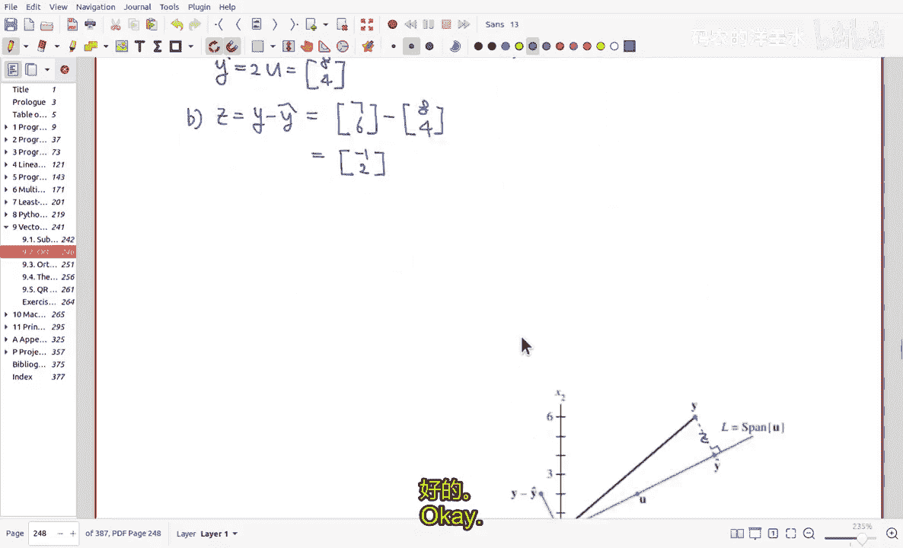

**公式**：**ŷ** = proj\_L(**y**) = ( (**y**·**u**) / (**u**·**u**) ) * **u**，其中 L = Span{**u**}。

更一般地，我们常说 **y** 在由 **u** 张成的直线 L 上的投影，记为 proj\_L(**y**)。这在几何上更直观，无论 **y** 与 **u** 的夹角是锐角还是钝角，投影都落在直线 L 上。

### 示例：计算投影与距离

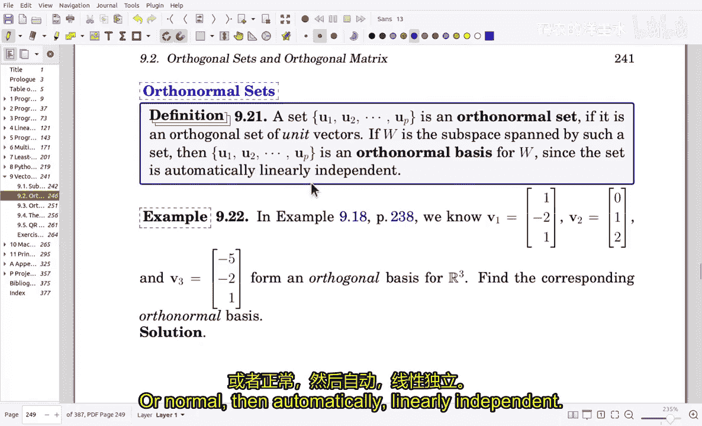

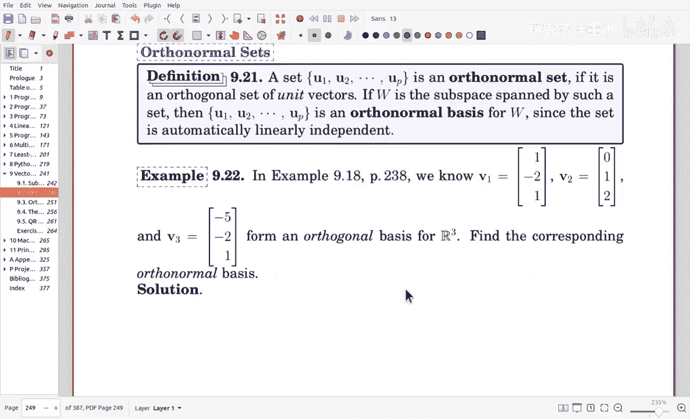

给定 **y** = [7, 6]，**u** = [4, 2]。设 L 为由 **u** 张成的直线。

**a. 求 **y** 在 **u** 上的投影。**
α = (**y**·**u**)/(**u**·**u**) = (28+12)/(16+4) = 40/20 = 2
**ŷ** = 2 * **u** = [8, 4]

**b. 将 **y** 写成 **ŷ** 与一个垂直于 **u** 的向量 **z** 的和。**
**z** = **y** - **ŷ** = [7, 6] - [8, 4] = [-1, 2]
验证：**ŷ** · **z** = (8*-1) + (4*2) = 0，正确。

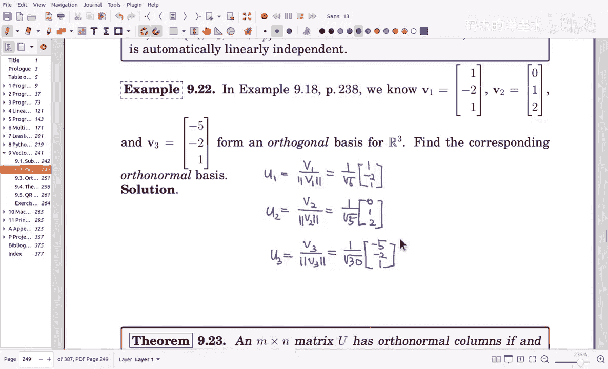

**c. 求 **y** 到直线 L 的距离。**
这个距离就是正交分量 **z** 的长度。
距离 = ||**z**|| = √((-1)² + 2²) = √5

---

## 标准正交基与正交矩阵

上一节我们处理了正交投影。本节中，我们来看看当正交向量具有单位长度时，会带来哪些更优美的性质。

### 标准正交集与标准正交基

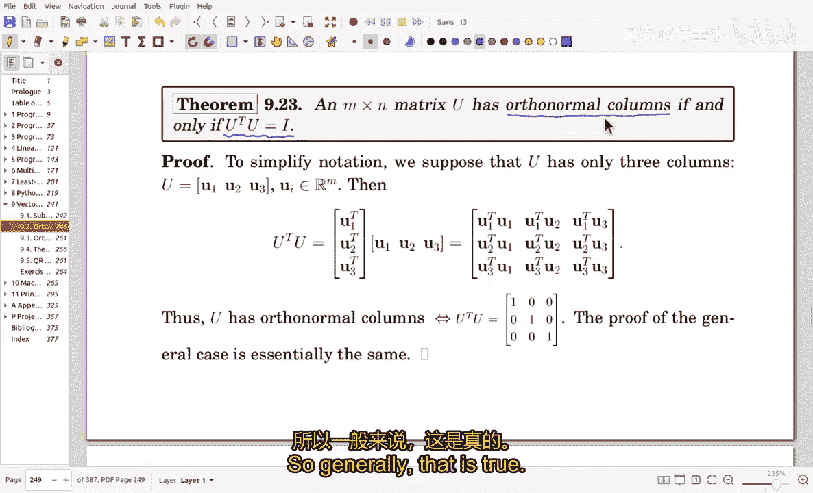

如果一个正交集 {**u**₁, **u**₂, ..., **u**_p} 中的每个向量都是**单位向量**（即长度为1），则称该集合为**标准正交集**。

如果一个子空间 W 的基同时是一个标准正交集，则称该基为 W 的**标准正交基**。

**示例**：已知 {**v**₁, **v**₂, **v**₃} 是 ℝ³ 的一个正交基，其中 **v**₁=[1,-2,1], **v**₂=[0,1,2], **v**₃=[-5,-2,1]。要得到对应的标准正交基，只需将每个向量单位化：
**u**₁ = **v**₁ / ||**v**₁|| = (1/√6)[1, -2, 1]
**u**₂ = **v**₂ / ||**v**₂|| = (1/√5)[0, 1, 2]
**u**₃ = **v**₃ / ||**v**₃|| = (1/√30)[-5, -2, 1]

### 具有标准正交列的矩阵

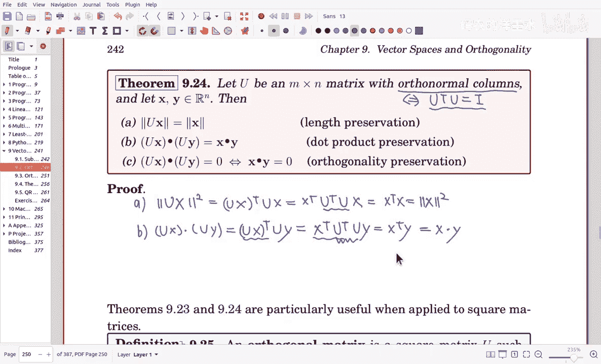

设 **U** 是一个 m × n 矩阵。如果 **U** 的列向量构成一个标准正交集，则称 **U** 具有**标准正交列**。

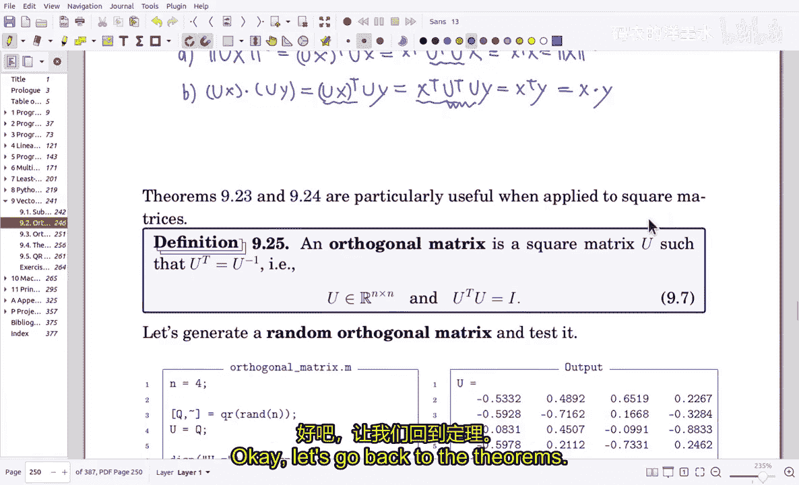

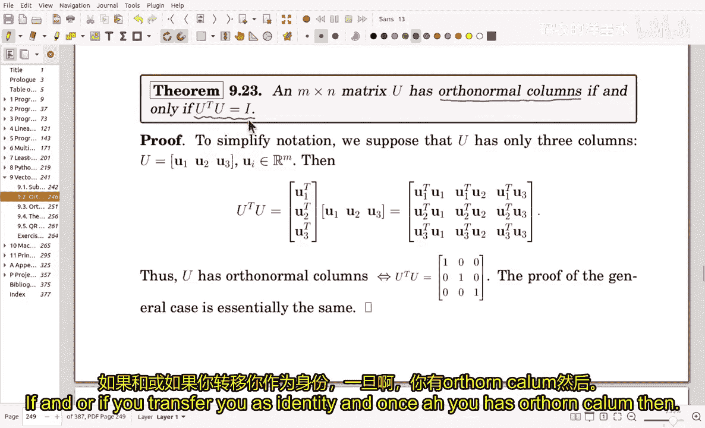

一个关键性质是：矩阵 **U** 具有标准正交列，当且仅当 **U**ᵀ**U** = **I**_n（n阶单位矩阵）。
**证明思路**：**U**ᵀ**U** 的第 (i, j) 元素就是 **U** 的第 i 列与第 j 列的点积。标准正交意味着对角线元素（i=j）为1，非对角线元素（i≠j）为0。

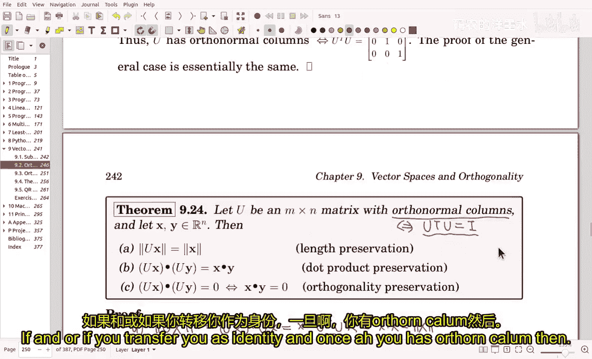

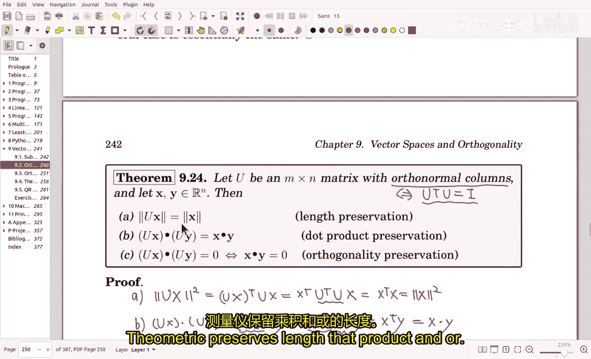

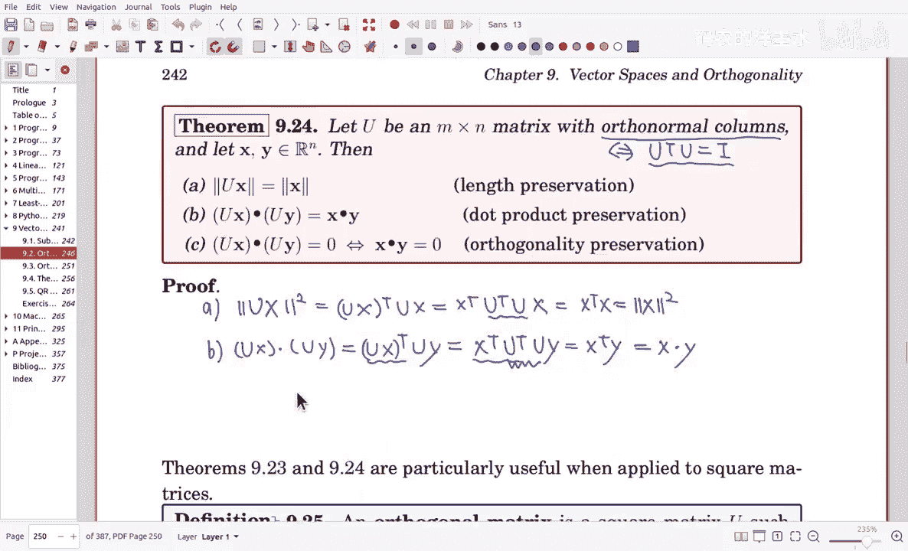

### 正交矩阵及其性质

当矩阵 **U** 是**方阵**（即 m = n）且具有标准正交列时，我们给它一个特殊的名字：**正交矩阵**。

对于一个 n × n 的正交矩阵 **U**，其定义等价于以下任一条件：
1.  **U**ᵀ**U** = **U****U**ᵀ = **I**_n
2.  **U**ᵀ = **U**⁻¹ （即其转置等于其逆矩阵）

正交矩阵具有非常重要的保性质变换特性：
1.  **保长度**：对于任意向量 **x** ∈ ℝⁿ，有 ||**Ux**|| = ||**x**||。
2.  **保点积**：对于任意向量 **x**, **y** ∈ ℝⁿ，有 (**Ux**) · (**Uy**) = **x** · **y**。
3.  **保正交性**：若 **x** ⊥ **y**，则 **Ux** ⊥ **Uy**。

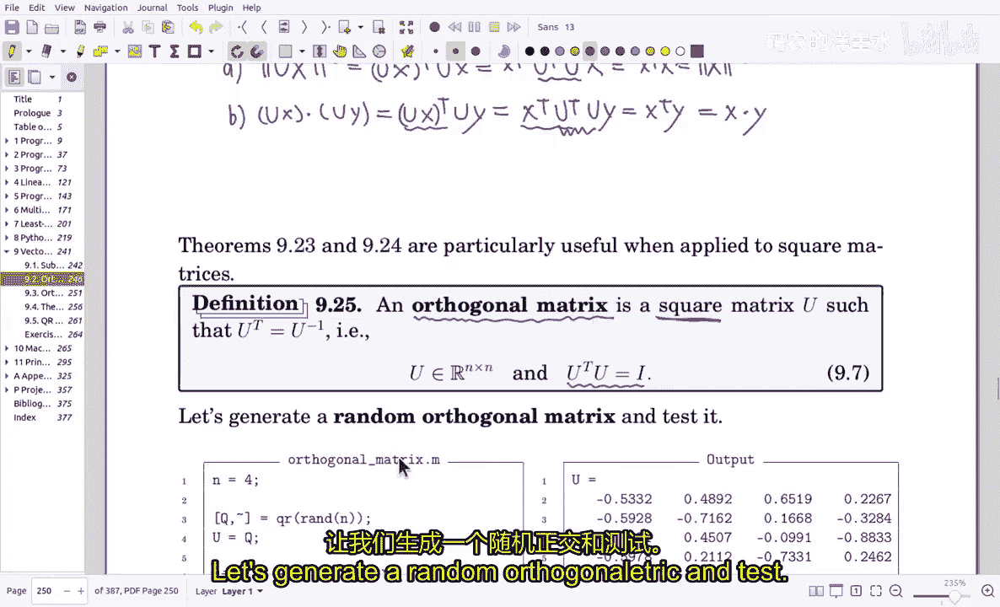

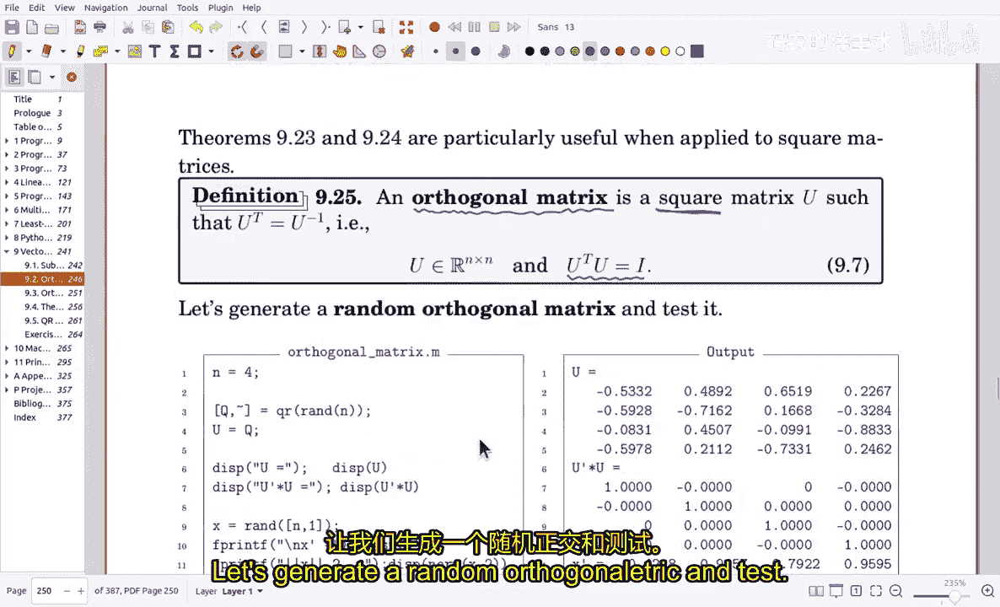

**代码示例（概念演示）**：生成一个随机正交矩阵并验证其性质。
```python
import numpy as np
n = 4
# 通过QR分解生成一个随机正交矩阵 U
A = np.random.randn(n, n)
Q, R = np.linalg.qr(A)
U = Q
print("正交矩阵 U:\n", U)
print("\n验证 U^T * U 是否为单位矩阵:\n", U.T @ U)
x = np.random.randn(n)
print("\n随机向量 x 的范数:", np.linalg.norm(x))
print("Ux 的范数:", np.linalg.norm(U @ x)) # 两者应相等
```

---

## 总结

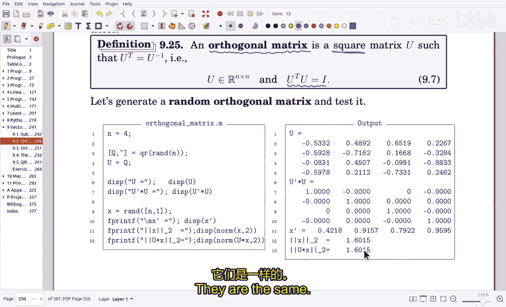

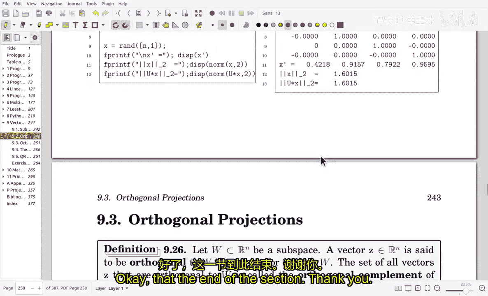

本节课中我们一起学习了线性代数的核心工具：正交集与正交矩阵。
*   我们首先定义了**正交集**和**正交基**，并展示了如何利用正交性轻松计算向量在子空间中的坐标。
*   接着，我们探讨了**向量的正交投影**，学习了如何将一个向量分解为平行于和垂直于给定方向的两个分量，并计算点到直线的距离。
*   然后，我们引入了**标准正交基**的概念，并讨论了具有标准正交列的矩阵的性质，即 **U**ᵀ**U** = **I**。
*   最后，我们聚焦于方阵情形，定义了**正交矩阵**（**U**ᵀ = **U**⁻¹），并阐述了其最重要的**保长度、保点积、保正交性**的特性。这些性质使得正交矩阵在数值计算、图形变换和信号处理等领域中不可或缺。