# 056：正交投影与正交分解定理 🧮

在本节课程中，我们将学习线性代数中两个核心概念：**正交投影**与**正交分解定理**。正交投影是许多数学和数值分析应用中的基础工具。我们将从定义出发，逐步理解如何将一个向量分解为子空间内的分量和与该子空间正交的分量，并探讨其几何意义与计算方法。

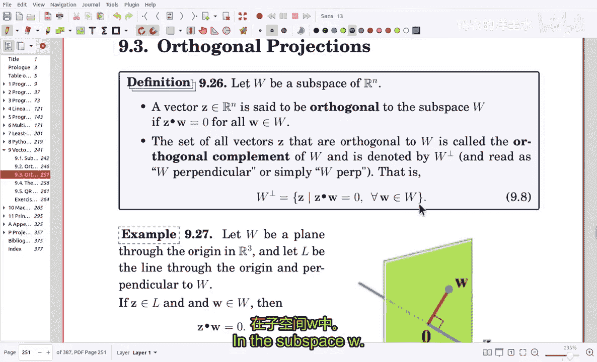

## 正交补空间的定义

首先，我们定义向量与子空间的正交关系。设 **W** 是 **R^n** 的一个子空间。如果向量 **z** 与子空间 **W** 中的每一个向量 **w** 的内积都为零，即 **z · w = 0**，那么我们称向量 **z** 正交于子空间 **W**。

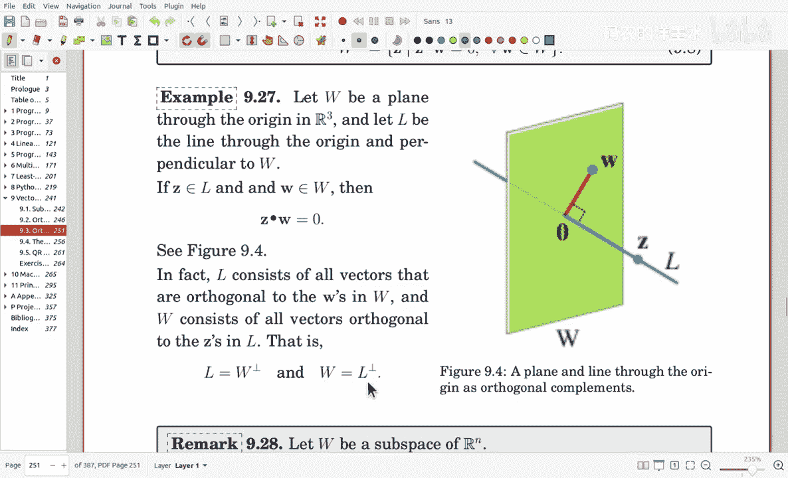

所有正交于子空间 **W** 的向量构成的集合，称为 **W** 的**正交补空间**，记作 **W^⊥**。

其正式定义为：
**W^⊥ = { z ∈ R^n | z · w = 0, ∀ w ∈ W }**

## 正交补空间的例子与性质

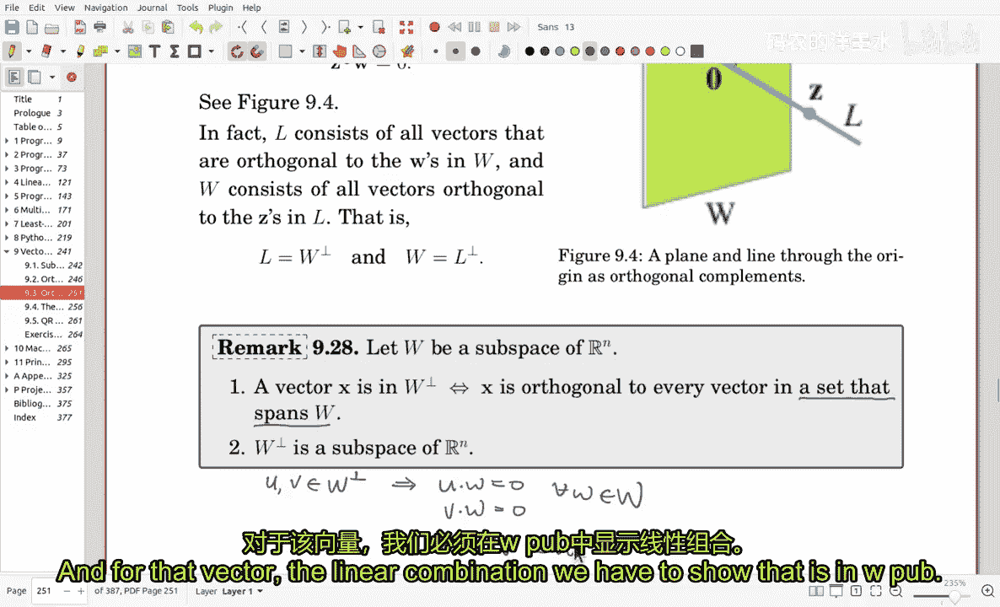

为了直观理解，我们来看一个例子。在 **R^3** 中，设 **W** 是一个通过原点的平面，**L** 是一条通过原点且垂直于该平面的直线。从直线 **L** 上任取一个向量 **z**，从平面 **W** 上任取一个向量 **w**，它们的点积必然为零 (**z · w = 0**)。实际上，直线 **L** 就是所有垂直于平面 **W** 的向量的集合，而平面 **W** 也是所有垂直于直线 **L** 的向量的集合。因此，**L = W^⊥**，同时 **W = L^⊥**。

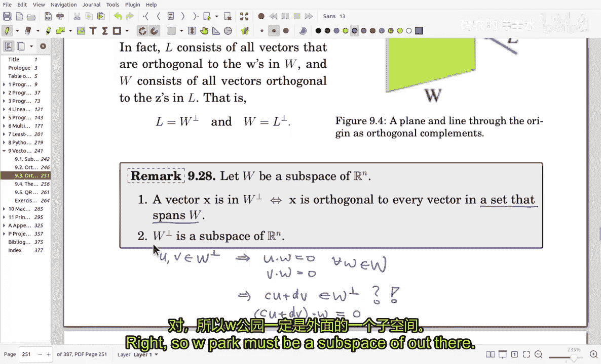

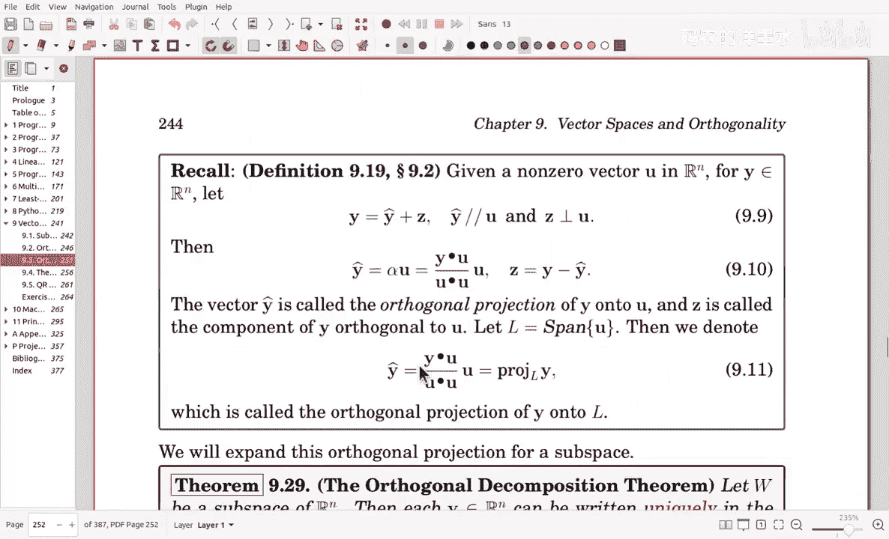

正交补空间本身也是一个子空间。要证明这一点，只需验证它对线性组合封闭。假设 **u** 和 **v** 都在 **W^⊥** 中，这意味着对于 **W** 中任意向量 **w**，都有 **u · w = 0** 和 **v · w = 0**。现在考虑它们的线性组合 **c u + d v**，计算它与 **w** 的内积：
**(c u + d v) · w = c (u · w) + d (v · w) = c * 0 + d * 0 = 0**
由于内积为零，所以 **c u + d v** 也在 **W^⊥** 中，因此 **W^⊥** 是 **R^n** 的一个子空间。

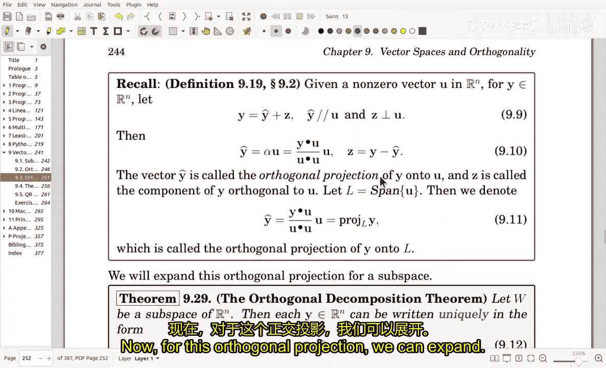

## 从向量投影到子空间投影

上一节我们学习了向量在另一个向量上的投影。给定 **R^n** 中一个非零向量 **u** 和任意向量 **y**，我们可以将 **y** 唯一地分解为：
**y = ŷ + z**
其中，**ŷ** 是与 **u** 平行的分量（即 **y** 在 **u** 上的投影），**z** 是与 **u** 正交的分量。我们称 **ŷ** 为 **y** 在由 **u** 张成的直线 **L** 上的**正交投影**。

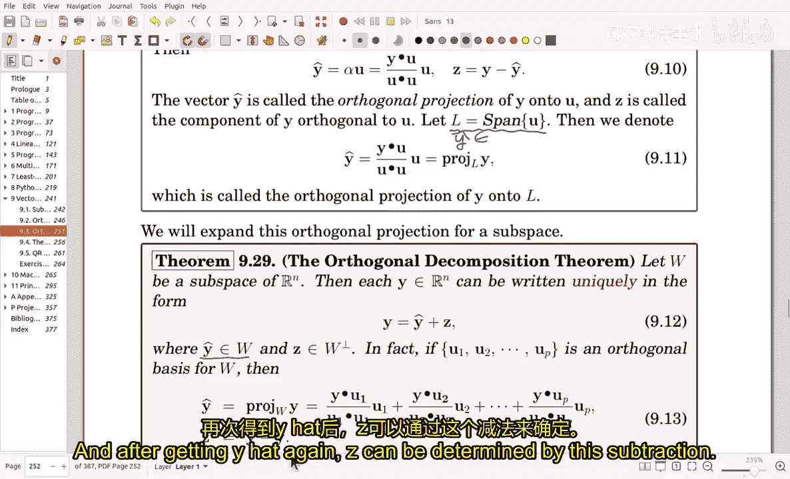

现在，我们将这个概念推广到更一般的子空间上。**正交分解定理**指出：设 **W** 是 **R^n** 的一个子空间，则对于 **R^n** 中的任意向量 **y**，都可以被**唯一地**写成如下形式：
**y = ŷ + z**
其中，**ŷ ∈ W**，而 **z ∈ W^⊥**。

如果 **{u₁, u₂, ..., u_p}** 是子空间 **W** 的一组**正交基**，那么投影分量 **ŷ** 可以通过一个简洁的公式计算：
**ŷ = ( (y·u₁)/(u₁·u₁) ) u₁ + ( (y·u₂)/(u₂·u₂) ) u₂ + ... + ( (y·u_p)/(u_p·u_p) ) u_p**
计算出 **ŷ** 后，正交分量 **z** 可以通过 **z = y - ŷ** 得到。

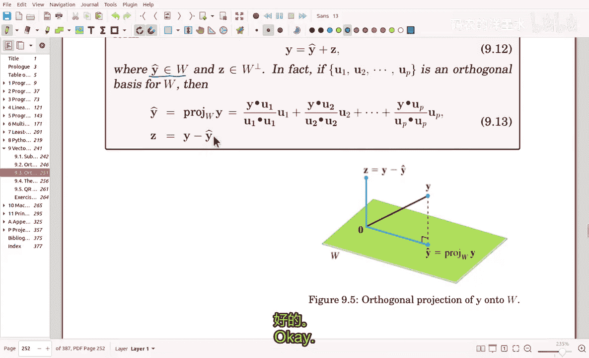

## 几何解释与最佳逼近

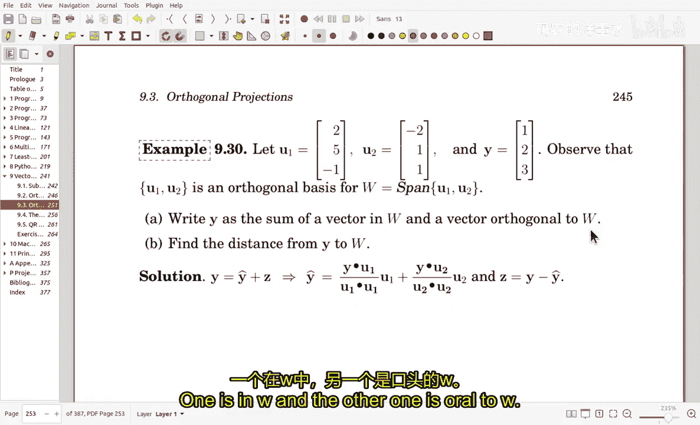

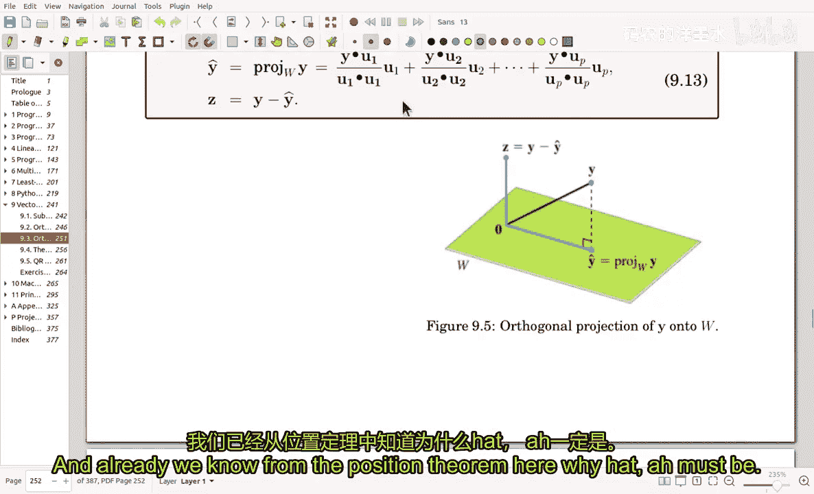

我们可以从几何上理解这个分解。设 **W** 是一个通过原点的子空间（例如平面），**y** 是空间中的一个点。那么 **ŷ** 就是 **y** 在 **W** 上的**垂足**。**ŷ** 是 **W** 中离 **y** 最近的点，而距离 **y** 到子空间 **W** 的距离，正是正交分量 **z** 的长度 **||z||**。

这个性质被称为**最佳逼近定理**。数学表述为：对于 **W** 中任意其他向量 **v**，都有
**|| y - ŷ || ≤ || y - v ||**
并且等号仅在 **v = ŷ** 时成立。因此，**ŷ** 是 **W** 中对 **y** 的**最佳逼近**。如果 **y** 本身就在 **W** 中，那么它的投影就是它自身，即 **ŷ = y**。

证明利用了勾股定理。将 **y - v** 重写为 **(y - ŷ) + (ŷ - v)**。由于 **y - ŷ = z ∈ W^⊥**，而 **ŷ - v ∈ W**，这两项正交。根据勾股定理：
**|| y - v ||² = || y - ŷ ||² + || ŷ - v ||²**
因为 **|| ŷ - v ||² ≥ 0**，所以 **|| y - v ||² ≥ || y - ŷ ||²**，即 **|| y - v || ≥ || y - ŷ ||**。

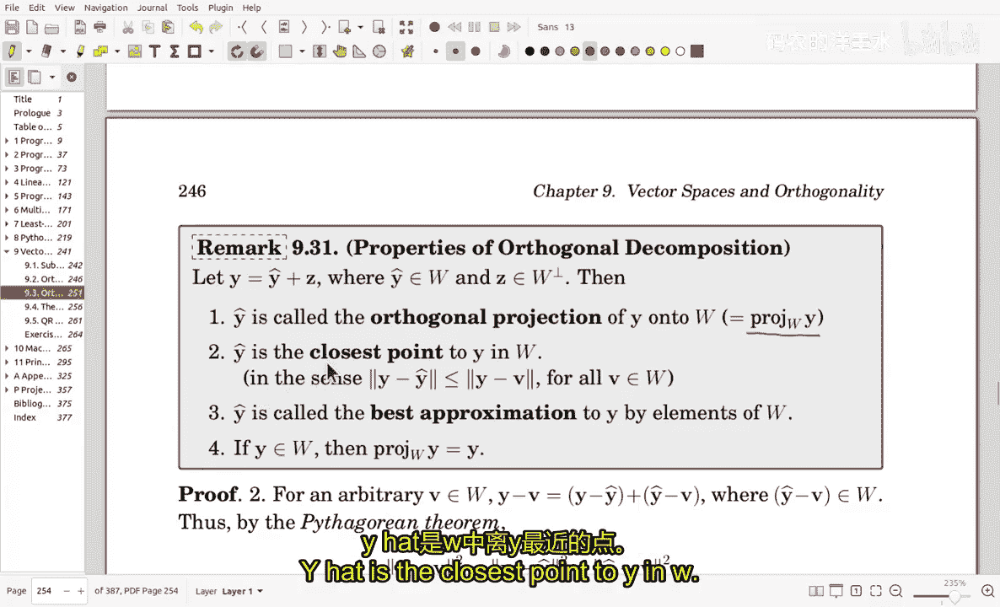

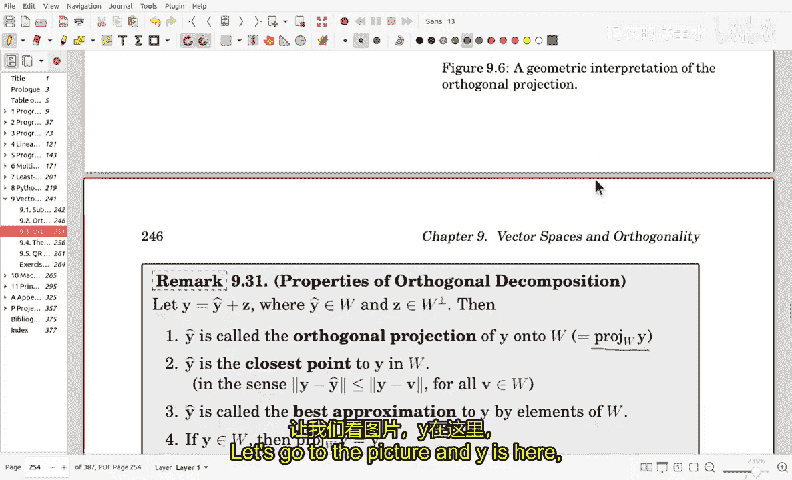

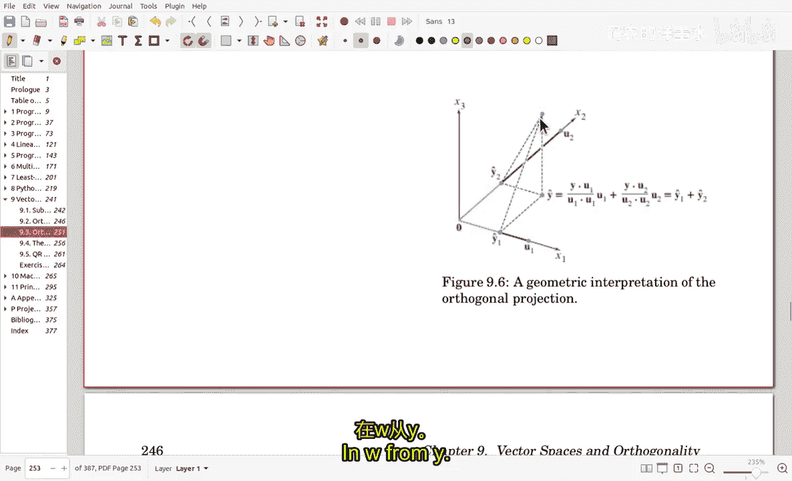

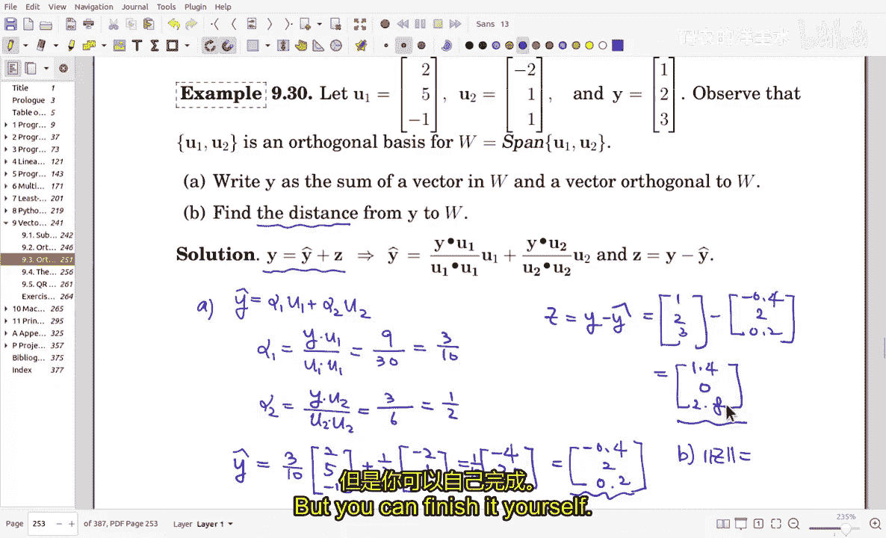

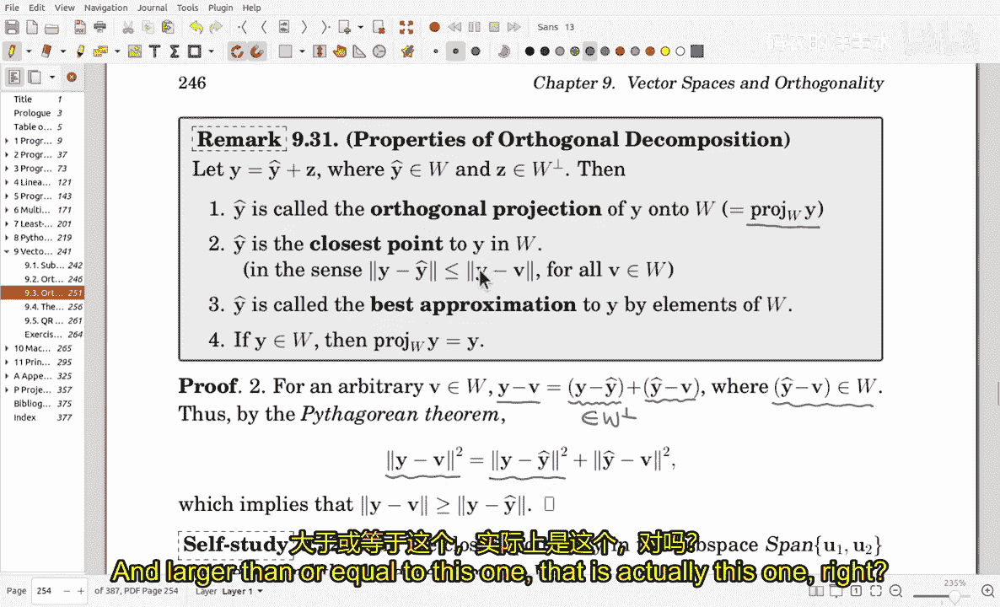

## 计算实例

让我们通过一个具体例子来演练计算过程。设子空间 **W** 由两个向量张成：
**u₁ = [2, 5, -1]ᵀ**, **u₂ = [-2, 1, 1]ᵀ**
给定向量 **y = [1, 2, 3]ᵀ**。我们需要将 **y** 分解为 **W** 中的分量和 **W^⊥** 中的分量。

以下是计算步骤：
1.  验证 **{u₁, u₂}** 是 **W** 的一组正交基（本题中已给出，且 **u₁ · u₂ = 0**）。
2.  利用正交基的投影公式计算 **ŷ**。
3.  计算 **z = y - ŷ**。
4.  **||z||** 即为从 **y** 到子空间 **W** 的距离。

首先计算 **ŷ** 的系数：
**α₁ = (y·u₁) / (u₁·u₁) = 9 / 30 = 3/10**
**α₂ = (y·u₂) / (u₂·u₂) = 3 / 6 = 1/2**

然后得到投影向量：
**ŷ = α₁ u₁ + α₂ u₂ = (3/10)[2, 5, -1]ᵀ + (1/2)[-2, 1, 1]ᵀ = [0.6-1, 1.5+0.5, -0.3+0.5]ᵀ = [-0.4, 2, 0.2]ᵀ**

接着计算正交分量：
**z = y - ŷ = [1, 2, 3]ᵀ - [-0.4, 2, 0.2]ᵀ = [1.4, 0, 2.8]ᵀ**

因此，分解为：
**y = [-0.4, 2, 0.2]ᵀ + [1.4, 0, 2.8]ᵀ**
距离为 **||z|| = √(1.4² + 0² + 2.8²)**。

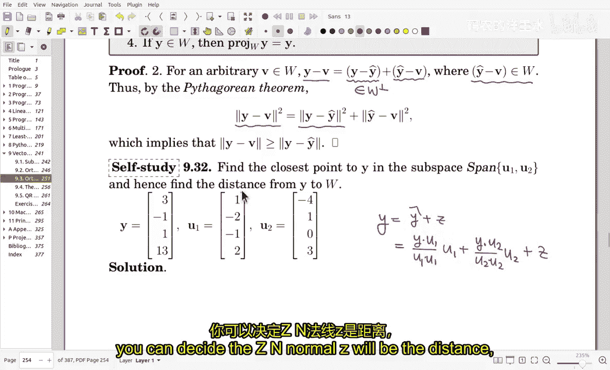

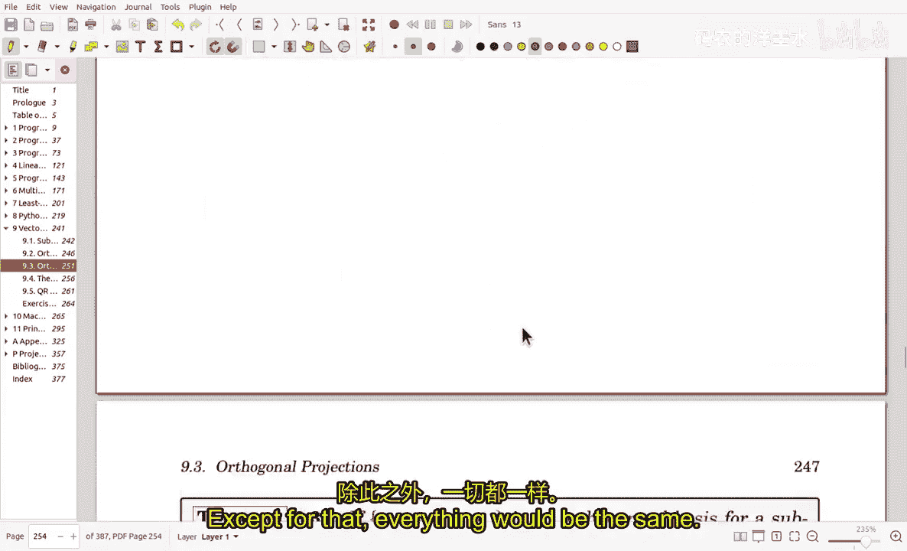

## 投影的矩阵表示

最后，我们探讨正交投影的矩阵表示。如果 **{u₁, u₂, ..., u_p}** 不仅是正交基，还是**标准正交基**（即每个基向量的长度都为1），那么投影公式可以简化为：
**ŷ = (y·u₁) u₁ + (y·u₂) u₂ + ... + (y·u_p) u_p**

令矩阵 **U = [u₁ u₂ ... u_p]**，其列向量由这组标准正交基构成。那么，向量 **y** 在子空间 **W** 上的正交投影可以通过一个矩阵变换得到：
**ŷ = U Uᵀ y**
矩阵 **P = U Uᵀ** 被称为到子空间 **W** 上的**投影矩阵**。

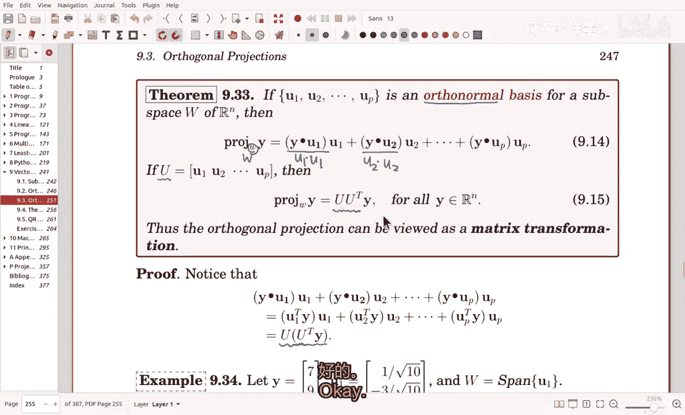

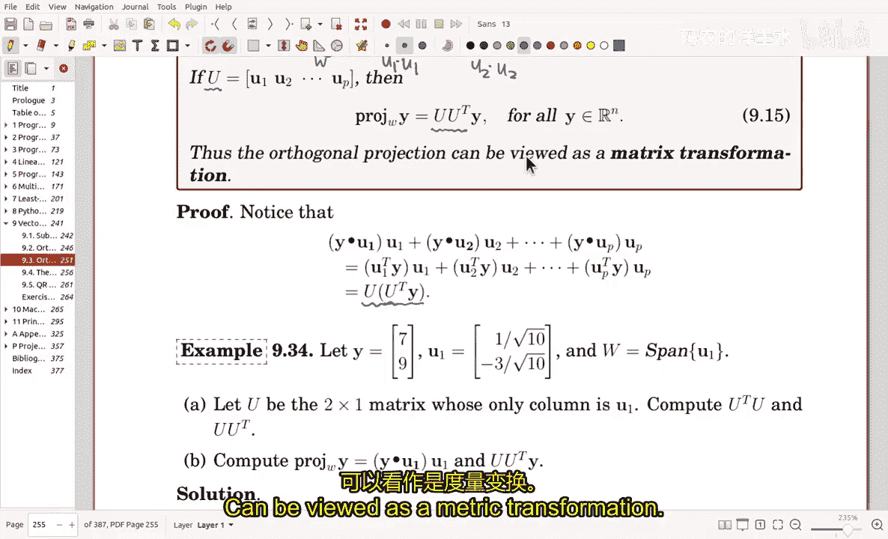

我们通过一个简单例子验证。设 **u₁ = (1/√10, -3/√10)ᵀ** 是 **R²** 中的单位向量，张成子空间 **W**。给定 **y = (7, 9)ᵀ**。
-   用公式计算投影：**ŷ = (y·u₁) u₁ = (-20/√10) * (1/√10, -3/√10)ᵀ = (-2, 6)ᵀ**。
-   用矩阵计算：构造 **U = (1/√10, -3/√10)ᵀ**，计算 **U Uᵀ y**。首先计算 **U Uᵀ = (1/10)[1, -3; -3, 9]**，然后乘以 **y** 得到 **(1/10)[-20, 60]ᵀ = (-2, 6)ᵀ**。
两者结果一致，验证了投影的矩阵表示形式。

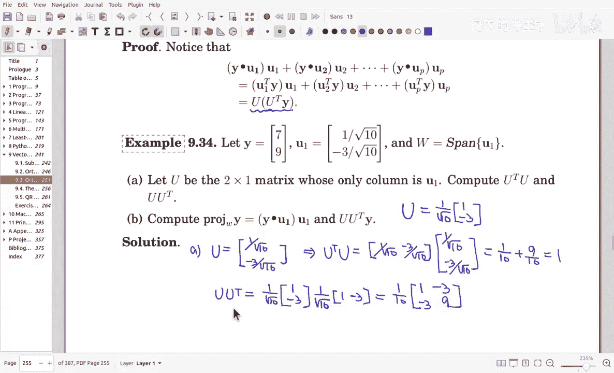

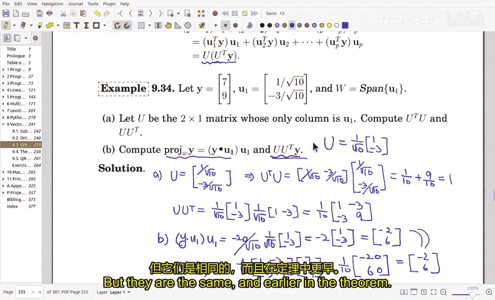

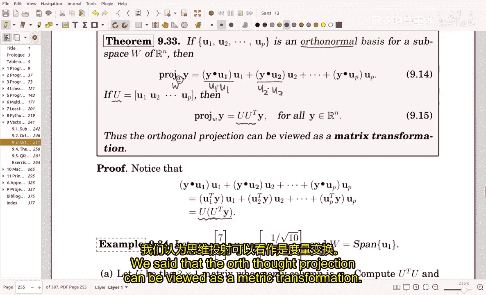

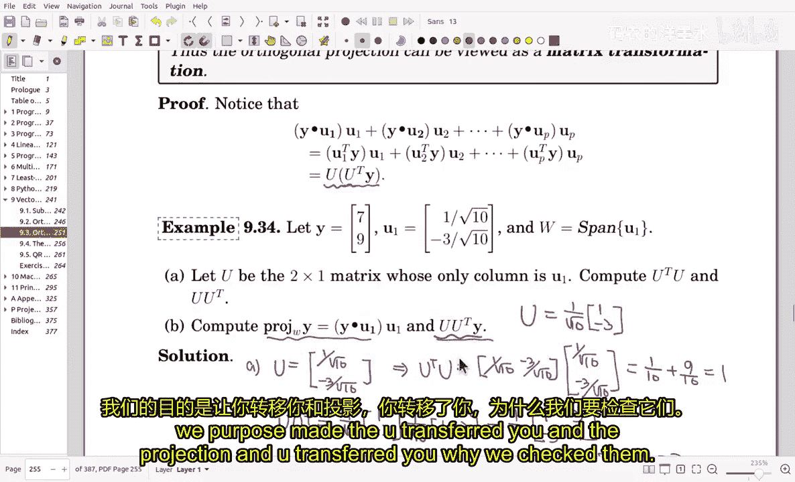

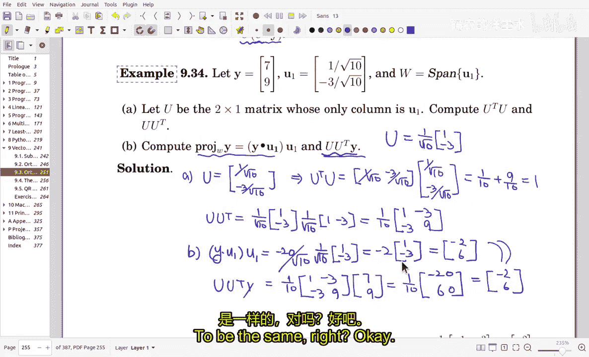

## 本节总结

本节课我们一起学习了正交投影的核心思想。我们从正交补空间的定义出发，引入了强大的**正交分解定理**，该定理保证了任何向量都可以唯一地分解为子空间内分量和正交分量。我们探讨了其几何意义——投影点是子空间中距离原向量最近的点（最佳逼近），并学习了在给定子空间正交基情况下的具体计算方法。最后，我们看到了当基为标准正交基时，投影操作可以优雅地表示为一个矩阵乘法 **U Uᵀ y**。这些概念是理解后续最小二乘法、傅里叶级数等高级课题的基石。

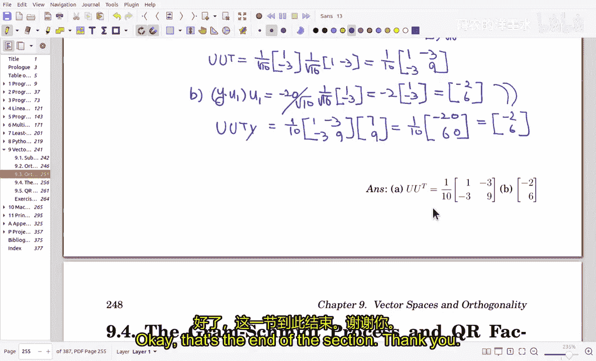

