# 057：Lecture 57 - Gram-Schmidt过程与QR分解最小二乘解 👨‍🏫

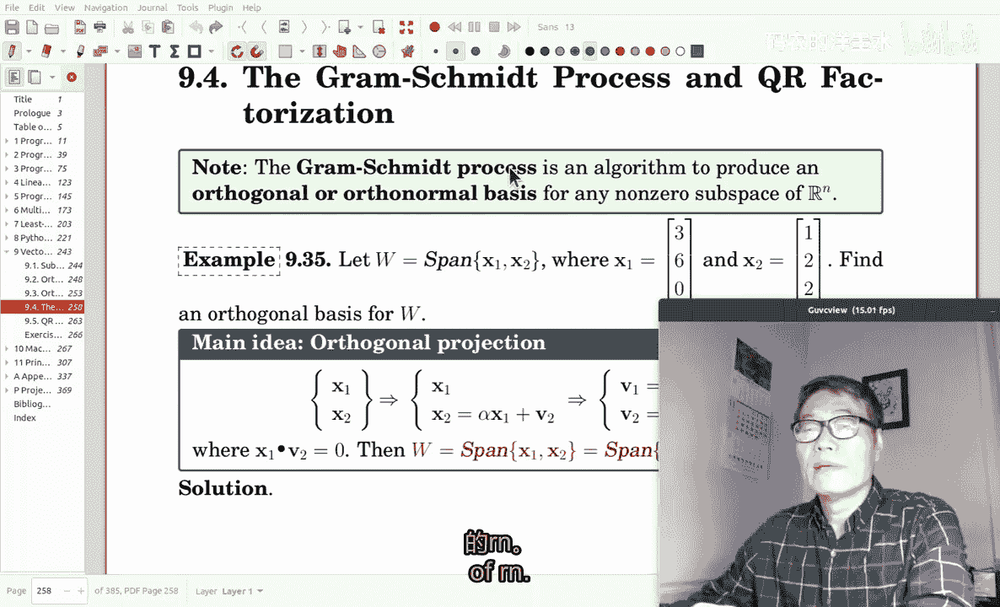

在本节课中，我们将学习如何应用正交投影来构造正交基，这个过程称为Gram-Schmidt正交化。我们还将探讨如何利用此过程进行QR分解，并最终使用QR分解来求解最小二乘问题。

## 概述 📋

上一节我们学习了正交投影。本节中，我们将应用正交投影进行Gram-Schmidt过程和QR分解。Gram-Schmidt过程是一种算法，用于为R^N中的任何非零子空间生成一组正交或标准正交基。

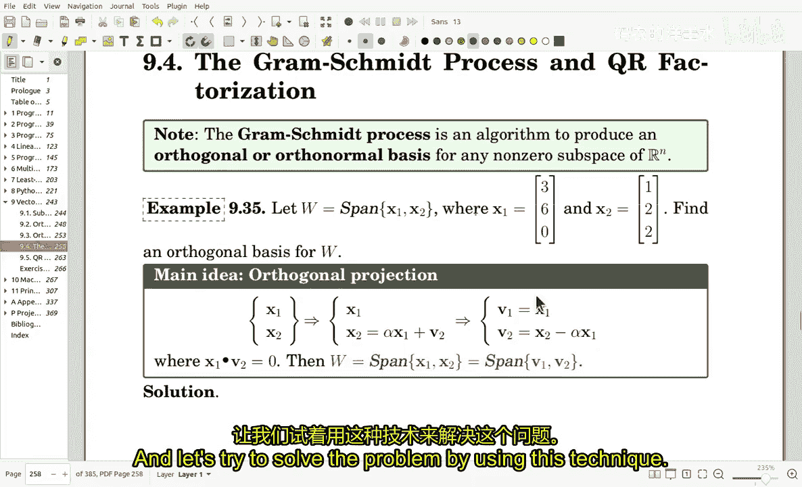

## Gram-Schmidt过程 🧮

Gram-Schmidt过程的核心思想是利用正交投影。给定一组线性无关的向量，我们可以通过逐步投影和减去其在已构建正交基上的分量，来获得一组正交向量。

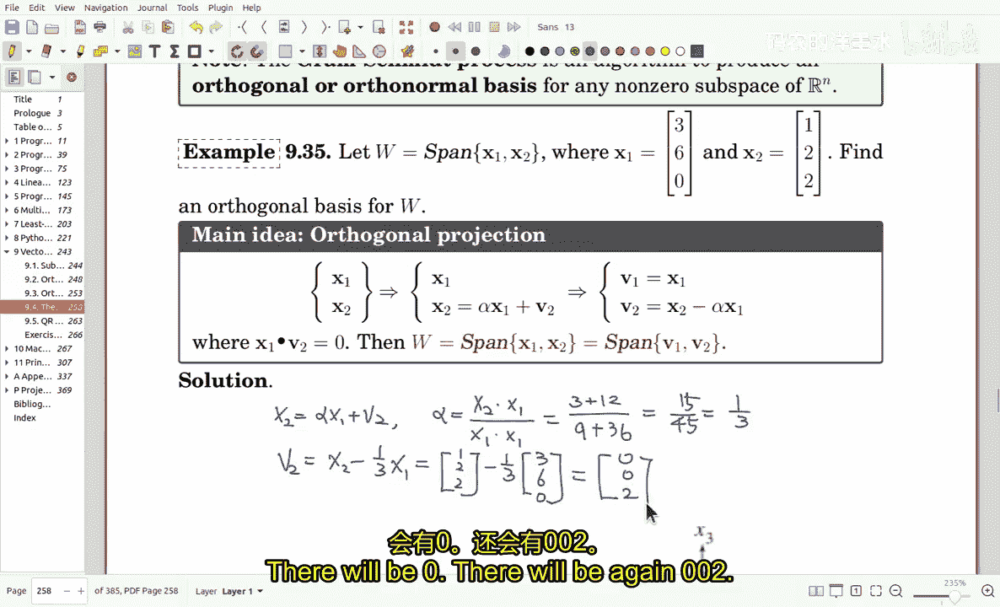

### 基本思想与示例

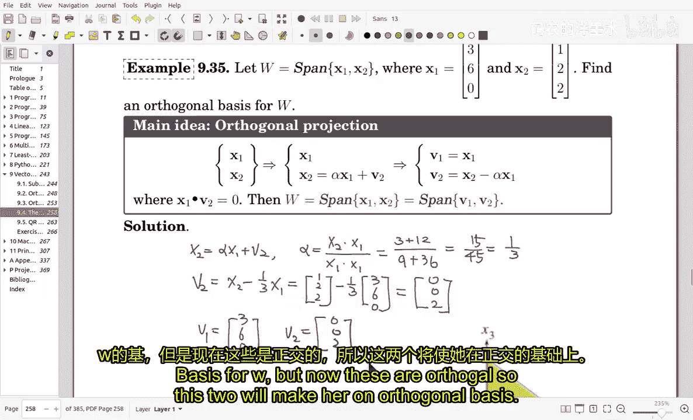

假设我们有一个子空间W，它由向量x1和x2张成。我们的目标是找到W的一组正交基。

主要思路是使用正交投影。对于给定的x1和x2，首先将x2投影到x1上，得到的正交分量v2将与x1正交。这样，我们得到一组正交向量v1（即x1）和v2。

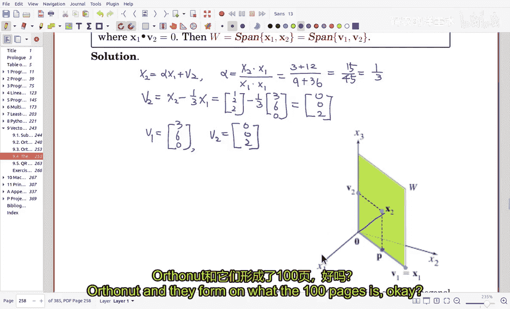

因为v2是x1和x2的线性组合，所以x1、x2张成的空间与v1、v2张成的空间是相同的。

让我们通过一个具体例子来理解这个过程。

W是x1和x2的张成空间。这两个向量来自R^3。我们将尝试为W找到一个正交基。

现在，x2必须被投影到x1的空间上。所以，x2 = α * x1 + v2。对于这个投影，α必须是 (x2 · x1) / (x1 · x1)。

计算如下：
*   x2与x1的点积是3。
*   x1与自身的点积是9 + 36 = 45。
*   因此，α = 3/45 = 1/3。

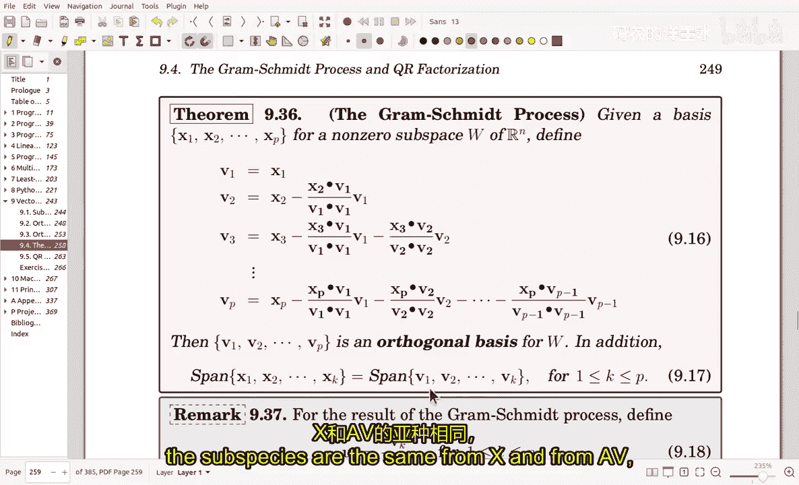

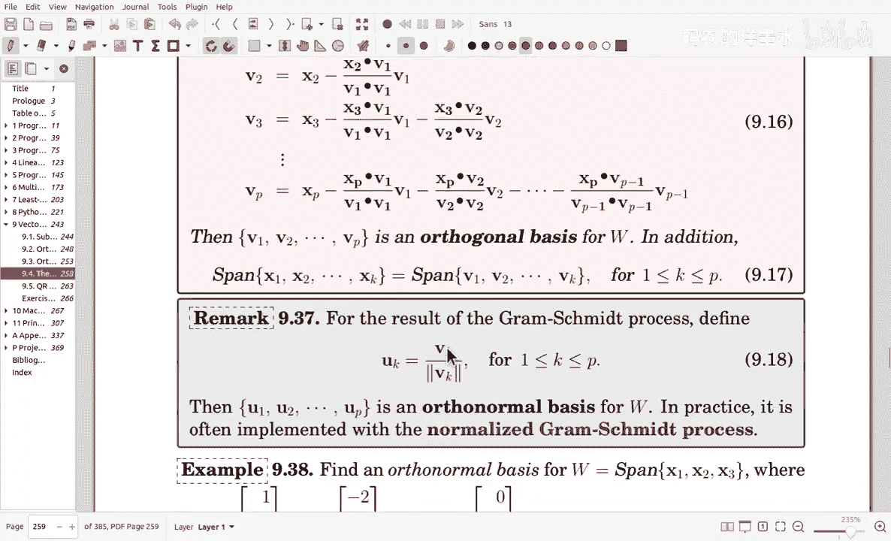

所以，v2 = x2 - (1/3) * x1。
*   x2 = [1, 2, 2]。
*   (1/3) * x1 = (1/3) * [3, 6, 0] = [1, 2, 0]。
*   因此，v2 = [1-1, 2-2, 2-0] = [0, 0, 2]。

现在，我们收集v1和v2：
*   v1 = x1 = [3, 6, 0]。
*   v2 = [0, 0, 2]。

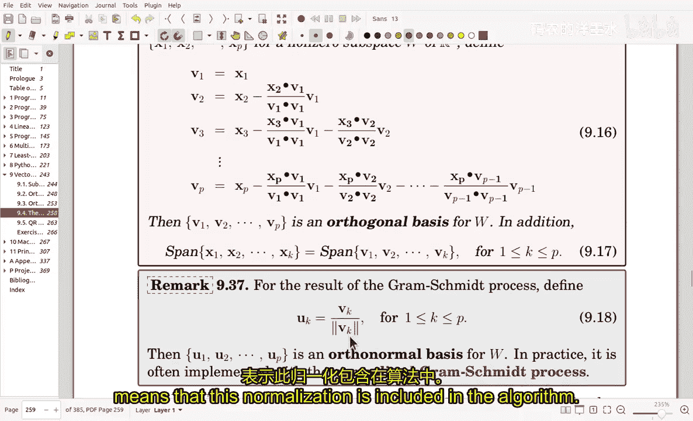

这两个向量构成了W的一组正交基。

如上图所示，x1是一个向量，x2是另一个向量。我们不直接使用x1和x2，而是将x2投影到x1的空间上，得到投影分量和正交分量v2。这样，v1和v2就构成了一组正交基。

### 过程的一般化

现在我们将这个想法一般化。对于R^N中非零子空间W的一组基（即线性无关的向量）{x1, x2, ..., xp}，我们按如下方式定义向量{v1, v2, ..., vp}：

1.  设 v1 = x1。
2.  对于 k = 2 到 p，计算 vk = xk - Σ_{i=1}^{k-1} ( (xk · vi) / (vi · vi) ) * vi。

这个集合 {v1, v2, ..., vp} 就是 W 的一组正交基。此外，对于每个 k (1 ≤ k ≤ p)，前 k 个 x 向量张成的子空间与前 k 个 v 向量张成的子空间是相同的。

### 获得标准正交基

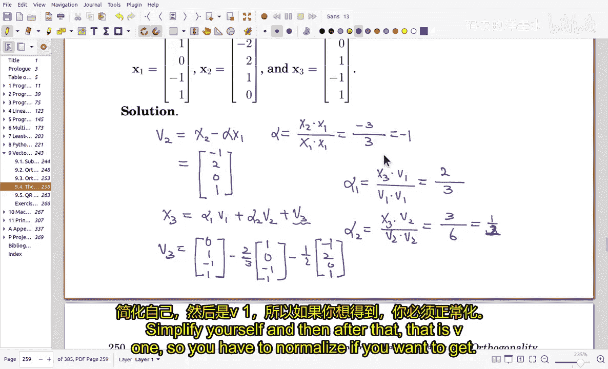

这是一组正交基。一旦我们将这些正交向量标准化（即除以其长度），这组正交基就变成了**标准正交基**。

实际上，Gram-Schmidt过程通常以实现为包含标准化步骤的版本，这意味着在算法中直接生成标准正交向量。

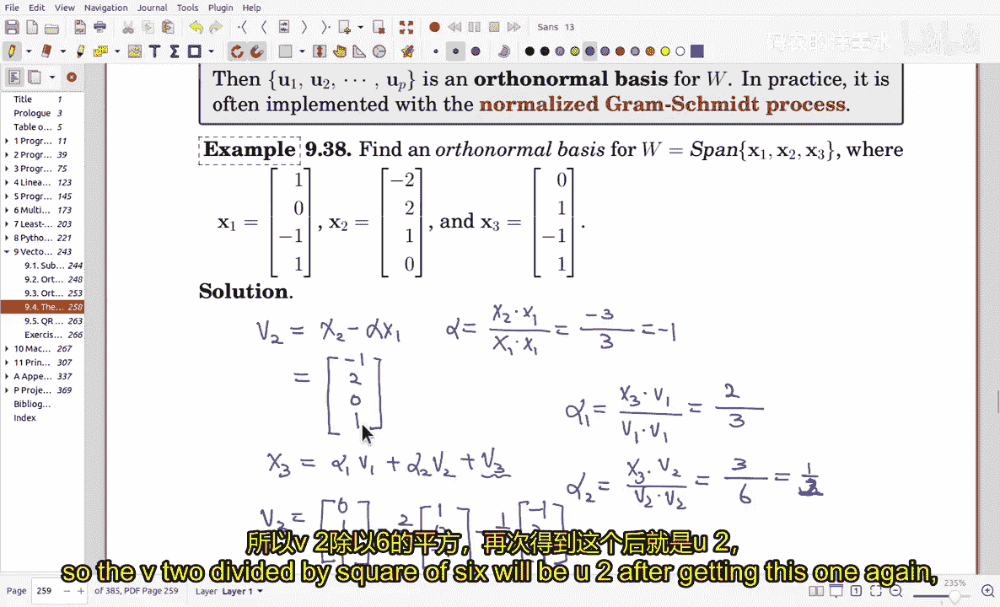

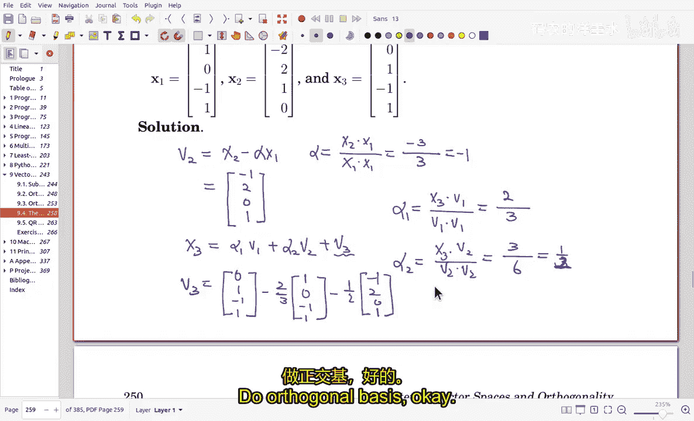

让我们尝试为W找一组标准正交基，W由x1, x2, x3张成，这些向量来自R^4。

我们将使用Gram-Schmidt过程。
首先，v1 = x1。
接着，计算v2 = x2 - α * x1，其中 α = (x2 · x1) / (x1 · x1)。
*   x2与x1的点积是 -3。
*   x1与自身的点积是 3。
*   因此 α = -1。
*   所以 v2 = x2 - (-1)*x1 = x2 + x1 = [0, 2, 0, 2]。

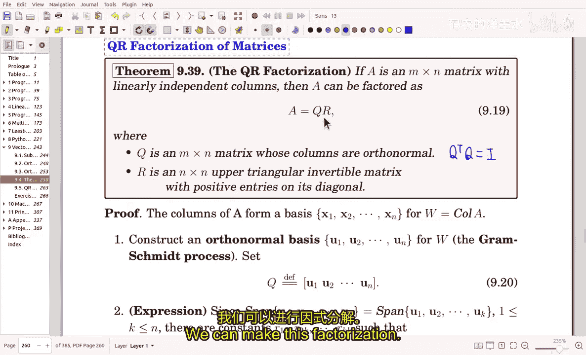

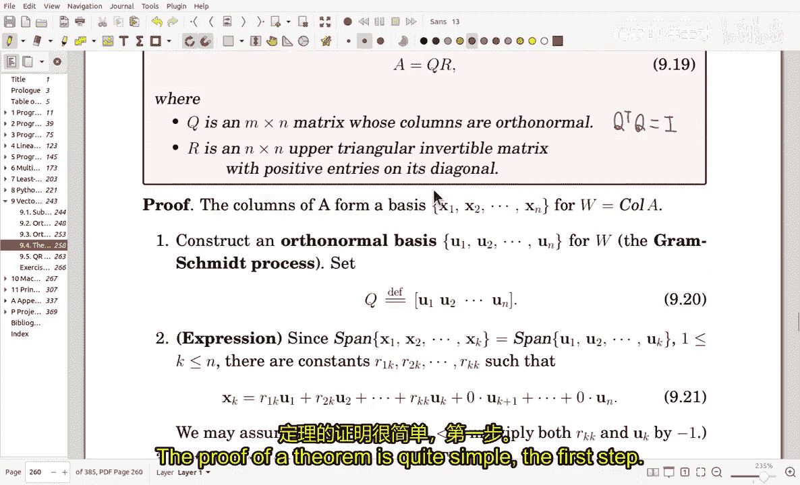

然后，计算v3 = x3 - α1 * v1 - α2 * v2。
*   α1 = (x3 · v1) / (v1 · v1) = 2 / 3。
*   α2 = (x3 · v2) / (v2 · v2) = 3 / 6 = 1/2。
*   所以 v3 = x3 - (2/3)*v1 - (1/2)*v2。计算后可得v3。

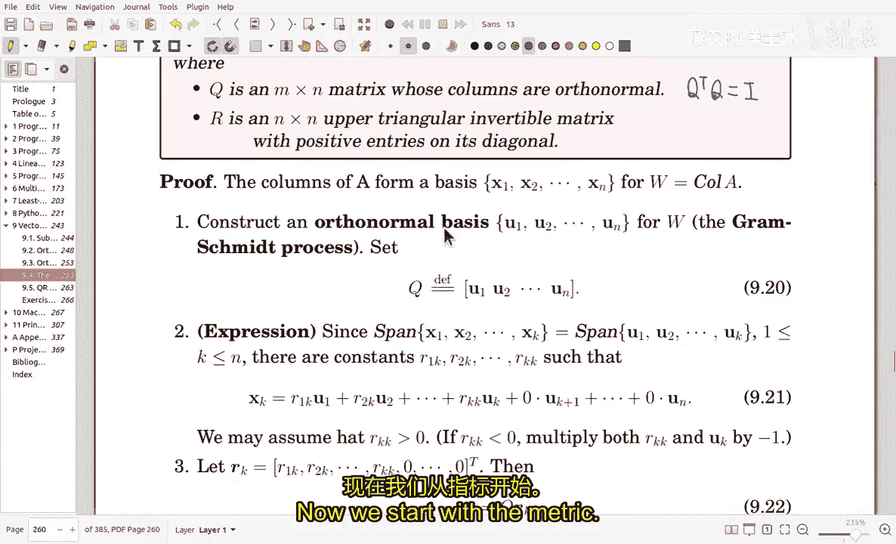

最后，为了得到标准正交基{u1, u2, u3}，我们将每个v除以其长度（范数）：
*   u1 = v1 / ||v1||
*   u2 = v2 / ||v2||
*   u3 = v3 / ||v3||

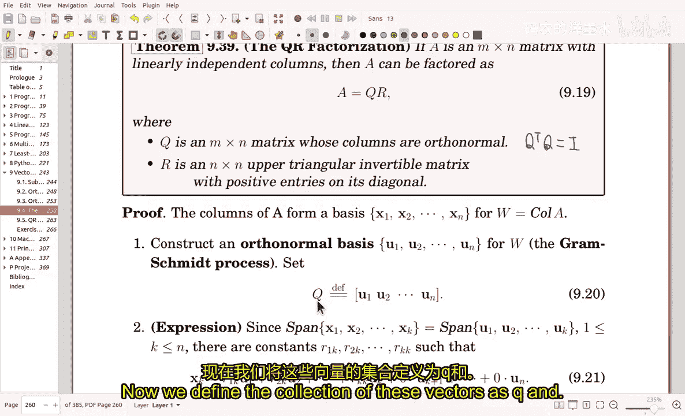

这样，u1, u2, u3就构成了W的一组标准正交基。

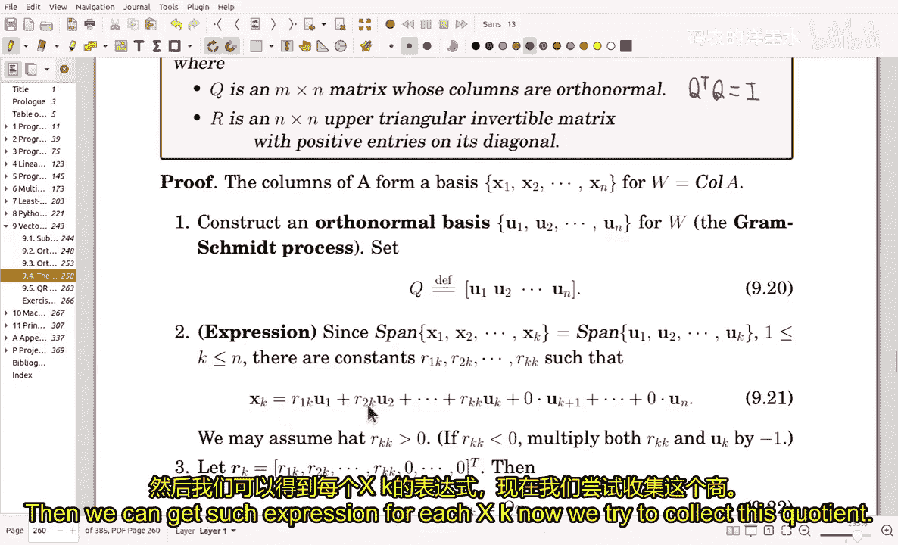

## QR分解 🔧

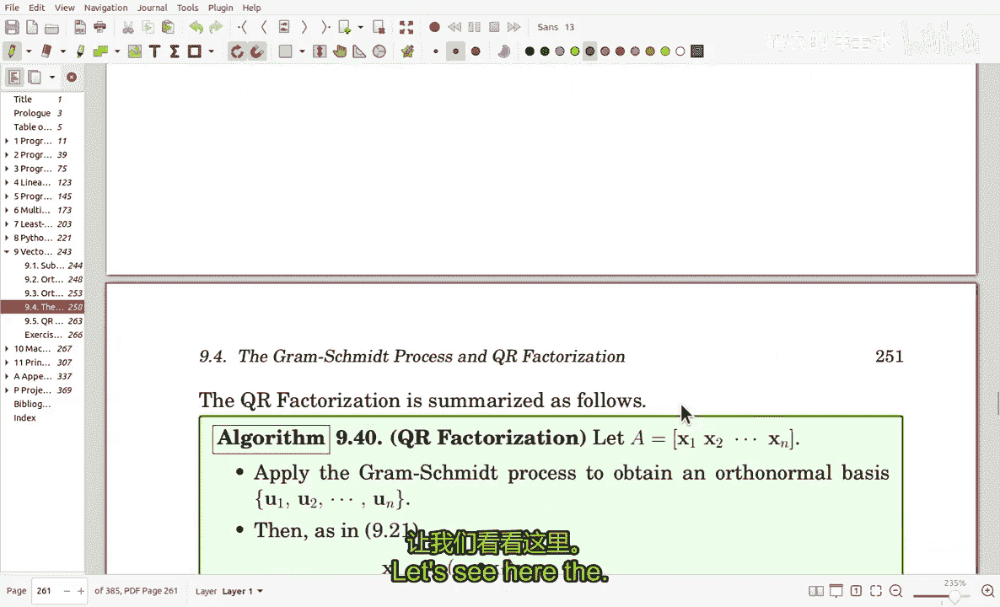

现在我们可以利用这项技术进行QR分解。设A是一个m×n矩阵，其列线性无关。那么它可以被分解为：
**A = Q R**
其中：
*   Q是一个m×n矩阵，其列是标准正交的（即 **Q^T Q = I**）。
*   R是一个n×n可逆的上三角矩阵，其对角线元素为正。

### 分解原理与算法

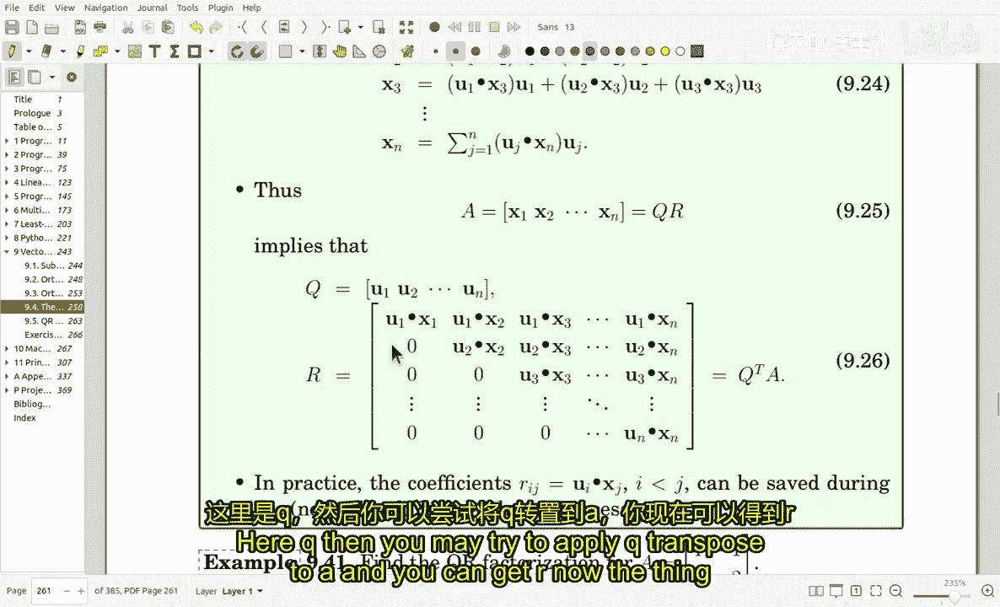

这个定理的证明相当简单。我们从矩阵A开始，其列线性无关，因此我们可以为A的列空间（即W）获得一组标准正交基。这些基向量构成了矩阵Q的列。

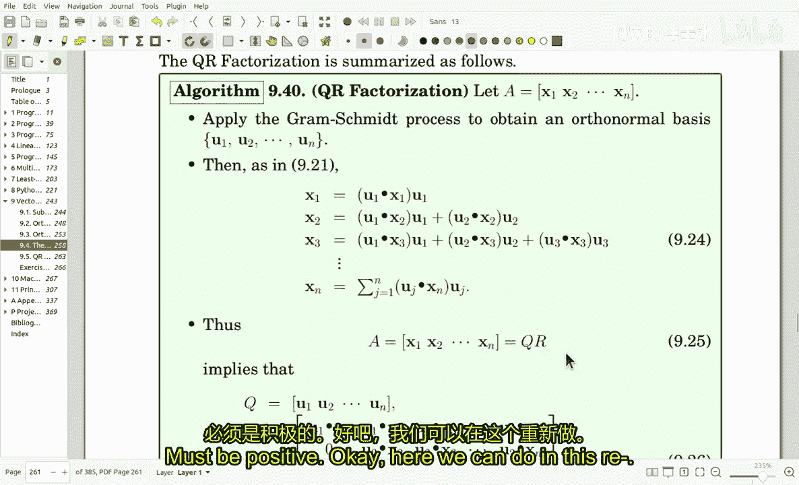

由于这是一组基，A的每一列xk都可以表示为这些标准正交向量的线性组合。具体来说，xk = Σ_{i=1}^{k} (xk · ui) * ui。当我们收集这些系数时，就得到了上三角矩阵R。

因此，主要思想是：我们可以通过Gram-Schmidt过程得到QR分解。

以下是QR分解的算法：
1.  给定矩阵A，其列x1到xn线性无关。
2.  对A的列应用Gram-Schmidt过程，得到列空间的一组标准正交基{u1, u2, ..., un}。这些构成了矩阵Q的列。
3.  对于每个k，计算系数 r_ik = ui · xk (对于 i ≤ k)。这些系数构成了上三角矩阵R的元素。对角线元素 r_kk 应为正。如果为负，可以通过同时改变对应Q列的符号和R行/列的符号来调整。
4.  或者，在得到Q后，直接计算 **R = Q^T A**。

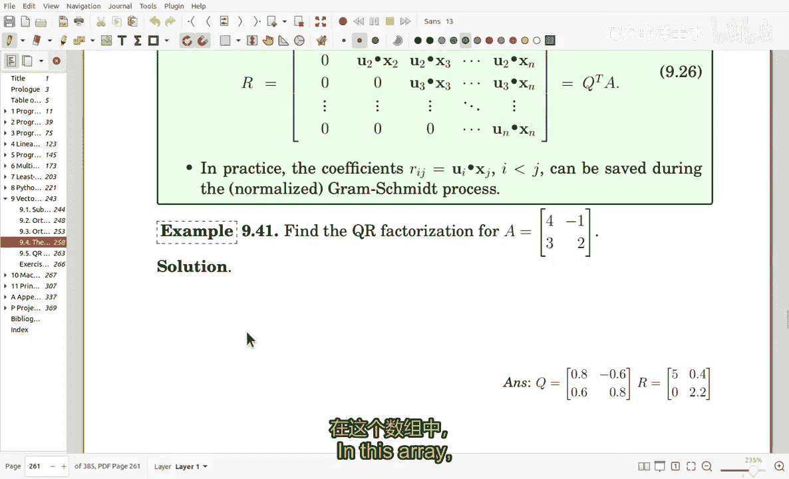

在实践中，系数 r_ij = ui · xj 可以在标准化的Gram-Schmidt过程中保存下来。

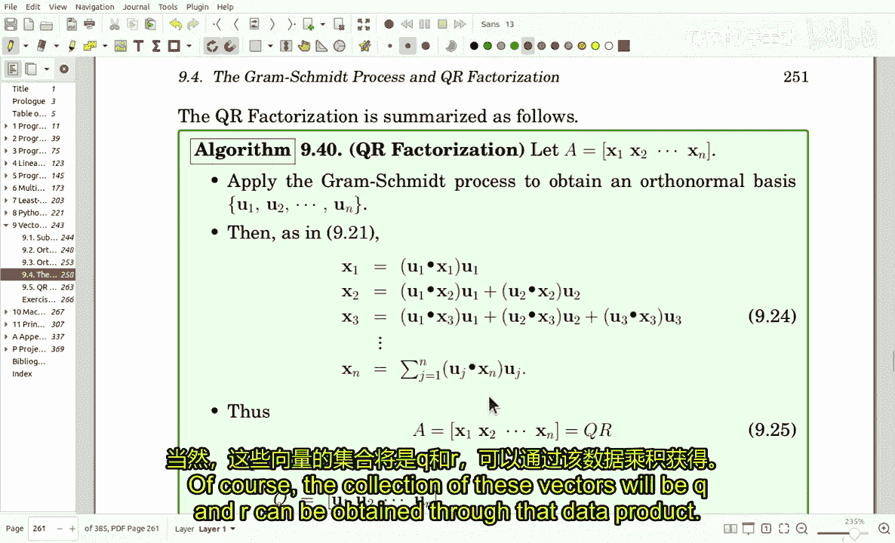

### QR分解示例

让我们尝试为给定的矩阵A找到QR分解。

我们将遵循上述算法。首先，使用Gram-Schmidt过程获得标准正交基，然后这些向量的集合就是Q，R可以通过点积或矩阵乘法得到。

计算过程如下：
*   设x1 = [4, 3]， x2 = [-1, 2]。
*   计算v1 = x1。
*   计算α = (x2 · x1) / (x1 · x1) = 2/25。
*   计算v2 = x2 - α*x1 = ... 最终得到v2。
*   标准化v1和v2得到u1和u2，它们构成矩阵Q。
*   然后可以通过公式计算R，或者简单地计算 **R = Q^T A**。

你可以自行完成计算。

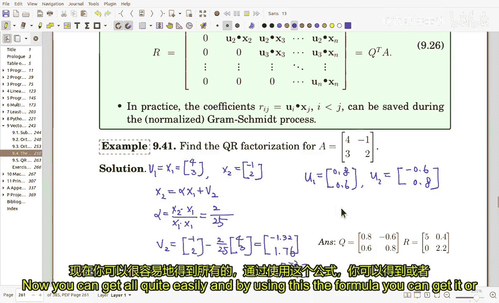

## 利用QR分解求解最小二乘问题 🎯

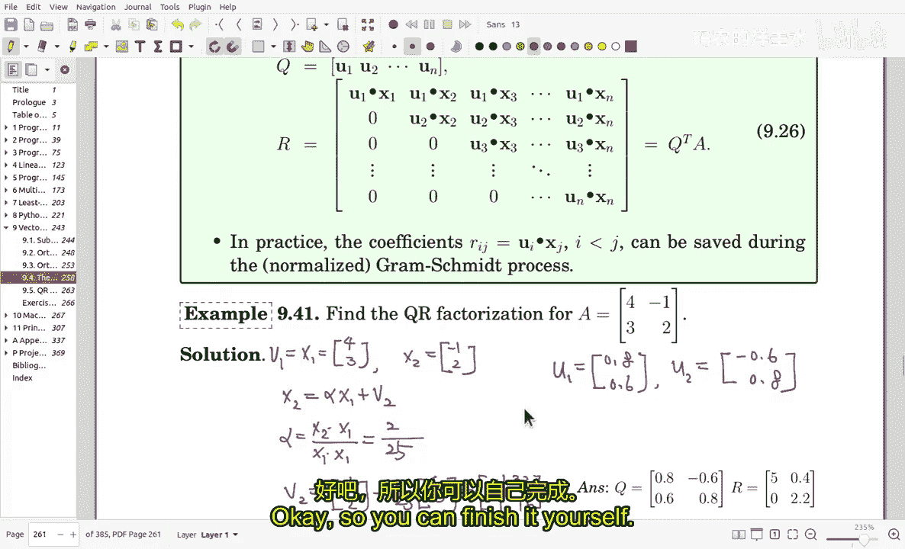

现在，我们使用QR分解技术来替代计算最小二乘解。设A是一个m×n矩阵（m ≥ n），并且假设A的秩为n（即列线性无关）。

我们已经知道最小二乘问题 **min ||Ax - b||** 有唯一解，并且可以通过正规方程求解：**x = (A^T A)^{-1} A^T b**。矩阵 **(A^T A)^{-1} A^T** 被称为A的伪逆，记作 **A^+**。

这里，我们将尝试使用QR分解来解决这个问题。对于相同的矩阵A（列线性无关），有A = QR。那么，对于任意的b ∈ R^m，方程Ax = b的唯一最小二乘解由下式给出：
**x = R^{-1} Q^T b**

### 原理证明

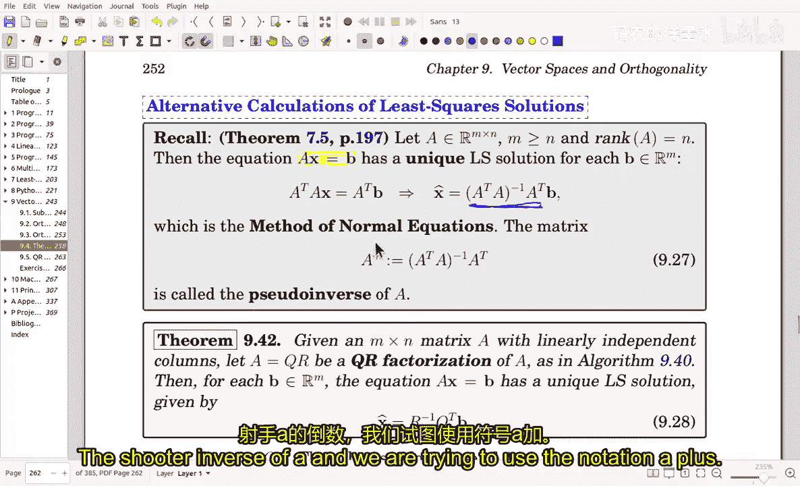

我们来推导这个公式。A的伪逆是 A^+ = (A^T A)^{-1} A^T。
将A = QR代入：
A^+ = ((QR)^T (QR))^{-1} (QR)^T = (R^T Q^T Q R)^{-1} R^T Q^T
由于Q的列是标准正交的，Q^T Q = I，所以：
A^+ = (R^T R)^{-1} R^T Q^T = R^{-1} (R^T)^{-1} R^T Q^T = R^{-1} Q^T
因此，最小二乘解 x = A^+ b = R^{-1} Q^T b。

### 示例

对于给定的A和b，我们可以很容易地看出A的列是线性独立的，因此可以进行具有正对角线元素的QR分解。一旦得到分解，首先计算Q^T b，然后乘以R的逆，就可以得到解。请你自己尝试计算。

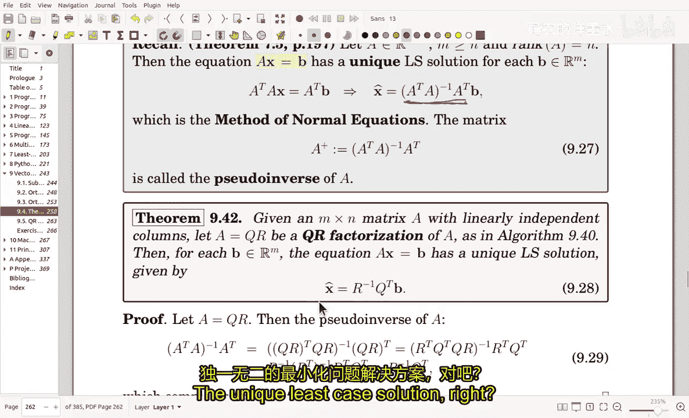

## 总结 📝

本节课中，我们一起学习了：
1.  **Gram-Schmidt正交化过程**：一种通过逐步正交投影，将任意一组线性无关向量转化为正交基或标准正交基的算法。
2.  **QR分解**：将列线性无关的矩阵A分解为一个列标准正交的矩阵Q和一个上三角可逆矩阵R的乘积，即 **A = QR**。这个过程的核心是Gram-Schmidt正交化。
3.  **QR分解的应用**：利用QR分解可以高效、稳定地求解最小二乘问题。解的形式为 **x = R^{-1} Q^T b**，这避免了直接计算可能病态的 **(A^T A)^{-1}**。

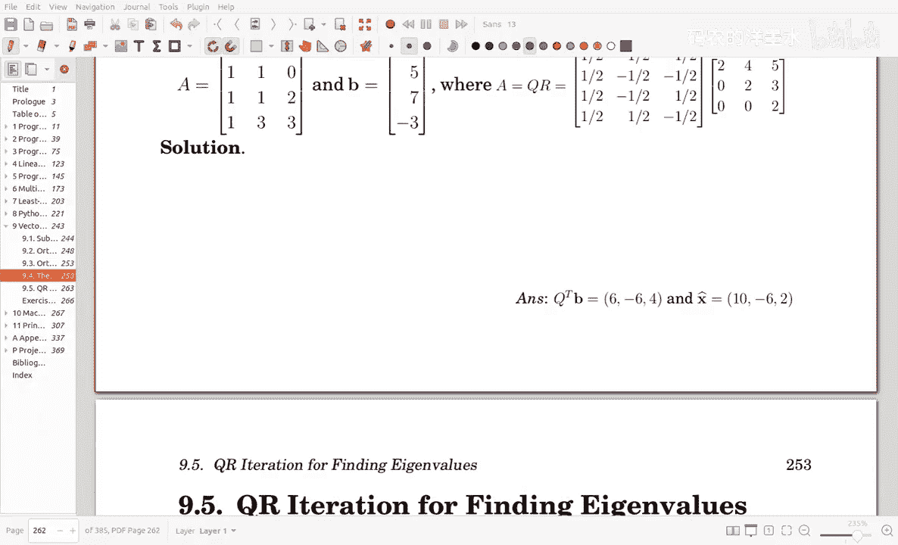

这些工具在数值线性代数、信号处理和机器学习等领域中对于处理线性系统和数据拟合问题至关重要。