# 058：第58讲 - QR迭代算法用于寻找特征值 🧮

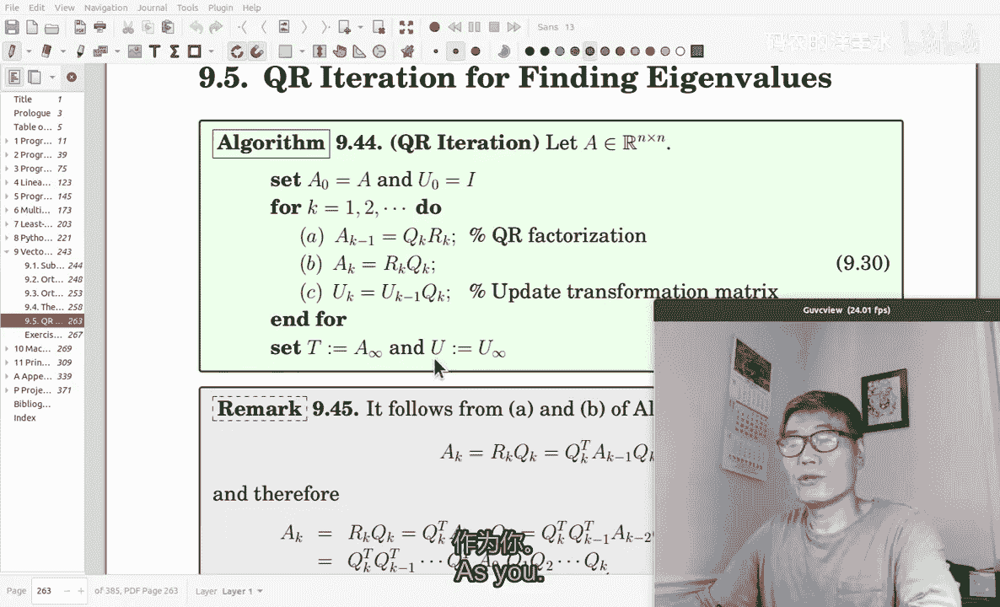

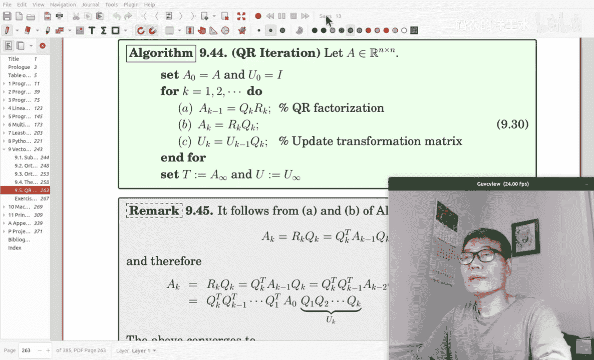

## 概述
在本节课中，我们将要学习QR迭代算法。上一节我们介绍了QR分解过程，本节中我们将应用QR分解来寻找矩阵的特征值和特征向量。

## QR迭代算法
对于对称矩阵 **A**，QR迭代算法在每一步中执行QR分解，并通过矩阵乘法更新矩阵 **A**。算法从单位矩阵开始，通过右乘正交矩阵来更新变换矩阵 **U**。算法非常简单。一旦算法收敛，矩阵 **A** 的极限将是对角矩阵 **T**，矩阵 **U** 的极限将是正交矩阵。

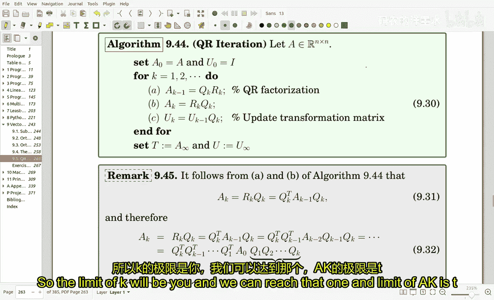

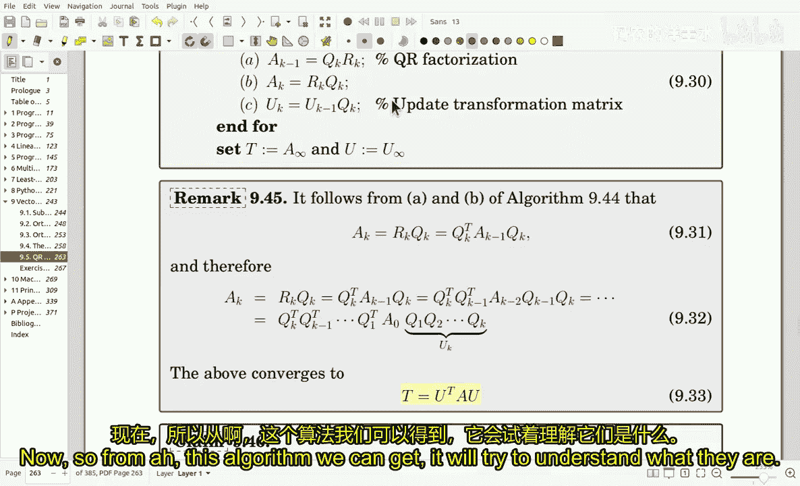

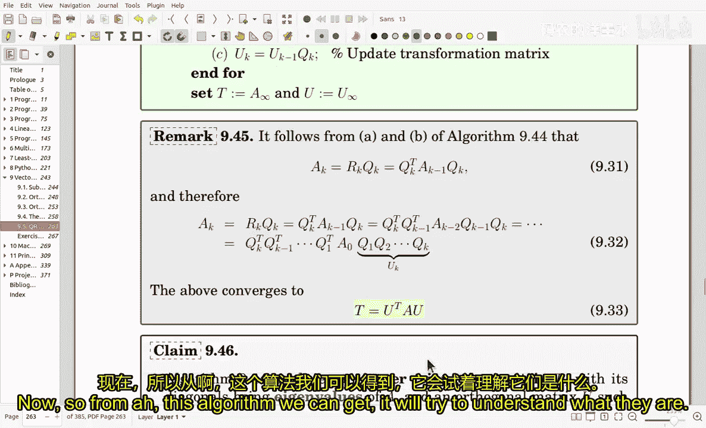

以下是QR迭代算法的核心步骤：
1.  初始化：设 **A₀ = A**， **U₀ = I**。
2.  对 **k = 1, 2, ...** 进行迭代：
    *   对 **Aₖ₋₁** 进行QR分解：**Aₖ₋₁ = Qₖ Rₖ**。
    *   更新矩阵：**Aₖ = Rₖ Qₖ**。
    *   更新变换矩阵：**Uₖ = Uₖ₋₁ Qₖ**。
3.  当 **Aₖ** 的非对角线元素足够小时，停止迭代。

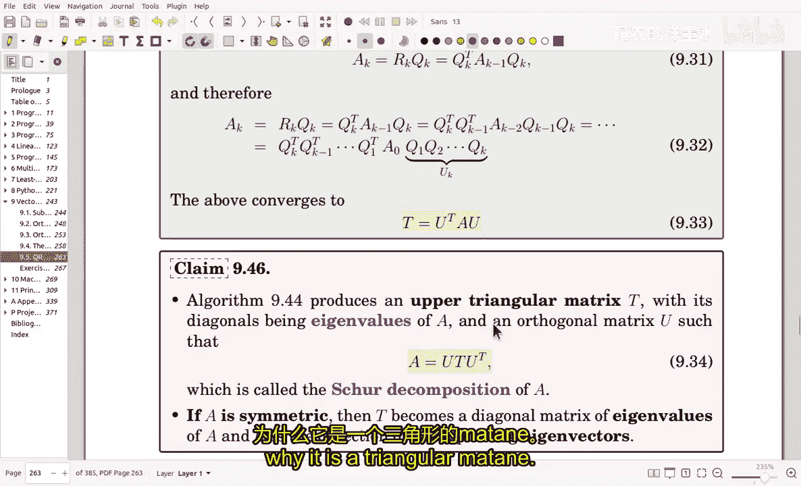

## 算法原理
从算法中，我们可以看到 **Aₖ = Rₖ Qₖ**。由于 **Qₖ** 是正交矩阵，我们可以推导出 **Aₖ = Qₖᵀ Aₖ₋₁ Qₖ**。通过递归应用这个等式，我们可以得到 **Aₖ = (Q₁ Q₂ ... Qₖ)ᵀ A (Q₁ Q₂ ... Qₖ)**。

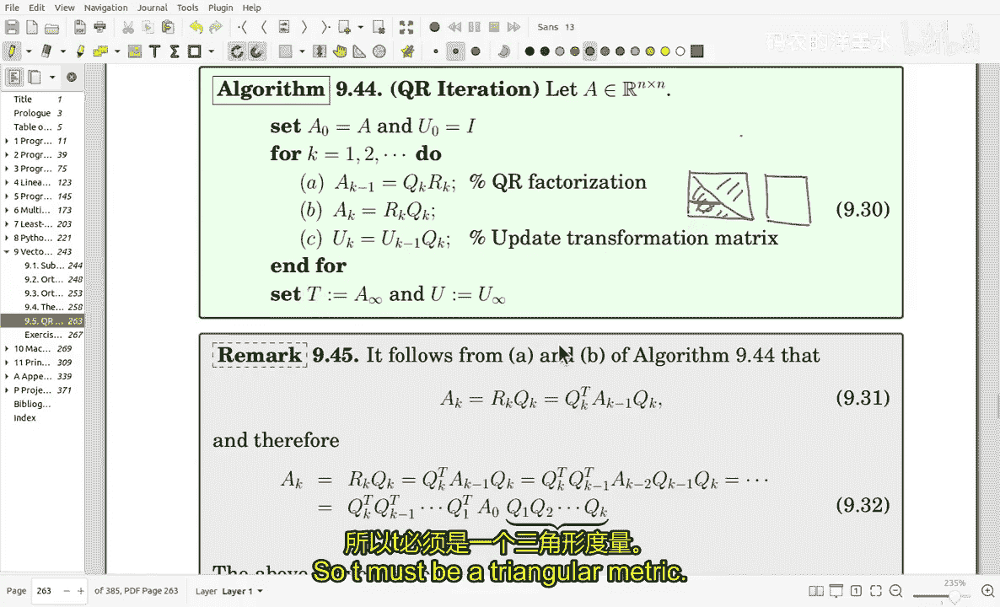

一旦算法收敛，**Uₖ** 的极限就是 **U**，**Aₖ** 的极限就是 **T**。因此，我们有 **T = Uᵀ A U**。

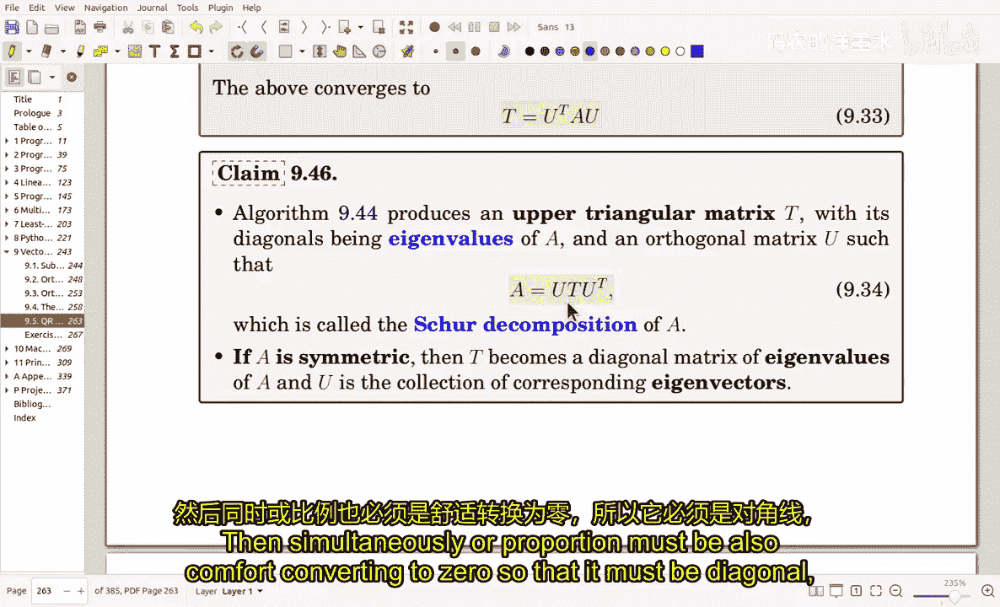

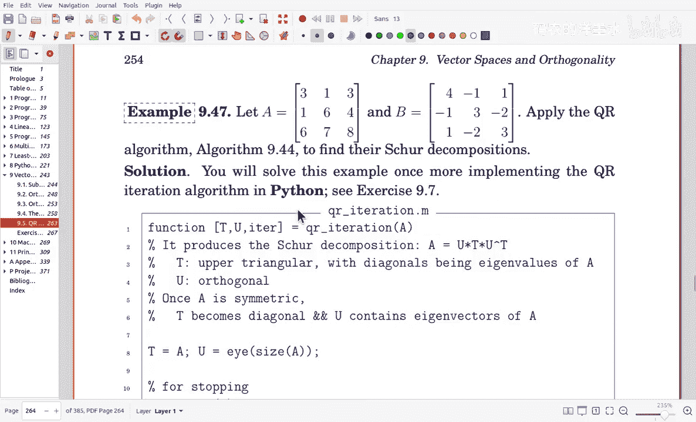

## 舒尔分解
**T** 是一个上三角矩阵，其对角线元素就是矩阵 **A** 的特征值。**U** 是一个正交矩阵。因此，我们可以将 **A** 写成 **A = U T Uᵀ**。这种分解被称为矩阵 **A** 的舒尔分解。

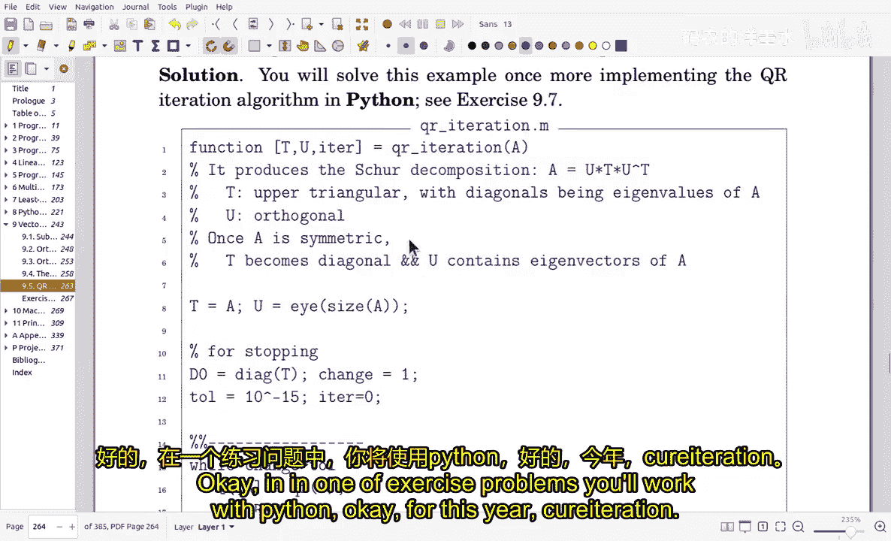

为什么 **T** 是三角矩阵？让我们观察矩阵乘法。**R** 是上三角矩阵，**Q** 是正交矩阵（其列向量是标准正交基）。在乘积 **R Q** 中，由于 **R** 的下三角部分为零，这个乘积会使得结果矩阵的下三角部分数值逐渐变小，最终收敛到零。因此，极限 **T** 必然是一个三角矩阵。

## 对称矩阵的特殊情况
一旦矩阵 **A** 是对称的，那么 **T** 就会变成由 **A** 的特征值构成的对角矩阵，而 **U** 则是对应的特征向量的集合。如果 **A** 对称，那么 **T** 也应该对称。如果 **T** 的下三角部分收敛到零，那么其上三角部分也必须同时收敛到零，因此 **T** 必须是一个对角矩阵。

## 示例与代码实现
我们有两个矩阵 **A** 和 **B**。**A** 不是对称矩阵，而 **B** 是对称矩阵。我们将应用QR迭代算法来寻找它们的舒尔分解。

以下是QR迭代算法的Python实现核心逻辑：
```python
def qr_iteration(A, max_iter=1000, tol=1e-5):
    n = A.shape[0]
    T = A.copy()
    U = np.eye(n)
    for i in range(max_iter):
        Q, R = np.linalg.qr(T)
        T = R @ Q
        U = U @ Q
        # 检查非对角线元素的变化是否小于容差
        off_diag_change = np.abs(T - np.diag(np.diag(T))).max()
        if off_diag_change < tol:
            break
    return T, U
```
在实现中，我们初始化 **T** 为给定的矩阵 **A**，**U** 为单位矩阵。然后进行迭代：对 **T** 进行QR分解，更新 **T = R Q**，并更新变换矩阵 **U = U Q**。停止条件通常是检查 **T** 的非对角线元素（或对角线元素的变化）是否小于一个预设的容差（例如 `10^-5`）。

## 结果分析
对于非对称矩阵 **A**，经过26次迭代后算法收敛。得到的 **T** 矩阵是上三角矩阵，其对角线元素就是特征值。我们尝试用 **U T Uᵀ** 恢复原始矩阵，结果成功恢复。通过特征值计算得到的特征向量也与算法结果一致。

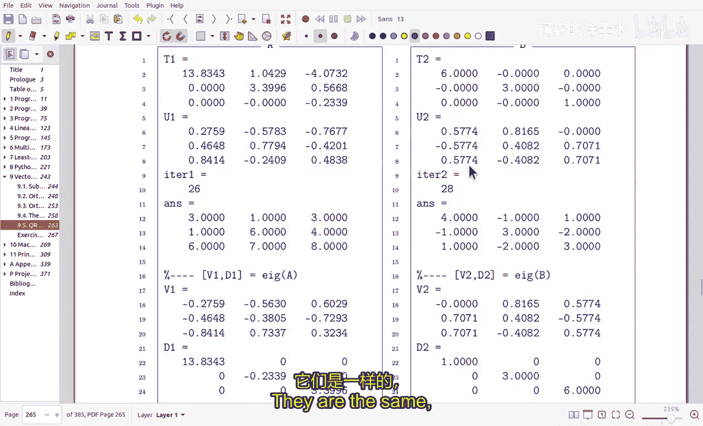

对于对称矩阵 **B**，经过28次迭代后算法收敛。得到的 **T** 矩阵是对角矩阵，对角线上的值就是特征值。同样，我们可以成功恢复原始矩阵，并且计算得到的特征向量与算法结果匹配。

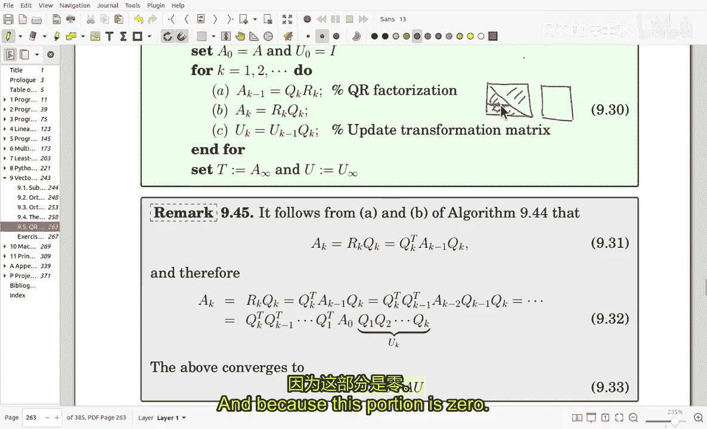

观察每次迭代后矩阵 **Aₖ** 的变化：在非对称情况下，矩阵的下三角部分数值随着迭代逐渐变小。在对称情况下，矩阵始终保持对称，其非对角线元素对称地逐渐减小，最终趋近于零。

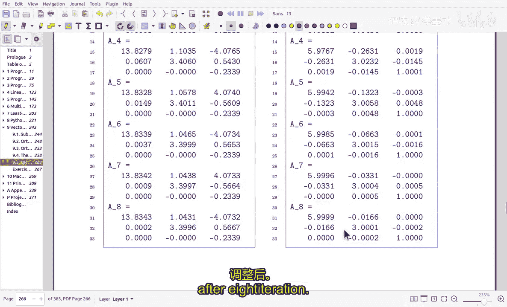

## 总结
本节课中我们一起学习了QR迭代算法。我们了解了该算法如何通过重复的QR分解和矩阵乘法，将一个矩阵迭代地转化为（近似）上三角形式，从而得到其特征值。对于对称矩阵，该算法能直接得到对角矩阵和特征向量。通过Python代码示例，我们看到了算法的具体实现和收敛过程。QR迭代是数值线性代数中求解特征值问题的一个强大而基础的工具。