# 059：机器学习简介 🧠

在本章中，我们将学习什么是机器学习，并了解一些流行的机器学习分类器。我们还将介绍一个名为Scikit-learn的Python机器学习库。最后，我们会看到一些“母代码”（基础代码）。你可以修改这些母代码来实现自己的机器学习算法，并且可以轻松地将你的算法与流行的机器学习分类器进行比较。本章是对机器学习的简要介绍，希望能对你有所帮助。

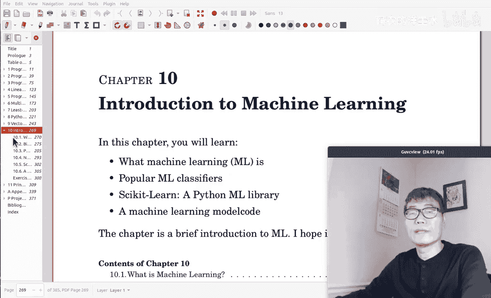

---

## 人工智能编程：10.1：什么是机器学习？🤔

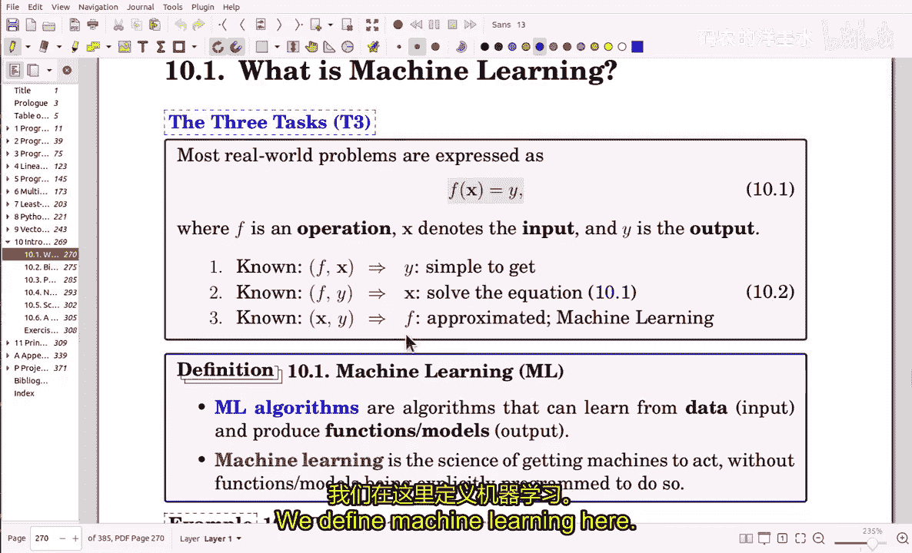

大多数现实世界的问题都可以表示为 **f(x) = y**。其中，**f** 是一个操作（函数），**x** 表示输入，**y** 是输出。一旦 **f** 和 **x** 已知，得到输出就是最简单的任务。如果 **f** 和 **y** 未知，那么求解输入就需要解方程。如果 **x** 和 **y** 已知，我们就需要找到操作 **f**，但这个任务并不简单。机器学习正是处理这类问题的。

我们在此定义机器学习：

> 机器学习算法是能够从数据中学习并生成函数或模型的算法。机器学习是一门让机器在没有被明确编程的情况下采取行动的科学。

机器学习算法有不同的类型：
*   **监督学习**：通常使用带有标签的数据集。
*   **无监督学习**：使用没有标签的数据，例如聚类。
*   **强化学习**：使用奖励系统。

最流行的类型是监督学习，因此我们将重点介绍它。机器学习算法基于一个信念：平均结果是正确的，至少是可接受的。

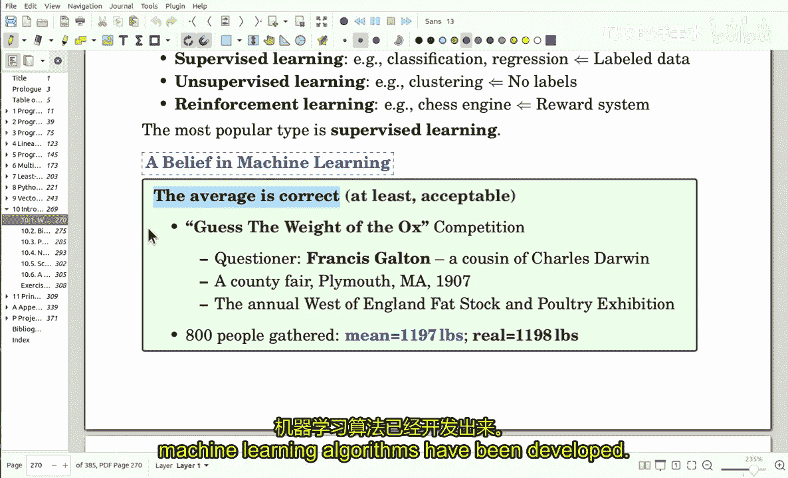

让我们看一个例子。1907年，在英国普利茅斯的一个集市上，弗朗西斯·高尔顿（查尔斯·达尔文的表弟）举办了一场猜测公牛体重的竞赛。共有800人参与猜测。其中13个答案不可靠（如0、无穷大或难以辨认），因此被排除。对于剩余的猜测，计算出的平均值为1197磅。之后，公牛的实际体重被称量为1198磅。因此，来自许多人的猜测的平均值，误差仅为1磅。这表明，如果我们使用数据集中的许多数据点，那么平均值至少在可接受的范围内是正确的。基于这个信念，机器学习算法得以发展。

---

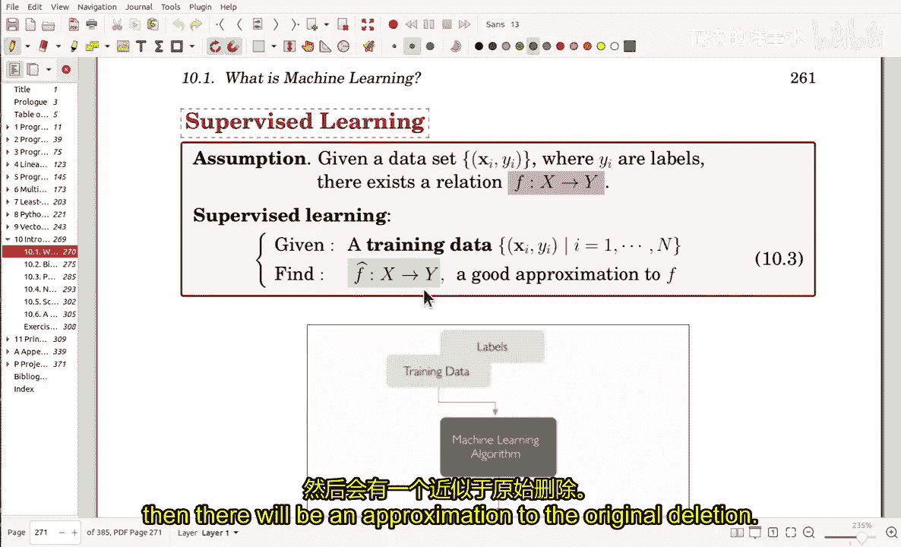

## 人工智能编程：10.2：监督学习 👁️

上一节我们介绍了机器学习的基本概念，本节中我们来看看监督学习。

监督学习的假设是，对于一个数据集 **{ (x_i, y_i) }**，其中 **y_i** 是标签，存在一个真实的函数 **f** 将 **x** 映射到 **y**。因此，监督学习的任务是找到这个函数 **f**。通过使用训练数据集 **{ (x_i, y_i) }**，我们试图得到一个函数 **f_hat**，它是原始真实函数 **f** 的良好近似。我们并不知道真实的 **f**，所以一旦我们找到了一个函数或模型，它就会成为原始函数的一个近似。

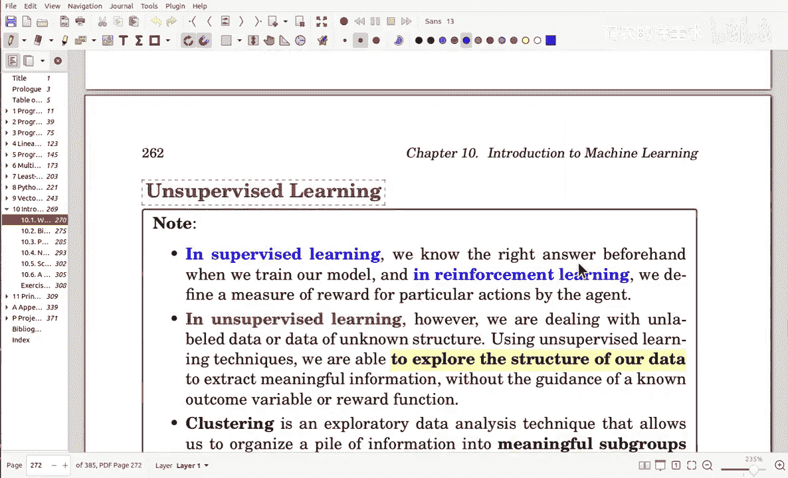

从图示上，我们可以解释监督学习。训练数据会与标签一起给出。利用这个数据集，大多数学习算法会构建一个模型。之后，当新的数据点出现时，就可以使用这个模型进行预测。这就是监督学习的图示解释。

如图所示，机器学习就是构建一个模型或函数，例如一个超平面。当数据集中有两类数据时，算法会尝试找到一条线或一个超平面，使得当新点到来时，其值可以是负的或正的，从而可以做出决策。这个超平面的值为0，因此对于给定的数据点（负值、正值），我们可以做出判断。这就是构建模型的主要思想。同样，对于这些数据点，我们试图找到其趋势或走向，这涉及到一种回归分析。

---

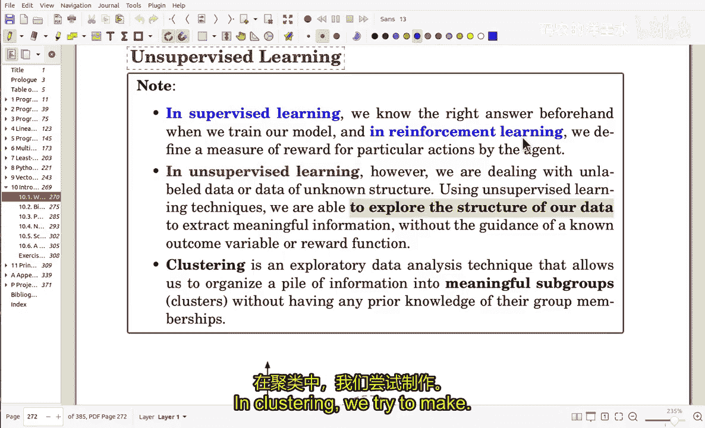

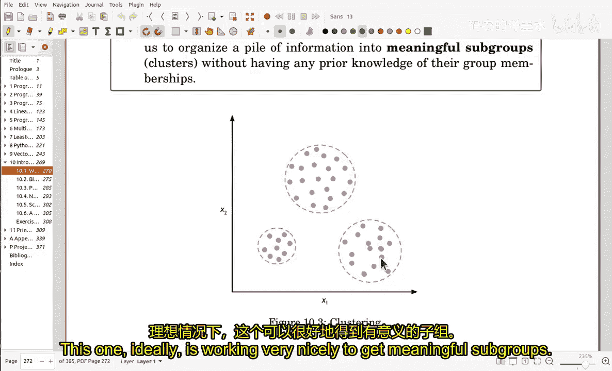

## 人工智能编程：10.3：无监督学习 🔍

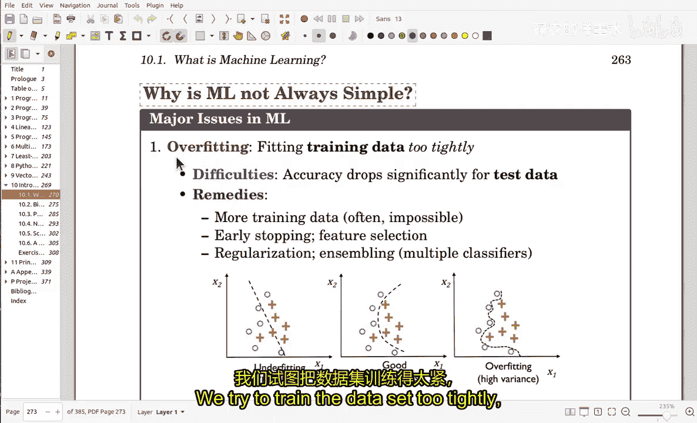

上一节我们讨论了监督学习，本节我们转向无监督学习。

无监督学习可用于探索数据集的结构。在开始时，我们一无所知，没有标签。然而，一旦数据集给定，我们就必须发现一些隐藏的结构。这就是无监督学习的目的。在监督学习中我们使用标签，在强化学习中使用奖励系统，但在无监督学习中，我们没有任何这些，只是探索数据集的隐藏结构。

一个例子是聚类。在聚类中，我们尝试创建有意义的子组。请看图中的示例，理想情况下，算法能很好地创建有意义的子组。

---

## 人工智能编程：10.4：为什么机器学习不总是那么简单？⚠️

看起来机器学习的概念很简单，但在现实中，机器学习并不总是那么简单。以下是机器学习面临的一些挑战：

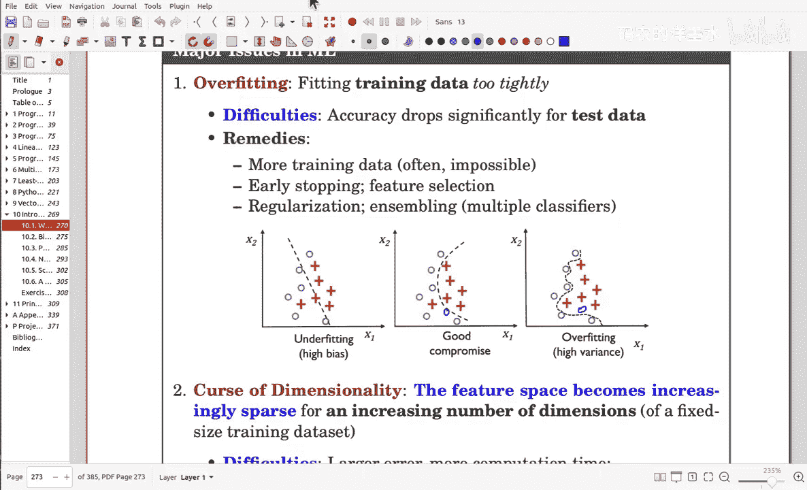

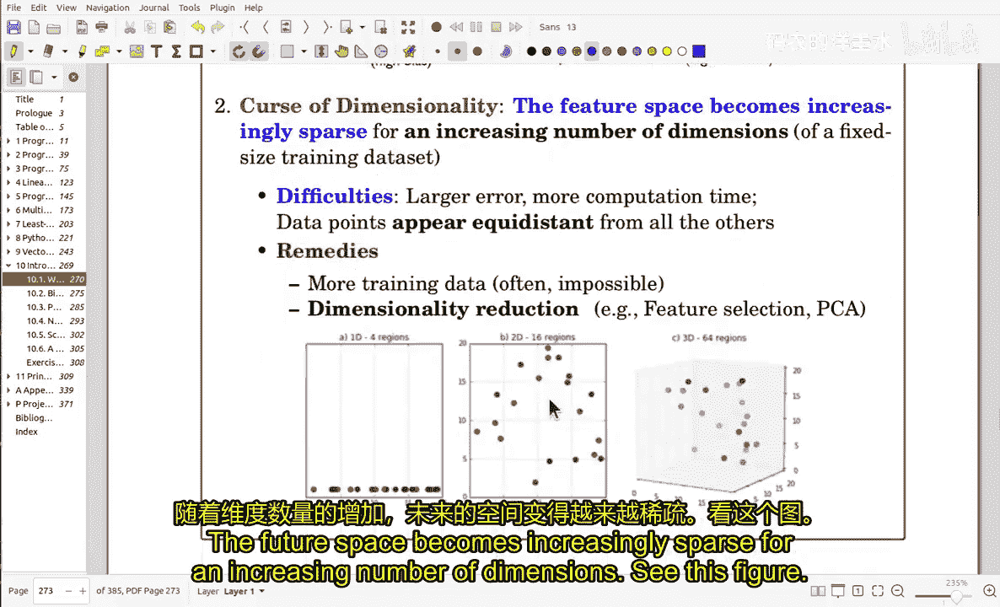

**1. 过拟合**
第一个问题是过拟合。这在训练中很容易发生。在训练中，如果我们对数据集的拟合过于紧密，就会发生过拟合。

例如，在图中，左侧的拟合过于粗糙，而右侧的拟合则过于紧密。假设有一个新的数据点出现，如果模型拟合得太紧，可能会对这个新点做出错误的预测。这就叫过拟合。其问题是，对于测试数据，准确率会显著下降。对于新的数据点，准确率可能很差，但对于给定的训练数据，准确率却非常好。例如，训练数据集的准确率可能达到100%，但对于新数据点，准确率可能远低于100%。

为了克服这个问题，我们可能会尝试使用更多的训练数据。但在现实中，这通常是不可能的。更多的数据意味着需要更多的实验和资金。在训练模型时，通常不可能获得更多的训练数据。此外，训练算法通常是迭代算法，因此你可以尝试提前停止，或者尝试选择一些重要特征来降低维度，或者为目标函数添加正则化项，或者尝试使用多个分类器并通过多数投票来决定输出。这些都是补救措施，但过拟合仍然经常发生。

**2. 维度灾难**
随着维度的增加，特征空间变得越来越稀疏。

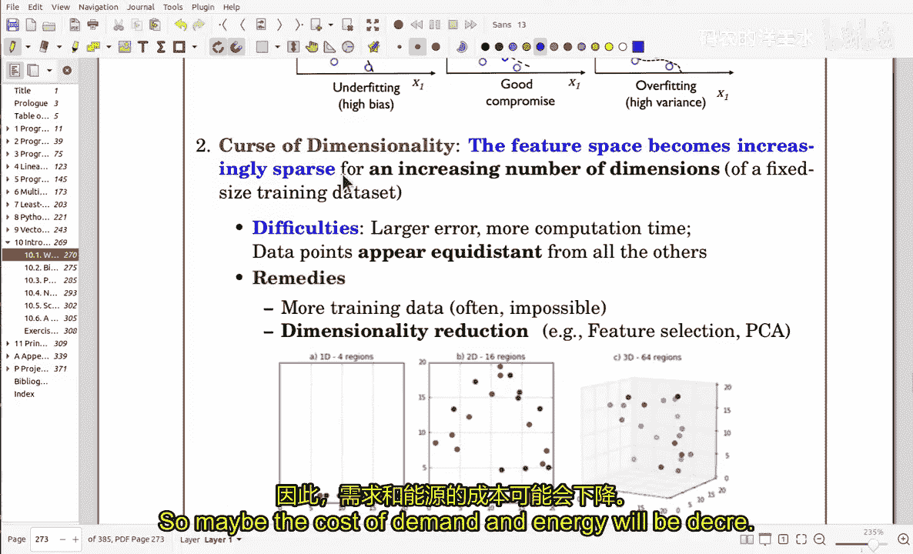

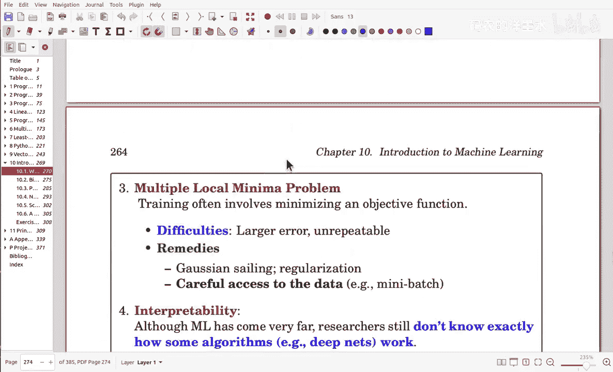

观察图示，在一维空间中，数据点看起来密集。但在二维空间中，它们开始分散。在三维空间中，数据点看起来等距，且彼此远离。因此，识别点群可能变得非常困难。在许多情况下，即使是监督学习，模型也是基于点群的。一旦发生维度灾难，结果就会很差。

为了克服维度灾难，基本上又需要更多的训练数据，但这通常不可能。另一种方法是降维，通过特征选择，只选择重要的特征，可能会更好。或者通过主成分分析等降维技术，将数据集转换到更低维的空间，然后选择几个主成分，从而降低维度。这样也许能缓解维度灾难。

**3. 局部最小值**
现在，大多数算法都基于目标函数。这个目标函数可能有多个局部最小值。如果你使用梯度下降法，它可能会收敛到局部最小值。

例如，在图中，目标函数可能像这样。如果你从这里的初始值开始，它将收敛到这个点。如果你从这里开始，它将去到那里。但在开始时，我们不知道全局最小值在哪里，因此根据初始化的选择，输出的模型可能大不相同，有时会产生较大的误差。无论如何，这是不可重复的。

为了克服这个问题，我们可能会尝试退火或正则化。退火意味着尝试使目标函数更平滑，以便在找到一个最小值后，再次使用不那么平滑的函数，最终使用原始目标函数来找到全局最小值，但这也不容易做到。有时，我们可以非常仔细地访问数据集。一种技术是小批量处理，即在每次迭代中只访问部分数据点，而不是使用所有数据点。在这种情况下，由于数据点较少，目标函数的振荡较小，因此更有可能达到全局最小值。

**4. 可解释性**
尽管机器学习在某些应用领域已经取得了很大成功，但研究人员仍然不完全清楚某些算法是如何工作的。一个例子就是深度网络。如果我们不知道它是如何工作的，那么我们如何进行真正的改进？因此，我们必须理解并能够解释我们的算法，这样我们才能修改并克服缺陷，获得更好的算法。可解释性是一个难题。

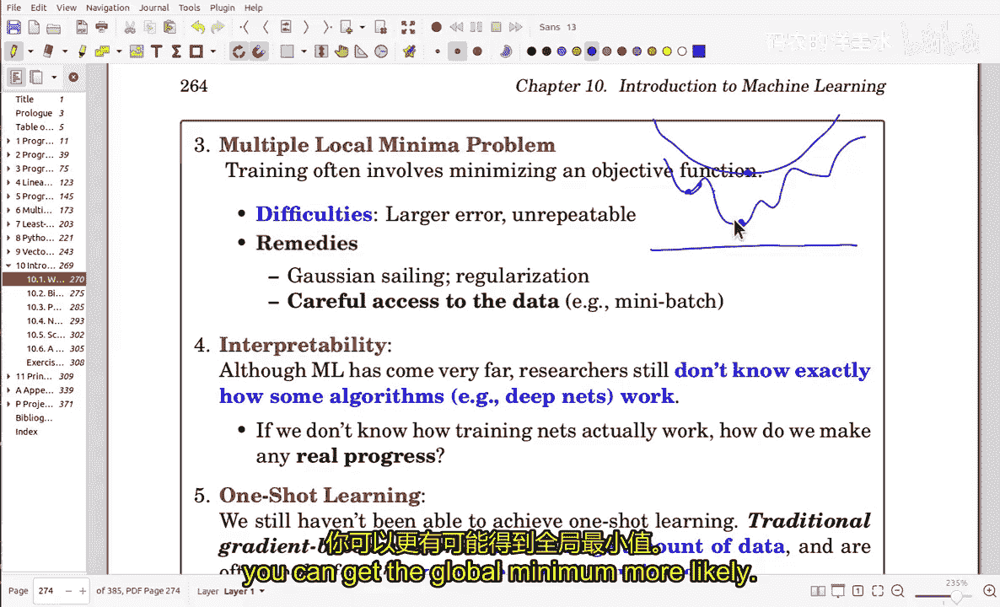

在现代术语中，这被称为可解释的人工智能（XAI），这是当前机器学习领域的热门话题。

**5. 数据规模**
最后，我们面临学习所需数据规模的问题。我们仍然无法实现“一次性学习”。传统上，神经网络等方法的训练需要大量数据，并且通常需要非常多的迭代次数。但人类智能可以通过几个例子就理解一个对象。问题是，我们能否创造出只需少量样本就能训练的机器学习算法？如果你能解决这个问题，你很快就能成为亿万富翁。

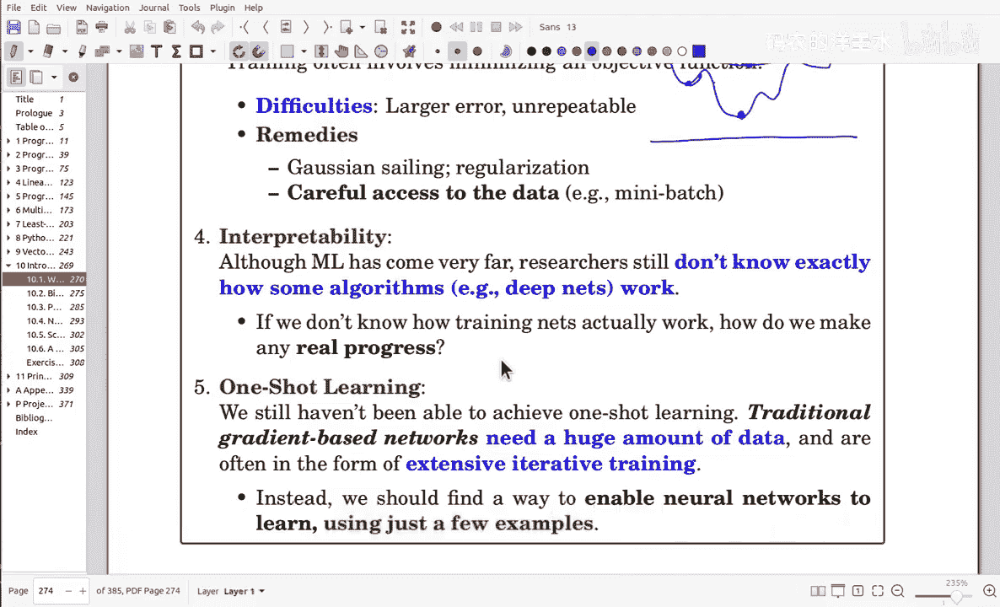

---

## 总结 📝

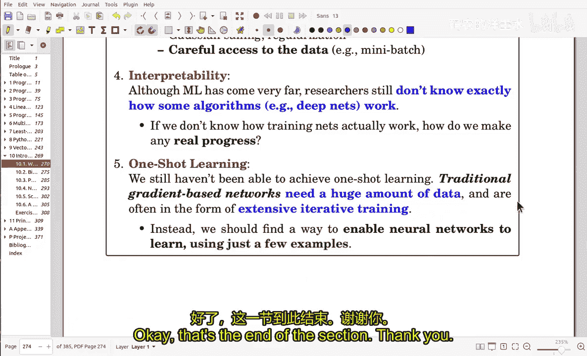

在本节课中，我们一起学习了机器学习的基本概念。我们定义了机器学习，并区分了监督学习、无监督学习和强化学习。我们通过一个生动的例子理解了“群体智慧”的信念。我们详细探讨了监督学习如何通过带标签的数据寻找近似函数，以及无监督学习如何探索数据的隐藏结构（如聚类）。最后，我们深入分析了机器学习实践中面临的五大挑战：过拟合、维度灾难、局部最小值、可解释性以及数据规模问题，并简要提及了可能的解决方向。本章为后续学习具体的算法和应用奠定了基础。