# 062：逻辑回归

在本节课中，我们将学习三种流行的机器学习分类器：逻辑回归、支持向量机和K近邻算法。我们将从逻辑回归开始，首先介绍其核心的激活函数——逻辑Sigmoid函数。

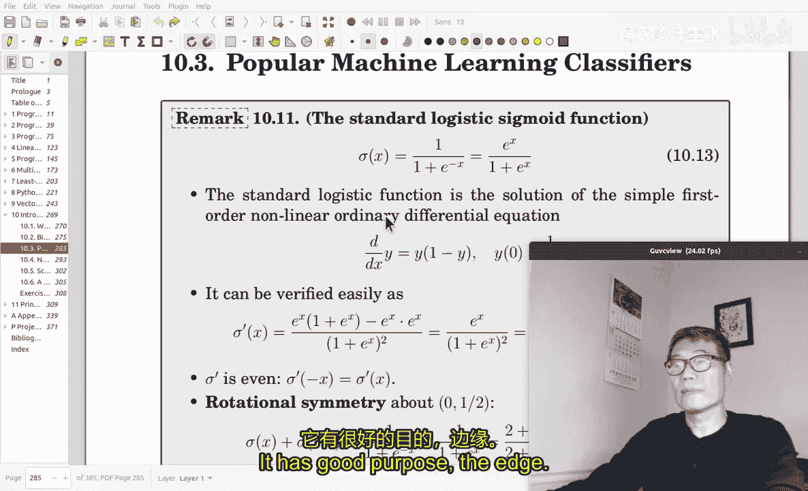

## 逻辑Sigmoid函数

逻辑Sigmoid函数是逻辑回归模型的核心。它通常被用作激活函数，因为它具有良好的数学性质。

逻辑Sigmoid函数由以下公式定义：

**公式：σ(x) = 1 / (1 + e^{-x})**

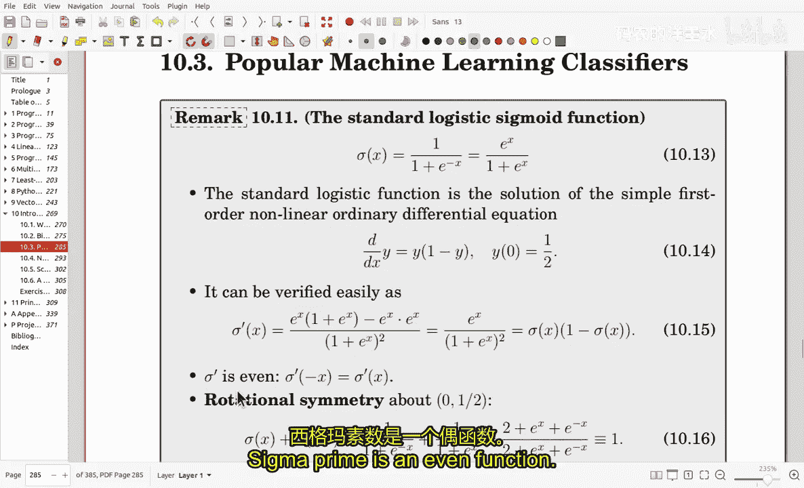

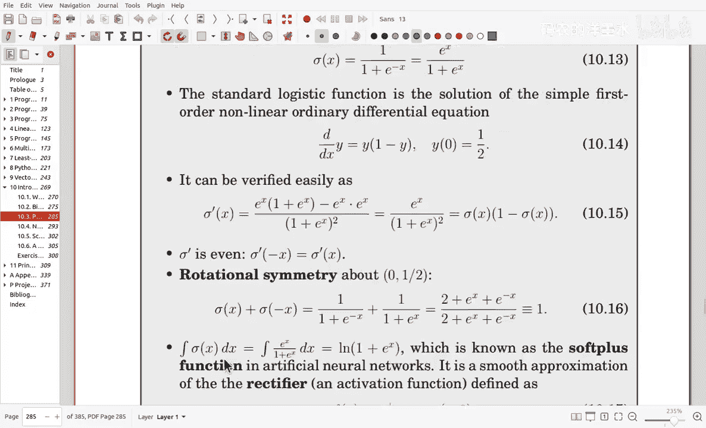

这个函数是以下简单微分方程的解：

**公式：σ‘(x) = σ(x) * (1 - σ(x))**

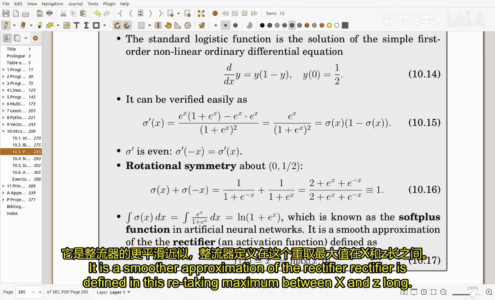

我们可以通过求导规则轻松验证这一点。当 x 等于 0 时，函数值为 0.5。逻辑Sigmoid函数满足这个微分方程。

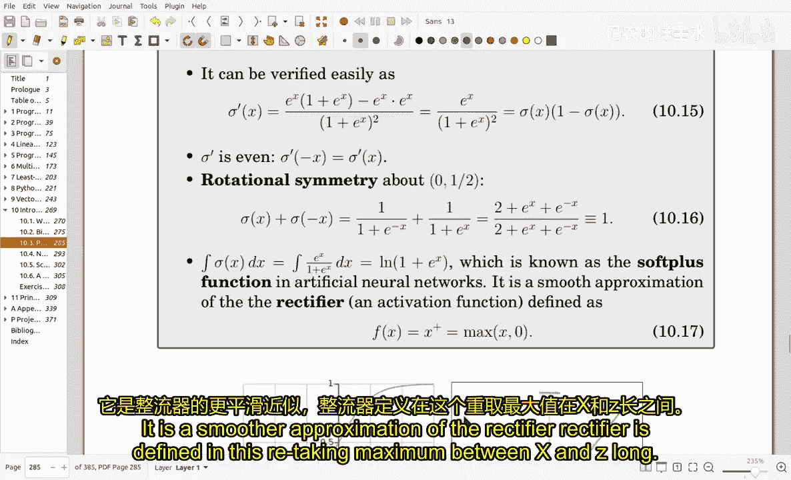

该函数具有对称性：

**公式：σ(x) + σ(-x) = 1**

如果对函数进行积分，可以得到 `log(1 + e^x)`，这被称为“Softplus”函数。

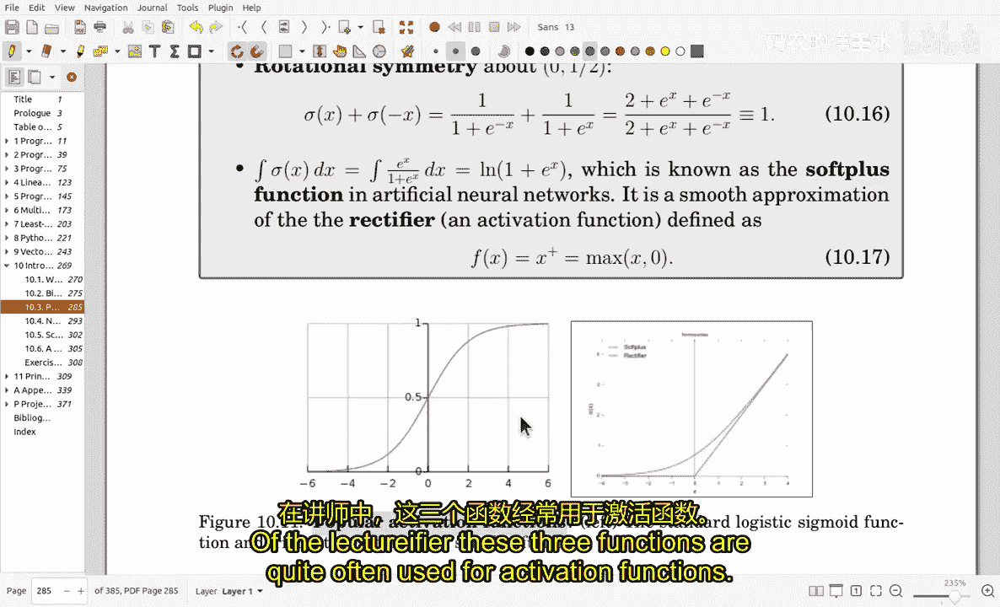

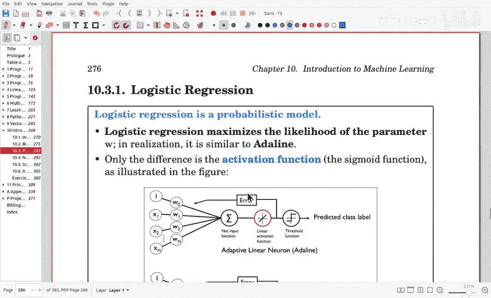

## 激活函数对比

以下是几种常见的激活函数。

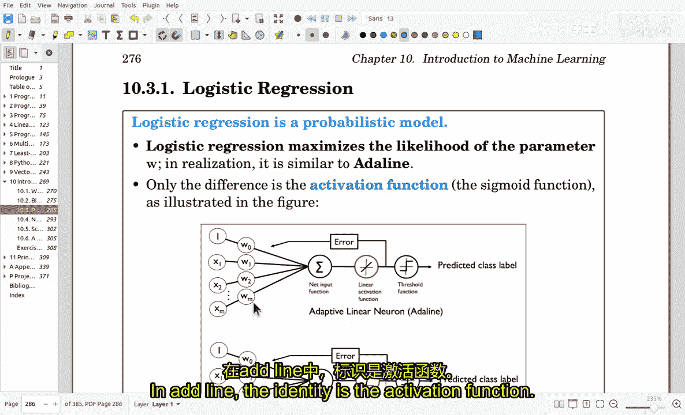

*   **整流线性单元**：定义为 `max(0, x)`。
*   **逻辑Sigmoid函数**：如上所述，是一个平滑的S形曲线。
*   **Softplus函数**：`log(1 + e^x)`，是整流线性单元的一个平滑近似。

这三种函数在神经网络中经常被用作激活函数。

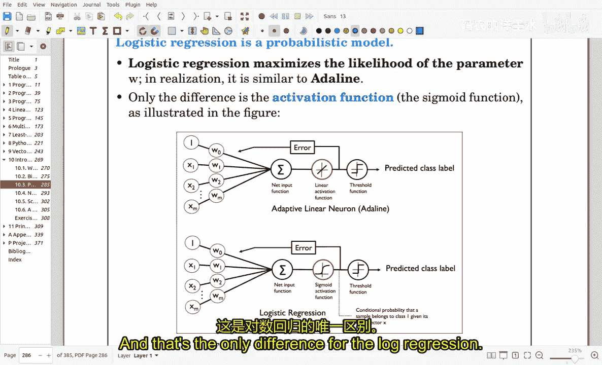

## 逻辑回归模型

上一节我们介绍了激活函数，本节中我们来看看逻辑回归模型本身。逻辑回归是一个概率模型，其目标是最大化参数 **w** 的似然函数。

逻辑回归的实现与线性回归非常相似。主要区别在于激活函数。

*   在线性回归中，激活函数是恒等函数，即没有激活。
*   在逻辑回归中，激活函数是Sigmoid函数。

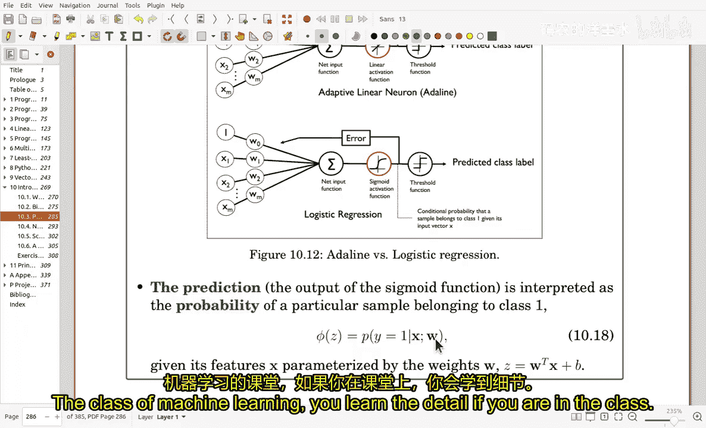

这是逻辑回归与线性回归的唯一区别。

由于使用了Sigmoid函数，输出值被限制在0和1之间。因此，预测值可以被解释为样本属于类别1的概率。

对于输入 **x**，其属于类别1的概率为 `P(y=1|x) = σ(w·x + b)`。这里的 `σ` 就是Sigmoid函数。有一些理论支持将激活值解释为概率。

## 推导损失函数

现在，让我们尝试推导逻辑回归的损失函数。我们从似然函数开始。

似然函数定义如下：`L(w, b) = ∏ [σ(w·x_i + b)]^{y_i} * [1 - σ(w·x_i + b)]^{1-y_i}`

这里，标签 `y_i` 的幂次为0或1。这样组织后，对于每个数据点，该项都会被乘起来。如果我们能正确得到 **w** 和 **b**，那么对于一个属于类别1的点，`σ(...)` 理想情况下应为1，而 `1-σ(...)` 为0，从而使似然值接近1。模型训练良好时，整个似然值将接近1。

直接最大化这个似然函数并不容易，因为它涉及幂运算和连乘。因此，我们转而最大化其对数似然。利用对数的性质，幂运算可以移出，乘法可以转化为加法。

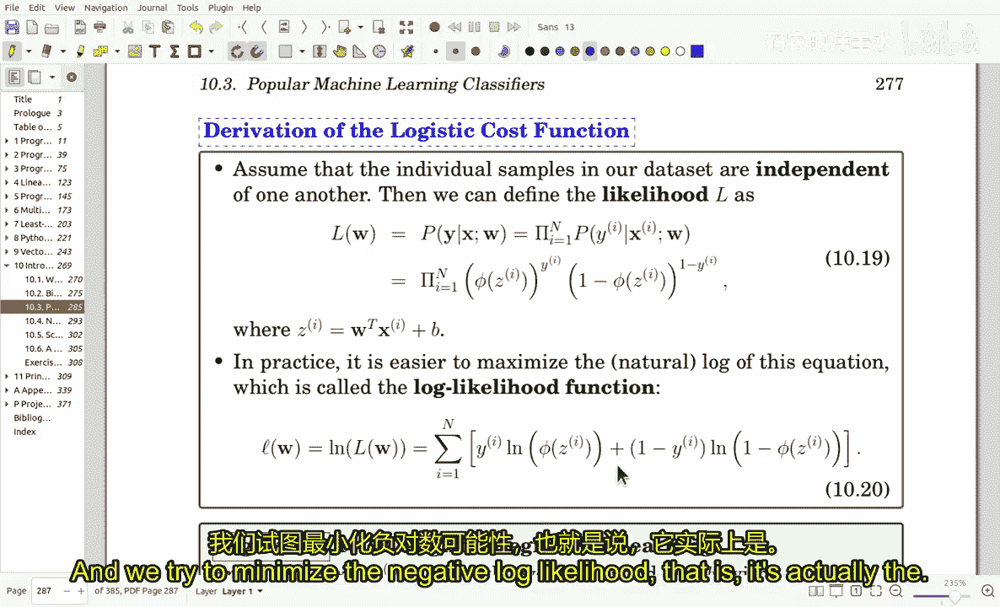

我们不是最大化这个对数似然，而是最小化负对数似然，这实际上就是我们的目标函数（损失函数）。

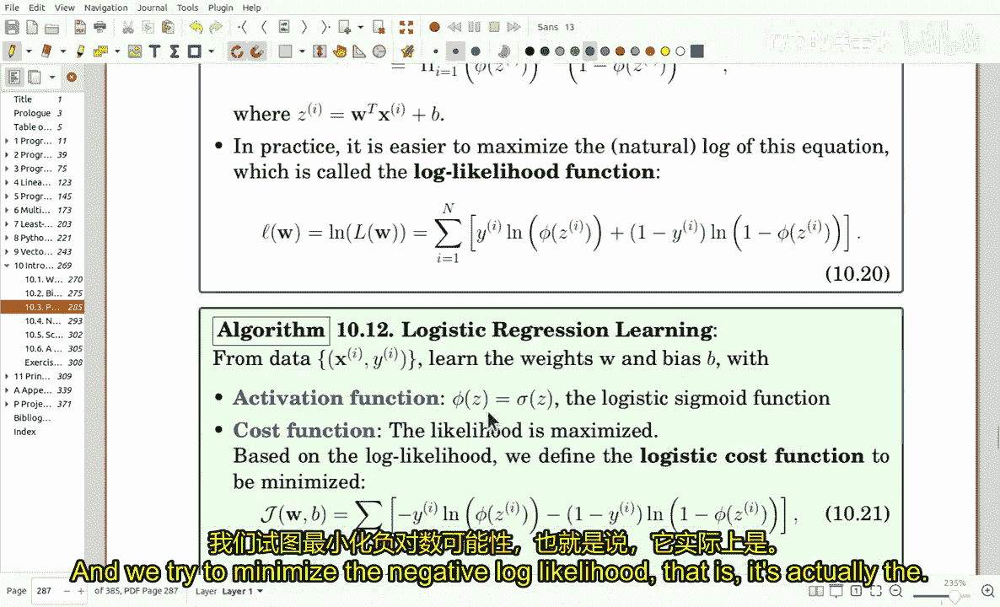

**公式：J(w, b) = -∑ [y_i * log(σ(w·x_i + b)) + (1 - y_i) * log(1 - σ(w·x_i + b))]**

这就是逻辑回归的目标函数，其中我们使用逻辑Sigmoid函数作为激活函数。

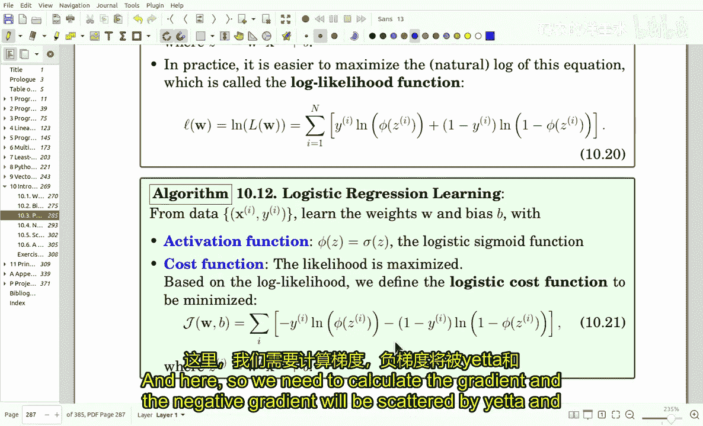

## 梯度计算与参数更新

我们需要最小化这个目标函数。通过梯度下降法可以实现。为此，我们需要计算梯度，然后用学习率 `η` 缩放负梯度来更新参数。

计算逻辑回归中 `J` 对 `w_j` 的梯度。从目标函数出发，对 `w_j` 求偏导，应用链式法则，并利用已知的Sigmoid函数导数性质 `σ‘(x) = σ(x)(1-σ(x))`，我们可以得到结果。

以向量形式简化后，梯度为：

**公式：∇_w J = ∑ (σ(w·x_i + b) - y_i) * x_i**

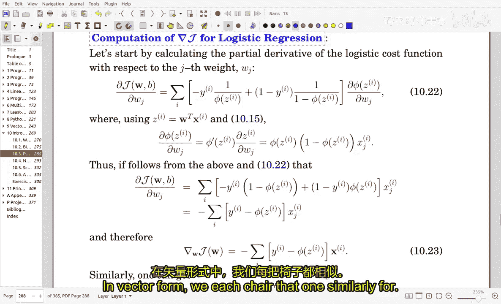

类似地，对偏置 `b` 的导数为：

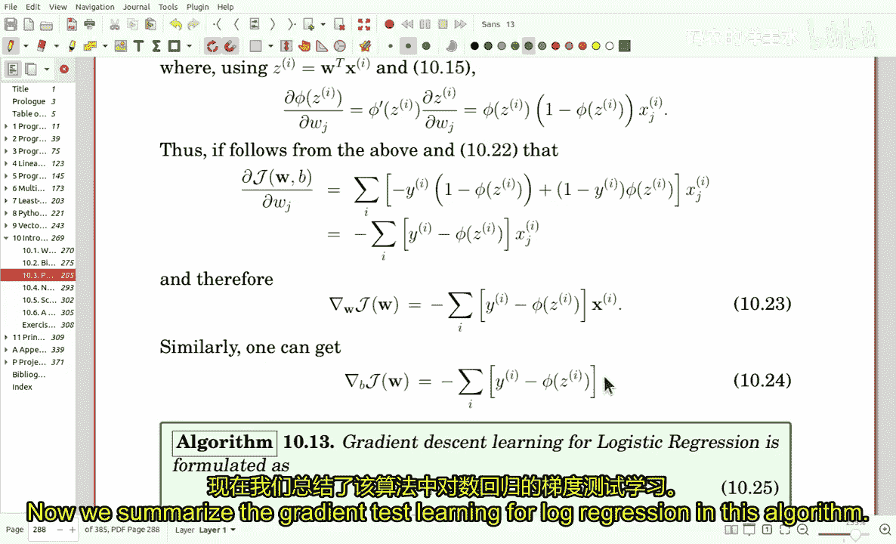

**公式：∂J/∂b = ∑ (σ(w·x_i + b) - y_i)**

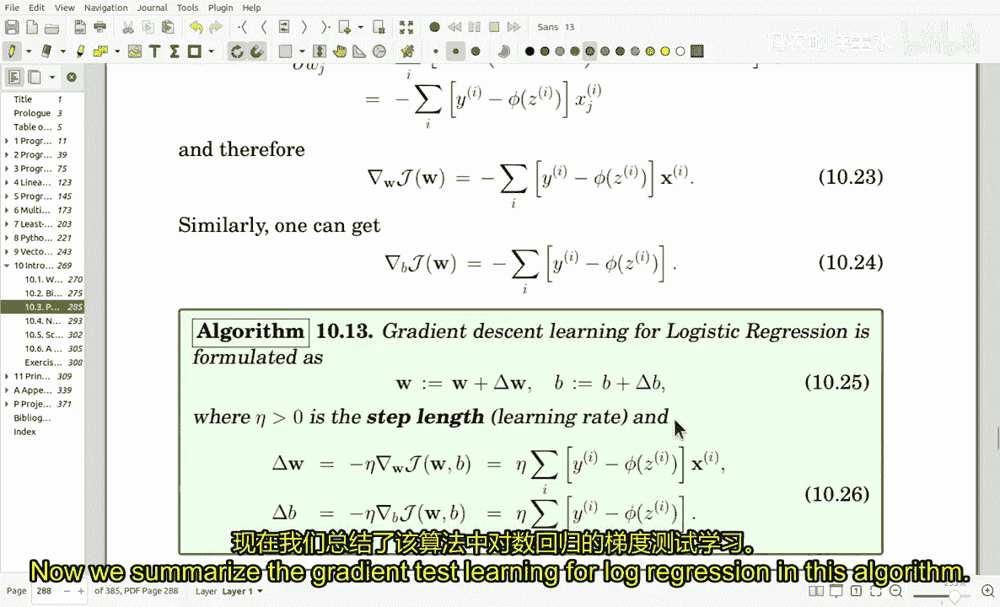

## 梯度下降算法

以下是逻辑回归的梯度学习算法总结。

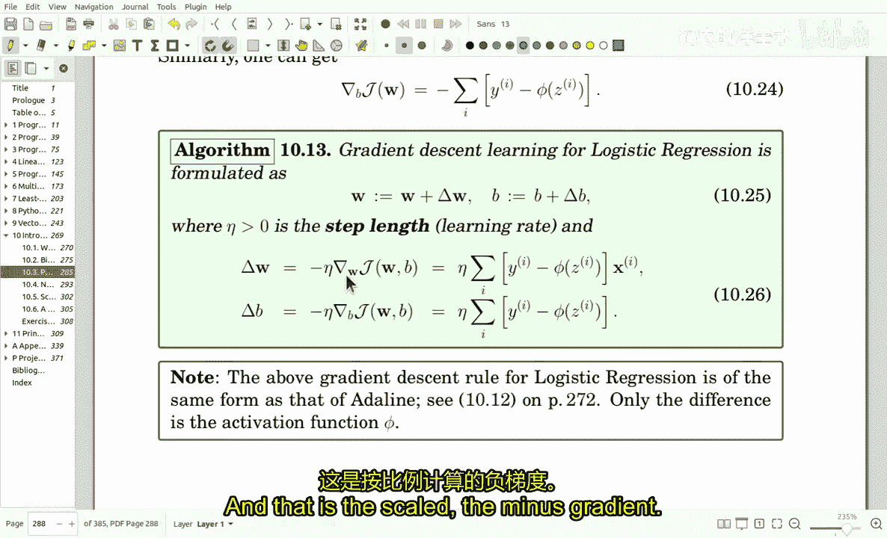

参数 **w** 和 **b** 按照以下规则更新：

**公式：w := w - η * ∇_w J**
**公式：b := b - η * ∂J/∂b**

其中，`η` 是学习率，`∇_w J` 和 `∂J/∂b` 是上面计算出的梯度。更新项是学习率乘以梯度。

这个形式与线性回归的算法完全相同。唯一的区别是，这里我们使用了Sigmoid激活函数将净输入映射到0和1之间，而线性回归使用的是恒等函数。因此，如果你已经有了线性回归的代码，可以很容易地修改它来实现逻辑回归。

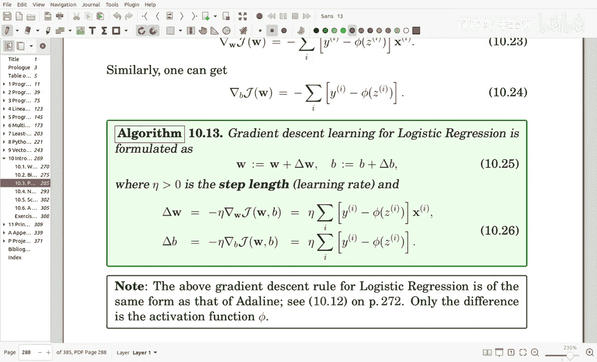

本节课中，我们一起学习了逻辑回归的基础。我们从逻辑Sigmoid函数及其性质开始，然后介绍了逻辑回归作为一个概率模型如何工作。我们推导了其损失函数（负对数似然），并详细说明了如何通过梯度下降法计算梯度并更新模型参数。最后，我们指出了逻辑回归与线性回归在算法形式上的高度相似性。