# 063：支持向量机 📚

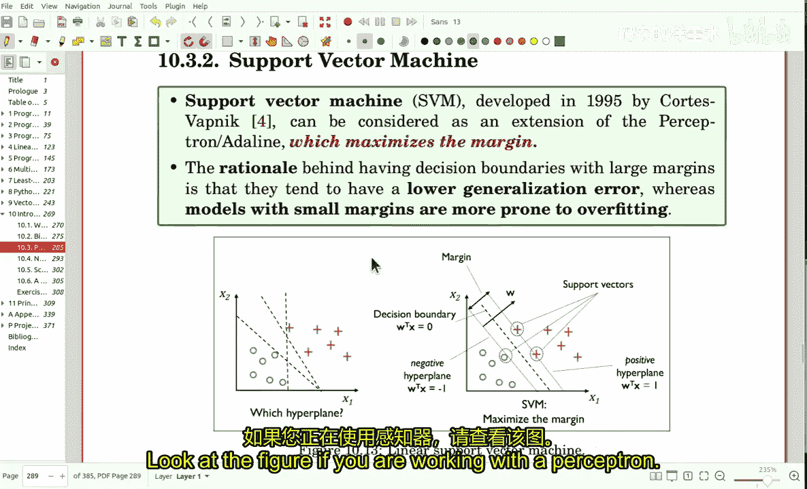

在本节课中，我们将要学习支持向量机。支持向量机可以看作是感知机或线性分类器的扩展，其核心思想是最大化分类边界与数据点之间的“间隔”，以获得更好的泛化能力。

## 概述

上一节我们介绍了逻辑回归。本节中，我们来看看支持向量机。支持向量机可以被视为感知机的扩展，它致力于最大化分类的“间隔”。

## 支持向量机的基本思想

观察下图，如果使用感知机算法，它可能会收敛于图中任意一条能将数据分开的直线。例如，如果选择了图中较细的直线，那么当一个新的数据点出现在虚线附近时，感知机可能会将其错误分类。这是因为感知机得到的分类边界“间隔”很小。

较小的间隔更容易导致过拟合，并在预测时产生较大的误差。相反，如果我们能找到一个分类超平面，使得两个不同类别之间的间隔最大化，那么模型对于未知数据的泛化误差就会更低。泛化误差低意味着模型对后续出现的新数据点预测错误率小。支持向量机的逻辑就是尝试最大化这个间隔。

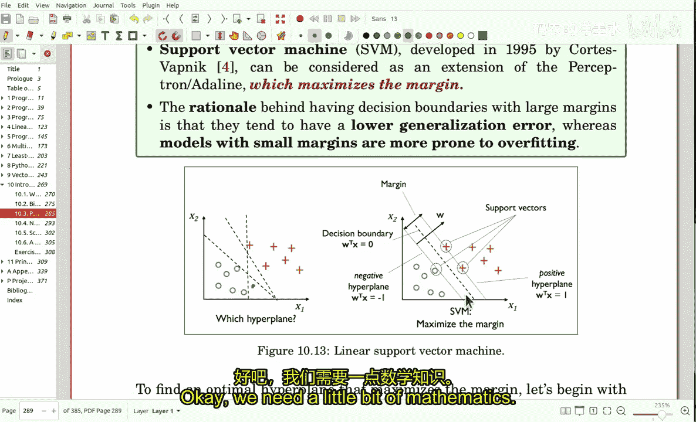

## 如何最大化间隔

我们需要一些数学推导。对于一个分类线，我们定义其两侧的边界线。对于正类样本点，其净输入值（到分类线的距离）应大于等于1；对于负类样本点，其净输入值应小于等于-1。中间值为0的线就是分类线本身。

位于边界线上、净输入值恰好为1或-1的点被称为“支持向量”，正是这些点“支撑”着整个间隔。

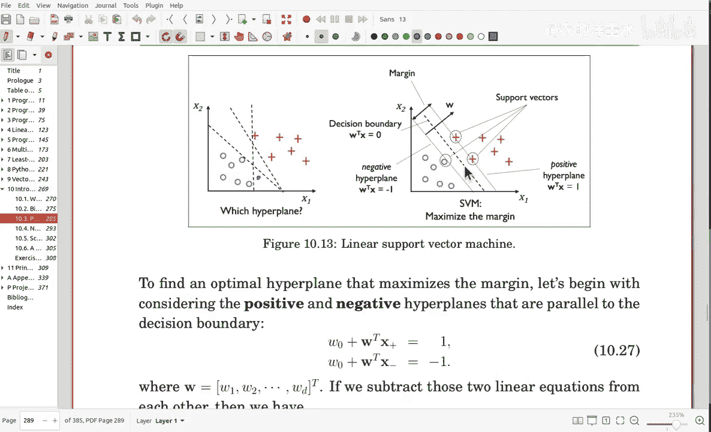

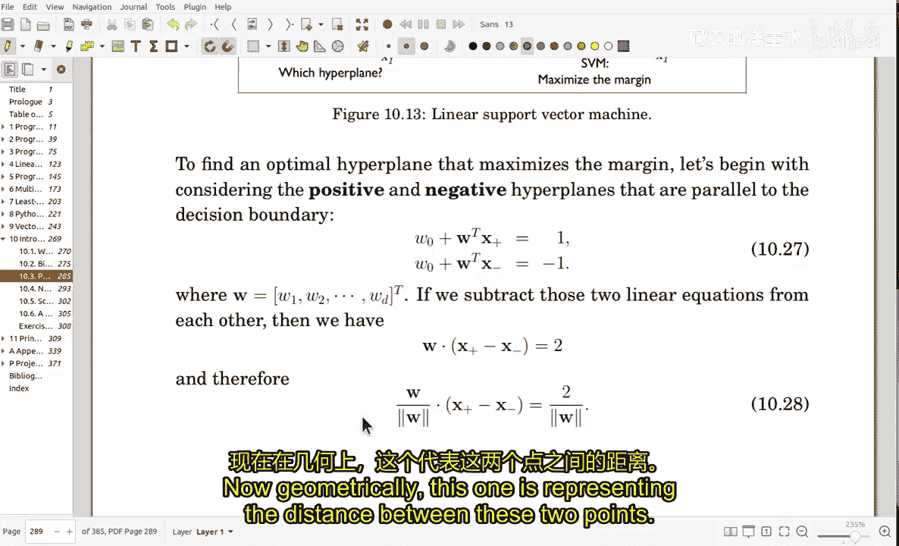

通过数学推导，我们可以得到两个支持向量 `x+` 和 `x-` 在法向量 `w` 方向上的投影距离。这个距离正是我们想要最大化的间隔。

具体而言，间隔 `M` 的计算公式为：
`M = 2 / ||w||`

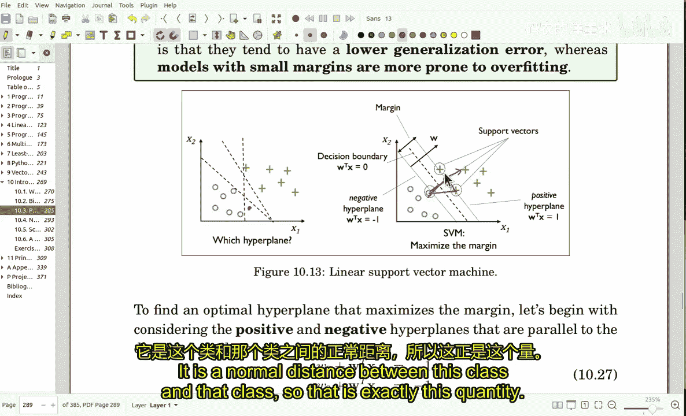

因此，最大化间隔 `M` 等价于最小化权重向量 `w` 的范数 `||w||`。于是，支持向量机的优化问题可以表述为：在满足所有数据点分类约束的条件下，最小化 `||w||`。

## 支持向量机的优化问题

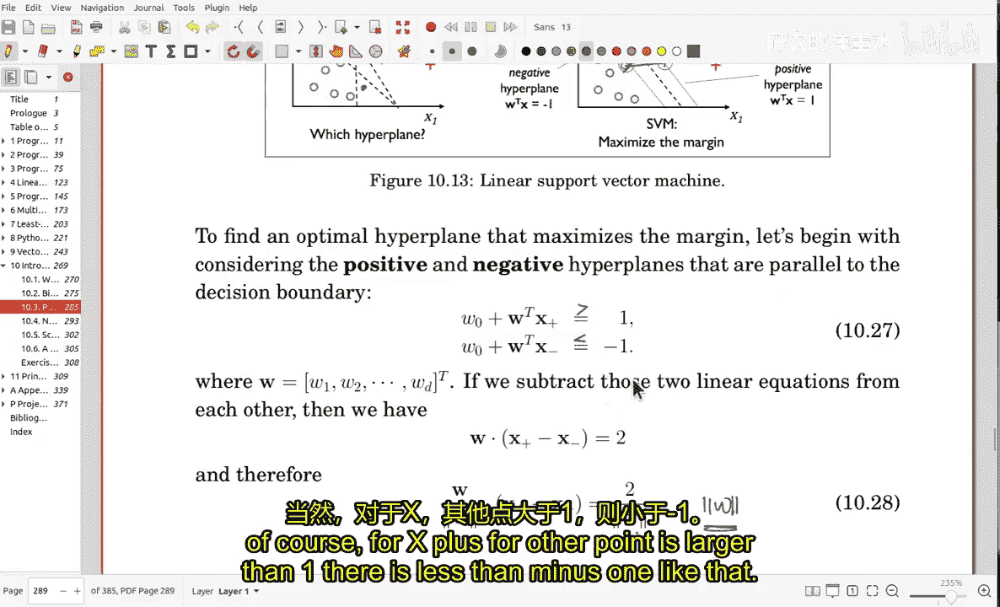

支持向量机的目标函数如下所示。我们不是直接最大化间隔，而是在约束条件下最小化权重向量的范数。

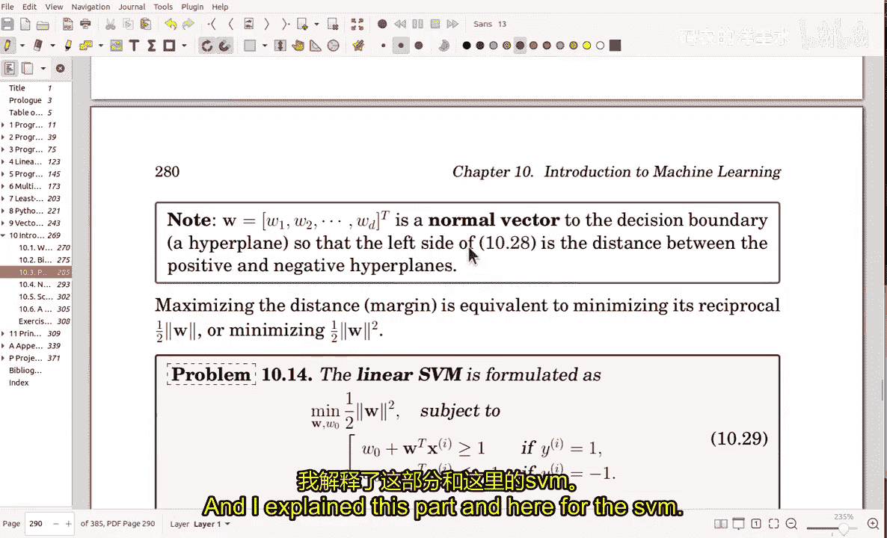

其数学形式为：
**最小化：** `(1/2) * ||w||^2`
**约束条件：** `y_i * (w^T * x_i + b) >= 1`， 对于所有样本点 `i`

这里，`y_i` 是样本的标签（+1 或 -1）。这个约束条件确保了所有样本都被正确分类，并且位于间隔边界之外。

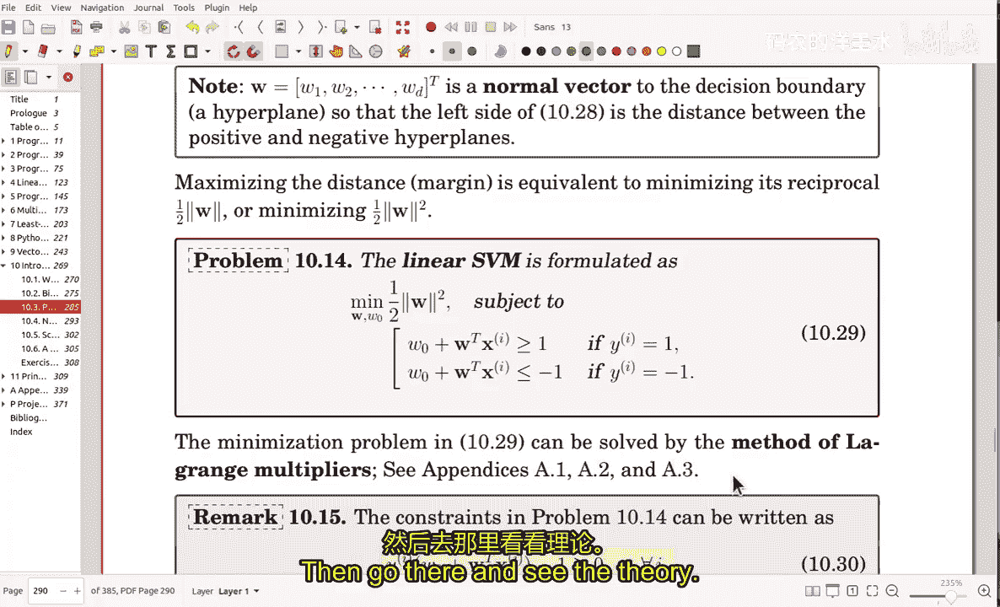

这个带约束的最小化问题可以通过拉格朗日乘子法求解。课程附录（A1, A2, A3）中详细解释了相关数学理论，如果你对背后的数学原理感兴趣，可以前往查阅。

## 线性支持向量机的特性

线性支持向量机的一个优点是，如果数据是线性可分的，那么该优化问题存在唯一的全局最优解。

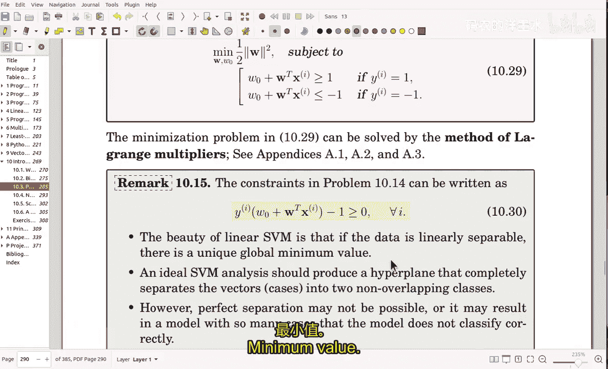

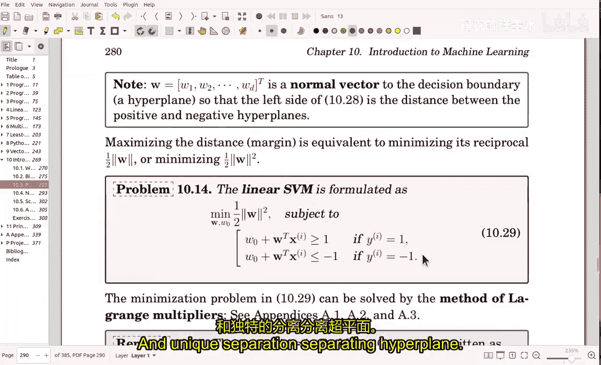

这意味着我们能得到一个唯一的、间隔最大化的分类超平面。

## 处理非线性与噪声数据

理想的SVM应该产生一个能将所有向量完全分离成两个非重叠类别的超平面。然而，完美的分离并不总是可能的，或者可能导致模型过于复杂（例如支持向量过多），从而不能正确分类，尤其是在数据集存在噪声时。

为了克服线性SVM在处理非线性或噪声数据时的困难，我们可以考虑以下方法：

以下是两种主要的扩展技术：
1.  **软间隔分类**：引入松弛变量，允许一些样本点落在间隔之内甚至被错误分类，从而在间隔最大化和分类错误之间取得平衡。
2.  **核技巧**：通过一个核函数，将数据隐式地映射到更高维的特征空间，使得在原始空间中非线性可分的数据在高维空间中变得线性可分。这样既避免了显式计算高维特征向量的高昂成本，又提升了模型的分类能力。非线性SVM中常用的核函数包括多项式核、高斯径向基核等。

## 总结

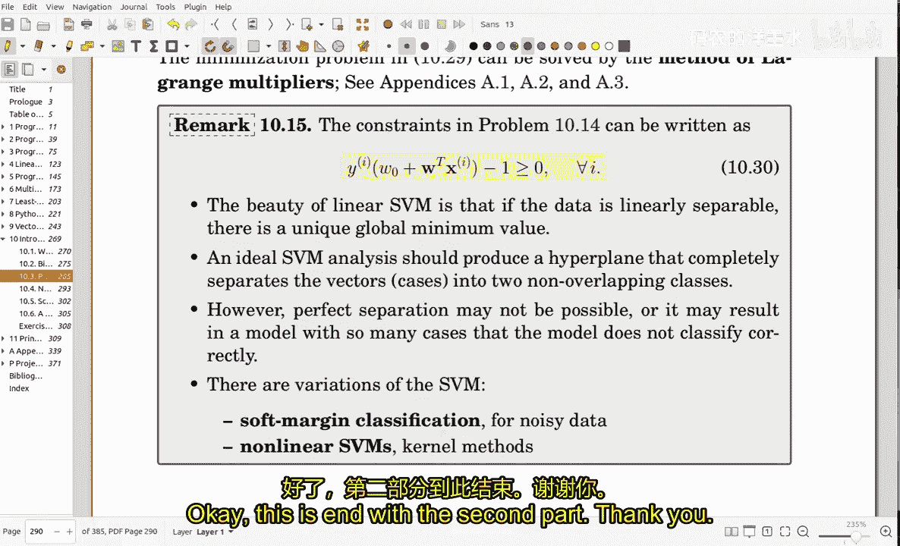

本节课中我们一起学习了支持向量机。我们从感知机的局限性出发，引出了最大化间隔的核心思想。我们推导了间隔的公式，并将其转化为一个带约束的优化问题。我们了解到，对于线性可分数据，SVM能给出唯一的最优解。最后，我们简要探讨了处理非线性与噪声数据的两种关键技术：软间隔与核技巧。支持向量机是一个理论优美且在现实中非常流行的算法。