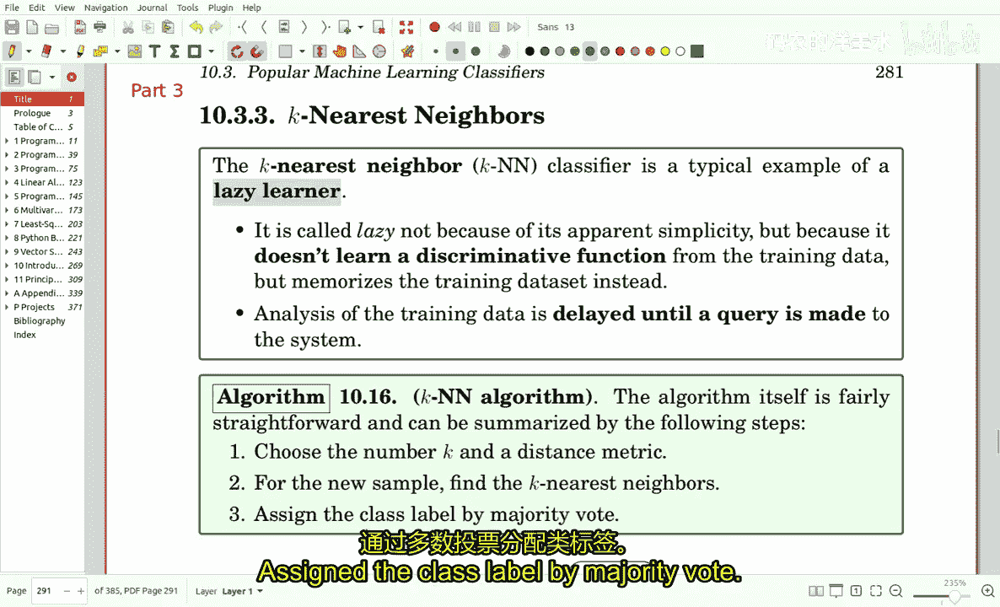
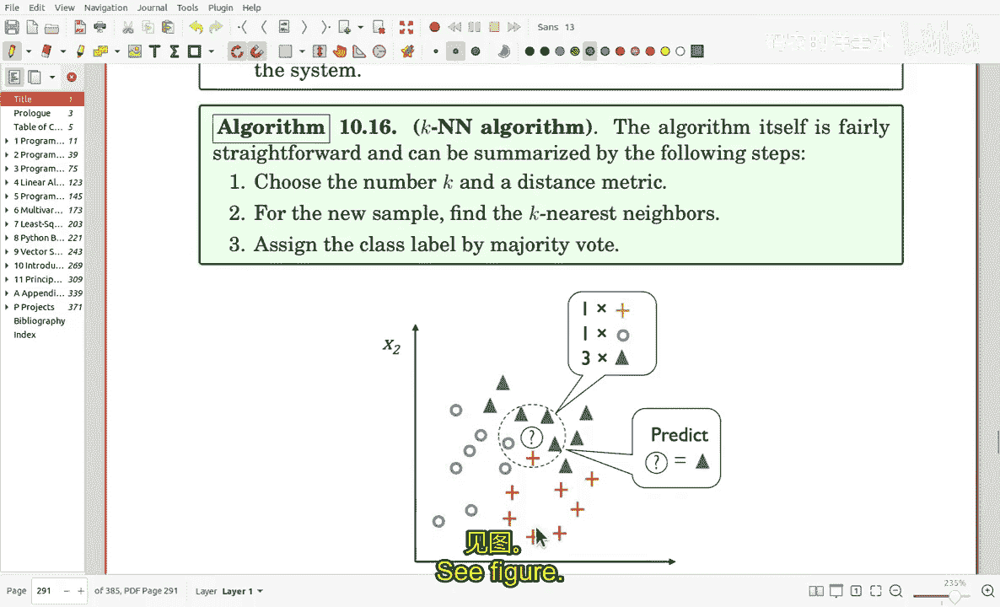
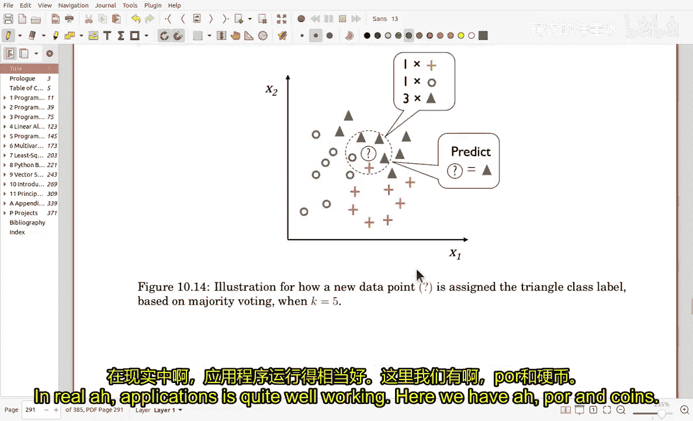
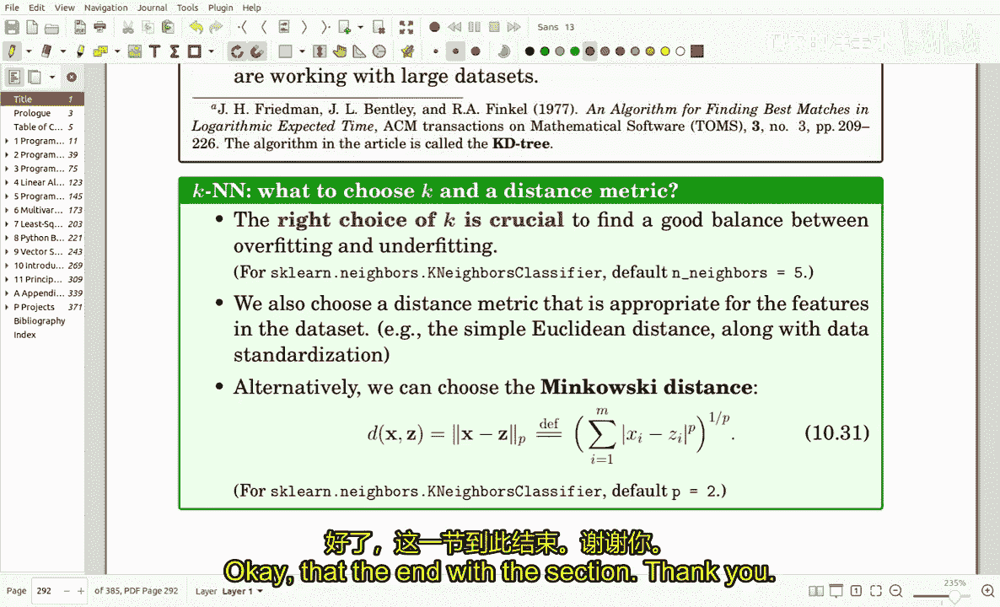

# 064：第64讲 - k最近邻(KNN) 👨‍🏫

在本节课中，我们将学习一种名为k最近邻（KNN）的经典机器学习算法。这是一种典型的“懒惰学习”算法，其核心思想简单而强大，在许多实际数据集上表现优异。

## 概述 📋

k最近邻分类器是“懒惰学习”的一个典型例子。它之所以被称为“懒惰”，并非因为其看似简单，而是因为它不会从训练数据中学习一个判别函数。该算法只是记忆整个训练数据集。对训练数据的分析会延迟到系统收到查询请求时才进行。

## KNN算法的工作原理 ⚙️

上一节我们介绍了KNN的基本概念，本节中我们来看看它的具体工作步骤。KNN算法可以概括为以下几个步骤：

以下是实现KNN分类的核心步骤：
1.  **选择参数K和距离度量**：确定要考虑的最近邻数量（K值）以及计算样本间距离的方法。
2.  **为新样本寻找K个最近邻**：对于一个新的查询样本，计算它与训练集中所有样本的距离，并找出距离最近的K个点。
3.  **通过多数投票分配类别标签**：查看这K个最近邻样本的类别，将出现次数最多的类别作为新样本的预测类别。

观看此视频以直观理解。

我们选择K=5。对于图中这个新的数据点（星号），我们找到了距离它最近的5个邻居点。其中有4个是三角形，1个是圆形。因此，系统将通过**多数投票**预测该点为一个三角形。这就是KNN的基本思想，相当简单。但在实际应用中，它通常非常有效。

## KNN的优缺点 ⚖️

了解了算法流程后，我们来看看它的长处与短处。KNN有以下优点和缺点：

**优点**：
*   **基于记忆**：分类器可以立即适应新收集的训练数据。
*   **实现简单**：概念和实现都非常直观。

**缺点**：
*   **预测计算复杂度高**：预测时的计算复杂度与训练样本数量呈线性增长（在最坏情况下）。
*   **难以丢弃训练样本**：由于没有独立的训练阶段，每次获得新数据点都将其加入训练集，因此存储空间可能随着数据量增大而成为挑战。不过在实际中，这种情况并不频繁发生。

## 关键参数选择 🔧

一个更重要的问题是**K值的选择**。在许多情况下，选择合适的K值至关重要。通过选择正确的K，你可以在**欠拟合**和**过拟合**之间取得平衡。

如果你使用Scikit-learn中的分类器，默认K值是5。你也可以选择不同的**距离度量**。默认是欧几里得距离（L2范数）。你也可以选择其他距离，例如曼哈顿距离（L1范数）或切比雪夫距离（L∞范数）。你可以根据你的数据集特性来选择不同的度量方式。

## 实际应用与总结 🏆

KNN算法相当简单。我个人测试了Scikit-learn中构建的各种算法，并选择了超过10个数据集。对于每个数据集，我应用了从Scikit-learn中选出的10个分类器。我发现，在大约三分之一的数据集上，KNN预测的准确率是最高的。这意味着，在整整三分之一的数据集中，KNN算法取得了最佳精度。

尽管这是一个简单的算法，但在许多情况下，它优于更先进、更复杂的算法。因此我相信，有时越简单越好。所以，KNN并非一个廉价的算法，它虽然简单，但在许多数据集中非常有用。

本节课中，我们一起学习了k最近邻（KNN）算法的核心思想、工作步骤、优缺点以及关键参数的选择。它是一种强大而直观的懒惰学习算法，是机器学习工具箱中的重要工具。

