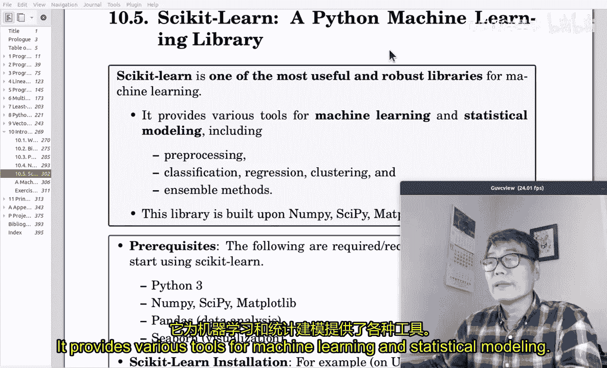
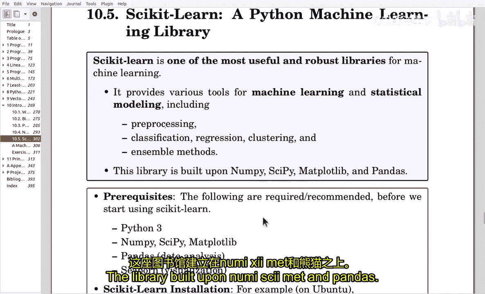
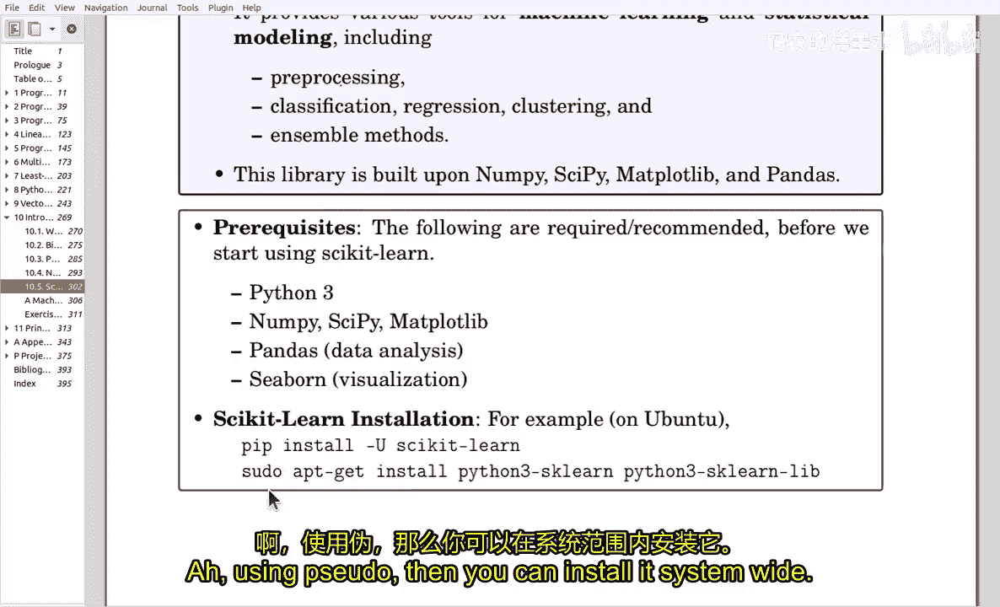
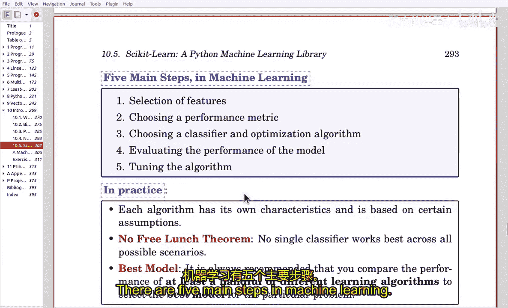
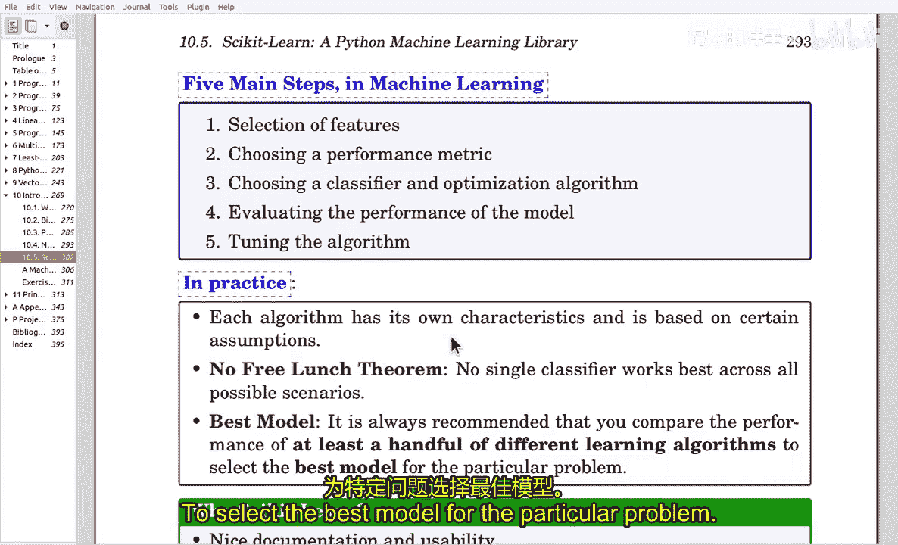
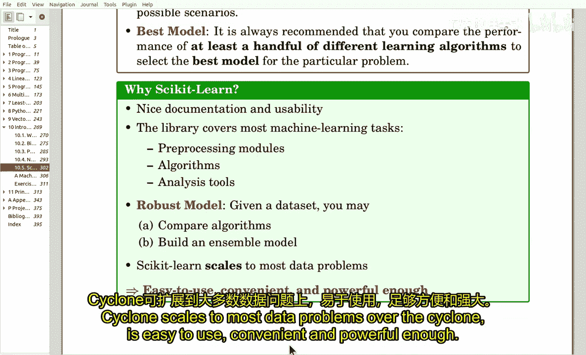
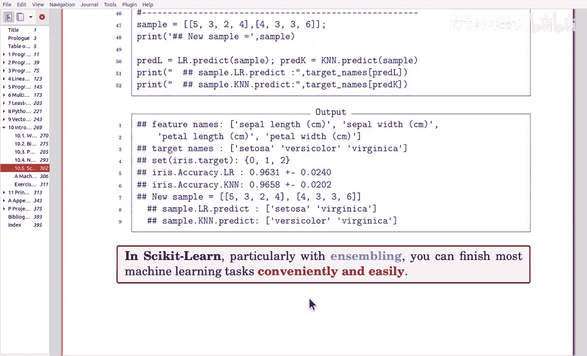

# 066：Scikit-Learn - Python机器学习库 🧠



在本节课中，我们将要学习Scikit-Learn，一个功能强大且应用广泛的Python机器学习库。我们将了解它的核心功能、安装方法、使用流程，并通过一个简单的示例来演示如何用它构建和评估机器学习模型。



---



Scikit-Learn是一个Python机器学习库。它是最有用和最健壮的机器学习库之一。它提供了用于机器学习和统计建模的各种工具。



该库建立在NumPy、SciPy、Matplotlib和Pandas之上。

以下是使用Scikit-Learn所需或推荐的准备工作。你需要安装Python 3、NumPy、SciPy、Matplotlib和Pandas。此外，你也可以尝试使用Seaborn进行可视化。对于安装，例如在Ubuntu系统上，你可以尝试使用以下命令。如果你使用`sudo`安装，则可以将其安装到整个系统中。

```bash
pip install scikit-learn
```



机器学习主要包含五个步骤。

1.  特征选择。
2.  选择性能指标。
3.  选择分类器和优化算法。
4.  评估模型性能。
5.  调整算法参数。



在实践中，每种算法都有其自身特点并基于某些假设。没有一种分类器能在所有场景下都表现最佳，这就是“没有免费午餐定理”。始终建议你至少比较几种不同学习算法的性能，以便为特定问题选择最佳模型。

以下是推荐使用Scikit-Learn的原因。它文档完善，应用广泛。该库涵盖了大多数机器学习任务、预处理模块、算法和实用工具。如果你想获得一个鲁棒的模型，那么给定一个数据集，你可以比较算法并构建集成模型。Scikit-Learn能够处理大多数数据问题。总的来说，Scikit-Learn简单、方便且足够强大。

---

上一节我们介绍了Scikit-Learn的基本概念和优势，本节中我们来看看一个简单的示例代码。

使用Scikit-Learn，你可以轻松加载数据集，库中内置了一些示例数据集。这里我们选择鸢尾花数据集。你可以获取一些额外信息并打印出来。同时，创建模型实例也非常容易。在导入逻辑回归和K近邻分类器后，我们创建了模型实例。`lr`代表逻辑回归，`knn`代表K近邻分类器。此外，划分训练集和测试集的操作也非常简单。`train_test_split`函数非常实用。

现在，对于数据集，我们获取特征向量和标签。代码将尝试运行100次来评估这些模型，并尝试获取平均准确率。在每次迭代中，我们将数据集随机划分为两部分：训练集和测试集，其中测试集占比为0.3（即30%用于测试，70%用于训练）。划分过程包含随机打乱，以确保随机分离。划分数据集后，使用训练集进行拟合（即训练），然后使用测试集进行评分（即获取准确率）。我们将每次迭代的准确率保存下来，最后计算并打印出平均准确率和标准差。

一旦有新样本到来，我们可以轻松进行预测。例如，这里创建了一个合成样本。预测过程相当简单，我们可以打印结果。并且，我们可以使用真实的目标名称（如‘setosa’）而不是标签（0, 1, 2）来输出。

以下是代码输出的部分信息。这些是数据集的特征名称。这些是目标名称。在标签中我们看到0,1,2，但原始的目标名称是这三个。这是逻辑回归在鸢尾花数据上的平均准确率。对于K近邻分类器，我们得到这个准确率。K近邻分类器的表现略好一些。

现在，对于新样本，逻辑回归和K近邻分类器对第二个样本的预测相同，但对第一个样本的预测不同。根据所使用的算法，你可能会得到不同的预测结果，因此准确率也可能不同。但你可以组合这些算法。在Scikit-Learn中，特别是通过集成方法，你可以方便且轻松地完成大多数机器学习任务。我们将在下一节中讨论集成方法。

---



本节课中我们一起学习了Scikit-Learn机器学习库。我们了解了它的核心依赖、安装方法以及构建机器学习模型的通用流程。通过一个鸢尾花数据集的分类示例，我们实践了如何使用Scikit-Learn加载数据、划分数据集、训练模型、评估性能并进行预测。我们还认识到不同算法可能产生不同结果，因此比较多种算法是选择最佳模型的关键。Scikit-Learn以其简洁的API和丰富的功能，成为了Python机器学习入门和实践的强大工具。