# 067：Scikit-Learn 比较与集成 🧠

在本节课中，我们将学习如何使用一个模板代码来轻松有效地进行机器学习编程。这个代码主要用于算法比较和集成学习。我们将逐步解析代码结构，并学习如何自定义分类器、与Scikit-Learn内置分类器进行比较，以及构建集成模型。

## 概述与数据准备

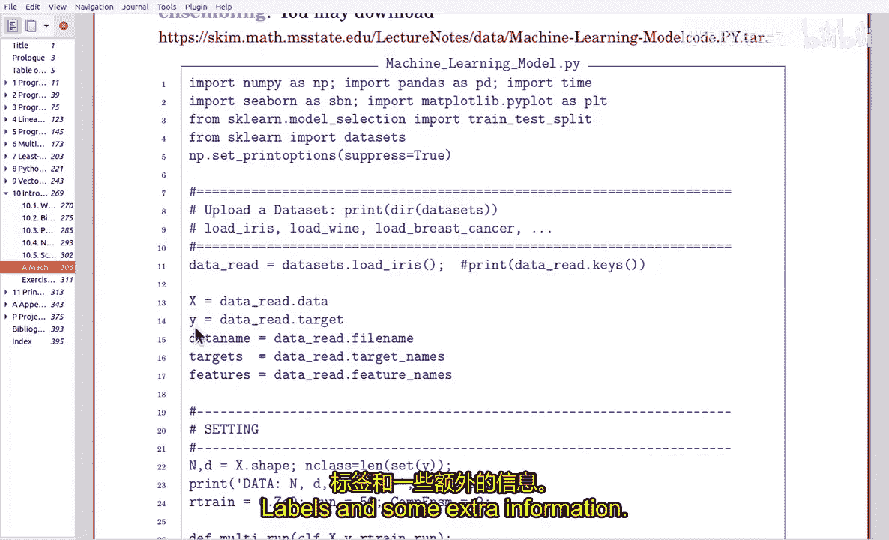

首先，我们需要导入必要的库并加载数据集。以下是代码的初始部分。

```python
# 导入所需库
import numpy as np
from sklearn import datasets
from sklearn.model_selection import train_test_split

# 加载数据集
data = datasets.load_iris()
X = data.data  # 特征矩阵
y = data.target  # 标签
info = data  # 额外信息
```

通过打印数据集，我们可以查看可用的信息。这里我们选择了鸢尾花（Iris）数据集。读取数据后，我们可以获得特征矩阵、标签和一些额外信息。


在设置部分，我们找出数据点的数量、特征维度和数据中的类别数量。这些是额外的超参数。我们的训练集比例设为0.7。根据这个比例，数据集将被分成两部分：70%用于训练，30%用于测试。运行次数设为50。对于每个分类器，我们将运行50次以获得平均准确率。这个参数控制执行流程：如果为0，则程序只执行自定义分类器；如果为1，则分类器将与Scikit-Learn分类器进行比较；如果为2（如本设置），则执行比较和集成。

## 核心执行函数

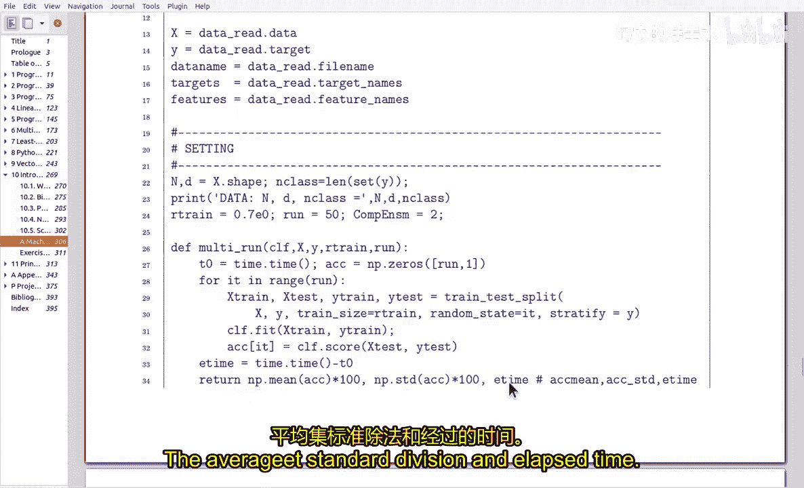

以下函数将用于每次执行，适用于基本分类器和数据集。

```python
def run_classifier(clf, X, y, train_size=0.7, runs=50):
    accuracies = []
    total_time = 0
    for _ in range(runs):
        X_train, X_test, y_train, y_test = train_test_split(X, y, train_size=train_size)
        start_time = time.time()
        clf.fit(X_train, y_train)
        accuracy = clf.score(X_test, y_test)
        accuracies.append(accuracy)
        total_time += time.time() - start_time
    avg_accuracy = np.mean(accuracies)
    std_accuracy = np.std(accuracies)
    elapsed_time = total_time / runs
    return avg_accuracy, std_accuracy, elapsed_time
```

该函数将对每个分类器运行50次。每次运行时，数据按0.7的比例分割为训练集和测试集。函数输出三个值：平均准确率、标准差和每次运行的平均耗时。

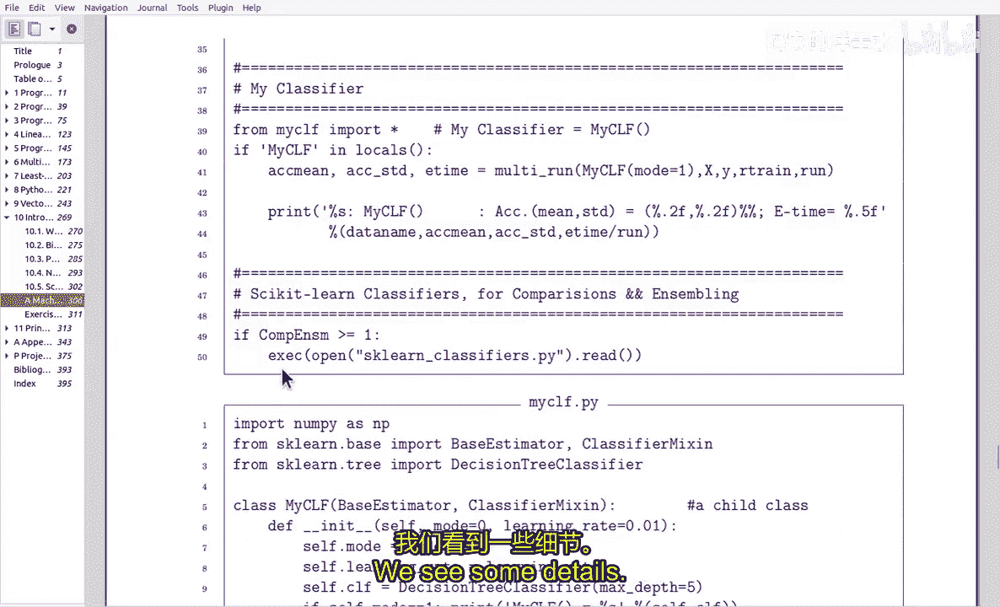


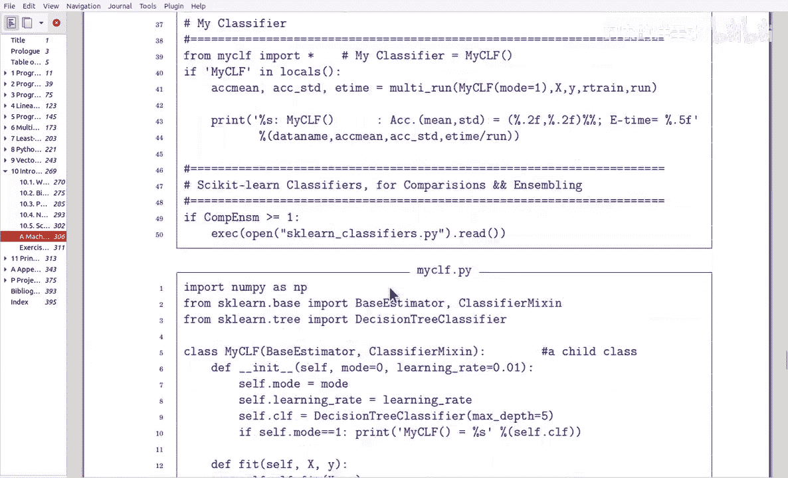

你可以定义自己的分类器，假设它保存在 `my_classifier.py` 文件中。然后你可以导入它。

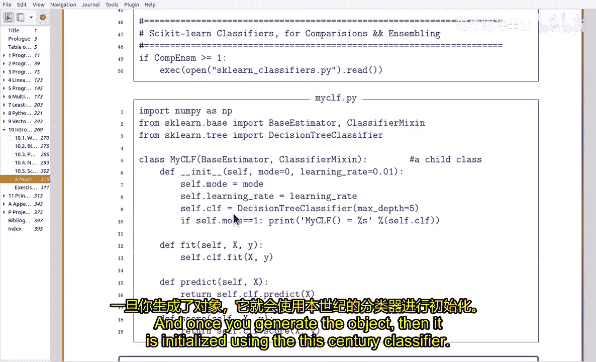

```python
from my_classifier import MyClassifier
my_clf = MyClassifier()
```

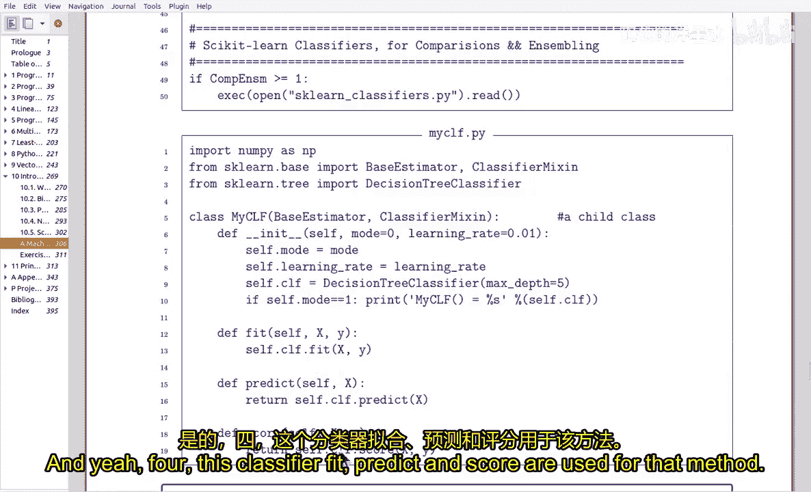

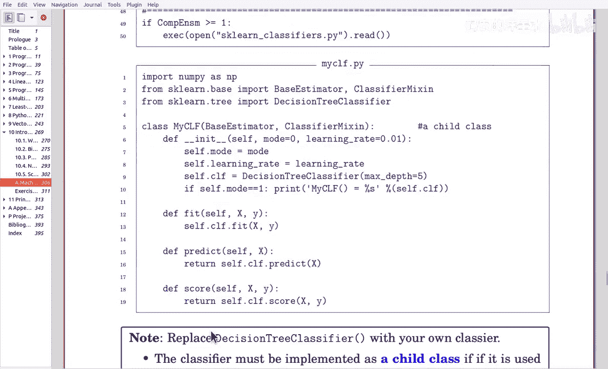

一旦导入，就可以使用你的分类器。通过执行 `run_classifier` 函数，我们可以获得平均准确率、标准差和耗时，并输出结果。

现在，如果参数大于或等于1，那么Scikit-Learn分类器将被加载并执行。

## 自定义分类器实现

让我们看看 `my_classifier.py` 的一些细节。


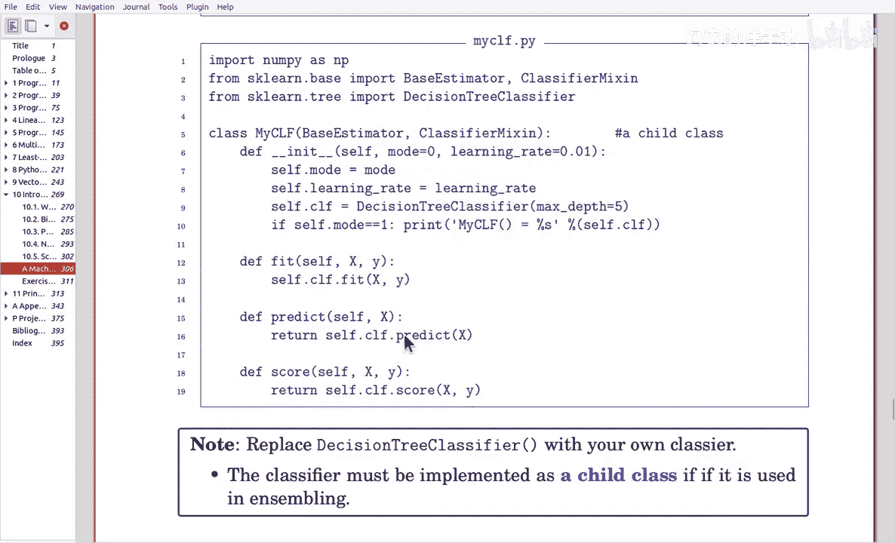

在这个文件中，我暂时选择了一个决策树分类器。一旦你创建了对象，它就会用决策树分类器进行初始化。


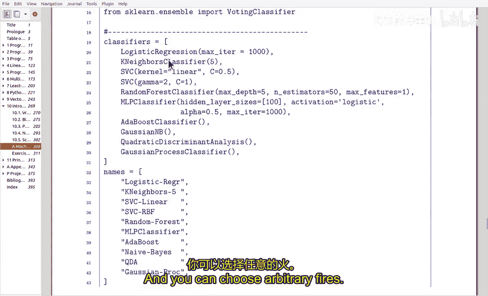

对于这个分类器，我们使用 `fit`、`predict` 和 `score` 作为其方法。

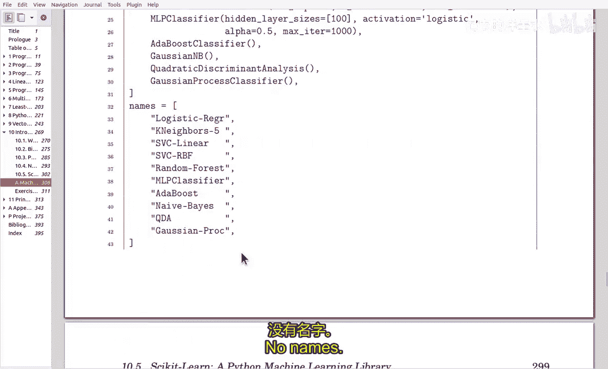


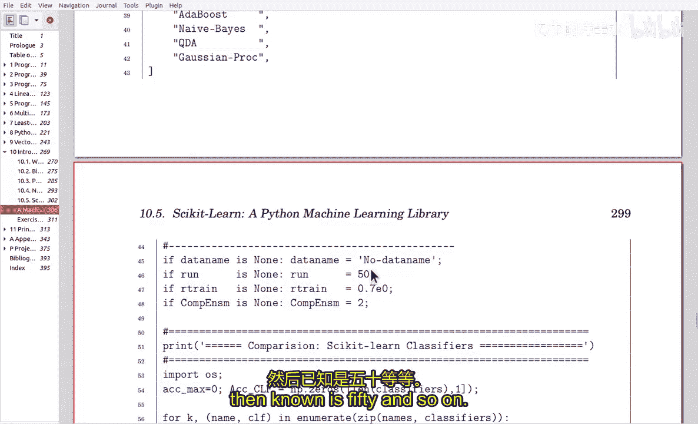

你可以用你自己的分类器替换这个决策树分类器。如果你的分类器要用于集成学习，它必须实现为一个子类。在这个实现中，`MyClassifier` 是 `BaseEstimator` 和 `ClassifierMixin` 这两个基类的子类。通过这种继承，你的分类器可以与其他Scikit-Learn分类器结合。此外，你必须在你的分类器中定义 `fit`、`predict`、`score` 这三个方法。这样，集成中的每个分类器都具有相同的结构，否则集成就不容易实现。因此，你必须首先将其实现为子类，并且必须包含这三个方法。

## Scikit-Learn 分类器比较

现在让我们转到 `cyclone_classifier.py`。所需的数据 `X`、`y` 和多轮运行次数在第一部分定义。对于这四个参数，如果没有定义，我们会尝试使用默认值；如果给定了值，则使用给定值。我们导入库，并在这里从Scikit-Learn中选择10个分类器及其名称。这是我的选择，你可以任意选择分类器。


名称列表如下。


这是默认设置。如果数据名称未定义，我们尝试选择数据名称；如果运行次数未定义，则设为50，依此类推。


这部分用于比较。现在，对于名称列表中的每个分类器，我们将执行多轮运行，以获得平均准确率、标准差和耗时。之后，平均准确率被保存到这个数组中。在两个主要步骤中，我们计算所有分类器的平均准确率。对于每个分类器，我们打印出结果，然后再次基于此，我们打印出分类器准确率的最大值和平均值。这就是比较部分。

这里，一旦参数大于或等于2，下面的代码将被执行。现在，名称被修剪。在这里，我们尝试剔除一些分类器。执行后，你会看到结果从这里打印出来。有些分类器的准确率非常低，比如这个、这个和这个。因此，我们尝试从列表中剔除这五个分类器。基于P方法，我们从名称和分类器列表中尝试剔除这五个，你可以打印出剩余的分类器。

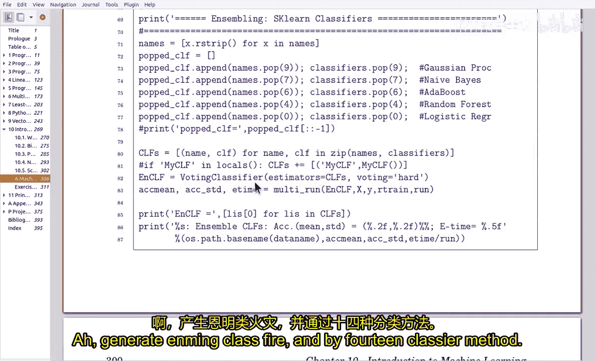

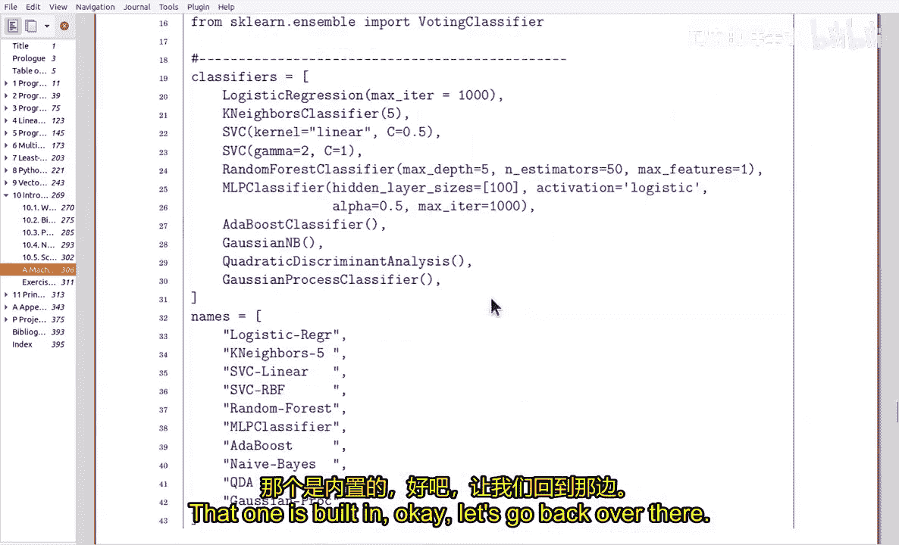

对于这些分类器，我们现在尝试构建用于集成分类的分类器列表。这些分类器必须至少是一个元组，包含一个字符串（名称）和分类器对象。因此，我们尝试为每个分类器收集这个元组。整体上，这是一个列表。如果你想在集成中添加你的分类器，你可以用这个字符串和分类器对象来添加。使用选定的分类器，你现在可以生成集成分类器，通过使用 `VotingClassifier` 方法。

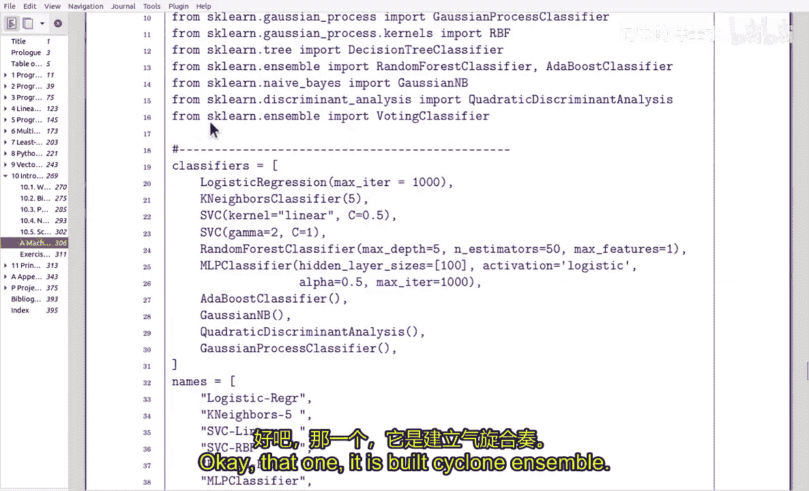


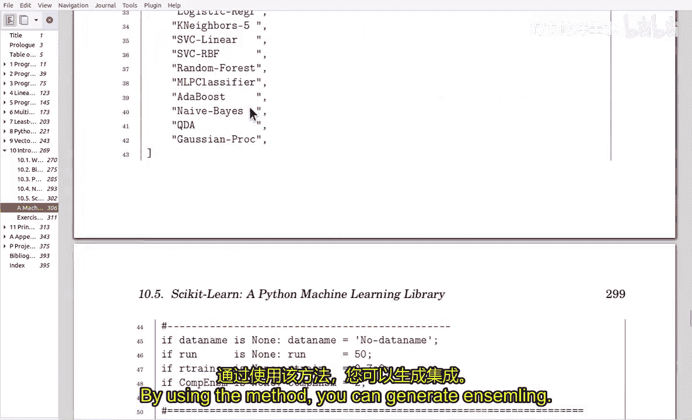

这个方法是内置的。让我们回顾一下它们是什么。


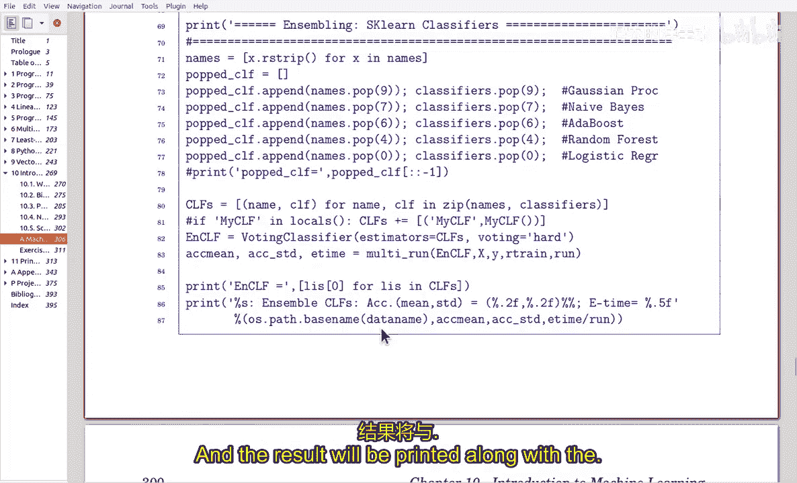

好的，那个。它是内置的。


通过使用 `VotingClassifier` 方法，你可以生成集成分类器。


一旦生成，现在通过使用 `run_classifier` 函数，你可以轻松获得平均准确率、标准差和耗时。我们尝试打印出集成中使用的分类器，现在 `list0`。第一个名称被放入输出中，结果将随之打印出来。

## 结果分析与解读

让我们看看输出。这部分来自主程序的第一部分，有150个数据点，特征维度是4，有三个类别。这来自于自定义分类器。我们选择了那个分类器。对于自定义分类器，平均准确率是94.253%，几乎是最差的。实际上，这个比那个还差，但几乎是表现最差的。此外，标准差很大。通常，当我们多次运行分类器时，如果标准差很大，意味着对于数据集的不同划分，结果不一致，准确率波动很大。这意味着它不太准确，因此通常较差的分类器具有较大的标准差。

这些是每个分类器的比较部分，我们有平均准确率和标准差。这是所有分类器的平均准确率，这是最大准确率。最好的是多层感知器分类器。所以这里就是这个。现在，这部分来自集成部分，这五个分类器被使用。集成准确率是96.0%，标准差是2.53。这比最好的分类器差，但比平均准确率好。因此，简单的集成可能不会提高分类准确率。所以，当一两个分类器对你的数据集比其他分类器好得多时，你可以从最好的或最好的几个开始。它们是其他选项的变体。连同这些选择的分类器，你可以构建一个集成分类器。

让我们看看这个分类器当前的选项。

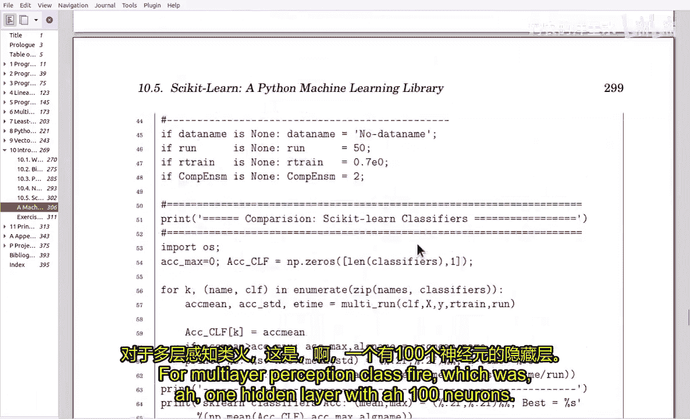


对于多层感知器分类器，我们选择了1个隐藏层，包含100个神经元。你可以改变这个设置。例如，`(30, 30, 30)`。那么你选择了3个隐藏层，每个有30个神经元。你可以通过设置不同的参数来创建不同的神经网络。你也可以选择不同的激活函数，当前是逻辑函数，但你可以选择整流线性单元或softplus，或双曲正切函数。Alpha是正则化系数，你可以选择不同的Alpha值，比如1、0.1或0.01。通过使用不同的Alpha，你可以得到不同的分类器。通过选择其他选项，你可以得到这个分类器的变体。如果你将它们组合起来得到一个集成分类器，那么你可能会获得更好的准确率。

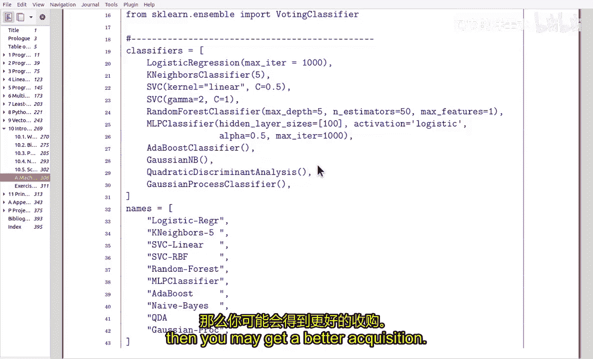

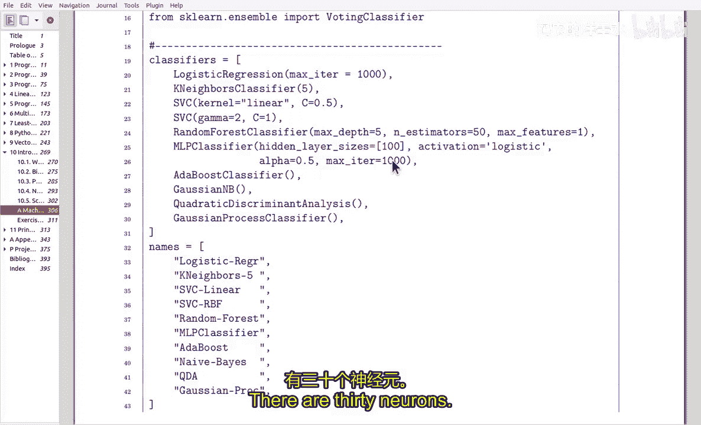

只是简单的。

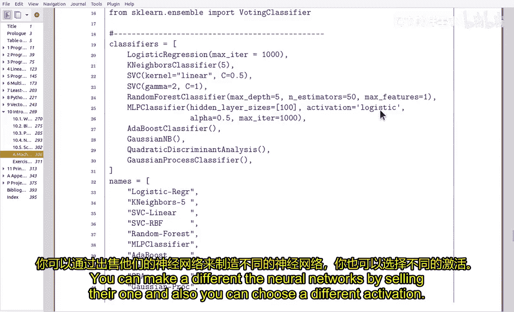

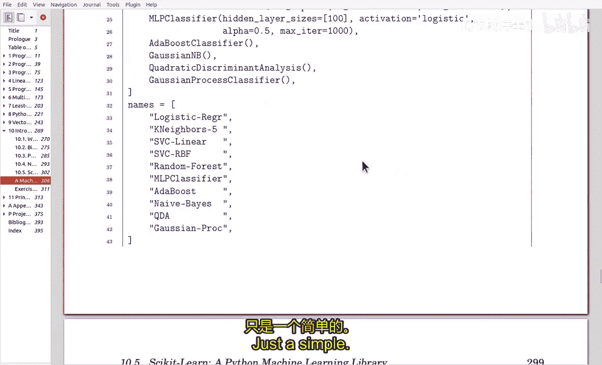

分类器的简单堆叠可能不会提高你的准确率。

## 总结


本节课中，我们一起学习了如何使用一个模板代码进行机器学习算法比较和集成。我们详细介绍了如何准备数据、实现自定义分类器、与Scikit-Learn内置分类器进行比较，以及构建和评估集成模型。关键点在于，自定义分类器需要继承特定的基类并实现核心方法，而简单的投票集成不一定能超越最优的单个分类器，但通过精心选择分类器变体进行集成，有可能提升模型性能。

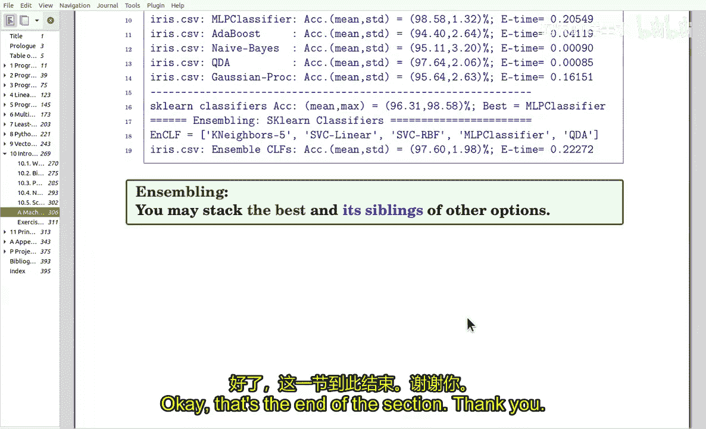

