# 05：神经网络

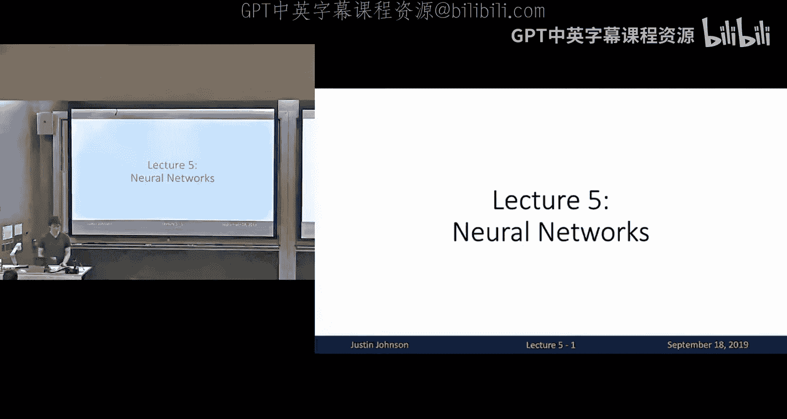

在本节课中，我们将要学习神经网络。我们将首先回顾线性分类器的局限性，然后介绍特征变换的概念，最后深入探讨神经网络的基本结构、工作原理及其强大的函数表示能力。

## 从线性模型到特征变换

上一节我们介绍了如何使用随机梯度下降及其变体来优化线性模型的权重。本节中，我们来看看如何克服线性模型本身的局限性。

线性分类器虽然简单易懂，但其功能表示能力有限。从几何角度看，它只能通过高维超平面来分割空间；从视觉角度看，它每个类别只能学习一个“模板”，无法表示同一类别的多种形态（例如，向左看的马和向右看的马）。

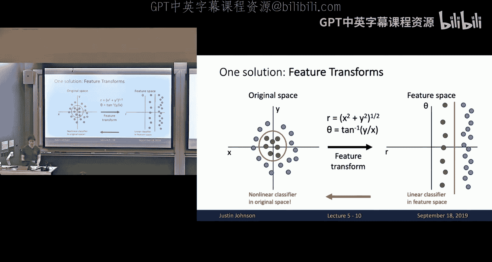

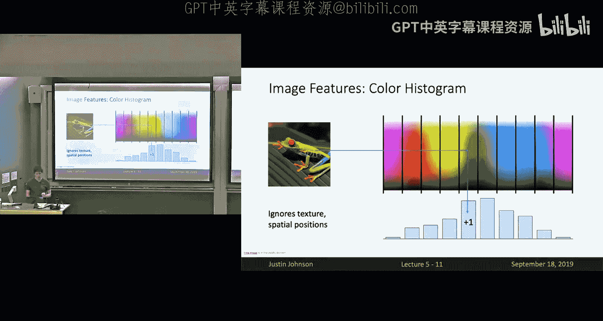

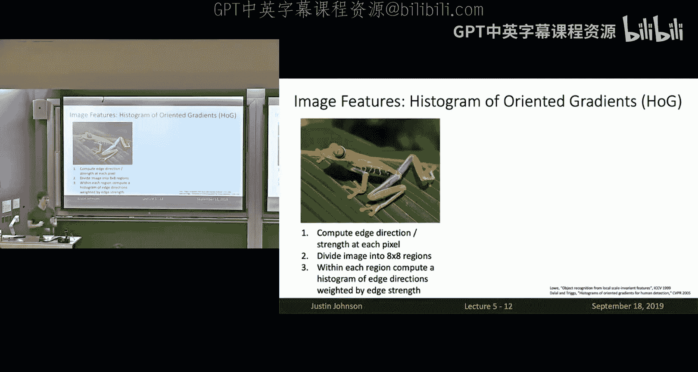

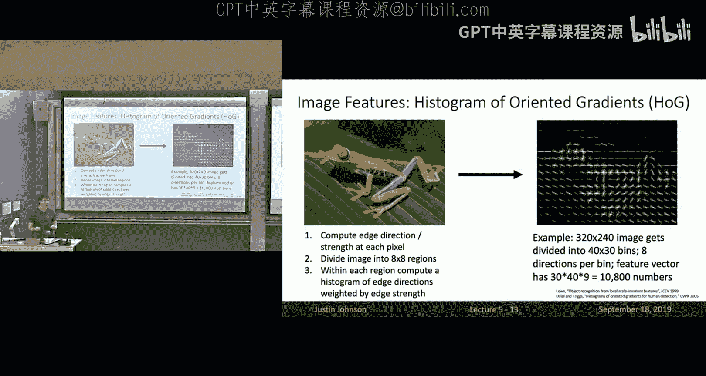

为了克服这些限制，我们可以引入**特征变换**的概念。其核心思想是：将原始输入数据通过一个精心设计的数学变换，映射到一个新的“特征空间”中，使得数据在这个新空间中更容易被线性分类器处理。

以下是一个简单的例子：
*   **原始空间**：数据点以笛卡尔坐标 `(x, y)` 表示，无法用一条直线分开。
*   **特征变换**：将坐标转换为极坐标 `(r, θ)`。
*   **特征空间**：在极坐标下，数据变得线性可分。

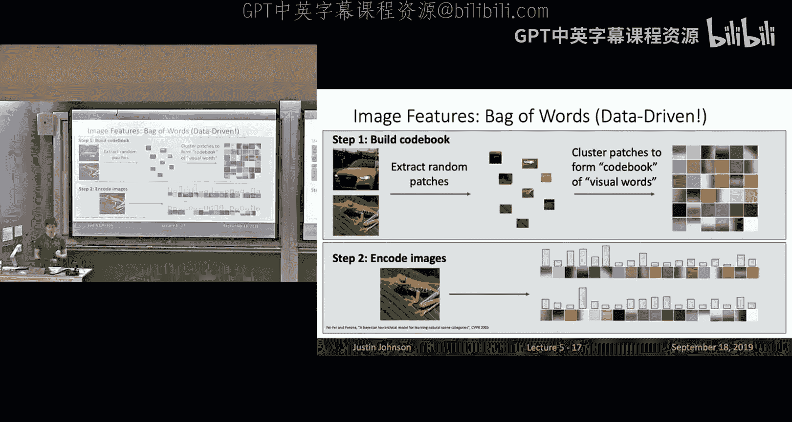

此时，在特征空间中训练的线性分类器，其决策边界映射回原始空间时，就对应着一条非线性的决策边界。通过选择合适的特征变换，我们可以显著提升模型的表达能力。

在计算机视觉领域，特征变换曾被广泛使用。以下是几种经典的特征表示方法：
*   **颜色直方图**：将图像的颜色空间划分为多个区间，统计每个颜色区间内像素的数量，形成一个直方图向量。这种方法丢弃了空间信息，但对颜色分布敏感。
*   **方向梯度直方图**：计算图像局部区域的边缘方向和强度，并统计成直方图。这种方法关注纹理和形状，而忽略了颜色信息。
*   **视觉词袋**：这是一种数据驱动的特征表示。首先从大量训练图像中提取随机图像块，然后对这些块进行聚类，得到一组“视觉单词”（即聚类中心）。对于一张新图像，统计其中每个“视觉单词”出现的频率，形成特征向量。

此外，我们还可以将多种特征表示（如颜色直方图、HOG、视觉词袋）拼接成一个长向量，以捕获图像不同方面的信息。2011年ImageNet挑战赛的冠军就使用了复杂的特征提取流水线，最后在其上训练线性SVM。

然而，基于特征提取的流水线存在一个根本问题：特征提取阶段通常是固定的，或者其学习目标并非直接优化最终的分类性能。整个系统中，只有最后的线性分类器部分会根据分类任务调整其参数。

## 神经网络：端到端学习

与上述方法不同，神经网络构建了一个**端到端**的学习系统。它从原始像素输入开始，直接预测分类得分。在训练过程中，**整个网络的所有参数（包括特征提取部分和分类部分）都会根据最终的分类性能进行联合优化**。

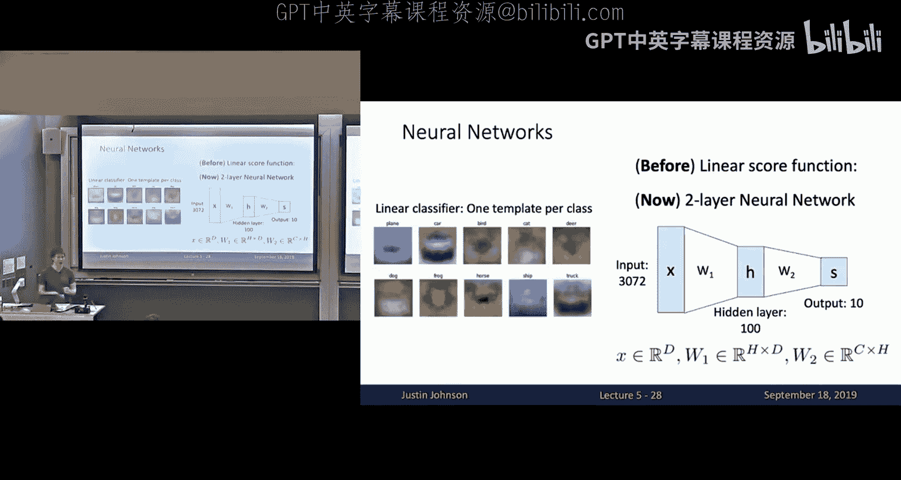

从这个角度看，神经网络可以看作是在**联合学习一个适合当前任务的特征表示，以及一个作用于该特征表示之上的线性分类器**。

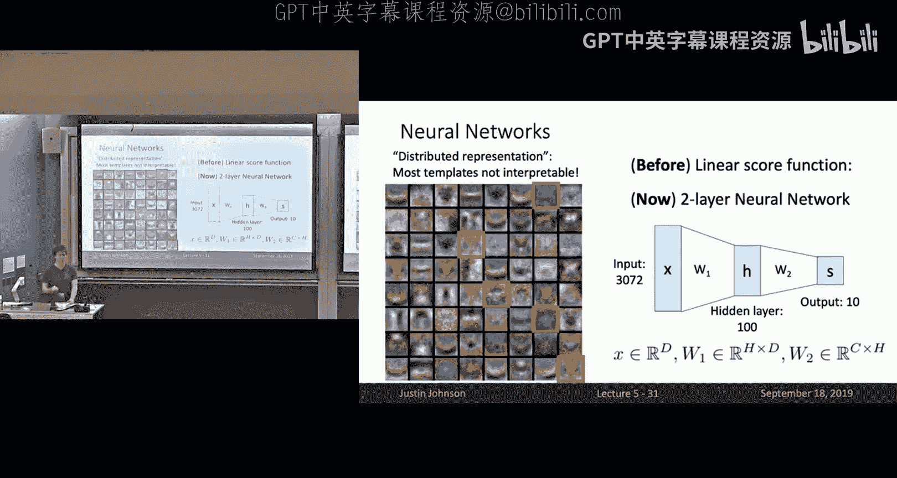

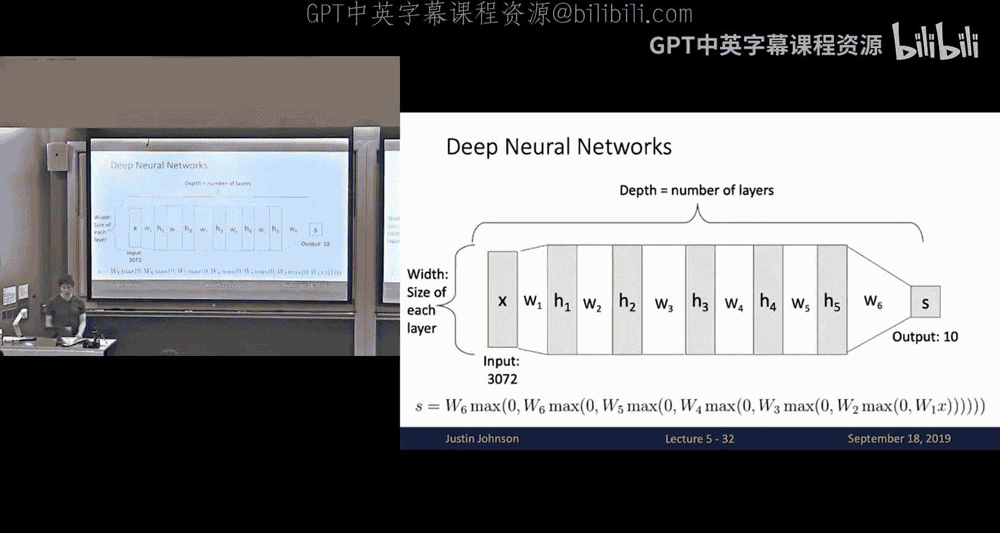

## 神经网络的结构

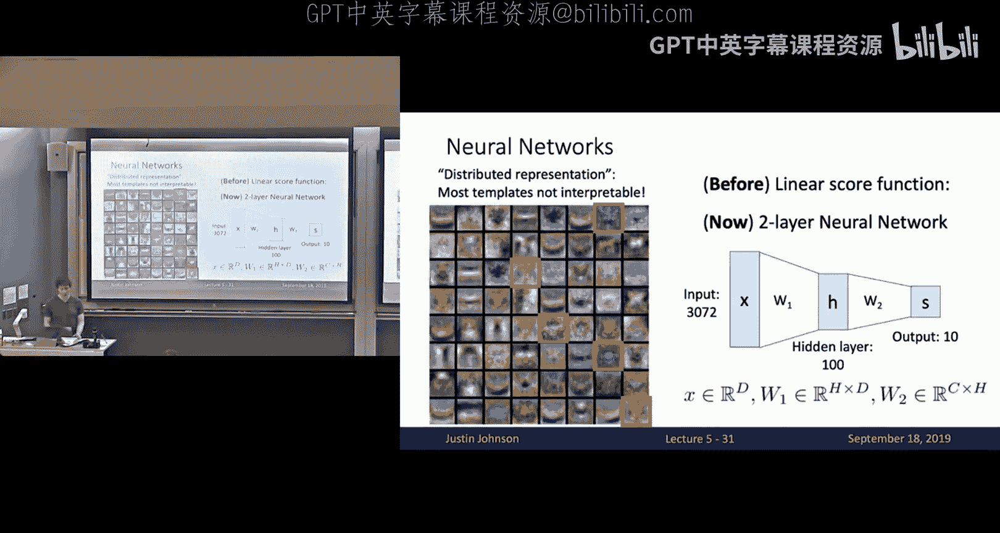

现在，让我们来看一个具体的神经网络例子。我们熟悉的线性分类器公式为：
`s = Wx`
其中 `x` 是输入向量，`W` 是权重矩阵，`s` 是得分向量。

最简单的神经网络（两层全连接网络）则将其扩展为：
`h = max(0, W1 * x)`
`s = W2 * h`
这里：
*   `W1` 是第一个权重矩阵，将输入 `x` 映射到隐藏层 `h`。
*   `max(0, ·)` 是一个非线性函数，称为**ReLU**。
*   `W2` 是第二个权重矩阵，将隐藏层 `h` 映射到输出得分 `s`。
*   `h` 的维度称为网络的**隐藏层大小**。

我们可以进一步推广到具有 `L` 层的深度网络：
`h1 = f(W1 * x)`
`h2 = f(W2 * h1)`
...
`s = WL * h_{L-1}`
其中 `f` 是非线性激活函数（如ReLU）。网络的**深度**是指权重矩阵的数量，**宽度**通常指各隐藏层的维度。

这种网络结构通常用图示表示：输入层、隐藏层、输出层从左到右排列，层与层之间由权重矩阵全连接。因此，这种网络常被称为**全连接网络**或**多层感知机**。

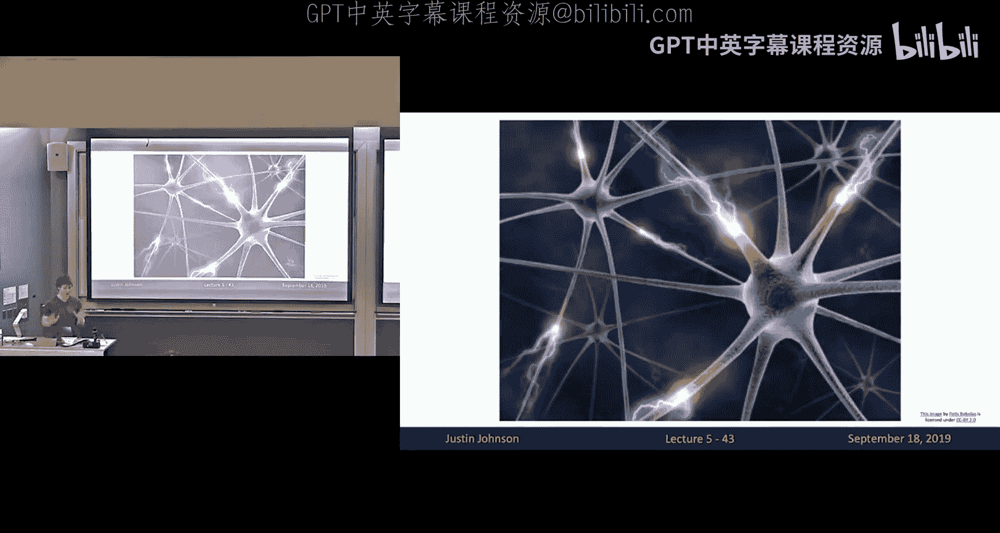

## 神经网络的解释

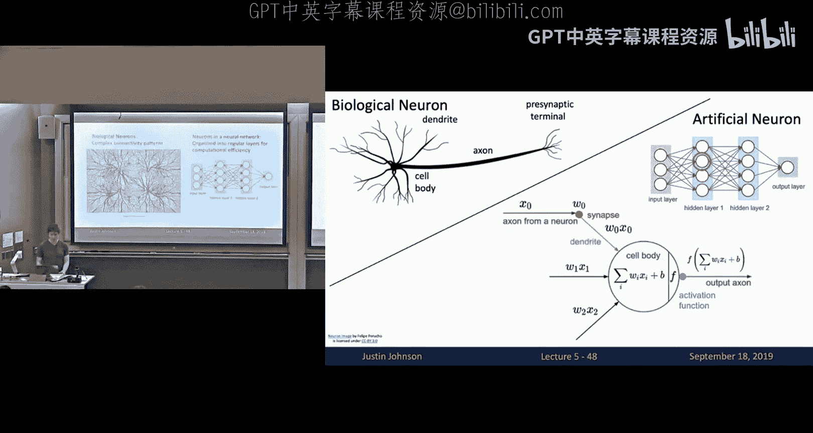

我们可以从两个角度来理解神经网络的工作方式。

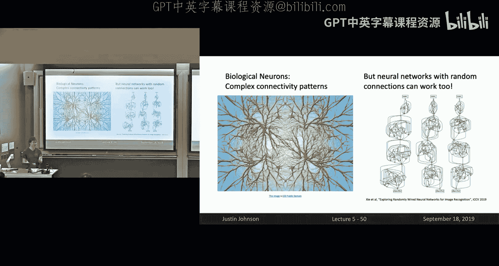

**模板匹配视角**：
类似于线性分类器，神经网络第一层的权重 `W1` 也可以看作学习到的一组“模板”。隐藏层向量 `h` 中的每个元素，表示输入图像 `x` 与对应模板的匹配程度。第二层的权重 `W2` 则将这些匹配程度以加权和的方式组合，得到最终的分类得分。这使得网络能够学习同一类别的多个模板（例如，向左看的马和向右看的马），从而克服了线性分类器的“双头马”问题。不过，这些模板通常对人类来说并不直观，被称为**分布式表示**。

**空间扭曲视角**：
我们可以将神经网络看作是对输入空间进行一系列非线性扭曲。第一层的每个ReLU单元定义了一个“折叠线”，将输入空间划分为被激活（正值通过）和未被激活（置为零）的区域。多个这样的单元共同作用，将原始输入空间折叠、扭曲成一个新的特征空间。在这个新的特征空间中，数据可能变得线性可分。一个线性决策边界在这个扭曲后的特征空间中，对应着原始输入空间中一个复杂的非线性决策边界。

隐藏层单元越多，这种空间扭曲能力就越强，可以形成更复杂的决策边界。为了防止过拟合，我们通常不是通过减少网络宽度来正则化，而是使用像L2正则化这样的可调参数来控制模型复杂度。

## 激活函数与通用近似定理

激活函数（如ReLU）是神经网络的关键。如果没有非线性激活函数，无论堆叠多少层，整个网络仍然等价于一个线性变换，无法获得更强的表示能力。

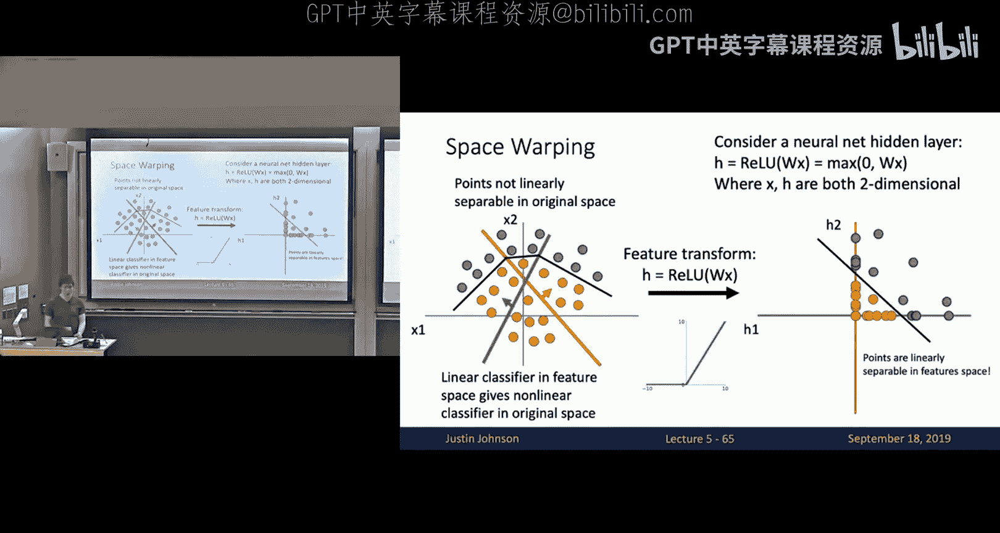

ReLU函数定义为：
`ReLU(x) = max(0, x)`
它是一个简单有效的默认选择。历史上也使用过Sigmoid、Tanh等其他激活函数。

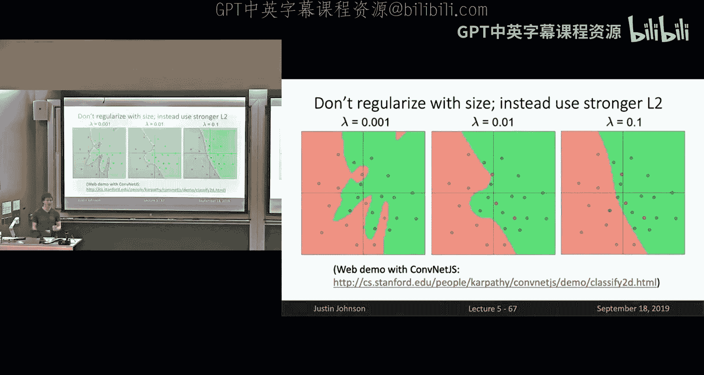

神经网络一个强大的理论性质是**通用近似定理**：一个至少包含一层隐藏层的神经网络，只要隐藏层足够宽，就可以以任意精度逼近任何定义在紧致集上的连续函数。

为了直观理解，可以考虑一个单输入单输出的两层网络。其输出是多个经过缩放和平移的ReLU函数之和。通过精心设置权重，我们可以用四个ReLU单元组合成一个“脉冲”函数。使用足够多的这样的“脉冲”，并将它们排列在输入域上，就可以近似任何连续函数。

然而，这个定理主要是一个存在性证明。它告诉我们神经网络有能力表示复杂函数，但并没有说明：
1.  如何通过训练找到这些权重。
2.  需要多少数据才能学好。
3.  学习过程是否容易。

事实上，像K近邻这样的简单模型也具备通用近似性质。因此，神经网络的“魔力”不仅仅在于其表示能力。

## 优化：凸性与非凸性

线性模型（如Softmax回归、SVM）的损失函数关于权重通常是**凸函数**。凸函数形如碗状，具有很好的性质：任何局部最小值就是全局最小值，并且存在理论保证的优化算法可以高效地收敛到最优解。

神经网络的损失函数则是**非凸函数**。这意味着损失函数的形状可能非常复杂，存在许多局部极小值、鞍点和平坦区域。从理论上讲，我们无法保证梯度下降算法一定能找到全局最优解，甚至无法保证收敛。

尽管如此，在实践中，通过精心设计的初始化、优化算法和大量数据，我们通常能够训练出性能优异的神经网络模型。为什么非凸优化在深度学习中行之有效，仍然是当前研究的热点问题。

## 总结

本节课中我们一起学习了：
1.  **特征变换**：通过将数据映射到新空间来增强线性模型的表达能力。
2.  **神经网络的核心思想**：端到端地联合学习特征表示和分类器。
3.  **神经网络的基本结构**：全连接层、激活函数（如ReLU）、深度与宽度。
4.  **对神经网络的理解**：可以从模板匹配和空间扭曲两个视角来看。
5.  **神经网络的表示能力**：通用近似定理表明其理论上可以逼近任何连续函数。
6.  **神经网络的优化挑战**：面临的是非凸优化问题，缺乏理论收敛保证，但实践中效果良好。

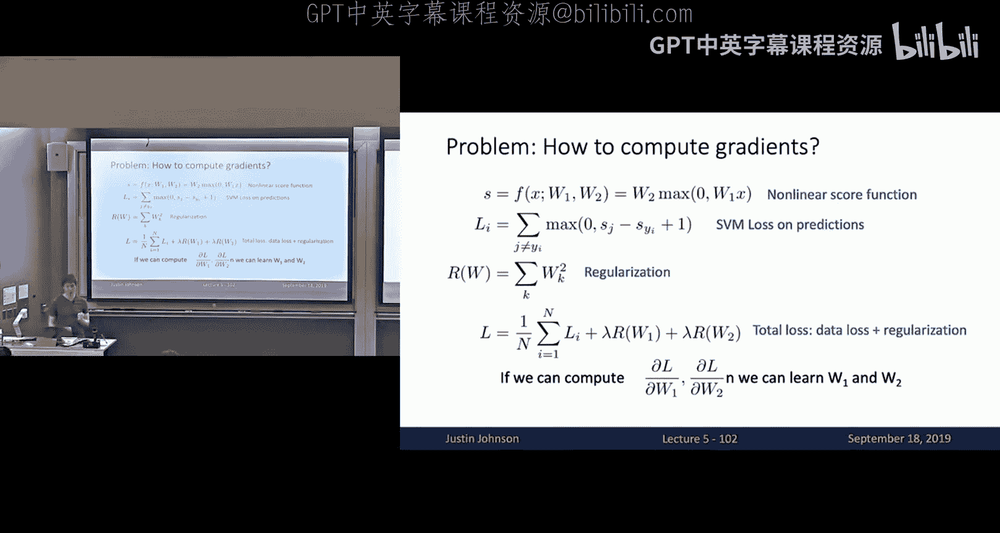

遗留的一个关键问题是：对于如此庞大复杂的神经网络，我们如何高效地计算其梯度以进行训练？下一节课，我们将介绍解决这个问题的核心算法——**反向传播**。