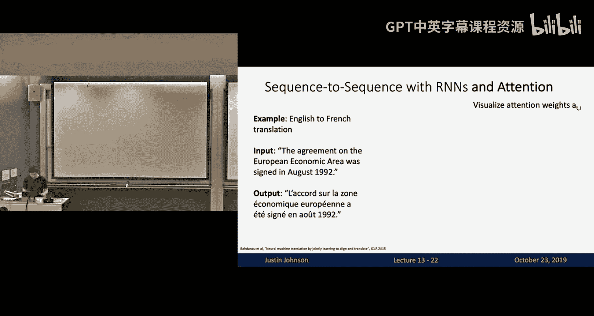
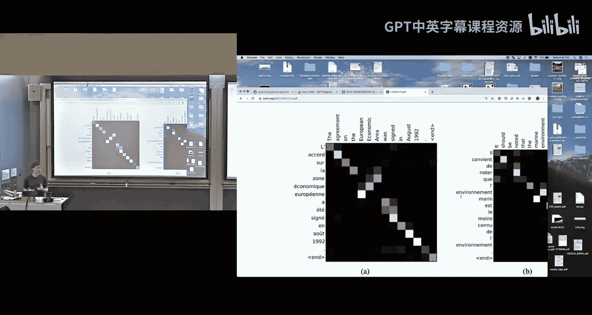

# 13：注意力机制

## 概述
在本节课中，我们将要学习注意力机制。我们将从回顾序列到序列的循环神经网络开始，探讨其局限性，并引入注意力机制作为解决方案。随后，我们会将注意力机制推广为一种通用的神经网络层——自注意力层，并最终介绍基于自注意力构建的强大模型——Transformer。本节课内容旨在让初学者能够理解这些核心概念。

---

## 回顾：序列到序列模型
上一节我们介绍了用于处理序列数据的循环神经网络。本节中，我们来看看如何将其应用于序列到序列的任务，例如机器翻译。

在序列到序列模型中，我们使用一个编码器RNN处理输入序列（如英文句子），生成一系列隐藏状态。这些隐藏状态最终被汇总为一个上下文向量 **C**。然后，一个解码器RNN接收这个上下文向量和起始标记，逐步生成输出序列（如西班牙语句子）。

**公式表示编码器步骤**：
`h_t = f_W(h_{t-1}, x_t)`

其中，`h_t` 是时间步 `t` 的隐藏状态，`x_t` 是输入，`f_W` 是带有参数 `W` 的RNN单元。

然而，这种方法存在一个瓶颈：无论输入序列多长，所有信息都必须压缩到**单个上下文向量 C** 中。这对于长段落或书籍的翻译来说是不现实的。

---

## 引入注意力机制
为了克服上述瓶颈，我们引入注意力机制。其核心思想是：解码器在生成每一个输出词时，都可以动态地关注输入序列的不同部分，而不是依赖一个固定的上下文向量。

以下是实现注意力的关键步骤：

1.  **计算对齐分数**：在解码器的每个时间步 `t`，我们有一个查询向量（通常是解码器的当前隐藏状态 `s_t`）。我们将其与编码器所有时间步的隐藏状态 `h_i` 进行比较，计算出一个对齐分数 `e_{ti}`，表示在生成当前输出词时，输入词 `i` 的重要性。
    **常用对齐函数（缩放点积）**：
    `e_{ti} = (s_t · h_i) / sqrt(d_k)`
    其中 `d_k` 是向量的维度。缩放是为了防止点积结果过大导致Softmax梯度消失。

2.  **转换为注意力权重**：将对齐分数序列 `e_{t1}, e_{t2}, ..., e_{tT}` 通过Softmax函数，得到归一化的注意力权重 `α_{ti}`。这形成了一个概率分布，总和为1。
    **公式**：
    `α_{ti} = exp(e_{ti}) / Σ_j exp(e_{tj})`

3.  **计算上下文向量**：将编码器的所有隐藏状态 `h_i` 按其对应的注意力权重 `α_{ti}` 进行加权求和，得到当前时间步专属的上下文向量 `c_t`。
    **公式**：
    `c_t = Σ_i (α_{ti} * h_i)`

4.  **生成输出**：解码器RNN结合当前的隐藏状态 `s_t`、新计算的上下文向量 `c_t` 以及上一个输出词（或起始标记），来预测当前时间步的输出词 `y_t`。

这个过程在解码器的每个时间步重复进行，使得模型能够灵活地将注意力集中在输入序列的不同部分。

---

## 注意力的应用与可视化
注意力机制不仅用于机器翻译，还可应用于图像描述生成等任务。

在图像描述任务中，编码器是一个卷积神经网络，其最后一层卷积特征图可以视为一个空间位置的网格，每个位置对应一个特征向量。解码器RNN在生成每个单词时，使用注意力机制在这个特征网格上进行“观察”，计算应该关注图像的哪个区域。

注意力权重提供了模型决策的可解释性。例如，在机器翻译中，我们可以可视化注意力矩阵，看到输出词的生成主要依赖于输入序列中的哪些词，有时甚至能发现语言之间的词序对应关系（如英语的“European economic area”对应法语的“zone économique européenne”）。

---

## 推广：自注意力层
我们可以将注意力机制抽象为一个通用的神经网络层。它不关心输入是否是序列，而是处理两组向量：查询向量集 **Q** 和输入向量集 **X**。

以下是构建通用注意力层的步骤：

1.  **键值分离**：为提供更多灵活性，我们将每个输入向量 `x_i` 通过可学习的权重矩阵 `W^K` 和 `W^V` 分别转换为键向量 `k_i` 和值向量 `v_i`。
    **公式**：
    `k_i = W^K * x_i`
    `v_i = W^V * x_i`

2.  **计算相似度**：对于每个查询向量 `q`（来自查询集 **Q**），计算它与所有键向量 `k_i` 的缩放点积，得到相似度分数。
3.  **应用Softmax**：对每个查询对应的相似度分数序列应用Softmax，得到该查询对于所有输入的注意力权重。
4.  **加权求和**：使用注意力权重对值向量 `v_i` 进行加权求和，得到该查询对应的输出向量。

当查询集 **Q** 和输入集 **X** 是同一组向量时，就得到了**自注意力层**。自注意力层允许序列中的每个元素直接与序列中的所有其他元素进行交互。

自注意力层是**置换等变**的：改变输入向量的顺序，输出向量的顺序会相应改变，但内容不变。为了融入位置信息，我们通常需要加入**位置编码**。

---

## Transformer：基于自注意力的模型
自注意力层高度可并行化，且能一次性捕获长距离依赖，这使其成为处理序列的理想选择。Transformer模型完全基于自注意力构建。

一个基本的**Transformer块**包含以下组件：
1.  **多头自注意力层**：使用多个并行的自注意力头，以捕获不同子空间的信息。
2.  **残差连接与层归一化**：添加在自注意力层和前馈网络之后，有助于稳定和加速训练。
3.  **前馈神经网络**：一个应用于每个位置独立的小型全连接网络。

通过堆叠多个这样的Transformer块，我们可以构建出非常深且强大的模型。这种架构在自然语言处理领域取得了革命性成功，催生了如BERT、GPT等预训练大模型。

---

## 总结
本节课中我们一起学习了注意力机制的核心思想与发展脉络。我们从解决序列到序列模型的瓶颈出发，引入了动态计算上下文向量的注意力机制。随后，我们将其推广为通用的自注意力层，并最终介绍了完全基于自注意力构建的Transformer模型。注意力机制及其衍生模型为处理序列、图像甚至多模态数据提供了强大而灵活的工具，是当前深度学习研究的前沿方向。