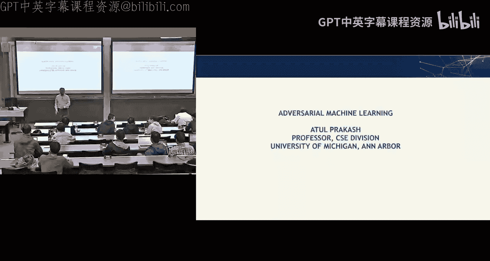
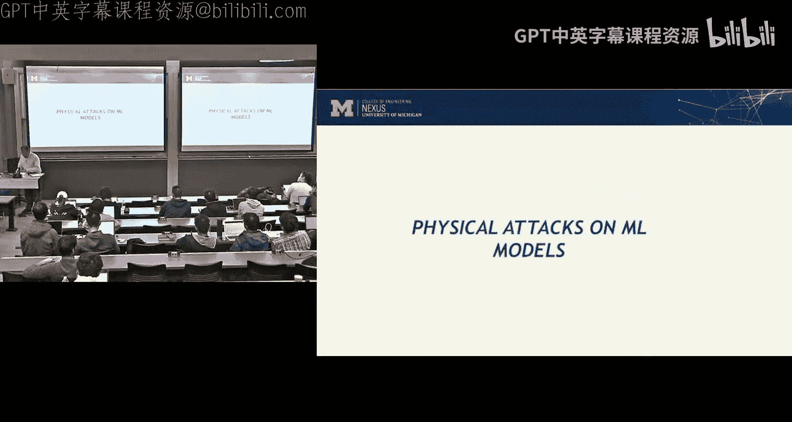
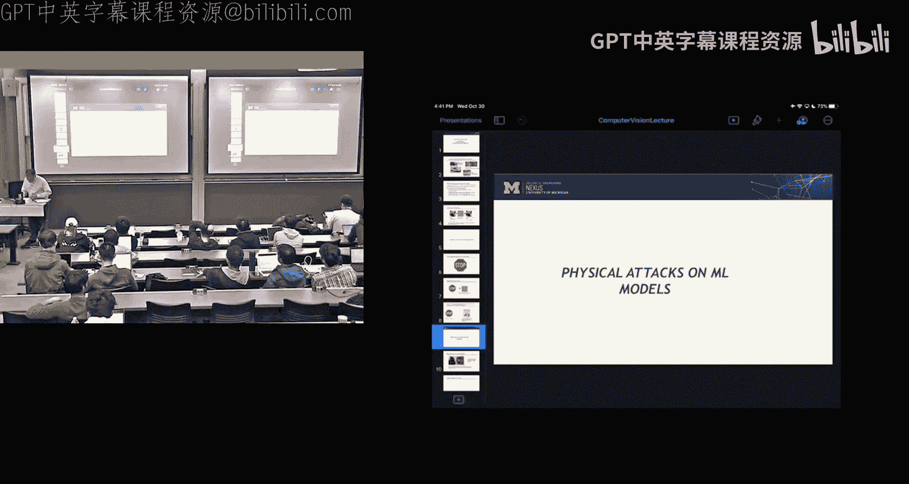
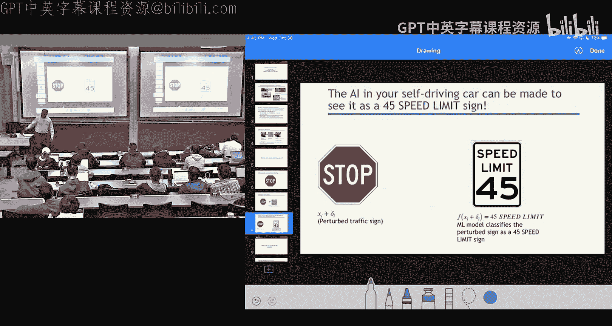
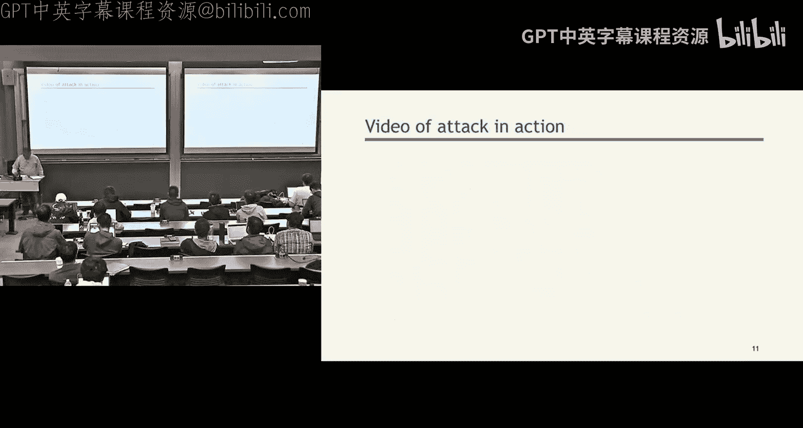
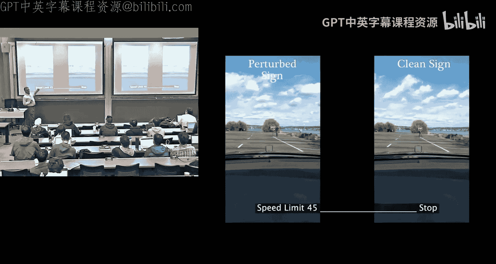
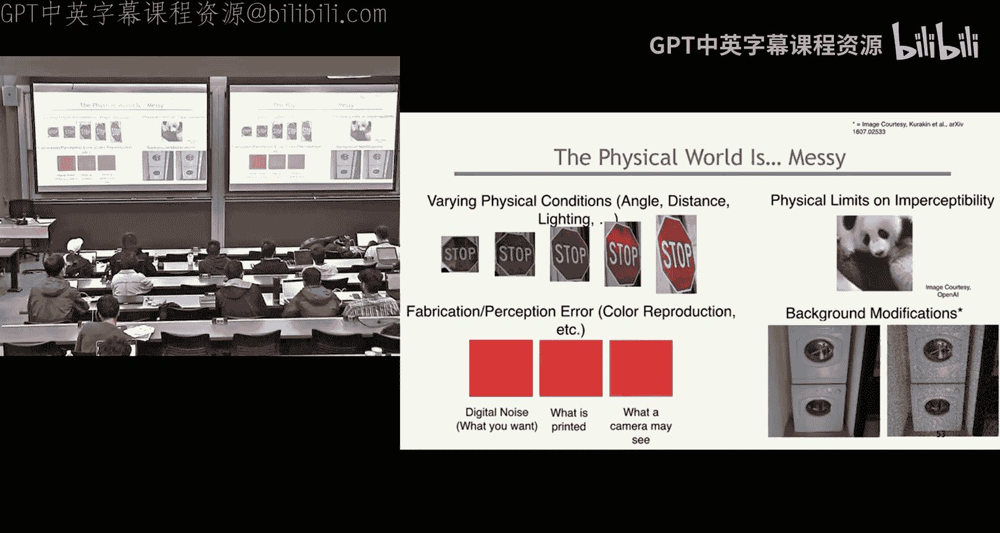
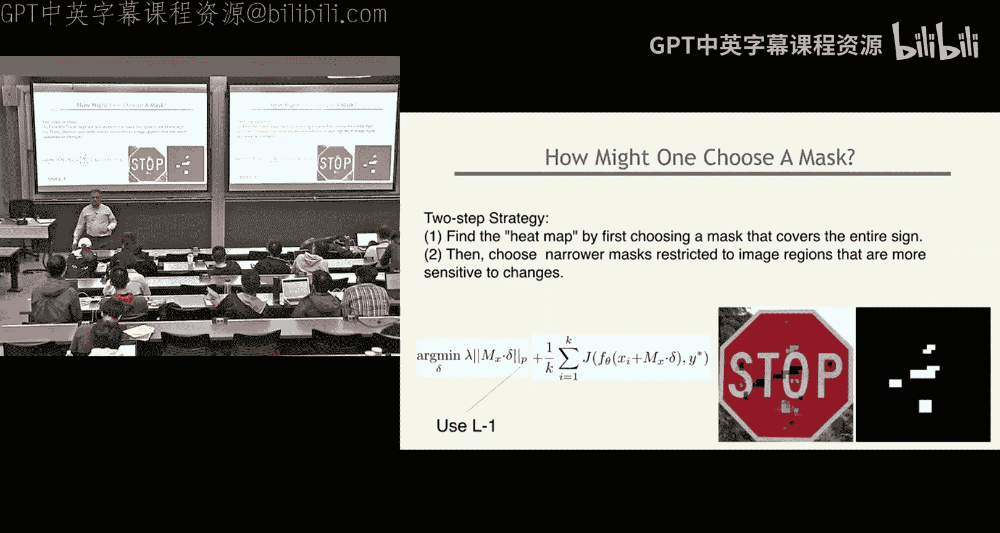
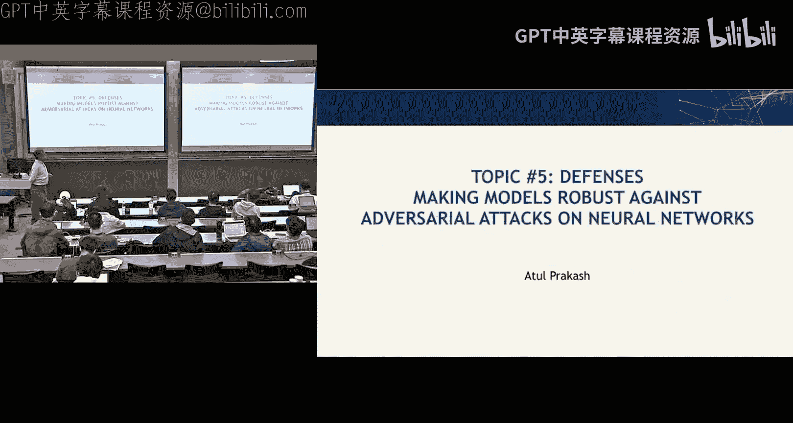
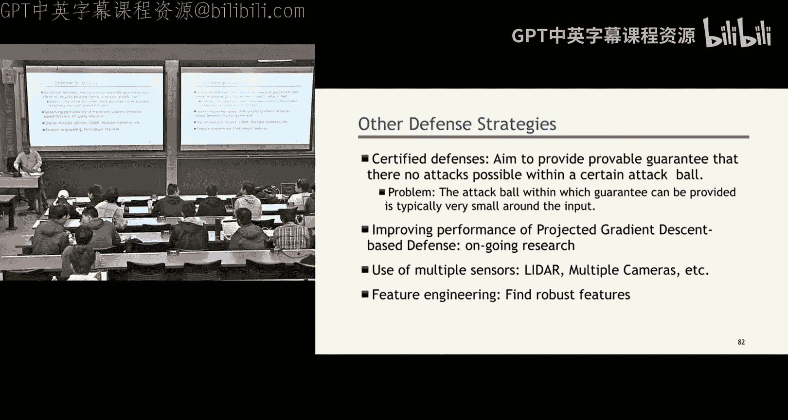

# 对抗性机器学习：第14讲：对抗性攻击与防御概述



在本节课中，我们将学习对抗性机器学习的基本概念。我们将探讨机器学习模型，特别是深度学习模型，如何可能被精心设计的微小输入扰动所欺骗，导致错误的分类决策。理解这些攻击的原理以及潜在的防御策略，对于构建可信赖的、安全的AI系统至关重要。

## 问题定义与动机

上一节我们介绍了课程背景，本节中我们来看看对抗性攻击的核心问题。

对抗性攻击的核心思想是：对于一个训练有素、准确率很高的分类器，攻击者能否找到一个微小的扰动，添加到原始输入上，使得分类器做出完全错误的判断？这个扰动对人类观察者而言，输入看起来几乎没有变化，应保持相同的标签。





**公式化描述**：给定一个分类器 `f` 和一个正确分类的输入 `x`（即 `f(x) = y`），目标是找到一个扰动 `δ`，使得 `f(x + δ) ≠ y`（非目标攻击）或 `f(x + δ) = y_target`（目标攻击），同时约束 `δ` 的“大小”（例如，像素变化幅度）足够小。

这种现象引发了我们对机器学习模型，尤其是在自动驾驶、医疗诊断等安全关键领域应用的信任问题。如果模型如此脆弱，我们能否放心地部署它们？



## 对抗性攻击为何可能？

为了理解攻击为何可能成功，我们可以从一个简化的线性模型开始思考。



考虑一个高维线性分类器：`y = Σ w_i * x_i`。假设我们希望对 `y` 产生大的改变，但只允许对每个特征 `x_i` 进行微小调整。根据梯度的思想，我们应该沿着使 `y` 变化最快的方向调整 `x`。具体来说，对于权重 `w_i` 较大的特征，即使对 `x_i` 做微小改变，也会对 `y` 产生较大影响。通过协调地、有方向地对多个高维特征施加微小扰动，累积效应可能导致输出发生显著变化。



深度学习模型虽然非线性，但包含大量可操作的维度和线性成分，且攻击者可以利用模型的梯度信息。在正常的模型训练中，我们使用梯度下降来最小化损失函数。而在对抗性攻击中，我们可以进行“逆向”操作：寻找能最大化损失（或使损失朝向错误标签最小化）的最小输入扰动。

## 攻击实例与影响

以下是几种对抗性攻击的实例：

*   **数字图像攻击**：对一张“熊猫”图片添加人眼难以察觉的噪声后，分类器可能以高置信度将其识别为“长臂猿”。
*   **物理世界攻击**：在现实世界的停车标志上粘贴精心设计的贴纸，可以使车载摄像头系统将其误判为“限速45英里”标志。这证明了攻击可以从数字域迁移到物理世界。
*   **数据投毒攻击**：在模型训练阶段注入恶意样本。例如，微软的聊天机器人Tay在2016年上线后，通过在线学习吸收了用户的恶意输入，在24小时内变成了发表种族主义和煽动性言论的机器人。
*   **逃避攻击**：攻击者修改输入以绕过内容过滤器。例如，垃圾邮件发送者故意拼错关键词以逃避基于关键词的过滤器。

这些例子表明，对抗性威胁广泛存在于模型部署（逃避攻击）、训练（数据投毒）和测试（对抗性输入）各个阶段。

## 攻击方法分类与策略

根据攻击者对目标模型的了解程度，攻击可分为：

*   **白盒攻击**：攻击者拥有模型的完整知识，包括架构、参数（权重），可以计算精确的梯度。这是最强的攻击设定。
*   **黑盒攻击**：攻击者仅能向模型输入数据并观察输出（如分类结果和置信度），不知道内部细节。一种有效的策略是利用攻击的“可迁移性”：攻击者使用输入输出对训练一个替代模型，然后对这个替代模型进行白盒攻击，生成的对抗样本有很大概率也能欺骗原模型。

在白盒设定下，根据攻击目标，又可分为：
*   **非目标攻击**：仅使分类结果出错，不关心具体错误类别。
*   **目标攻击**：使模型将输入误分类为某个特定的目标类别。

## 核心攻击算法简介

攻击通常被形式化为一个约束优化问题：在扰动 `δ` 的范数（衡量其大小）不超过某个阈值 `ε` 的条件下，找到使模型针对目标标签的损失最小化（或针对原始标签的损失最大化）的 `δ`。

以下是两个经典算法：

**快速梯度符号法（FGSM）**
这是一种一步攻击法，速度快但可能非最优。其核心思想是沿损失函数相对于输入数据的梯度方向，以最大允许步长 `ε` 移动。

**代码描述**：
```python
# x: 原始输入
# y_target: 目标标签
# epsilon: 扰动最大幅度
# loss_fn: 损失函数（如交叉熵）
# model: 目标模型

# 计算损失关于输入的梯度
x.requires_grad = True
loss = loss_fn(model(x), y_target)
loss.backward()
gradient = x.grad.data

# 生成对抗样本
perturbation = epsilon * torch.sign(gradient)
x_adv = x + perturbation
```

**投影梯度下降法（PGD）**
这是一种迭代攻击法，通常更强大。它在每一步沿梯度方向更新扰动，如果更新后的扰动超出了允许的范数球，就将其投影回球内。

**代码描述（概念）**：
```python
x_adv = x.clone()
for i in range(num_iterations):
    x_adv.requires_grad = True
    loss = loss_fn(model(x_adv), y_target)
    loss.backward()
    gradient = x_adv.grad.data

    # 沿梯度方向更新
    x_adv = x_adv + alpha * torch.sign(gradient) # alpha为步长

    # 计算当前扰动 delta = x_adv - x
    delta = x_adv - x
    # 将扰动投影到 epsilon 球内（例如 L∞ 范数）
    delta = torch.clamp(delta, -epsilon, epsilon)
    # 得到投影后的对抗样本
    x_adv = torch.clamp(x + delta, 0, 1) # 假设输入像素值在[0,1]
```

## 物理攻击与防御现状

物理攻击的挑战在于需要使攻击在不同视角、光照条件下仍然有效。解决思路通常是将问题建模为优化问题，要求生成的扰动在多个变换（如旋转、缩放）后的图像上都能成功欺骗模型，同时可能通过掩码矩阵将扰动限制在特定物理区域（如贴纸形状内）。



目前，最有效的防御策略是**对抗训练**。其核心思想是在模型训练过程中，不仅使用原始数据，还主动生成当前模型下的对抗样本，并将其加入训练集，迫使模型学会正确分类这些“困难”样本。

**公式化描述（简化）**：
`min_θ E_(x,y)~D [ max_(δ∈Δ) L( f_θ(x+δ), y ) ]`
其中，内层的 `max` 是寻找针对当前模型参数 `θ` 的最强对抗扰动 `δ`，外层的 `min` 是调整模型参数 `θ` 以最小化在最坏扰动下的损失。



然而，对抗训练存在一些挑战：
1.  计算开销大，训练时间可能增加一个数量级。
2.  可能会在提升模型鲁棒性的同时，略微降低其在干净数据上的正常准确率。
3.  目前尚无能完全免疫所有攻击的防御方法，攻击与防御处于持续的“军备竞赛”中。



## 总结与展望

本节课中我们一起学习了对抗性机器学习的基础知识。我们了解了对抗性攻击如何通过微小扰动欺骗深度学习模型，探讨了其背后的原理（高维模型与梯度利用），并介绍了白盒/黑盒、目标/非目标等攻击分类。我们还简要了解了快速梯度符号法（FGSM）和投影梯度下降法（PGD）等核心攻击算法，以及从数字域到物理世界的攻击实例。最后，我们讨论了当前主要的防御策略——对抗训练及其面临的挑战。



对抗性机器学习是一个快速发展的领域，仍然存在大量开放问题，例如：如何设计更高效且强大的黑盒攻击？如何构建理论上可证明鲁棒的模型？如何将鲁棒性考量集成到复杂的多模态、多传感器系统中？对这些问题的探索，不仅关乎AI系统的安全，也有助于我们更深入地理解机器学习模型本身的特性与局限。