# 16：目标检测 🎯

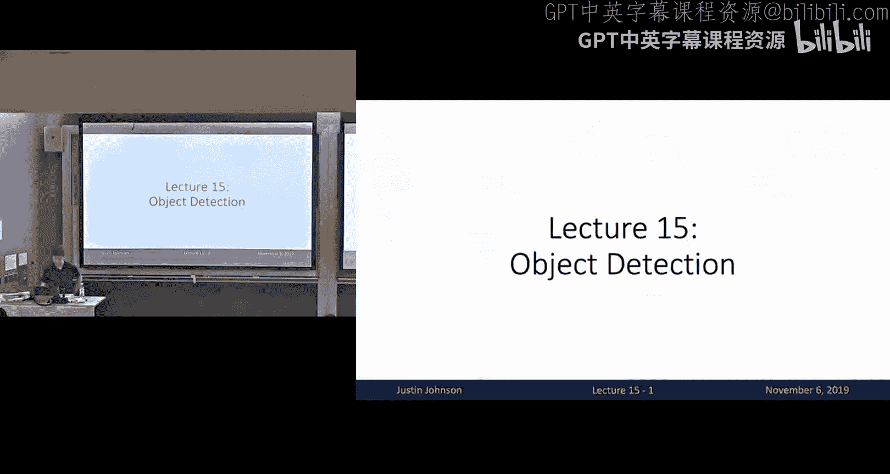

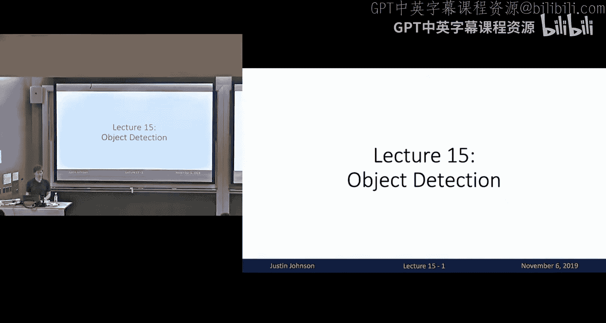

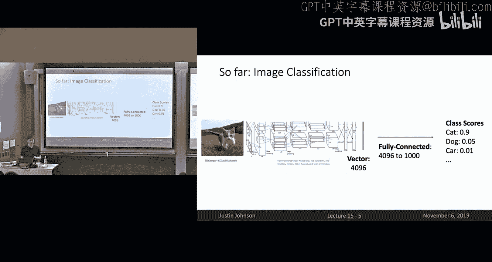

在本节课中，我们将要学习计算机视觉中的一个核心任务——目标检测。我们将从图像分类任务出发，探讨目标检测的独特挑战，并介绍一系列经典的目标检测方法，包括R-CNN系列算法及其演进。

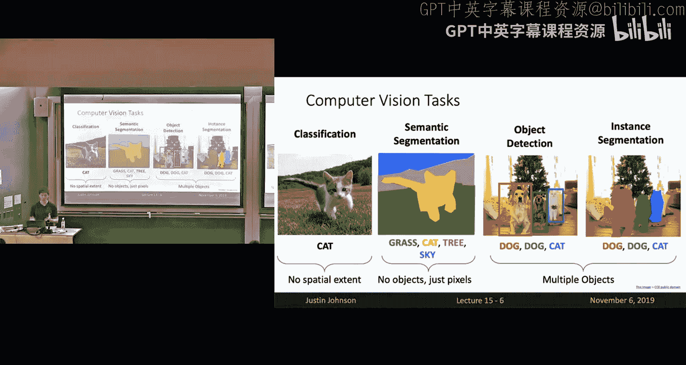

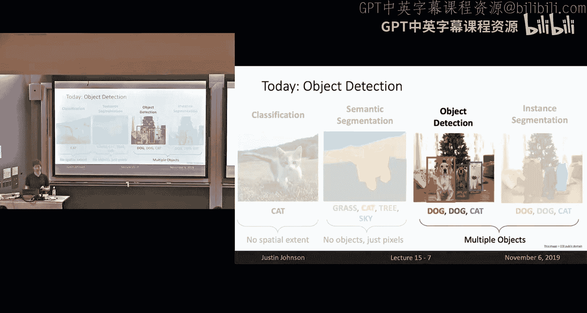

## 概述

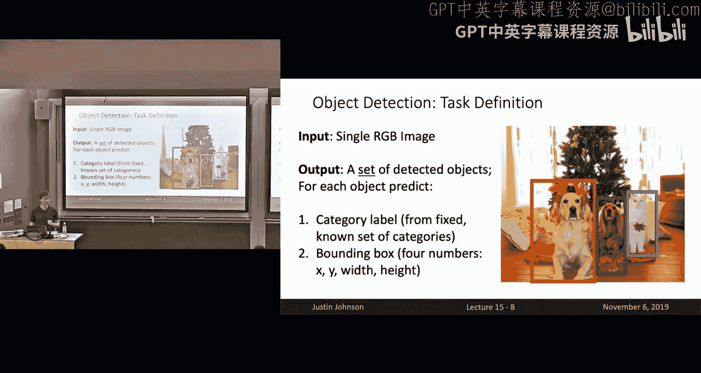

之前我们讨论了如何理解和可视化卷积神经网络内部的工作机制。今天，我们将转向一个更实用的新任务：目标检测。与为整张图像分配单一标签的图像分类不同，目标检测要求模型识别图像中所有感兴趣的物体，并为每个物体输出其类别标签和空间位置（即边界框）。

## 从图像分类到目标检测

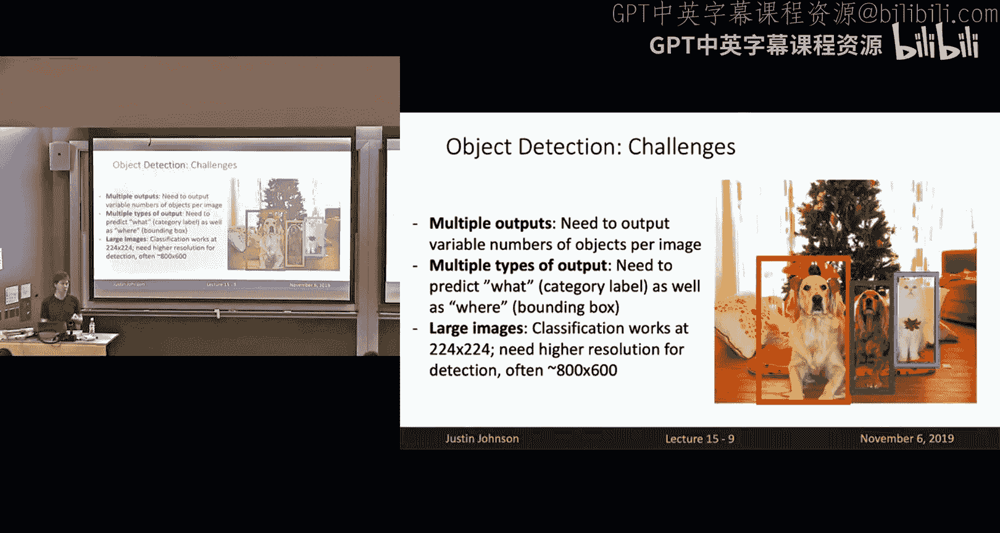

上一节我们介绍了图像分类，本节中我们来看看目标检测与其有何不同。

图像分类任务为整张输入图像分配一个单一的类别标签（例如，猫、狗、汽车）。这是一个非常有用且基础的任务，帮助我们理解了如何构建和训练卷积神经网络。

然而，计算机视觉领域包含一系列更复杂的任务，它们不仅识别图像中有什么，还要识别物体在哪里。目标检测就是其中之一。

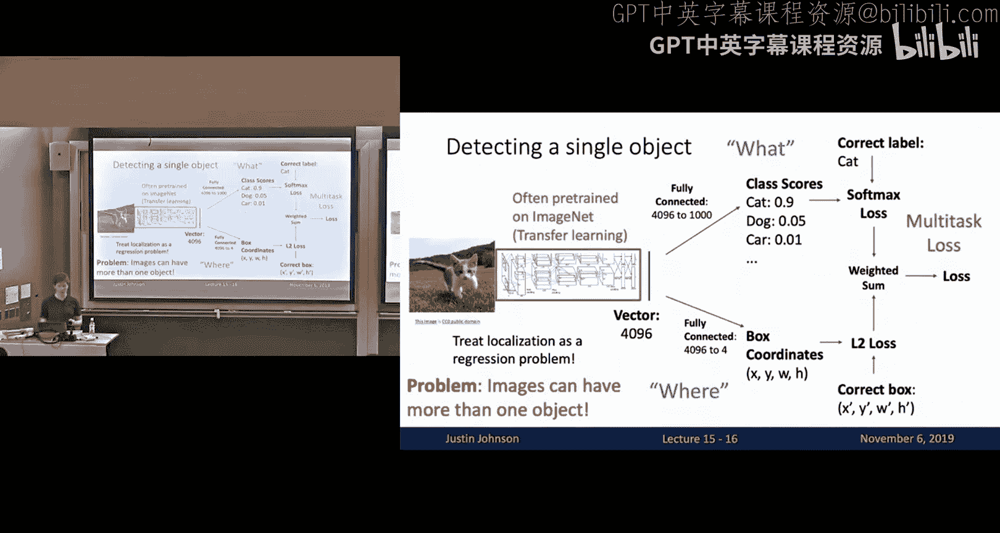

### 什么是目标检测？

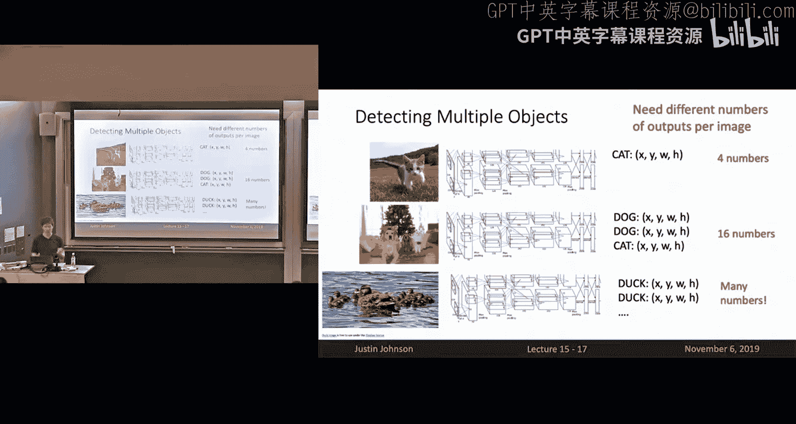

目标检测任务输入一张RGB图像，输出一组检测到的物体。对于每个被检测到的物体，模型需要输出两样东西：
1.  **类别标签**：指明物体的类别（如“猫”、“狗”）。
2.  **边界框**：一个矩形框，用四个数字 `(x, y, w, h)` 表示，其中 `(x, y)` 是框的中心坐标，`(w, h)` 是框的宽和高（均以像素为单位）。这些边界框通常与图像坐标轴对齐。

### 目标检测的挑战

与图像分类相比，输出边界框这一看似微小的变化带来了巨大的复杂性：
*   **可变数量的输出**：图像中物体的数量是可变的，模型需要输出一个可变大小的检测结果集合。
*   **处理边界框**：网络需要一种机制来生成和回归边界框坐标。
*   **高分辨率图像需求**：为了准确定位多个物体，目标检测通常需要在更高分辨率的图像（如800x600像素）上工作，这带来了更大的计算负担。

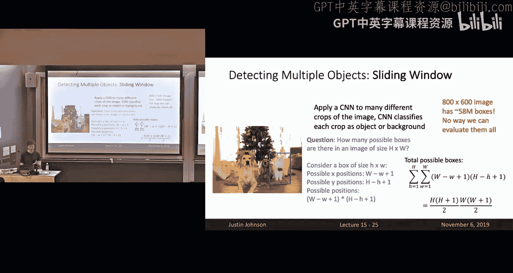

尽管有这些挑战，目标检测在自动驾驶、监控等众多领域有至关重要的应用，是计算机视觉中仅次于图像分类的核心问题。

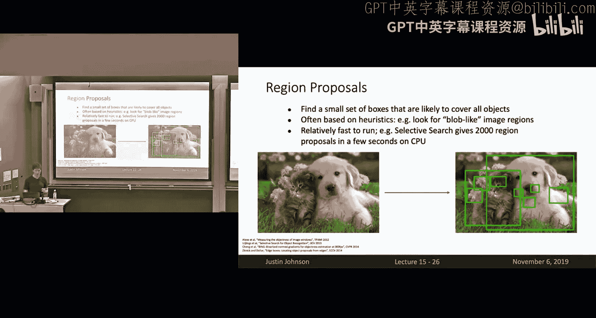

## 单目标检测：一个简单的起点

在深入多目标检测的复杂性之前，我们先考虑一个简化问题：如何检测图像中的单个物体？

我们可以构建一个相对简单的架构：
1.  输入图像通过一个卷积神经网络（如AlexNet、VGG、ResNet）得到特征向量。
2.  从这个特征向量分出两个分支：
    *   **分类分支**：一个全连接层，输出类别分数，使用Softmax损失进行训练。
    *   **回归分支**：另一个全连接层，输出四个实数 `(x, y, w, h)`，表示边界框坐标，使用回归损失（如L2损失）进行训练。

为了用梯度下降法训练这个同时做两件事的网络，我们需要将两个损失函数合并为一个标量损失。这通过计算它们的加权和来实现：

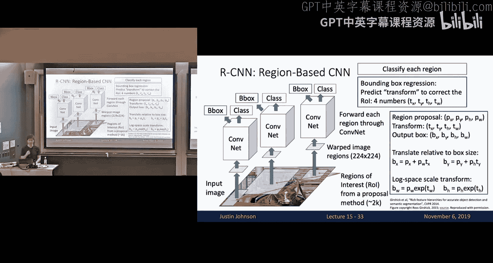

`总损失 = w1 * 分类损失 + w2 * 回归损失`

这种为单一网络设计多个损失项以完成不同子任务的结构，被称为**多任务损失**。这种方法在已知图像中只有一个物体时效果很好，但无法处理现实世界中多物体的场景。

## 滑动窗口方法及其局限性

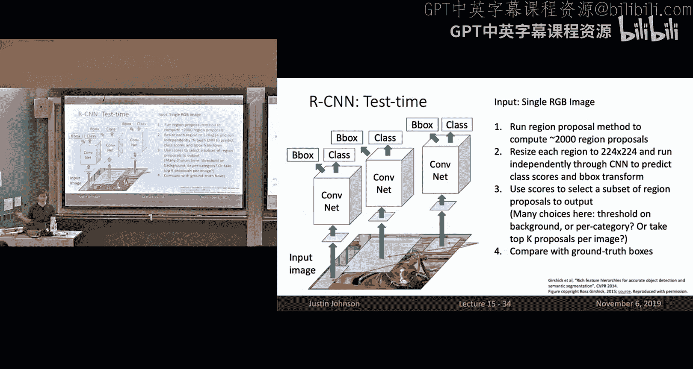

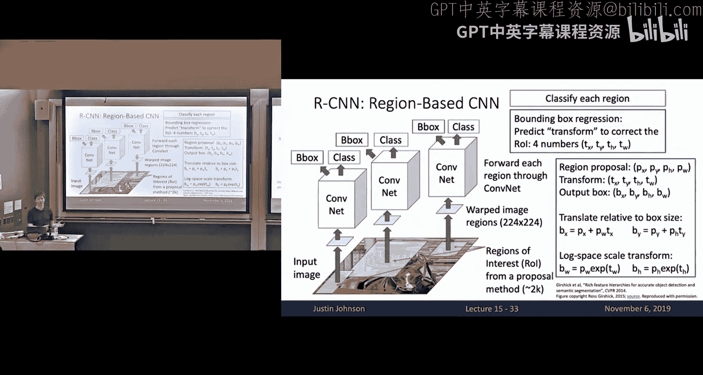

为了检测多个物体，一个直观的想法是使用**滑动窗口**方法：
1.  训练一个CNN分类器，用于判断一个固定大小的图像区域（窗口）是否包含某个特定类别的物体，或者只是背景。
2.  将这个分类器以滑动窗口的方式应用到输入图像的各个位置和不同尺度上。
3.  所有被分类为非背景的窗口位置，就构成了检测结果。

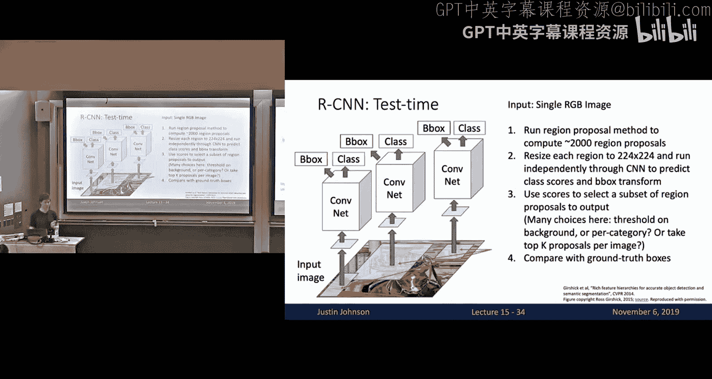

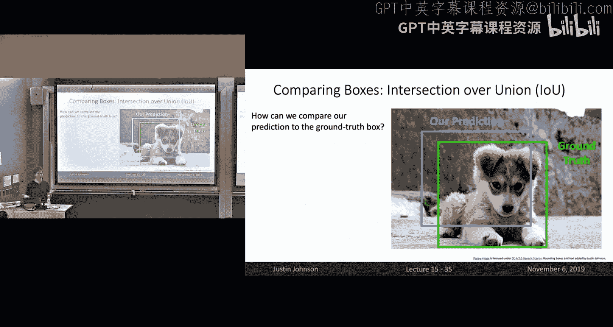

然而，这种方法存在一个致命缺陷：计算量过大。对于一个 `H x W` 的图像，考虑所有可能位置、大小和长宽比的窗口，其数量是像素数量的四次方级。例如，对于一个800x600的图像，可能有约5800万个候选窗口。对每个窗口都运行一次CNN前向传播是完全不可行的。

## 区域提议与R-CNN

为了解决滑动窗口的计算瓶颈，研究者引入了**区域提议**的概念。其核心思想是：使用一个快速、轻量的算法（如**选择性搜索**）预先从图像中生成约2000个可能包含物体的候选区域，而不是穷举所有窗口。

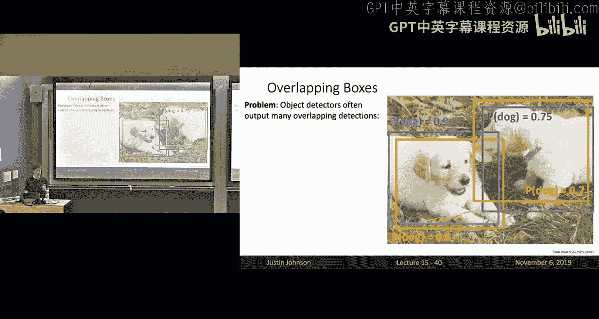

这引出了2014年极具影响力的**R-CNN**方法：
1.  **生成区域提议**：对输入图像运行选择性搜索算法，得到约2000个候选框。
2.  **变形与分类**：将每个候选区域变形（warp）成固定大小（如224x224），然后分别输入一个CNN中进行特征提取。
3.  **分类与精修**：CNN为每个区域输出两部分：
    *   一个 `C+1` 类的分类分数（C个物体类别 + 1个背景类）。
    *   一个边界框回归参数，用于对初始的区域提议框进行微调，使其更贴合真实物体。

R-CNN首次成功地将深度学习应用于目标检测，但它的速度很慢，因为需要为每个区域提议独立运行CNN前向传播（约2000次）。

## 加速之路：Fast R-CNN与Faster R-CNN

为了提升速度，**Fast R-CNN**改进了流程：
1.  **共享卷积计算**：首先将整张图像输入一个CNN（称为**骨干网络**），得到整张图的卷积特征图。
2.  **特征图上裁剪**：将选择性搜索得到的区域提议映射到特征图上，并通过一个可微的操作（如**RoI Pooling**）从特征图中裁剪出对应区域，并池化为固定大小的特征块。
3.  **区域分类与回归**：将这些固定大小的特征块输入后续的全连接层，同时完成分类和边界框回归。

Fast R-CNN通过共享整图的卷积计算，大幅提升了速度。然而，区域提议生成（选择性搜索）仍然是CPU上的瓶颈。

**Faster R-CNN**进一步将区域提议的生成也整合进神经网络：
1.  骨干网络提取图像特征。
2.  一个轻量的**区域提议网络**（RPN）在特征图的每个位置上预设多个不同尺度和长宽比的**锚框**，并预测每个锚框是“物体”还是“背景”，同时输出一个微调锚框的变换参数。
3.  RPN生成的区域提议，再像Fast R-CNN一样，通过RoI Pooling和后续网络进行最终的分类和回归。

Faster R-CNN实现了端到端的训练，并将大部分计算都放在了GPU上，速度得到了极大提升。由于其包含“区域提议生成”和“区域分类回归”两个明显阶段，它被称为**两阶段检测器**。

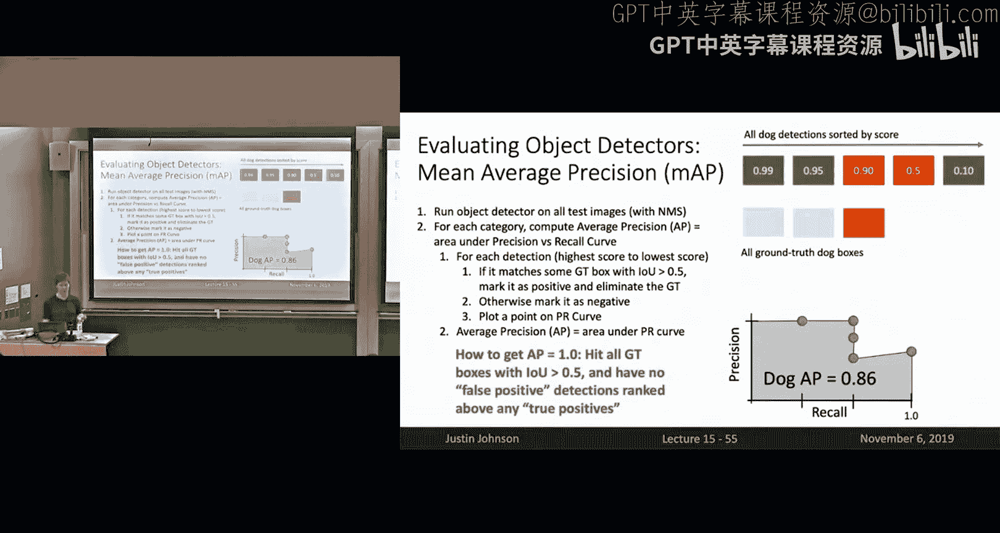

## 更快的单阶段检测器

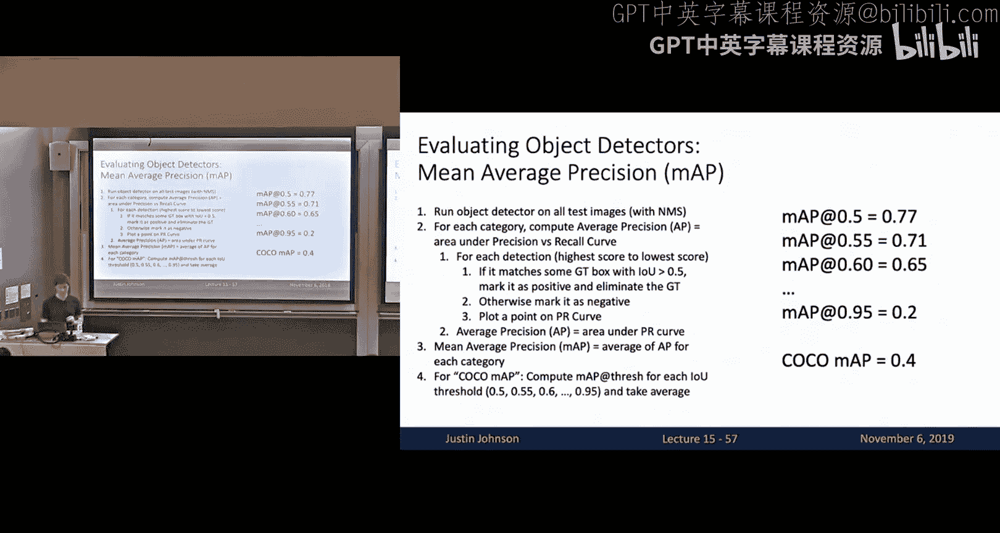

既然RPN已经可以生成带有类别和框信息的输出，能否去掉第二阶段，只用一阶段就完成检测？这就是**单阶段检测器**（如SSD, YOLO）的思想。

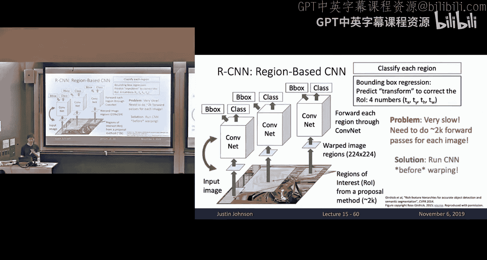

单阶段检测器在特征图的每个锚点位置上，直接通过卷积层预测：
*   所有类别的分类分数（包括背景）。
*   每个类别对应的边界框回归参数（或共享的参数）。

单阶段检测器结构更简单、速度更快，因为完全避免了每区域的独立计算。但其精度通常略低于两阶段检测器，因为它没有对候选区域进行“二次审视”的机会。

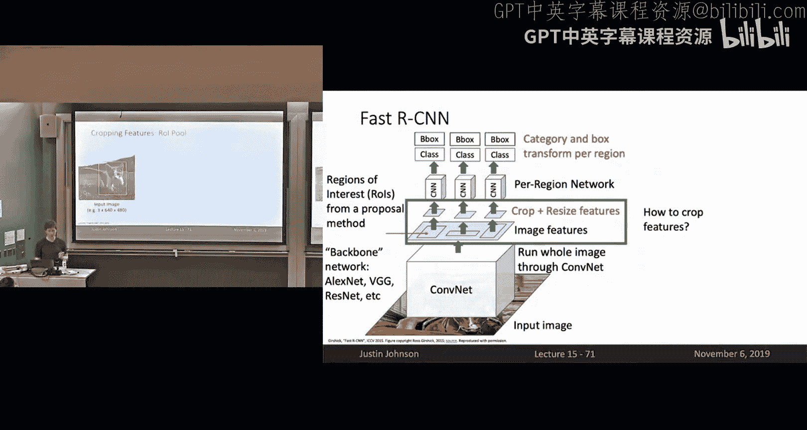

## 评估指标：交并比与平均精度均值

为了衡量目标检测器的性能，我们需要专门的评估指标。

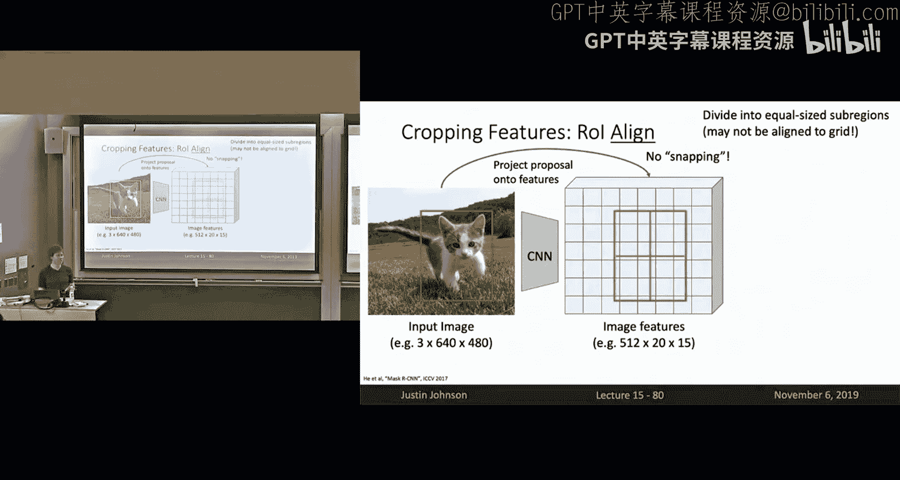

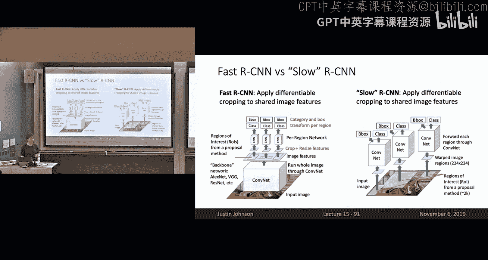

### 交并比

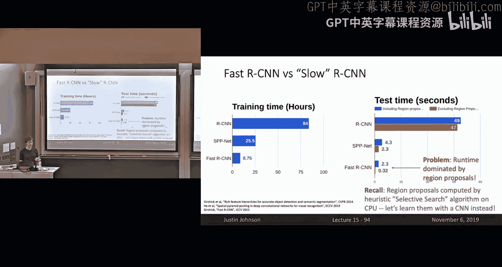

**交并比**（IoU）用于衡量两个边界框的重叠程度。计算公式为两个框交集面积与并集面积的比值：

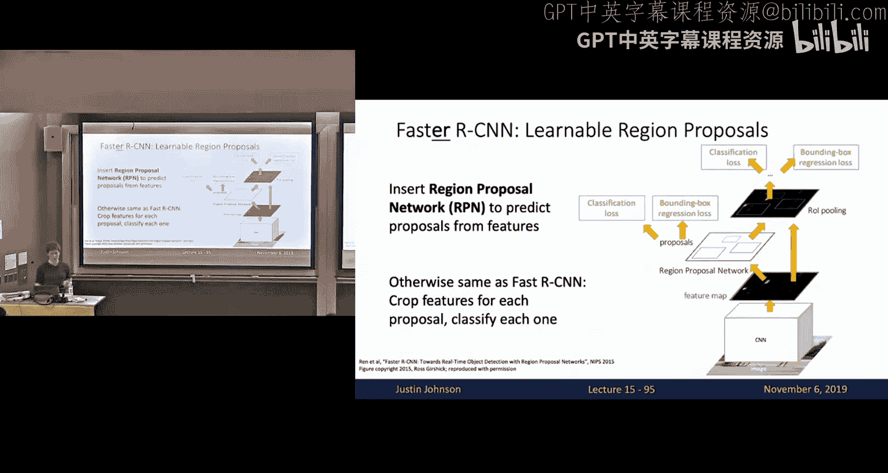

`IoU(A, B) = 面积(A ∩ B) / 面积(A ∪ B)`

IoU值在0到1之间，值越大表示重叠越好。通常IoU > 0.5被认为是一个可以接受的匹配。

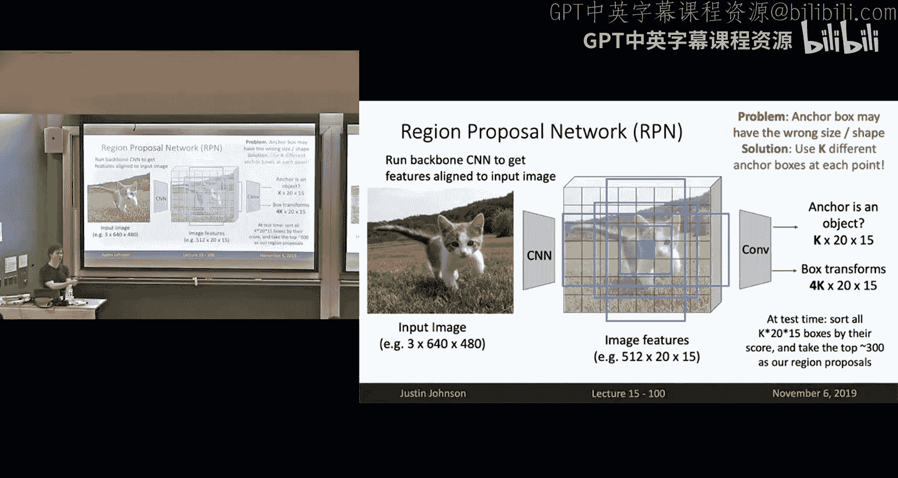

### 非极大值抑制

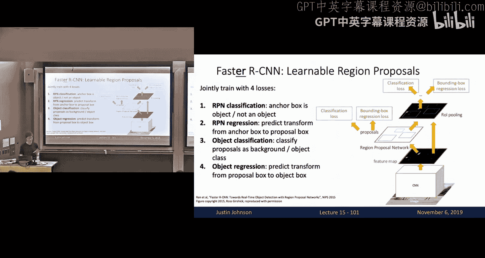

检测器通常会为同一个物体输出多个高度重叠的框。**非极大值抑制**（NMS）是一种后处理算法，用于去除冗余检测框：
1.  选择置信度最高的检测框。
2.  计算该框与所有其他框的IoU。
3.  移除所有IoU超过某个阈值（如0.7）的其他框（视为重复检测）。
4.  在剩下的框中重复步骤1-3，直到处理完所有框。

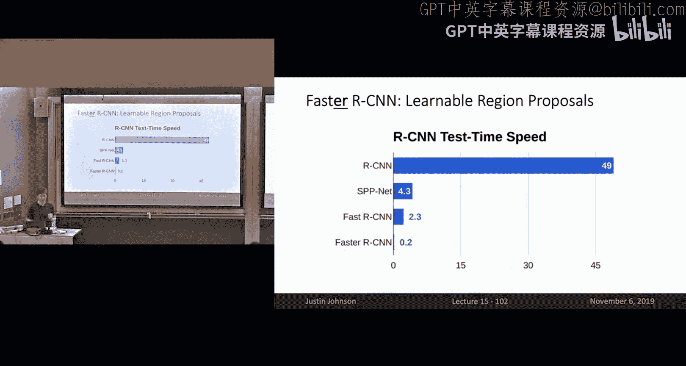

### 平均精度均值

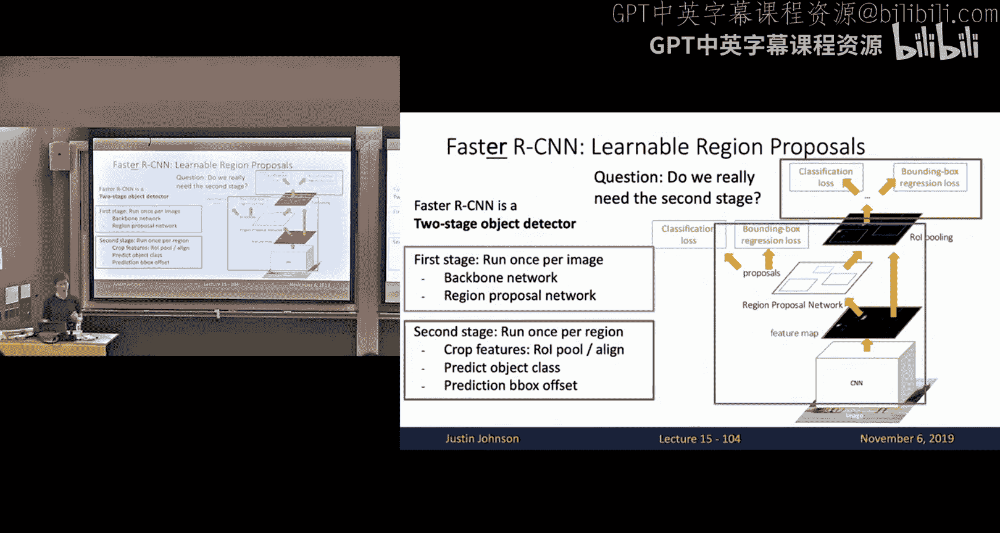

**平均精度均值**（mAP）是目标检测中最核心的综合评估指标。计算过程如下：
1.  对每个类别单独计算**平均精度**（AP）：
    *   将模型在该类别下所有测试图片上的所有检测框，按置信度从高到低排序。
    *   从最高置信度开始，逐个判断检测框是否为真正例（与某个真实框IoU > 阈值，如0.5，且该真实框未被匹配过）。
    *   随着检测框数量的增加，计算**精确率**（Precision，真正例数 / 已检测数）和**召回率**（Recall，真正例数 / 总真实数），绘制P-R曲线。
    *   AP即为该P-R曲线下的面积。
2.  对所有类别的AP取平均，即得到mAP。

mAP综合考虑了模型在不同召回率下的精确率表现，是衡量检测器性能的黄金标准。在实际研究中，常会报告在不同IoU阈值（如0.5:0.95）下计算的平均mAP。

## 现代目标检测现状与实用建议

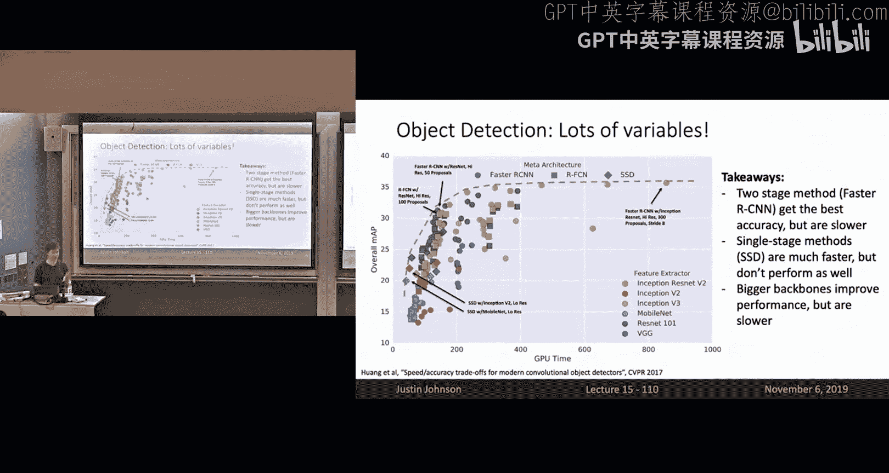

目标检测领域发展迅速。如今，通过使用更强大的骨干网络（如ResNet、ResNeXt）、多尺度特征金字塔（FPN）以及更长的训练策略，两阶段和单阶段检测器的性能差距正在缩小，且整体精度大幅提升。

对于实践者的建议：
*   **不要从头实现**：现代目标检测系统涉及大量复杂的技巧和调参，自行实现很难达到最优性能。
*   **使用现有框架**：推荐使用高质量的开源实现，例如：
    *   **PyTorch**：Detectron2（Facebook发布，包含最新模型）。
    *   **TensorFlow**：TensorFlow Object Detection API。
    这些框架提供了预训练模型和易于使用的接口，可以快速应用于实际项目。

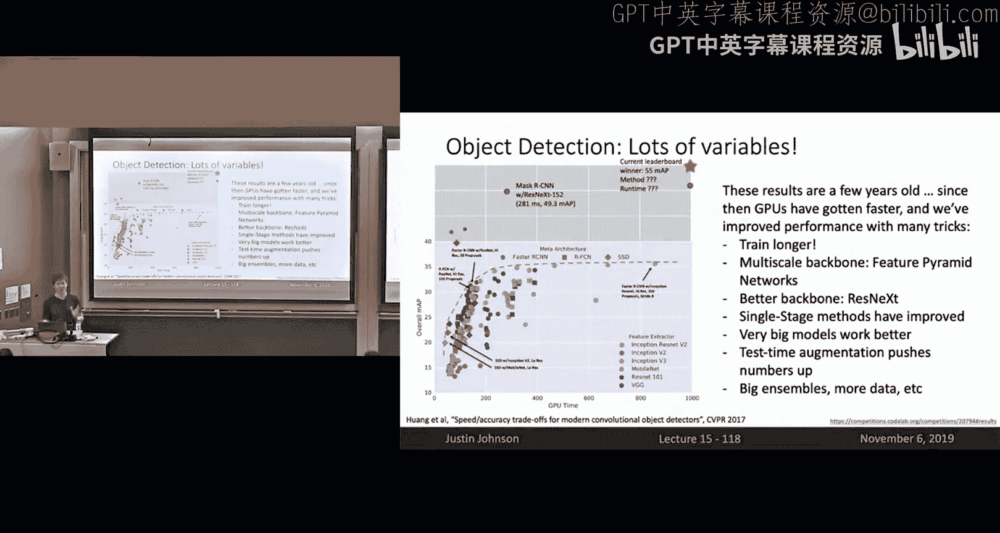

## 总结

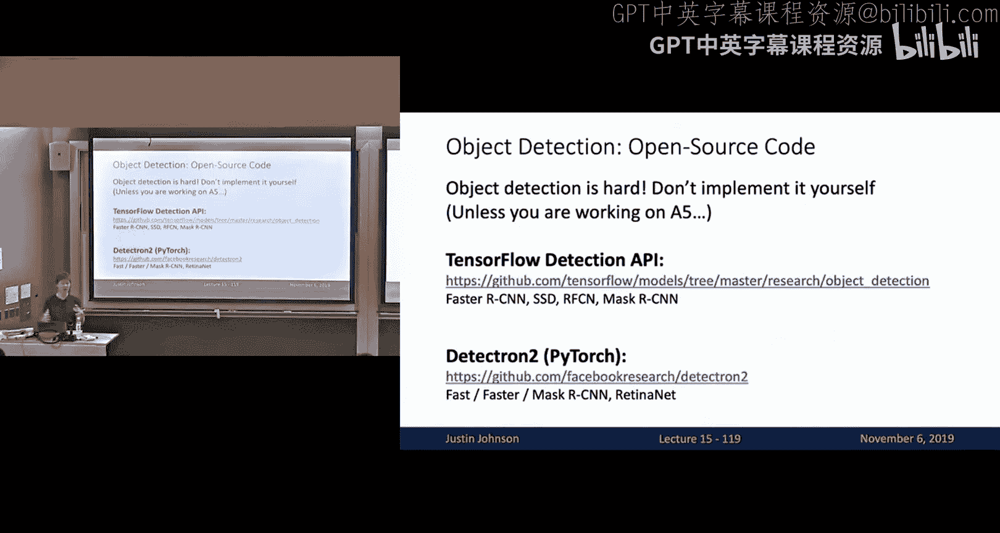

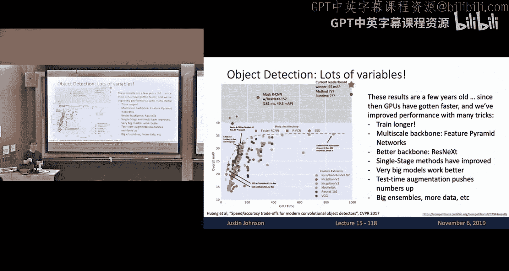

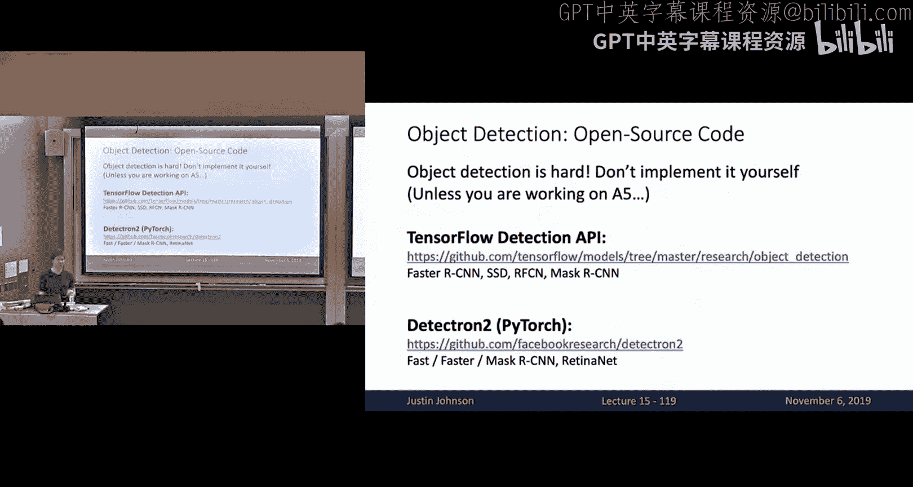

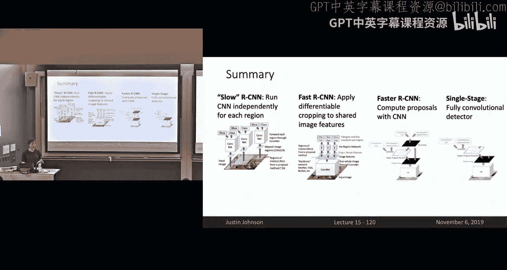

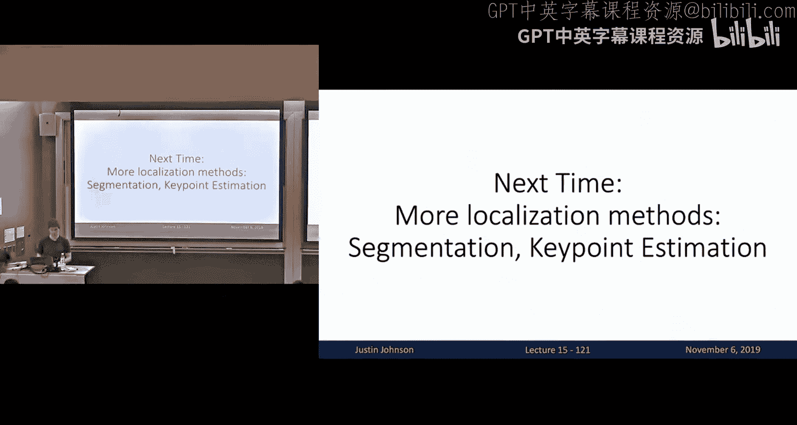

本节课中我们一起学习了目标检测这一核心计算机视觉任务。我们从图像分类的局限出发，探讨了目标检测的独特挑战。随后，我们沿着历史脉络，介绍了从滑动窗口、R-CNN、Fast R-CNN到Faster R-CNN的演进过程，以及更快的单阶段检测器。我们还学习了用于评估检测性能的关键指标：IoU、NMS和mAP。最后，我们了解了当前目标检测的发展现状，并给出了实用的工具选择建议。目标检测是一个复杂但极其重要的领域，为图像理解和现实世界应用奠定了坚实基础。