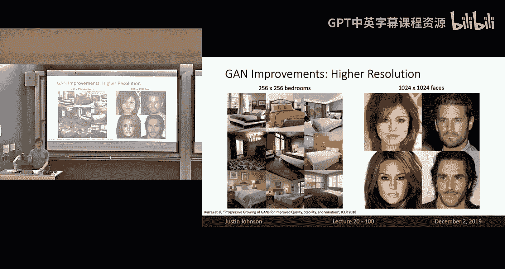
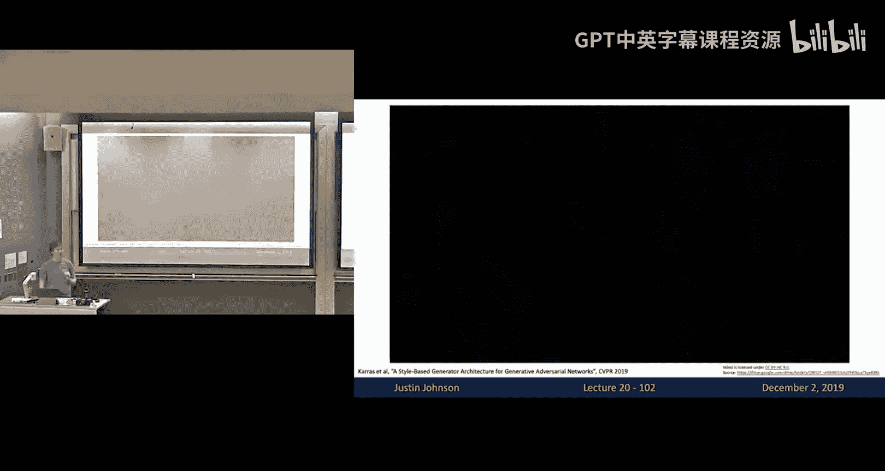
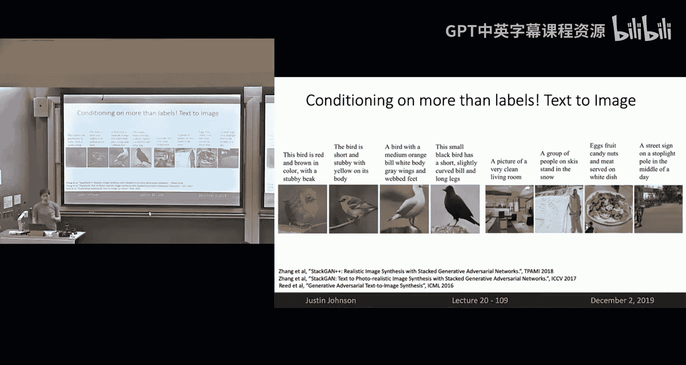
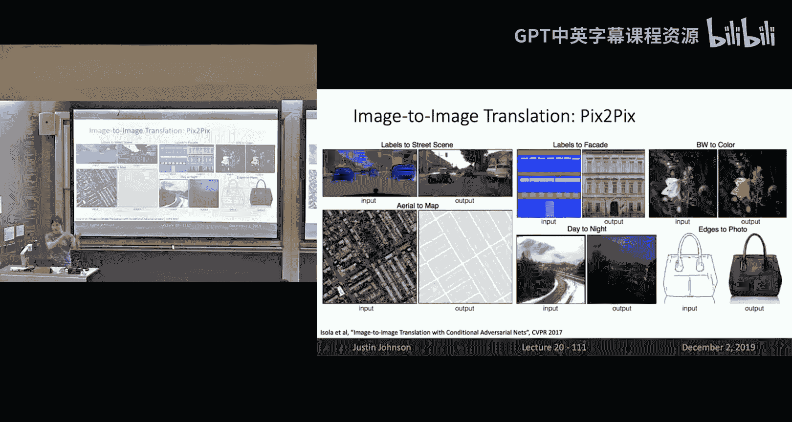
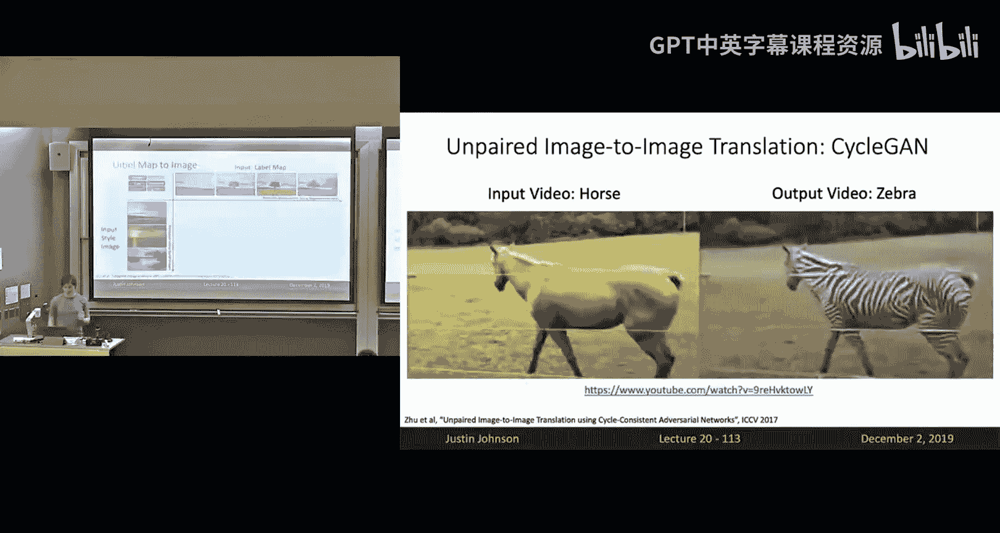
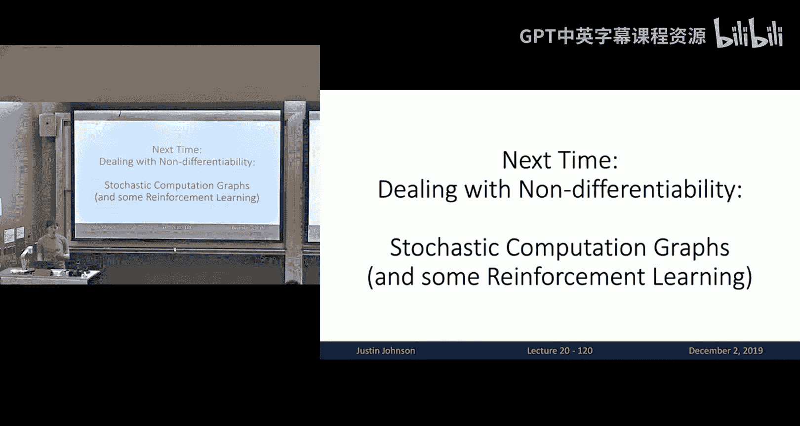

# 20：生成模型（第二部分）🎨

在本节课中，我们将继续讨论生成模型，涵盖变分自编码器（VAE）和生成对抗网络（GAN）的核心概念、工作原理、训练方法以及应用实例。我们将从回顾上一讲的内容开始，逐步深入这两种强大的生成模型。

## 课程回顾与概述

上一讲我们介绍了生成模型的基本概念，并讨论了自回归模型。我们回顾了监督学习与无监督学习的区别，以及判别式模型与生成式模型在概率建模上的不同。自回归模型通过直接参数化数据的似然函数来生成数据，但其生成过程较慢，且不学习数据的潜在表示。

本节中，我们将探讨另外两类重要的生成模型：变分自编码器和生成对抗网络。它们采用了不同的策略来建模和生成数据。

## 变分自编码器（Variational Autoencoders）

变分自编码器是一种概率生成模型，它通过学习数据的潜在表示（latent representation）来生成新样本。与自回归模型不同，VAE引入了潜在变量 `Z`，旨在捕获数据的高层语义特征。

### 核心架构与目标

VAE包含两个神经网络：编码器（Encoder）和解码器（Decoder）。
*   **编码器** `Q_φ(z|x)`：输入数据 `x`，输出潜在变量 `z` 的概率分布（通常假设为对角高斯分布）。
*   **解码器** `P_θ(x|z)`：输入潜在变量 `z`，输出数据 `x` 的概率分布。

由于直接最大化数据似然 `P(x)` 在引入潜在变量后变得难以处理，VAE转而最大化其变分下界（Evidence Lower Bound, ELBO）：

**公式：ELBO**
```
log P(x) ≥ E_{z∼Q_φ(z|x)}[log P_θ(x|z)] - D_KL(Q_φ(z|x) || P(z))
```

其中：
*   `E_{z∼Q_φ(z|x)}[log P_θ(x|z)]` 是**重构项**，鼓励解码器能根据潜在编码 `z` 较好地重构输入数据 `x`。
*   `D_KL(Q_φ(z|x) || P(z))` 是**KL散度项**，鼓励编码器输出的分布 `Q_φ(z|x)` 接近我们预设的先验分布 `P(z)`（通常为标准正态分布 `N(0, I)`）。

这两个目标相互制约：重构项希望潜在编码包含足够信息以重建输入，而KL散度项则希望潜在编码的分布尽量简单（接近标准正态）。

### 训练过程

以下是训练VAE的具体步骤：

1.  **前向传播**：将小批量数据 `x` 输入编码器，得到潜在分布的均值 `μ` 和方差 `σ^2`（假设为对角高斯）。
2.  **采样**：从该分布中采样一个潜在向量 `z`。为了允许梯度回传，我们使用“重参数化技巧”（Reparameterization Trick）：`z = μ + σ ⊙ ε`，其中 `ε ∼ N(0, I)`。
3.  **解码**：将采样得到的 `z` 输入解码器，得到重构数据 `x̂` 的分布参数。
4.  **计算损失**：损失函数即为负的ELBO，需要计算重构损失（如二元交叉熵或均方误差）和KL散度损失。
5.  **反向传播与优化**：通过梯度下降同时更新编码器和解码器的参数，以最大化ELBO。

### VAE的能力与应用

一旦VAE训练完成，我们可以利用它做以下几件事：

*   **生成新数据**：从先验分布 `P(z)`（如 `N(0, I)`）中采样一个 `z`，然后通过解码器生成新的数据样本 `x`。
*   **数据编辑**：将一张真实图片输入编码器得到其潜在编码 `z`，通过有目的地修改 `z` 的某些维度，再输入解码器，可以得到编辑后的图片（如改变人脸表情、光照方向等）。
*   **潜在空间插值**：在两个潜在向量 `z1` 和 `z2` 之间进行线性插值，并将插值点输入解码器，可以得到在两个原始图像之间平滑过渡的生成序列。

VAE的优点是提供了一个结构化的潜在空间，并且训练相对稳定。但其生成的图像有时会比较模糊。

## 生成对抗网络（Generative Adversarial Networks）

生成对抗网络采用了与VAE完全不同的思路：它放弃了显式建模数据分布 `P(x)`，而是专注于学习如何从该分布中**采样**。GAN通过一个“对抗”的过程来训练生成器，使其能产生足以“欺骗”判别器的逼真样本。

### 核心思想：对抗博弈

GAN包含两个相互博弈的神经网络：
*   **生成器（Generator） G**：输入一个从简单先验分布（如均匀分布或正态分布）中采样的噪声向量 `z`，输出一个合成数据样本 `G(z)`。其目标是生成尽可能真实的数据，以骗过判别器。
*   **判别器（Discriminator） D**：输入一个数据样本（可以是真实的，也可以是生成器合成的），输出一个标量，表示该样本是来自真实数据分布（输出接近1）还是来自生成器分布（输出接近0）。其目标是尽可能准确地区分真实样本和伪造样本。

二者构成了一个极小极大博弈（minimax game），其价值函数 `V(G, D)` 为：

**公式：GAN目标函数**
```
min_G max_D V(D, G) = E_{x∼p_data(x)}[log D(x)] + E_{z∼p_z(z)}[log(1 - D(G(z)))]
```

### 训练过程与挑战

GAN的训练是一个交替优化的过程：

1.  **固定生成器G，更新判别器D**：最大化 `V(D, G)`。这相当于训练一个二分类器，使其能正确区分真实数据和当前生成器产生的假数据。
2.  **固定判别器D，更新生成器G**：最小化 `V(D, G)`。这相当于训练生成器，使其产生的数据能让判别器 `D` 给出高的“真实”概率（即 `D(G(z))` 接近1）。

在实际训练中，早期生成器能力很弱，`D(G(z))` 接近0，导致 `log(1 - D(G(z)))` 的梯度很小（梯度消失问题）。因此，常采用一个非饱和（non-saturating）的替代目标来训练生成器：**最大化 `log D(G(z))`**。

GAN训练极具挑战性，常面临模式崩溃（mode collapse）、训练不稳定、难以调试（损失曲线无法直观反映训练状态）等问题。

### GAN的强大能力与应用

尽管训练困难，GAN在生成高质量、高分辨率图像方面取得了巨大成功，并催生了大量变体和应用：





*   **高质量图像生成**：从DCGAN、Progressive GAN到最新的StyleGAN，生成的图像分辨率从64x64提升到1024x1024，逼真度惊人。
*   **条件生成**：通过向生成器和判别器输入额外的条件信息（如图像类别、文本描述、另一张图片），可以实现可控的图像生成、图像到图像的翻译（如语义图→照片、马→斑马）、超分辨率、图像修复等。
*   **潜在空间操作**：与VAE类似，GAN的潜在空间 `z` 也常常具有可解释性，可以通过向量运算（如“微笑女人 - 中性女人 + 中性男人 = 微笑男人”）来编辑生成图像的属性。
*   **跨领域应用**：GAN不仅用于图像，还可用于生成视频、3D模型、音乐、文本，甚至用于预测行人未来轨迹等任务。

## 总结与展望



本节课我们一起学习了生成模型中两个至关重要的范式：





1.  **变分自编码器（VAE）**：通过最大化数据似然的变分下界，**联合学习数据的潜在表示和生成模型**。它提供了结构化的潜在空间，便于插值和编辑，但生成的图像可能较模糊。
2.  **生成对抗网络（GAN）**：通过生成器和判别器的**对抗博弈**，直接学习从噪声到逼真数据的映射。它放弃了显式的似然计算，专注于采样，能生成极其清晰、高质量的图像，但训练过程复杂且不稳定。



此外，我们还看到了结合两者优点的前沿工作（如VQ-VAE-2），这可能是未来生成模型发展的一个方向。生成模型是一个快速发展的领域，在图像合成、编辑、数据增强、跨模态理解等方面有着广阔的应用前景。