# 密歇根大学《深度学习用于计算机视觉｜Deep Learning for Computer Vision UMich EECS 498-007 2019》中英字幕 p01 -01-1_IntroductiontoDeepLearningforComputerVision.zh_en -BV1jA4m1P7GN_p1-

So I hope you' all in the right place， welcome to EECS 498007/598005 this special topics class taught for the first time here at Michigan deep learningning for computer vision I wish we had a snap year easier more easier to remember course number but when you teach a special topics class they give you numbers like this so I'm sorry about that。

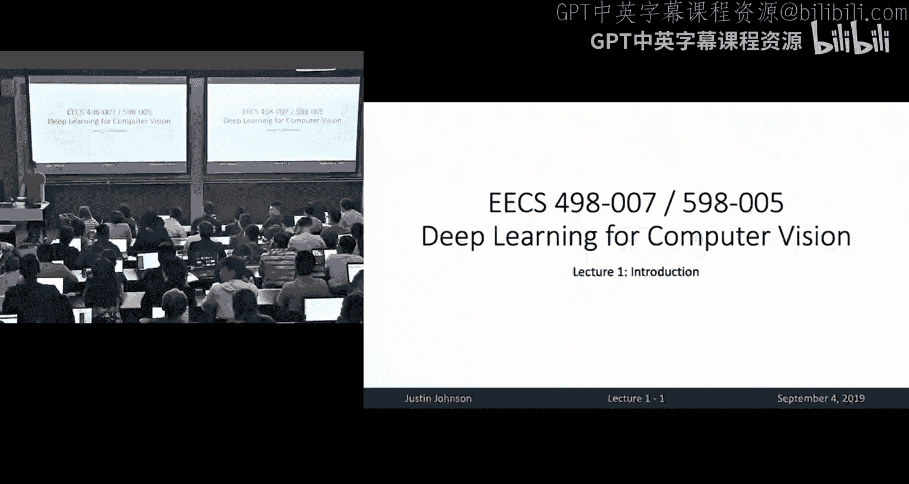

But hopefully you're all in the right place so before we get started。

 I wanted to talk a little bit about the waitlist so I know we had a lot of interest in this class much more than we could possibly accommodate so because we only have 120 slots in the class and when I check yesterday。

 we had something like 135 people on the waitlist so no matter which way we slice it。

 unfortunately many people who will want to take this class just unfortunately won't be able to get in so I'm really sorry about that but we will try to get as many people in as we can and stay tuned we'll be sending out a couple more overris later today and as we move on in the quarter if anyone drops。

 I'll definitely be adding in more people but I apologize in advance if you're not able to get a slot in this class when you wanted to so that with that out of the way let's get started on the course material。

So the title of this class is Deep Learning for Computer visionsion。

 so I think we need to unpack a little bit what these terms mean before we get started。😡。

So computeruter visionsion is the study of building artificial systems that can process perceive and otherwise reason about visual data。

 and this kind of quite a broad definition， what does process， what does perceive。

 what does reason mean， it's kind of up for interpretation or what does visual data mean。

 that could be images， that could be videos， that could be medical scans that could be just about any type of continuously valued signal you can think about。

 can sometimes be found in computer vision conferences or publication somewhere so these terms are really defined quite broadly。

😡，So why is computer vision important Well I think computer vision is a particularly important and exciting topic to study because it's everywhere I think many of us in this room right now are carrying around one or more several cameras we're just taking millions of photos every day there's cameras all around us all the time people are always creating visual data sharing visual data talking about visual data and it's very important that we build algorithms that can perceive reason and process。

😡，For a couple of concrete statistics， if you look at YouTube， actually I no。

 let's talk about Instagram words， so Instagram is very popular。

 I think many of you are familiar with it， and there's something like 100 million photos and videos uploaded on Instagram every single day。

If we go on YouTube it's even worse， so on YouTube as of 2015， so I'm sure it's grown since then。

 people are uploading roughly 300 hours of video on YouTube every minute。😡。

So that means if you do the math and you think if I wanted to as a single individual human being。

 look at all the visual data just being uploaded on Instagram and YouTube in one day。

 if you do the math， say I'm going look at images for maybe one second each。

 I'm going to look at my YouTube videos at double speed。

 it's going to take me about 25 years to look at the visual data that's going to be uploaded on just these two sites in a single day so when you think about these massive statistics and think about the massive amount of visual data being processed and shared across the internet these days。

 it becomes clear that we need to be able to build automated systems that can deal with it because we just don't have the human manpower to look and processed and perceive all of the data that we're creating。

😡，So that's why I think computer vision is such an important topic to be studying these days。

 and it's only going to get more important as the number of visual sensors out in the world keep increasing with new emerging technologies like autonomous vehicles。

 augmented and virtual reality， drones， you can imagine that the role of computer vision in our modern society will just continue getting more and more and more important。

 so clearly un'biased because this is my research area。

 but I think this is the most important and exciting research topic that we can be studying right now in computer science。

😡，So that's computer vision。Computer visionsion is the problem that we're trying to solve。

 it sets forth this problem of understanding visual data。

 but computer vision doesn't really care how we solve that problem。

 Our goal is just to crunch through all of those images and videos， however we can。😡。

But the way that the technique that we happen to be using in computer vision across the field these days is deep learning deep learning so before we get to deep learning what is learning learning is the process of building artificial systems that can learn from data and experiences notice that this is somewhat orthogonal to the goals of computer vision。

 computer vision just says we want to understand visual data。

 we don't care how you do it learning is this separate problem of trying to build systems that can adapt to the data that they see in the experiences that they have in the world and from the outset it's not immediately clear why these two go together。

 but it turns out that in the last 10 to 20 years we've found that building learningbased systems is very important for building many kinds of generalizable computer systems both in computer vision and across many areas artificial intelligence and computer science more broadly。

So now when we think about deep learning。Deep learning is then yet another subset of machine learning。

 where deep learning is sort of maybe a bit of a hype name， a bit of a buzzwordy name。

 but my definition is that it's a type of deep learning consists of hierarchical learning algorithms with many layers。

 whatever that means in the context at hand， that are very。

 very loosely inspired by the architecture of the mammalian brain and sometimes mammalian visual system。

😡，Now moment that I say loosely， this is the thing that you'll often see people talk about in deep learning that it's how the brain learns or how the brain works。

 I think you should take any of these comparisons with a massive brain of salt。

 there are some very coarse comparisons between brains and neural networks that we use today。

 but I think you should not take them too seriously。😡。

So then kind of stepping back a little bit from these two topics。

Computer vision and machine learning both fall within the purview of the larger research field of artificial intelligence。

 so artificial intelligence is very general， very broad。

 it's broadly speaking how can we build computer systems that can do things that normally people do so that's kind of my definition I think people will argue about what is and is not artificial intelligence but I think we just want to build smart machines whatever that means to any of us and I think。

There's clearly many different sub disciplinescilines of artificial intelligence。

 but to the most important， clearly again， in my biased opinion， our computer vision。

 teaching machines to see and machine learning， teaching machines to learn。

 and these are the topics that we'll study in this class。

So then kind of where does deep learning fall in this regime。

 deep learning would be a subset of machine learning。

 and it intersects both computer vision and falls within the larger AI realm。

I think it's important at the outset and so then this class is going to focus at kind of this intersection right in the middle the intersection of computer vision。

 machine learning and deep learning The reason I want to start out with this slide is because it's really easy to get caught up in the hyp these days and think that computer vision is the only type of AI deep learning is the only type of AI deep learning is the only type of computer vision but I think none of these are true there are types of AI which have nothing to with learning。

 nothing to do with deep learning， there's classical results about symbolic systems and other approaches to AI that are very different technically there's areas of computer vision that do not use any very much machine learning over much deep learning so I want to even though the focus of this class will be the intersection of these different research areas I just want to keep I just want you to keep in mind as a whole that there is a bunch broader realm of AI research being done today around the world by different。

That falls into different pieces of this pie chart。And of course。

 there's many other areas within AI that we won't talk about too much。

 so there's natural language processing， things like speech recognition， things like robotics。

 and I kind of ran out a space on the chart put any more sub areasas。

 but suffice to say artificial intelligence is massive is a massively successful。

 massive popular area of research and area of study these days that again。

 with the broad goal of making machines do things that people normally do。

 you can imagine that there's a whole lot of things that we might do out in the world that fall under this umbrella of artificial intelligence。

So that's kind of the big picture road now， and now for the rest of the semester。

 we're going to focus on this little red area in here， but again。

 don't forget that there's a lot more to the world than what we're talking about in this class。😡。

So today's agenda is a little bit different from most of the lectures in this class because again it is the first week。

 so before we can really dive into that red piece of the pie chart and talk about machine learning and deep learning and computer vision。

 all that really good stuff I think it's important to get a little bit of historical context about how we got here as a field this has been a hugely successful research area in the last five to10 years but deep learning。

 machine learning， computer vision， these are areas with decades and decades of research built upon them and all of the successes we've seen in the last few years have been a result of building upon decades of prior research in these areas so today I want to give a a bit of a brief history and overview of some of the historical context that led up to the successes of today and then following that we need to talk about some of the boring stuff。

 the course overview logistics， all that other stuff that you expect to see in a first lecture in a class。

So let's start with so we're going to do this in two ways right we're going to do we're going to do a parallel stream first we're going to talk about the history of computer vision。

 then we're going to sort of switch a little bit and cover the history of deep learning。😡。

So before we dive into the material， is there any sort of questions before we launch into this historical escapade？

No， okay， perfectly clear。So if we go I think whenever you talk about a research area。

 it's always difficult to pinpoint the start right because everything built on everything else。

 there's always prior work， everyone was inspired by something else that came before。

 but with a finite amount of time to talk about a finite number of things youve got to cut the line somewhere so one place where I like to draw the line and point to is maybe the start of computer vision is actually not with computer scientists at all。

 it's from this seminal study of a Hubo and weasel back in 1959 who were not interested in computers at all。

 they wanted to understand how mammalian brains work so what they did is they got a cat they got an electrode。

 they put the electrode into the brain of the cat it' the visual cortex of the cat which is part in the back of your head that processes visual data and with this electrode they're able to record the neuro activity of the individual neurons in the cat's visual cortex。

So then with this somewhat grotesque experimental setup， they were able to have the cap watch TV。

 and then， well not really TV because it was 1959， but they were able to show different sorts of slides to the cap。

And they have this general hypothesis that maybe there's certain neurons in the brain that respond to different types of visual stimuli and by showing the cat different types of visual stimuli and recording the neural activity from individual neurons。

 maybe we can start to puzzle out how this thing called vision works at all。

 So that's exactly what they did。 They got these cats。

 They stuck neurons in their brains and they started showing a lots of different images on a slidehow to try to see what kinds of images would activate the neurons in the cat's brains so they tried different things you can show them maybe mice and fish and other kinds of things that cats like to eat or play with but it was really hard to get any solid signal about what these neurons were responding to。

So what one really interesting discovery happened is you know。

 today we're using PowerPoint back in the day we had actual slide projectors and when you changed the slide like it was kind of a vertical bar that would move up and down the screen and what they surprisingly found is that some of the neurons in the cat's brain would consistently respond to the time when they changed the slides and even though they couldn't recognize any patterns of how was the cat responding to things on the slides。

 and they eventually discovered that it was in fact this moving vertical bar that was indeed causing some of the neuronal activity in the cat's brain。

So with this hint they were able to puzzle out that certain that there are different types of cells in the brain that are responding to different types of visual stimuli。

 many of them are very hard to interpret， but some of these easiest are these so-called simple cells that they discovered so the simple cells would respond to an edge that's going be light on one side dark on another side at a particular orientation at a particular position in the cat's visual field and if there happened to be an edge at the right position in the right angle in the right place。

 then that particular neuron might fire that was very exciting because then they had some concrete evidence of what it is that cats are actually responding to in their brains then with a bit more exploration they were able to find other types of cells in the brain that responded to even more complex patterns like the complex cells that would respond to bits of motion or could respond to oriented edges but anywhere in visual field to give a sense some sense of translation and variances in the visual representations that they。

So I think that this is really one of the found oh and by the way， of course。

 I have to mention that these this was very seminal research and these guys won a nobel prize for it in 1981 so this was a very important research in history of science and psychology and vision overall but I like to point to this as the beginning of computer vision for a couple reasons one is this emphasis on oriented edges we'll see this come up over and over again on the different architectures that we studied throughout the semester the other is this hierarchical representation of the visual system of building from simple cells that represent one thing combining with complex cells and more and more complex cells that respond to more and more complex types of visual stimuli this broad idea was hugely influential on the way that people thought about visual processing and even on neural representations more generally。

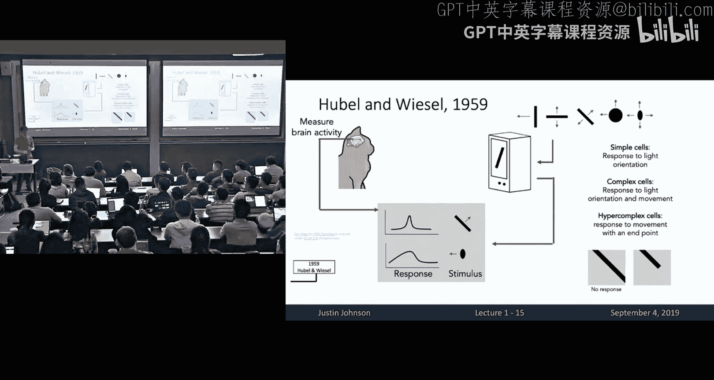

So then if we move forward a couple years to 1963， Larry Roberts did his that's when Larry Roberts graduated from MIT with his PhD and did perhaps what was the first PhD thesis on computer vision here。

 of course it was 1963 doing anything with computers was very cumbersome doing anything with digital cameras was very cumbersome so large portions of his thesis just to talk about how do you actually get photographic information into the computer because this was not something you could take for granted at that time but even working through those constraints he built some system that was able to take this raw visual picture。

 detect some of the edges in the picture， sort of inspired by people and weasels discovery the edges were fundamental visual processing then from there detect feature points and then from there start to understand the 3D geometry of objects and images Now what's really interesting is that if you go and look at Larry Roberts Wikipedia page。

 it actually doesn't mention any of this at all because after he finished his PhD he went on to become the founding father of the internet。

We on to be a hugely a major player in the World web and all of the networking technologies that were developed around that time。

 so doing the first PhD thesis in computer vision was kind of a low point in his career。

I think all of us can aspire to be that successful。

So then moving forward a couple more years people were getting really excited so there was this very famous study in 1966 from MIT Seymour Paport proposed the Summer Computer visionsion Project the summer Computer visionion project basically what he wanted to do is's like okay we've got visual cameras now we can detect edges we know how Hu and weiesel told us how the brain works what we're going to do is hire a couple undergrads but I'm to work over the summer and after the summer we should be able to construct a significant portion of the visual system man these guys are really ambitious back in the day because now it's clearly computer vision is not solved they did not achieve this lofty goal and nearly 50 years later we're still plugging away trying to achieve what they thought they can do in the summer with live undergrads。

好。So moving forward into the 1970s， one hugely influential figure in this era was David Mar who proposed this idea of stages of visual representation。

 then again kind of haens back to Hu and weasel， so here you can see that maybe we want the input image。

 then we have another stage of visual processing where we extract edges then from the edges。

 we extract some kind of depth information， that maybe con segment objects and say which parts of the image belong to different types of objects。

 and then think about the relative depths of those objects。

 and then eventually start to reason about whole 3D models of the world and of the scene。

And then moving forward in the '70s， people were started to become interested in recognizing objects and thinking about ways to build computer systems that could not just detect edges and simple geometric shapes。

 but more complex objects like people so work about some things like generalized cylinders and pictorial structures that tried to recognize people as these deformal configurations of rigid parts with some kind of known topology。

 and you can see ideas， and this was very influential work at a time。

But the problem is that in the 1970s processing power was very limited。

 digital cameras were very limited so a lot of this stuff was sort of sort of toy in a sense。

 and as we move into the 80s people have much more access to better digital cameras。

 more and more computational power and people began to work on slightly more realistic images so one kind of theme in the 80s was trying to recognize objects and images via edge detection I told you that edges were going to be super influential throughout the history of computer vision so there was a very famous paper from John Cany in 1986 that proposed a very robust algorithm for detecting edges and images and then David Lowe the next year in 1987 proposed some mechanism for recognizing objects and images by matching their edges so in this example you can imagine we've got this cluster razors and then we detect the edges then maybe we have some template picture of a razor that we know about then we can detect the edges of our template razor and try to match it into this image this cluttered images。

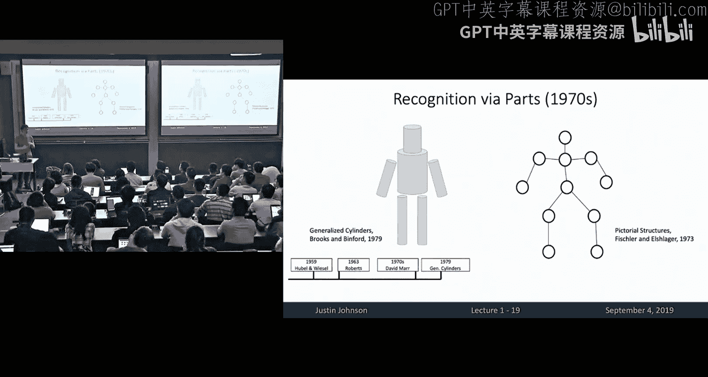

man of all the razors， and then by kind of matching edges in this way。

 we might be able to recognize that there are maybe 10 razors in this image and what are their relevant configurations just based on matching with our template image。

😡。

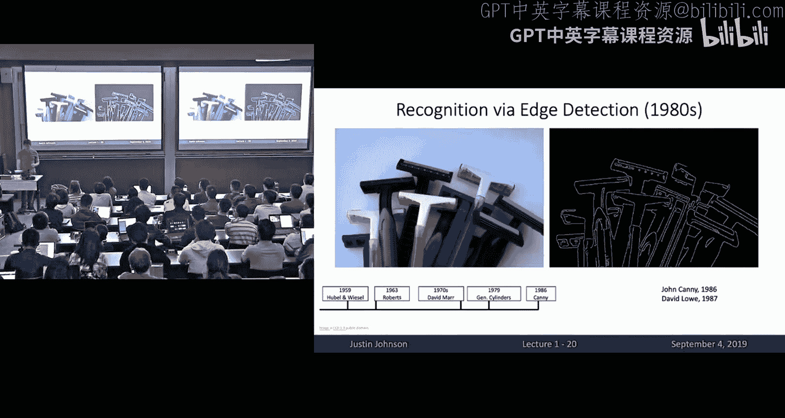

And now moving on into the 1990s people again wanted to build to more and more complex images。

 more and more complex scenes， so here a big theme was trying to recognize objects via grouping so here rather than maybe just matching via edges。

 what we want to do is take the input image and segment it into semantically meaningful chunks。

 maybe we know that the person is composed of one meaningful chunk。

 the different umbrellas would be composed of a different meaningful chunk with the idea that if we can first do some sort of grouping。

 then later downstream recognizing or giving a label to those groups might be an easier problem。😡。

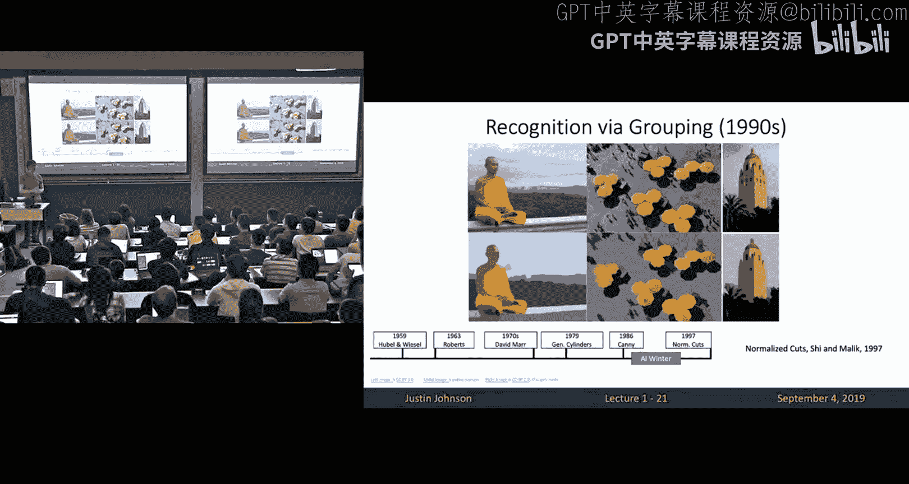

Then in the 2000s a big theme was recognition via matching and there was a hugely famous paper called Sit by by David Low again in 1999 that proposed a a different way of recognition via matching so here the idea is that we would take our input image detect little recognizable key points and different positions in the image and at each of those key points we're going to represent its appearance using some kind of feature vector and that feature vector is going to be a real valued vector that somehow encodes the appearance of image at that little point in space and by very careful design of exactly how that feature vector is computed you can encode different types of invariances into that feature vector such that if we were to take the same image and rotate a little bit or brighten or darken the lighting conditions in the scene a little bit that hopefully we would compute the same value for that feature vector even if the underlying image were to change a little bit and there was a lot of work in。

Then once we can extract these sets of robust and invariant feature vectors。

 then you can again perform some kind of recognition via matching。

 so then on the left if we have some template image of a stop sign。

 we can detect all these distinctive invariant feature key points， then on the right。

 if we have another image of a top of a stop sign that's may be taken from a different angle with different lighting conditions。

 then by our careful clever design of these invariant robust features。

 then we can match and correspond points in the one image into points in the other image。

 and thereby be able to recognize that the right image is indeed a stop sign。

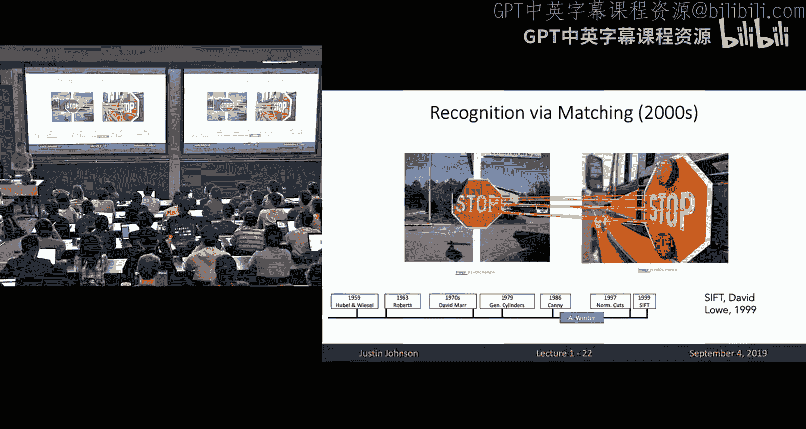

So then another hugely influential work in the 200s was the Biola Jones algorithmri published in 2001。

 and this was really， they developed a very very powerful algorithm for recognizing faces in images。

 so here you have an image and then you want a draw a box around where other people's faces are。

 and this was notable for this piece of work was notable for a couple reasons。One。

 it was the first major use of machine learning in computer vision so Viola and Jones used some algorithm called the Boed decision trees that were able to learn somehow the right combination of features to use in order to recognize images in order to recognize faces and two what was particularly notable was the very fast commercialization of this algorithm that this piece of research went very quickly from a sort of academic piece of research published in 2001 and within a few years this was actually being shipped in digital cameras at the time so if you remember maybe they had like an autofocus feature where you would kind of hold the shutter half down it would like be a little bit and draw fox on the faces and then focus on the people on the scene well that was most likely using this Viola Jones algorithm so this is a particularly notable piece of work for those two reasons。

So now after they kind of unlockched the box of using data and using machine learning to augment our visual representations。

 then moving on into the 2000s， we began to see more and more uses of machine learning more and more uses of data in order to improve our visual recognition systems so one huge influential piece of work here was the pastcal visual object challenge so here they downloaded a bunch of them because now it's 2000 Larry Roberts had exited computer vision and invented the internet。

 so we could then download images from the internet to help。Buildil these data sets of images。

 and then we could get graduate students to go and label those images。

And then you could use your machine learning algorithms to mimic the labels that the graduate students had written down on the images。

 and then if you do that， then you can see this nice graph on the right of performance increasing on this recognition challenge increased steadily over time from about 2005 to 2011。

So then this brings us to the INe large scale visual recognition challenge， so here this was a very。

 very large scale data set in computer vision that has become hugely influential and has become one of the main benchmarks in computer vision even leading up to this day。

 so the INe classification challenge was this fairly large data set of more than about 1。

4 million images and each of those 1。4 million images were labeled with one of a000 different category labels and the big new piece of innovation here was that if you' going to do the math here。

 you're going to be a lot of graduate students to label all this stuff。

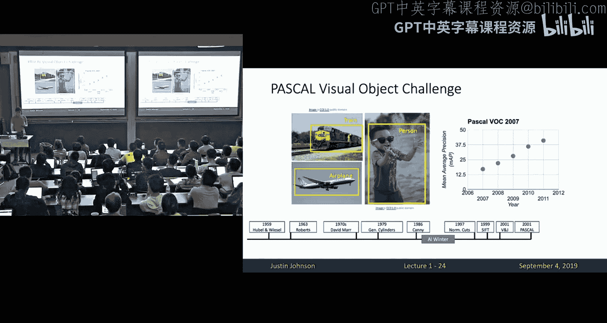

So the big piece of innovation here was to not label data using graduate students instead this made use of crowdsourcing so here you could go on services like Amazon Mcchan called Turk and then parcel up little pieces of work and then just blast amount over the internet and then people anywhere in the world could label a couple images。

 get paid a couple cents for each image they label and that was able to massively increase the amount of mean this is beneficial in two ways right because one researchers get people to label their data without being constrained by the number of graduate students that they have and two。

 it became a nice source of income for some people who were bored at work and just like label images。

Or if we're in class， as the case may be， I don't know， it's still running， by the way。

 you can go up and try and to do some tasks home。But anyway。

 this became a hugely influential data and computer vision。

 and more than a data set it became a benchmark challenge。

 so they had every year they ran a competition where they were different researchers would compete and try to build their own algorithms that would try to recognize objects this classification challenge。

😡，This became somewhat jokingly known sometimes as the Olympics of Comp vision。

 that there was a period of time from maybe in the mid the early 2010， the late 200s， early 2010s。

 when people would just really excitedly want to look at the results of the image and competition every year and see what kind of advances the field had made in the last year。

So then given that I told you it's this competition you can look at what was the error rate on this competition moving over time。

 so the first time the competition was ran in 2010 and 2011。

 we were sitting at error rates of around 28 around 25 and then something big happened in 2012 so at the 2012 Imnet competition。

 suddenly the error rates dropped in a single year from 25% all the way down to 16% and and then after 2012。

 error rates just kept on diminishing， diminishing very。

 very fast such that once we got to about 2017， we were building systems that could compete on this imagenet challenge and perform even better than humans when they tried to recognize images in this data set。

So then the question is is what happened in 2012， so what happened in 2012 is that deep learning came on to the scene and this was really the breakthrough moment for deep learning and computer vision researchers suddenly woke up and saw that there's this crazy new thing that is suddenly sweeping our field so in 2012 there was this absolutely seminal paper from Alex Kchski。

 Elis Sozeberg and Jack hintinton where they proposed a deep convolutional neural network called Alex Mattt that just crushed everyone else at the INet competition that year。

And for people working in computer vision at the time， this was shocking。

 this felt like there was this brand new thing that just came out of nowhere and just suddenly crushed all these algorithms that we've been working on。

 you know as we kind of watched this history of computer vision walking from the 1950s all the way up into until the 200s you'll notice that neural networks were not a mainstream part of that history throughout much of computer visions history so when this suddenly appeared it felt to a lot of computer vision researchers like this was this brand new thing suddenly appearing all at once that this brand new exciting technology and that was a little bit flawed because this was not a brand new technology。

 there had been a parallel stream of researchers going back similar amounts of time that had been developing and honing these techniques for decades and 2012 was the sudden breakthrough moment where all of that hard work paid off and became mainstream。

😡。

So then let's talk a little bit about the history of deep learning kind of going back in time yet again。

😡，So then about the same time that Hu and weasel were doing some of their seminal work on the visual visual recognition in cats。

 there was another very influential algorithm called actually it wasn't even algorithm all called the perceptron so the perceptron was one of the earliest systems that could learn as a computer system but what's interesting is that this was what 1958 so the idea of an algorithm。

 the idea of programming a computer， were already these were quite novel research topics on their own at that period in time so the perceptron was actually implemented as a piece of hardware。

s a picture of it on the right that is the perceptron it was this giant like cabinet- sized thing with like wires going all over the place。

 it had weights that were stored in these potentioomes which I don't even know what that is because I'm a computer scientist。

And these weights were just mechanically up the values of these weights were changed mechanically during learning by a set of electric motors。

 which again I'm not a mechanical engineer， so I definitely could not build this thing。

 but but even though this was this mechanical device that was bigger than a person it actually could learn from data somehow。

 and it was able to learn to recognize letters of the alphabet on these tiny 2020 by 20 images that were super state of the art in 1958。

 so I didn't any of them， I don't want to talk about any of the math for the perceptron。

 but if you were to look at it with modern eyes， we would probably call it a linear classifier。

 that we'll talk about next week on Wednesday's lecture。😡。

So this perceptron got a lot of people really excited， it caught people thinking like， wow。

 here's a mechanism that allows machines to learn novel stuff from data without people having to explicitly program how it's going to work。

😡，And all of that kind of came to a crashing halt in 1969 when Margaret Minsky and Seymour Packt published this infamous book called Perceptrons in 1969。

And what Minsky and Pepper pointed out in their book basically was that perceptrons are not magical devices right the perceptron is a particular learning algorithm and there's certain types of functions that it can learn to represent and other types of functions that it cannot to learn to represent in particular they pointed out that the Xor function is not something that is learnable by the linear perceptron learning algorithm that I'll talk about again a little bit more next week and this sudden realization。

 well okay so the normal story that gets told is that the sudden realization of this book was that oh the learning algorithms are not magical there's things they can't learn and people just lost interest in the field and work in learning work in perceptrons kind of dried up for a period of time following the release of this book。

But what's interesting is that I think nobody actually read the book because if you actually read it。

 there's sections where they say yes， the original preceptron learning algorithm is quite limited and it can only represent certain functions。

 but there's something else， there's another potential version of the algorithm called a multilayer preceptron that actually can learn to represent many many different types of functions and it's very flexible in its representations。

 but that kind of got lost in the headlines at the time and nobody realized that and people just heard that preceptrons didn't work and were dead and people stop learning on them。

So you should definitely read this site reading。

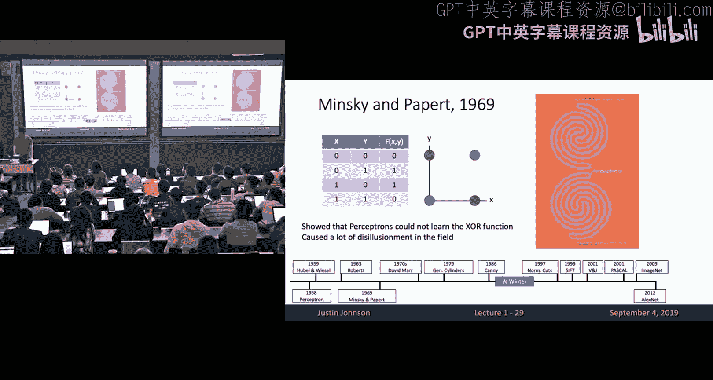

But then forward then going forward quite some amount of time。

 we skipped ahead to 1980 and there was this very influential paper called system proposed called the Necnotron that was developed by Fukushima。

 who's a Japanese computer scientist and he was directly inspired by Huboid weasels idea of this hierarchical processing of neurons。

 remember Hubo and weiesel talk about these simple cells， these complex cells。

 these hierarchies of neurons that could gradually learn to conceive more and more complex visual stimuli in the image。

So Fukushima proposed this。Comutational realization of pub and beasles formulation。

 that he call the neocoogninotron， so the neoconotron interleaved two types of operations。

 one were these computational symbol cells that if we were to look at them with modern terminology they look very much like convolution。

 and the latter was these computational realizations of complex cells that again。

 under modern terminology， look very much like the pooling operations that we use in modern convolutional neural networks。

So what's striking is that even back in this neocoogniron from 1980 had an overall architecture。

 an overall method of processing that looked very similar to this famous AlexNe system that swept in 2012。

 even the figures that they have in the papers look pretty similar so they got to do the same thing right but what was striking with the neocogninaron is that they defined this computational model。

 they had the right idea of convolution and pooling and hierarchy。

 but they did not have any practical method to train the algorithm because remember theres a lot of learnable weights in this system。

 a lot of connections between all the neurons inside。

 they need to be set somehow and Fukushima did not have an efficient algorithm for learning to properly set all all of the free weight parameters in the system based on data。

😡。

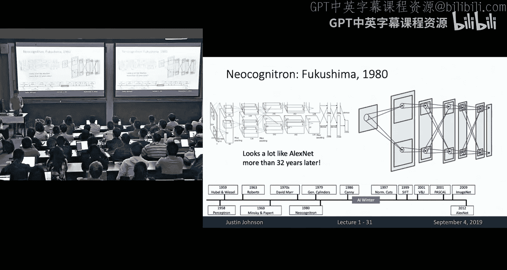

So then a couple of years later， there was this， again。

 massively influential paper by Ruohart Ininton Williams in 1986 that introduced the back propagation algorithm for training these multilayer perceptrons so remember that in the preceptrons book there was this thing called the multilayer perceptron that was thought to be very powerful in its ability to represent and learn different types of functions well in the back propagation in this paper that introduced the back propagation algorithm was one of the first times that people were able to successfully and efficiently train these deeper models with multiple layers of computation and this looks very much like a modern neural network that we're using today that if if you kind of look at this paper and open it up and through it。

 you'll see they talk about gradients and they talk about Jacobbians and Hessians and all this kind of mathematical terminology that we think about today when we're building and training neural networks。

So these look very much like the modern fully connected networks that we still use today。

 that are sometimes called multi layer perceptrons and homage to this long history。

So now that of people that led to a lot of small people started to get really excited about neural networks again and try to think about different types and structures of neural networks that could be built and trained。

 powered by this new back propagation algorithm and one of the most influential works around that time was Yang maun etal's paper in 1998 they introduced the idea of a convolutional neural network so this looks again very much like the Fukushima algorithm that basically what they did here is they took Fukushima's kind of idea of convolution and cooling and multilayer of multiple layers inspired by the visual system and combined that with the back propagation algorithm from Ral heart's paper in 1986 and with that combination they were able to train this convol these fairly large at the time。

 convolutional neural networks that could learn to recognize different types of things and images。

And this was a hugely successful system， it didn't it actually was very successful commercially。

 so in addition to being a piece of very influential academic research。

 it was also deployed in a commercial system by NC labs and for a period of time this convolutional neuralNe system developed by that group was actually being used to process the handwriting in a lot of checks that were written in the United States at that time。

 one figure that I found stated that up to 10% of all checks in the United States were actually being having the numbers on the check being read automatically by these convolutional neuralNe systems in the late '90s and early 2000s。

And again， if you look at exactly what this algorithm is doing。

Lynette was kind of like so the algorithm here was called Lnax after Jan Mccoon。

 I don't know hes French， and then that if you look at the structure of that algorithm。

 it looks very similar， almost identical the types to the algorithm that was used in Alexnap nearly 30 years later。

So then emboldened by the success， there was again a small group of people throughout the late 90s and early 2000s who were really interested in trying to in push neural net systems and figure out ways to train neuralnet systems that were ever bigger。

 ever deeper， ever wider and could be used on an increasing variety of tasks and around this period of time in the 2000s was where the term deep learning curves to merge where the term deep was meant to refer to multiple layers in these neural network type algorithms and so this was really not a super mainstream research area at this time。

 there was relatively small number of research groups and relatively small number of people studying these ideas around this time。

 but I think a lot of the fundamentals that were reaping the rewards of now really developed during this period of time in the 200s when people started figure out all the new modern trips to train different types of neural network systems。

So that finally brings us back to Alextt and then in 2012 we had this great confluence of great this computer visions task called ImageNe that people in Computer Vis were super excited about。

 we had this set of new techniques， convolutional neural networks and efficient ways to train them that had been developed by this parallel research community。

 and everything just seemed to come together just at the right time in 2012。

So then from 2012 to Pre day， we've seen an absolute explosion in the usage of convolutional and other types of neural networks across both across computer vision and across other types of related areas in AI and across computer science so here on the left we have the Google trends for deep learning that shows you this massive sort of exponential growth that really took off sort 2012 and on the right this is a photo I took at the computer visionion and counter recognition conference this summer in 2019 so this is one of the premiere venues for academic publications in computer vision and here is a graph that they were showing at the keynote for that conference where they showed on the X axis the year of the conference and on the Y axis of the number of submitted and accepted papers in this conference so you can see that even though the last five to 10 years have resulted in this massive explosion both of machine learning systems。

 both maybe in popular perception is measured by Google trends as well as a massive。

Increase in academic interest into both machine learning systems and computer vision systems as evidenced by this plot on the right。

And if you look around the field today， we see that convolutional networks。

 other types of deep neural networks are being used for just about every possible application of computer vision that you can imagine。

😡，So from 2012 these convolutional networks are really everywhere。

 they're getting used from such a wide diversity of tasks like image classification。

 where we want to put labels on images， from image retrieval。

 where we want to retrieve images from collections。Things like object detection。

 where we want to recognize the positions of objects and images while simultaneously labeling them。

 the right one should be image segmentation and where I need to fix the slide we want to label where this is going back to this idea of semantic grouping we saw from computer vision in the 90s。

 where we want to label the text of pixels as being part of a cohesive whole。

Comnets are getting used for things like video classification， activity recognition。

 they're getting used for things like pose estimation。

 where you want to say how are the exact geometric poses of people arranged in images。

 even for things that don't really feel like classical computer vision。

 like playing Atari games where they would process the visual input of the Atari game with a convolutional neural network and combine that with other sorts of learning techniques in order to both jointly learn a visual representation of a video game world as well as how to play in that world。

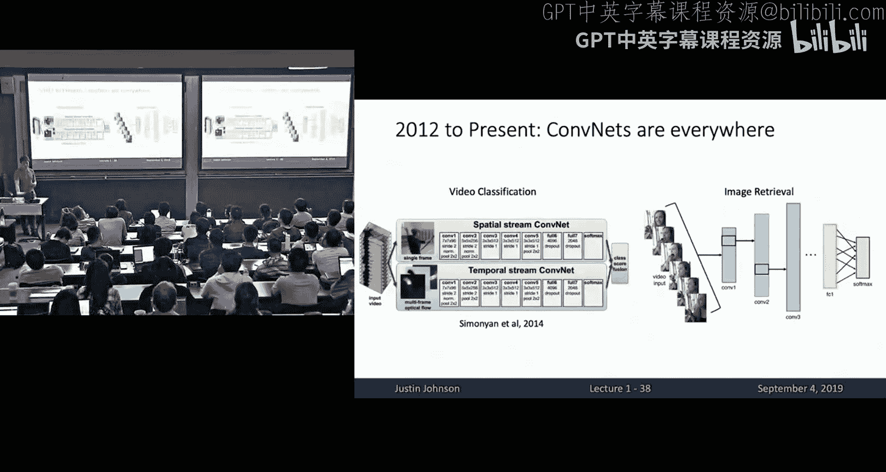

Convolutional neural networks are also getting used for visual tasks that are about visual data that humans' aren't very good at。

 so convolutional networks are getting used in things like medical imaging to diagnose different types of tumors to diagnose different types of skin lesions and other medical conditions they're getting used in galaxy classification they're getting used in tons of scientific applications like classifying whales or elephants or other types of or because there's this problem where scientists want to go out into the world and collect a lot of data and then be able to use images and visual recognition as a kind of universal sensor to make use of all this data that they collect and gain insights into their particular field of expertise that they're interested in and we've seen computer vision and convolutional networks branch out into all these other areas of science and just open up and unlock lots of new applications just across the board。

😡，Coms are getting used for all kinds of fun tasks like image captioning。

 like we can write we can build systems they can write natural language descriptions about images。

 these are using convolutional networks， we can use convolutional networks for generating art so we can make all these kind of psychedel like portraits again using convolutional neural networks。

So then we might ask what was it that happened in 2012 that made all of this take off Well I think the Jerry's out and we'll have to see what historians write 50 years from now。

 but my personal interpretation is that it was a combination of three big components that came together all at once one was the set of algorithms that we saw that there was a stream of people working on deep learning and neural networks and machine learning who had developed these powerful set of tools for representing learnable functions and for learning them with the backproagation algorithm we saw the second stream of data that with the rise of digital cameras。

 Larry Robins ining the internet and people developing crowdsourcing。

 we were able to collect unprecedented amounts of label data that could be used to train these systems and the third piece that we haven't really talked about was the massive rise in computational resources that has been continually happening throughout the history of computer science。

So one graph that I put together that I find particularly striking is looking at the gigaplos of computation per dollar as a function of time。

 so here on the blue you can see these are different types of CPUUs a CPUU's central processing units the thing that's making all of your laptops run and they get faster but not that much faster over time。

 but starting in 2008 there was some really interesting development with GPUs graphics processing units。

 and so these are these special purpose pieces of hardware that were originally developed to pump out pixels in computer graphics application。

But around 2008， people started developing techniques to run generalized programs on these graphics processing units and starting。

And then over time， these techniques， it became more and more easy to write general purpose。

 scientific code and mathematical code to run on these massively parallel of rapids constant units。😡。

And then if you look at the timeline from 2006 to 2017 and look at the gigaplos per dollar of these graphics processing units。

 you can see that although this exponential Moore's law may not have held up for CPUUs。

 it actually has we actually have seen exponential increases in GPU computing power over time over the last 10 years and if you look at maybe and this has been striking even in the last couple of years。

 so if you look at the AlexNe system in 2012， he was using this GTX 580 GPU that was very very exciting at the time if you were a gamer。

 and if you push it on more recent cards like the GTX 1080T or more recently a 2080T about update slides then you can see that the cards we have even five years later are literally exponentially more powerful than the cards that we were using even in 2012。

 so I think that it was really this confluence of algorithms of data and of massive increases in computation fueled by advances in GPUs that。

to all this magic happening in 2012 that led to all these new applications of convolutional networks on different types of computer vision。

And in recognition of all of this， in recognition of the impact of computer vision and Deep learning across the field。

 the 2018 Turing Award was awarded to Yashua Benggio。

 Jac Hinton and Jan Lacoon for their work on pioneering many of the deep learning ideas that we'll learn throughout this class。

 and for those of you who don't know the Turing Award is basically considered the Nobel Prize equivalent in the field of computer science。

 so this just happened last year， and this was just a recognition that this has been a massively influential piece of research that's been changing all of our lives over the last several years。

But I think it's important to stay humble and realize that despite all of the successes that we've seen in convolutional networks in deep learning and computer vision。

 I think we're really still a long way away from building systems that can perceive and understand visual data to the same fidelity and power and strength as humans can。

😡，One image that I like to use to it。To exemplify this is this example。

 so if we were to send this to a convolutional network。

 he would probably say person or scale or locker room maybe。But if we were to look at this。

 you see quite a different story。 you see a guy standing on a scale， you know how scales work。

 which requires some idea of physics。 you know that he's looking at the scale。

 you know that he's trying to measure his own weight you know that people tend to be self-conscious about their weight you know that the person behind him is stepping on the scale and pushing down because of your knowledge of physics。

 you know that that's going to make you scale but bigger number because of your knowledge of that guy's psychology。

 you'll know that that might make him feel embarrassed or uncomfortable because he thinks he ate too much and then you also know who that person pushing down on the scale is。

 and because of your knowledge of who he is and makes it maybe surprising that he's acting in this way you can see the people behind him to watching this scene and laughing and to understand that you need to know how it is that people look at each other。

 you understand that maybe they're surprised that this guy is doing this thing is causing this guy to be embarrassed so there's a lot going on in this image that we as human as visually intelligent。

Humans could understand and perceive。 And I think we're a long way away from building computer vision systems that can match that level of visual fidelity。

But I'm hoping that as we move forward and continue to advance the field。

 maybe one day we'll get there。But in the meantime。

 I think that computer vision technology really has massive potential to improve all of our lives。

 it'll make our lives more fun through sort of new video game applications， applications in VRAAR。

 it'll make our transportation safer with advances in autonomous vehicles it'll lead to improvements in medical imaging and diagnosis and overall I think computer vision as a whole has a massive ability and potential to continue leading to massive improvements in all of our day- to day lives。

 so that's why I think we should be studying computer vision。

 that's why I'm excited to be teaching this class this year。😡。

So that basically covers our brief history of computer vision and deep learning。

Except there's one little spot on the timeline that we didn't fill out， and that's this class。

So with that， it's time to if there's any questions about historical stuff。

 then we're going to move on to course logistics from here on out。

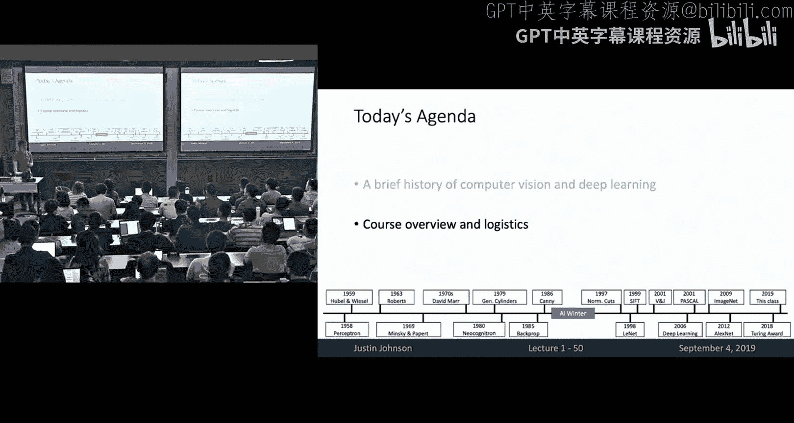

No， okay， great。So course staff， who are we I'm Justin Johnson。

 I'm a new assistant professor here in the computer science and engineering department。

 this is the first class I'm teaching here at Michigan。

 this is the first time I've been in this room so I'm glad I founded and got the laptop intended。

 but I'm excited to be here excited to be teaching you guys this semester we have an amazing team of graduate student instructors that are going to be helping us out this semester we have Yusak J。

그 사람。Yeah。Okay， that was a little awkward。You have， you don't have to stand in your。

And we have a little job。So these guys are all experts in computer vision。

 they're all PhD students here， UNCAC works in video understanding and generative models。

 KiA works in robustness and generalization and Luway works a lot in visual vision plus language。

 so if you have questions about those particular research areas you should go talk to them。

So how to contact us so this is an important slide right taking pictures of this one's a good idea hopefully we can fill some prominent systems that will track useful more information out from them automatically but we have a course website that's up at this URL the course website has all of the information that you'll need throughout the quarter you can find the syllabus that sets of the schedule。

 you'll find links to assignments there you'll find links to lecture videos assuming I set up the lecture capture properly really important we're going to use Pazza for most communication with you guys so we really encourage you if you have questions about the course material we're going to use Pazza as our main mechanism to communicate back and forth with you guys。

So if you have questions about course content， questions about material， post those on Piazza。

 and similarly when we need to make announcements back to the class to announce things like updated homeworks about changes to logistics。

 we'll be announcing all of those through Piazza so it's really important that you guys get signed up as quickly as possible and one piece of note is that please don't post any code on public questions on Piazza。

 if you do need to ask particular questions about code。

 we ask that you make private questions that are visible only to the instructor only to the instructor。

So we will have Cans， I think I need to set that up still this week but we're going to use Canvas primarily for just turning in assignments。

 mostly we'll be using Piazza and the course website for this class。

 we will have office hours both me and the GSIs starting next week and you'll be able to find the times and locations of the office hours on the Google calendar that I set up here Finally we really want most the vast majority of communication you do with us should be through Piazza。

 but if you have some kind of very sensitive topic that you would prefer to discuss directly with me then you can email me directly but for the vast majority of circumstances you should be going through Piazza for course communication that will ensure that everyone all of the teaching staff is able to help you in a timely manner and if you're able to make and if you're making public questions it lets you all help each other and learn collectively and learn from each other's mistakes so I think Piazza's a really great learning tool for that。

So we're going to have an optional test and textbook。

 there's no required textbook for this class on the schedule you'll find on the website there will be recommended readings for all of the lectures。

 this textbook is totally optional。And it's completely available for free online so you don't have to physically purchase a copy if you don't want to。

So on course content and braing， we're going the main bulk of the course is going to be six programming assignments。

 Oh is that a problem， is that too many is that note？

All right all right so we're going to have six program assignments that's going to be the bullet of course I think these are going to be really exciting assignments。

 we're going to use Python， Pytororch and Google Coab and we're going to walk you through the detailed implementations of a lot of the ideas that we talk about in lecture we will have a midterm exam and we don't have a final exam。

But there will not be any course project， the majority of the stuff you'll be learning is through the programming assignments。

So we have a late policy， so don't turn it in late， but more seriously you all get free。

 free late days you use on your homework assignments， you don't have to tell us beforehand。

 just turn it in late and we'll reflect them automatically once you've exhausted your late days and we'll take 25% for death and something like that free。

Are there any questions about contents of policies， late days， anything like that。

 yeah over here for the people that won't get off the wait？

Proll the course site intellectual recording。It's being really available or we have。

Yeah so the question is will the course materials be available for people not on the waitlist and they will be as really available as I can possibly make them。

 so even if you can't get enrolled in the class you can definitely feel free to follow along with the lecture slides with the lecture videos and with the course assignment。

😡，Yeah， question， those days。One late day per assignment if you yeah it's up to you。

 you're all grown ups， you can use as many late days per assignment as you want。

 but we yeah if you take too many we were zero， so I dont recommend that。

But three late days you can use as many as you want and extra late days。

 you use as many as you want per assignment， but we'll just take off points as necessary。Yeah。

 so let's talk about collaboration policy Right， so we really encourage you guys to work together in groups。

 I think it's great to discuss much course material with your classmates and to learn together。

 but we have a couple of ground rules about that for a collaboration policy。

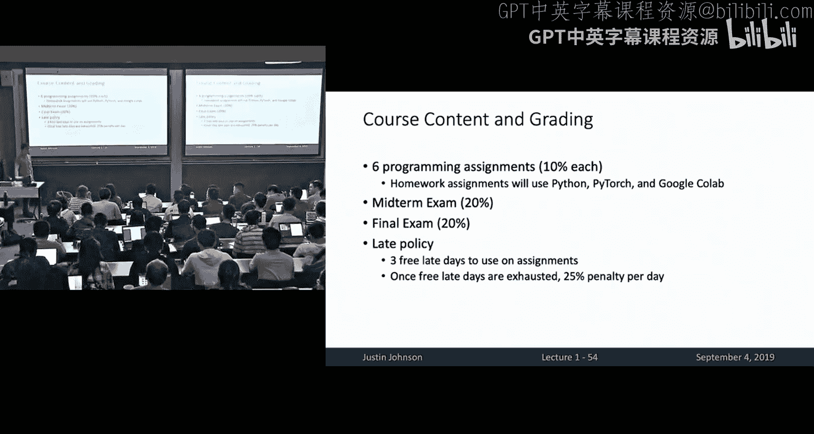

One is that everything you submit should be your own work。

 it's fine to talk about ideas with other students that's great and encouraged。

 but you shouldn't be sharing or looking at each other's code necessarily。😡。

You can talk about things conceptually but you shouldn't be turning in the same code as people you work with Secondly on the flip side。

 don't share your solution code with other people， this means don't post it on Piazza。

 don't give it to your roommate， don't put it on GiHub because that will make it easier and more temp for other people to violate collaboration policy interview。

And third， when you turn in assignments， we ask you to indicate who you work with。

 when you turn in your assignment， and there'll be more detailed instructions on that later。

And in general， turning in something late or iscomplete is much better than potentially violating collaboration policies not just in this course。

 but more generally。Any questions about that？Okay。So then course philosophy。

 what are we here for right our idea is that this class is not learned Pytorch in 90 days。

 this class is not learn deep learning and headlines of Python you can find tutorials on the internet that tell you how to do that if that's what you want。

But I think that learning about deep learning in that way does yourself a huge disservice I think that you want to focus on fundamental concepts we want you to understand not just the latest and greatest API high level APIs that RA care and Tensorflow we want you to understand the fundamentals of how those APIs might have been implemented why they've implemented the way they work。

 such that when faced with the next piece the next bit of technological tools。

 you understand the fundamentals and can do that yourself what that means is that you'll be writing a lot of backdrop code yourself in this course I think that it's very important for people to learn how to compute gradients and how and how the computationm of gradients affect the overall flow of learning by your system so for the first several assignments you'll be using no autograph。

 you'll be using no Tensorflow you'll be deriving and implementing your own backdrop your own gradient computations and you will be a better computer scientist for。

So given that， we prefer you to write for the purpose of pedagogy。

 we're going to encourage you to write hence scratch。

Rather than relying on existing open source implicationss， again。

 this will make you a better deep learning practitioner。That said， we're also practical。

 we're going to give you lots of tools and techniques for debugging and training big neural networks because it's tricky when you can't rely on that10 lines of code wrapping around lots of stuff。

 so we're going to talk a lot about how you can practically get these things to work。

 what tips and tricks should you be using when developing and debugging and training neural networks。

😡。

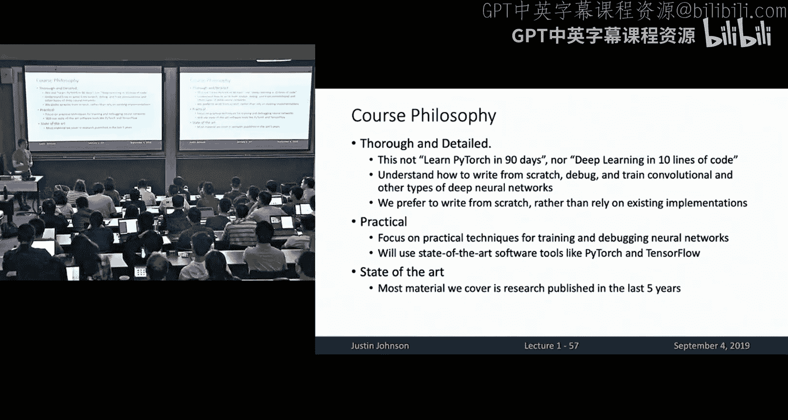

We will use state of the A software tools like Tytorch and TensorFlow。

 but only after you've earned your wings by writing a lot of Bck code yourself。

We're going to focus on state of the art， a lot of the material that we cover in this course。

 despite the long historical context that we talk about in this lecture。

 the majority of the actual concrete implementations and concrete results we've that we'll talk about in this course have been discovered in the last five to ten0 years so this has a couple interesting applications for implications for teaching the course。

 that means that aren't good textbooks for this stuff。

 that means that there might not be great resources outside of original research papers for learning about this stuff。

😡，So that's going to be maybe a bit of a struggle and a bit challenging， but on the upside。

 I think it's really exciting to be learning about such stupid art material in a classroom setting。

So。Thats。

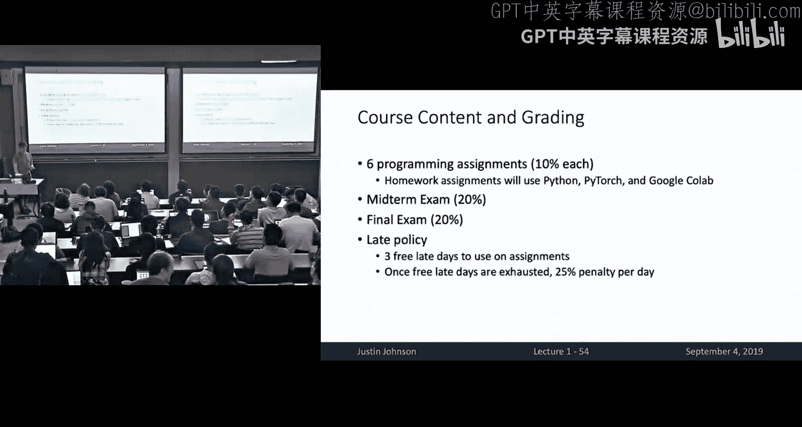

Yeah， so then in terms of so also in philosophy we wed also have a little bit of fun so we'll be covering some sort of fun topics like image captioning that we've got a good laugh when I put it up here a couple slides ago。

 and some of these is deep dream and artistic style transfer that lets you use neural networks to generate cool pieces of art。

 not just improving our lives so in terms of the course structure the first generally the first half of the course willll focus on fundamentals we'll talk about the details of how to implement different types of neural networks we'll cover fully fully connected convol the current neural networks。

 we'll talk about how to debug them， how to implement them。

 how to train them and' be very detailed and by the end of this module we'll basically implement your own convolutional neural networks system from scratch。

Now in the second half of the course we're going to shift a little bit in flavor and here we're going to focus more on applications and more emerging sort of research topics so around that point in the course you'll notice a bit of shifting tone in the lectures so they will become a little bit less details will sometimes skip over some of the lowlevel details and perhaps refer to papers if you need to know those details and instead the lectures will more focus on giving you an overview of how of how these different things are used across different applications in computer vision and beyond well in the second half we'll talk about things like object detection in segmentation3 vision videos。

 we'll talk about attention， transformers， vision and language generative models I think it's going to be a lot of fun。

But because there's a lot to get through， first homework assignment will be out over the weekend that will cover basically an intro and a warm up to the coab and Pi towards the environment that we'll be using throughout the quarter。

 so this is not intended to be a difficult or a long assignment。

 this should be out over the weekend and whenever we get it out it'll be due a week after that and everything you need to do this first homework assignment will get through in Monday session。

So with that said， welcome to the class and come back on Monday when we'll talk about image classification。

 start diving into the course material。

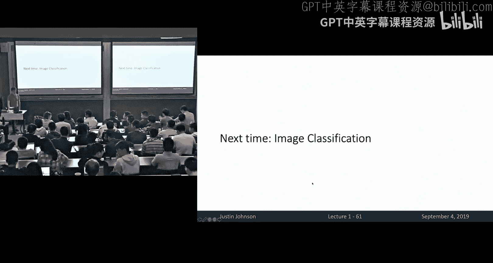

Okay。