# 深度学习用于计算机视觉：01：课程介绍与历史背景 🎓

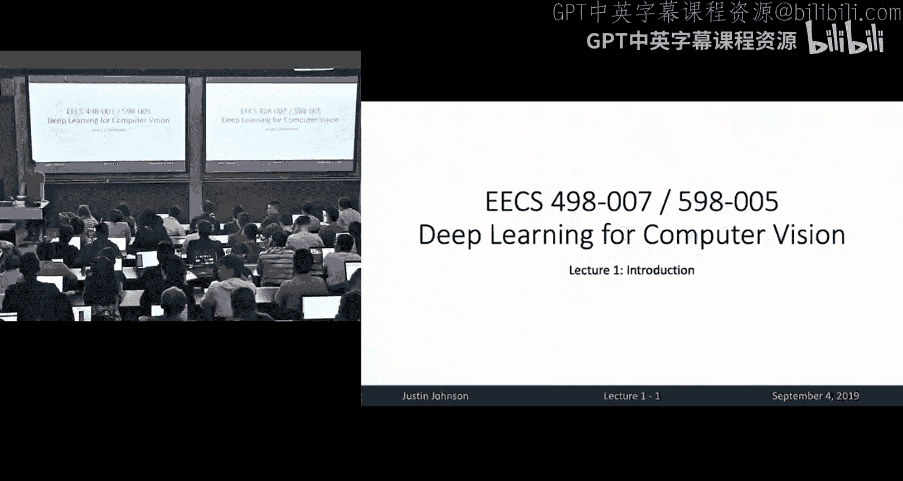

在本节课中，我们将学习本课程的基本介绍，并了解计算机视觉与深度学习领域的发展简史。我们将从这两个领域的定义出发，回顾它们从诞生到如今蓬勃发展的关键节点。

## 课程概述与欢迎 👋

欢迎来到EECS 498-007/598-005课程，这是密歇根大学首次开设的“深度学习用于计算机视觉”专题课程。

在开始课程内容之前，需要说明一下候补名单的情况。本课程名额有限，但申请人数远超容量。我们将尽力让更多同学加入，并会在后续通过邮件通知名额更新。对于可能无法选上课的同学，我们深表歉意。

## 什么是计算机视觉与深度学习？ 🤔

本节我们将拆解课程标题中的核心概念，理解计算机视觉与深度学习分别是什么，以及它们如何结合。

**计算机视觉**是研究构建能够处理、感知和理解视觉数据的人工系统的学科。这是一个非常宽泛的定义。“视觉数据”可以是图像、视频、医学扫描图像，或任何你能想到的连续值信号。

计算机视觉之所以重要，是因为它无处不在。我们每天都会产生和分享海量的视觉数据。例如，Instagram每天有约1亿张照片和视频上传，YouTube每分钟有约300小时的视频上传。如此庞大的数据量，使得我们必须构建能够自动处理和理解这些数据的系统。随着自动驾驶、增强/虚拟现实、无人机等新技术的出现，计算机视觉的作用将愈发重要。

**深度学习**是机器学习的一个子集。它指的是一种具有多层结构的、分层的学习算法。这些算法在某种程度上非常粗略地受到了哺乳动物大脑（有时是视觉系统）结构的启发。但请注意，这种类比非常宽泛，不应过分严肃地看待。

计算机视觉和机器学习都属于更广泛的人工智能研究领域。人工智能的目标是构建能够完成通常由人类完成的任务的计算机系统。本课程将聚焦于计算机视觉、机器学习和深度学习三者的交叉领域。

需要强调的是，尽管本课程聚焦于此，但人工智能领域远不止这些。还存在不依赖于学习或深度学习的AI方法，以及不使用机器学习的计算机视觉方法。这个广阔的领域还包括自然语言处理、语音识别、机器人学等众多子学科。

## 今日议程与历史背景的重要性 📜

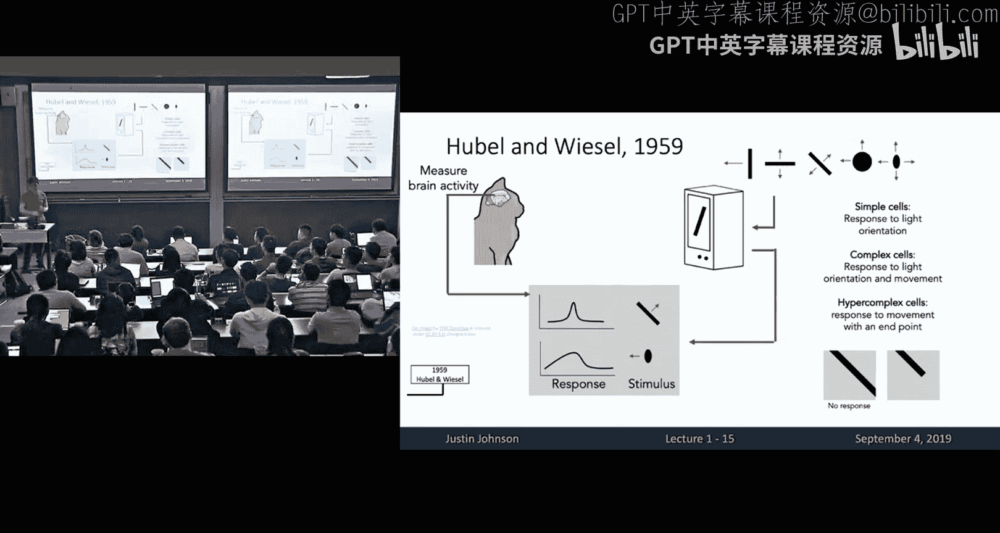

今天的课程安排与后续大部分课程不同。在深入探讨技术细节之前，我们认为了解领域的历史背景至关重要。近年来深度学习的巨大成功，是建立在数十年来计算机视觉和机器学习研究的基础之上的。

我们将分两条线索进行回顾：首先是计算机视觉的历史，然后是深度学习的历史。

## 计算机视觉简史 🖼️

以下是计算机视觉发展历程中的一些关键里程碑。

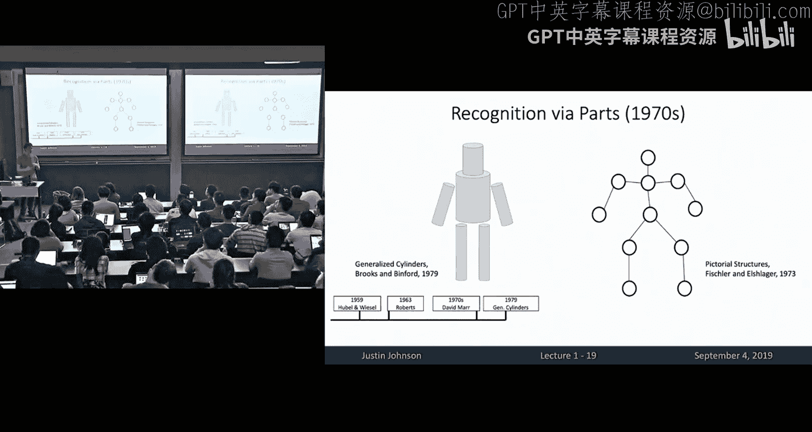

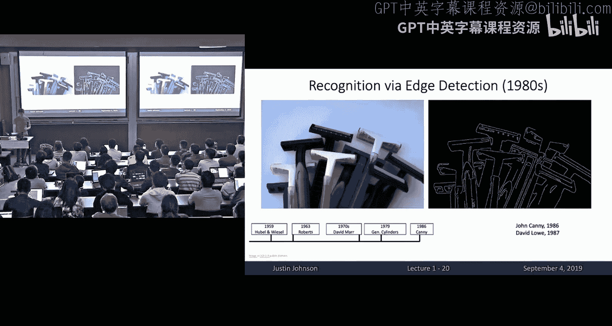

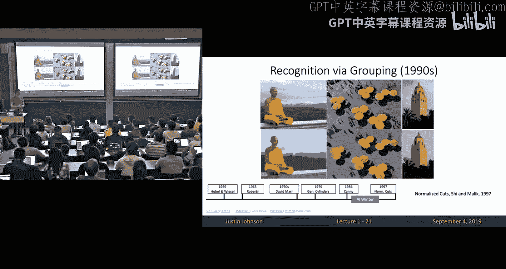

*   **1959年：Hubel & Wiesel的猫实验** 🐱
    这项研究并非由计算机科学家完成，而是旨在理解大脑如何工作。他们将电极植入猫的视觉皮层，发现某些神经元会对特定朝向、特定位置的明暗边缘做出反应（“简单细胞”），而另一些神经元则对更复杂的模式（如运动）有反应（“复杂细胞”）。这项关于**边缘检测**和**分层视觉处理**的研究获得了1981年诺贝尔奖，对后来的视觉处理思想产生了深远影响。

*   **1963年：Larry Roberts的博士论文** 📚
    这被认为是第一篇关于计算机视觉的博士论文。他的工作包括将照片信息输入计算机、检测图像中的边缘，并尝试理解图像中物体的三维几何结构。有趣的是，Roberts后来成为了互联网的奠基人之一。

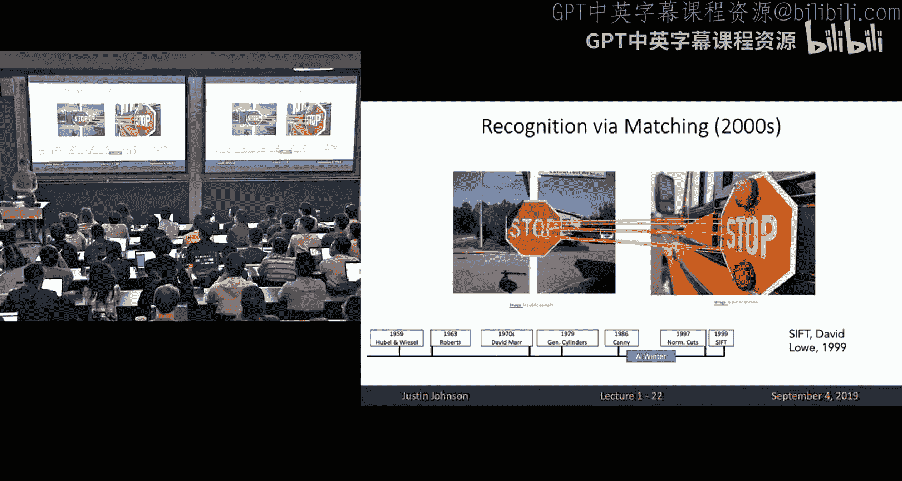

*   **1966年：MIT的“夏季视觉项目”** ☀️
    Seymour Papert提出了一个雄心勃勃的计划：雇佣一些本科生，用一个夏天的时间构建出视觉系统的“主要部分”。这显然未能实现，但反映了当时的乐观情绪。

*   **1970年代：David Marr的视觉表示阶段理论** 🧠
    他提出了视觉处理的层次化阶段：从原始图像，到提取边缘（“要素图”），再到2.5维草图（包含深度和表面信息），最后到完整的3D模型表示。这再次呼应了分层处理的理念。

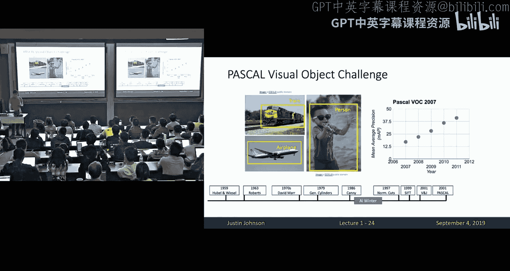

*   **1980年代：基于边缘的物体识别** ✂️
    随着计算能力和数字相机的提升，研究变得更加实际。John Canny在1986年提出了强大的边缘检测算法。David Lowe在1987年提出通过匹配模板与图像中的边缘来识别物体（如剃须刀）。

*   **1990年代：基于分组的物体识别** 🧩
    研究重点转向更复杂的场景。思路是先通过图像分割将图像分成有语义意义的块（如人、伞），然后再对这些块进行识别和标注。

*   **2000年代：基于特征匹配的物体识别** 🔍
    David Lowe在1999年提出了SIFT（尺度不变特征变换）算法。该算法提取图像中关键点的鲁棒特征向量，这些特征对旋转、光照变化具有一定不变性，从而可以实现可靠的图像匹配和物体识别。

*   **2001年：Viola-Jones人脸检测算法** 😀
    这是一个里程碑式的工作。首先，它首次在计算机视觉中大规模成功应用了机器学习（使用AdaBoost和决策树）。其次，该算法被迅速商业化，集成到了当时的数码相机中，用于人脸检测和对焦。

*   **2000年代中期：PASCAL VOC挑战赛** 🏆
    随着互联网的发展，研究人员可以下载并标注大量图像数据（PASCAL VOC数据集），并举办年度竞赛。这推动了基于数据的机器学习方法在视觉识别中的广泛应用，性能逐年稳步提升。

*   **2010年至今：ImageNet挑战赛与深度学习的崛起** 🚀
    ImageNet是一个超大规模数据集（超过140万张图像，1000个类别），它利用众包（如Amazon Mechanical Turk）进行标注，并成为了计算机视觉领域的核心基准测试。
    在2012年的ImageNet竞赛中，发生了一件轰动性的事件：由Alex Krizhevsky、Ilya Sutskever和Geoffrey Hinton提出的**AlexNet**（一个深度卷积神经网络）将错误率从上一年的约25%大幅降至约16%，以巨大优势获胜。
    此后，基于深度学习的模型性能持续快速提升，到2017年左右，某些系统在该任务上的表现已超过人类。2012年成为了深度学习在计算机视觉领域爆发的转折点。

## 深度学习简史 🧠

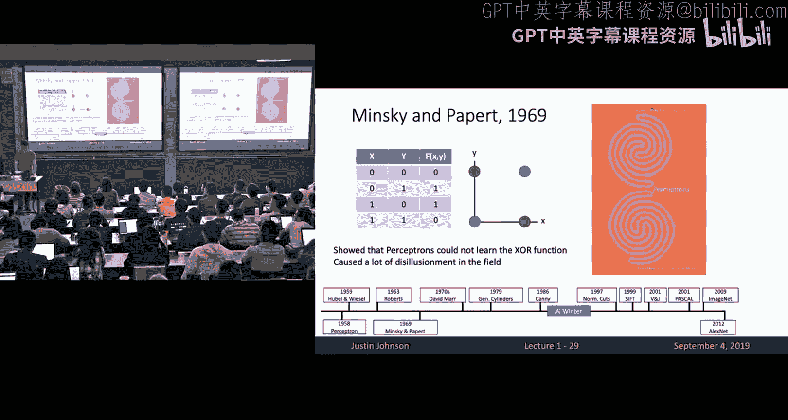

现在，让我们回顾深度学习这条并行发展的线索。

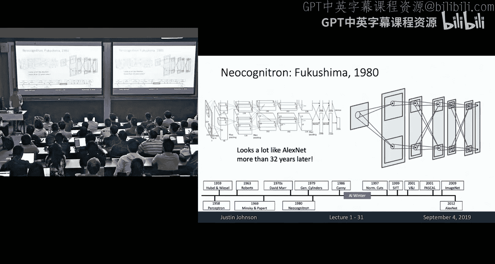

*   **1958年：感知机（Perceptron）** 🤖
    这是最早的能够学习的计算机系统之一，当时是一个庞大的硬件设备。它本质上是一个**线性分类器**，能够学习识别字母，引发了人们对机器学习的巨大热情。

*   **1969年：《感知机》一书出版** 📖
    Marvin Minsky和Seymour Papert在书中指出了单层感知机的局限性（例如无法学习异或XOR函数）。这在一定程度上导致了相关研究的降温。但值得注意的是，书中也提到了**多层感知机**的潜力，这一点在当时被忽视了。

*   **1980年：Neocognitron** 🕸️
    福岛邦彦受Hubel & Wiesel的启发，提出了Neocognitron模型。它交替使用两种操作：**S-cells**（类似于现代卷积）和**C-cells**（类似于现代池化）。其整体架构与后来的卷积神经网络非常相似，但当时缺乏有效的训练算法来学习网络中的所有参数。

*   **1986年：反向传播算法** 🔄
    Rumelhart, Hinton和Williams发表了关于**反向传播算法**的著名论文，为高效训练多层感知机（即现代的全连接神经网络）提供了关键方法。

*   **1998年：LeNet-5与卷积神经网络** 📇
    Yann LeCun等人将福岛邦彦的卷积/池化思想与反向传播算法结合，提出了**LeNet-5**卷积神经网络，并成功应用于银行支票手写数字识别，取得了商业上的成功。其架构与后来的AlexNet非常相似。

*   **2000年代：“深度学习”术语兴起与持续发展** 📈
    在这段时间里，相对小众的研究群体持续推动神经网络变得更深、更宽、更强大。“深度学习”中的“深度”即指网络中的多层结构。许多现代训练技巧和理论基础都在这个时期得以发展。

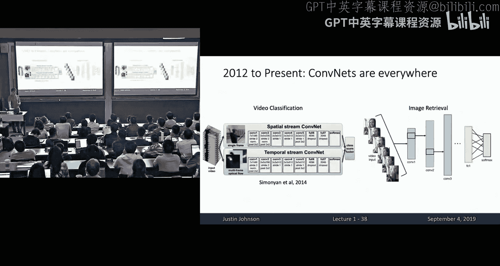

*   **2012年：历史性的交汇** ⚡
    **算法**（多年发展的深度学习）、**数据**（ImageNet等大规模标注数据集）和**计算**（GPU计算能力的指数级增长）三大要素在2012年汇聚，催生了AlexNet的突破性成功，并开启了深度学习的新时代。

## 深度学习的现状与未来展望 🌟

自2012年以来，卷积神经网络和其他深度神经网络被应用于计算机视觉的几乎所有方面，并扩展到其他领域。

以下是其应用的一些例子：
*   **核心视觉任务**：图像分类、图像检索、物体检测、图像分割、视频分类、姿态估计。
*   **游戏与AI**：处理视觉输入玩Atari游戏。
*   **科学与医疗**：医学影像诊断、星系分类、野生动物监测。
*   **创意应用**：图像描述生成、艺术风格迁移（如DeepDream）。

尽管取得了巨大成功，但我们距离构建具有人类水平视觉理解能力的系统仍然很远。人类看一张图，不仅能识别物体，还能理解物理关系、心理活动、社会互动等复杂信息。这是当前技术尚未达到的。

然而，计算机视觉技术无疑有巨大潜力改善我们的生活，例如让娱乐更有趣、让交通更安全、让医疗诊断更精准。

## 课程后勤与政策 📋

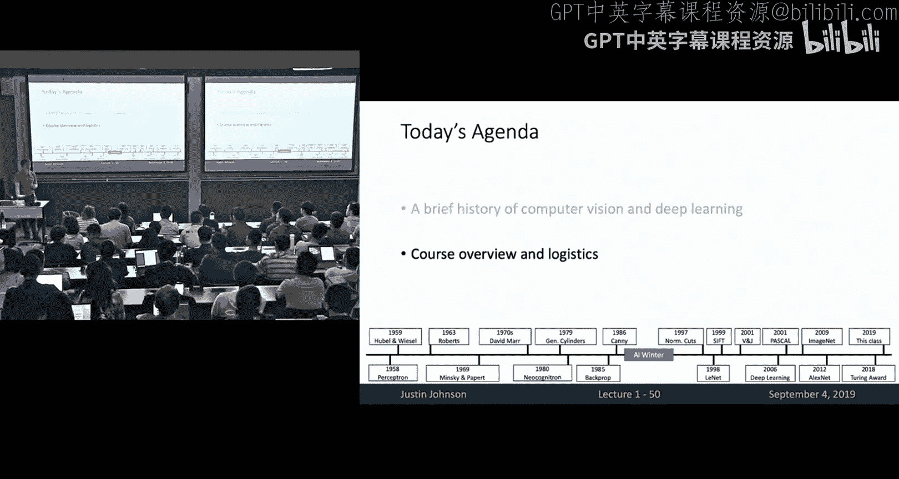

上一节我们回顾了激动人心的历史，本节我们来看看本课程的具体安排。

### 课程团队与联系方式
*   **讲师**：Justin Johnson（计算机科学与工程系新任助理教授）。
*   **研究生助教**：Yusak J.、KiA、Luway。
*   **主要沟通平台**：**Piazza**。请务必尽快注册。所有课程内容问题、公告都将通过Piazza发布。**请勿在公开帖子中发布代码**，代码相关问题请使用私密帖子。
*   **课程网站**：包含教学大纲、课程表、作业链接、讲座视频等所有信息。
*   **Canvas**：主要用于提交作业。
*   **办公室时间**：下周开始，具体时间地点请查看课程网站上的谷歌日历。

### 课程内容与评分
*   **教材**：无强制教材，网站会提供每讲的推荐阅读材料（可免费在线获取）。
*   **主要内容**：6个编程作业（使用Python、PyTorch和Google Colab）、1次期中考试、无期末考试、无课程项目。
*   **迟交政策**：每位同学有**3个**自由迟交日，可在任何作业中使用，无需提前说明。用尽迟交日后，将按日扣分。

### 合作政策
我们鼓励同学们讨论课程概念，但需遵守以下规则：
1.  所有提交的作业必须是**自己的独立成果**。可以讨论思路，但不应共享或查看彼此的代码。
2.  **不要将自己的解决方案代码分享给他人**（包括发布在Piazza、GitHub或给室友）。
3.  提交作业时，需注明一起讨论过的同学。
总之，**迟交或不完整提交远胜于违反学术诚信**。

### 课程理念与结构
本课程的目标不是“90天学会PyTorch”或“深度学习头条速成”。我们专注于**基础概念**，让你理解API背后的实现原理和原因。

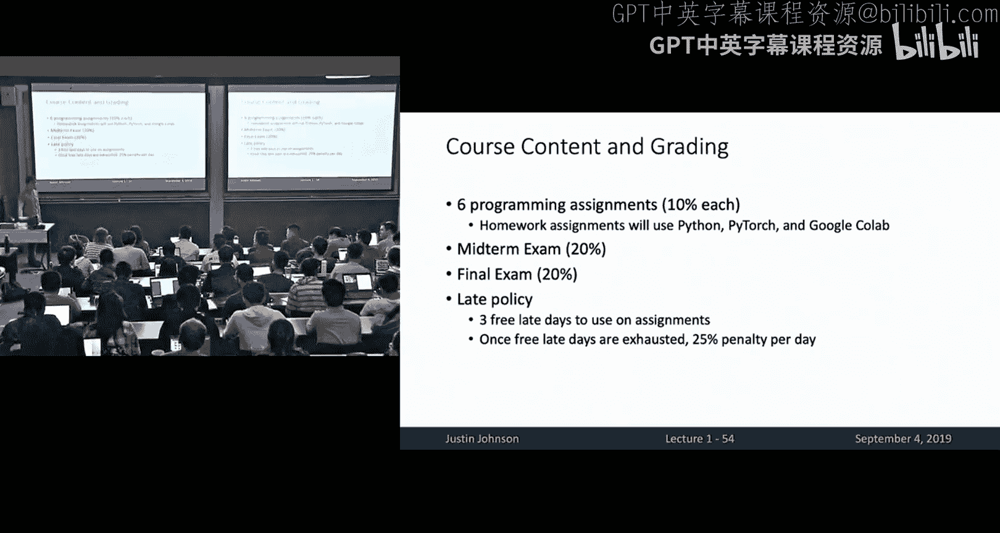

**课程前半部分（基础）**：我们将深入细节，学习如何实现、调试和训练各种神经网络（全连接网络、卷积神经网络等）。你将亲手实现自己的卷积神经网络系统，期间**不会使用自动求导**，以深入理解梯度计算和反向传播。

**课程后半部分（应用与前沿）**：我们将探讨更广泛的应用和新兴研究主题，如物体检测、分割、3D视觉、视频、注意力机制、Transformer、视觉与语言、生成模型等。讲座风格会更偏向概述和导读。

**第一份作业**将于本周末发布，内容是关于PyTorch和Google Colab环境的入门热身，难度不高，旨在帮助大家熟悉工具。

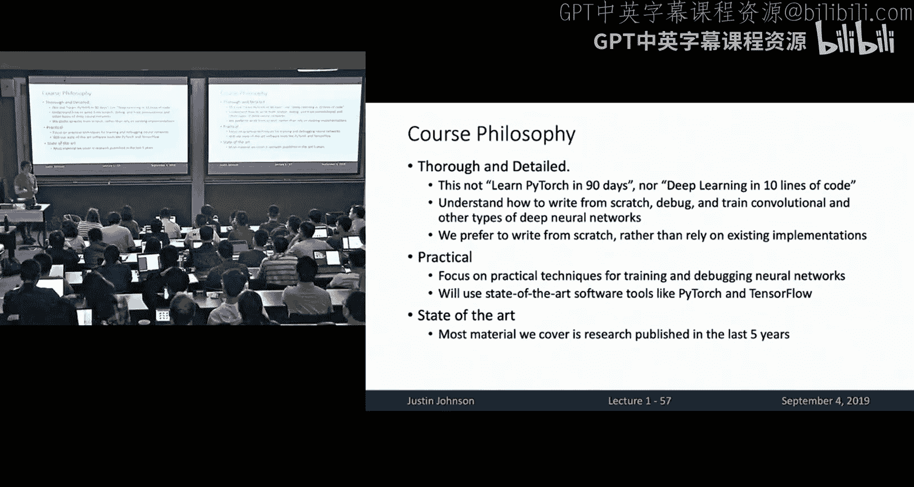

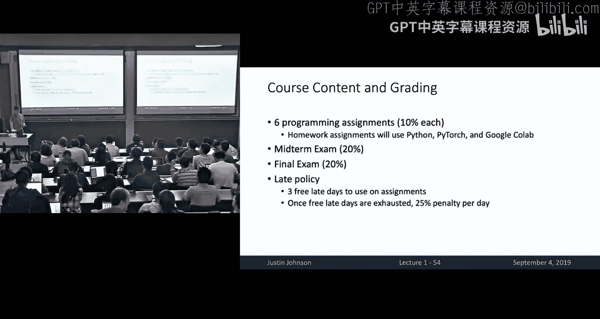

## 总结 🎯

本节课中，我们一起学习了本课程的介绍，并回顾了计算机视觉与深度学习波澜壮阔的发展历史。我们从它们的定义出发，看到了这两个领域如何从各自独立的起点，最终在算法、数据和算力的共同推动下于2012年交汇，引发了当今的人工智能革命。同时，我们也了解了本课程的具体安排、政策与核心理念。下节课，我们将正式深入技术细节，从“图像分类”问题开始我们的深度学习实践之旅。

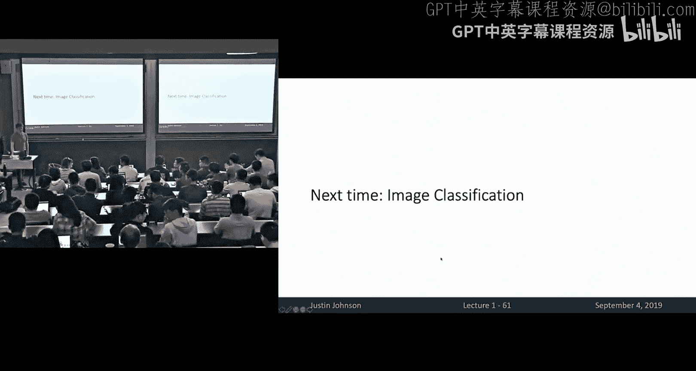

再次欢迎来到“深度学习用于计算机视觉”课堂！