# 密歇根大学《深度学习用于计算机视觉｜Deep Learning for Computer Vision UMich EECS 498-007 2019》中英字幕 p02 -02-2_ImageClassification.zh_en -BV1jA4m1P7GN_p2-

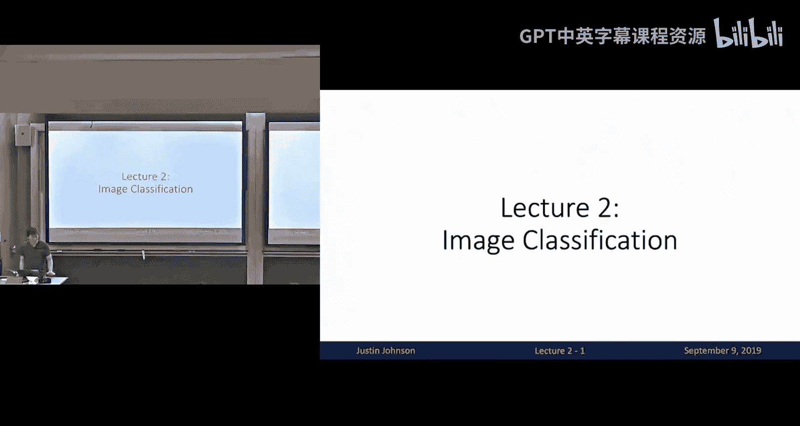

Okay it's a little it's a little bit after 430 so let's get started so welcome back to EECS 498-007-598005 welcome back to this is now a lecture too so last time we talked about a historical overview of the fields of computer vision and a deep learning and machine learning and now starting this lecture we're going to talk about image classification and we're going start diving into the technical material of the course and today we'll see our first learning algorithm。

😊，But before we get into today's content， we have to cover a couple administrative notes。

So I know you've all been wondering about the status of the waitlist。

 So the status is we gave a batch of overrides yesterday。

 if you received an override and did not yet enroll。

 then go do it right now because it's going to expire tomorrow。

 And if you receive an override and you don't enroll and it expires you won't get another one and will instead go on and give another override to someone else on the wait list because there's still a lot more people on the wait list then we can fit in the class。

 So again， if you receive an override， go enroll right now。

 otherwise you're out of luck and based on the status of the wait list and the number of enrolled students we'll then plan to continue working down the wait list and send out another batch of overrides later this week So if you wanted to get enrolled and you were not able to then stay tuned。

 there's still some hope that you might be able to find some space later this week。

So the next next note is on office hours。 we're going to be starting office hours both for myself and for the GSIs this week。

 So the the details of those can be found on the Google calendarendar and you can find the link to the Google calendarendar on on the course website and you can find the link to the course website on campus。

 So after that long chain of dependencies is hopefully you can figure out the office hours schedule。

So next is piazza。 So as a quick reminder， we're using piazza as our main mechanism for communication with with you guys during the course of the semester。

 And right now， the number of students who are enrolled in the class and the number of students who have enrolled in a class on Piazza are very different numbers。

 So you should all go enroll on Piazza if you haven't already。

So for those of you who are already enrolled in Piazza。

 you should have gotten an announcement yesterday that we've released the first assignment for the course。

 and if did not if you were not enrolled in Piazza， then you didn't get this announcement。

 so you should go enroll in Piazza right now。But we've released the first assignment for the course。

 you can find that link you can find that link on the slide on the course schedule on canvasva。

 you can find this link many places So this first assignment will use Python and So for all the assignments in this class we're going to be using Python and Pytororch and Google Coabb and this first assignment will cover two major topics one is an introduction to Pytorch Tensors because we be using Pytorrch throughout the class and it's important for you to start getting familiar with how to work with Pytorrch Tensors and second it covers the K nearest neighbor classification algorithm that we're going to cover today。

 So this assignment is going since we released this assignment yesterday。

 you'll have one week from the time it was released to turn it in which means it's going to be due on Sunday。

 September 15 at 1159 PMm note that this is a couple days after it was the original due date from the schedule that's our fault because took a little bit longer than we。

Expected to get it out， so you guys get a couple extra days to finish the assignments。So I'm。

 I'm pretty happy with the way the assignments worked out this year。

 I think using coab is gonna give you a really nice experience for working with these models yourself。

 So it's really easy。 So when you go to the assignment website。

 you'll see these buttons that say open on coab。 All you have to do is click on that button。

 And then the notebook will open up right in your browser。

 It'll automatically connect to a virtual machine with a GPU in the back end。

 You don't have to install anything。 You don't have to set up anything。

 You can just work on the assignment directly in your browser。 Then here you need to。😊，You need to。

Then you can work on the assignment directly in the browser。

 you can save a copy to your own Google Drive， and then you can download the assignment as an IPython notebook file when you're finished。

 And that's the thing that you'll turn in on canvas。So before we move on to the content for today。

 is there any question on administrative stuff？Yeah， in the back。Like。The question was。

 will the will lecture slides be available， So yeah。

 we'll make'll'll make every attempt to post lecture slides before the lecture starts with as big a gap as possible。

 I think today they went up maybe an hour ago for today's lecture。

 but we'll try to give a little more time before the lecture that slides go up in the future。

Any other questions。

Cool。So today， we're going to talk about image classification。

 So image classification is really a really important core task in computer vision and really machine learning more broadly。

 So image classification is really quite a simple task to state。

 So what we do is our algorithm is going to take as input and image on the left。

 And then the output the algorithm needs to assign a category label to that input image。

 So when we talk about image classification。 we typically have some fixed set of category labels in mind that the algorithm is aware of。

 So in this example， maybe the algorithm is aware of these five labels， Cat， bird。

 deer dog and truck。 and and during the as the algorithm performed image classification。

 what it needs to do is simply assign one of these five labels to the image that it sees。

 in this case is cat。So for all of us， this is a really trivial task， right。

 You can do this almost without thinking about it。 You just immediately know that this is a cat when you look at the image。

But for the computer， that's not so easy。 And the main challenge in image recognition and image classification when we try to do it on machines is this problem we call the semantic gap。

 So for us， when we look at this image， we immediately recognize it as a cat。

 we get these perceptions of all these photons of run and they hit our retina。

 they go through our brain， they go through a lot of complex processing。

 But we're not really aware of that consciously when we look at these images。 Instead。

 we just kind of intuitively know what we see。 But the computer doesn't have that kind of intuition。

 So when the computer looks at such an image。 What all it gets is a giant is a giant grid of numbers。

 So first for an image like this。 it's just a giant grid of 800 by 600 by three numbers where at each pixel。

 we have a single color value represented with with three numbers between 0 and 2，5，5。

So the problem is that if you look at these grid of numbers。

 it's really not obvious at all that this number， that this grid of numbers should represent a cat。

 And there's no obvious way to convert this grid of this。

 this grid of raw pixel values into this semantically meaningful category label of cat。

And what's even worse is that this entire grid of numbers can change drastically as we make relatively unassuming changes to the image。

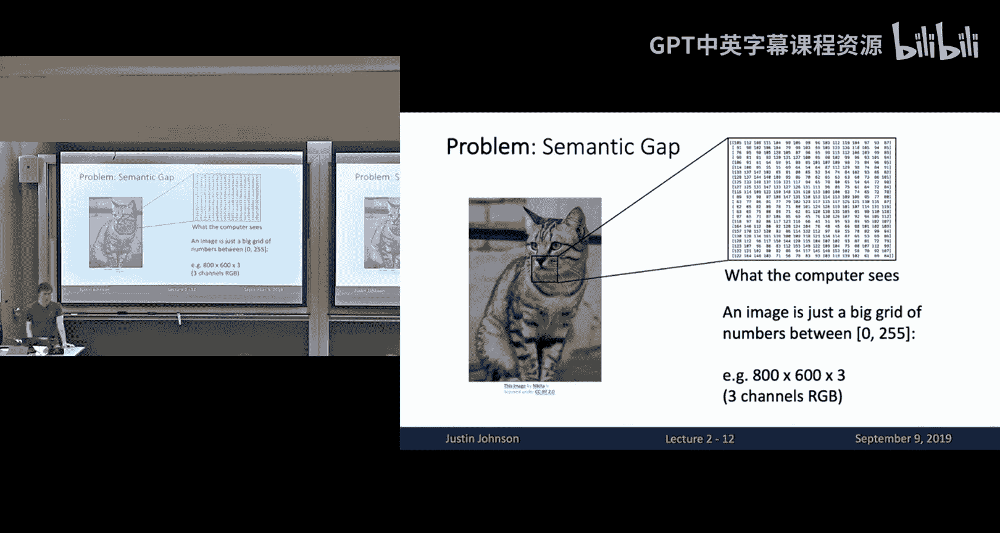

So， for example， if you were to imagine， if you， if we were to imagine changing the viewpoint of this image。

 maybe if we were to take an image of a photograph of this exact same cat from just a slightly different angle。

 then to all of us， we would probably recognize it Def we would still recognize it as a cat for sure。

 And we would probably still recognize it as this exact same cat because we could recognize the markings on its face and whatnot。

But the problem is that due to this， this semantic gap。

 this difference between what we understand when we look at images and and what is represented in this raw grid of pixel values。

 that if we were to make even a simple change to this image。

 like photographing from a slightly different angle。

 all of the pixel values would change in a very unintuitive way。

 and and we somehow need to be able to design algorithms that are robust to these massive changes in the raw pixel values that can arise from relatively simple changes to the images themselves。

So there's a lot more we need to deal with beyond viewpoint variation in order to perform image classification。

 We also need to deal with things like intraclass variation。 So if we look at different images。

 different cats all look very different。 And each of these different adorable cats all produces very different grids of pixel values on the raw sensor of of the camera。

 So we somehow need to build our systems that are robust to these massive variations that can occur within categories。

😊。

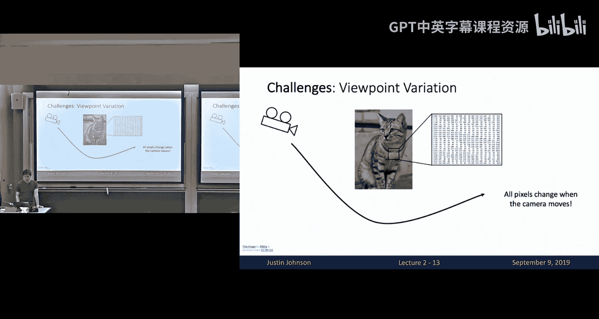

So there's another problem， which is sometimes we want to recognize fine-grained categories。

 So so far we've talked about recognizing maybe cats versus dogs versus trucks。

 but depending on the task at hand， we might want to recognize different categories that appear very visually similar。

 So， for example， if we if we we might want to recognize different breeds of cats in some applications。

 So here we have different categories that appear very visually similar。 And this is， again。

 a huge practical problem。 And it's not clear at all how to write algorithms that are robust image to changes in image pixels in this way。

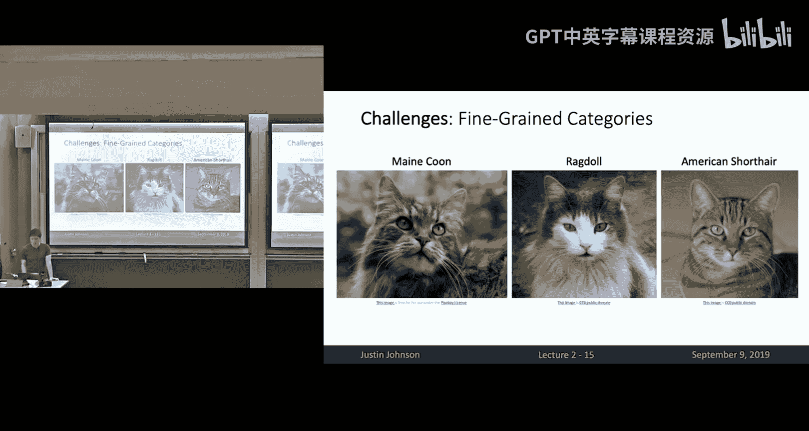

We also need to， we need our algorithms to be robust to background clutter。

 So sometimes the objects in the image that we want to recognize somehow blend into the background。

 maybe due to natural camouflage or other sorts of crazy things going on in the scene。We need our。

 we need our classifiers to be robust to illumination change as we change the lighting conditions in the scene。

 turn on and turn off lights， take pictures in the dark， take pictures in the daylight。

 The underlying semantics of the images of the objects and the images do not change。

 So our algorithms should be robust。 These massive changes in different lighting conditions。😊。

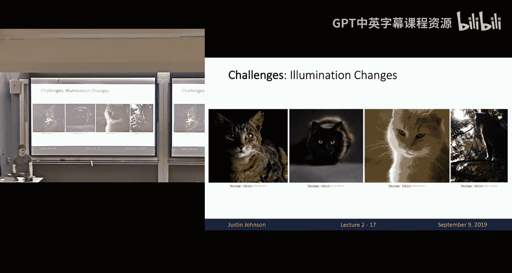

So our algorithms need to deal with deformation。 So the objects that。

 and maybe cats are particularly deformable object categories。 But we need to be。

 but sometimes the the objects that we want to recognize in images might appear in very different view very different poses。

 very different positions in the image。

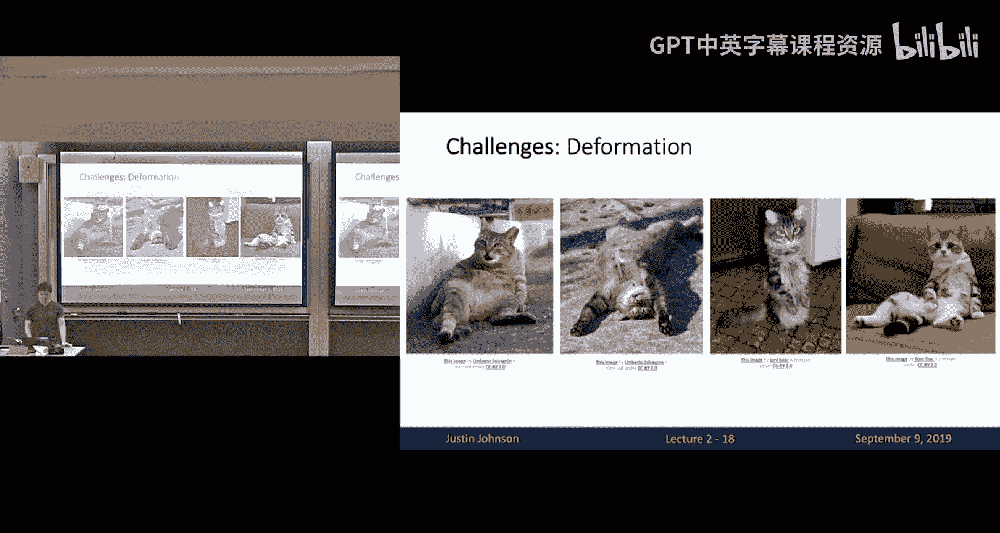

We might somehow need to deal with occlusion。So sometimes the object that we want to recognize in the image might not be visible hardly at all。

 And I think this example on the right is really interesting， right， This is basically a couch。

 and we see a tail sticking out from underneath the couch cushion。 Now。

 you probably intuitively thought that that was a cat right because we've seen a lot of images of cats because you know that cats usually live in houses because you know that maybe cats like to burrow down under things sometimes But actually。

 if you think about the evidence in the raw image evidence of this image。

 we don't actually know that this is a cat。 This could be a raccoon。

 This could be some other kind of a crazy animal with a tail right。

 So somehow even this relatively simple problem of giving category labels to objects and images can involve a lot of commonense reasoning about the world。

 your knowledge that cats live in houses and raccoons are unlikely to live under cushions of couches right So even this relatively unassuming problem of classifying images become very challenging。

 very quick。😊，If we want to recognize the full breadth of categories that exist in the world in all the variations and positions and appearances and changes in ways that those objects can appear in images around in the world。

So if we were somehow able to overcome all of these problems and write down algorithms that could perform robust image classification and recognize lots of object categories in lots of different situations。

 it would be really， really useful。

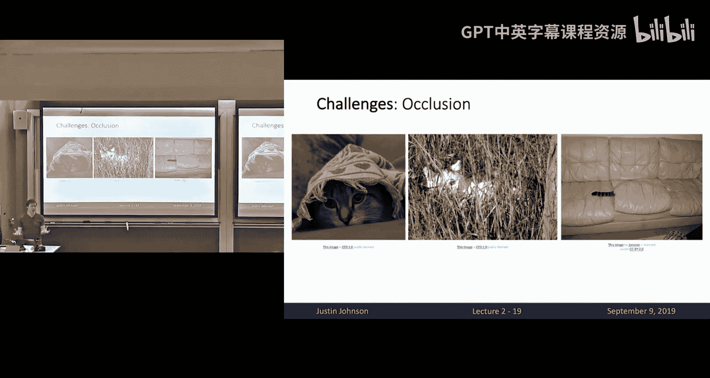

So we already saw in the last lecture how some applications of computer vision can unlock maybe many different scientific questions。

 so we could use image classification for things like medical imaging， medical diagnosis。

 Maybe we could take pictures of skin lesions and diagnose them as malignant or non malignant tumors。

 Maybe we could take pictures of x-rays and try to classify what types of problems could exist in medical images。

This robust image classification could be useful for for astronomers who want to go out and collect visual data from telescopes and other types of sensors and then classify what types of phenomenon are out there in the sky。

 These could also be useful for many other scientific applications。

 like maybe recognizing whales or or categorizing many different types of animals that could appear in sensors。

So image classification on its own is this really， really useful problem， and if we could solve it。

 it can unlock a lot of really powerful and useful applications。

But what I think is possibly even more interesting and maybe less intuitive is that image classification is also a fundamental building block of different algorithms we might want to perform inside computer vision。

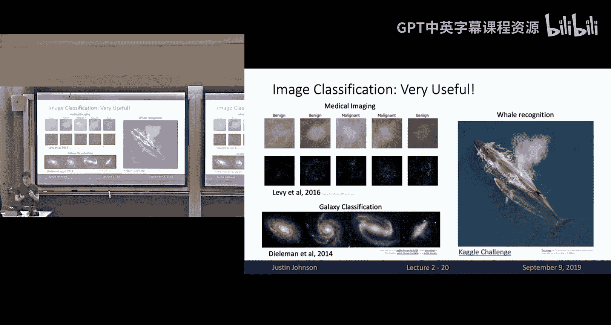

So as an example， so far， we've talked about image classification。

 So there's a related task in computer vision called object detection。 So in object detection。

 what we want to do is draw boxes around the objects in in images and say not just what objects are present in the image。

 but where are they located in the image。And it turns out that one。

 that image classification is itself a sub a subpart that can be used to build up to more complex applications like object detection。

So as an example， one way to perform object detection is via image classification of different sliding windows in the image。

 So one one way to perform object detection is to just classify different subregions of the image so we could look at a sub subregion over here and then classify it as background horse person car or truck in this case。

 it's classify as background because there there's no objects here。 if we were to classify this box。

 we should classify it as person， etca， etc ce。 So you can see that if we had the ability to build really powerful image classifiers that would again let us build other applications like object detectors。

Even something like image captioning is often framed as a as an image classification problem。

 So here the idea is that given an input image， we might want to write a natural language sentence to describe what is in the image。

 And here this can be framed as a sequence of classification problems just as in the object detection case。

 So here we've got maybe some fixed vocabulary of words in the English language that the algorithm is aware of。

 And the question is， what word should I say next。 And this is again， a classification problem。

 So then first we would classify and select this word man using an image classifier。

 maybe select the word writing， select the word horse and then select the word stop to mean though that's the end of the sentence。

So you can see that image so even maybe another even more even slightly more outlandish application is playing computer games like go。

 So people have built AI systems that can learn to play go and even outperform many of the best human experts in the world and this is basically a classification problem too here the input is now an image where each pixel of the image describes the state of the game board at some position and now the output is a classification problem about which position on the board should I place my next stone on So you can see that throughout these different applications this relatively unassuming problem of image classification is a really really powerful building block that we can use to build up many to many more interesting problems in computer vision。

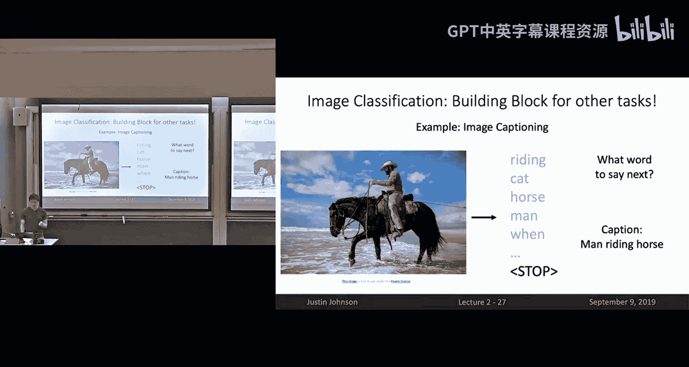

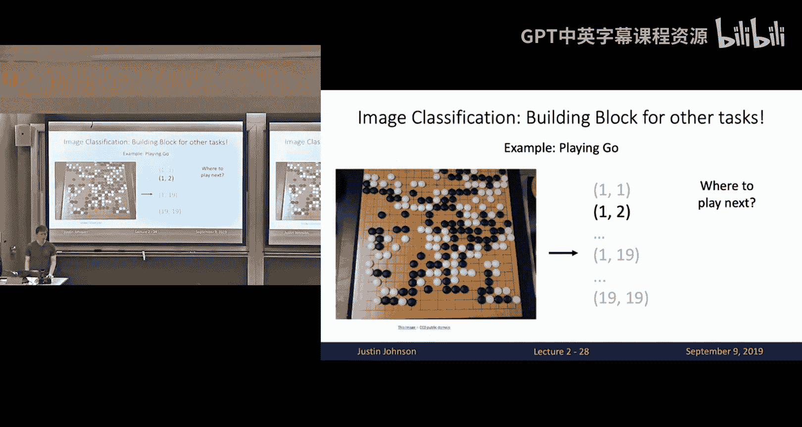

So given all of that， we we really want to be able to write algorithms that can perform image classification really well。

 but it's really not obvious at all how we should do this， right。

 if you were to just sit down at your computer and start typing code。

 you need to write this magical python function that's going input this giant grid of pixel values。

 perform some magical computation。 and then somehow spit out cat or place the go piece at position 5。

9 or this piece of image is or is not a piece of background。 and it's really not obvious at all。

 what code you should type here， right， because unlike for something like sorting a list of integers。

 there's really no well definedfined algorithm for how to convert grids of numbers into cats。😊。

So we need to do something， so it's really not clear at all how we should approach this problem。

So one thing you might do is maybe just try to use your own human knowledge about what cats and other objects look like in order to hand code classifiers that try to pick out different object categories。

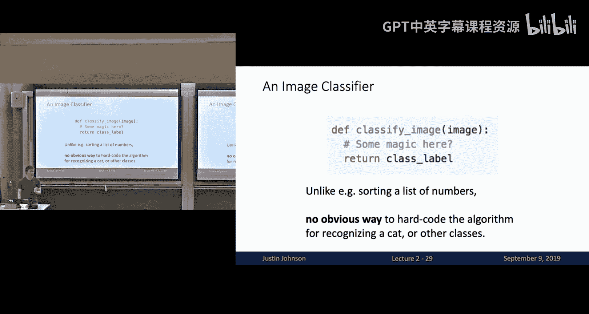

So one thing you might imagine doing is， you know， we talked in the last lecture about how edges in images are really important。

 So maybe what we could try to do is first take the image and then convert it and then extract edges。

 using some kind of edge detection algorithm。 and then maybe you try to find corners or other types of interpretable patterns in those edges right You know that maybe cats have triangular pointy ears。

 and you should hope that those ears come out in the edges。

 so maybe you could kind of look for corners and then draw write rules about what angles。

 cats ears are allowed to be。 maybe cats are supposed to have whiskers in different positions。

 maybe the whiskers would come out in edges。 So you could imagine maybe like really trying to go in there and hard code all your own human knowledge about what cats look like and try to write down some explicit algorithm for detecting them。

But this is not a very good approach， right， It's going to be brittle。

 There's going to be cats without whiskers or cats without pointy ears。

 or sometimes the edge detector will fail and won't give you when won't detect the edges that you wanted it to。

And maybe you spend a lot of time trying to kind of figure out all those corner cases for cats。

 But now tomorrow， we want to classify galaxies。And probably all of the hard work that you put into your algorithm for for recognizing cats from images is going to be completely thrown away tomorrow when we want to recognize galaxies instead。

 So we really want some way that is more robust， some approach。

 which is more scalable and some approach， which doesn't require us to write down all of our own human knowledge about what different types of objects look like。

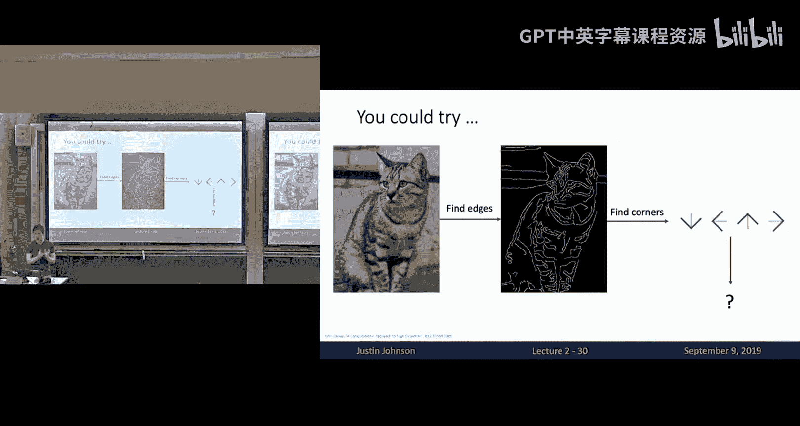

So here's where we come to machine learning。Right， so the idea is that rather than trying to explicitly encode our own human knowledge about what different types of objects look like。

 Instead， we're going to take a data driven approach and have algorithms that can learn from data how to recognize different types of objects and images。

So the basic pipeline for this machine learning system that we're going to build is that first。

 we want to collect a large data set of images and label them with the types of labels we want our algorithm to predict。

 So maybe if we want to build a cat a catverse dog detector。

 we need to go out and collect a lot of images of cats and dogs and hot dogs and not hot dogs and then and then and then go and collect human labels for which images are cats and dogs and hot dogs and whatnot。

 And then once we collect this large data， we're going to deploy some kind of machine learning algorithm。

 which will try to learn statistical dependencies between the input images and the data and the output labels that we that we wrote down during the data collection process。

So then once we and then once we've used our image。

 our machine learning algorithm to extract these statistical dependencies。

 we can then evaluate this classifier on new images。So what this looks。 So then basically。

 instead of writing this single monolithic function called a classify image。Instead。

 we have this really twopiece API。 One is this we need to write one function called Tra。

 which is going to input now a collection of images and their associated labels。

 it's going to perform some magical machine learning。

 and then it's going to return some statistical model。

 Then our second piece of API is this predict function。

 which is going to input the model that we produce during the training phase as well as new images on which to evaluate that model。

 This will run the model on the new images and then spit out the labels as they have been learned from the training set。

So what's really interesting about this approach is that it's kind of a different way to program computers。

RightWhen you think about writing algorithms to sort images sorry。

 to sort numbers and lists or perform other kinds of classical algorithms。

 you're basically using your own human knowledge to tell the computer exactly what steps it needs to perform in order to produce the output that you want it to produce but now when we take a data-driven machine learning approach instead。

 what we're basically doing is programming the computer。

 via the data that we feed it in and now if we want to program the computer to recognize cats。

 we feed it in images of cats if we want to tomorrow use then tomorrow if we want to recognize galaxies instead all we need to do is collect a new data set of galaxies。

 we don't need to recode our machine learning algorithm。

 hopefully and instead we can just feed in new data and then change the behavior of the program。

So now this is a really powerful paradigm for a lot of problems where we don't know how to write down explicit programs to solve them。

 So this is the approach that we'll be taking through。 So this。

 this has become the dominant approach for basically all visual recognition problems。

 image classification included。

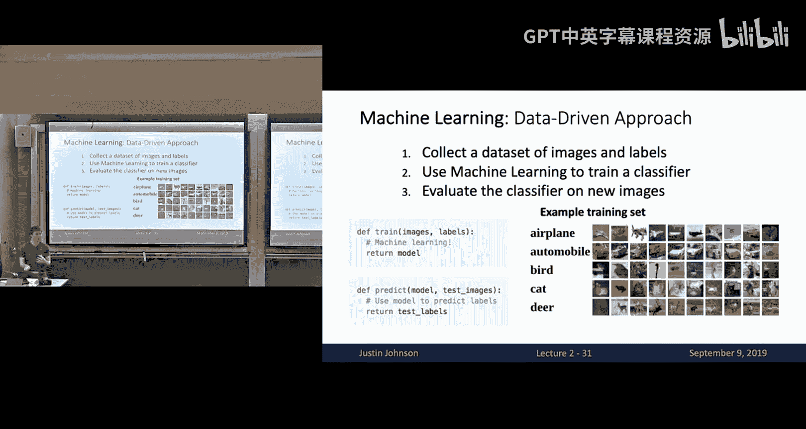

So now that we've sort of settled on this machine learning data driven approach to recognize images。

 we need to talk about sources of data， right？ So there's a couple common image classification data sets that you'll tend to come across。

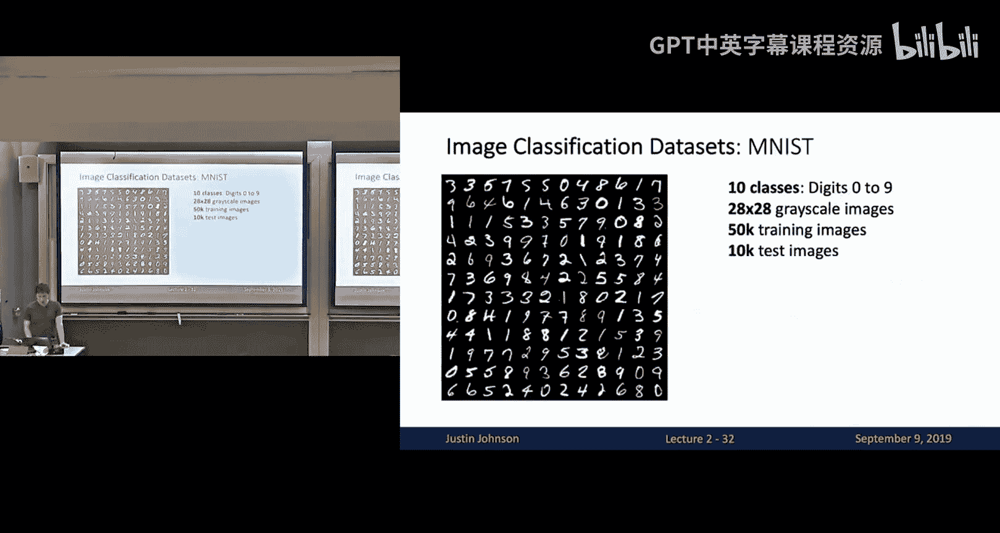

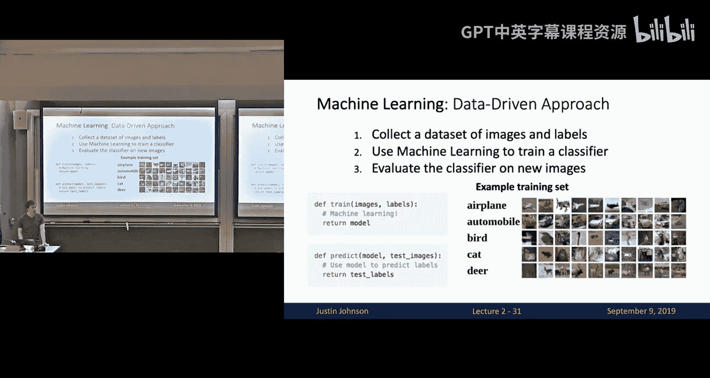

So one of the most common is the Mist data。 So Mnist has  10 classes， digits 0 to 9。

 The images are 28 by 28 pixels， grayscale images。 So they're very tiny。

 it gives us 50000 training images and 10000 test images。 So if you'll recall in the last lecture。

 we talked about how convolutional neural networks were developed in the 80s and 90s and deployed in commercial products in order to read check handwritten digits on checks。

 Well， this M nest data set was really used for that industrial application of recognizing handwritten digits on checks and was deployed out there in the world。

 So even though this seems like kind of a toy data。

 it really has a lot of rich history behind it and and has been very useful in the development of many machine learning algorithms。

But that said， the MNIS data set has sometimes been called the Drrosophila of computer vision。

 So you know that biologists often will go and perform a lot of initial experiments on fruit flies and then then could of work up to more interesting animals as they make their discoveries and this is this is really similar to the way the a lot of practitioners work on MnIS SoN because it's relatively small and simple data。

 it's very quick to try out new ideas on this data。

 but you have to be really careful when you're reading papers that only show results on MNIS because it's very。

 very common that basically everything works on Mnist right you can write down sort of any reasonable machine learning algorithm will get very high performance on MNIS So this is treated really as sort of a proof of concept。

 but just getting something to work here isn't really enough to impress people anymore。

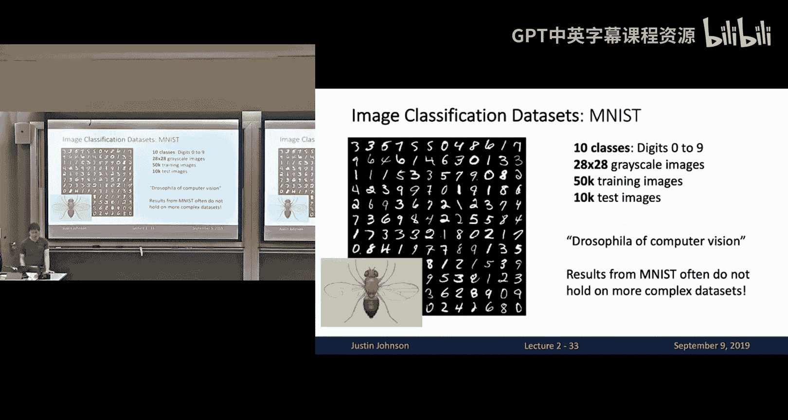

So instead， another data set that you'll see very commonly used is C far 10。So Cf 10 has is again。

 very small images，32 by 32， but they're color rather than grayscale。

 And now rather than handwritten digits， the categories are much more interesting。 They airplanes。

 automobiles， birds， cats， Deer。 you can read it on the slide。

 And this is a fairly decently sized data，50000 training 10000 tests。

 And this is and even though it's relatively small compared to other large scale dataset sets。

 it's considered reasonably challenging since these categories are reasonably difficult to recognize。

 So as a result， we'll be using the Cf 10 data set for most of the homework assignments throughout the semester。

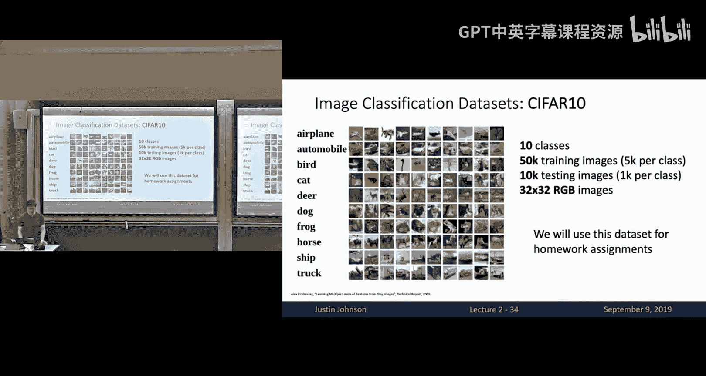

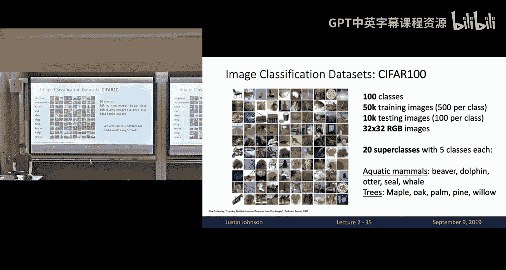

So CR 10 has a cousin called C400。 that's basically similar statistics。

 except we've got 100 categories rather than 10。 So I think people use C400 a little bit less than CR 10。

 but you'll sometimes see people working on this。 And it's nice to be aware of it。

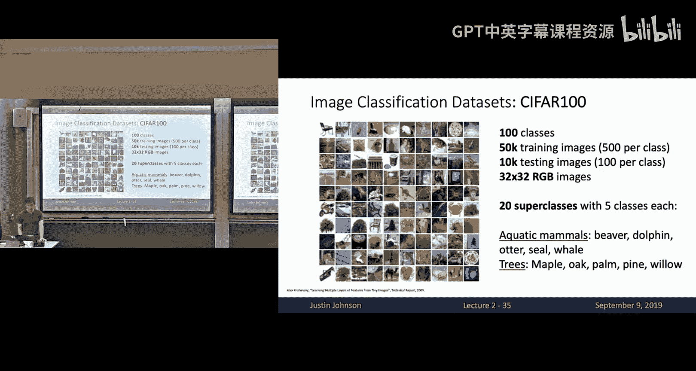

So another super so we talked last lecture a bit about the imagenet dataset。

 and this has become something of the gold standard for image classification data sets。 So basically。

 when you try to submit a research paper that proposes some new tweak to an image classification algorithm。

 if you don't show results on imagenet， reviewers will probably complain。

 and your paper will probably be rejected。 So it's so imagenet is really considered a super important data to benchmark image classification algorithms these days。

So Imnet is very interesting， very challenging because it contains 1000 different categories。

 This is much， much more than the 10 categories in Cpar or NN。 And it' and it's very， very large。

 So we've got about 1。3 million training images with about 1301300 training images per category。

 And it gives a standard validation in test sets。 Now， one， oh， yeah， a question。 How large are the。

😊，Pixel by pixel because the last two sets you showed us from 28。Yeah。

 so the question was how big are the images in INet Well。

 the issue is that INe images were sort of downloaded from the webs。

 they actually differ in resolution quite a lot， but for most practical applications。

 people resize them to either 256 by 256 or sometimes224 by 224 when training on those images。

So one interesting bit about IageNe is that is the accuracy metric that people report here。

 So because there's 100 different categories on ImageNe。

 very it's very difficult and possibly unreasonable to expect algorithms to pick out the exact one correct category。

 especially because you know some of the labels are a little bit noisy anyway。

 So what people do in practice here is have the algorithm predict five category labels。

 and then we count the algorithm as having made a correct prediction if the correct category is in any one of those five predictions。

 So that's just a little bit of nuance of the way imagenet is typically evaluated。

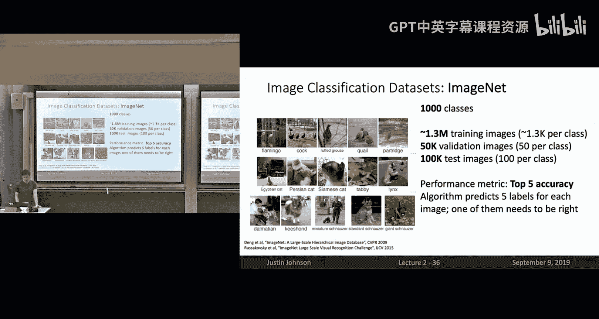

So there's， so those are kind of the the most standard image classification dataset sets that you'll see out there。

 Another interesting one is MI I T places。 So this。

 so imagenet images tend to focus on objects like cats and dogs and fish and trucks and things like that。

 So there's another related data that tries to focus on scene categories like classrooms and fields and buildings and things like that。

 So it's nice to be aware of。😊，Now， one thing that's really interesting is to try to compare these classification data sets in terms of their size。

 So here this is the number of pixels in the training set for these different data sets。

 and this is assuming 25，6，2，5，6 for Imnet and places。

 And what you'll note here is the Y axis is on a log scale。

 So so you'll see that CFR is maybe about an order roughly an order of magnitude bigger than MNT Imnet is roughly two orders of magnitude bigger than CR。

 and then places is yet another order of magnitude bigger than ImageNe。

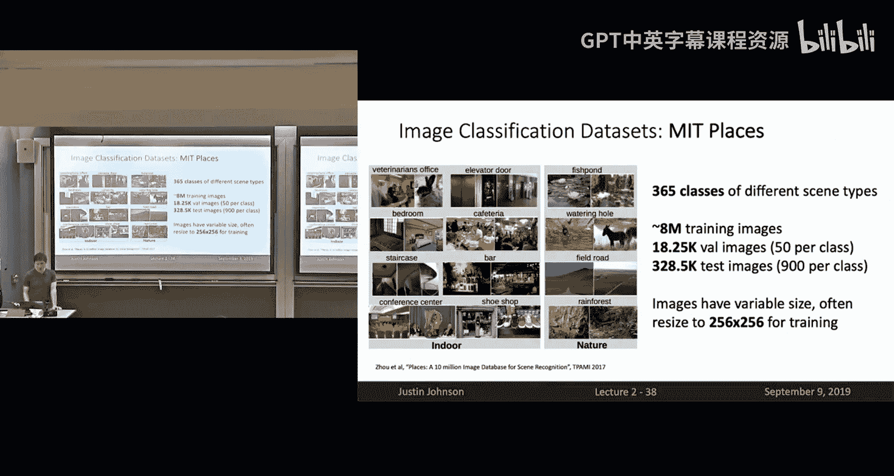

So this kind of drives home the point about why Imnet is somehow a qualitatively different dataset set than these other ones that you'll see people work on sometimes。

 So that makes results on ImNe much more convincing， but unfortunately。

 very computationally expensive to work with sometimes。 So as a result。

 we're kind of sticking with CA is kind of a sweet middle ground in this course that kind of splits the difference between the complexities of the visual recognition task that show up on Imnet and the computational affordability of smaller dataset sets like MNIS。

So what's also interesting to see from this chart is this increasing trend of datas getting bigger and bigger and bigger over time。

 So that's definitely， so that's definitely one interesting direction for research。

 How can we use ever bigger and bigger data sets to enhance the abilities of our algorithms to perform robust classification。

But people have also started thinking in the other direction as well。

 So one interesting data set to be aware of there is the omnilot data。

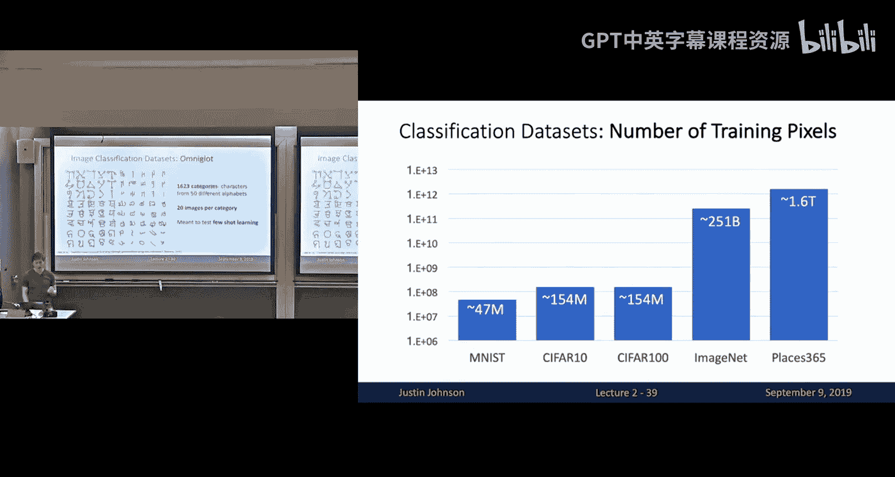

So here， omnilot kind of pushes things to the extreme and and wants to benchmark the ability of algorithms to learn with relatively little data。

 So on omniglot， we've got more than 1600 different categories。

 each of these categories is a letter in some alphabet from some language somewhere on earth。

 So they've got letters from more than from 50 different alphabets of different written languages。

 and the really interesting thing about omniglot is that rather than giving you tons and tons of examples of each image of each category it only gives you 20 examples for each of these letters and somehow the challenge is to build algorithms that can really that can learn very robustly from relatively few examples of each image category。

 So this social this so-called low shot classification problem is a really huge and emerging area of research where a lot of researchers are starting to think about these days。

So now that we， now that we've talked about some of the common data sets that you'll run into for image classification。

 it's time to think about our first classification algorithm because data only gets used so far。

 You need some algorithm to actually make use of that data。So really。

 so the first algorithm the first learning algorithm that we're going to talk about is nearest neighbor。

 And this one is so simple。 it might not even deserve the name of a learning algorithm。 right。

 So what it does is remember， I told you that when we implement a machine learning system。

 we need to implement these two functions。 One called train and one called predict。 Well。

 for nearest neighbor， the train function is trivial。

 We're simply going to memorize all of the training data。 We're not going we're not going process it。

 We're not going to do anything with it。 We're just going to memorize all of our training data。

And now in the predict in the predict side， what we're going to do is take our new image that we want to predict a label for。

 compareare it to each one of our images in the training set using some kind of comparison or similarity function。

 and now we're going keep track of the most similar image in the training set to our test image。

 And now we're going to simply return the label of the most similar training image。 So this is。

 like I said， very， very simple straightforward learning algorithm。

 and it only learns in the sense that it kind of memorizes the training data。

But in order to implement this algorithm， we need to actually write down some function that can compute the similarity between two input images。

So the some very common choice。 So basically， we need to write down some kind of distance distance metric。

 which can input a pair of images and then spit out some number representing how semantically similar are those two pairs of images in order to perform this nearest neighbor classification。

So one very common choice of this distance metric is a very simple one。

 Just use the L1 or Manhattan distance between the pixels of the images。

 So here what we're going to do is take our test image here。

 we're imagining a very simple by4 by four test image that we've written down the values of all of its pixels explicitly and to compare it to a training image we simply take the absolute value of the differences between all the corresponding pixels in the two images。

 and then sum up all of these absolute values of all the differences in the corresponding pixels and that gives us a single number representing different the distance or difference between those two images。

 So one thing to point out here is that know if we this kind of satisfies all the normal rules for a metric from mathematics right So if we've got two images that are exactly the same we'll have a distance of zero things like the triangle inequality are satisfied。

 this is a reasonably well mathematicalmatically defined metric。So now， basically。

 with these couple bits of information， we， that's enough to implement your first learning algorithm。

 And indeed， the nearest neighbor classifier is such a simple and straightforward algorithm that we can fit a full implementation on a slide。

 And I think people can even with some comments。 and even better。

 I think you might even be able to read it。So here in our nearest neighbor classifier。

 I told you we need to implement two things， one is this train step， which is trivial here。

 we just memorize the training data， so we assign the images X and their labels Y to some member variables of our class。

Then in the predict， we have again， very simple， we take some new images， some new test images， X。

 we simply iterate all over all the images in the training set， compute this L1 distance。

 and then return the label of the most similar image。So that's it。 That's nearest neighbor。

 You can now implement your own machine learning systems。So a couple of questions。

 So with this nearest neighbor class fire， S we have a training set of n examples。

 Then how fast is training。I don't know。 It seems tricky。 Well。

 I guess it kind of depends on your copy semantics。

 but I would say that this is maybe constant time training if we're just going to store pointers to all of the training date all of the training data。

 then that could be done in constant time if you were to make a deep copy， then maybe be linear time。

 but let's not do that。So then the question is， again， with N with N examples。

 how fast is testing going to be？Well， this one's going to be linear time， right。

 because kind of folding the size of the image and computation of the norm。

 we're going to call that a constant， which means that now for every testing example。

 we need to compare it to each of the N training examples。

 which means that compare that at test time， we're going to pay a performance penalty that's linear in the size of the training set。

Now， this is actually really bad。 This is like really， really， really bad。

 This is actually the opposite of what we want from machine learning systems。

 right because if you think about how we want to deploy a machine learning system。

 what we want to do is somehow collect as much data as we possibly can about our task at hand and then maybe use this large amount of data and train a big powerful model。

 and it's okay if training that model takes a long long time。

 But when we finally deploy that model and actually use that model at test time。

 we'd like it to be very fast。 we'd like to be able to run these models maybe on your mobile phone in real time we'd like to run it for millions or billions of users on the web for all photos that are getting run around on the Internet。

 So somehow this is the exact opposite characteristics of what we'd usually like for in a machine learning system。

 And we'll see that as we move to neural networkbased approaches。

 we'll see that they kind of invert this bit of hierarchy and these neural network systems that we'll end up using will be relatively long to train。

 but then relatively fast at inference time。So of course。

 I also need to point out that sort of for completeness that there are many interesting algorithms for computing approximate nearest neighbors。

 and when you perform approximate nearest neighbor computation。

 this can be done maybe much more faster than these full brute force approaches and these are kind of beyond the scope of this class。

 but it's nice to be aware of in case you find yourself in a situation where you really really need to perform some large scale nearest neighbor search for some reason。

So now， once we've got this， this image， this this idea of nearest neighbor classification。

 we can think about how does it actually perform on images。 So here。

 what we're showing is the results of nearest neighbor classification on the C far 10 data set。

 So here on the left column， we're seeing a bunch of test example。

 a bunch of examples from the CR 10 test set。 And then along each row。

 we're seeing the nearest neighbors from the training set to each of those test examples。

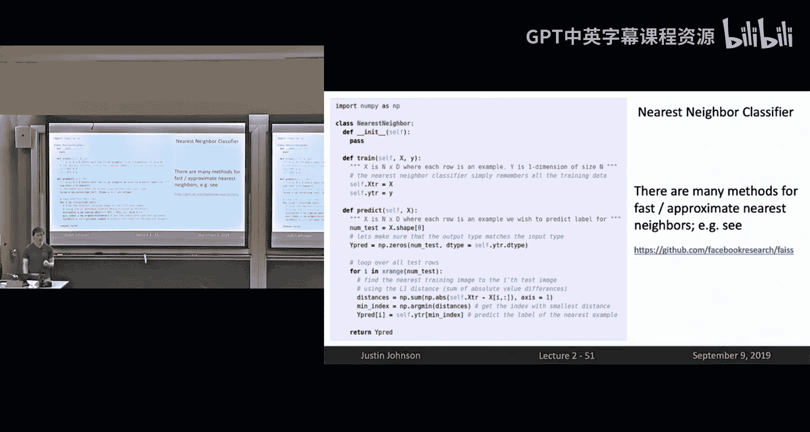

And and as you might， sort of intuitive， because we're computing the distance between between images by literally comparing the values of their pixels。

 the nearest neighbors tend to be images that look very visually similar。

 So if you look at maybe the third row， you've got this orange blob in the middle is our test image。

 And then if you look across the row， you see other images。

 the nearest the nearest neighbors that we retrieve are kind of things that have maybe orange or reddish blobs in the middle and then kind of a green or brownish background。

 So this nearest this L1 distance that we're using to compute nearest neighbors is really not very smart。

 and it doesn't know much about what it's looking at。

And we can we can kind of get a sense for maybe how poorly this might perform if we look at which of these one nearest neighbors are correct or incorrect。

 So it's kind of tough to actually tell what these images are sometimes just by looking at them because they're relatively low resolution。

 But what I've tried to do is draw red boxes around the one nearest neighbors that are incorrect。

 and green boxes on the one nearest neighbors that are correct。

 and this gives you a sense that even though images can look very visually similar as measured by this L1 distance。

 they actually can sometimes have very different semantic meanings。

 So this is clear maybe in the fourth row， when you see this kind of this kind of a brown blob surrounded by a white background。

 I think it's a frog。 I think it's a frog actually for the test image。

 But then it nearest neighbor is actually a cat。 So then the cat is also a brown blob and a white background。

 but so it looks very visually similar by this L by this L1 metric， but the label is different。

 So be we would make an incorrect classification。On this thing。

So this is one way to think to sort of get an intuitive understanding for what a nearest neighbor classifier is doing。

 Another way to think about nearest neighbor classifiers is through this notion of decision boundaries that we can see in this plot that needs a bit of unpacking。

 So what we're showing here is we're imagining performing a nearest neighbor classification over images over images with two pixels。

 So then the x axis here is maybe the value the intensity value of one of our pixels and the y axis here is the intensity value of another of our pixels。

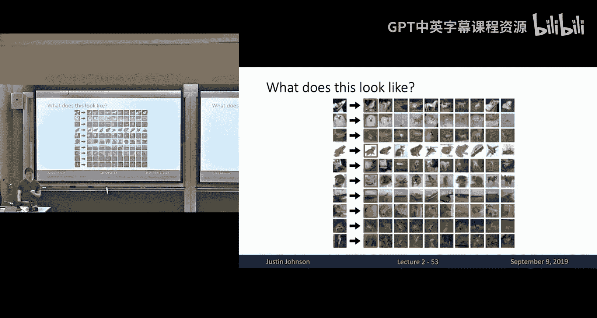

And now， each of these dots， each of these colored dots that we're seeing are examples of training images where the color of the dot maybe represents the category of the。

 of the training image。 So maybe red dots are cats and blue dots or dogs and so on and so forth。

And now the color of the background region represents the category label that would be assigned to that point in space if we were to have if we were to run the test if we were to run nearest neighbor classification for one of those test images。

 So for example， in this red X here， we can see that the nearest neighbor to the nearest neighbor in the training set is maybe this red dot here。

 which means that if we were to perform nearest neighbor classification for this red X。

 we would predict we would predict the red category。

So then what's interesting to look at here is the decision boundaries between different categories。

 So here we've drawn out this this region in space that carves up between regions in space that would be classified as green and regions in space that would be classified as purple。

And when we look at the nearest neighbor class fire in this way。

 we can recognize a couple interesting things。One is that these decision regions can be very。

 very noisy and are subject to outliers。 So， for example， we see that in our training set。

 we've got this one yellow point kind of sitting out in the middle of a whole bunch of green points。

 And maybe that's noise。 Maybe actually it should have been labeled as green instead of yellow。

 it's kind of hard to say。 But when we use this nearest neighbor classifiedifier。

 the presence of a single yellow point in this cloud of green is going to cause a bunch of test examples around that yellow point to be classified as yellow。

 maybe that's good， maybe that's bad。 We can also see over here on the left side of the screen。

 we've got this kind of jagged decision boundary between the red class and the blue class。

 And maybe and again， this is because this relying on only the nearest neighbor to perform the classification can be a bit noisy。

So then the question is， what be， what might we be able to do to kind of smooth out these decision boundaries and maybe give us a more robust classification。

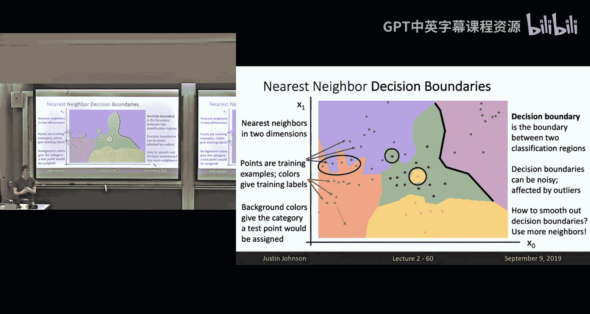

So one idea is to simply use more neighbors。 So so far。

 we've talked about the nearest neighbor classifier as simply parroting out the label that is attached to the nearest training example to each test example。

 But what we can do instead is use more than just that one nearest neighbor。 Instead。

 we can consider some set of K nearest neighbors。 and then take maybe and then imagine some way of combining the category labels of each of our k nearestval nearest retrieved results。

 So one there's many different ways that you might imagine doing this。

 But one simple idea is to simply take a majority vote among all the category labels of each of our k nearest neighbors。

So then it's kind of interesting then once this picture of the nearest neighbor classifier using decision boundaries lets us see some of the difference between k equals1 and k equals 3。

 So one is that our decision boundaries got a lot smoother。

 So you can see that when we use K equals1 recall that our decision boundaries we're very noisy as a result of only using one neighbor。

 And now as if we use three neighbors instead to perform classification on the same data set。

 we can see we've smoothed out the decision boundary between these two categories quite a lot。

We can also see that weve this has helped reduce the effect of outliers on our classification performance。

 So now， even though we still have this one yellow point hanging out in a cloud of green。

 it no longer affects。 it no longer results in this yellow classification region。And similarly。

 this region between red and blue has somehow got a little bit smooth out by using more than one nearest neighbor。

But there's another problem， which is that when K is greater than one。

 there might be ties between classes。 So in this visualization these white regions all have three nearest neighbors that that are all of different categories。

 So somehow you you need some mechanism for breaking ties。

 And maybe you could you can imagine maybe having some heuristic then based on the distance。

 Maybe you back off and use the one nearest neighbor result。

 There's different heuristics you might imagine in this situation。

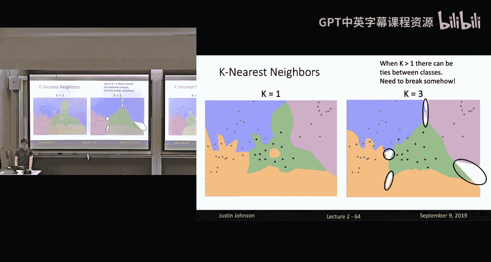

So another thing， another thing that we might want to change or play around with as when we do the nearest neighbor classifier is changing the distance metric that we use to compute similarity between images。

 So so far we've talked about using this L1 distance between images。

 which recall was the app the sum of the absolute differences between all the corresponding pixels and the two images。

 Another common choice is the L2 or Euclidean distance between the images between the pixels of the image。

 So this has the effect of know taking basically what we're doing here is taking the pixels of the image。

 stretching it onto a long vector。 then imagine computing the Euclidean distance between points and a high dimensional space for those two images。

And what's interesting is if we flip back to this picture of nearest neighbors using decision boundaries。

 you can see that as we use different distance metrics。

 we get sort of qualitatively different properties in the decision boundaries that arise。

 So I'll kind of lead this as an exercise to the reader。 But with L1 classification。

 we can see that all of the decision boundaries between categories are all composed of access aligned chunks。

 they're either vertical line segments， horizontal lines segments or vertical lines or 45 degree angle line segments。

 But when we use the L2 or Euclidean distance if we use the Euclidean distance instead to compute nearest neighbors。

 then now our decision boundaries are still piecewise linear。

 but those lines can appear at any orientation in the input。

 So somehow using different distance using different distance metrics somehow is a way that you as human as the human expert can imbue some of your own human knowledge into the structure that you want the algorithm to take account of。

 So it's a little bit。Clear maybe for whether L1 or L2， whether that's going to make big differences。

 it's not really intuitively clear what semantic differences in L1 versus an L2 distance metric is going to result in for the case of image classification。

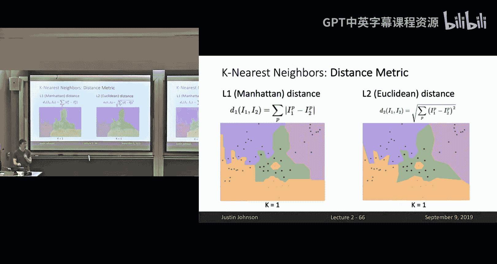

But what's really interesting about the k nearest neighbor algorithm is that basically if we choose different types of distance metrics。

 we can imagine applying k nearest neighbors to just about any type of data imaginable。 So so far。

 we've talked about these kind of using traditional maybe vector norms or vector vector metrics to compute distances between points。

 But you can imagine using very strange or interesting types of data and writing down very sophisticated distance functions between them in order to perform nearest neighbor classification on many different types of data sets。

So one example here is comparing research papers。 So there's this cool site called archive sanity that lets you go and kind of have some interesting exploration around research papers that are coming out each day。

 And one interesting feature of this website is it lets you show show papers that are similar to another paper。

 So here I looked up on archive sanity， a paper that I wrote last year called mesh RCNM。

 And then if we click show similar。 then what this does is basically does nearest neighbor retrieval on these P on these PF files。

 And the way that it does that is by using an interesting distance metric。

 So the distance metric here is called TF IDF similarity that's term frequency inverse document frequency that's very commonly used in a lot of NLP applications that I won't tell you how it works。

 but it's just kind of a distance metric that works on pieces of text that encodes human knowledge about the frequency that words appear in different documents。

 And what's interesting is that doing nearest neighbor。

rieval using this TF IDF metric on research papers actually gives really good results。 So if I look。

 if we look at the four nearest neighbors to my own most recent paper， then we see these four papers。

 they don't they're meaningless to you。 But actually。

 three of these were like things that we directly compared against and cited and like really tried hard to make sure we beat them in order to get our paper published。

 But interestingly， the nearest neighbor here is something that we didn't cite。 So we should。

 I should maybe go back and read that one。

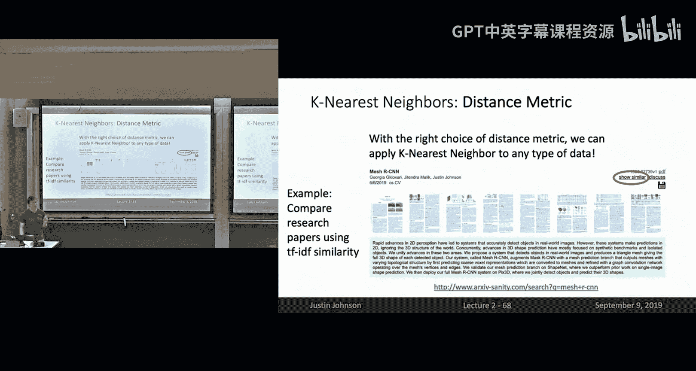

But the point here is that the nearest neighbor algorithm， even though it seems relatively simple。

 can be fairly powerful and can be applied to fairly robust and different types of data as you change the way that you compute distance between。

 between elements。So this is also a bit of fun。 A couple years ago。

 I wrote this interactive web demo in jascript that lets you kind of produce these visualizations for nearest neighbor。

 So you can go on this link and play around with this。

 you can interactively drag points around and see the decision boundaries move。

 You can change the number of categories。 You can change the number of training points。

 You can change the number the value of K for the nearest neighbors that we use。

 and you can try to flip back and forth between L1 and L2 metrics to try to get a sense of qualitatively what all these choices do and how they change the decision boundaries of your K and and classifier。

 So coding this thing up was like two days of my life。 So I really hope someone looks at it sometime。

😊，So I think this can be a useful tool to help you gain a little bit of intuition into what this canon classifier is doing。

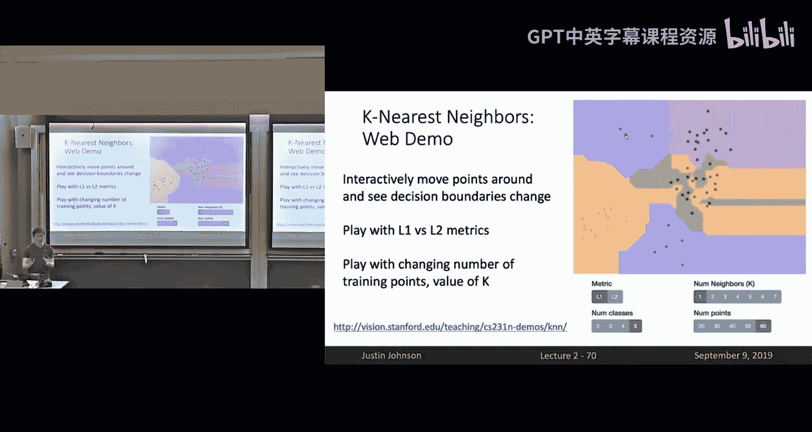

So by now， we've seen a couple different choices that we have to make when performing when doing this K and N classification。

 we've seen that apart from the training data， we need to choose a value of K。

 that is how many different neighbors are going to consider when doing this algorithm。

 We've also seen we need to choose the distance metric should we use L1 L2 should we try to cook something up that incorporates our own domain knowledge and it's not really clear how we should set these for different problems。

 So these choices of K and of the distance metric， are examples of what we call hyperparameters。

 So a hyperparameter is a choice that we need to make in our learning algorithm that we cannot necessarily learn directly from the training data。

 because they somehow interact with the way the algorithm works in a deep fundamental way。

 So these hyperparameters we can't really set them directly through learning。

 So we need some other mechanism to choose which values of hyperparameters are going to work best on our data。

And unfortunately， there's not a lot of great ways in practice to choose hyperpara。

 The kind of simplest approach is that they're very problem dependent。

 So we basically need to try out different values and see whatever is going to work best for our data and our task。

But there's some nuance here in what exactly we mean by try out different values and what exactly I mean by decide which one works best。

So here's a couple ideas for how we might try to go about setting hyperparameters。

So idea number one would be maybe we should select the values of hyperparameters that will cause our learning algorithm to。

 to give us the highest accuracy on our training set。This seems reasonable， right。

 we want we want our algorithm to do well。 We have a training set。 Tra set is meant for training。

 We need to then maybe we should just set the hyperparameter to give us the best performance on the training set。

 So even though this seems reasonable， it's actually a terrible idea。 Like never do this。

 just like simply never do this。 So the reason is this this can lead you very， very far astray。

 So in a concrete example for K nearest neighbor classification。

 if you were to try to set hyperparameters by maximizing accuracy on the training set。

 you would always choose K equals one。Because imagine what happens if you use a actually use a training point in the K and Unclassifier。

 if you use K equals 1， it will try to find the nearest training point， which is itself。

 and then it will always return the correct label， so K and unclassifier with K equals 1 always gets 100% on the training set。

But as we've seen some of these qualitative examples that probably intuitively is not correct because we've seen how maybe smoothing out setting higher values of K can maybe cause decision boundaries to be smooth out。

 and that actually might be the correct thing to do for some problems。

But we'll never get to know that by looking at the training set accuracy only。So instead。

 better idea is idea number  two。Maybe what we need to do is split our data into two components。 One。

 we're going to maybe reserve something like 90% of our data and call it the training set。

 and then reserve maybe 10% of our data and call it the test set。Because again， really。

 the point of machine learning algorithm and then what we're going to do is then try out different values of hyperparameters。

 learn the learn the learning algorithm， use the learning algorithm to learn from the training set。

 and then see what the accuracy is on the test set。

 And then as we vary the values of the hyperparameters。

 we'll choose the values of the hyperparameters that work the best on the test set。Now。

 this is more reasonable because the point of machine learning the point of using machine learning algorithms overall is to generalize to unseen data。

 We don't care about performance on the training set because we already have those labels in our data set。

 We care about the performance on unseen data， and somehow this approach gives us some estimate of our algorithms performance on data that it had not seen during training question。

Isn't this kind of like all of want to test that？你就应该系发系。See thatでなば。啊关于 same。对这个我的是这。Yeah。

 so basically， you're absolutely correct。 And even though I told you this seems very reasonable。

 it seems very logical。 This is wrong。 And you should not do this。 This is actually， again。

 equally as bad as training on the training set。 If you do this。

 you will you will draw incorrect conclusions about the performance of your learning algorithm because basically what we've done in this approach is a different way of learning on the test set。

 because once you look at the test set， your algorithm is polluted with knowledge of that test set and if you are using the test set in any way to make decisions about your learning algorithm。

 then you' cheating because again， that then it pollutes your idea of how well that algorithm is actually going to perform on unseen data because once you use the test set to set values of your hyperparameter。

 the test set is no longer unseen data and you no longer have any estimate。

 you no longer have any idea about how your algorithm is actually going to perform。

 when you deploy it out there in the wild。And run it on new images that did not appear in your dataset set at all。

 So even though this idea idea， too， seems logical and seems plausible。

 this is a fundamental cardinal sin in machine learning models。 And if you do this。

 you're making a fundamental error when in the way that you're preparing your model。

So a much better approach is idea number three。 So here what we're going to do is split our data now into three sets。

 We're going to have a training set that we use to train our algorithm。

 We're going to have a validation set that we use to set the values of our hyperparameters。

 and then we'll reserve a test set to use only once at the very， very end。Now。

 so then basically what we do， right， is kind of this kind of similar is what we did before， right。

 We train our algorithm on the test set。 We try different values of hyperparameter。

 We evaluate the performance of different hyperparabator values by checking the accuracy on the validation set now。

 And now we select we select the values of hyperparameter that have the highest performance on the validation set。

And now， once you've chosen those hyper once you've chosen all the values for all of your hyperparameters。

 once you've fixed everything， then only once at the very， very end of your pipeline。

 do you ever touch the test set， And then you touch it only once you run your algorithm exactly once on the test set。

 And that gives you a single number that now gives you a very proper estimate of your algorithm's performance on truly unseen data。

So even though this is the correct thing to do， it's actually completely terrifying in practice。

 right So you when you're writing a research paper， you've been working on this project for months。

 You've been working on this project for years。 and that entire time you've been tweaking your algorithm。

 you've been tuning it， you've been lovingly trying to improve it。

 And throughout that entire process of developing your algorithm。

 you as a good machine learning practitioner have never touched the test set。

 you've only evaluated on the on the validation set。 And then it's the week of the deadline。

 All of your hard work has finally come to fruition。

 it's finally time to see how well your algorithm actually does And then a week before the deadline is the only time you should run it on the test set。

 even though this is terrifyingtuition you think what if my number is bad。

 what if my entire life's work has been wasted on this algorithm。 Well， if it turns out that well。

 actually even this is the right way to solve that problem right So if it turns out that you get a bad performance on the test。

That means your algorithm was bad and maybe it shouldn't be published。So this is actually。

 this is very terrifying to work with in practice。 but this is the correct way to do data hygiene and machine learning。

 and projects have been sunk by getting this wrong。 If you get this wrong， you not only， I mean。

 you might get your papers accepted， but you'll be fundamentally dishonest about how well your algorithm performs out there in the wild。

 And that's actually the point of building machine learning models at all。

 So even though this is terrifying， this is the right thing to do and you should always do it when you're working on machine learning problems。

So we said that idea 3 was better。 In idea 3， the basic trick was to split our data into three chunks。

 but we can do even better。 Why stop there， We can split our data into ever more chunks and get ever better estimates of。

 of our generalization performance。

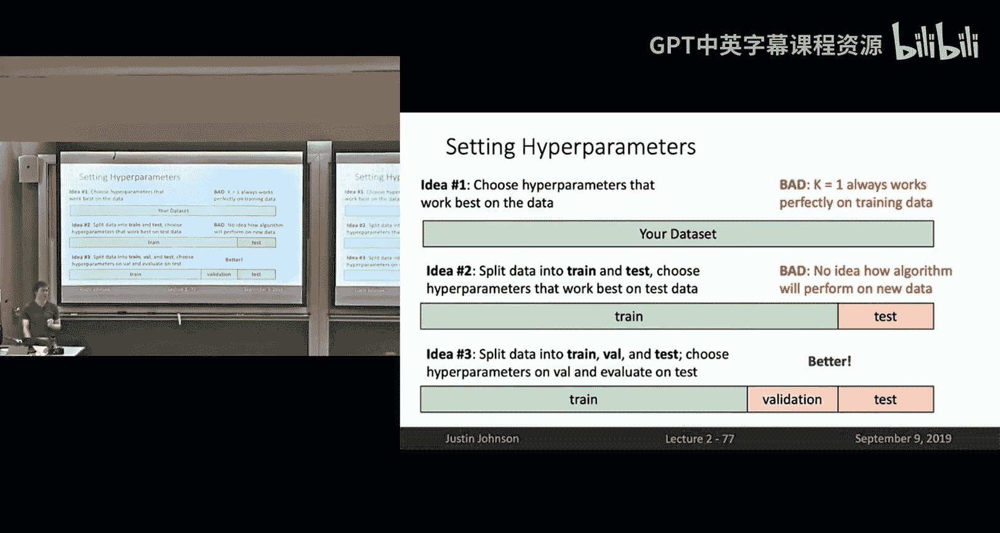

So that's idea number four called cross validationidation。

 which is maybe even the best idea that we really should all be doing。

 So here the idea is we'll split our data into many。

 many different chunks called folds and now what we're going to do is iterate through them and and maybe in this example we have five folds so we'll try out five different versions of our algorithm。

 one that uses fold 5 as a validation set and trains unfold folds one through four one that uses fold4 as a validation set and trains on folds 1 two。

35 etc cea etc ce。 and then what you can do is then now you get a slightly more robust idea of how hyperparameters are going to perform on unseen data because now you get maybe one sample per fold for each setting of the hyperparameters and then maybe you select your best hyperparameters using highest using some metric maybe the highest accuracy across all folds。

 something like that So this is this is probably the most robust way to choose hyperparameters but it's fairly expensive。

Because it requires actually training your algorithm on many different folds of the data。

 so even though this is definitely the most correct thing you can do in practice。

 this doesn't typically get done in most machine learning projects。

 just because the training can be very， very expensive for many of those models。

 But if you're using smaller models or smaller data sets or if you can afford。

 if you can computationally afford to do it， then some kind of crossvalidation is really the correct way to set hyperparameters for your machine learning models。

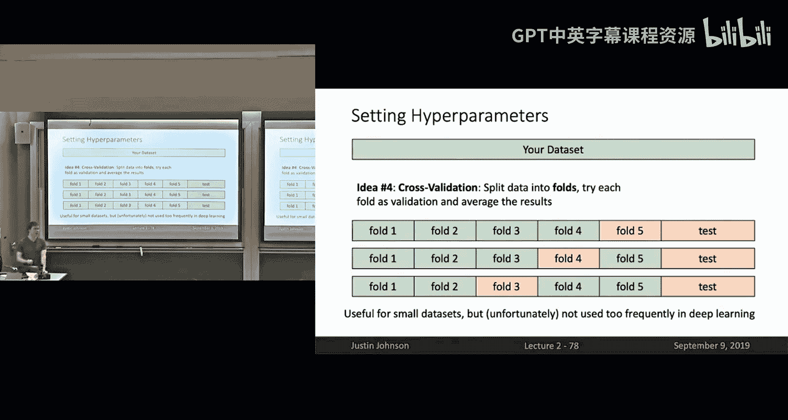

So when you run cross validation， you end up getting a plot like this。

 So then here maybe on the X axis is a value is different values for one of our hyperparameter k。

 and on the y axis we see then each dot is then one of the validation set performances for each of those different trials of the algorithm that we've run。

 So here's so this is an example of5fold cross validationation on k。

 and the line here maybe gives the mean across all the folds for each setting of the hyperparameters。

 So then here we can see that maybe peaks around k equals7 ish。

 So based on this example of cross validation， then k equals 7 is the correct value to set for this hyperparameter then we should run our model。

 So then once we set that value of k equals 7， we should then run our model exactly once on the test set and that's the number we report for our algorithm。

So another interesting feature of the K nearest neighbor algorithm is this property of universal approximation。

 So what's really interesting is that k nearest neighbor actually makes very few assumptions with the types of functions that it can represent。

 So in fact， as we take the number of training samples to infinity。

 then k nearest neighbor can actually represent any function。 Of course。

 any is here with a mathematical asterisks because anytime you make statements like this。

 people who've taken a real analysis course will start pointing out all the corner cases where it might fail。

 So I've tried to cover cover myself a little bit here。

 But basically for all practical for all practical functions you might encounter in nature。

 you can expect this to work quite well。 So as kind of intuitive example of how this universal approximation property can work for k nearest neighbors。

 here's an example of maybe doing a continuous valued prediction using a nearest neighbor approach。

 So here we maybe have a one pixel image So just a a single floating point number。Is our input X。

 And now we want to predict a single floating point number Y。

 So then the blue curve here shows some underlying true function that we want our machine learning model to learn。

 But we only have access to a finite number of data samples。 So here。

 the black points represent this finite number of samples from this underlying true function。

And now the green curve represents the value of a K of a one nearest neighbor classified one nearest neighbor regressor。

 I guess， in this case， if we were to use this finite training sample to approximate this underlying true function using this finite sample using this finite number of training samples。

 and because it's a one nearest neighbor， we have it sort of has a flat constant region around each of the training samples and areas and discontinuities wherever it's exactly between two of the training samples。

Now， this example uses only five points for training。

 So the quality of our function approximation here is quite bad。

 But as we increase the number of training samples， you're doubling to 10， again。

 doubling to 20 and now doubling now going up again to 100。

 we can see that this one nearest neighbor classifier basically is doing a very。

 very good job at approximating this underlying function。

 And you can imagine we're not going to go through a formal proof here。

 but kind of intuitively speaking， if you're able to kind of paper the space and kind of cover the entire training space with all of your data points with enough data points。

 then your nearest neighbor algorithm， your nearest neighbor classifier will actually learn some arbitrarily correct approximation of the true underlying function。

So that seems to be really good news， right， right， This nearest neighbor is。

 maybe this is the only learning algorithm we need， right， It can represent any function。

 All we need to do is collect a lot of data。😊，But there's a catch here。

 and that catch is called thecursive dimensionality。

So the problem is that in order to get a kind of uniform coverage of the full space of the training set。

 we need a number of training samples， which is exponential in the dimension of the underlying space。

 So in the example from the previous slide， our input space was only one dimensional。

 So then suppose here， maybe we don't need we actually don't need that many training samples to get a relatively dense coverage of a one dimensional space。

Suppose we had a two dimensional space， and we wanted to achieve a similar density in our training samples over a two dimensional space。

 Now we would need we would now instead of needing four examples in this in this example。

 we now would would need something like four squared training samples and also we move to three dimensions。

 we would now need four to the4 to the power three training samples to again achieve a similar density in in covering our our space。

But you also you think， okay， maybe this is okay。 we need a lot of data sure。

 but the Internet's really big， right， Maybe there's maybe there's enough images out there to cover the space of all visual things we might care about。

 And this would be very wrong to assume right，'s kind of put some numbers on this。

 if we're imagining relatively low resolution images。

 something like Cf 10 images that are only 32 by 32 pixels。

 Then the number of binary images that are 32 by 32， is2 to the power of 32 times 32。

 which is about 10 to the 308。 Now， that's a pretty big number。

 And to get get a sense of just how big that number is。

 realize that the number of elementary particles in the visible universe is about 10 to the 97。

What that means is that if we took our visible universe and we put a copy of our entire visible universe into every elementary particle in our universe。

 and if our universe was then again， a copy our universe was yet another elementary particle in some larger universe。

 then every elementary particle in this entire massive collection of universes would would be actually still less。

 then the number of 32 by 32 binary images。So this is not going to work， right。

 We can never collect enough data to densely cover the entire space of images。

 because forget about 32 by 32， We want that。 we want our algorithms to work on things that are much。

 much higher dimension。 and we don't care about just binary images。

 We care about real valued color images。

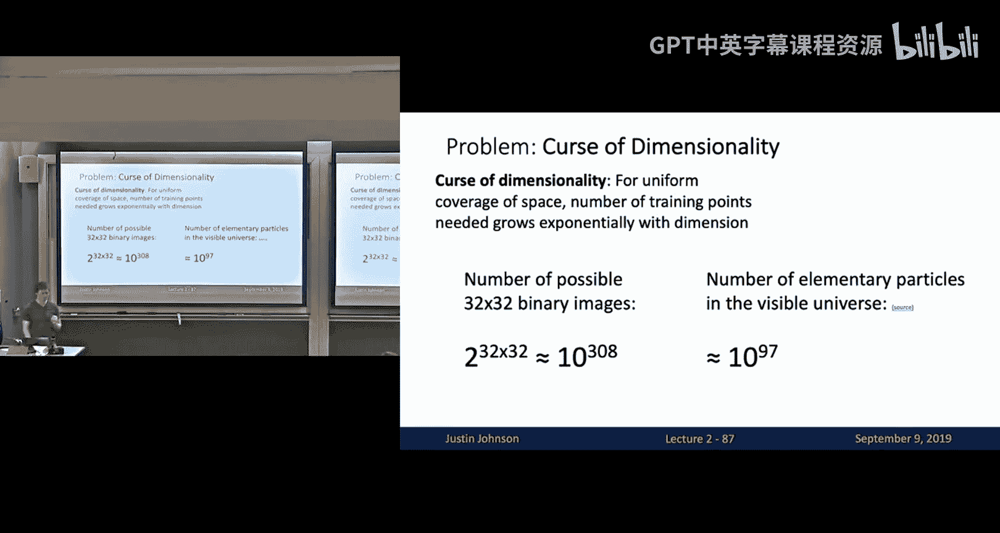

So this is not going to work。And this is， in fact， one reason why， in fact。

 a nearest neighbor algorithm， even though nearest neighbors is this very nice algorithm to think about in practice。

 it's very rarely used on raw pixels。 So for a couple of reasons， One， as we've seen。

 it's very slow at test time。 and that's kind of the opposite of what we want from machine learning systems。

 other is that the other is just it's very hungry for data。

 and it's very difficult to get enough data to cover the space of all possible images。

A third reason is that these distance metrics on raw pixel values is just not very semantically meaningful。

 So as kind of a trivial example of this， if we look at this original image on the right on the left and compute the L2 distance from the original image to each of these three perturbed images We'll find that the L two distance is the same across all of these three pairs。

 and this is not very intuitive， right， the middle， this shifted image， for example。

 to us appears very， very similar to this original image on the left。

 So you might intuitively hope that any reasonable metric of comparing image similarity should say that the original image and the shifted image are very。

 very similar。 While this boxed image or this tintive image should be much larger in distance。

 But unfortunately， these kind of raw pixelwise L2 or L1 metrics between raw pixels of images is just not very sensitive and is not able to capture these kind of perceptual or semantically meaningful distances between images。

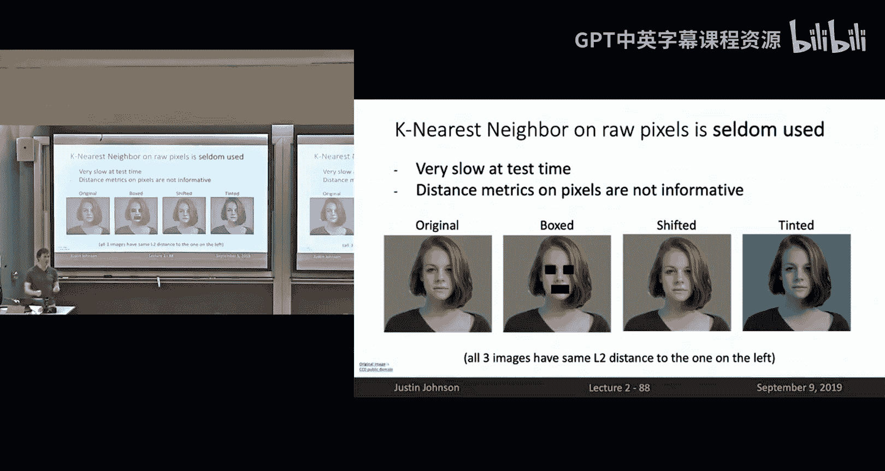

So even though raw even though nearest neighbor classifiers on raw pixel values do not work very well。

 actually， it turns out somewhat surprisingly that one thing that does work quite well is nearest neighbors using feature vectors computed from deep convolutional neural networks。

 So of course， over the next couple of weeks will talk about exactly how these might be computed。

 but as just a hint here， here's an example of doing nearest neighbor retrieval using not the raw pixel values。

 but instead using feature vectors computed for these images with a deep network。

 And what you can see is that now our nearest neighbors that we retrieve are quite semantically meaningful。

 So here we given a picture of a train we're able to retrieve trains even though they are from different viewpoints and different angles and even have trains in different positions in the image。

 or if we look at this image of a baby we can see that we're able to retrieve other images of babies。

 even though they look even though the raw pixel values are completely different。

 What I think is particularly interesting here is the example。On the far right of the baby row。

 where you can see that we've retrieved a baby， which has actually rotated 90 degrees。 So here。

 the pixels of those two images are completely different。

 Yet somehow the features computed by this deep network were able to bridge this semantic gap to some extent。

And what's interesting here is that sometimes even though using nearest neighbor on raw pixel values is not used that often。

 In fact， using some nearest neighbor retrieval with convolutional neural network features is actually a very strong baseline for a lot of problems So there was this very nice paper from a few years ago where they actually performed image captioning using a nearest neighbor approach。

 So here you know we've got a large data set of images and captions。

 we retrieve nearest neighbors using features computed from deep networks。

 and we just return the caption of the nearest neighbor from the training set and even though this is a relatively simple nearest neighbor algorithm。

 it actually can give some pretty good captions， So it it can say things like a bedroom with a bed and a couch on the upper left or a cap sitting in a bathroom sink on the upper right。

 which maybe says more about the distribution of images of cats that people upload on the internet。

 this sort of suggests that there's a lot of examples of cat sitting in syncs in the training set。

But the point here is that even though a nearest neighbor is maybe not the best thing to do on raw pixels。

 you should actually definitely consider giving it a try for more complex problems using better features。

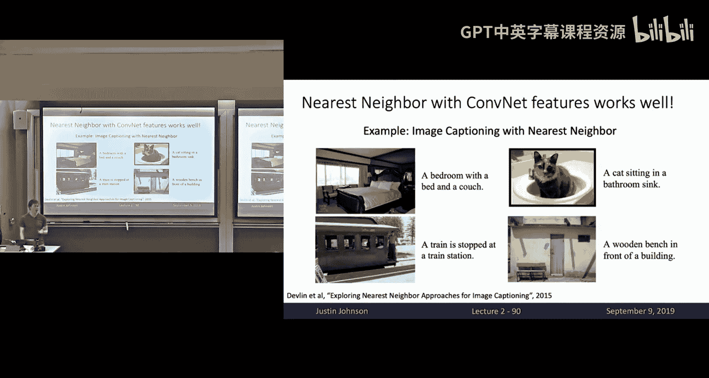

So then to kind of summarize what we talked about today we talked about this overall problem of image classification and we saw how it can be a building block for many other problems in computer vision。

 and then we saw the canest neighbor algorithm as our kind of first example of a learning algorithm and that was simple enough for us to walk through the full learning pipeline in just this one lecture we talked a bit about hyperparameters。

 we talked a bit about data hygiene on how to properly deal with your training and validation sets。

So you'll get if you do the first if now you have enough knowledge to go and do the first homework assignment。

 which will be due over the weekend， and then we can come back on Wednesday and start talking about that our next learning algorithm of linear classifiers。

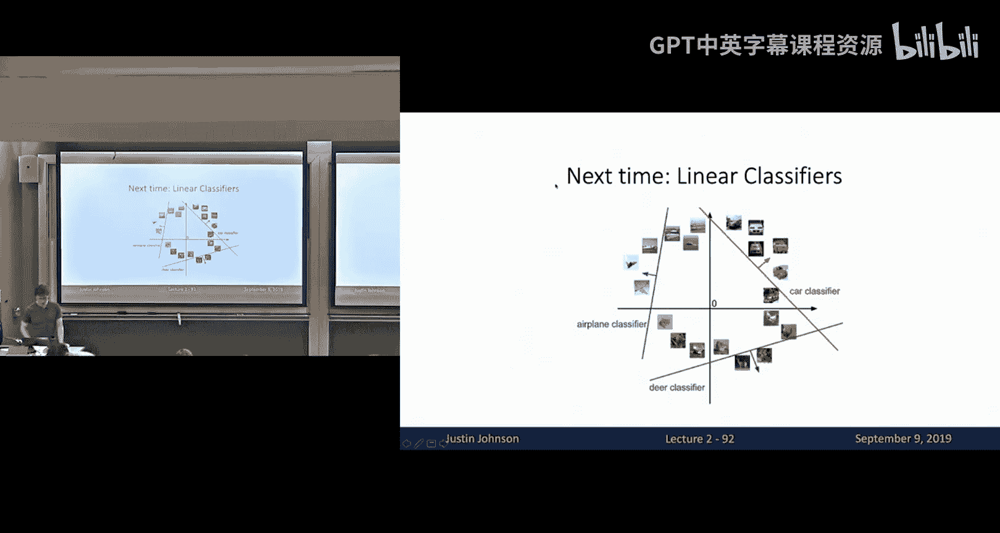