# 深度学习用于计算机视觉：02：图像分类

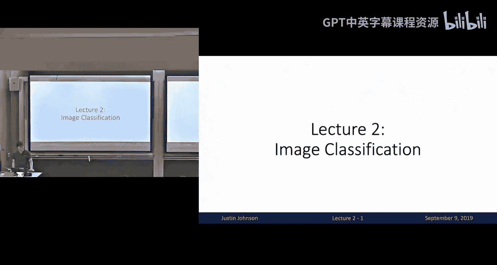

## 概述
在本节课中，我们将要学习计算机视觉中的核心任务——图像分类。我们将探讨其定义、面临的挑战、应用场景，并深入介绍我们的第一个学习算法：K最近邻算法。通过本节课，你将理解机器学习方法如何通过数据驱动的方式解决图像识别问题。

## 课程管理事项
在进入今天的正式内容之前，我们需要先处理几项课程管理事项。

以下是关于候补名单状态的说明：
*   我们昨天发放了一批选课许可。
*   如果你收到了许可但尚未选课，请立即完成选课，因为许可将于明天过期。
*   如果你收到许可但未选课且许可过期，你将不会获得新的许可，我们将把许可发放给候补名单上的其他同学。

以下是关于办公时间的说明：
*   我和助教的办公时间将于本周开始。
*   具体时间安排可在Google日历上找到，日历链接位于课程网站上，课程网站链接可在校园网上找到。

以下是关于课程交流平台Piazza的说明：
*   Piazza是本学期我们与大家沟通的主要平台。
*   目前，课程注册学生数与Piazza注册学生数差异很大。
*   如果你尚未注册Piazza，请立即注册。

以下是关于第一次作业的说明：
*   我们已于昨天发布了课程的第一次作业。
*   作业链接可在课程大纲、Canvas等地方找到。
*   本次作业将使用Python和PyTorch，并在Google Colab上完成。
*   作业涵盖两个主要主题：PyTorch张量简介和K最近邻分类算法。
*   作业提交截止日期为9月15日（周日）晚上11:59。

以下是关于使用Google Colab完成作业的说明：
*   在作业网站上，点击“在Colab上打开”按钮。
*   笔记本将在你的浏览器中打开，并自动连接到后端带GPU的虚拟机。
*   你无需安装任何软件，可以直接在浏览器中完成作业。
*   完成后，可以将副本保存到自己的Google云端硬盘，并下载为IPython笔记本文件提交到Canvas。

## 图像分类任务
上一节我们介绍了课程的管理事项，本节中我们来看看图像分类任务本身。

图像分类是计算机视觉乃至更广泛的机器学习领域中一项非常重要的核心任务。

图像分类的任务陈述非常简单。我们的算法将接收一张输入图像（例如左侧的图片），然后需要为该图像分配一个类别标签。当我们讨论图像分类时，通常预设算法知晓一组固定的类别标签。在这个例子中，算法可能知晓“猫”、“鸟”、“鹿”、“狗”、“卡车”这五个标签。算法在执行图像分类时，需要做的就是简单地为看到的图像分配这五个标签中的一个，本例中就是“猫”。

对我们所有人来说，这是一个非常简单的任务。你几乎可以不假思索地完成它，看一眼图像就能立刻知道这是一只猫。

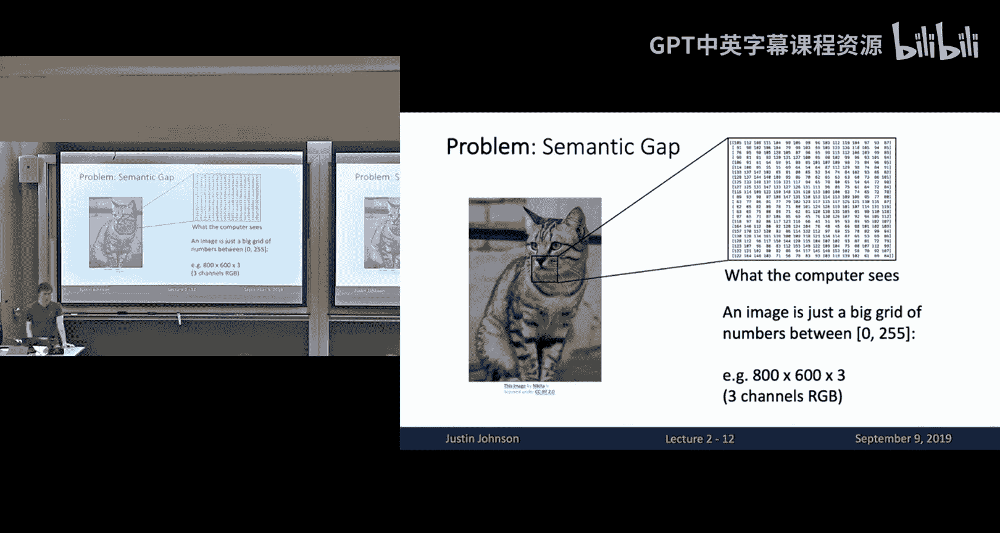

但对计算机来说，这并不容易。当我们尝试在机器上实现图像识别和分类时，面临的主要挑战是一个被称为“语义鸿沟”的问题。当我们看这张图像时，我们立刻认出它是一只猫。光子击中我们的视网膜，经过大脑的复杂处理，但我们看图像时并没有意识到这个过程，只是直观地知道我们看到的是什么。但计算机没有这种直觉。当计算机看这样一张图像时，它得到的只是一个巨大的数字网格。对于这样一张图像，它只是一个800x600x3的巨大数字网格，其中每个像素都有一个由0到255之间的三个数字表示的颜色值。

问题是，如果你看这个数字网格，完全不清楚这个数字网格应该代表一只猫。没有明显的方法将这个原始像素值网格转换成具有语义意义的“猫”这个类别标签。

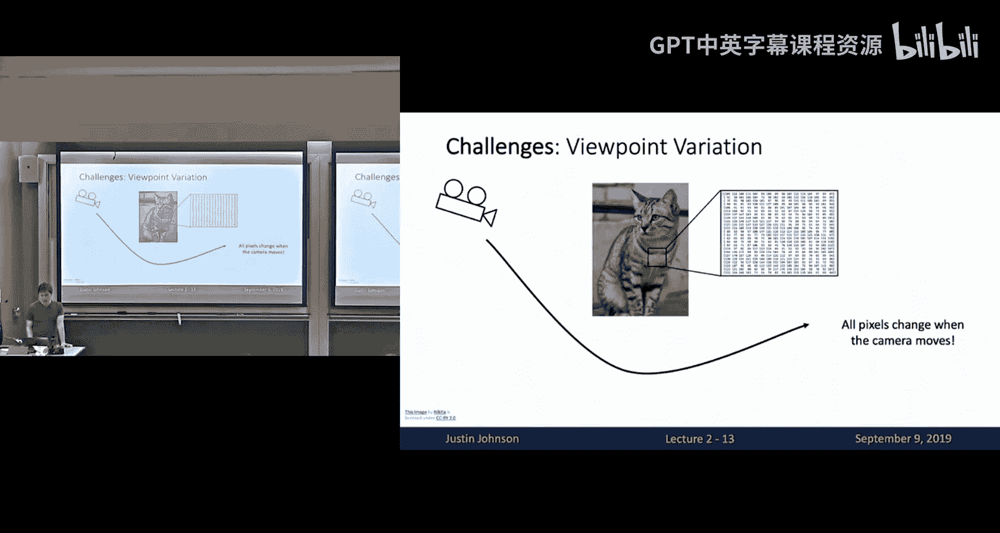

更糟糕的是，当我们对图像进行相对简单的更改时，整个数字网格可能会发生剧烈变化。

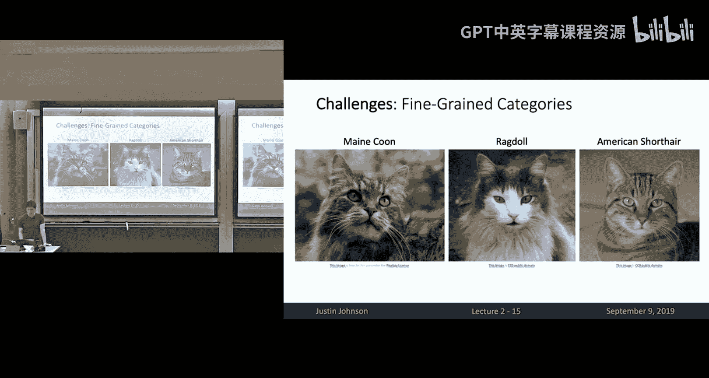

## 图像分类的挑战
上一节我们定义了图像分类任务并指出了“语义鸿沟”问题，本节中我们来看看实现稳健图像分类所必须应对的具体挑战。

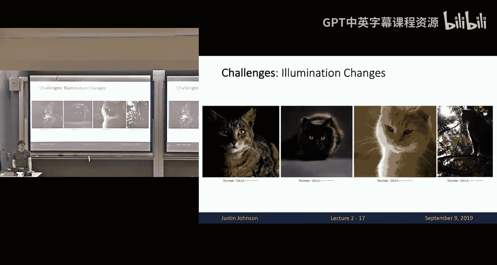

以下是图像分类面临的主要挑战：

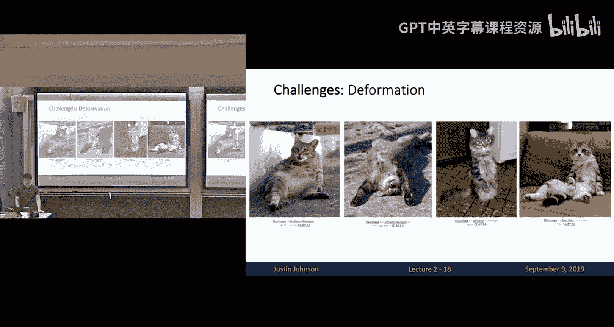

**视角变化**
例如，如果我们从稍微不同的角度拍摄同一只猫的照片，我们所有人肯定仍然会认出它是一只猫，甚至可能认出是同一只猫。但由于语义鸿沟的存在，即使是这样简单的图像变化，也会导致所有像素值以一种非常不直观的方式改变。我们需要设计的算法必须能够应对这些由图像本身相对简单的变化所引起的原始像素值的巨大变化。

**类内差异**
不同的猫看起来非常不同。这些不同的可爱猫咪在相机原始传感器上都会产生非常不同的像素值网格。我们需要构建能够应对类别内部可能出现的这些巨大差异的系统。

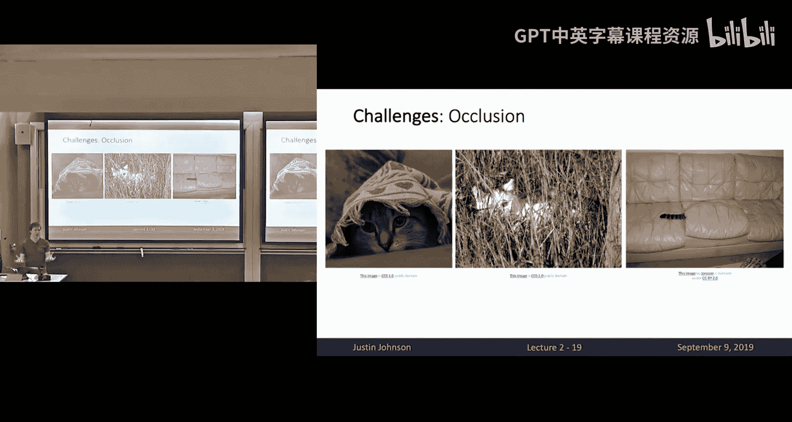

**细粒度分类**
有时我们需要识别视觉上非常相似的细粒度类别。例如，在某些应用中，我们可能希望识别不同品种的猫。这同样是一个巨大的实际问题。

**背景干扰**
有时图像中我们想要识别的物体会融入背景中，可能是由于自然伪装或场景中其他复杂情况。我们的分类器需要对此保持稳健。

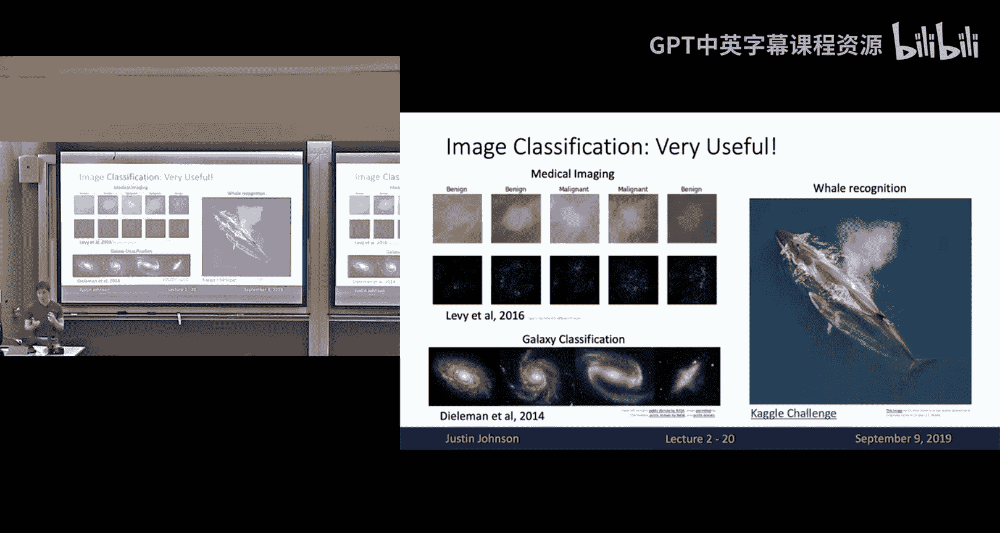

**光照变化**
随着场景中光照条件的改变，例如开关灯、在黑暗中或在日光下拍照，图像中物体的底层语义并不会改变。因此，我们的算法应该能够应对不同光照条件下的这些巨大变化。

**形变**
我们想要识别的物体在图像中可能以非常不同的姿态、非常不同的位置出现。猫是特别容易形变的物体类别。

**遮挡**
有时我们想要识别的物体在图像中可能几乎完全不可见。右侧的例子非常有趣，这基本上是一个沙发，我们看到一个尾巴从沙发垫下面伸出来。你可能直觉上认为那是一只猫，因为你见过很多猫的图片，知道猫通常住在房子里，知道猫有时喜欢钻到东西下面。但实际上，如果只考虑这张图像的原始图像证据，我们并不知道这是一只猫。这可能是浣熊，也可能是其他有尾巴的动物。因此，即使是为图像中的物体分配类别标签这个相对简单的问题，也可能涉及大量关于世界的常识推理。

如果我们想要识别世界上存在的所有类别，以及这些物体在图像中可能出现的所有变化、位置和外观方式，这个相对简单的图像分类问题很快就会变得非常具有挑战性。

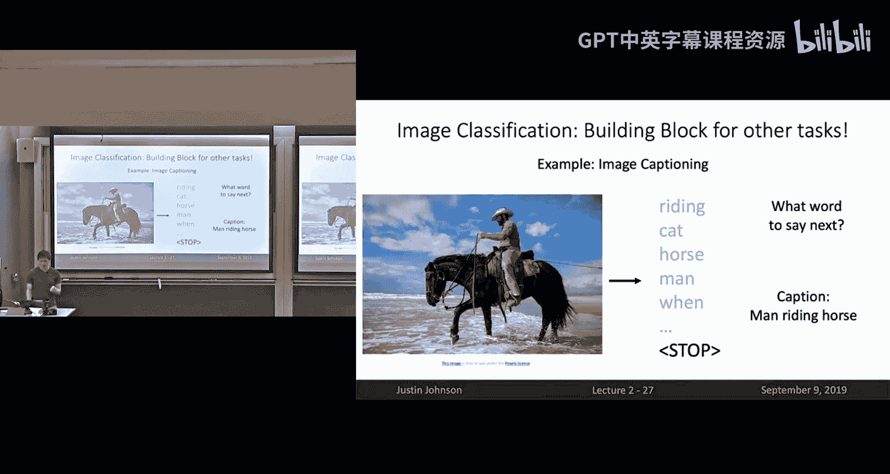

## 图像分类的应用
上一节我们探讨了图像分类面临的诸多挑战，本节中我们来看看为什么克服这些挑战、实现稳健的图像分类会如此有用。

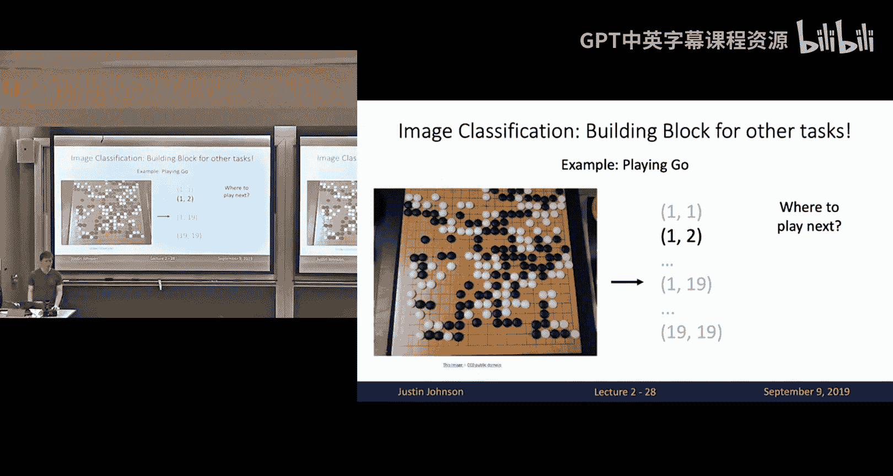

如果我们能够克服所有这些问题，编写出能够执行稳健图像分类、在各种情况下识别大量物体类别的算法，那将非常非常有用。

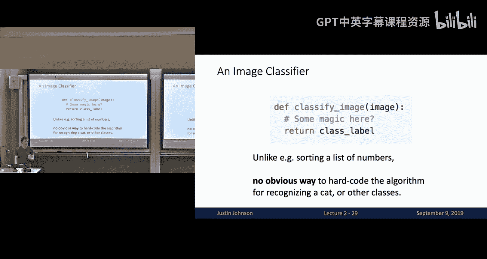

我们已经在上一讲中看到计算机视觉的一些应用如何解锁许多不同的科学问题。我们可以将图像分类用于医疗影像、医学诊断等领域。例如，拍摄皮肤病变图片并诊断其为恶性或非恶性肿瘤；拍摄X光片并尝试分类医学图像中可能存在的问题类型。

稳健的图像分类对天文学家也很有用，他们希望从望远镜和其他类型的传感器收集视觉数据，然后分类天空中存在的现象类型。这对于许多其他科学应用也很有用，例如识别鲸鱼或对传感器中可能出现的许多不同类型的动物进行分类。

图像分类本身就是一个非常非常有用的难题，如果我们能解决它，可以解锁许多真正强大且有用的应用。

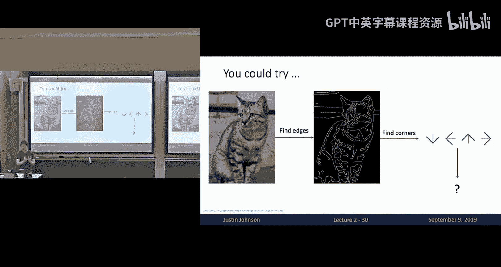

但我觉得可能更有趣、也许不那么直观的是，图像分类也是我们希望在计算机视觉内部执行的不同算法的基本构建模块。

## 作为构建模块的图像分类
上一节我们看到了图像分类的直接应用，本节中我们来看看它如何作为更复杂视觉任务的基石。

作为一个例子，我们之前讨论了图像分类。计算机视觉中有一个相关的任务叫做目标检测。在目标检测中，我们想要做的是在图像中的物体周围绘制框，并不仅说明图像中存在什么物体，还要说明它们在图像中的位置。事实证明，图像分类本身可以作为一个子部分，用于构建更复杂的应用，如目标检测。

例如，执行目标检测的一种方法是通过对图像中不同的滑动窗口进行图像分类。执行目标检测的一种方法就是分类图像的不同子区域。我们可以看这里的一个子区域，然后将其分类为背景、人、马、汽车或卡车。在这个例子中，它被分类为背景，因为这里没有物体。如果我们分类这个框，我们应该将其分类为人，等等。可以看到，如果我们有能力构建真正强大的图像分类器，那将再次让我们能够构建像目标检测器这样的其他应用。

即使是像图像描述这样的任务，也常常被构建为图像分类问题。这里的想法是，给定一张输入图像，我们可能希望写一个自然语言句子来描述图像中的内容。这可以像目标检测案例一样，被构建为一系列分类问题。这里，算法可能知晓英语中一组固定的词汇。问题是，我接下来应该说哪个词。这同样是一个分类问题。首先，我们会使用图像分类器分类并选择“男人”这个词，然后选择“骑”这个词，选择“马”这个词，最后选择“停止”这个词来表示句子结束。

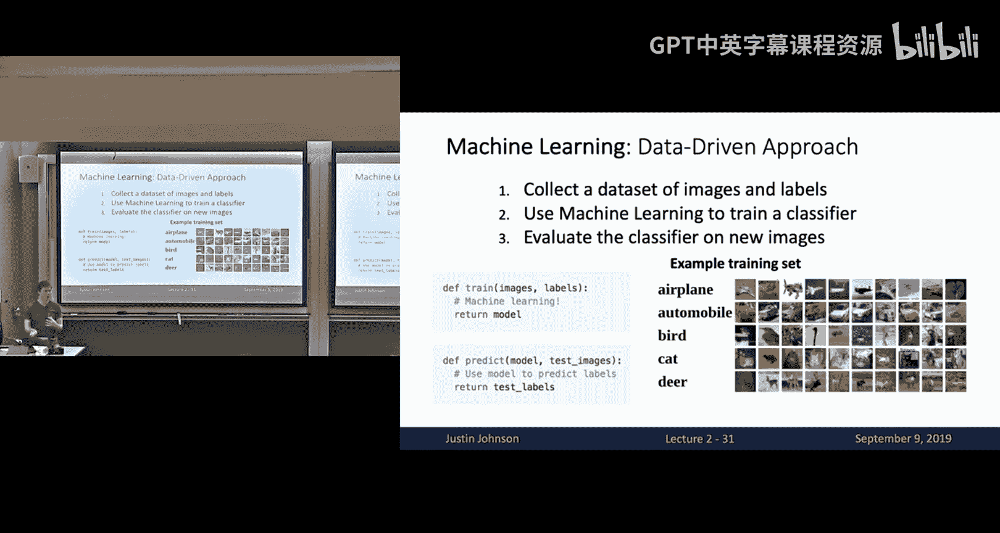

可以看到，图像分类这个相对简单的任务，是一个真正强大的构建模块，我们可以用它来构建计算机视觉中许多更有趣的问题。

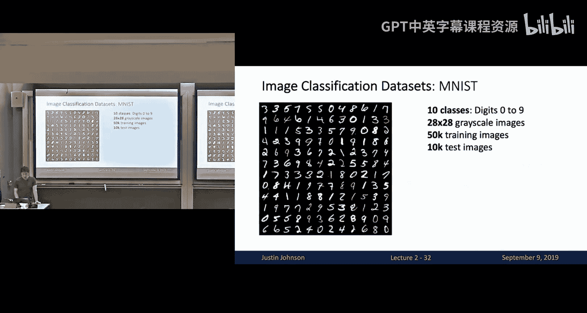

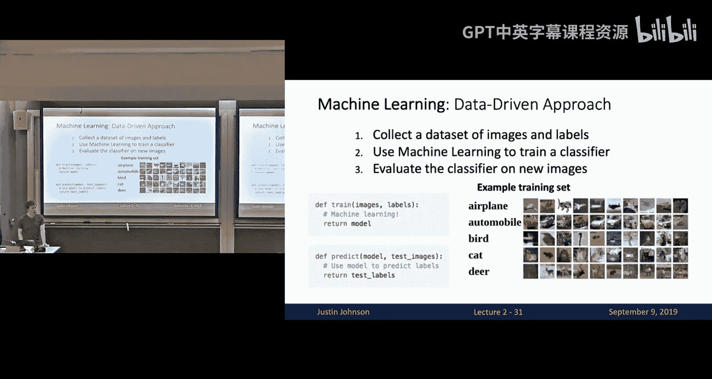

## 数据驱动方法
上一节我们看到了图像分类作为基础任务的重要性，本节中我们来看看如何着手解决这个“如何编写分类算法”的难题。

考虑到所有这些，我们确实希望能够编写出能够很好执行图像分类的算法，但完全不清楚我们应该如何做。如果你只是坐在电脑前开始编写代码，你需要编写这个神奇的Python函数，它输入这个巨大的像素值网格，执行一些神奇的计算，然后以某种方式输出“猫”，或者在围棋棋盘的第5行第9列落子，或者判断这片图像是或不是背景。完全不清楚你应该在这里输入什么代码，因为与对整数列表排序这样的任务不同，确实没有明确定义的算法来将数字网格转换成“猫”。

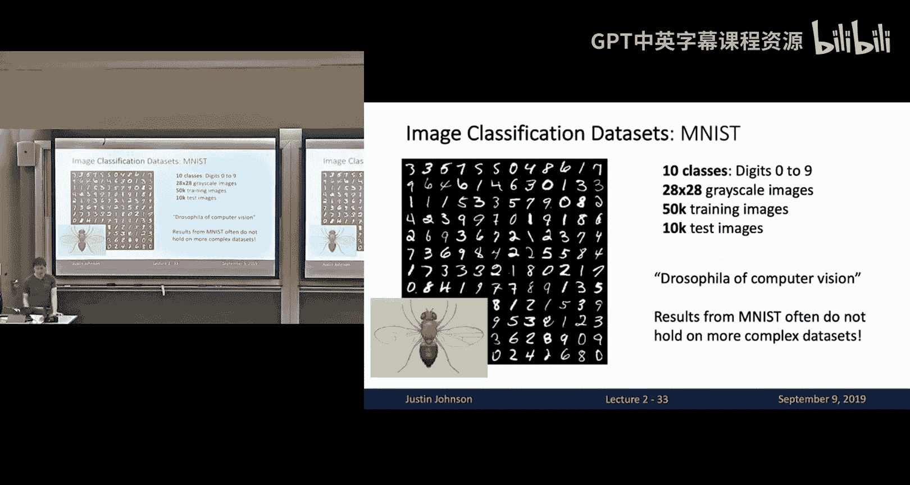

我们需要做点什么，但完全不清楚我们应该如何解决这个问题。

你可能会做的一件事是，尝试利用你自己关于猫和其他物体外观的人类知识，来手动编写尝试挑选出不同物体类别的分类器。

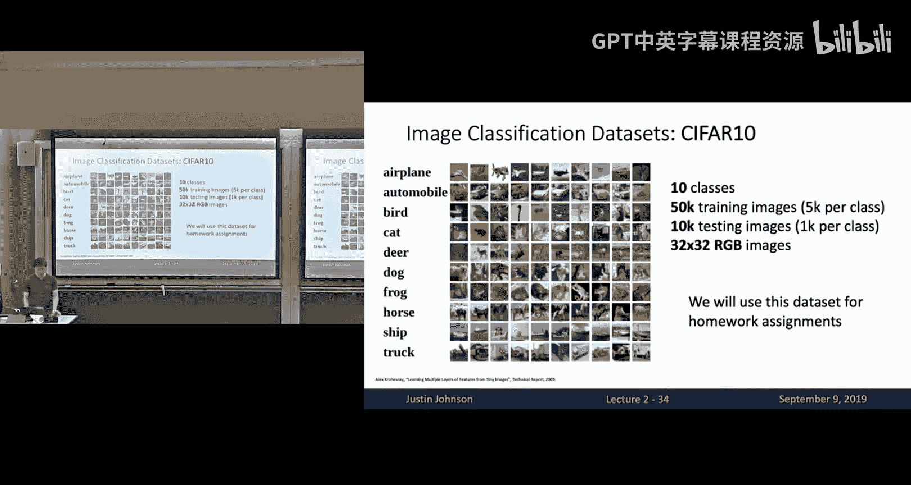

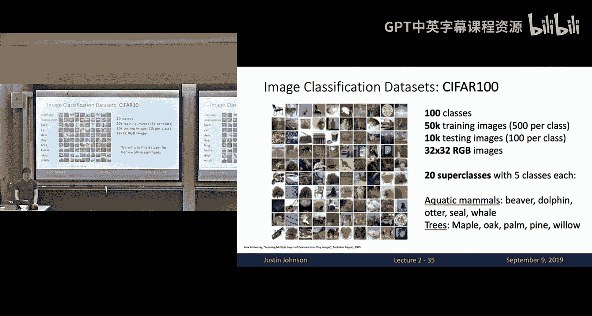

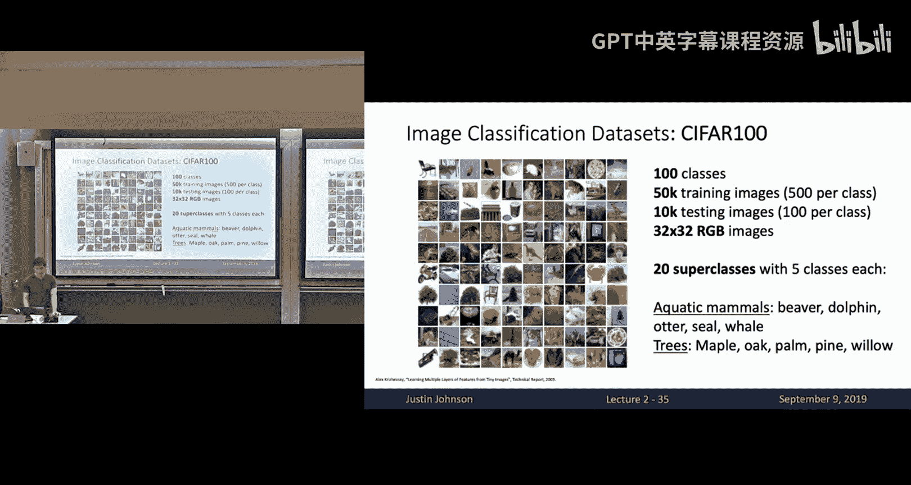

## 传统方法的局限性
上一节我们提到了手动编码规则的想法，本节中我们来看看为什么这种方法不可行。

你可能会想象这样做：我们在上一讲中谈到图像中的边缘非常重要。所以，也许我们可以尝试先获取图像，然后使用某种边缘检测算法提取边缘。接着，你可能会尝试在这些边缘中寻找角点或其他可解释的模式。你知道猫可能有三角形的尖耳朵，你希望这些耳朵能在边缘中显现出来，所以也许你可以寻找角点，然后编写关于猫耳朵允许角度的规则。猫的胡须可能在不同位置，胡须可能会在边缘中显现。你可以想象，真的尝试深入其中，硬编码你所有关于猫外观的人类知识，并尝试编写一些明确的算法来检测它们。

但这不是一个很好的方法。它会很脆弱。可能会有没有胡须的猫，或者没有尖耳朵的猫。有时边缘检测器会失败，无法检测到你希望它检测到的边缘。也许你花了很多时间试图弄清楚猫的所有边界情况。但明天，我们想对星系进行分类。很可能你为从图像中识别猫而投入的所有艰苦工作，在我们明天想识别星系时将被完全抛弃。因此，我们真的需要一种更稳健、更可扩展的方法，一种不需要我们写下关于不同类型物体外观的所有人类知识的方法。

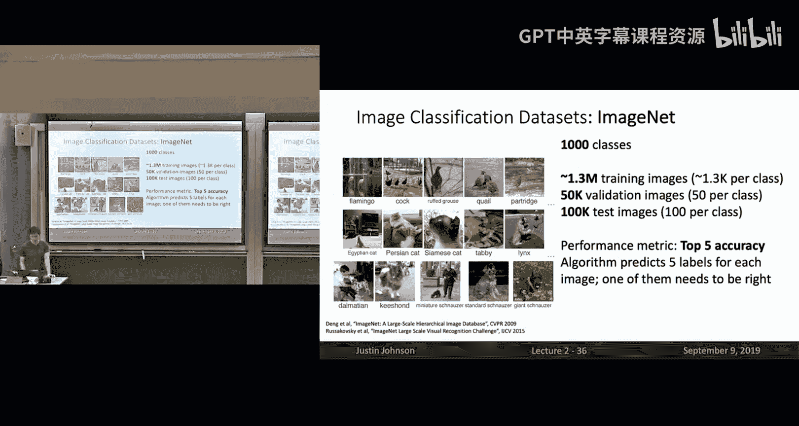

## 机器学习方法
上一节我们看到了手动编码规则的局限性，本节中我们来看看机器学习的解决方案。

这就是我们转向机器学习的原因。其理念是，与其尝试明确编码我们自己关于不同类型物体外观的人类知识，不如采用数据驱动的方法，让算法能够从数据中学习如何识别图像中不同类型的物体。

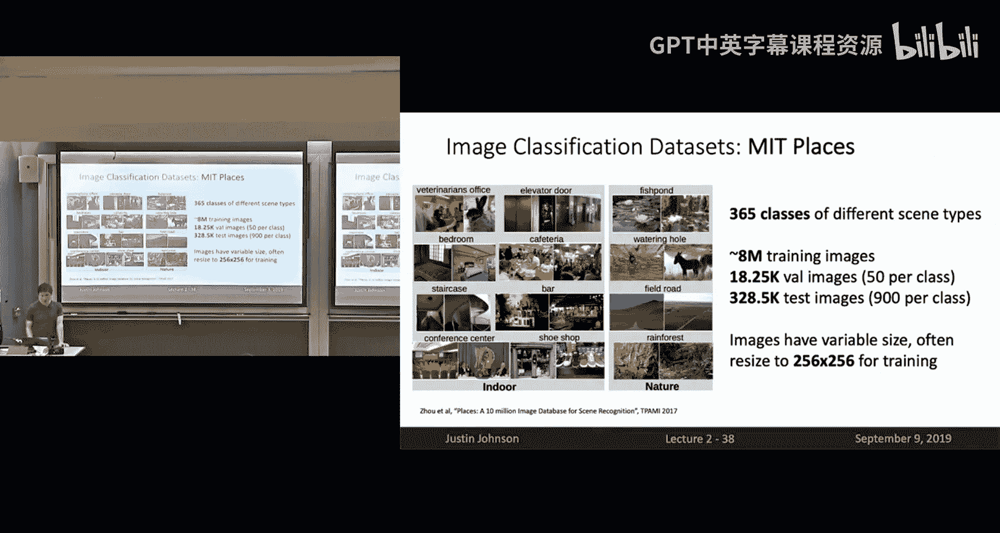

我们要构建的这个机器学习系统的基本流程是：首先，收集一个包含大量图像的数据集，并用我们希望算法预测的标签类型为它们打上标签。例如，如果我们想构建一个猫狗分类器，我们需要出去收集很多猫和狗的图片，然后收集人工标注，说明哪些图片是猫，哪些是狗。一旦我们收集了这个大数据集，我们将部署某种机器学习算法，该算法将尝试学习输入图像与数据以及我们在数据收集过程中写下的输出标签之间的统计依赖关系。

然后，一旦我们使用机器学习算法提取了这些统计依赖关系，我们就可以在新图像上评估这个分类器。那么，这看起来是怎样的呢？基本上，我们不是编写一个名为`classify_image`的单一整体函数，而是拥有这个两部分的API。一个是我们需要编写一个名为`train`的函数，它将输入一组图像及其关联的标签，执行一些神奇的机器学习，然后返回某个统计模型。然后我们的第二部分API是这个`predict`函数，它将输入我们在训练阶段产生的模型以及要评估该模型的新图像。这将在新图像上运行模型，然后输出从训练集中学习到的标签。

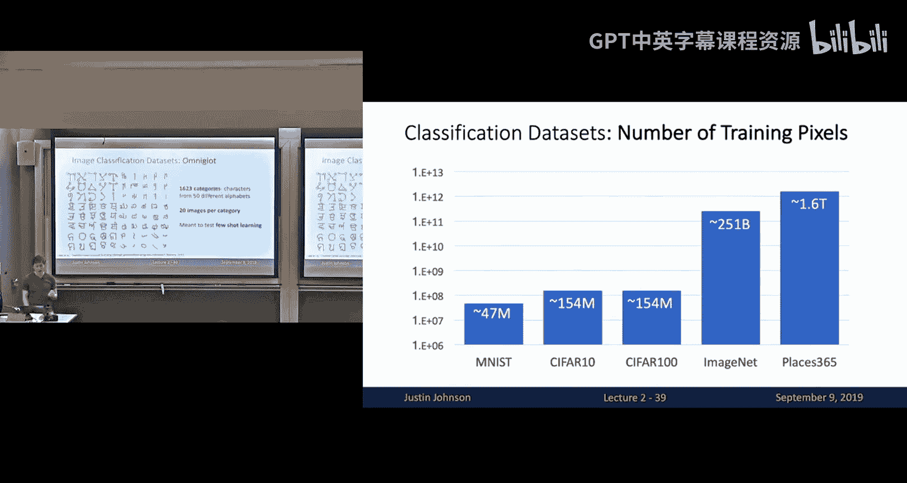

这种方法真正有趣的地方在于，它是一种不同的计算机编程方式。当你考虑编写算法来对数字列表排序或执行其他类型的经典算法时，你基本上是在使用你自己的人类知识来告诉计算机它需要执行的确切步骤，以产生你希望它产生的输出。但现在，当我们采用数据驱动的机器学习方法时，我们基本上是通过我们输入的数据来对计算机进行编程。现在，如果我们想对计算机进行编程以识别猫，我们就输入猫的图片。如果我们明天想识别星系，我们需要做的就是收集一个新的星系数据集，我们不需要重新编写我们的机器学习算法（希望如此），相反，我们只需要输入新数据，然后改变程序的行为。

现在，这对于许多我们不知道如何编写明确程序来解决的问题来说，是一个非常强大的范式。这就是我们将要采用的方法。这已成为基本上所有视觉识别问题（包括图像分类）的主流方法。

## 常用数据集
上一节我们确定了采用机器学习数据驱动的方法来识别图像，本节中我们需要讨论数据来源。

以下是几个你经常会遇到的常见图像分类数据集：

**MNIST数据集**
*   MNIST有10个类别，数字0到9。
*   图像是28x28像素的灰度图像，非常小。
*   它提供50,000张训练图像和10,000张测试图像。
*   这个MNIST数据集确实用于识别支票上手写数字的工业应用，并在世界范围内部署。
*   MNIST数据集有时被称为计算机视觉的“果蝇”，因为很多从业者先在MNIST上尝试新想法，但需要注意，几乎所有合理的机器学习算法在MNIST上都能取得很高的性能。

**CIFAR-10数据集**
*   CIFAR-10的图像也很小，32x32像素，但是彩色的。
*   类别不再是手写数字，而是更有趣的类别，如飞机、汽车、鸟、猫、鹿等。
*   这是一个规模相当不错的数据集，有50,000张训练图像和10,000张测试图像。
*   尽管与其他大规模数据集相比相对较小，但由于这些类别识别起来相当困难，它被认为是具有合理挑战性的。
*   因此，我们将在本学期的大部分作业中使用CIFAR-10数据集。

**CIFAR-100数据集**
*   CIFAR-100基本上是类似的统计数据，只是有100个类别而不是10个。
*   人们使用CIFAR-100比CIFAR-10少一些，但有时你会看到人们研究它。

**ImageNet数据集**
*   ImageNet已成为图像分类数据集的黄金标准。
*   基本上，当你提交一篇提出图像分类算法新调整的研究论文时，如果不展示在ImageNet上的结果，审稿人可能会抱怨，你的论文可能会被拒绝。
*   ImageNet非常有趣且具有挑战性，因为它包含1000个不同的类别，比CIFAR或MNIST的10个类别多得多，而且规模非常大。
*   大约有130万张训练图像，每个类别大约有1300张训练图像，并提供标准的验证集和测试集。
*   关于ImageNet的一个有趣之处是报告的准确率指标。由于ImageNet有1000个类别，期望算法精确挑选出一个正确类别非常困难，因此实践中人们让算法预测五个类别标签，如果正确类别出现在这五个预测中的任何一个，就算算法预测正确。

**MIT Places数据集**
*   ImageNet图像倾向于关注猫、狗、鱼、卡车等物体。
*   另一个相关的数据集试图关注场景类别，如教室、田野、建筑物等。

比较这些分类数据集的大小（假设ImageNet和Places为256x256分辨率）可以发现，CIFAR大约比MNIST大一个数量级，ImageNet大约比CIFAR大两个数量级，而Places又比ImageNet大一个数量级。这说明了为什么ImageNet在某种程度上是与这些其他数据集性质不同的数据集，也使得在ImageNet上的结果更有说服力，但不幸的是，有时计算成本非常高。因此，在本课程中，我们坚持使用CIFAR作为一种折中的选择，在ImageNet上显示的视觉识别任务的复杂性与像MNIST这样较小数据集的计算可负担性之间取得了平衡。

从这张图表中还可以看到数据规模随时间增长的趋势。这绝对是研究的一个有趣方向：我们如何利用越来越大的数据集来增强算法执行稳健分类的能力。

但人们也开始思考另一个方向。一个需要注意的有趣数据集是Omniglot数据集。

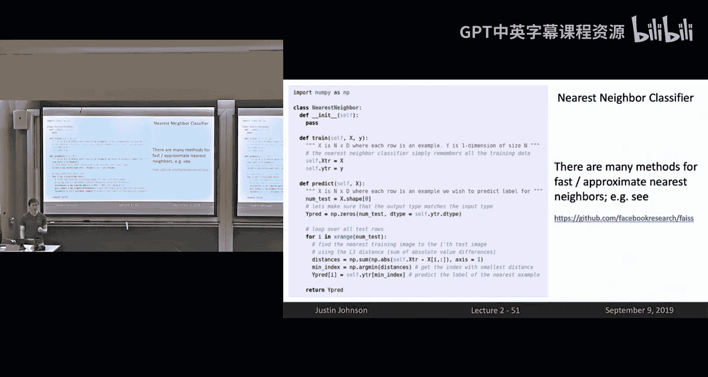

**Omniglot数据集**
*   Omniglot将事情推向极端，希望基准测试算法在相对较少数据下学习的能力。
*   Omniglot有超过1600个不同的类别，每个类别是地球上某种语言字母表中的字母。
*   它包含了50多种不同书写语言的字母。
*   Omniglot真正有趣的地方在于，它不是为每个图像类别提供大量示例，而是每个字母只提供20个示例。挑战在于构建能够从每个图像类别相对较少的示例中稳健学习的算法。
*   这种所谓的“少样本分类”问题是一个真正巨大且新兴的研究领域，许多研究人员现在开始思考这个问题。

## K最近邻算法
上一节我们讨论了一些常见的图像分类数据集，本节中我们来看看第一个分类算法，因为数据只能用到这一步，你需要某种算法来实际利用这些数据。

我们要讨论的第一个学习算法是最近邻算法。这个算法非常简单，甚至可能不配被称为学习算法。它的工作原理是：记得我说过，当我们实现机器学习系统时，需要实现两个函数，一个叫`train`，一个叫`predict`。对于最近邻算法，`train`函数是微不足道的。我们只是简单地记住所有的训练数据。我们不会处理它，不会对它做任何事情，只是记住我们所有的训练数据。

在`predict`阶段，我们要做的是：获取我们想要预测标签的新图像，使用某种比较或相似性函数将其与训练集中的每一张图像进行比较，然后跟踪训练集中与测试图像最相似的图像，最后简单地返回最相似训练图像的标签。正如我所说，这是一个非常非常简单直接的学习算法，它只在记忆训练数据的意义上进行学习。

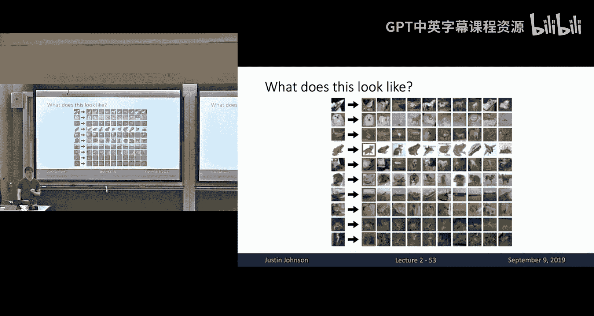

但为了实现这个算法，我们实际上需要写下一些可以计算两幅输入图像之间相似度的函数。

一个非常常见的选择是使用图像像素之间的L1距离或曼哈顿距离。我们要做的是：取测试图像（这里我们想象一个非常简单的4x4测试图像，我们明确写出了它所有像素的值），为了将其与训练图像进行比较，我们只需取两幅图像中所有对应像素的差值的绝对值，然后将所有这些对应像素差值的绝对值求和，这样就得到了一个表示两幅图像之间距离或差异的单一数字。这里需要指出的一点是，这满足数学中度量（metric）的所有常规规则。如果我们有两幅完全相同的图像，距离为零，三角不等式等规则也满足，这是一个在数学上定义合理的度量。

基本上，有了这几条信息，就足以实现你的第一个学习算法了。事实上，最近邻分类器是如此简单直接，以至于我们可以将完整的实现放在一张幻灯片上，甚至加上一些注释。更好的是，我想你甚至能读懂它。

在我们的最近邻分类器中，我说过我们需要实现两件事，一个是`train`步骤，这里很简单，我们只是记忆训练数据，所以我们将图像`X`和它们的标签`y`分配给类的某些成员变量。然后在`predict`中，同样非常简单，我们接收一些新的测试图像`X_test`，简单地遍历训练集中的所有图像，计算这个L1距离，然后返回最相似图像的标签。就是这样，这就是最近邻算法。你现在可以实现你自己的机器学习系统了。

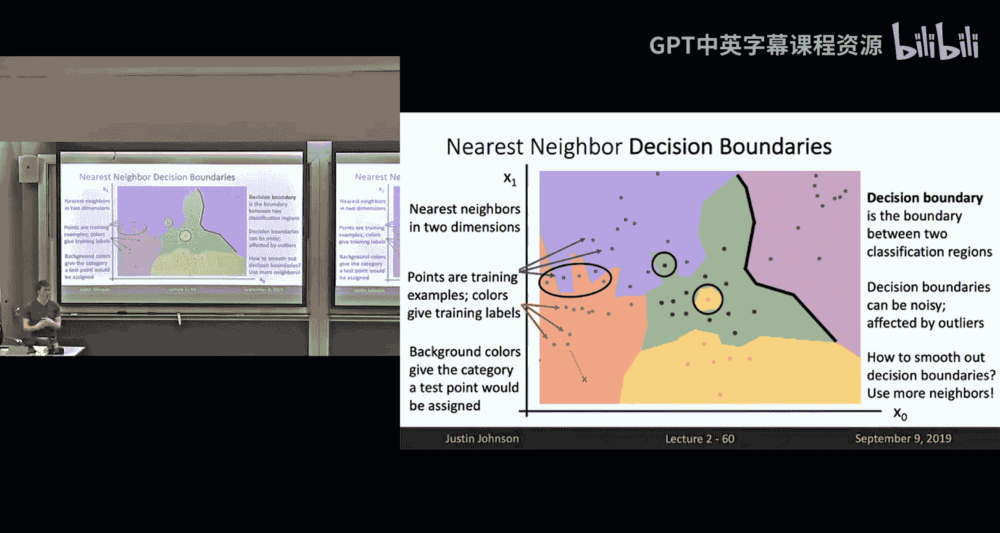

## 算法复杂度分析
上一节我们介绍了K最近邻算法的基本思想，本节中我们来分析一下它的计算复杂度。

关于这个最近邻分类器，如果我们有`N`个训练样本，那么训练速度有多快？这似乎有点棘手。如果我们只是存储指向所有训练数据的指针，那么这可以在常数时间内完成；如果你要进行深拷贝，那可能是线性时间，但我们不这样做。

那么，测试速度有多快？这将是线性时间，因为我们将图像大小和范数计算视为常数，这意味着对于每个测试样本，我们需要将其与`N`个训练样本中的每一个进行比较，因此在测试时，我们将付出与训练集大小成线性关系的性能代价。

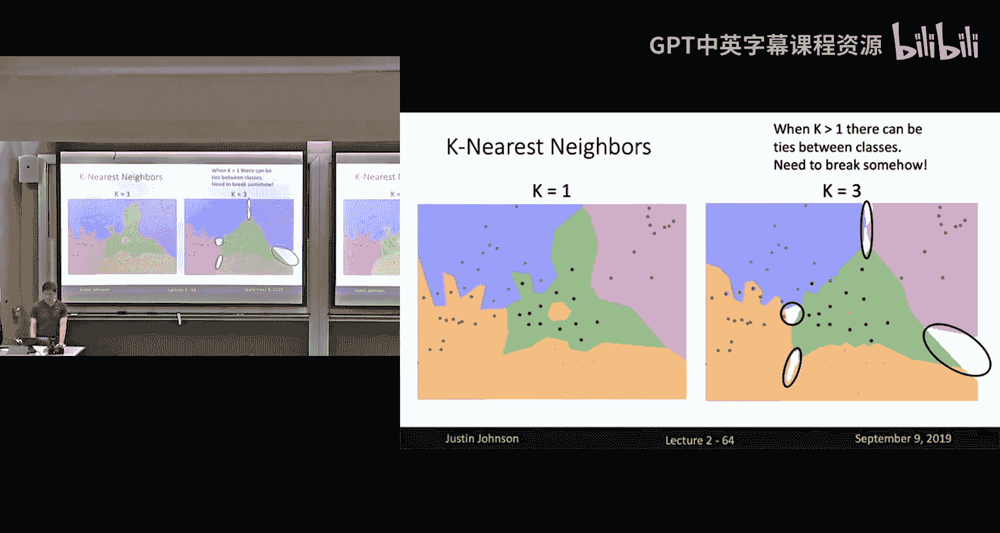

这实际上非常糟糕。这实际上与我们希望机器学习系统具备的特性相反。因为如果你考虑如何部署一个机器学习系统，我们希望做的是尽可能收集关于手头任务的大量数据，然后也许利用这些大量数据训练一个强大的模型。训练那个模型花费很长时间是可以接受的。但当我们最终部署该模型并实际在测试时使用它时，我们希望它非常快。我们希望能够在你的手机上实时运行这些模型，或者为网络上数百万或数十亿用户运行它，处理互联网上传播的所有照片。因此，这通常是我们希望机器学习系统具备的完全相反的特性。我们将看到，当我们转向基于神经网络的方法时，它们会反转这种层次结构，我们最终使用的这些神经网络系统训练时间相对较长，但在推理时相对较快。

当然，为了完整性，我也需要指出，有许多有趣的算法用于计算近似最近邻，当你执行近似最近邻计算时，这可能比这些完全的暴力方法快得多，这超出了本课程的范围，但如果你发现自己因某种原因确实需要执行大规模最近邻搜索，了解一下是很好的。

## 算法性能与可视化
上一节我们分析了算法的复杂度，本节中我们来看看最近邻分类器在图像上的实际表现。

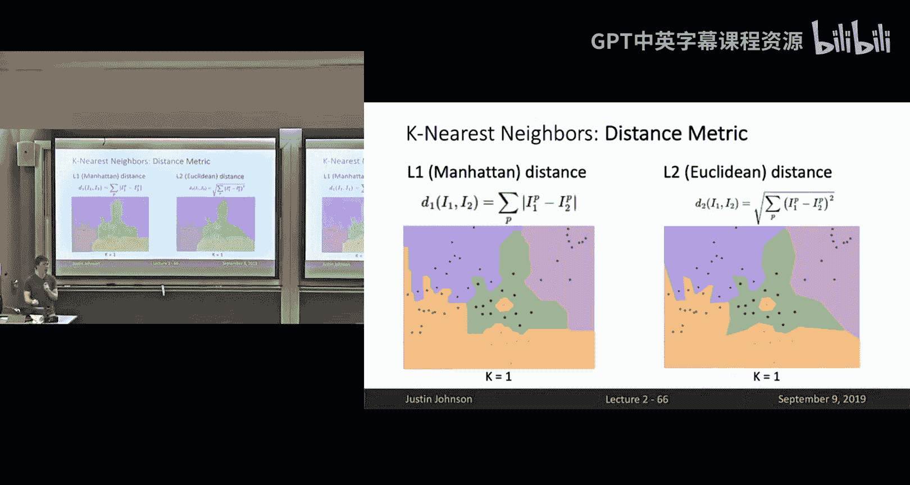

这里展示的是在CIFAR-10数据集上最近邻分类的结果。左侧列我们看到一堆测试样本，来自CIFAR-10测试集的一堆例子。然后沿着每一行，我们看到训练集中与每个测试样本的最近邻。

正如你可能直觉的那样，因为我们通过字面比较图像像素值来计算图像之间的距离，所以最近邻往往是看起来视觉上非常相似的图像。例如，看第三行，中间这个橙色斑点是我们的测试图像。然后如果你看这一行，你看到的其他图像，我们检索到的最近邻是那些中间可能有橙色或红色斑点、背景是绿色或棕色的东西。我们用来计算最近邻的这个L1距离真的不是很智能，它不知道自己在看什么。

如果我们看看这些最近邻中哪些是正确的或错误的，我们可能能感觉到这个算法表现有多差。有时仅仅通过观察很难分辨这些图像是什么，因为它们分辨率相对较低。但我尝试做的是在错误的最近邻周围画上红框，在正确的最近邻周围画上绿框。这让你感觉到，即使图像通过这个L1距离测量看起来视觉上非常相似，它们实际上有时可能有非常不同的语义含义。这在第四行可能很明显，当你看到这种被白色背景包围的棕色斑点时，我认为测试图像是一只青蛙。但它的最近邻实际上是一只猫。所以猫也是一个棕色斑点和白色背景，因此通过这个L1度量看起来视觉上非常相似，但标签不同。所以我们会做出错误的分类。

这是思考最近邻分类器在做什么的一种方式。另一种思考最近邻分类器的方式是通过决策边界的概念，我们可以在这个需要稍作解释的图中看到。

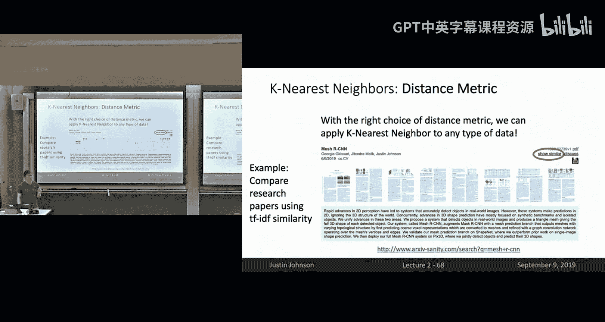

我们在这里展示的是，我们想象在具有两个像素的图像上执行最近邻分类。那么这里的x轴可能是我们一个像素的强度值，y轴是另一个像素的强度值。

现在，我们看到的这些彩色点中的每一个都是训练图像的例子，其中点的颜色可能代表训练图像的类别。也许红点是猫，蓝点是狗，等等。

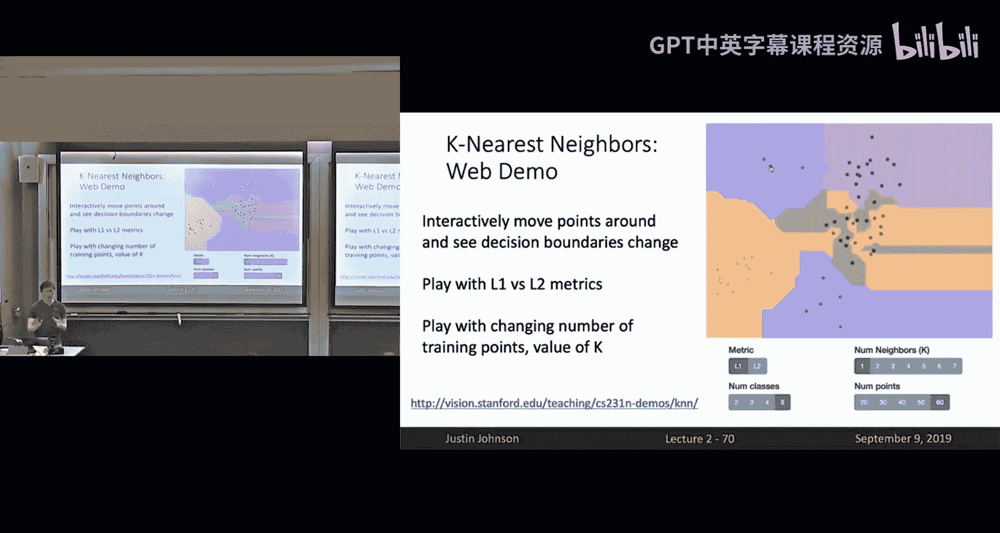

现在，背景区域的颜色表示如果我们对其中一个测试图像运行最近邻分类，将分配给该空间点的类别标签。例如，在这个红色的X处，我们可以看到训练集中最近的邻居可能是这个红点，这意味着如果我们对这个红色的X执行最近邻分类，我们将预测红色类别。

那么，这里有趣的是看不同类别之间的决策边界。我们在这里画出了空间中划分将被分类为绿色和将被分类为紫色的区域。

当我们以这种方式观察最近邻分类器时，我们可以认识到几个有趣的事情。一是这些决策区域可能非常嘈杂，并且容易受到异常值的影响。例如，我们看到在训练集中，有一个黄点位于一大堆绿点中间。也许是噪声，也许它本应被标记为绿色而不是黄色，这很难说。但当我们使用这个最近邻分类器时，这个绿点云中单个黄点的存在将导致该黄点周围的一堆测试样本被分类为黄色。这可能是好的，也可能是坏的。我们还可以在屏幕左侧看到，红色类和蓝色类之间有一个锯齿状的决策边界。同样，这是因为仅依赖最近邻来执行分类可能有点嘈杂。

那么问题是，我们能做些什么来平滑这些决策边界，也许给我们一个更稳健的分类？

## K值的影响与距离度量
上一节我们通过决策边界看到了最近邻分类器的表现，本节中我们来看看如何通过调整参数来改进它。

一个想法是简单地使用更多的邻居。到目前为止，我们讨论的最近邻分类器只是简单地复述与每个测试样本最近的训练样本所附的标签。但我们可以做的是使用不止一个最近邻。相反，我们可以考虑一组K个最近邻，然后想象某种方式组合我们K个最近检索结果的类别标签。有很多不同的方式可以想象这样做，但一个简单的想法是简单地对所有K个最近邻的类别标签进行多数投票。

那么，一旦有了最近邻分类器使用决策边界的图像，让我们看看K=1和K=3之间的一些差异。一是我们的决策边界变得平滑了很多。你可以看到，当我们使用K=1时，由于只使用一个邻居，我们的决策边界非常嘈杂。现在，如果我们在相同的数据集上使用三个邻居来执行分类，我们可以看到这两个类别之间的决策边界已经平滑了很多。

我们还可以看到，这有助于减少异常值对我们分类性能的影响。现在，即使我们仍然有一个黄点悬停在一堆绿点中，它不再影响分类区域。类似地，红色和蓝色之间的区域也因使用多于一个最近邻而变得平滑了一些。

但还有另一个问题，即当K大于1时，类别之间可能会出现平局。在这个可视化中，这些白色区域都有三个最近邻，它们都属于不同的类别。因此，你需要某种机制来打破平局。也许你可以想象基于距离的某种启发式方法，也许退一步使用一个最近邻的结果。在这种情况下，你可以想象不同的启发式方法。

当我们做最近邻分类器时，我们可能想要改变或调整的另一件事是改变我们用来计算图像之间相似度的距离度量。

到目前为止，我们讨论的是使用图像之间的L1距离，即两幅图像所有对应像素的绝对差值之和。另一个常见的选择是图像像素之间的L2或欧几里得距离。我们在这里所做的本质上是将图像的像素拉伸成一个长向量，然后想象在高维空间中计算这两幅图像点之间的欧几里得距离。

有趣的是，如果我们翻回到使用决策边界的最近邻图像，你可以看到，当我们使用不同的距离度量时，我们得到的决策边界具有定性上不同的属性。我将把这留给读者作为练习。但对于L1分类，我们可以看到所有类别之间的决策边界都由坐标轴对齐的块组成，它们要么是垂直线段，要么是水平线段，要么是45度角的线段。但当我们使用L2或欧几里得距离来计算最近邻时，现在我们的决策边界仍然是分段线性的，但这些线可以出现在输入中的任何方向。因此，使用不同的距离度量在某种程度上是你作为人类专家可以将一些你自己的人类知识嵌入到你希望算法考虑的结构中的一种方式。对于图像分类来说，L1与L2距离度量会导致什么语义差异，直觉上并不十分清楚。

## 算法的通用性与局限性
上一节我们探讨了K值和距离度量的选择，本节中我们来看看K最近邻算法的通用性及其根本局限性。

关于K最近邻算法真正有趣的是，基本上如果我们选择不同类型的距离度量，我们可以想象将K最近邻应用于几乎任何类型的数据。到目前为止，我们讨论的是使用传统的向量范数或向量度量来计算点之间的距离。但你可以想象使用非常奇怪或有趣的数据类型，并为它们编写非常复杂的距离函数，以便在许多不同的数据集上执行最近邻分类。

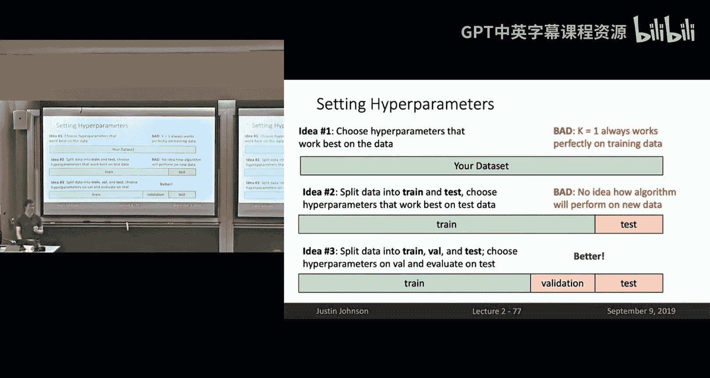

这里的一个例子是比较研究论文。有一个很酷的网站叫Archive Sanity，可以让你每天对新出现的研究论文进行有趣的探索。这个网站的一个有趣功能是，它可以显示与另一篇论文相似的论文。在这里，我在Archive Sanity上查找了我去年写的一篇名为Mesh R-CNN的论文。然后如果我们点击“显示相似”，那么它所做的基本上是在这些PDF文件上进行最近邻检索。它实现的方式是使用一个有趣的距离度量。这里的距离度量称为TF-IDF相似度（词频-逆文档频率），这在很多NLP应用中非常常用，我不会告诉你它是如何工作的，但它只是一种适用于文本片段、编码了单词在不同文档中出现频率的人类知识的距离度量。有趣的是，使用这种TF-IDF度量对研究论文进行最近邻检索实际上给出了非常好的结果。如果我查看我自己最近论文的四个最近邻，我们看到这四篇论文，它们对你来说毫无意义。但实际上，其中三篇是我们直接比较、引用并努力确保在发表论文时超越的东西。但有趣的是，这里的最近邻是我们没有引用的东西。所以也许我应该回去读一下那篇。

但这里的重点是，最近邻算法，尽管看起来相对简单，但可以相当强大，并且可以通过改变计算元素之间距离的方式，应用于相当稳健和不同类型的数据。

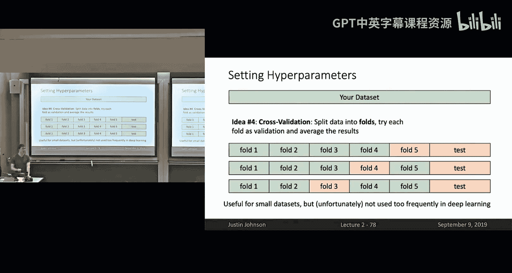

这也挺有趣的。几年前，我用JavaScript写了一个交互式网络演示，可以让你为最近邻生成这些可视化效果。你可以访问这个链接并尝试一下，可以交互式地拖动点并观察决策边界的移动。你可以更改类别数量、训练点数量、使用的最近邻K值，并可以尝试在L1和L2度量之间切换，以尝试了解所有这些选择在定性上做了什么，以及它们如何改变你的K最近邻分类器的决策边界。编写这个东西花了我两天时间，所以我真的希望有人能看看它。我认为这是一个有用的工具，可以帮助你获得一些关于这个K最近邻分类器在做什么的直觉。

## 超参数与模型评估
上一节我们看到了K最近邻算法的灵活性与一个演示工具，本节中我们来讨论算法中需要人为设定的关键选择——超参数，以及如何正确地评估模型。

到目前为止，我们已经看到了在执行K最近邻分类时必须做出的几个不同选择。我们已经看到，除了训练数据，我们需要选择一个K值，即在进行算法时要考虑多少个不同的邻居。我们还看到需要选择距离度量：应该使用L1、L2，还是尝试设计一些融入我们自己领域知识的东西？对于不同的问题，如何设置这些并不清楚。

因此，K和距离度量的这些选择，就是我们称之为超参数的例子。超参数是我们在学习算法中需要做出的选择，我们不能直接从训练数据中学习它们，因为它们以某种深刻的基本方式与算法的工作方式相互作用。这些超参数我们不能直接通过学习来设置，所以我们需要其他机制来选择哪些超参数值在我们的数据上效果最好。

不幸的是，在实践中没有很多很好的方法来选择超参数。最简单的方法是它们非常依赖于具体问题。所以我们基本上需要尝试不同的值，看看什么对我们的数据和任务最有效。

但这里有一些细微差别，关于“尝试不同值”和“决定哪个效果最好”到底意味着什么。

以下是关于如何设置超参数的几个想法：

**想法一：根据训练集准确率选择**
也许我们应该选择使我们的学习算法在训练集上给我们最高准确率的超参数值。这似乎是合理的，我们希望我们的算法表现良好。我们有一个训练集，训练集用于训练，那么也许我们应该将超参数设置为在训练集上给我们最佳性能。尽管这看起来合理，但实际上是一个可怕的想法。永远不要这样做。原因是这会导致你误入歧途。对于K最近邻分类的具体例子，如果你试图通过最大化训练集准确率来设置超参数，你总是会选择K=1。因为想象一下，如果你在K最近邻分类器中使用一个训练点，如果你使用K=1，它会尝试找到最近的训练点，也就是它自己，然后它总是返回正确的标签，所以K=1的K最近邻分类器在训练集上总是得到100%。但正如我们从一些定性例子中看到的，直觉上这可能并不正确，因为我们看到也许设置更高的K值可以使决策边界平滑，这对于某些问题实际上可能是正确的做法。但仅通过查看训练集准确率，我们永远无法知道这一点。

**想法二：根据测试集准确率选择**
也许我们需要做的是将数据分成两部分。我们可能保留大约90%的数据并称之为训练集，然后保留大约10%的数据并称之为测试集。然后我们要做的是尝试不同的超参数值，使用学习算法从训练集中学习，然后查看测试集上的准确率。然后随着我们改变超参数的值，我们将选择在测试集上效果最好的超参数值。现在，这更合理，因为使用机器学习算法的总体目标是泛化到未见过的数据。我们不关心训练集上的性能，因为我们的数据集中已经有那些标签。我们关心的是在未见过的数据上的性能，而这种方法在某种程度上给了我们算法在训练期间未见过的数据上性能的估计。但即使我告诉你这看起来很合理、很符合逻辑，这也是错误的。你不应该这样做。这实际上和直接在训练集上训练一样糟糕。如果你这样做，你会对你的学习算法的性能得出不正确的结论，因为基本上我们在这个方法中所做的是以不同的方式在测试集上学习。因为一旦你查看了测试集，你的算法就被该测试集的知识污染了，如果你以任何方式使用测试集来对你的学习算法做出决策，那么你就是在作弊，因为那样它就不再是未见过的数据，你也不再有任何关于你的算法在实际部署到野外、运行在数据集中未出现的新图像上时表现如何的估计。因此，尽管想法二看起来符合逻辑且似乎合理，但这是机器学习模型中的一个基本禁忌。如果你这样做，你在准备模型的方式上犯了一个根本性的错误。

**想法三：使用验证集**
一个更好的方法是想法三。这里我们要做的是将数据分成三个集合。我们将有一个用于训练算法的训练集，一个用于设置超参数值的验证集，然后我们保留一个测试集，只在最后使用一次。那么，基本上我们做的是：在训练集上训练我们的算法，尝试不同的超参数值，通过检查验证集上的准确率来评估不同超参数值的性能，然后我们选择在验证集上具有最高性能的超参数值。现在，一旦你为所有超参数选择了这些值，一旦你固定了一切，那么只有在管道的最后，你才接触测试集，而且只接触一次，你在测试集上只运行一次算法。这给了你一个单一的数字，现在它给了你一个关于算法在真正未见过的数据上性能的非常恰当的估计。

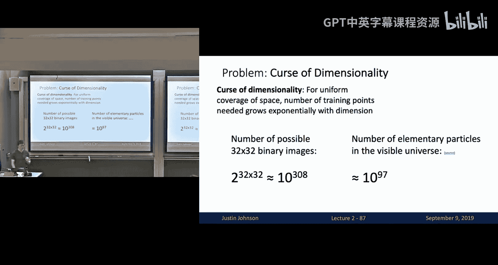

尽管这是正确的做法，但在实践中这实际上非常可怕。当你写研究论文时，你已经在这个项目上工作了几个月，甚至几年。在整个过程中，你一直在调整你的算法，精心地改进它。在整个算法开发过程中，作为一个优秀的机器学习实践者，你从未接触过测试集，你只评估验证集。然后是截止日期的那一周，你所有的辛勤工作终于有了成果，终于到了看看你的算法实际表现如何的时候了。在截止日期前一周是你唯一应该在测试集上运行它的时候，尽管这很可怕，你会想：如果我的数字不好怎么办？如果我毕生的心血都浪费在这个算法上了怎么办？嗯，如果事实证明你在测试集上表现不佳，那意味着你的算法不好，也许不应该发表。所以这实际上在实践中非常可怕，但这是进行机器学习和数据处理的正确方式，项目可能因为做错这一点而失败。如果你做错了，你不仅可能让论文被接受，而且会从根本上不诚实地描述你的算法在野外的表现。而这实际上是构建机器学习模型的全部意义所在。因此，尽管这很可怕，但这是正确的事情，当你在处理机器学习问题时，你应该总是这样做。

## 交叉验证
上一节我们介绍了使用训练集、验证集和测试集的标准流程，本节中我们来看看一种更稳健的超参数选择方法——交叉验证。

我们说过想法三更好。在想法三中，基本技巧是将数据分成三块，但我们可以做得更好。为什么停在那里？我们可以将数据分成更多块，并获得对泛化性能的更好估计。

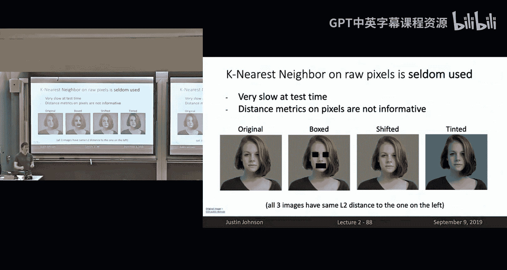

这就是想法四，称为交叉验证，这可能是我们应该都做的最好的想法。这里的理念是，我们将数据分成许多不同的块，称为折（fold）。现在我们要做的是遍历它们，在这个例子中我们有五折，所以我们将尝试算法的五个不同版本：一个使用第5折作为验证集并在第1到4折上训练；一个使用第4折作为验证集并在第1、2、3、5折上训练，等等。然后你可以做的是，现在你对超参数在未见过的数据上的表现有了稍微更稳健的了解，因为现在对于每个超参数设置，你每个折可能得到一个样本，然后也许你可以使用某个指标（例如所有折上的最高准确率）来选择你的最佳超参数。这可能是选择超参数最稳健的方式，但成本相当高，因为它需要实际在数据的许多不同折上训练你的算法。因此，尽管这绝对是你在实践中最正确的事情，但在大多数机器学习项目中通常不会这样做，仅仅是因为对于许多模型来说训练可能非常非常昂贵。但如果你使用较小的模型或较小的数据集，或者如果你在计算上负担得起，那么某种交叉验证确实是为你机器学习模型设置超参数的正确方法。

当你运行交叉验证时，最终会得到像这样的图。那么这里，也许X轴是我们的一个超参数K的不同值，Y轴上我们看到每个点是在我们运行算法的不同试验中，每个超参数设置的验证集性能之一。那么，这是对K进行5折交叉验证的例子，这里的线可能给出了每个超参数设置下所有折的平均值。那么在这里我们可以看到，也许在K约等于7时达到峰值。那么基于这个交叉验证的例子，K=7是为这个超参数设置的正确值，然后我们应该运行我们的模型。那么一旦我们设置了K=7这个值，我们应该然后在测试集上只运行一次我们的模型，这就是我们为算法报告的数字。

## 算法的理论性质与维度灾难
上一节我们介绍了交叉验证这种更稳健的评估方法，本节中我们来看看K最近邻算法的一个有趣理论性质及其根本限制。

K最近邻算法的另一个有趣特性是这种通用逼近性质。真正有趣的是，K最近邻实际上对其所能表示的函数类型做了很少的假设。事实上，当我们将训练样本数量趋近于无穷大时，K最近邻实际上可以表示任何函数。当然，这里的“任何”带有数学上的星号，因为每当你做出这样的陈述时，上过实分析课程的人就会开始指出它可能失败的所有边界情况。所以我在这里试图稍微掩饰一下。但基本上，对于你在自然界中可能遇到的所有实际函数，你可以预期这工作得相当好。作为K最近邻这种通用逼近性质如何工作的直观例子，这里有一个使用最近邻方法进行连续值预测的例子。这里我们可能有一个单像素图像，所以只是一个单一的浮点数作为我们的输入X。现在我们想预测一个单一的浮点数Y。那么这里的蓝色曲线显示了我们希望机器学习模型学习的一些底层真实函数。但我们只能访问有限数量的数据样本。这里，黑点代表来自这个底层真实函数的有限数量的样本。

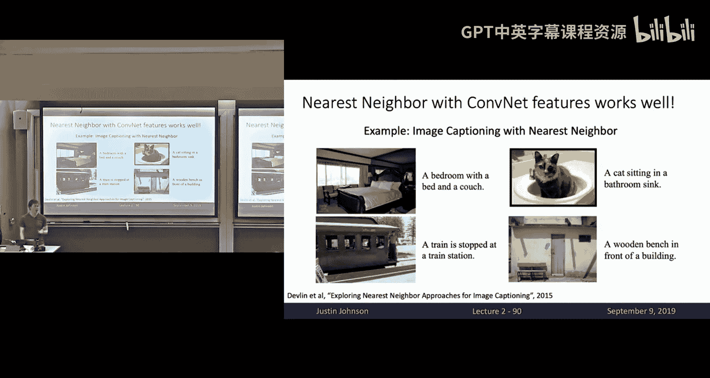

现在，绿色曲线表示一个最近邻分类器（在这种情况下，我想是一个最近邻回归器）的值。如果我们使用这个有限的训练样本来近似这个底层真实函数，并且因为它是一个最近邻，它在每个训练样本周围有一个平坦的常数区域，并且在恰好两个训练样本之间的任何地方都有不连续性。

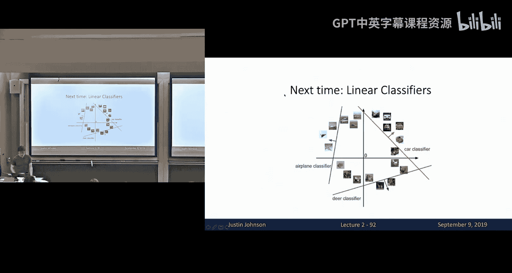

这个例子只使用了五个点进行训练，所以我们函数